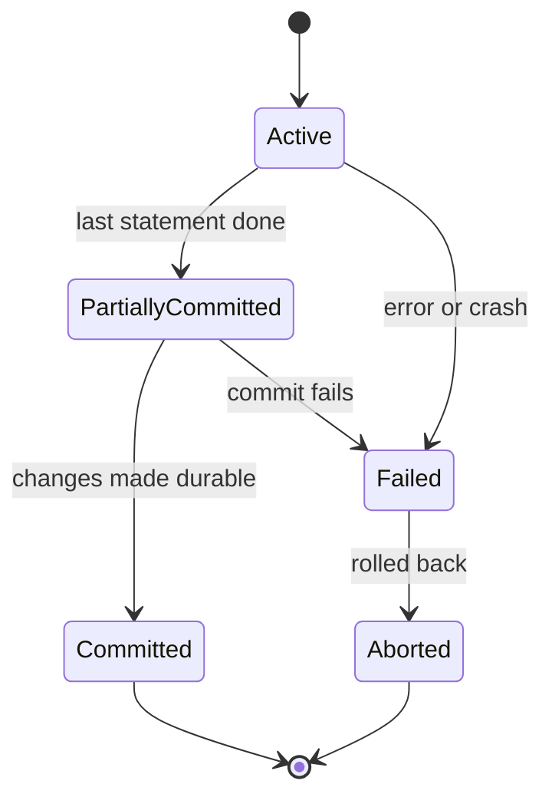
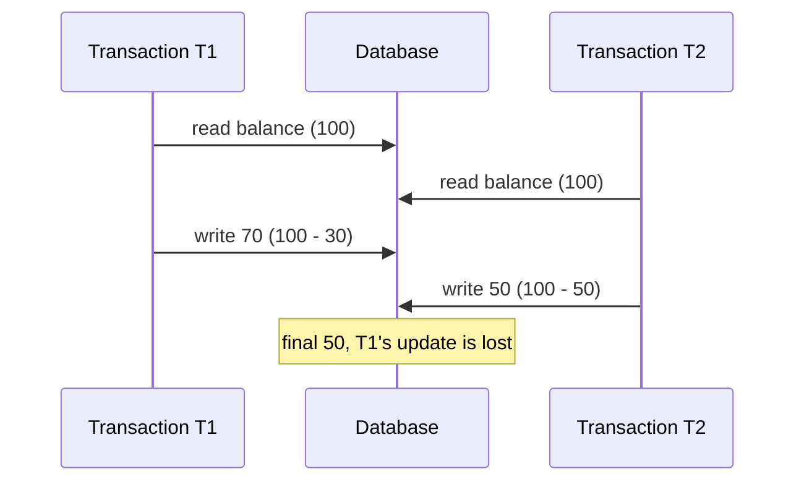

ACID and BASE are a standard interview pair. Expect these questions:

- What does each letter of ACID mean?
- What are the isolation levels, and which problems does each one allow?
- How do you prevent a lost update?
- What is the difference between ACID and BASE, and how do they relate to CAP?

The first half of the lesson covers ACID: the guarantees a database on one server gives you. The second half covers BASE: what distributed and NoSQL systems give up in exchange for staying available.

Related lessons: [distributed systems fundamentals](lesson:distributed-systems) (CAP and consistency models), the [Saga pattern](lesson:saga) (what to use when ACID cannot span several services) and [Java concurrency](lesson:java-concurrency) (the same ideas as locks and atomic variables). The examples use bank accounts.

The animation has four scenes: atomicity and durability, the lost update, write skew, and BASE.

```demo
name: acid-walk
```

> **One sentence to remember:** *ACID makes a transaction all or nothing, safe and permanent, while BASE stays available and lets copies agree later.*

## Transactions {#transactions}

### What a transaction is {#what}

A **transaction** is a group of operations treated as **one unit of work**: either they all take effect, or none of them do. The classic example is a transfer, which takes money from one account (a debit) and adds it to another (a credit).

In SQL:

- `BEGIN` starts a transaction. Some databases start one automatically.
- `COMMIT` makes the changes permanent.
- `ROLLBACK` undoes them.
- `SAVEPOINT` marks a point you can roll back to, so you can undo part of a transaction.



## ACID {#acid}

### Atomicity {#atomicity}

**All or nothing.** If any step fails, every change the transaction made is undone. A step can fail because of an exception, a broken constraint or a crash. So a half-finished state is never visible and never stored.

Databases implement it in two ways:

- An **undo log** keeps the old values, so changes can be reversed.
- **MVCC** never overwrites committed data in place (explained below).

On top of that, crash recovery uses the **write-ahead log**. Atomicity is about *failure*, not about transactions running at the same time.

### Consistency {#consistency}

**A transaction moves the database from one valid state to another valid state.** "Valid" means all **integrity rules** hold:

- primary keys and foreign keys;
- unique and check constraints;
- triggers;
- business rules (invariants), such as "a balance is never negative" or "the two sides of a transfer add up to the same total".

The database enforces the constraints you declare. The **application** is responsible for the rest, because the database cannot know your business rules.

Do not confuse this "C" with the **C in CAP**. In CAP, consistency means *every copy returns the latest write* (linearizability). That is about copies of data, not about rules.

### Isolation {#isolation}

**Transactions running at the same time do not interfere.** The result is as if they had run one after another, which is called serializable.

Perfect isolation is expensive. So databases offer **isolation levels** that give up some guarantees in exchange for more concurrency (see below). Isolation is about *concurrency*.

### Durability {#durability}

**Once a transaction is committed, its changes survive crashes and power loss.**

Databases implement it with the **write-ahead log (WAL)**:

1. Every change is first written to a log, one entry after another.
2. The log is **flushed to disk (`fsync`) before the database reports that the commit succeeded**.
3. The data pages themselves can be written to disk later.
4. On restart, recovery reads the log. It redoes committed work and undoes work that was not committed.

Replication to another server extends durability to the loss of a whole machine. Synchronous replication waits for the other server. Asynchronous replication does not wait, so it can lose the last few writes.

Some settings trade durability for speed, such as PostgreSQL's `synchronous_commit` or InnoDB's `innodb_flush_log_at_trx_commit`.

### How databases implement it {#implementation}

| Mechanism | What it provides |
| --- | --- |
| **Write-ahead log (WAL), with redo and undo** | It provides atomicity, durability and crash recovery. |
| **Locks (shared and exclusive; on a row, a range or a table)** | They provide isolation by blocking conflicting access. **Two-phase locking** holds every lock until the commit. |
| **MVCC** (multi-version concurrency control) | It provides isolation without readers blocking writers. Each transaction reads a **snapshot** of committed versions (PostgreSQL, Oracle, MySQL InnoDB). |
| **Constraints and triggers** | They provide consistency. |
| **Deadlock detection and timeouts** | They resolve transactions that wait on each other, by stopping one of them. |

With **MVCC**, the database keeps several versions of each row. Readers never block writers, and writers never block readers. Conflicts between two writers are still caught, by a row version or a lock.

A **deadlock** happens when T1 holds A and wants B, while T2 holds B and wants A. The database detects it and aborts one transaction. To avoid deadlocks, take locks in the same order every time, and retry the aborted transaction (the "victim").

## Isolation levels {#levels}

### Anomalies {#anomalies}

These problems can appear when transactions run at the same time and their steps interleave:

| Anomaly | What happens |
| --- | --- |
| **Dirty read** | A transaction reads data that another transaction wrote but has not committed yet. That other transaction may still roll back. |
| **Non-repeatable read** | A transaction reads the same row twice and gets different values, because another transaction committed a change in between. |
| **Phantom read** | A transaction runs the same query twice and gets a different **set of rows**, because another transaction inserted or deleted matching rows. |
| **Lost update** | Two transactions read a value and both write a new value based on it, so one overwrites the other. |
| **Write skew** | Two transactions read the same data, each updates a **different** row based on it, and together they break a rule. The joint account in the demo is an example. |

### The four standard levels {#four-levels}

| Level | Dirty read | Non-repeatable read | Phantom |
| --- | --- | --- | --- |
| **Read uncommitted** | possible | possible | possible |
| **Read committed** | prevented | possible | possible |
| **Repeatable read** | prevented | prevented | possible (standard) |
| **Serializable** | prevented | prevented | prevented |

In interviews, this table is usually read as "what each level allows". Real databases differ from the standard in important ways:

- **PostgreSQL:**
  - The default is **read committed**.
  - There is no real read uncommitted. It is treated as read committed.
  - **Repeatable read is snapshot isolation.** It prevents phantoms, but **write skew** is possible.
  - **Serializable** uses SSI (serializable snapshot isolation). It detects dangerous patterns and aborts a transaction with a serialization failure, which you retry.
- **MySQL InnoDB:**
  - The default is **repeatable read**.
  - Plain reads use a consistent snapshot. Locking reads use next-key (gap) locks, which prevent most phantoms.
  - A plain read followed by a write can still lose updates.
- **Oracle:** read committed is the default. Its "serializable" is really snapshot isolation.
- **SQL Server:** read committed with locks is the default, and snapshot isolation is optional.

Higher levels cost more: more blocking, or more aborts and retries. A common choice is **read committed**, plus explicit locks or optimistic versioning where it matters. Use **serializable** for rules that span several rows, if retry handling is in place.

Always check your database's documentation. The names are the same, but the behaviour is not.

### Preventing lost updates {#lost-update}



There are four options, from simplest to heaviest:

1. **An atomic update in SQL.** `UPDATE account SET balance = balance - 30 WHERE id = 1 AND balance >= 30` reads and writes in one statement. Check how many rows it changed.
2. **Pessimistic locking.** `SELECT ... FOR UPDATE` locks the row until the commit, so other transactions wait. It is safe when many transactions compete for the same row, but it blocks and can cause deadlocks.
3. **Optimistic locking.** Add a `version` column. Update only `WHERE version = ?`, and increase the version. If zero rows change, someone else changed the row first, so retry. It is best when conflicts are rare, because no lock is held while a user is thinking.
4. **A higher isolation level.** In PostgreSQL, repeatable read aborts the second writer. Serializable detects the conflict in general.

## In Java and Spring {#spring}

### @Transactional {#transactional}

```java
@Service
class TransferService {

    @Transactional                                         // starts a transaction, commits on return, rolls back on RuntimeException
    public void transfer(long from, long to, BigDecimal amount) {
        Account a = accounts.findById(from).orElseThrow();
        Account b = accounts.findById(to).orElseThrow();
        a.debit(amount);                                    // throws InsufficientFunds (a RuntimeException): everything rolls back
        b.credit(amount);
    }
}
```

Points interviewers ask about:

- **It works through a proxy.** A proxy is a wrapper object that Spring puts around your bean. Calls from **another bean** go through it. A call from a method in the **same class** (self-invocation), or to a `private` method, **skips** the proxy, so there is no transaction.
- **Rollback rule.** By default, only **unchecked exceptions** (`RuntimeException` and `Error`) cause a rollback. A checked exception **commits**, unless you set `rollbackFor = Exception.class`. Catching the exception with `try/catch` inside the method also commits.
- **Propagation** decides what happens when a transaction already exists:
  - `REQUIRED` (the default) joins the existing transaction, or starts one.
  - `REQUIRES_NEW` pauses the current transaction and starts an independent one, which commits on its own.
  - `NESTED` uses a savepoint inside the current transaction.
  - `SUPPORTS`, `MANDATORY`, `NEVER` and `NOT_SUPPORTED` cover the remaining cases.
- **Isolation and readOnly** are set like this: `@Transactional(isolation = Isolation.SERIALIZABLE, readOnly = true, timeout = 5)`. `readOnly` is only a hint. It lets the driver or Hibernate skip dirty checking, and it may send the query to a replica.
- **Keep transactions short.** Do not call remote services or wait for user input inside one, because locks and connections stay held. The transaction belongs to the **thread**, so work handed to another thread runs outside it.
- **JPA keeps changes in memory first.** It holds them in the persistence context and **flushes** them to the database at commit, or before a query. It **dirty-checks** managed entities, which means it compares them with their original state to find changes.

### Optimistic and pessimistic locking in JPA {#jpa-locks}

```java
@Entity
class Account {
    @Id Long id;
    BigDecimal balance;

    @Version Long version;                 // Hibernate adds "WHERE version = ?" to updates and increments it
}

// a conflicting concurrent update fails with ObjectOptimisticLockingFailureException: retry it
@Retryable(retryFor = ObjectOptimisticLockingFailureException.class, maxAttempts = 3)
@Transactional
public void withdraw(long id, BigDecimal amount) { ... }

// pessimistic: SELECT ... FOR UPDATE
public interface AccountRepository extends JpaRepository<Account, Long> {
    @Lock(LockModeType.PESSIMISTIC_WRITE)
    @Query("select a from Account a where a.id = :id")
    Optional<Account> lockById(@Param("id") long id);
}
```

### Plain JDBC {#jdbc}

```java
try (Connection con = dataSource.getConnection()) {
    con.setAutoCommit(false);
    con.setTransactionIsolation(Connection.TRANSACTION_READ_COMMITTED);
    try {
        debit(con, from, amount);
        credit(con, to, amount);
        con.commit();
    } catch (Exception e) {
        con.rollback();
        throw e;
    }
}
```

## BASE {#base}

### What BASE means {#base-meaning}

**BASE** is the opposite approach, used by many distributed and NoSQL systems. It was described by Eric Brewer and colleagues, and in "BASE: An ACID alternative" (Pritchett, 2008).

- **Basically Available:** the system keeps answering requests even when parts of it fail or are cut off from each other. The answer may be degraded or stale, but the system does not refuse.
- **Soft state:** the state can change over time even with no new input, because copies are still catching up. There is no single value that is correct everywhere at every moment.
- **Eventually consistent:** if updates stop, all copies end up with the same state. Until then, reads may see stale or different values.

BASE is what choosing **availability over consistency** in [CAP](lesson:distributed-systems#cap-theorem) looks like in practice (the AP side). It also means choosing low latency over strong consistency in [PACELC](lesson:distributed-systems#pacelc). The name is a chemistry joke: acid versus base.

### ACID versus BASE {#compare}

| | ACID | BASE |
| --- | --- | --- |
| Consistency | It is strong and immediate. | It is eventual. |
| Availability when the network splits | The system may refuse requests (CP). | The system stays up (AP). |
| Isolation | Transactions appear to run one after another. | There is none. Concurrent updates are merged later. |
| Scale | A bigger machine, or careful sharding. | Many machines, with data partitioned and replicated. |
| Failure handling | Roll back. | Compensate, retry and reconcile. |
| Typical stores | PostgreSQL, MySQL, Oracle, SQL Server. | Cassandra, DynamoDB (by default), Riak and many caches. |
| Fits | Money, inventory counts, identity, and anything with hard rules. | Feeds, carts, counters, analytics, search indexes and caches. |
| Work for the developer | The database enforces the rules. | The application handles stale data and conflicts. |

They are two ends of a range, not two separate camps:

- **Many NoSQL stores now offer ACID transactions**, such as MongoDB multi-document transactions, DynamoDB transactions and FoundationDB.
- **Distributed SQL databases**, such as Google Spanner, CockroachDB and YugabyteDB, give strong consistency across machines using consensus, at the price of latency.
- A relational database with asynchronous read replicas is already BASE for reads.

### Living with BASE {#living}

Eventual consistency is safe only if the design plans for it:

- **Idempotent operations:** repeating an operation has no extra effect. Use message ids so retries and duplicates are harmless ([idempotent receiver](lesson:messaging#idempotent)).
- **Versioning and conflict resolution:** use version numbers, vector clocks, CRDTs (data types that merge automatically) or merges based on business rules ([conflicts](lesson:distributed-systems#conflicts)).
- **Session guarantees:** give users read-your-writes and monotonic reads, by sending a user to the same replica or by tracking a version.
- **Sagas and compensation** instead of one big transaction ([Saga pattern](lesson:saga)), and the **outbox** for reliable events ([outbox](lesson:microservice-patterns#outbox)).
- **Reconciliation:** jobs that run regularly to compare and repair data, for example ledger totals.
- **Show uncertainty in the UI**, with states such as "pending" and "processing".
- **Keep the core ACID:** use a strongly consistent store for the part that moves money, and BASE for read models and secondary data.

### ACID across services {#distributed}

One database gives you ACID. A business transaction that spans several services does not get it. There are three options:

1. **Two-phase commit** is atomic, but it blocks and ties the services together ([2PC](lesson:distributed-systems#two-pc)).
2. **Sagas** are a sequence of local ACID transactions with compensating steps. The services are eventually consistent with each other.
3. **A distributed SQL database** gives ACID across machines.

In microservices, the usual answer is local ACID transactions plus sagas and the outbox.

Try it in the lab: [Isolation anomalies: dirty, non-repeatable, phantom](lab:acid-isolation-anomalies).

## Cheat sheet {#cheatsheet}

| Topic | Key point |
| --- | --- |
| Atomicity | All or nothing, using the undo log, the WAL and rollback. |
| Consistency | From one valid state to another, using constraints and business rules. It is not the CAP "C". |
| Isolation | Concurrent transactions do not interfere. The levels trade safety for concurrency. |
| Durability | Committed data survives crashes, because the WAL is flushed before the commit is confirmed. |
| Anomalies | Dirty read, non-repeatable read, phantom, lost update and write skew. |
| Levels | Read uncommitted, read committed, repeatable read and serializable. |
| Defaults | PostgreSQL uses read committed. MySQL InnoDB uses repeatable read. |
| Lost update fixes | An atomic `UPDATE`, `FOR UPDATE`, `@Version` or a higher isolation level. |
| `@Transactional` traps | It works only through the proxy, self-invocation and private methods skip it, and only unchecked exceptions roll back. |
| BASE | Basically available, soft state, eventually consistent. |
| ACID vs BASE | Strong consistency and isolation, versus availability and scale. |
| Across services | Use sagas, the outbox and idempotency, not 2PC. |

## Interview questions {#questions}

### [basic] What does ACID stand for? {#acid-q}

Four guarantees that make transactions reliable:

1. **Atomicity:** a transaction is all or nothing.
2. **Consistency:** it takes the database from one valid state to another, keeping the integrity rules.
3. **Isolation:** transactions running at the same time do not interfere, as if they ran one after another.
4. **Durability:** once committed, the changes survive crashes.

Together they make transactions safe for data where correctness is critical, such as money.

### [basic] What is a transaction? {#transaction-q}

A group of operations that run as one unit: they all commit, or they all roll back.

It starts with `BEGIN` and ends with `COMMIT` or `ROLLBACK`. It gives the ACID guarantees, so a failure in the middle never leaves partial results visible or stored.

Example: a transfer debits one account and credits another. Either both happen, or neither does.

### [basic] How does a database guarantee atomicity and durability? {#wal-q}

With a **write-ahead log (WAL)**.

1. Every change, with its old and new values, is written to a log, one entry after another.
2. The log is flushed to disk before the commit is confirmed.
3. After a crash, recovery uses the log. It undoes transactions that have no commit record, which gives atomicity. It redoes committed transactions whose data pages were not written yet, which gives durability.

A rollback uses the same undo information.

### [basic] What is the difference between the C in ACID and the C in CAP? {#c-vs-c}

They share a name, not a meaning.

- **In ACID**, consistency means a transaction keeps the database's integrity rules: from one valid state to another. The application and the database enforce it together.
- **In CAP**, consistency means linearizability: every read returns the most recent write. It is a property of copied data when the network splits.

### [basic] What are dirty, non-repeatable and phantom reads? {#anomalies-q}

They are three problems that weaker isolation levels allow:

- A **dirty read** sees changes from another transaction that has not committed yet, and might roll back.
- A **non-repeatable read** reads the same row twice and gets different values, because another transaction committed a change in between.
- A **phantom read** runs the same query twice and gets a different set of rows, because another transaction inserted or deleted matching rows.

### [basic] What is BASE? {#base-q}

An alternative to ACID for distributed systems:

- **Basically Available:** the system keeps answering during failures.
- **Soft state:** the state may change while copies catch up.
- **Eventually consistent:** if writes stop, all copies end up agreeing.

It gives up immediate consistency and isolation, and in return gets availability, tolerance of network splits and the ability to scale across machines.

### [basic] When would you use ACID and when BASE? {#when-q}

Use ACID where correctness is a hard rule, and BASE where slightly stale data is acceptable.

- **ACID** suits payments, account balances, orders being committed, stock reservations and identity.
- **BASE** suits feeds, recommendations, caches, counters, analytics and search indexes, which need scale and availability.

Many systems use both: a strongly consistent core, with eventually consistent read models and integrations around it.

### [intermediate] Explain the isolation levels and what each prevents. {#levels-q}

Each level prevents one more problem than the level below it:

1. **Read uncommitted** allows dirty reads.
2. **Read committed** prevents dirty reads.
3. **Repeatable read** also prevents non-repeatable reads. The standard allows phantoms, though some databases prevent them.
4. **Serializable** prevents all anomalies. It behaves as if transactions ran one at a time.

Higher levels give stronger guarantees, but cost more blocking or more aborts and retries. Real databases differ: PostgreSQL's repeatable read is snapshot isolation, and MySQL's uses gap locks. Check the documentation.

### [intermediate] What is MVCC and why is it used? {#mvcc-q}

**MVCC (multi-version concurrency control)** keeps several versions of each row. A transaction reads from a consistent snapshot: the versions that were committed when the transaction, or the statement, began.

It is used because readers do not block writers and writers do not block readers, so more work runs at the same time. Conflicts between two writers are still detected through locks or version checks.

Old versions are cleaned up later, by vacuum in PostgreSQL and by purge in InnoDB.

### [intermediate] What is a lost update and how do you prevent it? {#lost-update-q}

Two transactions read the same value, each calculates a new value, and each writes it back. The second write overwrites the first, so one change is lost.

Example: the balance is 100. T1 withdraws 30 and writes 70. T2 withdraws 50 and writes 50. The balance should be 20.

Prevent it with one of these:

1. An atomic update statement, such as `balance = balance - x`.
2. Pessimistic locking with `SELECT FOR UPDATE`.
3. Optimistic locking with a version column, and a retry on conflict.
4. A higher isolation level that detects the conflict and aborts one transaction.

### [intermediate] What is write skew and why does snapshot isolation allow it? {#write-skew-q}

Two transactions read the same data, decide based on it, and write to **different** rows. Neither overwrites the other, yet together they break a rule.

Example: two sub-accounts must stay at or above zero in total. Two withdrawals, one from each sub-account, each see enough money and both succeed.

Snapshot isolation allows it because it only detects conflicts on the **same** row. Here the rows are different, so both transactions commit.

Prevent it with one of these:

- serializable isolation, which detects the read-write dependency;
- explicit locks on the rows that were read;
- a constraint, or a single row that holds the total.

### [intermediate] Optimistic versus pessimistic locking: when to use which? {#locking-q}

Optimistic when conflicts are rare, and pessimistic when they are common.

- **Optimistic locking** reads without locks. At update time it checks a version (`WHERE version = ?`) and retries if the check fails. It holds no locks and scales well, so it suits web requests and low contention.
- **Pessimistic locking** locks rows when it reads them (`FOR UPDATE`), so others wait. It avoids retries and suits high contention or short critical sections. The cost is blocking and a risk of deadlocks.

### [intermediate] What are the common @Transactional pitfalls in Spring? {#transactional-pitfalls}

The common ones are:

1. **Self-invocation and private methods** skip the proxy, so no transaction applies.
2. **Only unchecked exceptions roll back by default.** Use `rollbackFor` for checked ones.
3. **Catching the exception inside the method** hides it, so the transaction commits.
4. **`REQUIRES_NEW` commits on its own**, separately from the outer transaction.
5. **`readOnly` is only a hint.**
6. **Long transactions** hold connections and locks, especially with remote calls inside them.
7. **Lazy loading outside the transaction** fails.
8. **The transaction belongs to the thread**, so async work runs outside it.

### [intermediate] What are the transaction propagation types? {#propagation-q}

Propagation decides what a method does when a transaction may already exist:

- `REQUIRED` (the default) joins the existing transaction, or creates one.
- `REQUIRES_NEW` pauses the current one and starts a new, independent one.
- `NESTED` uses a savepoint inside the current one.
- `SUPPORTS` uses a transaction if there is one.
- `MANDATORY` requires an existing one.
- `NOT_SUPPORTED` runs without one.
- `NEVER` fails if one exists.

A typical use of `REQUIRES_NEW` is audit logging that must be saved even if the main transaction rolls back.

### [intermediate] How does a deadlock happen and how do you handle it? {#deadlock-q}

Two transactions each hold a lock that the other needs, so both wait forever. Example: T1 locks account A and then wants B, while T2 locks B and then wants A.

The database detects the cycle and aborts one transaction (the victim) with an error.

Reduce deadlocks by:

1. always taking locks in the same order;
2. keeping transactions short;
3. using suitable isolation levels and indexes, so fewer rows are locked;
4. retrying the aborted transaction.

### [intermediate] How are ACID and CAP related? {#acid-cap-q}

They describe different things.

- **ACID** is about transactions in a database: reliability and isolation.
- **CAP** is about copied data when the network splits: consistency versus availability.

An ACID database on one server does not deal with network splits. A distributed database that wants strong consistency becomes CP: the smaller side of a split refuses requests. BASE systems choose AP.

"ACID means CP and BASE means AP" is a useful approximation, not a rule.

### [deep] Can a NoSQL database be ACID, and can a relational database be BASE? {#nosql-acid-q}

**Yes, both.**

- MongoDB, DynamoDB and FoundationDB provide ACID transactions across several documents or items.
- Distributed SQL systems, such as Spanner and CockroachDB, give strong consistency across machines using consensus.
- A relational database with asynchronous read replicas, or with caches, serves eventually consistent reads.

The label follows the guarantees you configure and use, not the data model.

### [deep] How do you achieve consistency across microservices without distributed transactions? {#cross-service-q}

Use a local ACID transaction in each service, and coordinate the services with sagas.

1. A **saga** is a sequence of local transactions, each with a compensating action that undoes it.
2. The **outbox pattern** publishes events reliably.
3. **Idempotent consumers** handle duplicate messages safely.
4. **Reconciliation** jobs find and repair differences.

Accept eventual consistency between services, and design the UI and APIs for pending states.

Two-phase commit is avoided because it blocks, ties the services together and is poorly supported by message brokers.

### [deep] What is the cost of Serializable isolation and how do databases implement it? {#serializable-q}

The cost is blocking, or aborts and retries. There are three ways to implement it:

1. **Two-phase locking with predicate or range locks.** Readers and writers block each other, which causes high contention and deadlocks.
2. **Serial execution.** One thread runs everything for a partition, as in some in-memory databases.
3. **Serializable snapshot isolation (SSI),** as in PostgreSQL. Transactions run on snapshots, and the database tracks read-write dependencies. When it finds a dangerous cycle, it aborts a transaction.

So applications must handle serialization failures by retrying.

### [coding] What is wrong with this transactional code? {#coding-bug}

```java
@Service
class PaymentService {

    public void process(Payment p) {
        record(p);                         // self-invocation: no transaction
    }

    @Transactional
    public void record(Payment p) throws IOException {
        payments.save(p);
        audit.write(p);                    // may throw a checked IOException
    }
}
```

There are two bugs:

1. `process` calls `record` on `this`, so the call skips the proxy and `@Transactional` has no effect.
2. Even if the transaction applied, `IOException` is a checked exception, and the default is to commit. So `save` would stay committed even though the audit failed.

The fix:

- Call `record` from another bean, or move the annotation to the entry method.
- Use `@Transactional(rollbackFor = Exception.class)`, or throw an unchecked exception.

### [coding] Prevent overdrafts with an atomic update. {#coding-atomic}

```java
@Modifying
@Query("update Account a set a.balance = a.balance - :amount where a.id = :id and a.balance >= :amount")
int withdraw(@Param("id") long id, @Param("amount") BigDecimal amount);

@Transactional
public void withdraw(long id, BigDecimal amount) {
    if (accounts.withdraw(id, amount) == 0) {
        throw new InsufficientFundsException(id);        // zero rows: account missing or balance too low
    }
}
```

How it works:

- The check and the write happen in one statement. There is no gap between reading and writing, so there is no lost update and no overdraft.
- The database locks the row while the statement runs.
- The number of changed rows shows failure: zero rows means the account is missing or the balance is too low.

### [coding] Implement optimistic locking with retry in Spring. {#coding-optimistic}

```java
@Entity
class Account {
    @Id Long id;
    BigDecimal balance;
    @Version Long version;
    void debit(BigDecimal a) {
        if (balance.compareTo(a) < 0) throw new InsufficientFundsException(id);
        balance = balance.subtract(a);
    }
}

@Service
class WithdrawalService {
    @Retryable(retryFor = ObjectOptimisticLockingFailureException.class, maxAttempts = 3, backoff = @Backoff(delay = 50))
    @Transactional
    public void withdraw(long id, BigDecimal amount) {
        accounts.findById(id).orElseThrow().debit(amount);   // flush issues: UPDATE ... SET balance=?, version=version+1 WHERE id=? AND version=?
    }
}
```

How it works:

- If another transaction changed the row, the version check fails (zero rows change), and Hibernate throws an optimistic locking exception.
- The retry reads the fresh row again in a new transaction. That is why `@Retryable` must wrap the transactional method, not sit inside it.
- After the last attempt, the error is passed to the caller.
