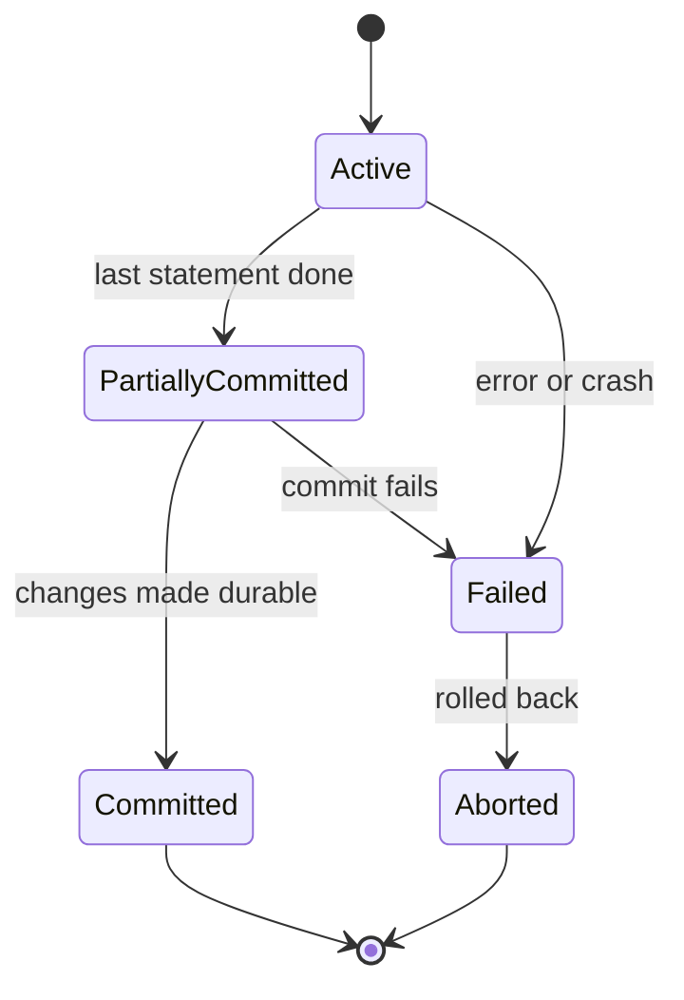
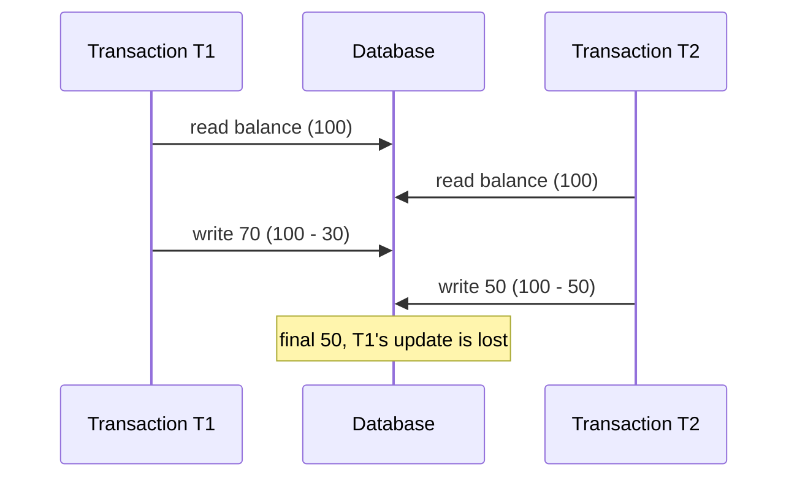

ACID versus BASE is a standard interview pair: *what does each letter of ACID mean, what are the isolation levels and anomalies, how do you prevent a lost update, what is the difference between ACID and BASE, and how do they relate to CAP?* The first half is the guarantee single-node databases give you, the second half is what distributed and NoSQL systems relax. It connects to [distributed systems fundamentals](lesson:distributed-systems) (CAP, consistency models), the [Saga pattern](lesson:saga) (what you use when ACID cannot span services) and [Java concurrency](lesson:java-concurrency) (the same ideas as locks and atomics). Examples use bank accounts. Play the four scenes: atomicity and durability, lost update, write skew, and BASE.

```demo
name: acid-walk
```

> **One sentence to remember:** *ACID makes a transaction all-or-nothing, rule-preserving, isolated from concurrent ones and permanent; BASE gives up immediate consistency and isolation to stay available and scalable, and converges later.*

## Transactions {#transactions}

### What a transaction is {#what}

A **transaction** is a group of operations treated as **one logical unit of work**: they all take effect or none do. Classic example: a transfer debits one account and credits another. In SQL you mark it with `BEGIN` (or an implicit start), then `COMMIT` to make the changes permanent or `ROLLBACK` to undo them. `SAVEPOINT` lets you roll back part of a transaction.



## ACID {#acid}

### Atomicity {#atomicity}

**All or nothing.** If any step fails (an exception, a constraint violation, a crash), every change made by the transaction is undone, so no half-finished state is ever visible or stored. Implemented with an **undo log** or by never overwriting committed data in place (MVCC), plus crash recovery from the **write-ahead log**. Atomicity concerns *failure*, not concurrency.

### Consistency {#consistency}

**A transaction moves the database from one valid state to another**, where "valid" means all **integrity rules** hold: primary and foreign keys, unique and check constraints, triggers, and application invariants (balance is not negative, the two sides of a transfer sum to the same total). The database enforces the declared constraints; the **application** is responsible for the rest, because the database cannot know your business rules. Do not confuse this "C" with the **C in CAP**, which means *every replica returns the latest write* (linearizability), a property about replicas, not about invariants.

### Isolation {#isolation}

**Concurrent transactions do not interfere**: the result is as if they had run one after another (serializably). Perfect isolation is expensive, so databases offer **isolation levels** that trade correctness guarantees for concurrency (below). Isolation concerns *concurrency*.

### Durability {#durability}

**Once committed, a change survives crashes and power loss.** Implemented by the **write-ahead log (WAL)**: every change is written to a sequential log and **flushed to disk (`fsync`) before the commit is acknowledged**; data pages can be written later, and on restart recovery replays the log (redo committed work, undo uncommitted work). Replication to another node extends durability to a lost machine (synchronous replication waits for it; asynchronous can lose the last writes). Settings such as PostgreSQL's `synchronous_commit` or InnoDB's `innodb_flush_log_at_trx_commit` trade durability for speed.

### How databases implement it {#implementation}

| Mechanism | Provides |
| --- | --- |
| **Write-ahead log (WAL), redo and undo** | atomicity and durability, crash recovery |
| **Locks (shared and exclusive, row, range, table)** | isolation by blocking conflicting access; **two-phase locking** holds all locks until commit |
| **MVCC** (multi-version concurrency control) | isolation without readers blocking writers: each transaction reads a **snapshot** of committed versions (PostgreSQL, Oracle, MySQL InnoDB) |
| **Constraints and triggers** | consistency |
| **Deadlock detection and timeouts** | resolves transactions waiting on each other by aborting one |

With **MVCC**, readers never block writers and writers never block readers; conflicts between writers are detected by row version or lock. **Deadlocks** (T1 holds A and wants B, T2 holds B and wants A) are detected and one transaction is aborted: take locks in a consistent order and retry the victim.

## Isolation levels {#levels}

### Anomalies {#anomalies}

Problems that appear when concurrent transactions interleave:

| Anomaly | What happens |
| --- | --- |
| **Dirty read** | read data another transaction has written but not yet committed (it may roll back) |
| **Non-repeatable read** | read the same row twice and get different values because another transaction committed a change in between |
| **Phantom read** | run the same query twice and get different **sets of rows** because another transaction inserted or deleted matching rows |
| **Lost update** | two transactions read a value, both write based on it, and one overwrites the other |
| **Write skew** | two transactions read overlapping data, each updates a **different** row based on it, and together break an invariant (the demo's joint account) |

### The four standard levels {#four-levels}

| Level | Dirty read | Non-repeatable read | Phantom |
| --- | --- | --- | --- |
| **Read uncommitted** | possible | possible | possible |
| **Read committed** | prevented | possible | possible |
| **Repeatable read** | prevented | prevented | possible (standard) |
| **Serializable** | prevented | prevented | prevented |

Reading the table as "what is allowed" is the usual interview format. Real databases differ from the standard in important ways:

- **PostgreSQL:** default **Read committed**; there is no real read uncommitted (treated as read committed); **Repeatable read is snapshot isolation** (no phantoms, but **write skew** is possible); **Serializable** uses SSI, which detects dangerous patterns and aborts a transaction with a serialization failure to retry.
- **MySQL InnoDB:** default **Repeatable read** with a consistent snapshot for plain reads and next-key (gap) locks for locking reads, which prevents most phantoms; plain read-then-write can still lose updates.
- **Oracle:** read committed (default) and a "serializable" that is really snapshot isolation.
- **SQL Server:** read committed (locking) by default, snapshot isolation optional.

Higher levels cost more (more blocking, or more aborts and retries). A common default is **read committed** with explicit locking or optimistic versioning where it matters; use **serializable** for invariants spanning several rows if the retry handling is in place. Always check your database's documentation: the names are the same, the behaviour is not.

### Preventing lost updates {#lost-update}



Options, from simplest:

1. **Atomic update in SQL:** `UPDATE account SET balance = balance - 30 WHERE id = 1 AND balance >= 30` does the read and write as one statement; check the affected row count.
2. **Pessimistic locking:** `SELECT ... FOR UPDATE` locks the row until commit, so others wait. Safe under high contention, but blocks and can deadlock.
3. **Optimistic locking:** a `version` column; update only `WHERE version = ?` and increment it; zero rows updated means someone else changed it, so retry. Best when conflicts are rare, no locks are held while the user thinks.
4. **Higher isolation level** (repeatable read in PostgreSQL aborts the second writer; serializable detects it generally).

## In Java and Spring {#spring}

### @Transactional {#transactional}

```java
@Service
class TransferService {

    @Transactional                                         // starts a transaction, commits on return, rolls back on RuntimeException
    public void transfer(long from, long to, BigDecimal amount) {
        Account a = accounts.findById(from).orElseThrow();
        Account b = accounts.findById(to).orElseThrow();
        a.debit(amount);                                    // throws InsufficientFunds (a RuntimeException): everything rolls back
        b.credit(amount);
    }
}
```

Points interviewers probe:

- It works through a **proxy**: calls from **another bean** go through it; a call from a method of the **same class** (self-invocation) or a `private` method **bypasses** it, so there is no transaction.
- **Rollback rule:** by default only **unchecked exceptions** (`RuntimeException` and `Error`) roll back; a checked exception **commits** unless you set `rollbackFor = Exception.class`. Swallowing the exception in a `try/catch` inside the method also commits.
- **Propagation:** `REQUIRED` (default: join or start), `REQUIRES_NEW` (suspend the current one and start an independent one, which commits separately), `NESTED` (savepoint), `SUPPORTS`, `MANDATORY`, `NEVER`, `NOT_SUPPORTED`.
- **Isolation and readOnly:** `@Transactional(isolation = Isolation.SERIALIZABLE, readOnly = true, timeout = 5)`. `readOnly` is a hint (lets the driver or Hibernate skip dirty checking, may route to a replica).
- **Scope:** keep transactions **short**; do not call remote services or wait for user input inside one (locks and connections are held). The transaction is bound to the **thread**, so work handed to another thread is outside it.
- JPA keeps changes in the persistence context and **flushes** them at commit (or before queries); managed entities are **dirty-checked**.

### Optimistic and pessimistic locking in JPA {#jpa-locks}

```java
@Entity
class Account {
    @Id Long id;
    BigDecimal balance;

    @Version Long version;                 // Hibernate adds "WHERE version = ?" to updates and increments it
}

// a conflicting concurrent update fails with ObjectOptimisticLockingFailureException: retry it
@Retryable(retryFor = ObjectOptimisticLockingFailureException.class, maxAttempts = 3)
@Transactional
public void withdraw(long id, BigDecimal amount) { ... }

// pessimistic: SELECT ... FOR UPDATE
public interface AccountRepository extends JpaRepository<Account, Long> {
    @Lock(LockModeType.PESSIMISTIC_WRITE)
    @Query("select a from Account a where a.id = :id")
    Optional<Account> lockById(@Param("id") long id);
}
```

### Plain JDBC {#jdbc}

```java
try (Connection con = dataSource.getConnection()) {
    con.setAutoCommit(false);
    con.setTransactionIsolation(Connection.TRANSACTION_READ_COMMITTED);
    try {
        debit(con, from, amount);
        credit(con, to, amount);
        con.commit();
    } catch (Exception e) {
        con.rollback();
        throw e;
    }
}
```

## BASE {#base}

### What BASE means {#base-meaning}

**BASE** is the contrasting approach of many distributed and NoSQL systems (described by Eric Brewer and colleagues; "BASE: An ACID alternative", Pritchett, 2008):

- **Basically Available:** the system answers requests even when parts fail or are partitioned, perhaps with degraded or stale data, rather than refusing.
- **Soft state:** the state of the system may change over time even without new input, as replicas catch up; data has no single instantly consistent value.
- **Eventually consistent:** if updates stop, all replicas converge to the same state. Meanwhile reads may see stale or different values.

It is the practical face of choosing **availability over consistency** in [CAP](lesson:distributed-systems#cap-theorem) (the AP side), and of low latency over strong consistency ([PACELC](lesson:distributed-systems#pacelc)). The name is a chemistry pun: acid versus base.

### ACID versus BASE {#compare}

| | ACID | BASE |
| --- | --- | --- |
| Consistency | strong, immediate | eventual |
| Availability under partition | may refuse (CP) | stays up (AP) |
| Isolation | transactions appear serial | none: concurrent updates, merged later |
| Scale | vertical, or careful sharding | horizontal, partitioned and replicated |
| Failure handling | rollback | compensation, retries, reconciliation |
| Typical stores | PostgreSQL, MySQL, Oracle, SQL Server | Cassandra, DynamoDB (default), Riak, many caches |
| Fits | money, inventory counts, identity, anything with hard invariants | feeds, carts, counters, analytics, search indexes, caches |
| Developer burden | the database enforces rules | the application handles staleness and conflicts |

They are two ends of a spectrum, not two camps. **Many NoSQL stores now offer ACID transactions** (MongoDB multi-document transactions, DynamoDB transactions, FoundationDB) and **distributed SQL databases** (Google Spanner, CockroachDB, YugabyteDB) provide strong consistency across nodes using consensus, at the price of latency. And relational systems with asynchronous read replicas are already BASE for reads.

### Living with BASE {#living}

Eventual consistency is safe only if the design accounts for it:

- **Idempotent operations** and message ids so retries and duplicates are harmless ([idempotent receiver](lesson:messaging#idempotent)).
- **Versioning and conflict resolution:** version numbers, vector clocks, CRDTs, or domain merges ([conflicts](lesson:distributed-systems#conflicts)).
- **Session guarantees:** read-your-writes and monotonic reads by routing a user to the same replica or tracking a version.
- **Sagas and compensation** instead of one big transaction ([Saga pattern](lesson:saga)); the **outbox** for reliable events ([outbox](lesson:microservice-patterns#outbox)).
- **Reconciliation:** periodic jobs that compare and repair data (for example ledger totals).
- **Show uncertainty in the UI:** "pending", "processing".
- **Keep the core ACID:** use a strongly consistent store for the money-moving core and BASE for read models and secondary data.

### ACID across services {#distributed}

A single database gives ACID; a business transaction across several services does not. Options: **two-phase commit** (atomic but blocking and coupled, see [2PC](lesson:distributed-systems#two-pc)), **sagas** (a sequence of local ACID transactions with compensation, eventual consistency between services), or a **distributed SQL** database. In microservices the usual answer is local ACID transactions plus sagas and the outbox.

## Cheat sheet {#cheatsheet}

| Topic | Key point |
| --- | --- |
| Atomicity | all or nothing; undo log, WAL, rollback |
| Consistency | valid state to valid state; constraints plus application invariants; not the CAP "C" |
| Isolation | concurrent transactions do not interfere; levels trade safety for concurrency |
| Durability | committed data survives crashes; WAL flushed before commit acknowledgement |
| Anomalies | dirty read, non-repeatable read, phantom, lost update, write skew |
| Levels | read uncommitted, read committed, repeatable read, serializable |
| Defaults | PostgreSQL read committed; MySQL InnoDB repeatable read |
| Lost update fixes | atomic UPDATE, `FOR UPDATE`, `@Version`, higher isolation |
| `@Transactional` traps | proxy only, self-invocation and private methods skipped, only unchecked exceptions roll back |
| BASE | basically available, soft state, eventually consistent |
| ACID vs BASE | strong consistency and isolation vs availability and scale |
| Across services | sagas, outbox, idempotency, not 2PC |

## Interview questions {#questions}

### [basic] What does ACID stand for? {#acid-q}

Atomicity (a transaction is all or nothing), Consistency (it takes the database from one valid state to another, preserving integrity rules), Isolation (concurrent transactions do not interfere, as if run serially) and Durability (once committed, changes survive crashes). Together they make transactions reliable for correctness-critical data such as money.

### [basic] What is a transaction? {#transaction-q}

A group of operations executed as one unit: they all commit or all roll back. It is delimited by BEGIN and COMMIT or ROLLBACK, and it gives the ACID guarantees, so a failure in the middle never leaves partial results visible or stored.

### [basic] How does a database guarantee atomicity and durability? {#wal-q}

With a write-ahead log: changes (with old and new values) are written to a sequential log and flushed to disk before the commit is acknowledged. On a crash, recovery uses the log to undo transactions without a commit record (atomicity) and redo committed ones whose data pages were not yet written (durability). Rollback uses the undo information.

### [basic] What is the difference between the C in ACID and the C in CAP? {#c-vs-c}

In ACID, consistency means a transaction preserves the database's integrity constraints and invariants (valid state to valid state), a property the application and database enforce together. In CAP, consistency means linearizability: every read returns the most recent write, a property of replicated data under partitions. They share a name, not a meaning.

### [basic] What are dirty, non-repeatable and phantom reads? {#anomalies-q}

A dirty read sees uncommitted changes of another transaction that might roll back. A non-repeatable read reads the same row twice and gets different values because another transaction committed a change in between. A phantom read re-runs a query and gets a different set of rows because another transaction inserted or deleted matching rows.

### [basic] What is BASE? {#base-q}

An alternative to ACID for distributed systems: Basically Available (the system keeps answering during failures), Soft state (state may change as replicas converge), Eventually consistent (if writes stop, all replicas agree eventually). It trades immediate consistency and isolation for availability, partition tolerance and horizontal scalability.

### [basic] When would you use ACID and when BASE? {#when-q}

ACID for data with hard invariants and correctness requirements: payments, account balances, orders being committed, inventory reservations, identity. BASE for data that tolerates temporary staleness and needs scale and availability: feeds, recommendations, caches, counters, analytics, search indexes. Many systems combine them: a strongly consistent core, with eventually consistent read models and integrations.

### [intermediate] Explain the isolation levels and what each prevents. {#levels-q}

Read uncommitted allows dirty reads; read committed prevents dirty reads; repeatable read also prevents non-repeatable reads (phantoms are allowed by the standard, though some databases prevent them); serializable prevents all anomalies, behaving as if transactions ran one at a time. Higher levels give stronger guarantees at the cost of more blocking or more aborts and retries. Real databases differ (PostgreSQL's repeatable read is snapshot isolation; MySQL's uses gap locks), so check the documentation.

### [intermediate] What is MVCC and why is it used? {#mvcc-q}

Multi-version concurrency control keeps several versions of each row; a transaction reads from a consistent snapshot of the versions committed when it (or its statement) began. Readers do not block writers and writers do not block readers, which improves concurrency; write-write conflicts are still detected through locks or version checks. Old versions are cleaned up later (vacuum in PostgreSQL, purge in InnoDB).

### [intermediate] What is a lost update and how do you prevent it? {#lost-update-q}

Two transactions read the same value, each computes a new one and writes it back, and the second write overwrites the first. Prevent with an atomic update statement (`balance = balance - x`), pessimistic locking (`SELECT FOR UPDATE`), optimistic locking with a version column and retry, or a higher isolation level that detects the conflict and aborts one transaction.

### [intermediate] What is write skew and why does snapshot isolation allow it? {#write-skew-q}

Two transactions read overlapping data, make a decision based on it and write to different rows, so there is no write-write conflict, yet together they violate an invariant (two withdrawals from two sub-accounts that must stay non-negative in total). Snapshot isolation only detects conflicts on the same row, so both commit. Prevent with serializable isolation (which detects the read-write dependency), explicit locks on the rows read, or a constraint or a single row representing the invariant.

### [intermediate] Optimistic versus pessimistic locking: when to use which? {#locking-q}

Optimistic locking assumes conflicts are rare: read without locks, and at update time check a version (`WHERE version = ?`), retrying on failure. It holds no locks, scales well and suits web requests and low contention. Pessimistic locking locks rows on read (`FOR UPDATE`) so others wait; it avoids retries and suits high contention or short critical sections, at the cost of blocking and deadlock risk.

### [intermediate] What are the common @Transactional pitfalls in Spring? {#transactional-pitfalls}

Self-invocation and private methods bypass the proxy so no transaction applies; only unchecked exceptions trigger a rollback by default (use `rollbackFor` for checked ones), and catching the exception inside swallows the rollback; `REQUIRES_NEW` commits independently of the outer transaction; `readOnly` is only a hint; long transactions holding connections and locks, or remote calls inside a transaction; lazy-loading outside the transaction; and thread-bound scope (async work is outside it).

### [intermediate] What are the transaction propagation types? {#propagation-q}

`REQUIRED` joins an existing transaction or creates one (default); `REQUIRES_NEW` suspends the current one and starts a new independent one; `NESTED` uses a savepoint inside the current one; `SUPPORTS` uses one if present; `MANDATORY` requires an existing one; `NOT_SUPPORTED` runs without one; `NEVER` fails if one exists. `REQUIRES_NEW` is typical for audit logging that must persist even if the main transaction rolls back.

### [intermediate] How does a deadlock happen and how do you handle it? {#deadlock-q}

Two transactions each hold a lock the other needs and wait forever (T1 locks account A then wants B, T2 locks B then wants A). Databases detect the cycle and abort one transaction (the victim) with an error. Reduce deadlocks by always acquiring locks in the same order, keeping transactions short, using appropriate isolation and indexes (to lock fewer rows), and retrying the aborted transaction.

### [intermediate] How are ACID and CAP related? {#acid-cap-q}

They describe different things. ACID is about transactions on a database (reliability and isolation); CAP is about replicated data under network partitions (consistency versus availability). A single-node ACID database ignores partitions; a distributed one that wants strong consistency becomes CP (refuses on the minority side), while BASE systems choose AP. "ACID means CP, BASE means AP" is a useful approximation, not a rule.

### [deep] Can a NoSQL database be ACID, and can a relational database be BASE? {#nosql-acid-q}

Yes to both. MongoDB, DynamoDB and FoundationDB provide multi-document or multi-item ACID transactions, and distributed SQL systems (Spanner, CockroachDB) give strong consistency across nodes via consensus. Conversely a relational database with asynchronous read replicas, or with caches, serves eventually consistent reads. The label follows the guarantees you configure and use, not the data model.

### [deep] How do you achieve consistency across microservices without distributed transactions? {#cross-service-q}

Use a local ACID transaction in each service and coordinate with sagas: a sequence of local transactions with compensating actions, plus the outbox pattern for reliable events and idempotent consumers. Accept eventual consistency between services, design the UI and APIs for pending states, and run reconciliation. Two-phase commit is avoided because it blocks, couples services and is poorly supported by brokers.

### [deep] What is the cost of Serializable isolation and how do databases implement it? {#serializable-q}

Implementations: two-phase locking with predicate or range locks (readers and writers block each other, high contention and deadlocks), serial execution (one thread per partition, as in some in-memory databases), or serializable snapshot isolation (PostgreSQL's SSI: run on snapshots and track read-write dependencies, aborting a transaction when a dangerous cycle is detected). The costs are blocking or abort-and-retry, so applications must handle serialization failures by retrying.

### [coding] What is wrong with this transactional code? {#coding-bug}

```java
@Service
class PaymentService {

    public void process(Payment p) {
        record(p);                         // self-invocation: no transaction
    }

    @Transactional
    public void record(Payment p) throws IOException {
        payments.save(p);
        audit.write(p);                    // may throw a checked IOException
    }
}
```

`process` calls `record` on `this`, so the proxy is bypassed and `@Transactional` has no effect. Even if it applied, `IOException` is checked and the default is to commit, so `save` would stay committed although the audit failed. Fix: call it from another bean (or move the annotation to the entry method), and use `@Transactional(rollbackFor = Exception.class)` or throw an unchecked exception.

### [coding] Prevent overdrafts with an atomic update. {#coding-atomic}

```java
@Modifying
@Query("update Account a set a.balance = a.balance - :amount where a.id = :id and a.balance >= :amount")
int withdraw(@Param("id") long id, @Param("amount") BigDecimal amount);

@Transactional
public void withdraw(long id, BigDecimal amount) {
    if (accounts.withdraw(id, amount) == 0) {
        throw new InsufficientFundsException(id);        // zero rows: account missing or balance too low
    }
}
```

Explain that the check and the write happen in one statement so there is no read-then-write gap (no lost update, no overdraft), that the row is locked by the database for the duration, and that the affected-row count signals failure.

### [coding] Implement optimistic locking with retry in Spring. {#coding-optimistic}

```java
@Entity
class Account {
    @Id Long id;
    BigDecimal balance;
    @Version Long version;
    void debit(BigDecimal a) {
        if (balance.compareTo(a) < 0) throw new InsufficientFundsException(id);
        balance = balance.subtract(a);
    }
}

@Service
class WithdrawalService {
    @Retryable(retryFor = ObjectOptimisticLockingFailureException.class, maxAttempts = 3, backoff = @Backoff(delay = 50))
    @Transactional
    public void withdraw(long id, BigDecimal amount) {
        accounts.findById(id).orElseThrow().debit(amount);   // flush issues: UPDATE ... SET balance=?, version=version+1 WHERE id=? AND version=?
    }
}
```

Explain that a concurrent change makes the version check fail (zero rows) and Hibernate throws an optimistic locking exception, the retry re-reads the fresh row in a new transaction (so `@Retryable` must wrap the transactional method, not sit inside it), and that after the attempts the error is reported to the caller.
