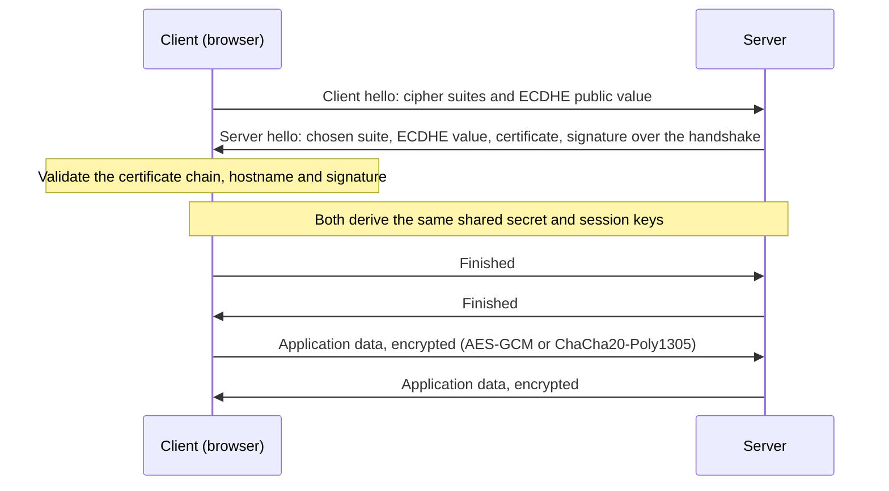

Security questions in a Java back-end interview usually start here: *what is the difference between symmetric and asymmetric encryption? Is hashing encryption? How does HTTPS work? How do you store passwords?* The authentication lessons (OAuth 2.0, OpenID Connect, JWT) all stand on these building blocks, so this is the first lesson of the security series. Examples use the usual cast: **Alice** and **Bob** want to talk, **Eve** eavesdrops and **Mallory** tampers. Press play to watch symmetric, asymmetric, signature and hybrid (TLS-style) flows.

```demo
name: crypto-walk
```

> **One sentence to remember:** *use a symmetric cipher for the data, an asymmetric scheme to share the key or prove identity, a hash to fingerprint or store a password, a signature to prove who wrote something, and never invent your own.*

## Goals and vocabulary {#basics}

### What cryptography is for {#goals}

| Goal | Meaning | Provided by |
| --- | --- | --- |
| **Confidentiality** | only the intended people can read the data | encryption |
| **Integrity** | the data was not changed | hashes, MACs, signatures, authenticated encryption |
| **Authenticity** | you know who produced the data | MACs, signatures, certificates |
| **Non-repudiation** | the author cannot later deny it | digital signatures (not MACs) |

Encryption alone does **not** give integrity: an attacker can often flip bits in a ciphertext and change the plaintext in predictable ways. Modern designs always use **authenticated encryption**, which gives confidentiality and integrity together.

### Terms {#terms}

- **Plaintext:** the readable data. **Ciphertext:** the encrypted result. **Cipher:** the algorithm that encrypts and decrypts. **Key:** the secret (or public) value that controls it.
- **Kerckhoffs's principle:** a system must stay secure even if everything except the key is public. So use well-known, heavily reviewed algorithms and protect the **key**. Secret home-made algorithms ("security by obscurity") are a red flag.
- **Nonce / IV:** a value that must be **unique** per encryption (a number used once, or initialisation vector) so the same plaintext never produces the same ciphertext.
- **Entropy and randomness:** keys, IVs and salts must come from a **cryptographically secure random generator** (`SecureRandom`), never `Random` or `Math.random()`.

### Encoding, encryption and hashing are different {#differences}

| | Reversible? | Needs a key? | Purpose | Example |
| --- | --- | --- | --- | --- |
| **Encoding** | yes, by anyone | no | represent data in another format | Base64, URL encoding, hex |
| **Encryption** | yes, with the key | yes | keep data secret | AES, RSA |
| **Hashing** | **no** (one way) | no | fingerprint data, store passwords | SHA-256, bcrypt, Argon2 |
| **MAC / signature** | not applicable | yes | prove integrity and origin | HMAC, ECDSA |

A very common wrong answer is "Base64 encrypts the data". It does not: anyone can decode it, which is why a JWT payload is readable by anybody who holds the token.

## Symmetric encryption {#symmetric}

### One shared key {#symmetric-idea}

In **symmetric** (secret-key) encryption the **same key** encrypts and decrypts. It is fast (gigabytes per second with hardware support) and secure with small keys, so it is what actually protects bulk data: files, database columns, disk volumes, and every byte of an HTTPS connection. The weakness is **key distribution**: both sides must get the key to each other safely first, and with *n* parties you need *n(n-1)/2* separate keys.

### AES, block and stream ciphers {#aes}

**AES** (Advanced Encryption Standard) is the standard symmetric cipher. It is a **block cipher** that works on 128-bit blocks, with keys of 128, 192 or 256 bits. AES-128 is secure today; AES-256 gives a larger margin (including against future quantum attacks). **ChaCha20** is a modern **stream cipher**, fast in software, used in TLS and on mobile devices. Obsolete: **DES** (56-bit key, broken) and **3DES**; **RC4** (broken).

### Modes of operation {#modes}

A block cipher only encrypts one block, so a **mode** defines how to encrypt longer data. The choice matters as much as the cipher:

| Mode | Notes |
| --- | --- |
| **ECB** | encrypts each block independently, so equal plaintext blocks give equal ciphertext blocks and **patterns leak** (the famous "ECB penguin" image). **Never use it.** |
| **CBC** | chains blocks, needs a random unpredictable IV and padding; gives **no integrity**, and is vulnerable to **padding-oracle** attacks unless you add a MAC (encrypt-then-MAC) |
| **CTR** | turns the block cipher into a stream cipher; needs a unique nonce; no integrity |
| **GCM** | **authenticated encryption (AEAD)**: encrypts and produces an authentication tag, so any tampering is detected. The default choice. **Never reuse a nonce with the same key**: it destroys both confidentiality and authentication |
| **ChaCha20-Poly1305** | the other widely used AEAD, same rules |

**AEAD** (authenticated encryption with associated data) also lets you bind unencrypted context (a header, a user id) to the ciphertext, so it cannot be moved to another message.

### AES-GCM in Java {#aes-java}

```java
SecretKey key = KeyGenerator.getInstance("AES").generateKey();      // 128-bit default; use init(256) for AES-256
SecureRandom random = new SecureRandom();

byte[] iv = new byte[12];                                           // 96-bit nonce, unique per message
random.nextBytes(iv);

Cipher enc = Cipher.getInstance("AES/GCM/NoPadding");
enc.init(Cipher.ENCRYPT_MODE, key, new GCMParameterSpec(128, iv));  // 128-bit authentication tag
enc.updateAAD(headerBytes);                                         // optional: authenticated but not encrypted
byte[] ciphertext = enc.doFinal(plaintext);                         // the tag is appended

// store or send iv + ciphertext (the IV is not secret)

Cipher dec = Cipher.getInstance("AES/GCM/NoPadding");
dec.init(Cipher.DECRYPT_MODE, key, new GCMParameterSpec(128, iv));
dec.updateAAD(headerBytes);
byte[] plain = dec.doFinal(ciphertext);                             // throws AEADBadTagException if anything was altered
```

Points to mention: a fresh random 12-byte IV for **every** message; the IV travels with the ciphertext; a failed tag check throws an exception and you must treat the data as invalid; the key itself comes from a key store or a key-management service, never from a constant in the code.

### Keys from passwords {#kdf}

Humans choose passwords, not 256-bit keys. To turn a password into a key, use a **key derivation function** with a random **salt** and a deliberately slow, memory-hard design (PBKDF2, scrypt, Argon2). Never use a plain hash of the password as a key. Java 25 adds a standard Key Derivation Function API ([Java 25](lesson:java-version-history#java-25)); before that, use `SecretKeyFactory` with `PBKDF2WithHmacSHA256`.

## Asymmetric encryption {#asymmetric}

### A key pair {#asymmetric-idea}

**Asymmetric** (public-key) cryptography uses a **mathematically linked pair of keys**: a **public key** you can give to anyone and a **private key** you keep secret. What one key does, only the other can undo. It solves the key-distribution problem: Alice can encrypt for Bob using only his *public* key, with no secret agreed in advance. The price: it is **roughly a thousand times slower** than symmetric encryption and limited to small payloads.

The two main uses, with the keys going opposite ways:

| Use | Alice uses | Bob uses |
| --- | --- | --- |
| **Encryption** (confidentiality) | Bob's **public** key to encrypt | his **private** key to decrypt |
| **Digital signature** (authenticity) | her **private** key to sign | her **public** key to verify |

### RSA and elliptic curves {#rsa-ec}

- **RSA** is based on the difficulty of factoring large numbers. Use **at least 2048-bit** keys (3072 for long-term protection). Encrypt with **OAEP** padding, never the old PKCS#1 v1.5 padding. Operations are slow and the key is large.
- **Elliptic-curve cryptography (ECC)** gives the same security with much smaller, faster keys: a 256-bit EC key is roughly as strong as a 3072-bit RSA key. Common choices: **ECDSA** (P-256) and **Ed25519** (signatures), **ECDH** and **X25519** (key agreement). Java supports Ed25519 and EdDSA since [Java 15](lesson:java-version-history#java-15).
- **Diffie-Hellman (DH / ECDH)** is **key agreement**, not encryption: two parties exchange public values and each computes the same shared secret, which never crosses the network.

```java
KeyPairGenerator gen = KeyPairGenerator.getInstance("RSA");
gen.initialize(2048);
KeyPair pair = gen.generateKeyPair();

OAEPParameterSpec oaep = new OAEPParameterSpec("SHA-256", "MGF1", MGF1ParameterSpec.SHA256, PSource.PSpecified.DEFAULT);
Cipher enc = Cipher.getInstance("RSA/ECB/OAEPPadding");                          // "ECB" here is just a JCA naming quirk
enc.init(Cipher.ENCRYPT_MODE, pair.getPublic(), oaep);
byte[] ct = enc.doFinal(smallSecret);                                            // at most ~190 bytes for RSA-2048 with OAEP-SHA-256

Cipher dec = Cipher.getInstance("RSA/ECB/OAEPPadding");
dec.init(Cipher.DECRYPT_MODE, pair.getPrivate(), oaep);
byte[] secret = dec.doFinal(ct);
```

Specify the `OAEPParameterSpec` explicitly: with the bare string `OAEPWithSHA-256AndMGF1Padding` the JDK uses SHA-1 inside the mask function, which surprises people when another system uses SHA-256.

### Hybrid encryption {#hybrid}

Real systems combine the two kinds: generate a random **symmetric session key**, encrypt the data with it (fast), and protect only that small key with the asymmetric scheme (or agree it with Diffie-Hellman). This is **hybrid encryption**, and it is how TLS, PGP, S/MIME and envelope encryption work.

**Envelope encryption** in cloud key-management services: a **data encryption key** (DEK) encrypts the data and is stored next to it, itself encrypted by a **master key** (KEK) that lives in a KMS or hardware security module and never leaves it. Rotating the master key means re-wrapping the small DEKs, not re-encrypting all the data.

## Hashing {#hashing}

### What a cryptographic hash is {#hash-basics}

A **hash function** maps data of any size to a fixed-size **digest**, deterministically and in **one direction**. A cryptographic hash has these properties:

- **Preimage resistance:** given a digest, you cannot find an input that produces it.
- **Second-preimage resistance:** given an input, you cannot find a different input with the same digest.
- **Collision resistance:** you cannot find *any* two inputs with the same digest.
- **Avalanche effect:** changing one bit of input changes about half the output bits.

Use **SHA-256** or **SHA-3** (or SHA-512). **MD5 and SHA-1 are broken** for collision resistance (practical collisions have been produced), so do not use them for security. Hashing is **not encryption**: there is no key and no way back.

```java
MessageDigest md = MessageDigest.getInstance("SHA-256");
byte[] digest = md.digest(data);                                    // file fingerprint, integrity check
```

Uses: file and download integrity checks, content-addressed storage, deduplication, commit ids, and as a building block inside signatures, MACs and password storage.

### Storing passwords {#passwords}

A plain `SHA-256(password)` is **not** safe storage: hashes are very fast, so an attacker with a stolen table can try billions of guesses per second, and identical passwords give identical hashes (rainbow tables). A password hash needs:

1. A unique random **salt** per user, stored with the hash, so identical passwords hash differently and precomputed tables are useless.
2. A deliberately **slow and memory-hard** algorithm with a tunable cost: **Argon2id** (preferred), **scrypt**, **bcrypt** or **PBKDF2** (with a high iteration count, for example 600,000 with HMAC-SHA-256 under current OWASP guidance).
3. Optionally a **pepper**: a secret value kept outside the database (in a vault) mixed into every hash.

```java
PasswordEncoder encoder = new BCryptPasswordEncoder(12);            // Spring Security: salt and cost are built in
String stored = encoder.encode(rawPassword);                        // "$2a$12$..." contains algorithm, cost, salt and hash
boolean ok = encoder.matches(rawPassword, stored);
```

`DelegatingPasswordEncoder` (Spring's default) prefixes each hash with its algorithm id (`{bcrypt}...`), so you can migrate algorithms over time. Compare secrets in **constant time** (`MessageDigest.isEqual`) to avoid timing leaks.

### HMAC: a hash with a key {#hmac}

An **HMAC** is a hash that also mixes in a secret key, so only someone with the key can produce or check it. It gives **integrity and authenticity** between parties that share the key:

```java
Mac mac = Mac.getInstance("HmacSHA256");
mac.init(new SecretKeySpec(sharedKey, "HmacSHA256"));
byte[] tag = mac.doFinal(message);                                  // send message + tag; the receiver recomputes and compares
```

Uses: signing webhooks and API requests, session cookies, and the **HS256** signature of a JWT. Because both sides hold the same key, an HMAC proves the message came from *someone* with the key but cannot show *which* of them: there is no non-repudiation.

## Digital signatures {#signatures}

A **digital signature** is the hash of a message encrypted (signed) with the signer's **private key**. Anyone with the matching **public key** can verify it. It provides **integrity**, **authenticity** and **non-repudiation**: only the key owner could have produced it, and it cannot be denied later. It does **not** hide the message.

```java
Signature signer = Signature.getInstance("SHA256withECDSA");        // or "Ed25519" (Java 15+), "SHA256withRSA"
signer.initSign(privateKey);
signer.update(message);
byte[] signature = signer.sign();

Signature verifier = Signature.getInstance("SHA256withECDSA");
verifier.initVerify(publicKey);
verifier.update(message);
boolean valid = verifier.verify(signature);                         // false if the message or signature was altered
```

| | HMAC (MAC) | Digital signature |
| --- | --- | --- |
| Key | one **shared** secret | a **private/public** pair |
| Who can verify | only those holding the secret | anyone with the public key |
| Non-repudiation | no | yes |
| Speed | very fast | slower |
| Typical use | between two parties that trust each other | software updates, JWTs from an identity provider, certificates, contracts |

Signing keys are the reason **RS256/ES256** JWTs are preferred when many services must *verify* tokens issued by one: they only need the public key, so a compromised verifier cannot forge tokens.

## Certificates and TLS {#tls}

### The trust problem {#trust}

Asymmetric cryptography has an open question: how does Alice know that a public key really belongs to Bob and not to Mallory? A **certificate** (an **X.509** document) binds an **identity** (a domain name, a person, an organisation) to a **public key**, and is **signed by a certificate authority (CA)** that the client already trusts. Operating systems and browsers ship a **trust store** of root CAs. A certificate chain runs from the server certificate, through intermediate CAs, to a trusted root.

When a client validates a certificate it checks: the **signature chain** up to a trusted root, the **validity dates**, that the **hostname matches**, that the certificate is **not revoked** (CRL or OCSP), and its allowed uses. A self-signed certificate has no chain, so it is trusted only if you install it deliberately (fine for local development and internal services, not for the public internet).

### How HTTPS (TLS 1.3) works, in outline {#handshake}



Properties worth naming: **forward secrecy** (the session keys are ephemeral, so stealing the server's long-term key later does not decrypt recorded traffic); **one round trip** before data can flow; and TLS 1.3 removed weak options (RSA key exchange, CBC, RC4, SHA-1). Optional **0-RTT** early data is faster but replayable, so use it only for idempotent requests. Java has supported TLS 1.3 since [Java 11](lesson:java-version-history#java-11).

### Mutual TLS {#mtls}

In ordinary TLS only the **server** proves its identity. In **mutual TLS (mTLS)** the client also presents a certificate, so both sides are authenticated. It is common between services inside a network (service meshes such as Istio, Spring Cloud with client certificates) and for high-assurance APIs.

### Key stores in Java {#keystores}

Java keeps keys and certificates in **key stores**: a **keystore** holds your own private keys and certificates (PKCS12 is the default format since Java 9), a **truststore** holds the CA certificates you trust. They are managed with `keytool` and configured with `-Djavax.net.ssl.keyStore` and `-Djavax.net.ssl.trustStore` (or Spring Boot's `server.ssl.*` and the SSL bundles).

## Using cryptography correctly {#practice}

### Rules to follow {#rules}

- **Do not design your own algorithm or protocol.** Use vetted libraries: the JCA/JCE built into Java, Bouncy Castle, Google Tink (a safe high-level API that picks modes and nonces for you) or libsodium.
- **Protect keys, not algorithms.** Keep keys in a KMS, HSM or secret manager; never in source code, config files in the repository or logs. **Rotate** them, and give each purpose its own key.
- Use **authenticated encryption** (AES-GCM, ChaCha20-Poly1305), never raw CBC or ECB.
- Generate keys, IVs and salts with `SecureRandom`.
- **Never turn off certificate validation** (a `TrustAllCerts` trust manager or `hostnameVerifier` that returns true): it makes TLS pointless. This is one of the most common real vulnerabilities.
- Encrypt data **in transit** (TLS), **at rest** (disk, database, backups) and sometimes **end to end** (only the two endpoints hold the keys, as in messaging apps, not even the server can read the data).

### Common mistakes {#mistakes}

| Mistake | Why it is wrong | Instead |
| --- | --- | --- |
| Base64 "encryption" | it is encoding, anyone can decode it | a real cipher |
| MD5 or SHA-256 for passwords | far too fast to brute force | Argon2id, bcrypt, scrypt, PBKDF2 |
| AES in ECB mode | leaks patterns | AES-GCM |
| Static or zero IV, reused GCM nonce | breaks confidentiality (and authentication in GCM) | fresh random IV per message |
| CBC without a MAC | tampering and padding-oracle attacks | AEAD |
| Hard-coded keys and secrets | anyone with the code has the key | KMS or secret manager |
| `Random` for tokens and keys | predictable | `SecureRandom` |
| Comparing MACs with `equals` | timing side channel | `MessageDigest.isEqual` |
| Disabling certificate checks | removes the identity guarantee | fix the trust store |
| Rolling your own crypto | subtle flaws | Tink, JCA, libsodium |

### Post-quantum cryptography {#post-quantum}

A large quantum computer would break RSA, Diffie-Hellman and elliptic curves (Shor's algorithm), while symmetric ciphers and hashes are only weakened (Grover's algorithm), which is why AES-256 and SHA-256 or larger remain acceptable. Attackers can already **harvest now, decrypt later**: record traffic today and decrypt it when quantum computers exist. Standards for quantum-resistant algorithms exist (ML-KEM for key exchange, ML-DSA for signatures); Java added them in [Java 24](lesson:java-version-history#java-24) on top of its KEM API from [Java 21](lesson:java-version-history#java-21), and hybrid post-quantum key exchange for TLS 1.3 is announced for [Java 27](lesson:java-version-history#java-27).

## Cheat sheet {#cheatsheet}

| Need | Use |
| --- | --- |
| Encrypt bulk data (files, DB fields, disk) | AES-256-GCM or ChaCha20-Poly1305 |
| Share a key over an open network | Diffie-Hellman (ECDHE, X25519) |
| Encrypt a small secret for one recipient | RSA-OAEP or ECIES (hybrid) |
| Prove who wrote data, verifiable by anyone | digital signature (Ed25519, ECDSA, RSA-PSS) |
| Prove integrity between two parties sharing a secret | HMAC-SHA-256 |
| Fingerprint a file | SHA-256 |
| Store a password | Argon2id, bcrypt, scrypt or PBKDF2, with salt |
| Secure a connection | TLS 1.3 (mTLS when both sides need identity) |
| Protect keys | KMS, HSM or secret manager, with rotation |

| Symmetric | Asymmetric |
| --- | --- |
| one shared key | key pair: public and private |
| fast, small keys (128 or 256 bits) | slow, larger keys (RSA 2048+, EC 256) |
| bulk data | key exchange, signatures, small secrets |
| key distribution is the problem | needs a trust model (certificates) |
| AES, ChaCha20 | RSA, ECC, Diffie-Hellman |

## Interview questions {#questions}

### [basic] What is the difference between symmetric and asymmetric encryption? {#sym-vs-asym}

Symmetric encryption uses **one shared secret key** for both encrypting and decrypting (AES); it is fast and good for bulk data, but the parties must somehow share the key safely. Asymmetric encryption uses a **key pair**: data encrypted with the public key can only be decrypted with the private key (RSA, elliptic curves); it removes the key-distribution problem but is far slower, so it is used for key exchange, signatures and small payloads. Real systems combine them (hybrid encryption).

### [basic] What is the difference between encoding, encryption and hashing? {#enc-enc-hash}

**Encoding** (Base64, URL encoding) changes the format of data and is reversible by anyone, with no secret. **Encryption** (AES, RSA) hides the data and is reversible only with the key. **Hashing** (SHA-256, bcrypt) creates a fixed-size fingerprint, is one way (no key, no way back) and is used for integrity and password storage. Saying "I Base64 encoded the password" is not protection.

### [basic] What is a hash function, and what properties must it have? {#hash-q}

It maps arbitrary input to a fixed-size digest. A cryptographic hash is deterministic, fast to compute, and is **preimage resistant** (cannot recover input from digest), **second-preimage resistant**, **collision resistant** (cannot find two inputs with the same digest) and shows the **avalanche effect** (a tiny change alters the whole digest). Use SHA-256 or SHA-3; MD5 and SHA-1 are broken.

### [basic] How should you store passwords? {#store-passwords}

Never in plain text or encrypted (encryption is reversible), and never with a fast hash. Store a hash from a slow, salted, memory-hard function: **Argon2id**, scrypt, bcrypt or PBKDF2 with a high iteration count, with a **unique random salt** per user. Verify by hashing the login attempt with the stored salt and comparing in constant time. A secret **pepper** held outside the database adds protection if the database leaks. In Spring use `DelegatingPasswordEncoder` or `BCryptPasswordEncoder`/`Argon2PasswordEncoder`.

### [basic] What is a salt, and why is it needed? {#salt}

A random value, unique per password, that is mixed into the hash and stored with it (it is not secret). It ensures two users with the same password get different hashes and makes precomputed rainbow tables useless, so the attacker must attack every password separately. It does **not** make a weak password strong or slow down a single guess; that is the job of the slow hash.

### [basic] What is a digital signature, and how does it differ from encryption? {#signature-q}

A signature is made with the sender's **private** key over a hash of the message, and anyone with the **public** key can verify it. It proves **who** produced the message and that it was **not altered** (and the signer cannot deny it), but it does not hide the message. Encryption hides the content from everyone without the key. The key roles are reversed: encrypt with the recipient's public key; sign with your own private key.

### [basic] What is TLS, and what does HTTPS protect? {#tls-q}

TLS (Transport Layer Security) is the protocol that secures a connection: it **authenticates the server** (and optionally the client) with certificates, **agrees session keys**, and then **encrypts and integrity-protects** all data with a symmetric AEAD cipher. HTTPS is HTTP over TLS. It protects data in transit from eavesdropping and tampering; it does not protect data once it reaches the server, or from a malicious server.

### [basic] What is a certificate and what is a certificate authority? {#cert-q}

A certificate is a signed document that binds an identity (such as a domain name) to a public key. A certificate authority (CA) is a trusted party that signs certificates after verifying the identity, and whose root certificates are pre-installed in browsers and operating systems. A client trusts a server certificate if it chains to a trusted root, is within its validity period, matches the hostname and has not been revoked.

### [intermediate] Explain how the TLS handshake works. {#handshake-q}

In TLS 1.3 the client sends a hello with its supported cipher suites and an ECDHE public value. The server replies with its chosen suite, its own ECDHE value, its certificate, and a signature over the handshake made with its private key. The client verifies the certificate chain, hostname and signature; both sides compute the same shared secret from the ECDHE values and derive session keys; each sends a Finished message; then data flows encrypted with AES-GCM or ChaCha20-Poly1305. It needs one round trip and gives forward secrecy because the key exchange is ephemeral.

### [intermediate] What is forward secrecy, and why does it matter? {#forward-secrecy}

Session keys are derived from ephemeral key-exchange values that are discarded after the session, rather than from the server's long-term private key. So if the long-term key is stolen later, previously recorded traffic still cannot be decrypted. Without it (the old RSA key exchange), an attacker who records traffic today and obtains the key tomorrow can read everything. TLS 1.3 makes forward secrecy mandatory.

### [intermediate] What is hybrid encryption, and why is it used? {#hybrid-q}

Asymmetric encryption is too slow and limited in size for bulk data, symmetric encryption needs a shared key. So generate a random symmetric key, encrypt the data with it (fast), and protect only that key with the recipient's public key (or agree it with Diffie-Hellman). TLS, PGP and cloud envelope encryption all work this way. In envelope encryption the data key is stored encrypted by a master key in a KMS, so rotating the master key does not require re-encrypting the data.

### [intermediate] Which AES mode should you use, and why not ECB or plain CBC? {#aes-mode}

Use **GCM** (or ChaCha20-Poly1305): it is authenticated encryption, so it provides confidentiality and integrity, and detects tampering. **ECB** encrypts equal blocks to equal ciphertext, leaking patterns. **CBC** gives no integrity and, with padding, is open to padding-oracle attacks unless a MAC is added correctly. Whatever the mode, the IV or nonce must be unique per message: reusing a nonce in GCM with the same key breaks both secrecy and authentication.

### [intermediate] What is the difference between a MAC (HMAC) and a digital signature? {#mac-vs-sig}

Both prove integrity and authenticity. An **HMAC** uses a **shared secret key**: fast, but anyone who can verify it can also forge it, so it cannot prove which party made it, and there is no non-repudiation. A **signature** uses a private/public pair: only the private-key holder can sign, anyone with the public key can verify, so it gives non-repudiation and suits one issuer with many verifiers (a certificate authority, an identity provider signing tokens).

### [intermediate] What is Diffie-Hellman key exchange? {#dh-q}

A way for two parties to create the same shared secret over an open channel. Each picks a private value and sends a public value computed from it; each then combines its own private value with the other's public value and both get the same result, which an eavesdropper who sees only the public values cannot compute (the discrete logarithm problem is hard). The ephemeral version (ECDHE, X25519) provides forward secrecy. It is key agreement, not encryption, and on its own does not authenticate the parties, so it is combined with signatures or certificates.

### [intermediate] What is the difference between RSA and elliptic-curve cryptography? {#rsa-vs-ec}

Both are asymmetric. RSA relies on the difficulty of factoring and needs large keys (2048 to 3072 bits and up); elliptic curves rely on the elliptic-curve discrete logarithm and give the same security with much smaller, faster keys (a 256-bit curve is about as strong as RSA-3072) and smaller signatures and certificates. ECC is the modern default (ECDSA, Ed25519, X25519); RSA remains widely supported. Both are threatened by quantum computers.

### [intermediate] How does certificate validation work, and what happens if you disable it? {#cert-validation}

The client builds a chain from the server certificate through intermediates to a trusted root and verifies each signature, checks validity dates, that the hostname matches, and revocation status. If you disable these checks (a trust-all trust manager, an always-true hostname verifier), the connection is still encrypted, but you may be talking to an attacker who presents any certificate, so a man-in-the-middle can read and alter everything. For development use a proper local CA or add the self-signed certificate to a trust store.

### [intermediate] What is mutual TLS, and when would you use it? {#mtls-q}

In normal TLS only the server authenticates itself. In mutual TLS the client also presents a certificate that the server validates, so both sides are authenticated at the transport layer. Use it for service-to-service traffic (zero-trust networks, service meshes) and high-assurance APIs, where managing client certificates (issuing, rotating, revoking) is acceptable.

### [intermediate] What is the difference between data in transit, at rest and in use? {#data-states}

**In transit**: moving over a network, protected by TLS. **At rest**: stored on disk or in a database or backup, protected by disk, volume or field-level encryption with keys held separately. **In use**: being processed in memory, which is normally unencrypted; confidential computing (hardware enclaves) addresses it. A complete design covers all three and treats key management as the real security boundary.

### [intermediate] What is end-to-end encryption? {#e2e}

Encryption where only the communicating endpoints hold the keys, so intermediaries, including the service provider, cannot read the content. In messaging apps each user has a key pair, and messages are encrypted for the recipient's devices. TLS alone is not end-to-end: it protects each hop, but the server at the other end sees the plaintext.

### [deep] Why must a nonce never be reused in AES-GCM? {#gcm-nonce}

GCM uses the key and nonce to produce a keystream (counter mode) and an authentication key. If two messages use the same key and nonce, XORing the ciphertexts cancels the keystream and leaks the XOR of the plaintexts; and the repeated authentication material lets an attacker recover the authentication key and forge messages. Random 96-bit nonces are safe for a limited number of messages per key (about 2^32); beyond that use a counter, a key per session, or a misuse-resistant mode such as AES-GCM-SIV.

### [deep] What is a padding-oracle attack? {#padding-oracle}

With CBC and padding, if a server reveals (by an error message or timing) whether the padding of a decrypted message was valid, an attacker can use that as an "oracle", modify ciphertext blocks and learn the plaintext byte by byte without the key. The fix is to authenticate the ciphertext first (encrypt-then-MAC, or use AEAD like GCM) and return the same error for every failure.

### [deep] How does a JWT signature relate to HMAC and public-key signatures? {#jwt-sig}

A JWT carries a header, a payload and a signature. **HS256** signs with an HMAC and a shared secret, so every verifier must hold the secret and could forge tokens. **RS256** and **ES256** sign with a private key held only by the issuer; verifiers use the public key (often fetched from a JWKS endpoint), so they cannot issue tokens. The payload is only Base64URL encoded, **not encrypted**: anyone can read it, and the signature only prevents modification. (The JWT lesson in this series covers this in depth.)

### [deep] What are the risks of using symmetric keys across many services, and how do you manage keys at scale? {#key-management}

A shared secret copied into many services widens the number of places that can leak it and prevents proving which service did something. Better: central key management (a KMS or HSM) where keys are generated, never exported, and used through an API with access control and audit logs; per-purpose and per-tenant keys; automatic rotation with key ids so old data can still be decrypted; envelope encryption for data; and asymmetric keys where many parties must verify but few should issue.

### [deep] How does quantum computing affect cryptography today? {#quantum-q}

Shor's algorithm would break RSA, Diffie-Hellman and elliptic curves, the basis of today's key exchange and signatures; Grover's algorithm only halves the effective strength of symmetric keys and hashes, so AES-256 and SHA-256 remain acceptable. Because encrypted traffic can be recorded now and decrypted later, long-lived secrets are already at risk. The response is post-quantum algorithms (ML-KEM, ML-DSA) and hybrid key exchange that combines a classical and a post-quantum scheme, which Java and TLS implementations are adopting.

### [coding] What is wrong with this encryption code? {#coding-aes-bug}

```java
SecretKeySpec key = new SecretKeySpec("my-secret-key-123".getBytes(), "AES");
Cipher cipher = Cipher.getInstance("AES");                 // no mode specified
cipher.init(Cipher.ENCRYPT_MODE, key);
byte[] ct = cipher.doFinal(data);
```

Several problems: the **key is hard-coded** and derived from a text string, so it has little entropy and is in the source code; `Cipher.getInstance("AES")` defaults to **AES/ECB/PKCS5Padding**, which leaks patterns; there is **no IV and no integrity check**, so ciphertext can be altered undetected. A fixed version uses a random key from a key store or KMS, GCM mode and a fresh IV per message:

```java
Cipher cipher = Cipher.getInstance("AES/GCM/NoPadding");
byte[] iv = new byte[12];
new SecureRandom().nextBytes(iv);
cipher.init(Cipher.ENCRYPT_MODE, key, new GCMParameterSpec(128, iv));    // key loaded from a KeyStore or KMS
byte[] ct = cipher.doFinal(data);
// output: iv + ct
```

### [coding] Store and verify a password correctly. {#coding-password}

```java
String hash = Hex.encodeHexString(MessageDigest.getInstance("SHA-256").digest(password.getBytes()));
```

This is unsalted and fast, so an attacker with the table can crack common passwords instantly with rainbow tables or brute force. Use a slow salted algorithm; with Spring Security:

```java
PasswordEncoder encoder = new BCryptPasswordEncoder(12);        // or Argon2PasswordEncoder, or DelegatingPasswordEncoder
String stored = encoder.encode(password);                       // salt and cost are inside the string
boolean ok = encoder.matches(attempt, stored);                  // constant-time comparison inside
```

Without Spring, derive with PBKDF2: a random 16-byte salt, `PBKDF2WithHmacSHA256` with at least 600,000 iterations, a 256-bit output, store the salt, iteration count and hash together, and compare with `MessageDigest.isEqual`. Add a rate limit on login attempts.

### [coding] Sign a payload and verify it on the other side. {#coding-sign}

Generate an EC key pair once, keep the private key secret (a key store or KMS) and publish the public key. The signer and the verifier then use the `Signature` API:

```java
KeyPairGenerator gen = KeyPairGenerator.getInstance("EC");
gen.initialize(new ECGenParameterSpec("secp256r1"));
KeyPair pair = gen.generateKeyPair();

// issuer
Signature s = Signature.getInstance("SHA256withECDSA");
s.initSign(pair.getPrivate());
s.update(payload);
byte[] sig = s.sign();

// verifier, who only has the public key
Signature v = Signature.getInstance("SHA256withECDSA");
v.initVerify(pair.getPublic());
v.update(payload);
if (!v.verify(sig)) throw new SecurityException("bad signature");
```

Mention: sign the **exact bytes** (canonical form) that the verifier will check, include an expiry or nonce in the payload to stop replay, and note that on Java 15+ `Ed25519` is a simpler, faster alternative to ECDSA.
