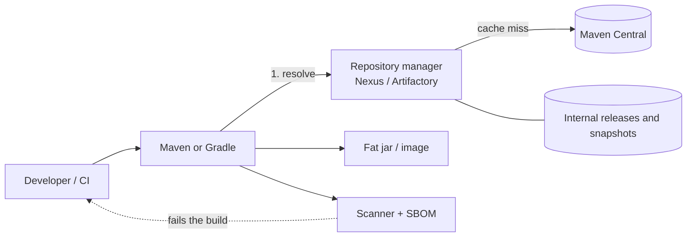

A typical Spring Boot service has 5 to 10 libraries that you chose. It also has 100 to 200 libraries that you did not choose, because every library brings its own.

A bank must be able to answer three questions about every release:

- Which libraries are in it?
- Which versions are they?
- Is any of them vulnerable?

Interviews ask:

- What is a transitive dependency?
- How do you fix a version conflict?
- What is a BOM?
- What was Log4Shell, and how would you have found it?
- What is an SBOM?
- What is dependency confusion?

This lesson builds on [Maven](lesson:maven) and [Gradle](lesson:gradle). The fixes link to [CI/CD](lesson:cicd-fundamentals) and to [cryptography](lesson:cryptography), for checksums and signatures.

> **One sentence to remember:** *Every library is code you run in production, so know the whole tree, pin the versions and scan it in CI.*

## Where dependencies come from {#map}



The build never needs to talk to the internet. It asks the **repository manager**, a server inside the company.

- The repository manager acts as a proxy for Maven Central. It downloads a library once and keeps a copy.
- It also hosts the bank's own **internal** libraries.

So the repository manager is the one door through which every library enters. That is where you control what gets in.

## Direct and transitive dependencies {#tree}

- A **direct** dependency is one you declare in the `pom.xml` or `build.gradle.kts`.
- A **transitive** dependency is a dependency of a dependency. You get it without asking, at the version the chain asks for.
- The **dependency tree** shows how each library arrived. One library can appear many times, through different paths.

```bash
# Maven: the full tree, including versions that lost a conflict
mvn dependency:tree -Dverbose -Dincludes=org.apache.logging.log4j

# Gradle: why is this library here, and which version won?
./gradlew dependencyInsight --dependency log4j-core --configuration runtimeClasspath
./gradlew dependencies --configuration runtimeClasspath
```

Always read the tree of the **runtime** classpath, because that is what ships. A library that is only on the compile classpath is not in the jar.

## Version conflicts {#conflicts}

A version conflict happens when two libraries ask for different versions of the same library. The classpath can hold only one, so the build tool picks one:

| Tool | Rule | Risk |
| --- | --- | --- |
| **Maven** | The version **nearest** to your project wins. At equal depth, the one **declared first** wins. | It can pick an **older** version than a library needs. That causes a `NoSuchMethodError` at run time. |
| **Gradle** | The **highest** requested version wins. | It can pick a **newer** version than a library was tested with. |

Try it in the lab: [Two libraries, two Jackson versions](lab:maven-dependency-conflict).

Four ways to take control:

- **Declare it yourself.** A direct dependency is at depth 1, so in Maven it beats any transitive one.
- **Manage it.** Use `dependencyManagement` in Maven, or `constraints { }` or a platform in Gradle. This sets the version for the whole tree, without making the library a direct dependency.
- **Exclude it.** Remove a transitive dependency you do not want, with `<exclusions>` in Maven or `exclude(group = ..., module = ...)` in Gradle.
- **Fail when paths disagree, instead of guessing.** The **Maven Enforcer** rule `dependencyConvergence` fails the build when two paths ask for different versions. Gradle's `failOnVersionConflict()` does the same.

```xml
<plugin>
  <artifactId>maven-enforcer-plugin</artifactId>
  <executions>
    <execution>
      <id>enforce</id>
      <goals><goal>enforce</goal></goals>
      <configuration>
        <rules>
          <dependencyConvergence/>
          <requireJavaVersion><version>[17,)</version></requireJavaVersion>
          <bannedDependencies>
            <excludes><exclude>commons-logging:commons-logging</exclude></excludes>
          </bannedDependencies>
        </rules>
      </configuration>
    </execution>
  </executions>
</plugin>
```

## BOMs, platforms and version catalogs {#bom}

A **BOM** (bill of materials) is a pom that only lists **managed versions**: versions of libraries that are known to work together. You import it once and leave the versions out of your own dependencies:

```xml
<dependencyManagement>
  <dependencies>
    <dependency>
      <groupId>org.springframework.boot</groupId>
      <artifactId>spring-boot-dependencies</artifactId>
      <version>3.3.0</version>
      <type>pom</type>
      <scope>import</scope>
    </dependency>
  </dependencies>
</dependencyManagement>
```

In Gradle, a BOM is imported as a **platform**:

```kotlin
dependencies {
    implementation(platform("org.springframework.boot:spring-boot-dependencies:3.3.0"))
    implementation("com.fasterxml.jackson.core:jackson-databind")   // version comes from the platform
}
```

- **Spring Boot is a BOM plus plugins.** That is why Boot starters have no version.
- **A version catalog** (`gradle/libs.versions.toml`) names each version once for the whole Gradle build.
- **A bank-wide BOM** published to Nexus does the same for many teams. It gives one place to raise a library version for every service.
- **To override one library in a Boot BOM**, set its version property (`<jackson-bom.version>2.17.2</jackson-bom.version>`) or add a constraint. Write down why.

## Pinning and reproducible builds {#pinning}

A build is **reproducible** when the same commit gets the same libraries every time. These things break it:

- **Version ranges**, such as `[1.0,2.0)`, Gradle's `1.+` and `latest.release`. The version changes whenever someone publishes a new one.
- **`-SNAPSHOT`** versions. They are replaced in place.
- **Floating plugin versions**, meaning a plugin with no version in the pom.
- **A repository that can serve different bytes** for the same version.

Use fixed versions, and add one of these:

- **Gradle dependency locking** records the whole resolved tree in `gradle.lockfile`. Turn it on with `dependencyLocking { lockAllConfigurations() }`, then run `./gradlew dependencies --write-locks`.
- **Gradle dependency verification** stores a **SHA-256 checksum** (and optionally a PGP key) for every artifact, in `gradle/verification-metadata.xml`. The build fails if the bytes change. A checksum is a short fingerprint of a file's bytes.
- **Maven** has no lock file by default. Fix all versions, pin the plugins, use `-C` (`--strict-checksums`), and use a repository manager that **cannot overwrite released versions**.

## Known vulnerabilities {#vulns}

A **CVE** (Common Vulnerabilities and Exposures) is a public id for one known flaw, such as `CVE-2021-44228`. Its **CVSS** score, from 0 to 10, rates how severe it is. A score of 9.0 or above is **critical**.

A **scanner** compares your dependency **tree** with a database of CVEs:

| Tool | Where it runs | Notes |
| --- | --- | --- |
| **OWASP Dependency-Check** | As a Maven or Gradle plugin in CI. | It is free and uses the NVD (the US National Vulnerability Database). It can fail the build above a CVSS threshold. |
| **Dependabot / Renovate** | On the code repository. | They open pull requests that raise vulnerable or old versions. |
| **Snyk, Trivy, Grype** | In CI, on the registry or on the image. | They also scan **container images** and operating-system packages. |
| **Nexus IQ / Artifactory Xray** | In the repository manager. | They block a bad component **before** it reaches a build. |

```xml
<plugin>
  <groupId>org.owasp</groupId>
  <artifactId>dependency-check-maven</artifactId>
  <configuration>
    <failBuildOnCVSS>7</failBuildOnCVSS>
    <suppressionFile>dependency-check-suppressions.xml</suppressionFile>
  </configuration>
</plugin>
```

A scan has **false positives**. Sometimes the flaw is in a part of the library you do not use. Sometimes the CVE names the wrong library. Suppress each false positive in a reviewed file, **with a reason and an expiry date**. Never ignore findings in bulk.

### Case study: Log4Shell {#log4shell}

How the vulnerability works inside the logger is explained in the [logging lesson](lesson:java-logging#log4shell).

In December 2021, `CVE-2021-44228` (CVSS 10) was found in **log4j-core** versions 2.0 to 2.14.1. An attacker could run code on the server by sending a string such as `${jndi:ldap://...}`. The application only had to **log** that string.

The fix itself was easy: upgrade to 2.17.1 or later. The hard part was **finding where the library was**:

- Many teams had `log4j-core` only as a **transitive** dependency, inside a fat jar. They did not know the jar contained it.
- Some products shipped their **own copy** of the jar.
- A bank had to answer *"which of our hundreds of services contain it?"* within hours.

Teams with an **SBOM** and a scanner in CI answered with one query. The others searched jar files by hand.

To fix a transitive dependency quickly, force the version from your own build with a **constraint** or a `dependencyManagement` entry, then redeploy.

Try it in the lab: [A scanner finds a vulnerable transitive library](lab:dep-vulnerable-library).

## SBOM {#sbom}

An **SBOM** (software bill of materials) is a machine-readable list of every component in a build, with versions, licences and hashes. The two common formats are **CycloneDX** and **SPDX**.

- Generate it in the build, with the **CycloneDX** Maven or Gradle plugin. Store it with the release artifact.
- Spring Boot can include one in the jar and show it through Actuator (`/actuator/sbom`).
- It answers *"are we affected by this CVE?"* without unpacking jars.
- Customers and regulators ask for it more and more.

## Repository managers and trusted sources {#repos}

A **repository manager**, such as **Nexus** or **Artifactory**, sits between the builds and the internet. It has three kinds of repository:

- A **proxy** repository caches Maven Central. Builds are fast, and they still work when Central is down.
- A **hosted** repository holds your own releases and snapshots. A **release** version must never change.
- A **group** repository joins the others under one URL. A build then needs just one `<mirror>` or `repositories {}` entry.

It can also block components that have a CVE or a bad licence, and it logs who downloaded what.

### Dependency confusion {#confusion}

**Dependency confusion** is an attack on builds that look in several repositories.

1. Your build asks several repositories for `com.bank:payments-core:9.9.9`.
2. An attacker **publishes a public package with the same name and a higher version number** on a public repository.
3. A build that takes the **highest version from any repository** installs the attacker's code.

**Typosquatting** is a related attack. The attacker publishes a name that differs by one letter, in the hope that someone mistypes it.

Try it in the lab: [Dependency confusion: the higher version wins](lab:dep-confusion).

Defences:

- Resolve dependencies **only** through the repository manager, never directly from public repositories.
- Add **routing rules**, so your internal group id (`com.bank.*`) comes **only** from the hosted repository and is never looked up on the proxy.
- Reserve your group id on Maven Central, and use fixed versions.
- Verify checksums. For critical libraries, also verify PGP signatures.

## Licences {#licences}

A library's licence is also a risk.

- **Permissive** licences, such as Apache 2.0, MIT and BSD, are fine in a closed product.
- **Copyleft** licences, such as **GPL** and **AGPL**, can require you to publish your own source code if you distribute the product. With AGPL, even offering the code over a network can count.

Legal teams keep a list of approved licences. Enforce it in the build with a licence report, not from memory. The CycloneDX output, `license-maven-plugin` and Nexus IQ can all produce one.

## A routine for a bank team {#routine}

1. **One BOM** (or platform) sets the versions. Services declare libraries without versions.
2. **Versions are fixed**, and the tree is locked or verified where the build tool allows it.
3. **Enforcer rules** check convergence, banned libraries and the minimum Java version.
4. **CI scans every pull request.** The build fails above a threshold, and suppressions are reviewed and have expiry dates.
5. **Renovate or Dependabot** opens update pull requests every week, so each upgrade is small.
6. **An SBOM** is generated and stored with each release.
7. **All builds resolve only through Nexus or Artifactory**, with routing rules for internal group ids.

## Cheat sheet {#cheatsheet}

| Need | Command or setting |
| --- | --- |
| Maven tree, including the versions that lost | `mvn dependency:tree -Dverbose` |
| Gradle: why this version | `./gradlew dependencyInsight --dependency <name>` |
| Find upgrades | `mvn versions:display-dependency-updates` |
| Fail on a conflict | Enforcer `dependencyConvergence`, or Gradle `failOnVersionConflict()` |
| Force one version | `dependencyManagement`, or `constraints { }` |
| Scan for CVEs | OWASP Dependency-Check, Trivy or Snyk |
| Lock the tree | `gradle.lockfile` and `verification-metadata.xml` |
| SBOM | The CycloneDX plugin |
| Block bad sources | A Nexus or Artifactory group with routing rules |

## Interview questions {#questions}

### [basic] What is a transitive dependency? {#transitive-q}

A transitive dependency is a dependency of a dependency.

For example, you declare `kyc-client`, and `kyc-client` needs Jackson. Jackson then comes into your build, even though it is not in your pom.

Most libraries in a service are transitive. That is why you must read the dependency tree, not only your own pom.

### [basic] What is a BOM and why use one? {#bom-q}

A BOM (bill of materials) is a pom, or a Gradle platform, that lists versions of libraries that are tested together.

- You import it, then declare libraries without versions.
- It keeps versions the same across modules and services.
- It gives one place to raise a version.

Spring Boot's dependency versions work this way.

### [basic] How do you see where a library in your build comes from? {#inspect-q}

Print the dependency tree.

- In Maven, `mvn dependency:tree -Dverbose -Dincludes=<groupId>` shows every path, including the versions that lost a conflict.
- In Gradle, `dependencyInsight --dependency <name>` shows which version was chosen and why.
- In Gradle, `dependencies --configuration runtimeClasspath` shows the whole tree.

### [basic] What is a CVE and what is CVSS? {#cve-q}

A CVE is the public id of one known vulnerability. CVSS is its severity score.

- An example CVE is `CVE-2021-44228`.
- CVSS runs from 0 to 10. A score of 9.0 or above is critical.

Scanners match your dependency tree against the CVE database. A build gate usually fails above a chosen score, such as 7.

### [intermediate] How do Maven and Gradle resolve a version conflict? {#conflict-q}

Maven picks the nearest version. Gradle picks the highest.

- **Maven** takes the version **nearest** to your project in the tree. At equal depth, it takes the one declared first. That version can be older than a library needs.
- **Gradle** takes the **highest** version requested.

In both tools, control the result by declaring or managing the version yourself. Add Enforcer or `failOnVersionConflict()`, so a disagreement fails the build instead of being decided silently.

### [intermediate] A service fails with `NoSuchMethodError` after you add a library. What do you do? {#nsme-q}

The class that was loaded is an older version than the calling code was built for.

1. Run `mvn dependency:tree -Dverbose` (or `dependencyInsight`).
2. Find which version won, and which library wanted the other one.
3. Pin the right version with `dependencyManagement`, a constraint or a BOM.
4. Add convergence enforcement, so it cannot happen again.

### [intermediate] How do you override one library version that a Spring Boot BOM manages? {#override-q}

Set the library's version property.

- In Maven, set the property in the pom, for example `jackson-bom.version`.
- In Gradle, set the same property, or add a constraint.

Add a comment that explains why. Remove the override when a Boot upgrade brings the fixed version.

### [intermediate] What is dependency locking, and how does it differ from fixed versions? {#lock-q}

Fixed versions pin only your direct dependencies. Locking pins the whole tree.

- **Fixed versions** set the versions you declare yourself.
- **Locking** records the **entire resolved tree**, including transitive versions, in a lock file such as `gradle.lockfile`. The same commit then always gets the same libraries.
- **Gradle's dependency verification** goes one step further. It checks a checksum for every artifact.

### [intermediate] What is an SBOM and why would a bank want one? {#sbom-q}

An SBOM is a machine-readable list of every component in a build, in a format such as CycloneDX or SPDX.

1. When a new CVE is announced, you search the SBOMs of all releases. You find the affected services in minutes, without unpacking jars.
2. Customers and regulators also ask for it.

### [intermediate] How would you stop a vulnerable library reaching production? {#gate-q}

Use several layers, so that one missed check does not let it through.

1. A Renovate or Dependabot pull request raises the version.
2. The CI dependency scan fails the build above a CVSS threshold.
3. A repository-manager policy blocks the component when it is downloaded.
4. The SBOM and a registry scan catch what is already deployed.

Every suppression needs a reason and an expiry date.

### [intermediate] What is a repository manager and why use one? {#nexus-q}

A repository manager is a server, such as Nexus or Artifactory, that every build downloads libraries through.

- It proxies and caches Maven Central.
- It hosts internal artifacts.
- It joins both under one group URL.

This makes builds fast and independent of the internet. It also lets you block bad components, keeps releases unchangeable, and records what each build used.

### [intermediate] Why are SNAPSHOT versions and version ranges a problem for releases? {#snapshot-q}

Because their content changes under the same name.

- The same commit can build different jars on different days.
- So you cannot say exactly what shipped.

A release should use only fixed release versions. The build should check this, for example with the Enforcer rule `requireReleaseDeps` in Maven.

### [deep] What is dependency confusion and how do you prevent it? {#confusion-q}

It is an attack where a public package pretends to be one of your internal ones.

1. An attacker publishes a public package with the same coordinates as an internal one, but a higher version.
2. A build that looks in several repositories and picks the highest version installs the attacker's jar.

To prevent it:

- resolve only through a repository manager;
- add routing rules, so the internal group id comes only from the hosted repository;
- reserve the group id publicly;
- use fixed versions;
- and verify checksums.

### [deep] What was Log4Shell, and what did it teach about dependencies? {#log4shell-q}

Log4Shell was `CVE-2021-44228` in log4j-core 2.0 to 2.14.1. It allowed remote code execution through a logged string that used a JNDI lookup.

The lesson was about **visibility**:

- The library was usually a transitive dependency, sometimes inside a vendor's fat jar.
- Teams with an SBOM and scanning found the affected services fast.

The fix was to upgrade to 2.17.1 or later. When log4j was transitive, teams forced the version with a constraint or `dependencyManagement`.

### [deep] How would you make builds reproducible and verifiable? {#reproducible-q}

Make sure the same commit always gets the same, checked inputs.

- Use fixed versions for libraries and plugins.
- Use no ranges or snapshots in releases.
- In Gradle, use a lock file or dependency verification (checksums and PGP).
- In Maven, use strict checksum checking and a repository where releases cannot change.
- Pin the JDK and use the wrapper.
- Run the same build on CI from a clean workspace.
- Store the SBOM with the artifact.

### [deep] A scanner reports a critical CVE in a library you only use transitively, and there is no fixed release yet. What do you do? {#nofix-q}

Reduce the risk now, and record the decision.

1. Check whether your code can actually reach the vulnerable code.
2. Read the advisory for a mitigation, such as a configuration switch or a WAF rule.
3. Look for an alternative library, or a fork with a patch.
4. Exclude the transitive dependency if you do not need it.
5. Add a **time-limited suppression**, with the reasoning and an owner.

Then track the upstream fix and upgrade when it comes.

### [coding] Fail the Maven build on a high-severity CVE and on conflicting versions. {#coding-gate}

```xml
<build>
  <plugins>
    <plugin>
      <groupId>org.apache.maven.plugins</groupId>
      <artifactId>maven-enforcer-plugin</artifactId>
      <version>3.5.0</version>
      <executions>
        <execution>
          <id>enforce-rules</id>
          <goals><goal>enforce</goal></goals>
          <configuration>
            <rules>
              <dependencyConvergence/>
              <requireReleaseDeps><onlyWhenRelease>true</onlyWhenRelease></requireReleaseDeps>
            </rules>
          </configuration>
        </execution>
      </executions>
    </plugin>
    <plugin>
      <groupId>org.owasp</groupId>
      <artifactId>dependency-check-maven</artifactId>
      <version>10.0.3</version>
      <configuration>
        <failBuildOnCVSS>7</failBuildOnCVSS>
        <suppressionFile>dependency-check-suppressions.xml</suppressionFile>
      </configuration>
      <executions>
        <execution><goals><goal>check</goal></goals></execution>
      </executions>
    </plugin>
  </plugins>
</build>
```

How to explain it:

- Enforcer runs in the `validate` phase and fails when versions disagree.
- The scan runs at `verify` and fails at CVSS 7 or higher.
- The plugin versions are fixed.
- Every suppression must be reviewed.

### [coding] In Gradle, force a safe log4j-core version for the whole tree and turn on checksum verification. {#coding-gradle}

```kotlin
dependencies {
    constraints {
        implementation("org.apache.logging.log4j:log4j-core:2.17.1") {
            because("CVE-2021-44228 (Log4Shell) affects 2.0 to 2.14.1")
        }
    }
}

configurations.all {
    resolutionStrategy.failOnVersionConflict()
}
```

```bash
# create gradle/verification-metadata.xml with a checksum for every artifact
./gradlew --write-verification-metadata sha256 build
```

How to explain it:

- The constraint overrides the transitive version without making log4j a direct dependency.
- `because` records the reason.
- The verification file makes the build fail if any downloaded artifact changes.
