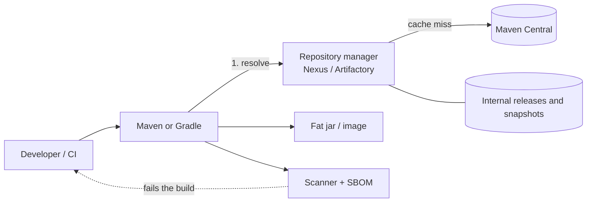

A typical Spring Boot service has 5 to 10 libraries you chose and 100 to 200 you did not: every library brings its own. A bank is asked *which libraries are in this release, which versions, and is any of them vulnerable?* Interviews ask the same: *what is a transitive dependency, how do you fix a version conflict, what is a BOM, what was Log4Shell and how would you have found it, what is an SBOM, and what is dependency confusion?* This lesson builds on [Maven](lesson:maven) and [Gradle](lesson:gradle), and the fixes link to [CI/CD](lesson:cicd-fundamentals) and [cryptography](lesson:cryptography) (checksums and signatures).

> **One sentence to remember:** *Every library you use is code you run in production, so know the full tree (direct and transitive), control the versions in one place with a BOM or platform, scan the tree for known vulnerabilities in CI, keep an SBOM, and fetch everything through a trusted repository manager.*

## Where dependencies come from {#map}



The build never needs to talk to the internet: it asks the **repository manager**, which proxies Maven Central, caches the result and also hosts the bank's **internal** artifacts. That one door is where you control what can enter.

## Direct and transitive dependencies {#tree}

- A **direct** dependency is one you declare in the `pom.xml` or `build.gradle.kts`.
- A **transitive** dependency is a dependency of a dependency. You get it without asking, at the version the chain says.
- The **dependency tree** shows how each library arrived. A library can appear many times, through different paths.

```bash
# Maven: the full tree, including versions that lost a conflict
mvn dependency:tree -Dverbose -Dincludes=org.apache.logging.log4j

# Gradle: why is this library here, and which version won?
./gradlew dependencyInsight --dependency log4j-core --configuration runtimeClasspath
./gradlew dependencies --configuration runtimeClasspath
```

Always read the tree of the **runtime** classpath: that is what ships. A library on the compile classpath only is not in the jar.

## Version conflicts {#conflicts}

Two libraries ask for different versions of the same one. The classpath holds only one, so the tool picks:

| Tool | Rule | Risk |
| --- | --- | --- |
| **Maven** | **nearest** to your project, then **first declared** | can pick an **older** version than a library needs: `NoSuchMethodError` at runtime |
| **Gradle** | the **highest** requested version | can pick a **newer** version than a library was tested with |

Try it in the lab: [Two libraries, two Jackson versions](lab:maven-dependency-conflict).

Ways to take control:

- **Declare it yourself.** A direct dependency is at depth 1 and beats any transitive one in Maven.
- **Manage it:** `dependencyManagement` in Maven, `constraints { }` or a platform in Gradle. This sets the version for the whole tree without adding the library as a direct dependency.
- **Exclude** a transitive dependency you do not want: `<exclusions>` in Maven, `exclude(group = ..., module = ...)` in Gradle.
- **Fail on disagreement** instead of guessing: the **Maven Enforcer** `dependencyConvergence` rule fails the build when paths disagree, and Gradle's `failOnVersionConflict()` does the same.

```xml
<plugin>
  <artifactId>maven-enforcer-plugin</artifactId>
  <executions>
    <execution>
      <id>enforce</id>
      <goals><goal>enforce</goal></goals>
      <configuration>
        <rules>
          <dependencyConvergence/>
          <requireJavaVersion><version>[17,)</version></requireJavaVersion>
          <bannedDependencies>
            <excludes><exclude>commons-logging:commons-logging</exclude></excludes>
          </bannedDependencies>
        </rules>
      </configuration>
    </execution>
  </executions>
</plugin>
```

## BOMs, platforms and version catalogs {#bom}

A **BOM** (bill of materials) is a pom that only lists **managed versions** of libraries that are known to work together. Import it once and omit the versions:

```xml
<dependencyManagement>
  <dependencies>
    <dependency>
      <groupId>org.springframework.boot</groupId>
      <artifactId>spring-boot-dependencies</artifactId>
      <version>3.3.0</version>
      <type>pom</type>
      <scope>import</scope>
    </dependency>
  </dependencies>
</dependencyManagement>
```

```kotlin
dependencies {
    implementation(platform("org.springframework.boot:spring-boot-dependencies:3.3.0"))
    implementation("com.fasterxml.jackson.core:jackson-databind")   // version comes from the platform
}
```

- **Spring Boot** is a BOM plus plugins: this is why Boot starters have no version.
- A **version catalog** (`gradle/libs.versions.toml`) names versions once for the whole Gradle build. A **bank-wide BOM** published to Nexus does the same across many teams: one place to raise a library version for every service.
- To **override** one library in a Boot BOM, set its version property (`<jackson-bom.version>2.17.2</jackson-bom.version>`) or add a constraint, and note why.

## Pinning and reproducible builds {#pinning}

A build is **reproducible** when the same commit resolves the same libraries every time. These break it:

- **Version ranges** (`[1.0,2.0)`, Gradle `1.+`, `latest.release`): the version changes when someone publishes.
- **`-SNAPSHOT`** versions: they are replaced in place.
- **Floating plugin versions** (a plugin with no version in the pom).
- A repository that can serve **different bytes** for the same version.

Use fixed versions and add one of:

- **Gradle dependency locking** (`dependencyLocking { lockAllConfigurations() }`, then `./gradlew dependencies --write-locks`) records the resolved tree in `gradle.lockfile`.
- **Gradle dependency verification** (`gradle/verification-metadata.xml`) stores a **SHA-256 checksum** (and optionally a PGP key) for every artifact and fails the build if the bytes change.
- **Maven** has no lock file by default: fix versions, pin plugins, use `-C` (`--strict-checksums`) and a repository manager that **cannot overwrite released versions**.

## Known vulnerabilities {#vulns}

A **CVE** (Common Vulnerabilities and Exposures) is a public id such as `CVE-2021-44228` for one known flaw. Its **CVSS** score (0 to 10) rates the severity: 9.0 and above is **critical**. A scanner compares the **tree** of your build with a database of CVEs:

| Tool | Where it runs | Notes |
| --- | --- | --- |
| **OWASP Dependency-Check** | Maven/Gradle plugin in CI | free, uses the NVD; fail the build above a CVSS threshold |
| **Dependabot / Renovate** | on the repository | opens pull requests that raise vulnerable or old versions |
| **Snyk, Trivy, Grype** | CI, registry, image | also scan **container images** and OS packages |
| **Nexus IQ / Artifactory Xray** | in the repository manager | blocks a bad component **before** it reaches a build |

```xml
<plugin>
  <groupId>org.owasp</groupId>
  <artifactId>dependency-check-maven</artifactId>
  <configuration>
    <failBuildOnCVSS>7</failBuildOnCVSS>
    <suppressionFile>dependency-check-suppressions.xml</suppressionFile>
  </configuration>
</plugin>
```

A scan has **false positives** (the flaw is in a part you do not use, or the CVE names the wrong library): suppress each one in a reviewed file **with a reason and an expiry date**, never with a blanket ignore.

### Case study: Log4Shell {#log4shell}

How the vulnerability works inside the logger is in the [logging lesson](lesson:java-logging#log4shell).

In December 2021, `CVE-2021-44228` (CVSS 10) in **log4j-core** 2.0 to 2.14.1 let an attacker run code by sending a string such as `${jndi:ldap://...}` that the application merely **logged**. The painful part was not the fix (upgrade to 2.17.1 or later) but **finding where the library was**:

- teams had `log4j-core` only as a **transitive** dependency, inside a fat jar they did not know contained it;
- some products shipped their **own copy** of the jar;
- a bank needed to answer *which of our hundreds of services contain it* within hours.

Teams with an **SBOM** and a scanner in CI answered with a query. The others searched jar files by hand. To fix a transitive dependency quickly, force the version from your own build: a **constraint** or `dependencyManagement` entry, then redeploy.

Try it in the lab: [A scanner finds a vulnerable transitive library](lab:dep-vulnerable-library).

## SBOM {#sbom}

An **SBOM** (software bill of materials) is a machine-readable list of every component in a build, with versions, licences and hashes. The two common formats are **CycloneDX** and **SPDX**.

- Generate it in the build: the **CycloneDX** Maven plugin or the Gradle plugin, then store it with the release artifact.
- Spring Boot can include one in the jar and expose it through Actuator (`/actuator/sbom`).
- It answers *"are we affected by this CVE?"* without unpacking jars, and customers and regulators increasingly ask for it.

## Repository managers and trusted sources {#repos}

A **repository manager** (**Nexus**, **Artifactory**) sits between the builds and the internet:

- **Proxy** repositories cache Maven Central, so builds are fast and still work when Central is down.
- **Hosted** repositories hold your own releases and snapshots. A **release** version must be immutable.
- A **group** repository joins them under one URL, so a build needs just one `<mirror>` or `repositories {}` entry.
- It can block components with a CVE or a bad licence, and logs who downloaded what.

### Dependency confusion {#confusion}

If a build asks several repositories for `com.bank:payments-core:9.9.9`, an attacker can **publish a public package with the same name and a higher version number** on a public repository. A build that takes the **highest version from any repository** installs the attacker's code. **Typosquatting** is the cousin: a name that differs by one letter, in the hope that someone mistypes it.

Try it in the lab: [Dependency confusion: the higher version wins](lab:dep-confusion).

Defences:

- Resolve **only** through the repository manager, never directly from public repositories.
- Add **routing rules** so that your internal group id (`com.bank.*`) is served **only** from the hosted repository, and never looked up on the proxy.
- Reserve your group id on Maven Central, and use fixed versions.
- Verify checksums and, for critical libraries, PGP signatures.

## Licences {#licences}

A library's licence is also a risk. **Permissive** licences (Apache 2.0, MIT, BSD) are fine in a closed product. **Copyleft** licences (**GPL**, **AGPL**) can require you to publish your own source if you distribute or, for AGPL, even offer the code over a network. Legal teams keep an approved list. Enforce it in the build with a licence report (the CycloneDX output, `license-maven-plugin`, or Nexus IQ), not by memory.

## A routine for a bank team {#routine}

1. **One BOM** (or platform) sets the versions; services declare libraries without versions.
2. **Fixed versions**, and lock or verify where the build allows it.
3. **Enforcer** rules: convergence, banned libraries, minimum Java version.
4. **Scan in CI**: dependency scan on every pull request, a failing threshold, reviewed suppressions with expiry dates.
5. **Renovate or Dependabot** raises update pull requests every week, so upgrades are small.
6. **SBOM** is generated and stored with each release.
7. All builds resolve **only through Nexus or Artifactory**, with routing rules for internal group ids.

## Cheat sheet {#cheatsheet}

| Need | Command or setting |
| --- | --- |
| Maven tree with losers | `mvn dependency:tree -Dverbose` |
| Gradle why this version | `./gradlew dependencyInsight --dependency <name>` |
| find upgrades | `mvn versions:display-dependency-updates` |
| fail on conflict | Enforcer `dependencyConvergence` / Gradle `failOnVersionConflict()` |
| force one version | `dependencyManagement` / `constraints { }` |
| scan for CVEs | OWASP Dependency-Check, Trivy, Snyk |
| lock the tree | `gradle.lockfile`, `verification-metadata.xml` |
| SBOM | CycloneDX plugin |
| block bad sources | Nexus/Artifactory group with routing rules |

## Interview questions {#questions}

### [basic] What is a transitive dependency? {#transitive-q}

A dependency of a dependency. If you declare `kyc-client` and it needs Jackson, Jackson comes along without being in your pom. Most libraries in a service are transitive, which is why you must read the dependency tree, not only your own pom.

### [basic] What is a BOM and why use one? {#bom-q}

A bill of materials is a pom (or Gradle platform) that lists versions of libraries that are tested together. Import it and declare libraries without versions. It keeps versions consistent across modules and services and gives one place to raise a version, as Spring Boot's dependencies do.

### [basic] How do you see where a library in your build comes from? {#inspect-q}

`mvn dependency:tree -Dverbose -Dincludes=<groupId>` shows every path, including the versions that lost the conflict. In Gradle, `dependencyInsight --dependency <name>` shows which version was chosen and why, and `dependencies --configuration runtimeClasspath` shows the whole tree.

### [basic] What is a CVE and what is CVSS? {#cve-q}

A CVE is a public identifier for one known vulnerability, for example `CVE-2021-44228`. CVSS is its severity score from 0 to 10, where 9.0 and above is critical. Scanners match your dependency tree against the CVE database, and a build gate usually fails above a chosen score, such as 7.

### [intermediate] How do Maven and Gradle resolve a version conflict? {#conflict-q}

Maven takes the version **nearest** to your project in the tree, and for equal depth the one declared first. That can be older than a library needs. Gradle takes the **highest** version requested. In both, control the result by declaring or managing the version yourself, and use Enforcer or `failOnVersionConflict()` so disagreement fails the build instead of being decided silently.

### [intermediate] A service fails with `NoSuchMethodError` after you add a library. What do you do? {#nsme-q}

The class loaded is an older version than the caller was built for. Run `mvn dependency:tree -Dverbose` (or `dependencyInsight`), find which version won and which library wanted the other, then pin the right version in `dependencyManagement`, a constraint or a BOM. Add convergence enforcement so it cannot recur.

### [intermediate] How do you override one library version that a Spring Boot BOM manages? {#override-q}

Set its version property in the pom (for example `jackson-bom.version`), or in Gradle set the same property or add a constraint. Add a comment on why, and remove the override when the Boot upgrade brings the fixed version.

### [intermediate] What is dependency locking, and how does it differ from fixed versions? {#lock-q}

Fixed versions pin your direct dependencies. Locking records the **entire resolved tree**, including transitive versions, in a lock file such as `gradle.lockfile`, so the same commit always resolves the same libraries. Gradle's dependency verification goes further and checks a checksum for every artifact.

### [intermediate] What is an SBOM and why would a bank want one? {#sbom-q}

A machine-readable inventory of every component in a build, in a format such as CycloneDX or SPDX. When a new CVE is announced, you query the SBOMs of all releases to find affected services in minutes, rather than unpacking jars. Customers and regulators also ask for it.

### [intermediate] How would you stop a vulnerable library reaching production? {#gate-q}

Layers: a Renovate or Dependabot pull request raises the version; the CI dependency scan fails the build above a CVSS threshold; a repository-manager policy blocks the component at download; and the SBOM plus a registry scan catch what is already deployed. Suppressions need a reason and an expiry date.

### [intermediate] What is a repository manager and why use one? {#nexus-q}

A server such as Nexus or Artifactory that proxies and caches Maven Central, hosts internal artifacts, and joins them in one group URL. It makes builds fast and independent of the internet, lets you block bad components, keeps releases immutable and gives an audit trail of what each build used.

### [intermediate] Why are SNAPSHOT versions and version ranges a problem for releases? {#snapshot-q}

Their content changes under the same name, so the same commit can build different jars on different days and you cannot say exactly what shipped. A release should use only fixed release versions, and the build should check this (Enforcer `requireReleaseDeps` in Maven).

### [deep] What is dependency confusion and how do you prevent it? {#confusion-q}

An attacker publishes a public package with the same coordinates as one of your internal ones but a higher version. A build that resolves from several repositories and picks the highest version installs the attacker's jar. Prevent it by resolving only through a repository manager, adding routing rules so the internal group id comes only from the hosted repository, reserving the group id publicly, using fixed versions and verifying checksums.

### [deep] What was Log4Shell, and what did it teach about dependencies? {#log4shell-q}

`CVE-2021-44228` in log4j-core 2.0 to 2.14.1 allowed remote code execution through a logged string using a JNDI lookup. The lesson was about visibility: the library was usually a transitive dependency, sometimes inside a vendor's fat jar. Teams with an SBOM and scanning found affected services fast. The fix was to upgrade (2.17.1 or later), forced through a constraint or `dependencyManagement` when it was transitive.

### [deep] How would you make builds reproducible and verifiable? {#reproducible-q}

Fixed versions for libraries and plugins, no ranges or snapshots in releases, a lock file or dependency verification (checksums and PGP) in Gradle, strict checksum checking and an immutable-release repository in Maven, a pinned JDK and wrapper, and the same build run on CI from a clean workspace. Record the SBOM with the artifact.

### [deep] A scanner reports a critical CVE in a library you only use transitively, and there is no fixed release yet. What do you do? {#nofix-q}

Check whether the vulnerable code is reachable in your usage and read the advisory for a mitigation (a configuration switch, a WAF rule). Look for an alternative library or a fork with a patch, exclude the transitive dependency if you do not need it, and add a **time-limited suppression** with the reasoning and an owner. Record the decision and track the upstream fix.

### [coding] Fail the Maven build on a high-severity CVE and on conflicting versions. {#coding-gate}

```xml
<build>
  <plugins>
    <plugin>
      <groupId>org.apache.maven.plugins</groupId>
      <artifactId>maven-enforcer-plugin</artifactId>
      <version>3.5.0</version>
      <executions>
        <execution>
          <id>enforce-rules</id>
          <goals><goal>enforce</goal></goals>
          <configuration>
            <rules>
              <dependencyConvergence/>
              <requireReleaseDeps><onlyWhenRelease>true</onlyWhenRelease></requireReleaseDeps>
            </rules>
          </configuration>
        </execution>
      </executions>
    </plugin>
    <plugin>
      <groupId>org.owasp</groupId>
      <artifactId>dependency-check-maven</artifactId>
      <version>10.0.3</version>
      <configuration>
        <failBuildOnCVSS>7</failBuildOnCVSS>
        <suppressionFile>dependency-check-suppressions.xml</suppressionFile>
      </configuration>
      <executions>
        <execution><goals><goal>check</goal></goals></execution>
      </executions>
    </plugin>
  </plugins>
</build>
```

Explain that Enforcer runs in the `validate` phase and fails on disagreeing versions, the scan runs at `verify` and fails at CVSS 7 or higher, plugin versions are fixed, and every suppression must be reviewed.

### [coding] In Gradle, force a safe log4j-core version for the whole tree and turn on checksum verification. {#coding-gradle}

```kotlin
dependencies {
    constraints {
        implementation("org.apache.logging.log4j:log4j-core:2.17.1") {
            because("CVE-2021-44228 (Log4Shell) affects 2.0 to 2.14.1")
        }
    }
}

configurations.all {
    resolutionStrategy.failOnVersionConflict()
}
```

```bash
# create gradle/verification-metadata.xml with a checksum for every artifact
./gradlew --write-verification-metadata sha256 build
```

Explain that the constraint overrides the transitive version without making log4j a direct dependency, that `because` documents the reason, and that the verification file makes the build fail if any downloaded artifact changes.
