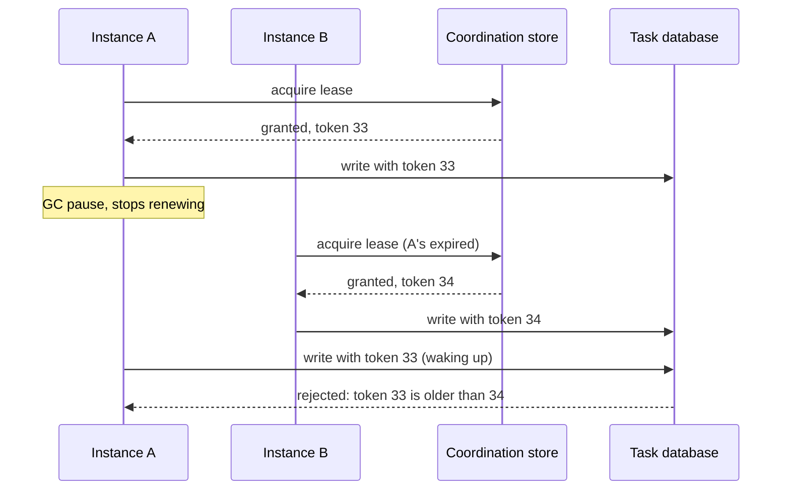
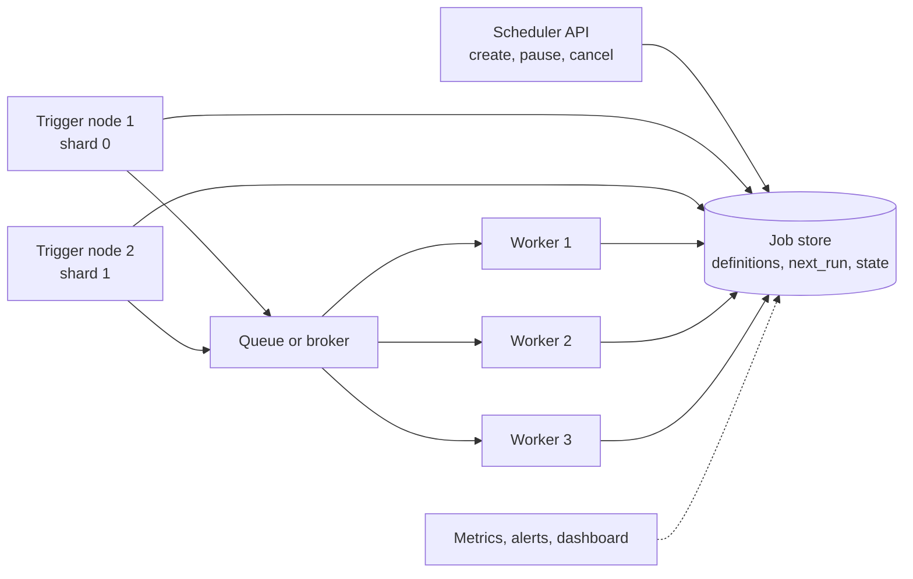

"We scaled the service to three instances and now the nightly job runs three times." That sentence is the start of every distributed scheduler question. Interviewers ask *how do you make a scheduled job run once in a cluster, what happens when the node running it dies, how do you avoid two leaders, how would you design a scheduler for millions of jobs?* This lesson covers the options from a one-line lock to a full scheduling service, and the reliability rules that apply to all of them. It builds on [microservice patterns](lesson:microservice-patterns), uses [idempotency](lesson:microservice-patterns#idempotency) heavily, and its coordination ideas are related to [locks in Java](lesson:java-concurrency) but across processes. Play the three scenes: duplicate runs and a lock, leader failover with fencing, and workers claiming tasks from a database.

```demo
name: scheduler-walk
```

> **One sentence to remember:** *a distributed scheduler answers "who runs this job at this time?" with a lock, a leader, or a database claim, and because a node can die or pause at any moment the answer is at-least-once, so the job must be idempotent.*

## The problem {#problem}

### What goes wrong with @Scheduled {#scheduled}

Spring's `@Scheduled` (and `java.util.concurrent.ScheduledExecutorService`) is a **local** timer inside one JVM. It has no idea that other instances exist.

```java
@Scheduled(cron = "0 0 2 * * *", zone = "Asia/Singapore")     // every instance runs this at 02:00
public void generateDailyStatements() { ... }
```

With three instances the method runs three times. The same happens with Kubernetes replicas, auto-scaling groups and rolling deploys. The requirements for a *distributed* scheduler:

- **At most one run per tick** across the cluster (no duplicates), usually with **at least one** (no missed runs): in practice *exactly one execution effect*.
- **Survive failure:** if the node running the job dies, someone else continues or retries.
- **No single point of failure** in the scheduler itself.
- **Scale:** many jobs, many workers, spread the load.
- **Observability and control:** see what ran, pause, retry, backfill.

### Vocabulary {#vocab}

| Term | Meaning |
| --- | --- |
| **Cron expression** | schedule such as `0 0 2 * * *` (second, minute, hour, day of month, month, day of week in Spring) |
| **Fixed rate / fixed delay** | every N ms from the start of the last run / from the end of the last run |
| **Misfire** | a trigger could not run on time (all nodes down, thread pool busy); a policy decides to skip, run once now, or catch up every missed run |
| **Overlap** | the next tick starts while the previous run is still going |
| **Lease** | a lock with an expiry that the holder must renew; if it stops, the lease lapses on its own |
| **Fencing token** | an increasing number issued with each lease; resources reject writes with an old token |
| **Idempotent job** | running it twice has the same effect as once |
| **Time zone / DST** | a "02:30" job may not exist (or exist twice) on a daylight-saving day; prefer UTC or an explicit zone |

## Approaches {#approaches}

### Overview {#overview}

| Approach | Idea | Good for | Weakness |
| --- | --- | --- | --- |
| **Single dedicated instance** | only one deployment (replicas=1) runs the scheduled code | tiny systems | single point of failure, deploy gaps |
| **Distributed lock (ShedLock)** | every instance tries a named lock; the winner runs | few cron-style jobs in a Spring app | lock expiry and clock edge cases; no scheduling state or UI |
| **Leader election** | one elected leader schedules everything; failover via a lease | several jobs, an existing coordination service | needs fencing; failover delay |
| **Clustered job scheduler (Quartz JDBC)** | triggers and locks stored in a shared database | many jobs, misfire handling, persistence | database as bottleneck, tuning |
| **Database task queue** | tasks are rows; workers claim due rows with `SKIP LOCKED` | high volume, retries, dynamic jobs | polling load, ordering |
| **Platform scheduler (Kubernetes CronJob, cloud scheduler)** | the platform fires a container or HTTP call | batch containers, simple crons | at-most-or-at-least semantics to read carefully, cold start |
| **Workflow engine (Temporal, Airflow, Step Functions)** | durable workflows with schedules, retries, history | long, multi-step, observable processes | extra infrastructure to run |

### Distributed lock with ShedLock {#shedlock}

**ShedLock** makes sure a scheduled method runs at most once at the same time by taking a named lock in a shared store (a JDBC table, Redis, ZooKeeper, MongoDB and others). It is a lock, not a scheduler: the timers still live in every instance.

```java
@Configuration
@EnableScheduling
@EnableSchedulerLock(defaultLockAtMostFor = "10m")
class SchedulingConfig {
    @Bean
    LockProvider lockProvider(DataSource ds) {
        return new JdbcTemplateLockProvider(JdbcTemplateLockProvider.Configuration.builder()
            .withJdbcTemplate(new JdbcTemplate(ds)).usingDbTime().build());   // use the database clock, not the node clock
    }
}

@Component
class StatementJob {
    @Scheduled(cron = "0 0 2 * * *", zone = "UTC")
    @SchedulerLock(name = "daily-statements", lockAtMostFor = "30m", lockAtLeastFor = "1m")
    public void run() { ... }
}
```

The lock table has one row per name (`name`, `lock_until`, `locked_at`, `locked_by`). Acquiring it is one atomic statement, roughly `UPDATE shedlock SET lock_until = ?, locked_by = ? WHERE name = ? AND lock_until <= now()`; the instance that updates one row wins, the others get zero rows and skip.

- **`lockAtMostFor`:** if the winner dies, the lock expires after this time so another instance can run the next tick. Set it **longer than the longest normal run**; otherwise a second instance can start while the first is still working.
- **`lockAtLeastFor`:** keeps the lock for at least this long even if the job finished early, so a node with a slightly fast clock cannot run the same tick again. Use the database time (`usingDbTime`) to avoid clock skew.
- ShedLock does **not** extend the lock while the job runs and does **not** fence: a job that outlives `lockAtMostFor` can overlap with the next one. Make jobs idempotent and size the timeout generously.

### Leader election and fencing {#leader}

Instead of locking every run, elect **one leader** that does the scheduling; the others stand by. Mechanisms:

- **ZooKeeper** (ephemeral sequential nodes, Curator `LeaderLatch`), **etcd** or **Consul** (sessions and leases), **Kubernetes** (a `Lease` object, as in `leader-election` libraries), **Redis** locks with expiry, or a **database row** used as a lease. Spring Integration offers `LockRegistryLeaderInitiator`; Spring Cloud Kubernetes has leader election too.
- The leader holds a **lease** (a lock with a TTL) and **renews** it every few seconds. If it stops (crash, partition, long GC pause) the lease expires after the TTL and another node takes over: failover time is about one TTL.

The hard part is the **zombie leader**: a paused node wakes up believing it is still leader after a new one was elected, and acts. A lease alone cannot prevent that, because the node cannot know it was paused. The fix is a **fencing token**: every acquisition returns a strictly increasing number, the leader sends it with each write, and the resource (database, storage, downstream API) **rejects tokens lower than the highest it has seen**. The second demo scene shows it.



### Quartz in cluster mode {#quartz}

**Quartz** is the classic Java job scheduler: jobs, triggers (cron, simple), calendars, misfire policies and persistence. In **clustered mode** every node uses the same JDBC job store; triggers are claimed with row locks in the database, so each fires on exactly one node, and if a node dies its in-progress jobs can be recovered by another (`requestsRecovery`).

```properties
org.quartz.scheduler.instanceName = statements
org.quartz.scheduler.instanceId = AUTO
org.quartz.jobStore.class = org.quartz.impl.jdbcjobstore.JobStoreTX
org.quartz.jobStore.driverDelegateClass = org.quartz.impl.jdbcjobstore.PostgreSQLDelegate
org.quartz.jobStore.dataSource = app
org.quartz.jobStore.isClustered = true
org.quartz.jobStore.clusterCheckinInterval = 7500
org.quartz.jobStore.misfireThreshold = 60000
org.quartz.threadPool.threadCount = 10
```

Spring Boot integrates it with `spring-boot-starter-quartz` (`spring.quartz.job-store-type=jdbc`). Points to know: all nodes need **synchronised clocks**, the database is the coordinator (lock contention at high trigger rates), the nodes do not share work *within* a job (each job runs on one node), and misfire instructions (`DO_NOTHING`, `FIRE_ONCE_NOW`, `IGNORE_MISFIRE_POLICY`) decide what happens to runs missed during downtime. Lighter alternatives with the same database-backed idea: **db-scheduler**, **JobRunr** (background jobs with a dashboard).

### Database task queue with SKIP LOCKED {#skip-locked}

For high volume or dynamic jobs, make each task a **row** and let workers claim due rows. The key is `SELECT ... FOR UPDATE SKIP LOCKED` (PostgreSQL, MySQL 8, Oracle): a worker locks the rows it takes and ignores rows locked by others, so workers neither block each other nor take the same row.

```sql
-- claim up to 10 due tasks, with a lease
WITH picked AS (
  SELECT id FROM task
  WHERE status IN ('NEW', 'RETRY') AND run_at <= now()
     OR status = 'RUNNING' AND locked_until < now()          -- reclaim tasks of dead workers
  ORDER BY run_at
  LIMIT 10
  FOR UPDATE SKIP LOCKED
)
UPDATE task t
SET status = 'RUNNING', locked_by = :worker, locked_until = now() + interval '5 minutes', attempts = attempts + 1
FROM picked WHERE t.id = picked.id
RETURNING t.*;
```

```java
@Scheduled(fixedDelay = 1000)
void poll() {
    for (Task t : taskRepository.claimDue(workerId, 10)) {      // the query above
        executor.submit(() -> {
            try {
                handler.handle(t);                               // must be idempotent
                taskRepository.markDone(t.getId(), workerId);
            } catch (Exception e) {
                taskRepository.markFailed(t.getId(), workerId, backoff(t.getAttempts()), e);
            }
        });
    }
}
```

This gives retries with backoff, a lease so crashed workers' tasks are reclaimed, parallelism proportional to the number of workers, and simple observability (the table is the state). Costs: polling load (tune the interval, or use `LISTEN/NOTIFY` as a wake-up), no strict global ordering, and the database as the throughput ceiling. The same design with Redis (a sorted set scored by run time), SQS delay queues or Kafka retry topics suits other stacks.

### Kubernetes CronJob and platform schedulers {#k8s}

A Kubernetes **CronJob** creates a Job (a pod) on a schedule, so the platform, not your app, is the scheduler: no instances compete.

```yaml
apiVersion: batch/v1
kind: CronJob
metadata:
  name: daily-statements
spec:
  schedule: "0 2 * * *"
  timeZone: "Asia/Singapore"
  concurrencyPolicy: Forbid          # Allow | Forbid (skip if still running) | Replace
  startingDeadlineSeconds: 300       # how late a missed run may still start
  successfulJobsHistoryLimit: 3
  failedJobsHistoryLimit: 3
  jobTemplate:
    spec:
      backoffLimit: 2                # retries of a failed pod
      activeDeadlineSeconds: 3600
      template:
        spec:
          restartPolicy: OnFailure
          containers:
            - name: statements
              image: registry.example.com/statements:1.4.0
```

Read the documented semantics carefully: a run can occasionally be **skipped or started twice**, so jobs should still be idempotent. The control plane is itself the single scheduler, so you inherit its availability. Cloud equivalents: AWS EventBridge Scheduler, Google Cloud Scheduler, Azure logic apps. They are best for "run this container or HTTP endpoint at 02:00".

### Workflow engines {#workflow}

For multi-step, long-running, observable work use a **workflow engine**: **Temporal** (durable code with built-in schedules, retries, timers, history; also useful for [sagas](lesson:saga)), **Apache Airflow** (batch DAGs, data pipelines), **Camunda**, **AWS Step Functions**, **Spring Batch** with a scheduler for chunked batch processing. They persist the state of each execution, so a crashed worker resumes where it stopped, at the cost of running and learning another platform.

## Designing a scheduler service {#design}

### Architecture {#architecture}

For a generic "schedule millions of jobs" system (a classic design question), separate three concerns: **storage** of job definitions and run state, the **trigger** component that decides what is due, and **workers** that execute.



- **Job store:** job id, schedule (cron or one-off time), payload, `next_run_at`, state, attempt count, owner, lease expiry. Indexed on `(state, next_run_at)`.
- **Triggers:** find jobs with `next_run_at <= now` and enqueue them, then compute the next run. **Shard** the job space (by hash of job id) so each trigger node handles its own slice, with shard ownership held by a lease or coordinator; this scales the finding step and removes the single leader.
- **Queue and workers:** decouple *deciding* from *doing*: the trigger only enqueues (cheap and fast), workers pull and execute, scale independently, and apply retries and concurrency limits per job type.
- **Timers at scale:** polling the table every second works to a point; for very large numbers use an in-memory **priority queue** or a **timing wheel** (hierarchical for long delays) per shard, refilled from the store (for example the next minute of jobs), so the database is read in batches rather than per job.

### Execution semantics {#semantics}

You cannot get exactly-once execution across failures; you get **at-least-once** and make the effect once:

- Give each execution an id such as `jobId + scheduledTime`; pass it to the job as an **idempotency key**; deduplicate in the target (unique constraint, "already processed" table) as in [idempotent consumers](lesson:microservice-patterns#idempotency).
- **At-most-once** (no retry) is acceptable only for jobs where a skipped run is harmless.
- Record run state transitions (`SCHEDULED`, `RUNNING`, `SUCCEEDED`, `FAILED`, `DEAD`) and use **heartbeats or leases** to detect stuck runs; reclaim after the lease expires.
- **Retry** with exponential backoff and a cap; move to a **dead-letter** state after N attempts and alert.
- Control **overlap** (skip, queue or kill the previous run), set **timeouts**, and enforce **concurrency limits** per job type.
- Decide the **misfire** policy explicitly: run once on recovery, run every missed tick, or skip.

### Pitfalls {#pitfalls}

| Pitfall | Consequence | Fix |
| --- | --- | --- |
| `@Scheduled` with several instances | duplicate runs | lock, leader, or platform scheduler |
| `lockAtMostFor` shorter than the job | second run overlaps the first | size above the longest run, make the job idempotent |
| Trusting node clocks | skew causes early or double runs | database time, NTP, `lockAtLeastFor` |
| Lease without fencing | zombie leader writes after failover | fencing tokens checked by the resource |
| Non-idempotent jobs | duplicates after retry or failover | idempotency keys, unique constraints |
| Long job in the scheduler thread | blocks other triggers, thread pool starvation | hand off to a worker pool or queue |
| Cron and time zones | skipped or doubled runs on DST changes | UTC or explicit zone, avoid 02:00 to 03:00 local |
| Everything polls every second | database load | batch claims, backoff, notify-based wake-ups |
| No visibility | stuck jobs go unnoticed | metrics (lag, duration, failures), alerts on "not run since" |
| Thundering herd at :00 | load spike on the hour | add jitter, spread the schedule |

## Cheat sheet {#cheatsheet}

| Need | Use |
| --- | --- |
| Few cron jobs in a Spring service, many instances | ShedLock (`@SchedulerLock`) |
| One scheduler brain with failover | leader election with lease and fencing token |
| Many jobs, misfire handling, persistence | Quartz JDBC cluster, db-scheduler, JobRunr |
| High volume, retries, dynamic tasks | DB task table with `FOR UPDATE SKIP LOCKED` and leases |
| Run a container on a schedule | Kubernetes CronJob (`concurrencyPolicy: Forbid`) |
| Long, multi-step, observable | Temporal, Airflow, Step Functions |
| Never trust | node clocks, "exactly once", an expiring lock without idempotency |
| Always | idempotent jobs, leases, retries with backoff, dead-letter state, metrics |

## Interview questions {#questions}

### [basic] Why does @Scheduled misbehave when you scale a service out? {#scheduled-q}

`@Scheduled` is a local timer inside each JVM, with no knowledge of other instances. With three instances the method fires three times per tick, causing duplicate emails, charges or reports. You need coordination so that only one instance runs each tick: a distributed lock, a leader, a clustered scheduler, or a platform scheduler.

### [basic] What is a distributed lock and how does ShedLock use it? {#shedlock-q}

A lock held in a shared store so processes on different machines can exclude each other. ShedLock keeps a row per lock name in a database (or Redis, ZooKeeper) and acquires it with an atomic conditional update (`lock_until` in the past). The one instance that updates the row runs the job; the others skip that tick. `lockAtMostFor` frees the lock if the holder dies and `lockAtLeastFor` prevents a quick re-run caused by clock differences.

### [basic] What does idempotent mean for a scheduled job, and why does it matter? {#idempotent-q}

Running it twice has the same effect as once. Distributed schedulers guarantee at-least-once execution because of failover, retries and lock expiry, so duplicates will happen. Make the effect safe by keying work on an id (job id plus scheduled time), using unique constraints or an "already processed" check, and writing results with upserts.

### [basic] What is the difference between fixedRate, fixedDelay and a cron expression? {#timers-q}

`fixedRate` starts runs at a constant interval from the start of the previous run (they can overlap or queue if a run is slow); `fixedDelay` waits a set time after the previous run **finishes**, so runs never overlap; a cron expression fires at calendar times (every day at 02:00 in a given time zone). Use cron for business times, fixedDelay for polling.

### [basic] How does a Kubernetes CronJob avoid duplicate runs? {#cronjob-q}

The control plane creates one Job per schedule tick, so your replicas do not compete. `concurrencyPolicy: Forbid` skips a tick while the previous Job is still running, `startingDeadlineSeconds` limits how late a missed run may start, and `backoffLimit` retries failed pods. Occasional skips or double runs are still possible, so the job should be idempotent.

### [intermediate] Compare ShedLock with Quartz in cluster mode. {#shedlock-vs-quartz}

ShedLock is only a lock around methods that are still scheduled locally by every instance: tiny to adopt, no job persistence, no misfire handling, no dynamic jobs, no UI. Quartz clustered stores jobs, triggers and state in the database, fires each trigger on exactly one node, recovers jobs of dead nodes, and supports misfire policies and dynamic scheduling, at the cost of more configuration, database tables and lock contention. Choose ShedLock for a few cron methods, Quartz (or db-scheduler, JobRunr, Temporal) when jobs are numerous, dynamic or must survive restarts with history.

### [intermediate] How does leader election work, and why do you need a fencing token? {#leader-q}

Nodes compete for a lease in a coordination store (ZooKeeper, etcd, Consul, a Kubernetes Lease, a database row). The holder is the leader and renews the lease; if it fails to renew, the lease expires and another node wins. A paused or partitioned old leader may not know it lost the lease and can still act. A **fencing token**, an increasing number issued with each lease and checked by the resource, lets the resource reject writes from the stale leader, which is the only way to make failover safe.

### [intermediate] What happens if the node running a job crashes in the middle? {#crash-q}

The lock or lease expires (`lockAtMostFor`, TTL, `locked_until`), and another node takes over at the next tick or reclaims the task, so the job is run again from the start or from a checkpoint. That is why execution is at-least-once and the job must be idempotent or resumable. A heartbeat or lease on a task row lets the system detect the dead worker promptly; Quartz recovers jobs flagged `requestsRecovery`.

### [intermediate] What is SELECT ... FOR UPDATE SKIP LOCKED and why is it useful for job queues? {#skip-locked-q}

It locks the rows a transaction selects and, instead of waiting, skips rows already locked by other transactions. Several workers can therefore run the same claim query concurrently and each gets different tasks, without blocking and without double-claiming. Combined with a `status`, `locked_until` lease and attempts counter it gives a reliable, scalable queue directly in PostgreSQL or MySQL 8.

### [intermediate] What is a misfire and how do you handle it? {#misfire-q}

A trigger that could not fire on time because all nodes were down or busy. The policy must be explicit: skip it (fine for a periodic cache refresh), run once immediately on recovery (a daily report), or catch up every missed execution (rare, when each tick carries data). Quartz has misfire instructions per trigger; Kubernetes uses `startingDeadlineSeconds`; in your own scheduler store `next_run_at` and decide when polling.

### [intermediate] How do you prevent overlapping runs of the same job? {#overlap-q}

Use `fixedDelay` rather than `fixedRate` locally; across nodes hold a lock for the duration (sized above the longest run, or extended with a heartbeat); in Quartz use `@DisallowConcurrentExecution`; in Kubernetes `concurrencyPolicy: Forbid`; in a task table mark a run `RUNNING` with a lease and skip while it is active. Also enforce a job timeout so a hung run does not block forever.

### [intermediate] How do clocks affect distributed scheduling? {#clocks-q}

Nodes' clocks drift, so one node may think a tick is due earlier than another, or a lock expired when it has not. Reduce the risk by using the database or coordination service as the single time source (`now()` in the SQL), running NTP, giving locks a `lockAtLeastFor`, and never relying on local timestamps for correctness. Fencing tokens give ordering that does not depend on clocks at all.

### [intermediate] How would you schedule jobs per time zone and handle daylight-saving changes? {#timezone-q}

Store schedules with an explicit time zone and compute the next run with a library that knows DST rules (`CronExpression` with `ZoneId`, Quartz `inTimeZone`). Local times that do not exist (the spring-forward gap) or occur twice (fall back) need a policy, and the safest approach for system jobs is UTC. Always keep `next_run_at` in UTC in the store.

### [deep] Design a scheduler that can run millions of jobs reliably. {#design-q}

Separate storage, triggering and execution. Persist job definitions and run state in a database indexed by `(state, next_run_at)`; partition (shard) the jobs by hash so several trigger nodes each own a shard, with shard ownership held by leases; each trigger loads the next window of due jobs into an in-memory timing wheel or priority queue and enqueues them when due; workers consume from a queue with per-type concurrency limits, take a lease, run the job with an idempotency key, heartbeat, and write the outcome; failures retry with backoff, then go to a dead state; expired leases are reclaimed; and metrics (scheduling lag, failures, stuck runs) drive alerts. Add an API for create, pause, cancel and backfill, add jitter to spread peaks, and use fencing tokens for shard owners.

### [deep] Can a distributed scheduler guarantee exactly-once execution? {#exactly-once-q}

Not in the face of crashes and network partitions: a worker may finish the work and die before recording it, so the scheduler cannot know and must either retry (at-least-once) or not (at-most-once). Practical systems provide **at-least-once delivery and make the effect idempotent** (idempotency key per execution, deduplicating writes, transactional outbox), which gives *effectively-once* processing. Where the work and its bookkeeping are in one database transaction the guarantee is exact.

### [deep] What are the problems with using Redis for a scheduler lock? {#redis-lock-q}

A single Redis lock (`SET key value NX PX ttl`) is fast but its safety depends on timing: if the holder pauses longer than the TTL, another gets the lock and both run; a failover to a replica can lose a lock that was not yet replicated; and releasing must check the owner token so a client does not delete another's lock. Redlock across several instances improves availability but is debated for correctness. For critical exclusion use a consensus-based store (ZooKeeper, etcd) or a database, and add fencing tokens and idempotent work either way.

### [deep] How would you run a job on every node, or on exactly one node per shard? {#sharding-q}

For "every node" (cache refresh, local cleanup) a plain `@Scheduled` is right. For one node per shard assign shards by consistent hashing or a coordinator, and give each node a lease per shard (or let ZooKeeper, a Kafka consumer group or Kubernetes StatefulSet ordinals assign them); when a node leaves, its shards are reassigned after the lease expires. The job processes only the keys of its shard and uses fencing for writes.

### [coding] Run a nightly job once across all instances with ShedLock. {#coding-shedlock}

```java
@Component
class StatementJob {

    @Scheduled(cron = "0 0 2 * * *", zone = "UTC")
    @SchedulerLock(name = "daily-statements", lockAtMostFor = "PT30M", lockAtLeastFor = "PT1M")
    public void generate() {
        LocalDate day = LocalDate.now(ZoneOffset.UTC).minusDays(1);
        for (Account a : accounts.findActive()) {
            statements.generateIfAbsent(a.getId(), day);        // idempotent: unique (account_id, day)
        }
    }
}
```

Explain the pieces: the lock name is shared by all instances, `lockAtMostFor` is above the longest run so the lock does not expire mid-job, `lockAtLeastFor` guards against clock skew, the lock table lives in the shared database, and the work is idempotent so a re-run after a crash is harmless.

### [coding] Claim tasks safely from a table with Spring Data JPA. {#coding-claim}

```java
public interface TaskRepository extends JpaRepository<Task, Long> {

    @Query(value = """
        SELECT * FROM task
        WHERE (status IN ('NEW','RETRY') AND run_at <= now())
           OR (status = 'RUNNING' AND locked_until < now())
        ORDER BY run_at
        LIMIT :n
        FOR UPDATE SKIP LOCKED
        """, nativeQuery = true)
    List<Task> lockDue(@Param("n") int n);
}

@Service
class TaskClaimer {
    @Transactional
    public List<Task> claim(String worker, int n) {
        List<Task> tasks = repository.lockDue(n);                        // rows locked until commit
        Instant lease = Instant.now().plus(Duration.ofMinutes(5));
        tasks.forEach(t -> t.start(worker, lease));                      // RUNNING, locked_by, locked_until, attempts + 1
        return tasks;                                                    // commit releases row locks; the lease now protects them
    }
}
```

Mention that the claim transaction is short (claim, mark RUNNING, commit) and the work runs outside it, that the lease handles crashed workers, that `attempts` drives backoff and a dead state, and that the handler must be idempotent because a slow worker can lose its lease and the task can be re-run.

### [coding] Add a fencing check to a write. {#coding-fencing}

```java
@Transactional
public void updateProgress(long taskId, long fencingToken, int done) {
    int rows = jdbc.update("""
        UPDATE task_progress
        SET done = ?, last_token = ?
        WHERE task_id = ? AND last_token <= ?            -- reject anything older than the latest seen token
        """, done, fencingToken, taskId, fencingToken);
    if (rows == 0) {
        throw new StaleLeaderException("token " + fencingToken + " is stale");
    }
}
```

Explain that the resource, not the leader, enforces the rule: each write carries the token received with the lease, the database keeps the highest seen, and a zombie leader with an older token is refused, which keeps data correct even when lease timing goes wrong.
