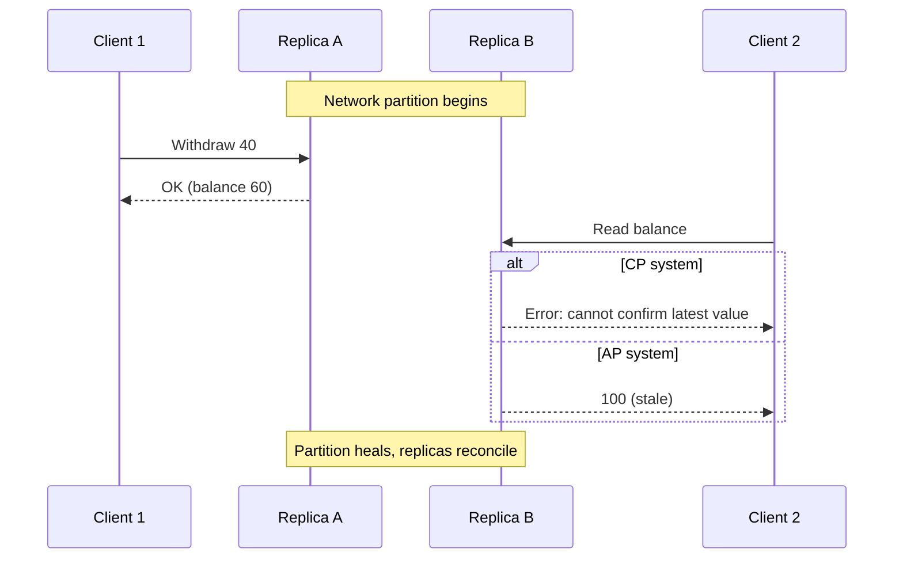
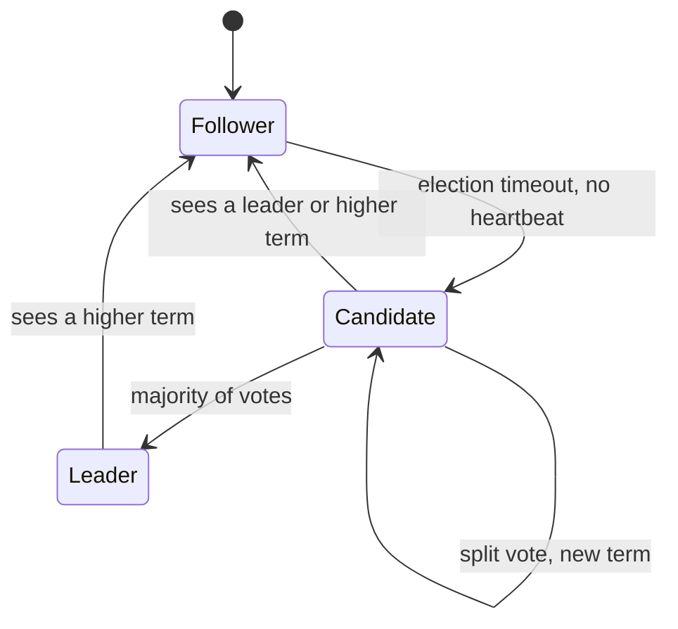

Once you split a system across machines, a new kind of problem appears: parts fail independently, messages are lost or delayed, and no machine has a trustworthy global view. Interviewers use this to see whether you understand *why* patterns like [sagas](lesson:saga), [leader election with fencing](lesson:distributed-scheduler#leader), [idempotent consumers](lesson:messaging#idempotent) and [circuit breakers](lesson:microservice-patterns#circuit-breaker) exist. Questions: *what is the CAP theorem, what does eventual consistency mean, how do quorums work, how does Raft elect a leader, why can't you trust timestamps, what is consistent hashing?* Play the four scenes: a partition (CP vs AP), quorum reads and writes, Raft consensus, and consistent hashing. Examples use banking-style data.

```demo
name: distributed-walk
```

> **One sentence to remember:** *in a distributed system the network will partition, nodes will fail and clocks will disagree, so every design is a trade-off between consistency, availability and latency, and the tools (quorums, consensus, idempotency, logical clocks) exist to make that trade-off explicit and safe.*

## Why it is hard {#why}

### Partial failure and the network {#failure}

On one machine a function either works or the whole process fails. In a distributed system **part of it fails while the rest keeps running**, and you often cannot tell which: a request that times out may have been lost, may still be running, or may have succeeded with the reply lost. You cannot distinguish a **crashed** node from a **slow** one from a **partitioned** one, so every failure detector (heartbeat with a timeout) can be wrong. The consequence for design: assume any call can fail **or** succeed invisibly, make operations **idempotent**, and bound every wait with a timeout.

### The fallacies of distributed computing {#fallacies}

Eight false assumptions (Deutsch and others) that cause real outages: **the network is reliable; latency is zero; bandwidth is infinite; the network is secure; topology does not change; there is one administrator; transport cost is zero; the network is homogeneous.** Each one maps to a mitigation: retries and timeouts, caching and batching, TLS, service discovery, automation, standard protocols.

### Failure models {#models}

| Model | What a faulty node does |
| --- | --- |
| **Crash-stop** | stops and never returns |
| **Crash-recovery** | stops, may restart (with its disk or without) |
| **Omission** | drops some messages |
| **Timing (performance)** | responds, but too late |
| **Byzantine** | behaves arbitrarily, even maliciously (needs 3f+1 nodes; blockchains, aircraft systems) |

Most business systems assume crash-recovery plus an unreliable network, not Byzantine faults. A **network partition** splits nodes into groups that cannot talk to each other but may all be alive.

## CAP and consistency {#cap}


### The CAP theorem {#cap-theorem}

For a data store that is **replicated**, the CAP theorem (Brewer, proved by Gilbert and Lynch) says that during a **network partition (P)** you must choose between:

- **Consistency (C):** every read sees the latest write (strictly, **linearizability**: the system behaves as if there were one copy). A node that cannot confirm it is up to date must refuse to answer.
- **Availability (A):** every request to a working node gets a (non-error) response, even if it may not be the latest data.

Partitions happen in any real network, so **P is not optional**; the choice is **CP or AP when a partition occurs**. "Pick any two of three" is a misleading summary: without a partition you can have both C and A.



| | CP (consistency first) | AP (availability first) |
| --- | --- | --- |
| During a partition | minority side refuses requests | every node keeps answering, possibly stale |
| After healing | simply continues | must reconcile conflicting writes |
| Examples | ZooKeeper, etcd, Consul, HBase, MongoDB (default settings), banking ledgers | Cassandra and DynamoDB (tunable), Riak, many caches and DNS |
| Fits | money, inventory counts, locks, leader election | feeds, carts, counters, session data, caches |

Many systems are **tunable** per operation (quorum settings), so "is database X CP or AP?" usually has the answer "it depends on the configuration".

### PACELC {#pacelc}

CAP only describes the partition case. **PACELC** adds the normal case: **if there is a Partition choose Availability or Consistency; Else (no partition) choose Latency or Consistency.** Even with a healthy network, strong consistency costs latency (waiting for replicas, possibly across regions), so systems classify as PA/EL (fast and loose), PC/EC (always consistent) and mixed.

### Consistency models {#consistency}

From strongest to weakest:

| Model | Guarantee |
| --- | --- |
| **Linearizable (strong)** | operations appear to happen instantly at some point between request and response, in one real-time order; reads see the latest write |
| **Sequential** | all see the same order of operations, which need not match real time |
| **Causal** | operations that are causally related (a reply to a post) are seen in order by everyone; unrelated ones may differ |
| **Read-your-writes, monotonic reads, monotonic writes** (session guarantees) | a client sees its own updates, never goes back in time, and its writes apply in order |
| **Eventual** | if writes stop, all replicas eventually converge; no promise about when or what is read meanwhile |

Practical points: **eventual consistency is not "inconsistent"**, it is a promise of convergence and it is what makes high availability and low latency possible. Choose the **weakest model that keeps the business correct**: a bank transfer needs strong consistency on the balance; a "likes" counter does not. **Linearizability** (single-object, real-time) is different from **serializability** (multi-object transactions with some serial order); a system with both is *strictly serializable*. **ACID** is the single-node transaction ideal, **BASE** (basically available, soft state, eventually consistent) describes the opposite end.

## Replication {#replication}

### Replication styles {#styles}

Copies of data provide **availability** (survive a failure), **lower latency** (data near users) and **read scaling**.

| Style | How | Trade-offs |
| --- | --- | --- |
| **Single-leader** (primary and replicas) | all writes go to the leader, which streams changes to followers | simple, no write conflicts; **replication lag** gives stale reads on followers; failover needs leader election |
| **Multi-leader** | several leaders accept writes (one per data center) | writes stay local and survive a site loss; **write conflicts** need resolution |
| **Leaderless** (Dynamo-style) | client or coordinator writes to several replicas, reads from several | no failover step, tunable consistency with quorums; conflicts and read repair |

**Synchronous** replication waits for followers before acknowledging (no data loss, slower, blocks if a follower is down); **asynchronous** acknowledges immediately (fast, but a leader crash can lose the latest writes and followers lag); **semi-synchronous** waits for one follower. Replication lag causes classic anomalies: a user writes then reads from a lagging replica and sees old data (fix: read-your-writes by reading from the leader or tracking a version), or sees data go backwards (fix: monotonic reads by sticking to one replica).

### Quorums {#quorums}

With **N** replicas, a write waits for **W** acknowledgements and a read queries **R** replicas. If **W + R > N**, every read set overlaps every write set in at least one replica, so a read sees the latest acknowledged write (the replica with the highest version wins). Typical N=3, W=2, R=2.

| Setting | Effect |
| --- | --- |
| W = N, R = 1 | fast reads, writes fail if any replica is down |
| W = 1, R = N | fast writes, slow reads |
| W = 1, R = 1 | fast and available, stale reads possible (W + R is not greater than N) |
| W + R > N | overlapping, "read latest" (assuming no concurrent writes and no sloppy quorum) |

Supporting mechanisms: **read repair** (a read that sees an older replica updates it), **anti-entropy** (background comparison, often with Merkle trees), **hinted handoff** (a node holds writes for a down replica and hands them over later; with a **sloppy quorum** this trades the overlap guarantee for availability). Quorums alone do not give linearizability under concurrent writes; you need versioning or consensus.

### Conflicts and merging {#conflicts}

When two replicas accept different writes to the same data concurrently you must merge:

- **Last write wins (LWW):** keep the highest timestamp. Simple, but silently **loses updates**, and depends on unreliable clocks.
- **Version vectors / vector clocks:** detect that two versions are **concurrent** (neither knows the other) and keep both (siblings) for the application or user to resolve.
- **CRDTs** (conflict-free replicated data types): data structures designed so concurrent updates always merge deterministically (counters, sets, registers); used in collaborative editing and AP stores.
- **Application-level merge:** domain rules, for example "union the carts".

## Partitioning {#partitioning}

### Sharding {#sharding}

When data or traffic exceeds one machine, **partition (shard)** it: each node holds a subset. Strategies:

- **Range partitioning:** contiguous key ranges (good for range scans, risk of **hot spots**, for example a monotonically increasing key writes only to the last shard).
- **Hash partitioning:** hash of the key decides the shard (even spread, but range queries must hit all shards).
- **Directory/lookup:** a mapping table says where each key lives (flexible, the directory is a dependency).

Challenges: **rebalancing** when nodes are added or removed, **hot keys** (one celebrity key), **cross-shard queries and transactions** (expensive, which is why [sagas](lesson:saga) exist), and secondary indexes (local to each shard, or global and updated asynchronously). Replication and partitioning combine: each shard is replicated.

### Consistent hashing {#consistent-hashing}

`hash(key) mod N` remaps nearly every key when N changes. **Consistent hashing** puts nodes and keys on the same **hash ring**; a key belongs to the first node clockwise from it. Adding or removing a node only moves the keys next to it, about **1/N** of all keys. **Virtual nodes** (each physical node owns many points on the ring) even out the load and spread a failed node's keys over many neighbours. It is used in Dynamo-style stores, Cassandra, memcached clients, load balancers and CDNs. The ring also gives natural **replica placement**: store a key on the next R nodes clockwise.

## Consensus {#consensus}

### The problem {#consensus-problem}

**Consensus** means getting several nodes to agree on one value (or an ordered log of values) even though nodes crash and messages are delayed. It underlies **leader election**, **distributed locks**, **atomic broadcast**, configuration stores and replicated state machines. The **FLP impossibility result** shows that no deterministic algorithm can guarantee consensus in a purely asynchronous system if even one node may crash; real algorithms (Paxos, Raft, Zab, Viewstamped Replication) stay **safe** always and are **live** when the network is reasonably well-behaved, using timeouts and randomisation. They need a **majority quorum**: a cluster of **2f + 1** nodes tolerates **f** failures (3 nodes tolerate 1, 5 tolerate 2). Any two majorities overlap, so two conflicting decisions are impossible.

### Raft {#raft}

**Raft** is designed to be understandable. Nodes are in one of three roles:



1. **Leader election:** time is divided into **terms**. If a follower hears no heartbeat before its (randomised) **election timeout**, it becomes a candidate for a new term and requests votes; each node votes at most once per term; a candidate with a **majority** becomes leader and sends heartbeats. Randomised timeouts make split votes rare.
2. **Log replication:** clients send commands to the leader, which appends them to its log and replicates to followers (`AppendEntries`). An entry is **committed** once stored on a majority, then applied to the state machine, and the client is answered.
3. **Safety:** a candidate can win only if its log is at least as up to date as a majority's, so committed entries are never lost, and a stale leader's writes are rejected because of the higher term.

In a partition, the side with a majority continues; the minority cannot elect a leader or commit, so it is **unavailable but never wrong** (CP). Raft is used in **etcd** (Kubernetes' store), **Consul**, CockroachDB, and the quorum controller of recent Kafka versions; **ZooKeeper** uses a similar protocol (Zab). **Paxos** is the older, harder-to-implement ancestor. Applications rarely implement consensus; they **use** it through ZooKeeper, etcd or a database for locks, leader election and metadata, as in the [scheduler lesson](lesson:distributed-scheduler#leader).

### Atomic commit: 2PC {#two-pc}

**Two-phase commit** is atomic commit across resource managers, not consensus: a coordinator asks all participants to *prepare* (vote), and if all vote yes tells them to *commit*. It **blocks** if the coordinator fails after participants have voted (they hold locks and cannot decide alone), which is why microservices avoid it ([why](lesson:microservice-patterns#q-two-phase)). Consensus-based commit (Paxos Commit, Spanner's use of Paxos groups with 2PC across groups) removes the single coordinator as a point of failure.

## Time and ordering {#time}

### Why timestamps lie {#clocks}

Each machine has its own clock, and clocks **drift and jump** (NTP corrections, leap seconds, VM pauses). Two events on different machines cannot be ordered by comparing their wall-clock times, and **last-write-wins on timestamps silently drops writes**. Two clocks are not enough even for a lock: a lease that "expires at 10:00:05" means different instants on different nodes. Use **monotonic clocks** for measuring durations locally, and **logical clocks** for ordering events.

### Logical clocks {#logical-clocks}

- **Happens-before (Lamport):** event `a` happens before `b` if `a` precedes `b` on the same process, or `a` sends a message that `b` receives, or transitively. Events with no such path are **concurrent**.
- **Lamport clock:** each process keeps a counter, increments it on each event, attaches it to messages, and on receive sets `counter = max(local, received) + 1`. If `a` happened before `b` then `L(a) < L(b)`, but not the reverse, so it gives a consistent order but cannot detect concurrency.
- **Vector clock:** each process keeps a vector of counters (one per process); comparing two vectors tells you whether one event happened before the other or they are **concurrent**, which is what conflict detection needs.
- **Hybrid logical clocks (HLC):** combine physical time with a logical counter to get timestamps close to real time yet monotonic and causally consistent (used by CockroachDB). **TrueTime** (Google Spanner) exposes clock uncertainty bounds from GPS and atomic clocks and waits it out to get external consistency.

```java
/** A Lamport logical clock. */
final class LamportClock {
    private long time;

    synchronized long tick() { return ++time; }                          // local event or before sending
    synchronized long onReceive(long remote) {                           // when a message arrives
        time = Math.max(time, remote) + 1;
        return time;
    }
}
```

## Building blocks in practice {#practice}

### Coordination and membership {#coordination}

- **Leader election, locks and configuration** via ZooKeeper, etcd or Consul (consensus-backed), with **leases** and **fencing tokens** to cope with paused nodes ([details](lesson:distributed-scheduler#leader)).
- **Failure detection:** heartbeats with timeouts, or the **phi accrual** detector that outputs a suspicion level instead of a yes/no.
- **Gossip protocols:** nodes periodically exchange state with random peers, spreading membership and metadata epidemically with no central point (Cassandra, Consul).
- **Idempotency, retries with backoff, timeouts and circuit breakers** make unreliable calls safe ([patterns](lesson:microservice-patterns#resilience)).

### Choosing consistency in a design {#design}

Ask for each piece of data: **what is the cost of a stale read, or of a lost or duplicated write?** Money balances, uniqueness constraints, locks and leader state need strong consistency (one primary, consensus store, serializable transactions). Counters, feeds, search indexes, caches and read models can be eventually consistent; make that visible to users (pending states) and design operations to be idempotent and commutative where possible. Mix them: a strongly consistent core with eventually consistent read models and events, linked by the [outbox pattern](lesson:microservice-patterns#outbox) and [messaging](lesson:messaging).

## Cheat sheet {#cheatsheet}

| Topic | Key point |
| --- | --- |
| Failure | partial, undetectable from slow; use timeouts, idempotency, retries |
| CAP | during a partition choose C (refuse) or A (answer, maybe stale); P is not optional |
| PACELC | else (no partition): latency vs consistency |
| Strongest to weakest | linearizable, sequential, causal, session guarantees, eventual |
| Replication | single-leader, multi-leader, leaderless; sync vs async; lag causes stale reads |
| Quorum | W + R > N overlaps; N=3, W=2, R=2 |
| Conflicts | LWW (loses data), vector clocks, CRDTs, app merge |
| Sharding | range, hash, directory; consistent hashing moves ~1/N keys; virtual nodes |
| Consensus | majority (2f+1 tolerates f), leader election and log replication; Raft, Paxos, Zab |
| 2PC | atomic commit, blocks on coordinator failure |
| Time | clocks drift: use logical (Lamport, vector) or hybrid clocks, not wall time, for ordering |
| Use consensus via | ZooKeeper, etcd, Consul, not hand-written |

## Interview questions {#questions}

### [basic] What makes distributed systems hard? {#hard-q}

Partial failure and an unreliable network: nodes crash independently, messages are lost, duplicated, delayed or reordered, and you cannot tell a dead node from a slow one. There is no shared memory, no global clock and no instantaneous global state, so coordination, consistency and debugging become difficult. Designs therefore rely on timeouts, retries, idempotency, replication and consensus.

### [basic] Explain the CAP theorem. {#cap-q}

For a replicated data store, when a network partition occurs you can have either consistency (every read sees the latest write, so a node that cannot confirm it must refuse) or availability (every request to a live node gets an answer, possibly stale), not both. Partitions cannot be avoided, so the real choice is CP or AP during a partition; when there is no partition you can have both. Many systems let you tune the choice per operation.

### [basic] What is eventual consistency? {#eventual-q}

A guarantee that if no new updates are made, all replicas will eventually converge to the same value. Reads in the meantime may return stale data and concurrent writes need merging. It enables high availability and low latency across regions and suits data that tolerates brief staleness (feeds, counters, caches), but not things like account balances without extra control.

### [basic] What is the difference between strong and eventual consistency? {#strong-vs-eventual}

Strong (linearizable) consistency makes the system behave like a single copy: after a write completes, every read returns it, at the cost of coordination latency and reduced availability under partitions. Eventual consistency lets replicas accept reads and writes independently and converge later, giving speed and availability but allowing stale reads and conflicts.

### [basic] What is replication and why is it used? {#replication-q}

Keeping copies of the same data on several nodes for availability (survive failures), lower latency (data near users) and read throughput. Types: single-leader (one writer, followers copy), multi-leader (several writers, conflicts), leaderless (quorums). The costs are replication lag, conflicts and the complexity of failover.

### [basic] What is sharding (partitioning)? {#sharding-q}

Splitting a dataset across nodes so each holds a subset, to scale storage and write throughput beyond one machine. Done by key range, hash or a directory. It brings rebalancing, hot spots and expensive cross-shard queries and transactions, and is combined with replication of each shard for availability.

### [intermediate] What is PACELC? {#pacelc-q}

An extension of CAP: if there is a Partition, choose between Availability and Consistency; Else, when the system is running normally, choose between Latency and Consistency. It captures that even without failures, stronger consistency means waiting for more replicas (higher latency), so a system is described by both choices, for example PA/EL for a fast eventually consistent store and PC/EC for a strongly consistent one.

### [intermediate] How do quorums work, and what does W + R > N mean? {#quorum-q}

With N replicas, a write must be acknowledged by W and a read must consult R replicas. If W + R > N the write set and read set must overlap in at least one replica, so a read includes the latest acknowledged write and the version numbers identify it. Choose W and R to trade write against read latency and availability. Caveats: sloppy quorums, concurrent writes and failed partial writes weaken the guarantee.

### [intermediate] What is replication lag and what anomalies does it cause? {#lag-q}

With asynchronous replication followers apply changes later than the leader, so a read from a follower can be stale. Anomalies: a user writes and then reads their own update from a lagging replica and does not see it (violating read-your-writes), reads going back in time across replicas (monotonic reads), and seeing effects before causes. Mitigations: read from the leader for recent writes, route a user to the same replica, track and wait for the version, or use synchronous replication where it matters.

### [intermediate] How are write conflicts resolved? {#conflicts-q}

Last-write-wins keeps the newest timestamp, which is simple but loses updates and relies on clocks. Vector clocks detect true concurrency and keep both versions for the application to merge. CRDTs make merging automatic and deterministic for suitable data types. Domain-specific merges (union of items, sum of deltas) work when the business rules allow. Best of all, avoid conflicts by routing writes for a key to one place.

### [intermediate] What is consistent hashing and why is it used? {#ch-q}

A hashing scheme in which nodes and keys sit on a ring and each key belongs to the next node clockwise, so adding or removing a node moves only about 1/N of the keys instead of nearly all, as modulo hashing would. Virtual nodes smooth the distribution and spread a failed node's load. It is used for sharding caches and databases, load balancing and replica placement.

### [intermediate] How does Raft elect a leader and replicate a log? {#raft-q}

Time is divided into terms. A follower that gets no heartbeat before its randomised timeout becomes a candidate, increments the term and requests votes; nodes vote once per term; a candidate with a majority becomes leader and sends heartbeats. Clients' commands go to the leader, which appends them to its log and replicates them; once a majority has stored an entry it is committed and applied. A candidate needs an up-to-date log to win, so committed entries survive leader changes.

### [intermediate] Why are majorities (quorums) needed for consensus, and how many nodes do you deploy? {#majority-q}

Any two majorities share a node, so two partitions can never both decide different values and a stale minority cannot commit. A cluster of 2f+1 nodes tolerates f failures, so 3 nodes tolerate one and 5 tolerate two; even sizes add cost without tolerating more (4 nodes still tolerate only 1). Spread nodes over failure domains (zones) and avoid running a consensus cluster across high-latency links.

### [intermediate] What is a split brain and how do you prevent it? {#split-brain-q}

Two parts of a system each believe they are the leader or primary after a partition and accept conflicting writes. Prevent with majority-based election (only one side can have a majority), leases that expire, fencing tokens that make resources reject a stale leader, and STONITH-style isolation in clusters. Consensus systems make split brain impossible by construction for committed data.

### [intermediate] Why can't you rely on timestamps to order events across nodes? {#clock-q}

Clocks drift, are corrected by NTP with jumps and are not synchronised to the precision needed, so a later event on one machine can carry an earlier timestamp than an earlier event on another, and last-write-wins can discard the true latest update. Use logical clocks (Lamport or vector) to capture causality, hybrid logical clocks for bounded closeness to real time, or a single sequencer, and use monotonic clocks to measure elapsed time.

### [deep] What is the difference between linearizability and serializability? {#lin-vs-ser}

Linearizability is a property of operations on a single object: each appears to take effect atomically at some instant between its start and end, consistent with real time, so reads return the latest write. Serializability is about transactions over multiple objects: the outcome equals some serial execution, but that order need not match real time. A database can be serializable without being linearizable, and a key-value store linearizable without transactions; strict serializability gives both, at a high coordination cost.

### [deep] Explain the FLP result and what it means in practice. {#flp-q}

Fischer, Lynch and Paterson proved that in a fully asynchronous system no deterministic algorithm can guarantee that consensus terminates if even one process may crash, because you cannot tell a crashed process from a very slow one. Practical protocols such as Paxos and Raft keep safety unconditionally (never decide inconsistently) and give up guaranteed liveness: they use timeouts and randomised election timers, so they make progress whenever the network is eventually well-behaved.

### [deep] How do Lamport and vector clocks differ? {#lamport-vs-vector}

A Lamport clock is a single counter updated on events and merged with `max + 1` on message receipt; it guarantees that if `a` happened before `b` then `L(a) < L(b)`, but a smaller timestamp does not imply happened-before, so it cannot detect concurrent events. A vector clock keeps one counter per process; comparing two vectors tells whether one precedes the other or they are concurrent, so it supports conflict detection, at the cost of size growing with the number of processes.

### [deep] How would you design a highly available but consistent counter, such as an account balance, across regions? {#balance-design}

Keep one authoritative owner per account (shard by account id with a leader replicated through consensus or a single-leader database with synchronous replication to a nearby replica) so writes are linearizable and an account never accepts conflicting updates; make operations idempotent with request ids; serve reads from replicas with a version check for the places that need the latest value; accept that during a partition the minority side cannot write (CP for balances). For counters that tolerate it (page views) use a CRDT counter. Cross-account transfers use a saga or a single-shard design, not a distributed transaction across regions.

### [coding] Implement consistent hashing with virtual nodes in Java. {#coding-ring}

```java
final class HashRing<N> {
    private final NavigableMap<Long, N> ring = new TreeMap<>();
    private final int virtualNodes;

    HashRing(int virtualNodes) { this.virtualNodes = virtualNodes; }

    void add(N node) {
        for (int i = 0; i < virtualNodes; i++) ring.put(hash(node + "#" + i), node);
    }

    void remove(N node) {
        for (int i = 0; i < virtualNodes; i++) ring.remove(hash(node + "#" + i));
    }

    N nodeFor(String key) {
        if (ring.isEmpty()) throw new IllegalStateException("no nodes");
        Map.Entry<Long, N> e = ring.ceilingEntry(hash(key));          // first node clockwise
        return (e != null ? e : ring.firstEntry()).getValue();        // wrap around the ring
    }

    private static long hash(String s) {                              // any well-distributed hash, not hashCode()
        byte[] d = MessageDigest.getInstance("MD5").digest(s.getBytes(StandardCharsets.UTF_8));   // checked exception handling omitted
        return ByteBuffer.wrap(d).getLong();
    }
}
```

Explain that `TreeMap.ceilingEntry` finds the next point clockwise, that `firstEntry` wraps around, that virtual nodes give an even spread (use 100 or more per node), that adding a node only takes keys in the ranges of its points, and that for replication you would take the next R distinct physical nodes. (The real code handles `NoSuchAlgorithmException`; a non-cryptographic hash such as Murmur3 is also fine.)

### [coding] Implement a vector clock comparison. {#coding-vector}

```java
enum Order { BEFORE, AFTER, EQUAL, CONCURRENT }

static Order compare(Map<String, Long> a, Map<String, Long> b) {
    boolean aLess = false, bLess = false;
    Set<String> nodes = new HashSet<>(a.keySet());
    nodes.addAll(b.keySet());
    for (String n : nodes) {
        long x = a.getOrDefault(n, 0L), y = b.getOrDefault(n, 0L);
        if (x < y) aLess = true;
        if (x > y) bLess = true;
    }
    if (aLess && bLess) return Order.CONCURRENT;     // each knows something the other does not: a conflict
    if (aLess) return Order.BEFORE;                  // a happened before b: b can safely replace a
    if (bLess) return Order.AFTER;
    return Order.EQUAL;
}
```

Explain that BEFORE and AFTER mean one version supersedes the other so it is safe to overwrite, that CONCURRENT means the writes were independent and must be merged or kept as siblings, and why this is better than comparing timestamps.

### [coding] Write quorum read logic that returns the newest version. {#coding-quorum}

```java
record Versioned(String value, long version) {}

Versioned quorumRead(List<Replica> replicas, int r) throws InterruptedException {
    CompletionService<Versioned> cs = new ExecutorCompletionService<>(pool);
    replicas.forEach(rep -> cs.submit(() -> rep.read(key)));
    List<Versioned> answers = new ArrayList<>();
    for (int i = 0; i < replicas.size() && answers.size() < r; i++) {
        try { answers.add(cs.take().get(timeout, MILLISECONDS)); } catch (ExecutionException | TimeoutException ignored) { }
    }
    if (answers.size() < r) throw new UnavailableException("no read quorum");   // CP behaviour: refuse
    Versioned newest = Collections.max(answers, Comparator.comparingLong(Versioned::version));
    readRepair(replicas, newest);                                               // bring stale replicas up to date
    return newest;
}
```

Point out that it answers only after R replicas replied, picks the highest version, refuses when it cannot reach a quorum (consistency over availability), and repairs lagging replicas; and that with W + R > N this read is guaranteed to include the latest acknowledged write.
