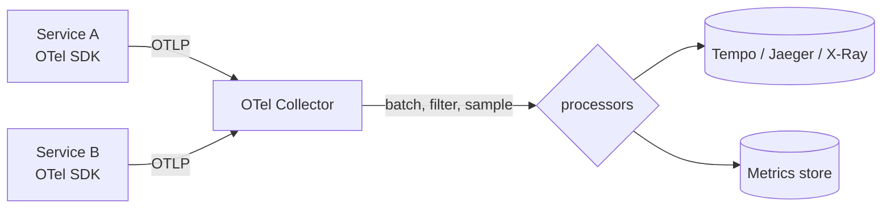

A customer says "the transfer took 8 seconds". The request went through a gateway, the payments service, the ledger, a fraud check, a database and a Kafka topic. The metrics show a slow p99 somewhere and the logs of each service look fine. **Distributed tracing** answers the question the other two cannot: *where did the time go, in this one request, across all services?* Interviews ask: *what is a trace and a span, how does the context travel between services, what is OpenTelemetry, how do you sample, why is my trace broken, and how do you find the slow hop?* This lesson goes deeper than the tracing section of [observability in Spring Boot](lesson:spring-observability#tracing) and connects to [microservice communication](lesson:microservice-communication), [messaging](lesson:messaging) and [logging](lesson:java-logging#mdc).

> **One sentence to remember:** *A trace is the tree of timed spans one request created in every service it touched; it only works if each service receives the trace context from its caller and passes it on (the W3C `traceparent` header, or a message header), and if you keep enough traces, including the slow and failed ones.*

## The three signals {#signals}

| Signal | Answers | Weakness alone |
| --- | --- | --- |
| **Metrics** | *is something wrong, and how bad?* (rates, errors, percentiles) | no detail about one request |
| **Logs** | *what happened here, and why?* | one service at a time, hard to join |
| **Traces** | *where did this request spend its time, and which hop failed?* | sampled, no aggregate view |

They work as one chain: an **alert** on a metric, then an **example trace** from that period (an *exemplar*), then the **slow span**, then the **logs of that span** through the shared trace ID.

## The trace and span model {#model}

A **trace** is everything that happened because of one request. It is a tree of **spans**: a span is one timed operation (an incoming HTTP request, an outgoing call, a database query, a method you chose to time).

```text
trace 0af7651916cd43dd8448eb211c80319c                       total 1 200 ms
gateway    POST /transfers                  |==============================================|
payments    handle /transfers                |=============================================|
payments     call fraud-service                |=========|
payments     call ledger-service                          |==========================|
ledger        POST /entries                                 |========================|
ledger         SELECT balance (JDBC)                         |=|
ledger         INSERT entry (JDBC)                             |=====================|
```

Every span carries:

| Field | Meaning |
| --- | --- |
| `traceId` | shared by all spans of the trace (16 bytes, 32 hex characters) |
| `spanId`, `parentSpanId` | this span (8 bytes) and the span that caused it; the root has no parent |
| **name** | the operation, with **low cardinality**: `POST /transfers` or `GET /accounts/{id}`, never `/accounts/12345` |
| **kind** | `SERVER` (handling a request), `CLIENT` (making one), `PRODUCER` / `CONSUMER` (a message), `INTERNAL` |
| start and end time | gives the duration |
| **status** | `UNSET`, `OK` or `ERROR` |
| **attributes** | key-values: `http.request.method`, `http.response.status_code`, `db.system`, `account.type` |
| **events** | timestamped notes inside the span, such as an exception with its stack trace |
| **links** | references to spans in other traces, for batch or fan-in cases |

A call between services makes **two spans**: a `CLIENT` span in the caller and a `SERVER` span in the callee. The gap between them is **network and queueing time**, which a metric inside either service never shows.

Try it in the lab: [Anatomy of one trace](lab:trace-anatomy).

## Context propagation {#propagation}

For the spans of different services to join one trace, each service must learn the **trace context** from its caller. It travels with the request:

```text
traceparent: 00-0af7651916cd43dd8448eb211c80319c-b7ad6b7169203331-01
             │  └────── trace id (32 hex) ───────┘ └─ parent span id ─┘ └ flags (01 = sampled)
             version
tracestate:  vendor=specific-data         (optional, vendor extras)
baggage:     tenant=retail,channel=app     (optional, user-defined key-values)
```

- **W3C Trace Context** (`traceparent`, `tracestate`) is the standard. Older systems use **B3** headers (Zipkin). The tracing library on each side reads and writes them: it is the **instrumented HTTP client** that adds the header and the **server instrumentation** that reads it.
- The **sampled flag** in `traceparent` carries the head-sampling decision downstream, so a trace is kept or dropped as a whole.
- **Baggage** propagates your own key-values to every service in the trace. It is useful (a tenant or a channel on every span), but it is sent in **headers to every callee, including third parties**: never put secrets or personal data in it.
- **Inside a process** the current span is held in a context (a `ThreadLocal` in classic Java). That context must also cross **thread boundaries**: executors, `@Async`, `CompletableFuture` and reactive pipelines need context propagation, the same problem as the [MDC](lesson:java-logging#mdc).
- **Messaging:** a producer writes the context into **message headers** (Kafka record headers, RabbitMQ properties) and the consumer reads it. A consumer span then continues the trace, or, for a batch, **links** to the producer spans.

A trace **breaks** (the downstream spans appear as a separate trace, or as orphans) wherever the context is not passed on: a legacy service, a gateway that drops unknown headers, a hand-built HTTP client, a queue message without headers, or a thread pool that did not copy the context.

Try it in the lab: [Where a trace breaks](lab:trace-propagation).

## OpenTelemetry {#otel}

**OpenTelemetry** (OTel) is the vendor-neutral standard for traces, metrics and logs: **APIs** and **SDKs** in each language, a wire protocol (**OTLP**, over gRPC on port 4317 or HTTP on 4318), **semantic conventions** (agreed attribute names so every tool understands `http.request.method`), and the **Collector**.

| Piece | Role |
| --- | --- |
| **API** | what code calls to create spans (no-op without an SDK) |
| **SDK** | samples, batches and exports spans |
| **Instrumentation** | libraries that create spans for you: HTTP servers and clients, JDBC, Kafka, gRPC |
| **Java agent** | `-javaagent:opentelemetry-javaagent.jar`: **zero-code** instrumentation of hundreds of libraries at class-load time |
| **Exporter (OTLP)** | sends spans to a Collector or a backend |
| **Resource** | who produced the data: `service.name`, `service.version`, `deployment.environment`; **`service.name` is essential** |
| **Collector** | a separate process that **receives, processes and exports** telemetry |



The **Collector** pipeline is `receivers → processors → exporters`. Running it keeps the application simple (it sends OTLP to one place), moves **batching, retries, sampling and routing** out of the code, lets you change the backend without redeploying services, and can **remove sensitive attributes**. It runs as a sidecar or DaemonSet (an *agent*) or as a central *gateway*, often both.

Try it in the lab: [From SDK to backend through the Collector](lab:trace-collector-pipeline).

## Tracing in Spring Boot {#spring}

Spring Boot 3 uses **Micrometer Observation and Micrometer Tracing** (the successor of Spring Cloud Sleuth, which ended with Boot 2). One **observation** produces a timer, a span and a log context together, and a **bridge** connects Micrometer Tracing to a tracer such as OpenTelemetry (or Brave).

```xml
<dependency><groupId>org.springframework.boot</groupId><artifactId>spring-boot-starter-actuator</artifactId></dependency>
<dependency><groupId>io.micrometer</groupId><artifactId>micrometer-tracing-bridge-otel</artifactId></dependency>
<dependency><groupId>io.opentelemetry</groupId><artifactId>opentelemetry-exporter-otlp</artifactId></dependency>
```

```yaml
spring:
  application:
    name: payments               # becomes service.name
management:
  tracing:
    sampling:
      probability: 1.0           # default is 0.1; use a low value in production (see sampling)
  otlp:
    tracing:
      endpoint: http://otel-collector:4318/v1/traces
logging:
  pattern:
    correlation: "[${spring.application.name:},%X{traceId:-},%X{spanId:-}] "
```

What is traced automatically: incoming **Spring MVC and WebFlux** requests, and outgoing calls made with a client **created from Spring's auto-configured builder** (`RestClient.Builder`, `RestTemplateBuilder`, `WebClient.Builder`). A client built with `new RestTemplate()` or a raw `HttpClient` is **not** instrumented, so the context is not sent: the most common cause of broken traces. Add `spring.kafka.template.observation-enabled=true` and `spring.kafka.listener.observation-enabled=true` for Kafka, and a datasource observation library for JDBC. The trace ID and span ID go into the **MDC**, so every log line carries them.

A custom span for a unit of work that matters:

```java
@Service
class TransferService {
    private final Tracer tracer;
    private final ObservationRegistry registry;

    @Observed(name = "transfer.validate", contextualName = "validate-transfer")   // simplest: annotation (needs the AOP starter)
    void validate(Transfer t) { /* ... */ }

    Receipt execute(Transfer t) {
        Span span = tracer.nextSpan().name("transfer.execute").tag("transfer.type", t.type().name()).start();
        try (Tracer.SpanInScope ws = tracer.withSpan(span)) {
            return doTransfer(t);
        } catch (RuntimeException e) {
            span.error(e);                       // marks the span as an error and records the exception
            throw e;
        } finally {
            span.end();
        }
    }
}
```

**Java agent or Micrometer?** The OTel **agent** needs no code or dependency changes and covers many libraries, which suits quick coverage and legacy services; **Micrometer Tracing** is native to Spring, integrates with Actuator and Boot configuration, and makes the same observation a metric and a span. Do not run both on one service: you get duplicate spans.

## Sampling {#sampling}

Tracing every request costs CPU, network and storage, so you keep a **sample**.

| Strategy | Decided | Pros | Cons |
| --- | --- | --- | --- |
| **Head-based** | at the **start** of the trace, by the first service (a ratio such as 10 percent), then carried in the sampled flag | cheap, simple, no buffering | **cannot know** the trace will be slow or fail, so **rare problems are dropped** |
| **Tail-based** | at the **end**, in the Collector, after seeing the whole trace | keeps **all errors and slow traces** plus a baseline | needs **buffering** (memory), all spans of a trace in **one** Collector instance, and more operations |
| **Always on / always off** | – | complete / free | too costly / blind |

A typical setup: services use **parent-based** head sampling (they respect the incoming sampled flag) at a modest ratio, or sample everything and let the Collector's **`tail_sampling` processor** keep 100 percent of errors, 100 percent of traces over a latency threshold, and 5 percent of the rest. Tail sampling requires a **load-balancing layer keyed by trace ID** so that every span of a trace reaches the same Collector.

```yaml
processors:
  tail_sampling:
    decision_wait: 10s            # how long to buffer a trace before deciding
    num_traces: 50000
    policies:
      - { name: errors,  type: status_code,   status_code: { status_codes: [ERROR] } }
      - { name: slow,    type: latency,       latency: { threshold_ms: 1000 } }
      - { name: baseline, type: probabilistic, probabilistic: { sampling_percentage: 5 } }
```

Try it in the lab: [Head sampling loses the failure](lab:trace-sampling).

## Reading a trace {#reading}

Open the **waterfall** (a Gantt view of the spans) and read it in this order:

1. **The widest span** on the critical path: where the time is.
2. **Gaps** between a `CLIENT` span and its child `SERVER` span: network, queueing or a saturated thread pool, not the callee's code.
3. **Sequential calls that could be parallel**: spans placed one after another with nothing between them.
4. **Many small identical spans** (dozens of `SELECT ... WHERE id = ?`): an **N+1 query** problem, visible only in a trace.
5. **Repeated spans for one call**: retries (and a retry storm) are visible as stacked attempts.
6. **Red (error) spans** and the exception event: which hop failed first.

A **service map** built from the spans shows who calls whom and where errors and latency concentrate. The Collector can also derive **RED metrics** (rate, errors, duration) from spans (a span-metrics connector), so one instrumentation feeds both views.

**Tie the signals together:** the trace ID is in every log line (grep it, or click from the span to the logs in Grafana), metrics carry **exemplars** (a sample trace ID attached to a histogram bucket, so a latency spike links to a real trace), and you return the trace ID in the **error response and a response header** so a customer or a support ticket can quote it.

## Backends {#backends}

| Backend | Notes |
| --- | --- |
| **Jaeger** | open source, a common default for traces, own storage (Elasticsearch, Cassandra) |
| **Grafana Tempo** | open source, stores traces in **object storage** (cheap at scale), integrates with Loki logs and Prometheus metrics |
| **Zipkin** | the original open-source tracer, simple, B3 propagation |
| **AWS X-Ray** | managed, integrates with the AWS services ([AWS service map](lesson:aws-service-map)); OTel data can be exported to it with the ADOT Collector |
| **Datadog, Honeycomb, Dynatrace** | commercial platforms with their own agents and OTLP ingest |

Because the application speaks **OTLP** to a Collector, the backend is a **configuration choice**, not a rewrite.

## Privacy, cost and safety {#safety}

- **Never put secrets or personal data in span attributes or baggage**: no passwords, tokens, full card numbers, full request bodies. Use identifiers. Spans are copied to a third-party store and readable by many people. The same [rules as logging](lesson:java-logging#policy) apply.
- **Sanitise database statements:** record the SQL with parameters as placeholders, never the values.
- **Keep names low cardinality:** `GET /accounts/{id}`, not the real URL. High-cardinality names explode storage and break grouping.
- **Control volume:** sample, limit span attributes and events, and do not instrument every method (a trace of 5 000 spans is unreadable and expensive).
- **Batch exports** asynchronously so the exporter never blocks a request, and set queue and timeout limits.

## Failure modes {#failures}

| Symptom | Likely cause | Fix |
| --- | --- | --- |
| The trace stops at one service; the rest is a separate trace | the context was not forwarded (a client built with `new`, a gateway stripping `traceparent`, a legacy hop) | use instrumented builders, allow the headers, add manual propagation |
| Consumer spans are not linked to the producer | Kafka observation not enabled, or headers dropped by a mirror or a transformer | enable observation, keep the headers, use span links for batches |
| Spans overlap or appear before their parent | **clock skew** between hosts | run NTP/chrony on every node; judge cross-host gaps carefully |
| Context vanishes inside a service | work moved to a thread pool or reactive chain without propagation | context-propagating executors, Reactor automatic context propagation |
| Every service shows as `unknown_service` | `service.name` not set | `spring.application.name` or `OTEL_SERVICE_NAME` |
| You never find the failing request | head sampling at 1 percent dropped it | tail sampling, or always sample errors |
| Duplicate spans | both the Java agent and Micrometer Tracing active | choose one |
| Storage bill explodes | 100 percent sampling, huge attributes, per-method spans | sample, trim, instrument boundaries only |

## A routine for a bank team {#routine}

1. **One standard (OpenTelemetry) and one Collector tier**; the backend can change.
2. **`service.name`, version and environment on every service**.
3. **Propagation tested** end to end, including queues, scheduled jobs and thread pools; a pipeline test that fails if the trace breaks.
4. **Instrument boundaries** (inbound, outbound, database, messaging) and a few business spans, not every method.
5. **Tail sampling** that keeps all errors and slow traces plus a small baseline.
6. **Trace ID in every log line and returned to the caller**; exemplars on latency histograms.
7. **No personal data or secrets in attributes or baggage**; sanitised SQL; attribute limits.
8. **Time sync (NTP)** on all hosts, and a dashboard of dropped spans and exporter failures.

## Cheat sheet {#cheatsheet}

| Need | Use |
| --- | --- |
| Header that carries the context | `traceparent: 00-<traceId>-<spanId>-<flags>` |
| Zero-code instrumentation | OpenTelemetry Java agent (`-javaagent`) |
| Spring Boot 3 tracing | `micrometer-tracing-bridge-otel` + `opentelemetry-exporter-otlp` |
| Where to send it | `management.otlp.tracing.endpoint` (OTLP HTTP 4318, gRPC 4317) |
| Sampling ratio | `management.tracing.sampling.probability` |
| Keep errors and slow traces | Collector `tail_sampling` processor |
| Instrumented HTTP client | built from `RestClient.Builder`, `RestTemplateBuilder`, `WebClient.Builder` |
| Kafka spans | `spring.kafka.template.observation-enabled`, `...listener.observation-enabled` |
| Custom span | `@Observed` or `Tracer.nextSpan()` |
| Join logs and traces | `traceId` in the MDC, `%X{traceId}` |
| Service identity | `service.name` resource attribute |
| Lost context across threads | context-propagating executor, Reactor context |

## Interview questions {#questions}

### [basic] What is distributed tracing and what problem does it solve? {#what-q}

It follows one request across all the services, queues and databases it touches and records each step as a timed span, so you can see where the time went and which hop failed. Metrics show that something is slow and logs show what one service did, but only a trace connects the whole path of a single request.

### [basic] What are a trace, a span, a trace ID and a span ID? {#terms-q}

A trace is the whole journey of one request, a tree of spans. A span is one timed operation with a name, start and end, status and attributes. The trace ID is shared by all spans of the trace; each span has its own span ID and points to its parent's.

### [basic] What are the span kinds? {#kinds-q}

`SERVER` (handling an incoming request), `CLIENT` (making an outgoing call), `PRODUCER` and `CONSUMER` (sending and receiving a message) and `INTERNAL` (work inside a process). A call between services produces a client span and a server span, and the gap between them is network and queueing time.

### [basic] How does the trace context travel from one service to another? {#propagate-q}

In the W3C `traceparent` header (`version-traceId-parentSpanId-flags`) on HTTP calls, and in message headers for brokers. The caller's instrumented client writes it, the callee's server instrumentation reads it and creates its span as a child, and the sampled flag carries the sampling decision with it.

### [intermediate] What is OpenTelemetry and how does it relate to Micrometer Tracing? {#otel-q}

OpenTelemetry is the vendor-neutral standard for traces, metrics and logs: APIs, SDKs, the OTLP protocol, semantic conventions and the Collector. Micrometer Tracing is Spring's tracing facade (the successor of Spring Cloud Sleuth); with the OTel bridge it creates OpenTelemetry spans from Micrometer observations, so one observation gives a metric, a span and log context.

### [intermediate] What does the OpenTelemetry Collector do and why use one? {#collector-q}

It is a separate process with receivers, processors and exporters. Applications send OTLP to it, and it batches, retries, filters, samples, enriches and routes the data to one or more backends. It keeps services simple, lets you change backends without redeploying, centralises sampling and can strip sensitive attributes.

### [intermediate] Java agent or Micrometer Tracing: which would you use? {#agent-q}

The Java agent needs no code changes and instruments many libraries, so it is quick for coverage and legacy or non-Spring services. Micrometer Tracing is native to Spring Boot, configurable through properties and Actuator, and unifies metrics and spans. Use one, not both, or spans are duplicated.

### [intermediate] A trace stops at the payments service and the ledger spans form a separate trace. What do you check? {#broken-q}

Whether the context was forwarded: the payments client may be built with `new RestTemplate()` or a raw HTTP client instead of the auto-configured builder, a gateway or proxy may drop `traceparent`, the call may go through a thread pool or reactive chain without context propagation, or the hop is a queue message without headers. Inspect the outgoing request headers and fix the first place the header is missing.

### [intermediate] What is the difference between head-based and tail-based sampling? {#sampling-q}

Head-based decides at the start of the trace (for example 10 percent) and is cheap but cannot know whether the trace will be slow or fail, so rare problems are dropped. Tail-based decides after the trace completes, in the Collector, so it can keep every error and slow trace plus a baseline, at the cost of buffering and the need to send all spans of a trace to the same Collector.

### [intermediate] How do you trace through Kafka? {#kafka-q}

The producer writes the trace context into the record headers and the consumer reads it, so the consumer span continues the trace. With Spring, enable observation on the template and the listener container. For batch consumers use span links to the producer spans instead of a single parent, and make sure mirror tools and transformations keep the headers.

### [intermediate] How do traces connect to logs and metrics? {#signals-q}

The trace ID and span ID are placed in the MDC, so every log line carries them and you can search the logs of one request or jump from a span to its logs. Exemplars attach a trace ID to a latency histogram bucket so a metric spike links to a real trace. The trace ID is also returned to the caller for support tickets.

### [intermediate] What would you store as span attributes and what never? {#attributes-q}

Store low-risk identifiers and technical facts: route template, status code, database system, account type, outcome, a business ID. Never store passwords, tokens, full card numbers, personal data or request bodies, and sanitise SQL so values are not recorded. Spans go to a shared backend and are readable by many people, so the same rules as logging apply.

### [deep] How would you find why one transfer took 8 seconds? {#slow-q}

Start from the metric to confirm the percentile and endpoint, take an exemplar or a tail-sampled slow trace, and read the waterfall: the widest span on the critical path, the gaps between client and server spans (network or queueing), sequential calls that could be parallel, repeated spans (N+1 queries or retries) and error spans. Then jump from the slow span to the logs by trace ID and fix the specific hop.

### [deep] Why can spans appear out of order or overlap, and what do you do about it? {#skew-q}

Different hosts have slightly different clocks, so a child span recorded on another machine may seem to start before its parent or end after it. Keep NTP or chrony running on every node, treat small cross-host differences as noise, and rely on durations inside one service and on the parent-child structure rather than on absolute timestamps across hosts.

### [deep] Design the tracing setup for 40 services at a bank. {#design-q}

All services use OpenTelemetry (Micrometer Tracing with the OTel bridge for Spring, the agent for others), set `service.name` and version, and send OTLP to a node-level Collector agent that forwards to a gateway tier with a load-balancing exporter keyed by trace ID. The gateway tail-samples (all errors and slow traces, a small baseline) and exports to Tempo or Jaeger and to the metrics store (span metrics). Propagation is tested in the pipeline, including Kafka and thread pools, attributes are reviewed for personal data, the trace ID is in logs and returned in error responses, and dashboards track dropped spans and exporter health.

### [deep] What does tracing cost and how do you keep it affordable? {#cost-q}

Costs are CPU and memory for creating and exporting spans, network traffic, and above all storage and indexing. Keep it affordable by sampling (tail sampling to keep the valuable traces), instrumenting boundaries rather than every method, limiting attributes and events, batching exports asynchronously, using cheap storage such as object storage for traces, and setting retention that matches how long you actually investigate.

### [deep] How do you propagate a trace over an asynchronous hop you wrote yourself? {#manual-q}

Capture the current context where the work is submitted and restore it where the work runs: inject the `traceparent` into the message headers or the task object, and in the consumer extract it and start a span with that parent (or link). For thread pools use a context-propagating executor or wrap the `Runnable` with the current context, and in reactive code use Reactor's context propagation.

### [coding] Configure a Spring Boot service to export traces through the Collector and log the trace ID. {#coding-boot}

```xml
<dependency><groupId>org.springframework.boot</groupId><artifactId>spring-boot-starter-actuator</artifactId></dependency>
<dependency><groupId>io.micrometer</groupId><artifactId>micrometer-tracing-bridge-otel</artifactId></dependency>
<dependency><groupId>io.opentelemetry</groupId><artifactId>opentelemetry-exporter-otlp</artifactId></dependency>
```

```yaml
spring:
  application:
    name: payments
management:
  tracing:
    sampling:
      probability: 1.0                         # sample everything here and let the Collector decide
  otlp:
    tracing:
      endpoint: http://otel-collector.observability:4318/v1/traces
  endpoints:
    web:
      exposure:
        include: health,info
logging:
  pattern:
    correlation: "[${spring.application.name:},%X{traceId:-},%X{spanId:-}] "
```

```java
@Configuration
class HttpClientsConfig {
    @Bean
    RestClient ledgerClient(RestClient.Builder builder) {            // the auto-configured builder is instrumented
        return builder.baseUrl("http://ledger-service").build();
    }
}
```

Explain: the OTel bridge and OTLP exporter send spans to the Collector; `service.name` comes from the application name; every log line gets `[payments,traceId,spanId]`; the client is built from the **injected builder**, otherwise no `traceparent` header would be sent and the trace would break at this hop.

### [coding] Write a Collector pipeline that keeps all errors, all slow traces and 5 percent of the rest. {#coding-collector}

```yaml
receivers:
  otlp:
    protocols:
      grpc: { endpoint: 0.0.0.0:4317 }
      http: { endpoint: 0.0.0.0:4318 }

processors:
  memory_limiter: { check_interval: 1s, limit_mib: 1500 }
  attributes/scrub:
    actions:
      - { key: http.request.header.authorization, action: delete }
      - { key: db.statement, action: delete }
  tail_sampling:
    decision_wait: 10s
    num_traces: 50000
    policies:
      - { name: errors,   type: status_code,   status_code: { status_codes: [ERROR] } }
      - { name: slow,     type: latency,       latency: { threshold_ms: 1000 } }
      - { name: baseline, type: probabilistic, probabilistic: { sampling_percentage: 5 } }
  batch: {}

exporters:
  otlp/tempo:
    endpoint: tempo.observability:4317
    tls: { insecure: true }

service:
  pipelines:
    traces:
      receivers: [otlp]
      processors: [memory_limiter, attributes/scrub, tail_sampling, batch]
      exporters: [otlp/tempo]
```

Explain: the memory limiter protects the Collector; sensitive attributes are removed before storage; the tail sampler keeps every error, every trace slower than a second and a 5 percent baseline; batching reduces export calls. It only works if all spans of a trace reach **this** Collector instance, so an upstream tier uses the load-balancing exporter keyed by trace ID when there is more than one.
