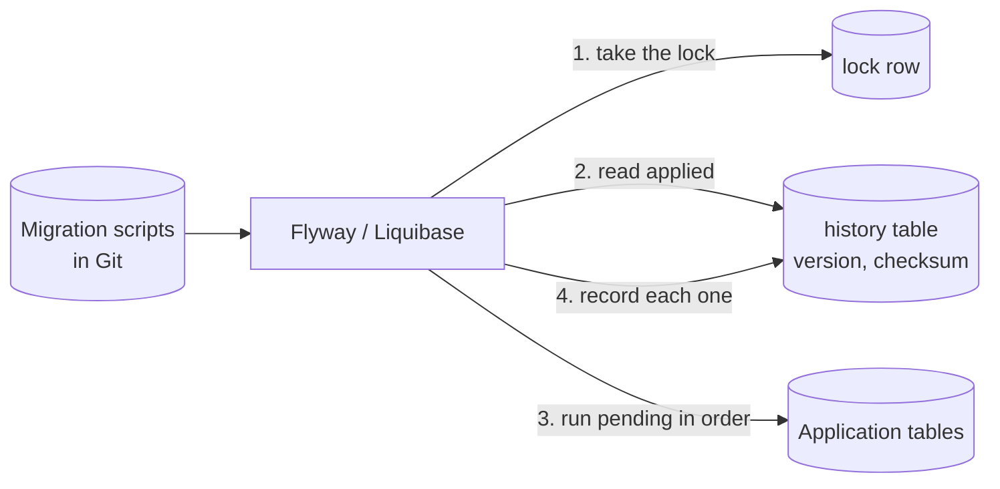

Application code is in Git, built by a pipeline and rolled back with a redeploy. The **schema** is the part that holds the data, so it cannot be redeployed: it must be changed **in place**, on every environment, in the same order, exactly once. Interviews ask: *how do you manage schema changes, what do Flyway and Liquibase do, what happens if someone edits an applied script, how do you roll back, how do two pods not migrate at the same time, and how do you change a column without downtime?* This lesson links to [Spring Data JPA](lesson:spring-data-jpa#practical), [deployment strategies](lesson:deployment-strategies#database) and [CI/CD](lesson:cicd-fundamentals).

> **One sentence to remember:** *A migration tool keeps the schema in version control as an ordered list of change scripts, records which ones each database has already run (with a checksum), applies only the missing ones in one controlled step, and refuses to continue if history was rewritten.*

## Why migrations {#why}

Without a tool, schema changes are an SQL file emailed to the DBA, a developer running `ddl-auto=update` against a shared database, or a wiki page of "run these before you deploy". The result is **schema drift**: test, staging and production slowly stop matching, and nobody can say which scripts ran where.

| Approach | Problem |
| --- | --- |
| Hibernate `ddl-auto=update` or `create` | guesses the diff, never drops or renames, cannot do data changes, and can lock or alter production at start-up |
| Manual scripts run by hand | forgotten, run twice, run in the wrong order, no record |
| **Migration tool** | the same ordered scripts on every environment, each applied once, recorded, reviewable in a pull request |

The tool gives you: **repeatability** (a new developer or a fresh test database reaches the current schema with one command), **an audit trail** (who changed what, when, in which release) and **a gate** (the release stops if a migration fails).

## How a migration tool works {#how}



Every tool does the same five things:

1. **Finds** the scripts (a folder on the classpath, such as `db/migration`).
2. **Locks** the database so only one process migrates at a time.
3. **Reads the history table** in the same database: which changes have run, with a **checksum** of each.
4. **Compares** the list: applied scripts must be unchanged (checksum), and only the **pending** ones, in order, are run.
5. **Records** each success in the history table, so the next run skips it.

Try it in the lab: [Start-up: only the pending migrations run](lab:migrate-startup).

## Flyway {#flyway}

Flyway is **file based and simple**: a migration is a SQL file whose **name** carries the version.

```text
src/main/resources/db/migration/
  V1__create_account.sql
  V2__add_account_status.sql
  V3__index_account_customer.sql
  R__account_summary_view.sql
```

| Kind | Name | Behaviour |
| --- | --- | --- |
| **Versioned** | `V<version>__<description>.sql` (two underscores) | runs **once**, in version order, then is frozen |
| **Repeatable** | `R__<description>.sql` | re-runs **whenever its checksum changes**, after all versioned ones; for views, functions, reference data |
| **Java based** | a class extending `BaseJavaMigration` | for data changes SQL cannot express, such as a backfill with logic |
| **Undo** | `U<version>__...` | a paid-edition feature; most teams **roll forward** instead |

```sql
-- V2__add_account_status.sql
ALTER TABLE account ADD COLUMN status VARCHAR(20) NOT NULL DEFAULT 'ACTIVE';
CREATE INDEX idx_account_status ON account (status);
```

In **Spring Boot** you add the dependency and Flyway runs **before** the application context finishes starting (so JPA sees the finished schema):

```xml
<dependency><groupId>org.flywaydb</groupId><artifactId>flyway-core</artifactId></dependency>
<!-- Flyway 10+: each database has its own module -->
<dependency><groupId>org.flywaydb</groupId><artifactId>flyway-database-postgresql</artifactId></dependency>
```

```yaml
spring:
  flyway:
    locations: classpath:db/migration
    baseline-on-migrate: false      # true only when adopting an existing database
  jpa:
    hibernate:
      ddl-auto: validate            # Hibernate checks the schema, it never changes it
```

Commands (CLI, Maven, Gradle or API): `migrate`, `info` (what is applied or pending), `validate` (checksums and order), `baseline`, `repair` (fix the history table) and `clean` (drops everything: **disabled by default** and never run in production).

The history table is `flyway_schema_history`: one row per migration with version, description, checksum, who ran it, when and whether it succeeded.

## Liquibase {#liquibase}

Liquibase is **change-log based**. A **changelog** is a file that lists **changesets**; each changeset is identified by **id + author + file path**, not by a file name, and can be written in **YAML, XML, JSON or formatted SQL**.

```yaml
# db/changelog/db.changelog-master.yaml
databaseChangeLog:
  - include:
      file: db/changelog/changes/001-create-account.yaml
  - include:
      file: db/changelog/changes/002-add-status.yaml
```

```yaml
# db/changelog/changes/002-add-status.yaml
databaseChangeLog:
  - changeSet:
      id: add-account-status
      author: alice
      changes:
        - addColumn:
            tableName: account
            columns:
              - column: { name: status, type: varchar(20), defaultValue: ACTIVE, constraints: { nullable: false } }
      rollback:
        - dropColumn: { tableName: account, columnName: status }
```

The same changeset as **formatted SQL**, which many teams prefer because reviewers read plain SQL:

```sql
--liquibase formatted sql
--changeset alice:add-account-status
ALTER TABLE account ADD COLUMN status VARCHAR(20) NOT NULL DEFAULT 'ACTIVE';
--rollback ALTER TABLE account DROP COLUMN status;
```

What Liquibase adds beyond running scripts once:

- **Database-independent change types** (`createTable`, `addColumn`, `createIndex`): the same changelog generates the right SQL for PostgreSQL, Oracle or SQL Server, and many have an **automatic rollback**.
- **Preconditions** (`tableExists`, `sqlCheck`) with `onFail: MARK_RAN` or `HALT`, to make a change safe on databases in different states.
- **Contexts and labels** to run a changeset only in some environments (`dev`, `test`, `prod`) or for some features.
- **`runOnChange`** (re-run when the changeset changes, like Flyway's repeatable) and **`runAlways`**.
- **Rollback** by count, tag or date, `diff` between two databases, `generate-changelog` from an existing database, and `status` to list what is pending.

Bookkeeping tables: **`DATABASECHANGELOG`** (one row per changeset with its checksum) and **`DATABASECHANGELOGLOCK`** (a single row that serialises concurrent runs). Spring Boot runs it at start-up when `liquibase-core` is present:

```yaml
spring:
  liquibase:
    change-log: classpath:db/changelog/db.changelog-master.yaml
    contexts: prod
```

Try it in the lab: [A Liquibase changelog with contexts and rollback](lab:migrate-liquibase).

## Flyway or Liquibase {#compare}

| | Flyway | Liquibase |
| --- | --- | --- |
| Unit of change | a **file** with a version in its name | a **changeset** (id, author, path) in a changelog |
| Languages | SQL (and Java) | SQL, YAML, XML, JSON |
| Ordering | by version number | by position in the changelog |
| Portability across databases | write SQL per database | generic change types translate |
| Rollback | undo scripts are a paid feature; roll forward | rollback blocks, many automatic |
| Conditional runs | callbacks and placeholders | preconditions, contexts, labels |
| Learning curve | very low | higher, more concepts |
| Typical fit | one database product, SQL-minded team | several database products, strict change control and audit |

Either is a good answer. State the **rules both enforce** (ordered, applied once, checksum, lock) and choose by the team: Flyway for simplicity, Liquibase when you need portability or rollback blocks.

## Applied migrations are immutable {#immutable}

The most asked question: *what happens if you edit a migration that has already run?*

The history table stored the **checksum** of the script when it ran. On the next start the tool recomputes it, sees a difference and **refuses to start** (`Validate failed: Migration checksum mismatch` in Flyway, `Validation Failed: 1 changesets check sum` in Liquibase). That is deliberate: the database in production no longer matches what the file says, and the tool will not guess.

The fix is **never** to edit the old file or to run `repair` to hide it. Revert the edit and put the change in a **new** migration:

```text
V2__add_account_status.sql     (unchanged, already applied)
V3__make_status_not_null.sql   (the new change)
```

`repair` (Flyway) or `clear-checksums` (Liquibase) exists for the rare case of a harmless change, such as fixing whitespace or a comment, and the change is reviewed first.

Try it in the lab: [Someone edits an applied migration](lab:migrate-checksum).

## Running migrations: start-up or a separate step {#running}

| Where | Good | Risk |
| --- | --- | --- |
| **At application start-up** (Spring Boot default) | nothing extra to run, fine for one instance and local work | several instances start together and race; a slow migration delays the readiness probe; the application needs **DDL rights** in production |
| **A separate pipeline step or Kubernetes Job**, before the rollout | one runner, migration failure stops the release before any traffic moves, the application account can have **limited rights** | one more step to maintain |

Both tools take a **lock** (Flyway a database-specific lock, Liquibase the `DATABASECHANGELOGLOCK` row), so two pods starting together do not apply the same change twice: one migrates and the other **waits**. A crashed run can leave the Liquibase lock held (`release-locks` frees it).

For a bank the usual answer is the **separate step**: migrations run from the pipeline with a dedicated account that owns the schema, the application connects with a **least-privilege** account (select, insert, update, delete), and `spring.flyway.enabled=false` or `spring.liquibase.enabled=false` in the service.

Try it in the lab: [Two pods start together](lab:migrate-concurrent-start).

## Safe changes on a live system {#safe}

A migration runs while the **old version is still serving traffic** (rolling, blue/green or canary), so each one must work for both versions: the [expand and contract](lesson:deployment-strategies#expand-contract-q) pattern.

- **Add, do not change.** A new column is `NULL` or has a default; rename and drop happen in a **later** release, when no old version can return.
- **Mind the lock.** On a large table, `ALTER TABLE` can block reads and writes. Use the database's online options (`CREATE INDEX CONCURRENTLY` in PostgreSQL, `ALGORITHM=INPLACE` in MySQL) and add `NOT NULL` or a foreign key in steps (add as not valid, validate afterwards).
- **Backfill in batches**, outside the DDL migration, so a long update does not hold locks or a transaction open.
- **Set a lock timeout** (`SET lock_timeout = '5s'`) so a migration that cannot get its lock fails fast instead of queueing behind a long query and blocking everything behind it.
- **DDL and transactions differ.** PostgreSQL and SQL Server run DDL in a transaction, so a failed script rolls back whole. **MySQL and Oracle commit DDL implicitly**, so a script that fails halfway leaves the schema half changed: keep one logical change per file.

## Adopting an existing database {#baseline}

A database that already has tables has no history table, so a tool that sees scripts `V1` to `V5` would try to create tables that exist. **Baseline** tells the tool *this database is already at version N*:

- **Flyway:** `baseline` (or `baseline-on-migrate=true` with `baseline-version=5`) records the starting version; only later scripts run.
- **Liquibase:** `generate-changelog` captures the current schema as a first changelog, then `changelog-sync` marks it as already applied.

Baseline **production first and exactly once**, and check that a fresh database built from the scripts matches production (`liquibase diff`, or compare the schema dumps).

## Rollback or roll forward {#rollback}

| Strategy | How | Reality |
| --- | --- | --- |
| **Roll forward** | write a **new** migration that fixes or undoes the change | the default in most teams: simple, tested and recorded like any change |
| **Rollback script** | Liquibase `rollback` blocks, Flyway undo (paid) | works for structure only; **data cannot be rolled back**: a dropped column or a deleted row is gone |
| **Restore a backup** | point-in-time restore | the last resort, and it loses everything written since |

So the real protection is **not rollback**, it is making the change **backward compatible** (expand first), testing it on a copy of production data and keeping the destructive step for a later release.

## Testing migrations {#testing}

- Run the **real** database engine with **Testcontainers** ([why not H2](lesson:spring-testing#testcontainers)), apply all migrations from empty, then start the Spring context with `ddl-auto=validate`: if an entity no longer matches the schema, the test fails.
- Run the migrations in the pipeline against a **copy of production-sized data** before production, to see how long a lock or backfill takes.
- Add **a test that two branches did not create the same version**: in Flyway two files named `V5__...` from two merged branches fail the build with a duplicate-version error.
- Use **repeatable** migrations or a seeding step for test data, never a versioned migration that exists only in test.

```java
@SpringBootTest
@Testcontainers
class MigrationsTest {
    @Container @ServiceConnection
    static PostgreSQLContainer<?> db = new PostgreSQLContainer<>("postgres:16");

    @Test void migrationsApplyAndEntitiesMatchTheSchema() { }   // context start applies Flyway, then Hibernate validates
}
```

## Common failures {#failures}

| Symptom | Cause | Fix |
| --- | --- | --- |
| `Migration checksum mismatch` | an applied script was edited | revert, add a new migration |
| `Detected resolved migration not applied` / out of order | a lower version merged after a higher one already ran | renumber, or allow `outOfOrder` deliberately |
| `Found non-empty schema without schema history table` | an existing database with no baseline | baseline it |
| A failed migration, then every start fails | a half-applied script (MySQL, Oracle) leaves a failed entry | fix the schema by hand, then `repair` or remove the failed row |
| Liquibase waits forever for the lock | a previous run was killed while holding it | `release-locks` after checking nobody is migrating |
| Application fails with `Schema-validation: missing column` | the entity changed but no migration was added | add the migration; never fix it with `ddl-auto=update` |

## With Hibernate {#hibernate}

The tool owns the **schema**, Hibernate only **uses** it. Set `ddl-auto=validate` (or `none`) in every shared environment so the application fails fast on a mismatch. Hibernate's schema generation (`jakarta.persistence.schema-generation`) is still useful to **draft** a migration: generate the SQL, review and edit it, then commit it as a versioned file.

## A routine for a bank team {#routine}

1. **Every schema change is a migration** in the same pull request as the code that needs it.
2. **Never edit an applied migration**; fix forward with a new one.
3. **One logical change per file**, named clearly, reviewed like code (a DBA can be a required reviewer).
4. **Backward compatible** changes only: expand now, contract in a later release.
5. **Migrations run as a pipeline step** with a schema-owner account; the application account has no DDL rights.
6. **Tested** from an empty database with Testcontainers and on production-sized data before release.
7. `ddl-auto=validate`, `clean` disabled, and a **backup** point before risky releases.

## Cheat sheet {#cheatsheet}

| Need | Flyway | Liquibase |
| --- | --- | --- |
| Run pending changes | `migrate` | `update` |
| See state | `info` | `status`, `history` |
| Check checksums | `validate` | `validate` |
| Adopt an existing database | `baseline` | `generate-changelog` + `changelog-sync` |
| Fix the history | `repair` | `clear-checksums`, `release-locks` |
| Roll back | roll forward (undo is paid) | `rollback`, `rollback-count`, `rollback-to-date` |
| History table | `flyway_schema_history` | `DATABASECHANGELOG` (+ `DATABASECHANGELOGLOCK`) |
| Spring Boot setting | `spring.flyway.*` | `spring.liquibase.*` |
| File location | `db/migration` | `db/changelog/db.changelog-master.yaml` |

## Interview questions {#questions}

### [basic] Why use a migration tool instead of `ddl-auto=update`? {#why-q}

`ddl-auto=update` guesses the difference at start-up: it never drops or renames, cannot change data, differs per environment and needs DDL rights in production. A migration tool keeps explicit, reviewed, ordered scripts in Git and applies each exactly once per database, with a record of what ran, so every environment reaches the same schema.

### [basic] What are Flyway and Liquibase? {#what-q}

Two migration tools for version-controlling a database schema. Flyway uses versioned SQL files (`V3__add_status.sql`); Liquibase uses a changelog of changesets written in SQL, YAML, XML or JSON. Both record applied changes in a history table in the database and apply only the pending ones.

### [basic] What is a schema history table? {#history-q}

A table the tool creates in your database (`flyway_schema_history`, `DATABASECHANGELOG`) with one row per applied migration: its version or id, description, checksum, time and result. It is how the tool knows what has already run, so each environment applies exactly what it is missing.

### [basic] How are Flyway migration files named? {#naming-q}

`V<version>__<description>.sql` for versioned ones (`V2__add_status.sql`, two underscores), `R__<description>.sql` for repeatable ones, and `U<version>__...` for undo (paid edition). Versions are compared as numbers, so `V10` runs after `V2`.

### [intermediate] What happens if someone edits a migration that has already been applied? {#checksum-q}

The stored checksum no longer matches, so on the next start the tool fails validation and the application does not start. This is intended: the database no longer matches the script. Revert the edit and add a **new** migration for the change. `repair` or `clear-checksums` is only for harmless edits such as a comment, and is reviewed first.

### [intermediate] What is the difference between versioned and repeatable migrations? {#repeatable-q}

A versioned migration runs **once**, in order, and is then immutable. A repeatable one (`R__...` in Flyway, `runOnChange` in Liquibase) is **re-applied whenever its content changes**, after the versioned ones. Use repeatable for objects that are replaced as a whole, such as views, functions, stored procedures and reference data.

### [intermediate] How is a changeset identified in Liquibase? {#changeset-q}

By **id, author and file path** together, not by file name. Renaming or moving a changelog file therefore changes the identity and would run the changes again, unless `logicalFilePath` is set. Each changeset also has a checksum, and changing an applied one fails validation like in Flyway.

### [intermediate] Two pods start at the same time. How do they not both migrate? {#lock-q}

The tool takes a lock first: Flyway uses a database-specific lock, Liquibase the `DATABASECHANGELOGLOCK` row. The first instance migrates, the second waits and then sees nothing pending. Better still, run migrations as a **separate step** (a pipeline stage or Kubernetes Job) before the rollout, so start-up never depends on it.

### [intermediate] Where should migrations run: at application start or in the pipeline? {#where-q}

At start-up is the Spring Boot default and fine for local work and a single instance. In production, prefer a **separate step before the deploy**: a failure stops the release before traffic moves, a slow migration does not fail health checks, and the application account needs no DDL rights. It also gives one place and one log for the change.

### [intermediate] How do you adopt Flyway or Liquibase on a database that already exists? {#baseline-q}

Baseline it: tell the tool the existing schema is already at version N. In Flyway, `baseline` (or `baseline-on-migrate` with `baseline-version`); in Liquibase, `generate-changelog` to capture the schema and `changelog-sync` to mark it applied. Only newer migrations then run. Verify that a fresh database built from the scripts matches production.

### [intermediate] How do you roll back a migration? {#rollback-q}

Mostly you **roll forward**: write a new migration that fixes or reverses the change. Liquibase has `rollback` blocks and Flyway has undo scripts in a paid edition, but they only restore structure; data that was dropped or overwritten is gone. The real safeguard is making changes backward compatible, testing on production-like data, and keeping a backup before risky releases.

### [intermediate] Why must a migration work with the old version of the application? {#compat-q}

During a rolling, blue/green or canary release the **old code keeps running against the new schema** for a while, and after a rollback it runs again. A migration that drops or renames a column in the same release breaks the old version. Use expand and contract: add first, switch the code, and remove in a later release.

### [intermediate] What is `ddl-auto` and what should it be in production? {#ddl-q}

A Hibernate setting for schema generation: `create`, `create-drop`, `update`, `validate` and `none`. In production use `validate` (the application checks that the schema matches the entities and fails fast otherwise) or `none`, and let Flyway or Liquibase own all changes.

### [deep] A migration fails halfway in production. What happens and what do you do? {#failed-q}

It depends on the database. In **PostgreSQL** DDL is transactional, so the script rolls back and nothing is recorded. In **MySQL and Oracle** DDL commits implicitly, so earlier statements stay applied and the tool records a failed migration, and later starts fail. Stop the release, repair the schema to a known state by hand (or finish the change), then `repair` the history. Prevent it with one logical change per file and a rehearsal on a production-sized copy.

### [deep] How do you add a `NOT NULL` column to a table with 200 million rows without an outage? {#bigtable-q}

Expand in steps. Add the column as nullable (or with a default, which is instant on modern PostgreSQL), deploy code that writes it, **backfill in batches** from a separate job, then add the constraint in a way that does not hold a long lock (`ADD CONSTRAINT ... NOT VALID` then `VALIDATE CONSTRAINT`). Set a short `lock_timeout` on each statement so it fails rather than queues, and run it off-peak.

### [deep] Two developers each add `V5__...` on different branches. What happens, and how do you avoid it? {#conflict-q}

After the merge there are two files with the same version and Flyway fails with a duplicate-version error (or, worse, one runs on a database where the other already ran). Prevent it with a CI check that fails the pull request, by rebasing and renumbering before the merge, or by timestamp-based versions such as `V20261123_1030__...`. Liquibase avoids it because ordering is the changelog list, but two changesets can still conflict in what they change.

### [deep] How would you design schema changes for a bank's regulated release process? {#bank-q}

Every change is a migration reviewed in a pull request (with a DBA for risky ones) and linked to a ticket. The pipeline applies it first in test and staging, with an approval gate before production, using a schema-owner account the application never has. Changes are backward compatible, destructive steps wait for a later release, the history table is the audit trail, and a backup or point-in-time restore point exists before each release.

### [coding] Write the Flyway migrations to add `status` to `account` safely. {#coding-flyway}

```sql
-- V7__expand_account_status.sql  (release N)
ALTER TABLE account ADD COLUMN status VARCHAR(20) NULL;
CREATE INDEX CONCURRENTLY idx_account_status ON account (status);   -- PostgreSQL: not allowed inside a transaction

-- V8__account_status_not_null.sql  (release N+1, after the backfill is verified)
ALTER TABLE account ADD CONSTRAINT account_status_nn CHECK (status IS NOT NULL) NOT VALID;
ALTER TABLE account VALIDATE CONSTRAINT account_status_nn;
```

Explain: `V7` is additive, so the old version still inserts rows without `status`; `CREATE INDEX CONCURRENTLY` must run outside a transaction, so that file needs `executeInTransaction=false` in a `V7__expand_account_status.sql.conf` file next to it; the backfill is a separate batch job; `V8` adds the constraint as `NOT VALID` (fast) and validates afterwards (no long write lock); and neither file is ever edited once applied.

### [coding] Write the Liquibase changeset with a rollback and a context. {#coding-liquibase}

```sql
--liquibase formatted sql

--changeset alice:add-account-status context:prod,staging
ALTER TABLE account ADD COLUMN status VARCHAR(20) NOT NULL DEFAULT 'ACTIVE';
--rollback ALTER TABLE account DROP COLUMN status;

--changeset alice:seed-test-accounts context:test runOnChange:false
INSERT INTO account (id, status) VALUES (1, 'ACTIVE'), (2, 'CLOSED');
--rollback DELETE FROM account WHERE id IN (1, 2);
```

Explain: the id and author make the changeset unique; the first one runs only in `prod` and `staging`, the second only when the context is `test`, so test data never reaches production; each has an explicit `rollback` because raw SQL cannot be reversed automatically; and `spring.liquibase.contexts` selects the environment.
