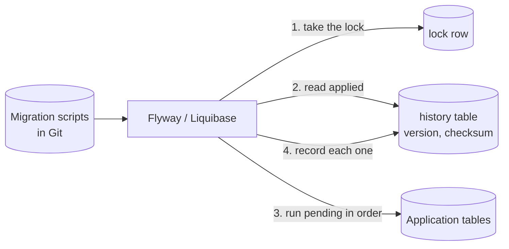

Application code lives in Git. A pipeline builds it, and you roll it back by deploying the old version again.

The **schema** (the tables, columns and indexes) is different, because it holds the data. You cannot just redeploy it. You must change it **in place**, on every environment, in the same order, exactly once.

A **migration** is one such change, written as a script. A **migration tool** runs these scripts for you.

Interviewers ask:

- How do you manage schema changes?
- What do Flyway and Liquibase do?
- What happens if someone edits a script that has already run?
- How do you roll back?
- How do you stop two pods from migrating at the same time?
- How do you change a column without downtime?

Related lessons: [Spring Data JPA](lesson:spring-data-jpa#practical), [deployment strategies](lesson:deployment-strategies#database) and [CI/CD](lesson:cicd-fundamentals).

> **One sentence to remember:** *A migration tool runs each change script once, in order, and stops if an old script was edited.*

## Why migrations {#why}

Without a tool, schema changes happen in messy ways:

- An SQL file is emailed to the DBA.
- A developer runs `ddl-auto=update` against a shared database.
- A wiki page lists the scripts to "run before you deploy".

The result is **schema drift**: test, staging and production slowly stop matching, and nobody can say which scripts ran where.

| Approach | Problem |
| --- | --- |
| Hibernate `ddl-auto=update` or `create` | It guesses the difference. It never drops or renames anything, and it cannot change data. It can also lock or change production tables when the application starts. |
| Scripts run by hand | People forget them, run them twice or run them in the wrong order, and there is no record. |
| **Migration tool** | The same ordered scripts run on every environment. Each runs once, is recorded, and can be reviewed in a pull request. |

A migration tool gives you three things:

1. **Repeatability.** A new developer, or a fresh test database, reaches the current schema with one command.
2. **An audit trail.** You can see who changed what, when, and in which release.
3. **A gate.** The release stops if a migration fails.

## How a migration tool works {#how}



A **checksum** is a short number calculated from the text of a script. If the script changes, even by one character, the checksum changes.

Every tool does the same five things:

1. **It finds the scripts**, usually in a folder on the classpath such as `db/migration`.
2. **It takes a lock** on the database, so only one process migrates at a time.
3. **It reads the history table** in the same database. This table lists the changes that have already run, with the checksum of each.
4. **It compares.** The scripts that already ran must be unchanged (same checksum). Only the **pending** scripts, the ones that have not run yet, are run, in order.
5. **It records** each success in the history table, so the next run skips it.

Try it in the lab: [Start-up: only the pending migrations run](lab:migrate-startup).

## Flyway {#flyway}

Flyway is **simple and based on files**. A migration is a SQL file, and the file **name** holds the version.

```text
src/main/resources/db/migration/
  V1__create_account.sql
  V2__add_account_status.sql
  V3__index_account_customer.sql
  R__account_summary_view.sql
```

| Kind | Name | Behaviour |
| --- | --- | --- |
| **Versioned** | `V<version>__<description>.sql` (two underscores) | It runs **once**, in version order. After that it must never change. |
| **Repeatable** | `R__<description>.sql` | It runs again **whenever its checksum changes**, after all the versioned ones. Use it for views, functions and reference data. |
| **Java based** | A class that extends `BaseJavaMigration` | It is for data changes that SQL cannot express, such as filling a column with logic. |
| **Undo** | `U<version>__...` | It is only in the paid edition. Most teams **roll forward** instead (fix with a new migration). |

```sql
-- V2__add_account_status.sql
ALTER TABLE account ADD COLUMN status VARCHAR(20) NOT NULL DEFAULT 'ACTIVE';
CREATE INDEX idx_account_status ON account (status);
```

In **Spring Boot** you add the dependency, and Flyway runs **before** the application finishes starting. So JPA sees the finished schema.

```xml
<dependency><groupId>org.flywaydb</groupId><artifactId>flyway-core</artifactId></dependency>
<!-- Flyway 10+: each database has its own module -->
<dependency><groupId>org.flywaydb</groupId><artifactId>flyway-database-postgresql</artifactId></dependency>
```

```yaml
spring:
  flyway:
    locations: classpath:db/migration
    baseline-on-migrate: false      # true only when adopting an existing database
  jpa:
    hibernate:
      ddl-auto: validate            # Hibernate checks the schema, it never changes it
```

You can run Flyway from the command line, Maven, Gradle or Java code. The commands:

- `migrate` runs the pending migrations.
- `info` shows which migrations are applied and which are pending.
- `validate` checks the checksums and the order.
- `baseline` marks an existing database as being at a version.
- `repair` fixes the history table.
- `clean` drops everything. It is **disabled by default**, and you never run it in production.

The history table is called `flyway_schema_history`. It has one row per migration, with the version, description, checksum, who ran it, when, and whether it succeeded.

## Liquibase {#liquibase}

Liquibase is **based on a changelog**.

- A **changelog** is a file that lists **changesets**.
- A **changeset** is one change. It is identified by its **id + author + file path**, not by a file name.
- You can write changesets in **YAML, XML, JSON or formatted SQL**.

```yaml
# db/changelog/db.changelog-master.yaml
databaseChangeLog:
  - include:
      file: db/changelog/changes/001-create-account.yaml
  - include:
      file: db/changelog/changes/002-add-status.yaml
```

```yaml
# db/changelog/changes/002-add-status.yaml
databaseChangeLog:
  - changeSet:
      id: add-account-status
      author: alice
      changes:
        - addColumn:
            tableName: account
            columns:
              - column: { name: status, type: varchar(20), defaultValue: ACTIVE, constraints: { nullable: false } }
      rollback:
        - dropColumn: { tableName: account, columnName: status }
```

Here is the same changeset as **formatted SQL**. Many teams prefer it, because reviewers can read plain SQL:

```sql
--liquibase formatted sql
--changeset alice:add-account-status
ALTER TABLE account ADD COLUMN status VARCHAR(20) NOT NULL DEFAULT 'ACTIVE';
--rollback ALTER TABLE account DROP COLUMN status;
```

Liquibase does more than run each script once:

- **Change types that work on any database**, such as `createTable`, `addColumn` and `createIndex`. The same changelog produces the right SQL for PostgreSQL, Oracle or SQL Server. Many of these types can also be **rolled back automatically**.
- **Preconditions**, such as `tableExists` or `sqlCheck`. They make a change safe on databases that are in different states. With `onFail: MARK_RAN` the changeset is skipped and marked as run. With `HALT` the run stops.
- **Contexts and labels**. They run a changeset only in some environments (`dev`, `test`, `prod`) or only for some features.
- **`runOnChange`** runs a changeset again when it changes, like Flyway's repeatable migrations. **`runAlways`** runs it every time.
- **Other commands.** You can roll back by count, tag or date. `diff` compares two databases. `generate-changelog` creates a changelog from an existing database. `status` lists what is pending.

Liquibase keeps two bookkeeping tables:

- **`DATABASECHANGELOG`** has one row per changeset, with its checksum.
- **`DATABASECHANGELOGLOCK`** has a single row. It makes runs that start at the same time wait for each other.

Spring Boot runs Liquibase at start-up when `liquibase-core` is on the classpath:

```yaml
spring:
  liquibase:
    change-log: classpath:db/changelog/db.changelog-master.yaml
    contexts: prod
```

Try it in the lab: [A Liquibase changelog with contexts and rollback](lab:migrate-liquibase).

## Flyway or Liquibase {#compare}

| | Flyway | Liquibase |
| --- | --- | --- |
| Unit of change | A **file** with a version in its name. | A **changeset** (id, author, path) in a changelog. |
| Languages | SQL and Java. | SQL, YAML, XML and JSON. |
| Order | By version number. | By position in the changelog. |
| Different database products | You write SQL for each database. | Generic change types are translated for each database. |
| Rollback | Undo scripts are a paid feature, so teams roll forward. | Rollback blocks, and many are automatic. |
| Running a change only sometimes | Callbacks and placeholders. | Preconditions, contexts and labels. |
| Learning curve | Very low. | Higher, with more concepts. |
| Typical fit | One database product and a team that likes SQL. | Several database products, strict change control and audit. |

Either one is a good answer in an interview. First name the **rules both enforce**: scripts run in order, each runs once, checksums are checked, and a lock is taken. Then choose by team: Flyway for simplicity, Liquibase when you need several database products or rollback blocks.

## Applied migrations are immutable {#immutable}

**Immutable** means they must never change. The most common question is: *what happens if you edit a migration that has already run?*

When the script ran, the history table stored its **checksum**. On the next start, the tool calculates the checksum again and sees a difference. Then it **refuses to start**:

- Flyway says `Validate failed: Migration checksum mismatch`.
- Liquibase says `Validation Failed: 1 changesets check sum`.

This is on purpose. The production database no longer matches what the file says, and the tool will not guess.

The fix is **never** to edit the old file, and never to run `repair` to hide the problem. Undo your edit, and put the change in a **new** migration:

```text
V2__add_account_status.sql     (unchanged, already applied)
V3__make_status_not_null.sql   (the new change)
```

`repair` (Flyway) and `clear-checksums` (Liquibase) exist for rare, harmless edits, such as fixing whitespace or a comment. Even then, the change is reviewed first.

Try it in the lab: [Someone edits an applied migration](lab:migrate-checksum).

## Running migrations: start-up or a separate step {#running}

| Where | Good | Risk |
| --- | --- | --- |
| **When the application starts** (the Spring Boot default) | There is nothing extra to run. It is fine for one instance and for local work. | Several instances start together and race. A slow migration delays the readiness probe. The application needs **DDL rights** (permission to change tables) in production. |
| **A separate pipeline step or Kubernetes Job**, before the rollout | One process runs the migrations. A failure stops the release before any traffic moves. The application account can have **limited rights**. | There is one more step to maintain. |

Both tools take a **lock**, so two pods that start together do not apply the same change twice. One pod migrates and the other **waits**.

- Flyway uses a lock that depends on the database.
- Liquibase uses the `DATABASECHANGELOGLOCK` row. If a run crashes, it can leave this lock held. `release-locks` frees it.

For a bank, the usual answer is the **separate step**:

- The pipeline runs the migrations with a dedicated account that owns the schema.
- The application connects with a **least-privilege** account. It can only select, insert, update and delete.
- The service sets `spring.flyway.enabled=false` or `spring.liquibase.enabled=false`.

Try it in the lab: [Two pods start together](lab:migrate-concurrent-start).

## Safe changes on a live system {#safe}

A migration runs while the **old version of the application is still serving traffic** (during a rolling, blue/green or canary release). So each migration must work with both the old and the new version. This is the [expand and contract](lesson:deployment-strategies#expand-contract-q) pattern: first add (expand), and remove the old parts later (contract).

- **Add, do not change.** A new column allows `NULL` or has a default. Renames and drops happen in a **later** release, when no old version can come back.
- **Watch the locks.** On a large table, `ALTER TABLE` can block reads and writes. Use the database's online options, such as `CREATE INDEX CONCURRENTLY` in PostgreSQL or `ALGORITHM=INPLACE` in MySQL. Add a `NOT NULL` rule or a foreign key in steps: add it as "not valid" first, then validate it.
- **Backfill in batches.** To **backfill** means to fill a new column for the existing rows. Do it outside the DDL migration, so a long update does not hold locks or keep a transaction open.
- **Set a lock timeout**, such as `SET lock_timeout = '5s'`. Then a migration that cannot get its lock fails fast. Otherwise it waits behind a long query, and everything else queues behind it.
- **DDL and transactions work differently per database.** PostgreSQL and SQL Server run DDL inside a transaction, so a failed script is rolled back completely. **MySQL and Oracle commit DDL automatically**, so a script that fails halfway leaves the schema half changed. So keep one logical change per file.

## Adopting an existing database {#baseline}

A database that already has tables has no history table. A tool that sees scripts `V1` to `V5` would try to create tables that already exist.

**Baseline** tells the tool: *this database is already at version N*.

- **Flyway:** run `baseline`, or set `baseline-on-migrate=true` with `baseline-version=5`. This records the starting version, and only later scripts run.
- **Liquibase:** run `generate-changelog` to capture the current schema as a first changelog. Then run `changelog-sync` to mark it as already applied.

Baseline **production first, and exactly once**. Then check that a fresh database built from the scripts matches production, with `liquibase diff` or by comparing schema dumps.

## Rollback or roll forward {#rollback}

| Strategy | How | Reality |
| --- | --- | --- |
| **Roll forward** | Write a **new** migration that fixes or undoes the change. | This is the default in most teams. It is simple, and it is tested and recorded like any other change. |
| **Rollback script** | Liquibase `rollback` blocks, or Flyway undo (paid). | It only works for structure. **Data cannot be rolled back**: a dropped column or a deleted row is gone. |
| **Restore a backup** | A point-in-time restore. | It is the last resort, and it loses everything written since then. |

So the real protection is **not** rollback. It is three habits:

1. Make each change **backward compatible** (expand first).
2. Test it on a copy of production data.
3. Keep the destructive step for a later release.

## Testing migrations {#testing}

- **Use the real database engine** with **Testcontainers** ([why not H2](lesson:spring-testing#testcontainers)). Apply all migrations to an empty database, then start the Spring context with `ddl-auto=validate`. If an entity no longer matches the schema, the test fails.
- **Run the migrations in the pipeline against a copy with production-sized data** before production. This shows how long a lock or a backfill takes.
- **Check that two branches did not create the same version.** In Flyway, two files named `V5__...` from two merged branches fail the build with a duplicate-version error.
- **Load test data with repeatable migrations or a seeding step.** Never use a versioned migration that exists only in test.

```java
@SpringBootTest
@Testcontainers
class MigrationsTest {
    @Container @ServiceConnection
    static PostgreSQLContainer<?> db = new PostgreSQLContainer<>("postgres:16");

    @Test void migrationsApplyAndEntitiesMatchTheSchema() { }   // context start applies Flyway, then Hibernate validates
}
```

## Common failures {#failures}

| Symptom | Cause | Fix |
| --- | --- | --- |
| `Migration checksum mismatch` | A script that already ran was edited. | Undo the edit, and add a new migration. |
| `Detected resolved migration not applied`, or "out of order" | A lower version was merged after a higher one had already run. | Renumber it, or allow `outOfOrder` on purpose. |
| `Found non-empty schema without schema history table` | An existing database has no baseline. | Baseline it. |
| A migration failed, and now every start fails | A half-applied script (on MySQL or Oracle) left a failed entry. | Fix the schema by hand, then run `repair` or remove the failed row. |
| Liquibase waits forever for the lock | An earlier run was killed while it held the lock. | Run `release-locks`, after checking that nobody is migrating. |
| The application fails with `Schema-validation: missing column` | The entity changed, but nobody added a migration. | Add the migration. Never fix it with `ddl-auto=update`. |

## With Hibernate {#hibernate}

The migration tool owns the **schema**. Hibernate only **uses** it.

Set `ddl-auto=validate` (or `none`) in every shared environment. Then the application fails fast if the schema and the entities do not match.

Hibernate's schema generation (`jakarta.persistence.schema-generation`) is still useful to **draft** a migration. Generate the SQL, review and edit it, and then commit it as a versioned file.

## A routine for a bank team {#routine}

1. **Every schema change is a migration**, in the same pull request as the code that needs it.
2. **Never edit a migration that already ran.** Fix forward with a new one.
3. **Put one logical change in each file.** Name it clearly, and review it like code. A DBA can be a required reviewer.
4. **Make only backward-compatible changes.** Expand now, and contract in a later release.
5. **Run migrations as a pipeline step** with a schema-owner account. The application account has no DDL rights.
6. **Test** from an empty database with Testcontainers, and on production-sized data before the release.
7. **Keep the safety settings.** Use `ddl-auto=validate`, keep `clean` disabled, and take a **backup** before risky releases.

## Cheat sheet {#cheatsheet}

| Need | Flyway | Liquibase |
| --- | --- | --- |
| Run pending changes | `migrate` | `update` |
| See the state | `info` | `status`, `history` |
| Check checksums | `validate` | `validate` |
| Adopt an existing database | `baseline` | `generate-changelog` + `changelog-sync` |
| Fix the history | `repair` | `clear-checksums`, `release-locks` |
| Roll back | Roll forward (undo is paid) | `rollback`, `rollback-count`, `rollback-to-date` |
| History table | `flyway_schema_history` | `DATABASECHANGELOG` (+ `DATABASECHANGELOGLOCK`) |
| Spring Boot settings | `spring.flyway.*` | `spring.liquibase.*` |
| File location | `db/migration` | `db/changelog/db.changelog-master.yaml` |

## Interview questions {#questions}

### [basic] Why use a migration tool instead of `ddl-auto=update`? {#why-q}

**Because `ddl-auto=update` guesses, and a migration tool does exactly what you wrote.**

Problems with `ddl-auto=update`:

1. It works out the difference when the application starts.
2. It never drops or renames anything, and it cannot change data.
3. Its result can differ per environment.
4. It needs DDL rights in production.

A migration tool keeps explicit, reviewed, ordered scripts in Git. It applies each one exactly once per database and records what ran. So every environment reaches the same schema.

### [basic] What are Flyway and Liquibase? {#what-q}

Two migration tools that put a database schema under version control.

- **Flyway** uses versioned SQL files, such as `V3__add_status.sql`.
- **Liquibase** uses a changelog of changesets, written in SQL, YAML, XML or JSON.

Both record the applied changes in a history table in the database, and apply only the pending ones.

### [basic] What is a schema history table? {#history-q}

A table that the tool creates in your database: `flyway_schema_history` or `DATABASECHANGELOG`.

It has one row per applied migration, with its version or id, description, checksum, time and result. This is how the tool knows what has already run, so each environment applies exactly what it is missing.

### [basic] How are Flyway migration files named? {#naming-q}

- Versioned: `V<version>__<description>.sql`, with two underscores, for example `V2__add_status.sql`.
- Repeatable: `R__<description>.sql`.
- Undo: `U<version>__...` (paid edition only).

Versions are compared as numbers, so `V10` runs after `V2`.

### [intermediate] What happens if someone edits a migration that has already been applied? {#checksum-q}

**The application does not start.** The stored checksum no longer matches the file, so the tool fails validation on the next start.

This is on purpose: the database no longer matches the script.

The fix: undo the edit, and add a **new** migration for the change. `repair` or `clear-checksums` is only for harmless edits, such as a comment, and is reviewed first.

### [intermediate] What is the difference between versioned and repeatable migrations? {#repeatable-q}

- A **versioned** migration runs **once**, in order. After that it must never change.
- A **repeatable** migration (`R__...` in Flyway, `runOnChange` in Liquibase) runs **again whenever its content changes**, after the versioned ones.

Use repeatable migrations for objects that are replaced as a whole, such as views, functions, stored procedures and reference data.

### [intermediate] How is a changeset identified in Liquibase? {#changeset-q}

**By its id, author and file path together**, not by the file name.

So renaming or moving a changelog file changes the identity, and the changes would run again. Setting `logicalFilePath` prevents this.

Each changeset also has a checksum. As in Flyway, changing a changeset that already ran fails validation.

### [intermediate] Two pods start at the same time. How do they not both migrate? {#lock-q}

**The tool takes a lock first.** Flyway uses a lock that depends on the database. Liquibase uses the `DATABASECHANGELOGLOCK` row.

The first pod migrates. The second waits, and then sees that nothing is pending.

Better still, run the migrations as a **separate step** before the rollout, such as a pipeline stage or a Kubernetes Job. Then start-up never depends on it.

### [intermediate] Where should migrations run: at application start or in the pipeline? {#where-q}

**In production, prefer a separate step before the deploy.** Running at start-up is the Spring Boot default, and it is fine for local work and a single instance.

A separate step is better for four reasons:

1. A failure stops the release before any traffic moves.
2. A slow migration does not fail the health checks.
3. The application account needs no DDL rights.
4. There is one place and one log for the change.

### [intermediate] How do you adopt Flyway or Liquibase on a database that already exists? {#baseline-q}

**Baseline it.** This tells the tool that the existing schema is already at version N.

- In Flyway, run `baseline`, or use `baseline-on-migrate` with `baseline-version`.
- In Liquibase, run `generate-changelog` to capture the schema, then `changelog-sync` to mark it as applied.

After that, only newer migrations run. Check that a fresh database built from the scripts matches production.

### [intermediate] How do you roll back a migration? {#rollback-q}

**Usually you roll forward**: you write a new migration that fixes or reverses the change.

Liquibase has `rollback` blocks, and Flyway has undo scripts in a paid edition. But they only restore the structure. Data that was dropped or overwritten is gone.

The real protection is three habits: make changes backward compatible, test on production-like data, and take a backup before risky releases.

### [intermediate] Why must a migration work with the old version of the application? {#compat-q}

**Because the old code keeps running against the new schema for a while.** This happens during a rolling, blue/green or canary release, and again after a rollback.

A migration that drops or renames a column in the same release breaks the old version.

Use expand and contract: add first, switch the code, and remove in a later release.

### [intermediate] What is `ddl-auto` and what should it be in production? {#ddl-q}

`ddl-auto` is a Hibernate setting for creating the schema. Its values are `create`, `create-drop`, `update`, `validate` and `none`.

In production, use `validate` or `none`. With `validate`, the application checks that the schema matches the entities and fails fast if not. Let Flyway or Liquibase own all changes.

### [deep] A migration fails halfway in production. What happens and what do you do? {#failed-q}

**It depends on the database.**

- In **PostgreSQL**, DDL runs inside a transaction. The script rolls back, and nothing is recorded.
- In **MySQL and Oracle**, DDL commits automatically. The earlier statements stay applied, the tool records a failed migration, and later starts fail.

What to do:

1. Stop the release.
2. Bring the schema to a known state by hand, or finish the change.
3. Run `repair` on the history.

To prevent it, put one logical change in each file, and rehearse on a copy with production-sized data.

### [deep] How do you add a `NOT NULL` column to a table with 200 million rows without an outage? {#bigtable-q}

**Expand in steps:**

1. Add the column as nullable, or with a default. On modern PostgreSQL, adding a default is instant.
2. Deploy code that writes the column.
3. **Backfill in batches** from a separate job.
4. Add the constraint without holding a long lock: `ADD CONSTRAINT ... NOT VALID`, then `VALIDATE CONSTRAINT`.

Set a short `lock_timeout` on each statement, so it fails instead of waiting in a queue. Run it when traffic is low.

### [deep] Two developers each add `V5__...` on different branches. What happens, and how do you avoid it? {#conflict-q}

**After the merge, Flyway fails with a duplicate-version error.** There are two files with the same version. Worse, one of them may run on a database where the other already ran.

Ways to avoid it:

- A CI check that fails the pull request.
- Rebasing and renumbering before the merge.
- Versions based on time, such as `V20261123_1030__...`.

Liquibase avoids the numbering problem, because the order is the list in the changelog. But two changesets can still conflict in what they change.

### [deep] How would you design schema changes for a bank's regulated release process? {#bank-q}

- Every change is a migration, reviewed in a pull request and linked to a ticket. Risky ones also need a DBA review.
- The pipeline applies it first in test and staging. An approval gate comes before production.
- The pipeline uses a schema-owner account. The application never has that account.
- Changes are backward compatible, and destructive steps wait for a later release.
- The history table is the audit trail.
- A backup or point-in-time restore point exists before each release.

### [coding] Write the Flyway migrations to add `status` to `account` safely. {#coding-flyway}

```sql
-- V7__expand_account_status.sql  (release N)
ALTER TABLE account ADD COLUMN status VARCHAR(20) NULL;
CREATE INDEX CONCURRENTLY idx_account_status ON account (status);   -- PostgreSQL: not allowed inside a transaction

-- V8__account_status_not_null.sql  (release N+1, after the backfill is verified)
ALTER TABLE account ADD CONSTRAINT account_status_nn CHECK (status IS NOT NULL) NOT VALID;
ALTER TABLE account VALIDATE CONSTRAINT account_status_nn;
```

Points to explain:

- `V7` only adds things, so the old version can still insert rows without `status`.
- `CREATE INDEX CONCURRENTLY` must run outside a transaction. So that file needs `executeInTransaction=false` in a `V7__expand_account_status.sql.conf` file next to it.
- The backfill is a separate batch job.
- `V8` adds the constraint as `NOT VALID`, which is fast, and validates it afterwards, which avoids a long write lock.
- Neither file is ever edited once it has run.

### [coding] Write the Liquibase changeset with a rollback and a context. {#coding-liquibase}

```sql
--liquibase formatted sql

--changeset alice:add-account-status context:prod,staging
ALTER TABLE account ADD COLUMN status VARCHAR(20) NOT NULL DEFAULT 'ACTIVE';
--rollback ALTER TABLE account DROP COLUMN status;

--changeset alice:seed-test-accounts context:test runOnChange:false
INSERT INTO account (id, status) VALUES (1, 'ACTIVE'), (2, 'CLOSED');
--rollback DELETE FROM account WHERE id IN (1, 2);
```

Points to explain:

- The id and the author make each changeset unique.
- The first changeset runs only in `prod` and `staging`. The second runs only when the context is `test`, so test data never reaches production.
- Each changeset has an explicit `rollback`, because Liquibase cannot reverse raw SQL automatically.
- `spring.liquibase.contexts` chooses the environment.
