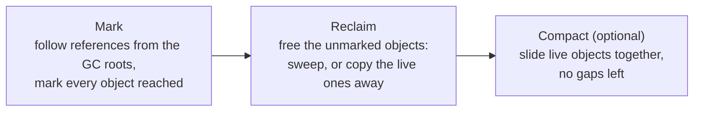

Java frees objects for you, and interviewers want to know how, what it costs, and what you do when it goes wrong. This lesson starts with the idea (reachability and generations), then walks through each collector in the order they appeared, then shows how to choose one, read a GC log and find a leak. Press play to see a young collection copy survivors, then switch to *Reachability*.

```demo
name: gc-walk
```

> **One sentence to remember:** *the collector finds every object that a GC root can still reach, keeps those, and reclaims the rest; collectors differ in how much of that work they do while your program is paused.*

## The basics {#basics}

### What a collector does {#what-it-does}

An object is **garbage** when no running code can reach it any more. The collector's job is to find that garbage and make its memory available again. Almost every collector works with the same three steps in some form:



Because Java uses reachability and not reference counting, a group of objects that only refer to each other is still garbage if no root reaches the group.

### GC roots {#gc-roots}

A **GC root** is a reference the collector treats as alive by definition. The main kinds:

- **Local variables and parameters** in the stack frames of every live thread (this is why an object disappears from the roots when its method returns).
- **Static fields** of loaded classes.
- **Live threads** themselves, and objects they hold while running.
- **JNI references** held by native code, and objects the JVM itself keeps (class loaders, loaded classes).

Everything the collector can reach from these is live, and everything else is garbage. Leaks happen when a root, usually a static field, quietly keeps a large structure reachable. See where the roots live in the [memory lesson](lesson:java-memory-model#gc-roots).

### Why the heap has generations {#generations}

Studies of real programs show the **generational hypothesis**: most objects die young. A request object, a temporary string or an iterator lives for microseconds, while caches and connection pools live for the whole process. So the heap is divided by age, and the young part is collected often and cheaply:

- **Young generation:** **eden** (new objects) plus two **survivor spaces**. A **young collection** (also called a *minor GC*) copies the live objects out of eden and one survivor space into the other survivor space and increases their age. Dead objects cost nothing, because they are never visited.
- **Old generation:** objects that survive enough young collections (the **tenuring threshold**, adaptive and up to 15) are **promoted** here. It is collected less often, and more expensively.
- A **full GC** collects the whole heap. In most collectors it is the slowest operation, and seeing many of them in a log is a warning sign.

An old object can point to a young one, so a young collection must know about those references without scanning the whole old generation. The JVM tracks them with a **card table** (or per-region remembered sets) updated by a small **write barrier** every time a reference field is written. See the [heap layout in the memory lesson](lesson:java-memory-model#heap) and the young-collection animation above.

### Pauses, throughput and footprint {#goals}

Collectors trade three things against each other, and you cannot maximise all three:

| Goal | Meaning | Matters for |
| --- | --- | --- |
| **Throughput** | share of time spent running your code instead of the collector | batch jobs, data pipelines |
| **Latency** | length of the pauses (the worst case, not just the average) | request/response APIs, trading, payments |
| **Footprint** | memory and CPU the collector needs on top of your data | containers, small instances |

A **stop-the-world** (STW) pause freezes every application thread so the collector can work safely; the JVM brings threads to a **safepoint** first. A **parallel** collector uses many threads during the pause. A **concurrent** collector does part of its work while your threads keep running. The newer collectors push more and more of the work into the concurrent phases.

### Reference types {#references}

| Reference | Collected when | Typical use |
| --- | --- | --- |
| **Strong** (a normal variable) | never while reachable | everything |
| **Soft** (`SoftReference`) | the JVM is short of memory | memory-sensitive caches |
| **Weak** (`WeakReference`, `WeakHashMap`) | at the next collection if only weakly reachable | canonicalising maps, listeners |
| **Phantom** (`PhantomReference`) | after the object is finalised; get is always null | cleanup actions |

**Finalizers** (`Object.finalize()`) were the old way to run cleanup code and are slow and unreliable; they were deprecated in Java 9 and **deprecated for removal in [Java 18](lesson:java-version-history#java-18)** (JEP 421). Use `try`-with-resources for deterministic cleanup and `java.lang.ref.Cleaner` as a safety net.

## The collectors {#collectors}

Choose a collector with a flag, for example `-XX:+UseG1GC`. The table shows how the main ones compare, then each gets its own section.

| Collector | Flag | Work during pauses | Typical strength |
| --- | --- | --- | --- |
| **Serial** | `-XX:+UseSerialGC` | everything, one thread | tiny heaps, single-CPU containers |
| **Parallel** | `-XX:+UseParallelGC` | everything, many threads | maximum throughput for batch work |
| **G1** | `-XX:+UseG1GC` | evacuation; marking is concurrent | balanced; the default since Java 9 |
| **ZGC** | `-XX:+UseZGC` | almost nothing (sub-millisecond) | very low latency, very large heaps |
| **Shenandoah** | `-XX:+UseShenandoahGC` | almost nothing | low latency (OpenJDK builds) |
| **Epsilon** | `-XX:+UseEpsilonGC` | no collection at all | benchmarks and throw-away jobs |
| **CMS** | removed in Java 14 | marking is concurrent, no compaction | history |

### Serial and Parallel {#serial-parallel}

The **Serial** collector is simple: one thread, stop-the-world, copying for the young generation and mark-compact for the old one. It has the smallest footprint, so the JVM picks it automatically on machines with fewer than two CPUs or about 2 GB of memory (before Java 27 made [G1 the default everywhere](lesson:java-version-history#java-27)).

The **Parallel** collector (the throughput collector) does the same work with many threads. It was the default on servers up to **Java 8**. It still gives the best raw throughput for batch jobs that can tolerate pauses of hundreds of milliseconds, and is selected with `-XX:+UseParallelGC`.

### CMS: the collector that was retired {#cms}

**Concurrent Mark Sweep** was the first low-pause collector for the old generation: it marked and swept concurrently with your threads. Its weaknesses were that it **never compacted**, so the old generation **fragmented** until a long full GC was forced (a *concurrent mode failure*), and that it used a lot of CPU and memory. G1 replaced it. CMS was **deprecated in [Java 9](lesson:java-version-history#java-9)** (JEP 291) and **removed in [Java 14](lesson:java-version-history#java-14)** (JEP 363). If an old application still passes `-XX:+UseConcMarkSweepGC`, newer JVMs refuse to start or ignore the flag, so move it to G1 (see the [removals table](lesson:java-version-history#removed)).

### G1: the default {#g1}

**Garbage-First** (G1) divides the heap into equal-sized **regions** (1 to 32 MB each, roughly 2,000 of them) instead of fixed young and old areas. Any region can be eden, survivor or old, and the roles change as the program runs. This gives G1 its main abilities:

- **Pause goal:** you state a target with `-XX:MaxGCPauseMillis` (default 200 ms) and G1 chooses how many regions to collect each time to try to stay within it. It collects the regions with the most garbage first, which is where the name comes from.
- **Young collections** copy live objects out of the young regions (an **evacuation pause**), stop-the-world and in parallel.
- **Concurrent marking:** when the heap passes an occupancy threshold, G1 marks the old regions concurrently (using a snapshot-at-the-beginning technique) and then runs **mixed collections** that clean young and the most profitable old regions together.
- **Humongous objects:** an object bigger than half a region is allocated in its own contiguous run of regions. Many short-lived humongous objects (large arrays, big `byte[]` buffers) cause extra work and fragmentation; larger regions (`-XX:G1HeapRegionSize`) or smaller buffers fix it.
- **Fallback:** if G1 cannot keep up, it does a **full GC**, which was single-threaded until [Java 10](lesson:java-version-history#java-10) made it parallel (JEP 307).

G1 was supported in [Java 7](lesson:java-version-history#java-7)u4, became the **default in [Java 9](lesson:java-version-history#java-9)** (JEP 248) and, as announced, is the default in every environment in Java 27. It is the right starting point for most services. See the [GC trail in the version history](lesson:java-version-history#trail-gc).

### ZGC: pauses that do not grow with the heap {#zgc}

ZGC does nearly everything concurrently, including **compaction**, so its pauses stay in the **sub-millisecond** range whether the heap is 1 GB or many terabytes. It relies on **load barriers** and **coloured pointers**: bits in each reference record the state of the object, and every load checks them, fixing up references lazily. The price is some extra CPU on every reference load and more memory (it does not use compressed pointers).

| Java | ZGC status |
| --- | --- |
| [11](lesson:java-version-history#java-11) | experimental, non-generational (JEP 333) |
| [15](lesson:java-version-history#java-15) | production-ready (JEP 377) |
| [21](lesson:java-version-history#java-21) | generational mode added, opt-in with `-XX:+ZGenerational` |
| [23](lesson:java-version-history#java-23) | generational mode becomes the default (JEP 474) |
| [24](lesson:java-version-history#java-24) | the old non-generational mode is removed (JEP 490) |

### Generational ZGC {#generational-zgc}

The original ZGC treated the whole heap alike, so it paid to scan short-lived garbage that a generational collector never touches. **Generational ZGC** ([Java 21](lesson:java-version-history#java-21), JEP 439) adds a young and an old generation, so it collects the young one much more often with far less work. The result is lower CPU use, better throughput and less memory headroom needed for the same latency. Since **Java 23** `-XX:+UseZGC` means the generational mode, and from **Java 24** the non-generational mode no longer exists.

### Shenandoah {#shenandoah}

Shenandoah (from Red Hat) has the same goal as ZGC: **concurrent compaction** with pauses independent of the heap size. It uses a different barrier design, moving objects while the program runs and fixing references through load-reference barriers. It was **experimental in [Java 12](lesson:java-version-history#java-12)** and **production-ready in [Java 15](lesson:java-version-history#java-15)** (JEP 379). A **generational mode** was experimental in Java 24 (JEP 404) and became a product feature in **Java 25** (JEP 521). It is included in OpenJDK-based builds such as Eclipse Temurin and Amazon Corretto but not in the Oracle JDK builds, which matters when you choose a distribution.

### Epsilon: the collector that collects nothing {#epsilon}

**Epsilon** ([Java 11](lesson:java-version-history#java-11), JEP 318, an experimental flag) allocates memory but never reclaims it, so the JVM exits with `OutOfMemoryError` when the heap is full. It sounds useless but has real uses: measuring the cost of a real collector by comparison, memory-pressure testing, very short-lived jobs that finish before the heap fills, and tests that assert an allocation budget.

## Metaspace and class unloading {#metaspace}

Class metadata is not on the Java heap. Since Java 8 it sits in **Metaspace** in native memory (see [the memory lesson](lesson:java-memory-model#metaspace) and [Java 8](lesson:java-version-history#java-8)). The collector still plays a part: a class and its metadata are freed only when the **class loader** that loaded it becomes unreachable, and a GC cycle must discover that. When `OutOfMemoryError: Metaspace` appears, the cause is almost always a **class loader leak** (a redeployed application whose old loader is still referenced by a static field, a thread or a `ThreadLocal`) or runaway generation of classes and proxies. Raising `-XX:MaxMetaspaceSize` only delays it.

## Smaller objects, less work {#compact-object-headers}

Every object has a header, and the collector must copy, mark and scan every live object, so smaller objects mean less heap and less GC work. **Compact object headers** (Project Lilliput) shrink the header from 12 to 8 bytes on 64-bit HotSpot. They were **experimental in [Java 24](lesson:java-version-history#java-24)** (JEP 450), became a **product feature in [Java 25](lesson:java-version-history#java-25)** (JEP 519) and, as announced, are on by default in Java 27. Workloads made of many small objects can see noticeably smaller heaps and fewer collections. See [object layout in the memory lesson](lesson:java-memory-model#object-layout).

## Choosing and tuning {#choosing}

### Choosing a collector {#choose-collector}

| Situation | Start with |
| --- | --- |
| Typical Spring Boot service, 1 to 16 GB heap | **G1** (the default): add `-Xmx` and leave the rest alone |
| Strict latency (payments, trading, interactive APIs), large heap | **ZGC** (generational) or Shenandoah, then measure |
| Batch or ETL job where only total time matters | **Parallel** |
| One CPU or a tiny container (a few hundred MB) | **Serial** |
| Benchmark baseline or a job that ends quickly | **Epsilon** |

Measure with your real load before changing anything: the best collector is the one whose pauses meet your p99 target at an acceptable CPU cost.

### Tuning approach {#tuning}

1. **Turn on GC logging** (below) in every environment so you have data.
2. **Fix allocation and leaks first.** Reducing allocation rate (reuse buffers, avoid boxing in hot loops, stream instead of loading everything) beats any flag.
3. **Set `-Xmx`** deliberately, and in containers also leave room for Metaspace, thread stacks, direct buffers and code cache (or use `-XX:MaxRAMPercentage`). Setting `-Xms` equal to `-Xmx` avoids resizing.
4. **State a goal rather than twiddle internals:** `-XX:MaxGCPauseMillis` for G1, or switch to ZGC for a hard latency target. Resist copying a long list of flags from the internet; old flags often fight the modern defaults.
5. **Change one thing at a time** and compare logs under the same load.

### Containers {#containers}

Since Java 10 the JVM reads container limits (cgroups). The default maximum heap is a quarter of the container's memory (`-XX:MaxRAMPercentage=25`), and the number of CPUs (so threads and the Serial-versus-G1 choice) follows the CPU limit. Raise the percentage for a single-process container (for example 60 to 75), but remember the process also uses memory outside the heap. A pod killed by the OOM killer with a healthy-looking heap usually means this headroom was too small.

## Reading a GC log {#gc-logs}

### Turning it on {#log-flags}

Unified logging (Java 9) replaces the old `-verbose:gc` and `-XX:+PrintGCDetails` flags:

```bash
java -Xlog:gc*:file=gc.log:time,uptime,level,tags:filecount=5,filesize=20m -jar app.jar
```

`-Xlog:gc` alone prints one line per collection, which is enough for a first look.

### What the lines mean {#log-lines}

```console
[2.113s][info][gc] GC(7) Pause Young (Normal) (G1 Evacuation Pause) 512M->140M(1024M) 8.321ms
[9.874s][info][gc] GC(18) Pause Young (Concurrent Start) (G1 Humongous Allocation) 801M->620M(1024M) 14.07ms
[10.002s][info][gc] GC(19) Concurrent Mark Cycle
[10.431s][info][gc] GC(19) Pause Remark 700M->650M(1024M) 3.114ms
[11.050s][info][gc] GC(20) Pause Young (Mixed) (G1 Evacuation Pause) 660M->410M(1024M) 18.44ms
[31.700s][info][gc] GC(41) Pause Full (Allocation Failure) 1019M->996M(1024M) 1840.5ms
```

- `GC(7)` is the collection number. The **type** follows: `Pause Young` (a young collection), `Pause Young (Mixed)` (young plus some old regions), `Pause Remark` and `Pause Cleanup` (short stop-the-world steps of the concurrent mark cycle) and `Pause Full`.
- The **cause** in parentheses: `G1 Evacuation Pause` is normal; `G1 Humongous Allocation` means large arrays; `Allocation Failure` on a full GC means the collector could not keep up.
- `512M->140M(1024M)` is heap used **before** the collection, **after** it, and the total committed heap. A good young collection frees most of what was used.
- The last number is the **pause time**. Look at the maximum and the 99th percentile, not the average.

In the example, the last line is the problem: a **1.8 second full GC that freed almost nothing** (`1019M->996M`). The heap is full of live data, so the program is leaking or the heap is too small. A heap that stays high after full collections is the signature of a leak.

### Tools {#gc-tools}

| Tool | Use |
| --- | --- |
| `jstat -gcutil <pid> 1000` | live occupancy of each area and counts of collections |
| `jcmd <pid> GC.heap_info` | current heap layout |
| `jcmd <pid> GC.heap_dump file.hprof` | heap dump to find what holds memory |
| Java Flight Recorder | allocation, GC and pause events with low overhead |
| GCViewer, GCeasy, VisualVM | load a log or dump and draw it |

## What goes wrong {#problems}

| Symptom | Likely cause | First action |
| --- | --- | --- |
| Frequent young collections | high allocation rate, or a young generation that is too small | find the allocating code with JFR; avoid temporary objects |
| Objects promoted too early | short-lived data survives because survivor space is too small or collections are too frequent | look at the age distribution; give the young generation more room |
| Repeated full GCs, heap high afterwards | a memory leak | heap dump, dominator tree; see [leaks](lesson:java-memory-model#leaks) |
| `GC overhead limit exceeded` | the JVM is spending nearly all its time collecting | same as above, found a little earlier |
| Long pauses in G1 | humongous allocations, too small a pause goal, or an evacuation failure | look at the cause text in the log |
| A pause exactly every N minutes | something calls `System.gc()` (often a library or RMI) | `-XX:+DisableExplicitGC` while you find the caller |
| Container killed with a healthy heap | native memory (Metaspace, stacks, direct buffers) plus heap is above the limit | lower `-Xmx` or raise the limit |

## Cheat sheet {#cheatsheet}

| Question | Answer |
| --- | --- |
| Default collector in Java 8? | Parallel |
| Default in Java 9 to 26? | G1 (Serial on small machines) |
| Default in Java 27 (as announced)? | G1 everywhere |
| Which collector was removed? | CMS, in Java 14 |
| Which collectors give sub-millisecond pauses? | ZGC (production since 15) and Shenandoah (15) |
| ZGC generational by default since? | Java 23 |
| Where is class metadata? | Metaspace, native memory, since Java 8 |
| What decides that an object is garbage? | no GC root can reach it |
| Can you force a collection? | `System.gc()` is only a request; avoid it |
| Which flag sets the max heap? | `-Xmx` |

## Interview questions {#questions}

### [basic] What is garbage collection? {#what-is-gc}

The JVM's automatic freeing of memory held by objects that the program can no longer reach. The collector starts from the GC roots (local variables on thread stacks, static fields, live threads), marks everything reachable, and reclaims the rest. It frees you from `free()`/`delete`, and prevents dangling-pointer and double-free bugs. It does not prevent leaks: an object that is still referenced is kept even if the program never uses it again.

### [basic] How does the JVM decide that an object is garbage? {#reachability-q}

By **reachability**, not reference counting. If no chain of references leads to the object from any GC root, it is garbage. Two objects that reference only each other are still garbage if no root reaches them. This is why circular references are not a problem in Java.

### [basic] Can you force garbage collection? {#system-gc}

`System.gc()` (and `Runtime.gc()`) only **suggests** that a collection should happen; the JVM may run a full GC or ignore it. Calling it is usually harmful: it causes a long pause at a time the collector would not choose. Some libraries call it, which shows up as periodic full GCs; `-XX:+DisableExplicitGC` turns the calls into no-ops while you find them.

### [basic] What are minor, major and full GC? {#minor-major-full}

A **minor GC** collects only the young generation and is frequent and short. A **major GC** is loosely "collecting the old generation". A **full GC** collects the whole heap (and usually class metadata) and is the most expensive. The terms are not precise across collectors: G1 has *young*, *mixed* and *full* collections, and ZGC and Shenandoah mostly collect concurrently, so read the exact name in your GC log.

### [basic] What is a stop-the-world pause? {#stw-q}

A period when the JVM halts all application threads so the collector can safely read or move objects. The threads are first brought to a **safepoint**. Pause time is the main latency cost of garbage collection. Collectors differ in how much work they do inside pauses: Serial and Parallel do everything there, G1 does evacuation, ZGC and Shenandoah almost nothing.

### [basic] Why is the heap divided into generations? {#why-generations}

Because of the **generational hypothesis**: most objects die young. Keeping new objects in a small young generation means the collector can find and reclaim them cheaply and often, copying only the few survivors, without scanning the whole heap. Long-lived objects get promoted to an old generation that is collected rarely.

### [basic] Which collector is the default in each Java version? {#default-collector}

Java 8 and earlier: **Parallel**. Java 9 onwards: **G1** on server-class machines (fewer than two CPUs or about 2 GB of memory selects **Serial**). Java 27, as announced: G1 in all environments. ZGC and Shenandoah are never the default; select them with flags. Check with `java -XX:+PrintFlagsFinal -version | grep Use.*GC`.

### [basic] What are strong, soft, weak and phantom references? {#reference-types-q}

A **strong** reference keeps an object alive. A **soft** reference is cleared only when memory is short, so it suits caches. A **weak** reference is cleared at the next collection once nothing else holds the object (`WeakHashMap` uses them for keys). A **phantom** reference is used to run cleanup after an object is collected. Use weak or soft references to avoid leaks in caches and listener lists, but a bounded cache library is usually clearer.

### [intermediate] How does G1 work, and what is the pause-time goal? {#g1-q}

G1 splits the heap into equal **regions**, any of which can be eden, survivor or old. Young collections evacuate (copy) live objects out of the young regions. When the heap fills past a threshold G1 marks the old regions concurrently, and then runs **mixed collections** that include the old regions with the most garbage (hence "garbage first"). You set a target with `-XX:MaxGCPauseMillis` (default 200 ms) and G1 chooses how many regions to collect to try to meet it. If it falls behind it does a full GC.

### [intermediate] What is a humongous object in G1, and why does it matter? {#humongous}

An object at least **half the region size** is humongous: it gets its own contiguous regions in the old generation and is not copied like normal objects. Allocating many large, short-lived arrays this way triggers extra concurrent cycles and fragmentation. Fix it by allocating smaller chunks, reusing buffers, or raising the region size with `-XX:G1HeapRegionSize`. The GC log shows `G1 Humongous Allocation` as the cause.

### [intermediate] Compare Parallel, G1 and ZGC: when would you use each? {#compare-collectors}

**Parallel** maximises throughput and accepts long pauses, so it suits batch and offline jobs. **G1** balances throughput and latency with a configurable pause goal, and is the right default for most services. **ZGC** (and Shenandoah) trade some CPU and memory for pauses that stay sub-millisecond whatever the heap size, so they suit latency-sensitive services with large heaps. Choose by measuring p99 latency and CPU under realistic load, not by reputation.

### [intermediate] What is the difference between ZGC and Shenandoah? {#zgc-vs-shenandoah}

Both do concurrent compaction with very short pauses. ZGC (from Oracle) uses coloured pointers and load barriers and has been generational by default since Java 23. Shenandoah (from Red Hat) uses its own load-reference barriers and added a generational mode in Java 25. The practical difference is availability: Shenandoah is in OpenJDK builds (Temurin, Corretto) but not in Oracle's builds; ZGC is in all of them. Both reached production status in Java 15.

### [intermediate] What happened to CMS? {#cms-q}

CMS was the first mostly-concurrent collector for the old generation. It did not compact, so the old generation fragmented and eventually required a long full GC, and it was complex and CPU-hungry. It was **deprecated in Java 9** and **removed in Java 14**. The migration path is G1 for most applications, or ZGC/Shenandoah if you need lower pauses.

### [intermediate] What causes a full GC, and how do you reduce them? {#full-gc-causes}

Common causes: the old generation fills faster than concurrent work can free it, **promotion failure or evacuation failure**, a **humongous allocation** with no contiguous space, Metaspace growth, or an explicit `System.gc()`. If memory use stays high after a full GC the cause is a leak, so analyse a heap dump. Otherwise reduce allocation and promotion, give the heap more room, or switch to a collector designed for low pauses.

### [intermediate] How do you read a GC log line like "Pause Young (Normal) 512M->140M(1024M) 8.3ms"? {#read-log}

It is a young collection of cause "normal" (eden filled). Heap use dropped from 512 MB before the collection to 140 MB after, out of 1024 MB committed, and the program was paused for 8.3 ms. Healthy logs show the "after" value flat or slowly rising; a rising floor across collections means a leak. A line such as `Pause Full (Allocation Failure) 1019M->996M(1024M) 1840ms` means the collector had to stop everything for nearly two seconds and freed almost nothing.

### [intermediate] What is premature promotion? {#premature-promotion}

Short-lived objects reaching the old generation because they were still alive at a few collections (for example during a big request), or because the survivor space was too small and overflowed. They then clog the old generation and cause expensive old collections. Remedies: reduce the lifetime or size of objects (avoid building huge intermediate collections), allow more young space, or use a collector that sizes generations adaptively.

### [intermediate] What is a card table and a write barrier? {#card-table}

A young collection must find old-to-young references without scanning the whole old generation. The JVM divides the heap into **cards**; a small **write barrier** (code the JIT inserts after every reference store) marks the card dirty. A young collection then scans only the dirty cards. G1 uses per-region remembered sets for the same purpose. The barrier is why reference writes cost a little more than primitive writes.

### [intermediate] What is the difference between a parallel and a concurrent collector? {#parallel-vs-concurrent}

**Parallel** means using many GC threads *during a pause*: the application is still stopped, just for less time. **Concurrent** means the collector works *while the application threads keep running*, which shortens pauses but costs CPU and needs barriers to stay correct. G1 is parallel for evacuation and concurrent for marking. ZGC and Shenandoah are concurrent for almost everything.

### [intermediate] How does garbage collection relate to Metaspace and class loaders? {#gc-metaspace-q}

Class metadata lives in Metaspace (native memory), and it is freed when the class loader that loaded the class is collected. A leaked class loader (kept alive by a thread, a `ThreadLocal`, a static field or a registered driver) therefore keeps all its classes, and Metaspace grows until `OutOfMemoryError: Metaspace`. Increasing `-XX:MaxMetaspaceSize` only delays the failure. Find the reference holding the loader in a heap dump.

### [intermediate] How would you approach a performance problem you think is caused by GC? {#tuning-q}

Measure first: enable GC logging (`-Xlog:gc*`) and look at pause times (p99 and max), the share of time in GC, the allocation rate and what the heap looks like after collections. If pauses are long, check the cause text and consider the collector; if the heap floor keeps rising, find the leak with a heap dump; if collections are frequent, find high allocation with JFR. Change one setting at a time and compare under the same load. Do not start by pasting dozens of flags.

### [intermediate] What would you set for a Java service in a container? {#container-flags}

Start with the defaults, add `-XX:MaxRAMPercentage` (or `-Xmx`) so the heap is a safe fraction of the container limit, leaving room for Metaspace, thread stacks and direct memory, and turn on GC logging. Keep `-Xms` equal to `-Xmx` if you want no resizing. Make sure the CPU limit is at least two, so the JVM chooses G1 rather than Serial, unless you want Serial. Add `-XX:+HeapDumpOnOutOfMemoryError` with a writable path.

### [deep] How do ZGC's coloured pointers and load barriers allow concurrent compaction? {#zgc-barriers}

ZGC stores metadata bits in unused bits of each 64-bit reference, so a reference tells the collector which phase of the cycle it belongs to. Whenever a thread loads a reference from the heap, a **load barrier** checks those bits. If the object has been moved or needs marking, the barrier fixes the reference (and may help relocate the object) before the thread uses it. Since the application heals references itself, the collector can move objects while the program runs, and only brief pauses are needed to start and end phases. It costs extra work on every reference load and rules out compressed pointers.

### [deep] What does generational ZGC change? {#generational-zgc-q}

The first ZGC collected the whole heap in every cycle, so it kept re-examining long-lived data and needed a lot of headroom to keep up with allocation. Java 21 added generations (JEP 439): young objects are collected often and cheaply, old ones rarely. That reduced CPU use and memory overhead and improved throughput, while keeping sub-millisecond pauses. It became the default ZGC mode in Java 23, and the old mode was removed in Java 24.

### [deep] What is snapshot-at-the-beginning marking? {#satb}

During concurrent marking, the program keeps changing references, so the collector could miss an object that was reachable when marking began. With **SATB** (used by G1), the collector logically takes a snapshot of the object graph at the start and uses a **pre-write barrier** to record the old value of a reference before it is overwritten. Everything reachable at the snapshot gets marked, even if it becomes garbage during the cycle (it is collected next time). It is conservative: it can retain some floating garbage but never frees a live object.

### [deep] Why does compaction matter, and which collectors do it concurrently? {#compaction-q}

Without compaction free memory becomes fragmented: plenty of space in total, but no hole big enough for a new object, which forces a full GC (the CMS problem). Compaction also lets allocation be a simple pointer bump. Moving live objects is hard to do while threads are running because references must be updated, so Serial, Parallel and CMS-era collectors did it in pauses. G1 compacts by copying regions during evacuation pauses. **ZGC and Shenandoah compact concurrently**, using barriers to keep references correct.

### [deep] How do compact object headers affect garbage collection? {#compact-headers-q}

Collectors copy, mark and scan every live object, so smaller objects mean less memory and less work. Shrinking the header from 12 to 8 bytes reduces heap size for object-heavy programs (JEP 450 reports up to about 20% less heap in some benchmarks), improves cache use and lowers allocation rate, so collections are rarer. It is a product feature in Java 25, as announced the default in Java 27, and comes from Project Lilliput.

### [deep] Which garbage collector would you choose for a payments API with a 99th-percentile latency target of 50 ms and a 6 GB heap? {#choose-payments}

Start with **G1** with `-XX:MaxGCPauseMillis` set well under the target (for example 50 to 100 ms), because its pauses on a 6 GB heap are usually in the tens of milliseconds and it is the best-supported default. If measurements show pauses or tail latency above the target, switch to **generational ZGC** (Java 21 and later), which keeps pauses at about a millisecond at some CPU cost. Whichever you pick, test with production-like load, watch p99 and max pause in the logs, keep the allocation rate low, and give the heap headroom so concurrent collectors do not fall behind.

### [coding] Diagnose this GC log. {#diagnose-log}

```console
[100.2s][info][gc] GC(60) Pause Young (Normal) (G1 Evacuation Pause) 1500M->900M(2048M) 25ms
[130.8s][info][gc] GC(61) Pause Young (Normal) (G1 Evacuation Pause) 1700M->1100M(2048M) 31ms
[170.5s][info][gc] GC(62) Pause Full (Allocation Failure) 2040M->1480M(2048M) 2100ms
[200.1s][info][gc] GC(63) Pause Young (Normal) (G1 Evacuation Pause) 1900M->1500M(2048M) 40ms
[240.9s][info][gc] GC(64) Pause Full (Allocation Failure) 2045M->1620M(2048M) 2350ms
```

The heap floor keeps rising: after collections it is 900 MB, 1100 MB, 1480 MB, then 1500 MB and 1620 MB, even after full GCs that should free everything garbage. That means more and more **live data**: a **memory leak**, not a tuning problem. The two-second full GCs are the symptom, and raising the pause goal would not help. Next steps: take a heap dump (`jcmd <pid> GC.heap_dump`), open the dominator tree to see which structure retains the memory (typically a static map or cache, a listener list or a class loader), fix the reference, and only then revisit the heap size.

### [coding] An event listener list keeps growing. Fix the leak. {#listener-leak}

```java
public class PriceFeed {
    private final List<PriceListener> listeners = new ArrayList<>();

    public void subscribe(PriceListener l) {
        listeners.add(l);
    }
}
```

Every subscriber stays reachable through `listeners` as long as the feed exists, so subscribers that are no longer needed (a closed screen, a finished request) are never collected, along with everything they reference. Fix it by providing and calling an `unsubscribe`, and making the subscription an `AutoCloseable` so it is removed deterministically, or by holding listeners weakly:

```java
private final Set<PriceListener> listeners =
        Collections.newSetFromMap(new WeakHashMap<>());   // wrap with Collections.synchronizedSet if shared across threads
```

Weak references mean a listener disappears when nothing else holds it, which is convenient but can drop a listener you wanted to keep, so an explicit unsubscribe is the clearer solution for most code.
