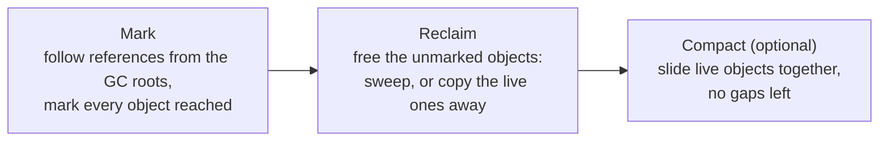

Java frees objects for you. Interviewers want to know three things: how it does that, what it costs, and what you do when it goes wrong.

This lesson starts with the idea (reachability and generations). Then it walks through each collector in the order they appeared. Last, it shows how to choose a collector, read a GC log and find a leak.

The animation has two scenes. The first shows a young collection copying the objects that survive. The second, *Reachability*, shows how the collector decides what is garbage.

```demo
name: gc-walk
```

> **One sentence to remember:** *The collector keeps every object a GC root can still reach and frees the rest.*

## The basics {#basics}

### What a collector does {#what-it-does}

An object is **garbage** when no running code can reach it any more. The collector's job is to find that garbage and make its memory free again. Almost every collector does the same three steps in some form:



Java decides by **reachability**, not by **reference counting** (counting how many references point to each object). So a group of objects that only refer to each other is still garbage if no root reaches the group.

### GC roots {#gc-roots}

A **GC root** is a reference that the collector treats as alive by definition. The main kinds:

- **Local variables and parameters** in the stack frames of every live thread. This is why an object loses its root when its method returns.
- **Static fields** of loaded classes.
- **Live threads** themselves, and the objects they hold while they run.
- **JNI references** held by native code, and objects the JVM itself keeps, such as class loaders and loaded classes.

Everything the collector can reach from these roots is live. Everything else is garbage.

Leaks happen when a root quietly keeps a large structure reachable. The root is usually a static field. See where the roots live in the [memory lesson](lesson:java-memory-model#gc-roots).

### Why the heap has generations {#generations}

Studies of real programs show the **generational hypothesis**: most objects die young. A request object, a temporary string or an iterator lives for microseconds. Caches and connection pools live as long as the process.

So the heap is divided by age, and the young part is collected often and cheaply:

- **Young generation:** **eden**, where new objects start, plus two **survivor spaces**. A **young collection** (also called a *minor GC*) copies the live objects out of eden and one survivor space into the other survivor space, and raises their age. Dead objects cost nothing, because the collector never visits them.
- **Old generation:** an object that survives enough young collections is **promoted** here. The number of collections needed is the **tenuring threshold**. The JVM adjusts it as it runs, up to 15. The old generation is collected less often, and each collection costs more.
- A **full GC** collects the whole heap. In most collectors it is the slowest operation. Many full GCs in a log are a warning sign.

An old object can point to a young one. A young collection must find those references without scanning the whole old generation.

The JVM tracks them with a **card table**: the heap is divided into small blocks called cards, and a card is marked when a reference in it changes. G1 uses per-region **remembered sets** for the same job. A small piece of code called a **write barrier** runs every time a reference field is written, and keeps this record up to date.

See the [heap layout in the memory lesson](lesson:java-memory-model#heap) and the young-collection animation above.

### Pauses, throughput and footprint {#goals}

Collectors trade three goals against each other. You cannot have the best of all three.

| Goal | Meaning | Matters for |
| --- | --- | --- |
| **Throughput** | The share of time spent running your code instead of the collector. | Batch jobs and data pipelines. |
| **Latency** | How long the pauses are. The worst case counts, not just the average. | Request and response APIs, trading and payments. |
| **Footprint** | The extra memory and CPU the collector needs on top of your data. | Containers and small machines. |

Three terms describe how a collector works:

- A **stop-the-world** (STW) pause freezes every application thread, so the collector can work safely. The JVM first brings each thread to a **safepoint**, a point in the code where it is safe to stop.
- A **parallel** collector uses many threads during the pause.
- A **concurrent** collector does part of its work while your threads keep running.

Newer collectors move more and more of the work into the concurrent phases.

### Reference types {#references}

| Reference | Collected when | Typical use |
| --- | --- | --- |
| **Strong** (a normal variable) | Never, while it is reachable. | Everything. |
| **Soft** (`SoftReference`) | When the JVM is short of memory. | Caches that should shrink when memory is low. |
| **Weak** (`WeakReference`, `WeakHashMap`) | At the next collection, if only weak references reach it. | Canonicalising maps (one shared object per value) and listeners. |
| **Phantom** (`PhantomReference`) | After the object is finalised. Its `get` always returns null. | Cleanup actions. |

**Finalizers** (`Object.finalize()`) were the old way to run cleanup code. They are slow and unreliable. They were deprecated in Java 9 and **deprecated for removal in [Java 18](lesson:java-version-history#java-18)** (JEP 421).

Use `try`-with-resources when cleanup must happen at a known moment. Use `java.lang.ref.Cleaner` as a safety net.

## The collectors {#collectors}

You choose a collector with a flag, for example `-XX:+UseG1GC`. The table compares the main ones. Each one then gets its own section.

| Collector | Flag | Work done during pauses | Typical strength |
| --- | --- | --- | --- |
| **Serial** | `-XX:+UseSerialGC` | All of it, with one thread. | Tiny heaps and single-CPU containers. |
| **Parallel** | `-XX:+UseParallelGC` | All of it, with many threads. | The highest throughput for batch work. |
| **G1** | `-XX:+UseG1GC` | Copying. Marking is concurrent. | Balanced. The default since Java 9. |
| **ZGC** | `-XX:+UseZGC` | Almost nothing (pauses under a millisecond). | Very low latency and very large heaps. |
| **Shenandoah** | `-XX:+UseShenandoahGC` | Almost nothing. | Low latency, in OpenJDK builds. |
| **Epsilon** | `-XX:+UseEpsilonGC` | Nothing, because it never collects. | Benchmarks and throw-away jobs. |
| **CMS** | Removed in Java 14. | Marking is concurrent. It never compacts. | History. |

### Serial and Parallel {#serial-parallel}

The **Serial** collector is simple. It uses one thread and stops the world. It copies objects in the young generation and uses mark-compact for the old one.

It has the smallest footprint. So the JVM picks it automatically on machines with fewer than two CPUs or about 2 GB of memory. This was true until Java 27 made [G1 the default everywhere](lesson:java-version-history#java-27).

The **Parallel** collector, also called the throughput collector, does the same work with many threads. It was the default on servers up to **Java 8**. It still gives the best raw throughput for batch jobs that can accept pauses of hundreds of milliseconds. Select it with `-XX:+UseParallelGC`.

### CMS: the collector that was retired {#cms}

**Concurrent Mark Sweep** (CMS) was the first low-pause collector for the old generation. It marked and swept while your threads kept running.

It had two weaknesses:

1. It **never compacted** memory. Over time the old generation **fragmented**: free memory was split into small gaps. Then a long full GC was forced, called a *concurrent mode failure*.
2. It used a lot of CPU and memory.

G1 replaced it. CMS was **deprecated in [Java 9](lesson:java-version-history#java-9)** (JEP 291) and **removed in [Java 14](lesson:java-version-history#java-14)** (JEP 363). If an old application still passes `-XX:+UseConcMarkSweepGC`, newer JVMs refuse to start or ignore the flag, so move it to G1. See the [removals table](lesson:java-version-history#removed).

### G1: the default {#g1}

**Garbage-First** (G1) divides the heap into equal-sized **regions** instead of fixed young and old areas. Each region is 1 to 32 MB, and there are roughly 2,000 of them. Any region can be eden, survivor or old, and the roles change as the program runs. This gives G1 its main abilities:

- **Pause goal:** you set a target with `-XX:MaxGCPauseMillis` (the default is 200 ms). G1 then chooses how many regions to collect each time, to try to stay within it. It collects the regions with the most garbage first, which is where the name comes from.
- **Young collections** copy live objects out of the young regions. This is called an **evacuation pause**. It stops the world and uses many threads.
- **Concurrent marking:** when the heap passes a fill threshold, G1 marks the old regions while the program runs. It uses a technique called snapshot-at-the-beginning. Then it runs **mixed collections**, which clean the young regions together with the old regions that will free the most memory.
- **Humongous objects:** an object bigger than half a region gets its own run of regions next to each other. Many short-lived humongous objects, such as large arrays or big `byte[]` buffers, cause extra work and fragmentation. Larger regions (`-XX:G1HeapRegionSize`) or smaller buffers fix it.
- **Fallback:** if G1 cannot keep up, it does a **full GC**. That full GC used one thread until [Java 10](lesson:java-version-history#java-10) made it parallel (JEP 307).

The timeline:

- G1 was supported from [Java 7](lesson:java-version-history#java-7)u4.
- It became the **default in [Java 9](lesson:java-version-history#java-9)** (JEP 248).
- As announced, it is the default in every environment in Java 27.

It is the right starting point for most services. See the [GC trail in the version history](lesson:java-version-history#trail-gc).

### ZGC: pauses that do not grow with the heap {#zgc}

ZGC does nearly everything while the program runs, including **compaction**. So its pauses stay **under a millisecond**, whether the heap is 1 GB or many terabytes.

It relies on **coloured pointers** and **load barriers**:

- **Coloured pointers:** some bits in each reference record the state of the object.
- **Load barriers:** every time a thread loads a reference, a small check reads those bits. If the reference is out of date, the check fixes it on the spot.

The price is some extra CPU on every reference load, and more memory, because ZGC does not use compressed pointers.

| Java | ZGC status |
| --- | --- |
| [11](lesson:java-version-history#java-11) | Experimental, without generations (JEP 333). |
| [15](lesson:java-version-history#java-15) | Ready for production (JEP 377). |
| [21](lesson:java-version-history#java-21) | A generational mode is added. You turn it on with `-XX:+ZGenerational`. |
| [23](lesson:java-version-history#java-23) | The generational mode becomes the default (JEP 474). |
| [24](lesson:java-version-history#java-24) | The old mode without generations is removed (JEP 490). |

### Generational ZGC {#generational-zgc}

The original ZGC treated the whole heap the same way. So it paid to scan short-lived garbage that a generational collector never touches.

**Generational ZGC** ([Java 21](lesson:java-version-history#java-21), JEP 439) adds a young and an old generation. It collects the young generation much more often, with far less work. The result is lower CPU use, better throughput, and less spare memory needed for the same latency.

Since **Java 23**, `-XX:+UseZGC` means the generational mode. From **Java 24**, the mode without generations no longer exists.

### Shenandoah {#shenandoah}

Shenandoah, from Red Hat, has the same goal as ZGC: **concurrent compaction**, with pauses that do not depend on the heap size. Its barrier design is different. It moves objects while the program runs, and fixes references through load-reference barriers.

The timeline:

- **Experimental in [Java 12](lesson:java-version-history#java-12).**
- **Ready for production in [Java 15](lesson:java-version-history#java-15)** (JEP 379).
- A **generational mode** was experimental in Java 24 (JEP 404) and became a product feature in **Java 25** (JEP 521).

Shenandoah is included in OpenJDK-based builds such as Eclipse Temurin and Amazon Corretto, but not in the Oracle JDK builds. This matters when you choose a distribution.

### Epsilon: the collector that collects nothing {#epsilon}

**Epsilon** ([Java 11](lesson:java-version-history#java-11), JEP 318, an experimental flag) allocates memory but never frees it. When the heap is full, the JVM exits with `OutOfMemoryError`.

It sounds useless, but it has real uses:

- measuring the cost of a real collector by comparing against it;
- testing behaviour under memory pressure;
- very short jobs that finish before the heap fills;
- tests that check the code stays within an allocation budget.

## Metaspace and class unloading {#metaspace}

Class metadata is not on the Java heap. Since Java 8 it sits in **Metaspace**, in native memory (see [the memory lesson](lesson:java-memory-model#metaspace) and [Java 8](lesson:java-version-history#java-8)).

The collector still plays a part. A class and its metadata are freed only when the **class loader** that loaded it can no longer be reached, and a GC cycle must discover that.

When `OutOfMemoryError: Metaspace` appears, the cause is almost always one of these:

- a **class loader leak**: an application was redeployed, but a static field, a thread or a `ThreadLocal` still references its old loader;
- code that keeps generating new classes and proxies.

Raising `-XX:MaxMetaspaceSize` only delays the failure.

## Smaller objects, less work {#compact-object-headers}

Every object has a header. The collector must copy, mark and scan every live object, so smaller objects mean a smaller heap and less GC work.

**Compact object headers** (Project Lilliput) shrink the header from 12 to 8 bytes on 64-bit HotSpot:

- **experimental in [Java 24](lesson:java-version-history#java-24)** (JEP 450);
- a **product feature in [Java 25](lesson:java-version-history#java-25)** (JEP 519);
- on by default in Java 27, as announced.

Programs made of many small objects can get noticeably smaller heaps and fewer collections. See [object layout in the memory lesson](lesson:java-memory-model#object-layout).

## Choosing and tuning {#choosing}

### Choosing a collector {#choose-collector}

| Situation | Start with |
| --- | --- |
| A typical Spring Boot service with a 1 to 16 GB heap. | **G1**, the default. Set `-Xmx` and leave the rest alone. |
| Strict latency (payments, trading, interactive APIs) with a large heap. | **ZGC** (generational) or Shenandoah. Then measure. |
| A batch or ETL job where only the total time matters. | **Parallel**. |
| One CPU, or a tiny container of a few hundred MB. | **Serial**. |
| A benchmark baseline, or a job that ends quickly. | **Epsilon**. |

Measure with your real load before you change anything. The best collector is the one whose pauses meet your p99 target (the time that 99% of requests stay under) at a CPU cost you can accept.

### Tuning approach {#tuning}

1. **Turn on GC logging** (see below) in every environment, so you have data.
2. **Fix allocation and leaks first.** Creating fewer objects beats any flag. Reuse buffers, avoid boxing in hot loops, and stream data instead of loading it all at once.
3. **Set `-Xmx` on purpose.** In containers, also leave room for Metaspace, thread stacks, direct buffers and the code cache, or use `-XX:MaxRAMPercentage`. Setting `-Xms` equal to `-Xmx` avoids resizing.
4. **State a goal instead of changing internals.** Use `-XX:MaxGCPauseMillis` for G1, or switch to ZGC for a hard latency target. Do not copy long lists of flags from the internet. Old flags often fight the modern defaults.
5. **Change one thing at a time**, and compare the logs under the same load.

### Containers {#containers}

Since Java 10, the JVM reads the container's limits (from cgroups):

- The default maximum heap is a quarter of the container's memory (`-XX:MaxRAMPercentage=25`).
- The number of CPUs follows the CPU limit. This affects the number of threads, and the choice between Serial and G1.

For a container that runs only this process, raise the percentage, for example to 60 to 75. But remember that the process also uses memory outside the heap. If a pod is killed by the OOM killer while the heap looks healthy, this spare room was usually too small.

## Reading a GC log {#gc-logs}

### Turning it on {#log-flags}

Unified logging (Java 9) replaces the old `-verbose:gc` and `-XX:+PrintGCDetails` flags:

```bash
java -Xlog:gc*:file=gc.log:time,uptime,level,tags:filecount=5,filesize=20m -jar app.jar
```

`-Xlog:gc` alone prints one line per collection. That is enough for a first look.

### What the lines mean {#log-lines}

```console
[2.113s][info][gc] GC(7) Pause Young (Normal) (G1 Evacuation Pause) 512M->140M(1024M) 8.321ms
[9.874s][info][gc] GC(18) Pause Young (Concurrent Start) (G1 Humongous Allocation) 801M->620M(1024M) 14.07ms
[10.002s][info][gc] GC(19) Concurrent Mark Cycle
[10.431s][info][gc] GC(19) Pause Remark 700M->650M(1024M) 3.114ms
[11.050s][info][gc] GC(20) Pause Young (Mixed) (G1 Evacuation Pause) 660M->410M(1024M) 18.44ms
[31.700s][info][gc] GC(41) Pause Full (Allocation Failure) 1019M->996M(1024M) 1840.5ms
```

How to read each part:

- **`GC(7)`** is the collection number.
- **The type** comes next:
  - `Pause Young` is a young collection.
  - `Pause Young (Mixed)` collects the young regions plus some old regions.
  - `Pause Remark` and `Pause Cleanup` are short stop-the-world steps of the concurrent mark cycle.
  - `Pause Full` is a full GC.
- **The cause** is in parentheses:
  - `G1 Evacuation Pause` is normal.
  - `G1 Humongous Allocation` means large arrays.
  - `Allocation Failure` on a full GC means the collector could not keep up.
- **`512M->140M(1024M)`** is the heap used **before** the collection, the heap used **after** it, and the total committed heap. A good young collection frees most of what was used.
- **The last number** is the **pause time**. Look at the maximum and the 99th percentile, not the average.

In the example, the last line is the problem. It is a **1.8-second full GC that freed almost nothing** (`1019M->996M`). The heap is full of live data, so the program is leaking or the heap is too small. A heap that stays high after full collections is the sign of a leak.

### Tools {#gc-tools}

| Tool | Use |
| --- | --- |
| `jstat -gcutil <pid> 1000` | Shows how full each area is right now, and how many collections ran. |
| `jcmd <pid> GC.heap_info` | Shows the current heap layout. |
| `jcmd <pid> GC.heap_dump file.hprof` | Writes a heap dump, to find out what holds the memory. |
| Java Flight Recorder | Records allocation, GC and pause events with low overhead. |
| GCViewer, GCeasy, VisualVM | Load a log or a dump and draw it as charts. |

## What goes wrong {#problems}

| Symptom | Likely cause | First action |
| --- | --- | --- |
| Frequent young collections. | A high allocation rate, or a young generation that is too small. | Find the code that allocates with JFR, and avoid temporary objects. |
| Objects promoted too early. | Short-lived data survives, because the survivor space is too small or collections run too often. | Look at the age distribution, and give the young generation more room. |
| Repeated full GCs, and the heap stays high afterwards. | A memory leak. | Take a heap dump and read the dominator tree. See [leaks](lesson:java-memory-model#leaks). |
| `GC overhead limit exceeded` | The JVM spends nearly all its time collecting. | The same as above. It is just found a little earlier. |
| Long pauses in G1. | Humongous allocations, a pause goal that is too small, or an evacuation failure. | Read the cause text in the log. |
| A pause exactly every N minutes. | Something calls `System.gc()`, often a library or RMI. | Use `-XX:+DisableExplicitGC` while you find the caller. |
| A container is killed while the heap looks healthy. | Native memory (Metaspace, stacks, direct buffers) plus the heap goes over the limit. | Lower `-Xmx`, or raise the limit. |

Try it in the lab: [Generational GC: eden, survivor, old](lab:gc-generations).

## Cheat sheet {#cheatsheet}

| Question | Answer |
| --- | --- |
| The default collector in Java 8? | Parallel. |
| The default in Java 9 to 26? | G1, or Serial on small machines. |
| The default in Java 27, as announced? | G1 everywhere. |
| Which collector was removed? | CMS, in Java 14. |
| Which collectors give pauses under a millisecond? | ZGC (production since 15) and Shenandoah (since 15). |
| Since when is ZGC generational by default? | Java 23. |
| Where is class metadata? | In Metaspace, in native memory, since Java 8. |
| What makes an object garbage? | No GC root can reach it. |
| Can you force a collection? | No. `System.gc()` is only a request, so avoid it. |
| Which flag sets the maximum heap? | `-Xmx`. |

## Interview questions {#questions}

### [basic] What is garbage collection? {#what-is-gc}

The JVM automatically frees the memory of objects that the program can no longer reach.

How it works:

1. The collector starts from the GC roots: local variables on thread stacks, static fields and live threads.
2. It marks everything it can reach from them.
3. It frees the rest.

It means you never call `free()` or `delete`, so there are no dangling pointers (pointers to freed memory) and no double frees. It does not prevent leaks: an object that is still referenced is kept, even if the program never uses it again.

### [basic] How does the JVM decide that an object is garbage? {#reachability-q}

**By reachability, not reference counting.** If no chain of references leads to the object from any GC root, it is garbage.

Two objects that refer only to each other are still garbage if no root reaches them. This is why circular references are not a problem in Java.

### [basic] Can you force garbage collection? {#system-gc}

**No.** `System.gc()` (and `Runtime.gc()`) only **suggests** a collection. The JVM may run a full GC, or ignore the call.

Calling it usually does harm: it causes a long pause at a moment the collector would not choose. Some libraries call it, and it shows up in the log as regular full GCs. `-XX:+DisableExplicitGC` turns these calls into no-ops while you find them.

### [basic] What are minor, major and full GC? {#minor-major-full}

- A **minor GC** collects only the young generation. It is frequent and short.
- A **major GC** loosely means "collecting the old generation".
- A **full GC** collects the whole heap, usually with the class metadata. It is the most expensive.

The terms are not exact across collectors. G1 has *young*, *mixed* and *full* collections, and ZGC and Shenandoah mostly collect while the program runs. So read the exact name in your GC log.

### [basic] What is a stop-the-world pause? {#stw-q}

A period when the JVM stops all application threads, so the collector can safely read or move objects. First, every thread is brought to a **safepoint**.

Pause time is the main latency cost of garbage collection. Collectors differ in how much work they do inside pauses:

- Serial and Parallel do all of it there.
- G1 does the copying there.
- ZGC and Shenandoah do almost nothing there.

### [basic] Why is the heap divided into generations? {#why-generations}

Because of the **generational hypothesis**: most objects die young.

If new objects are kept in a small young generation, the collector can free them cheaply and often. It copies only the few survivors and never scans the whole heap. Objects that live long are promoted to an old generation, which is collected rarely.

### [basic] Which collector is the default in each Java version? {#default-collector}

- **Java 8 and earlier:** Parallel.
- **Java 9 and later:** G1 on server-class machines. With fewer than two CPUs or about 2 GB of memory, the JVM picks **Serial**.
- **Java 27, as announced:** G1 in every environment.

ZGC and Shenandoah are never the default; you choose them with flags. To check, run `java -XX:+PrintFlagsFinal -version | grep Use.*GC`.

### [basic] What are strong, soft, weak and phantom references? {#reference-types-q}

- A **strong** reference keeps an object alive.
- A **soft** reference is cleared only when memory is short, so it suits caches.
- A **weak** reference is cleared at the next collection once nothing else holds the object. `WeakHashMap` uses them for its keys.
- A **phantom** reference is used to run cleanup after an object is collected.

Weak or soft references help avoid leaks in caches and listener lists. But a cache library with a size limit is usually clearer.

### [intermediate] How does G1 work, and what is the pause-time goal? {#g1-q}

G1 splits the heap into equal **regions**. Any region can be eden, survivor or old.

1. **Young collections** copy live objects out of the young regions.
2. When the heap fills past a threshold, G1 marks the old regions while the program runs.
3. Then it runs **mixed collections**, which include the old regions with the most garbage. This is where the name "garbage first" comes from.

You set a target with `-XX:MaxGCPauseMillis` (the default is 200 ms). G1 chooses how many regions to collect each time, to try to meet it. If it falls behind, it does a full GC.

### [intermediate] What is a humongous object in G1, and why does it matter? {#humongous}

An object that is at least **half the region size**. It gets its own regions next to each other, in the old generation, and it is not copied like normal objects.

Many large, short-lived arrays of this kind cause extra concurrent cycles and fragmentation. The GC log shows `G1 Humongous Allocation` as the cause.

To fix it:

- allocate smaller chunks;
- reuse buffers;
- or raise the region size with `-XX:G1HeapRegionSize`.

### [intermediate] Compare Parallel, G1 and ZGC: when would you use each? {#compare-collectors}

- **Parallel** gives the highest throughput and accepts long pauses. It suits batch and offline jobs.
- **G1** balances throughput and latency, with a pause goal you can set. It is the right default for most services.
- **ZGC** (and Shenandoah) spend some extra CPU and memory to keep pauses under a millisecond, whatever the heap size. They suit services with large heaps where latency matters.

Choose by measuring p99 latency and CPU under realistic load, not by reputation.

### [intermediate] What is the difference between ZGC and Shenandoah? {#zgc-vs-shenandoah}

Both compact memory while the program runs, with very short pauses. Both became ready for production in Java 15. The differences:

| | ZGC | Shenandoah |
| --- | --- | --- |
| Origin | Oracle. | Red Hat. |
| How it tracks moved objects | Coloured pointers and load barriers. | Its own load-reference barriers. |
| Generations | Generational by default since Java 23. | A generational mode was added in Java 25. |
| Where you can get it | In all builds. | In OpenJDK builds (Temurin, Corretto), but not in Oracle's builds. |

In practice, the biggest difference is where you can get it.

### [intermediate] What happened to CMS? {#cms-q}

**It was removed in Java 14**, after being **deprecated in Java 9**.

CMS was the first mostly-concurrent collector for the old generation. It had two problems:

1. It did not compact, so the old generation fragmented and eventually needed a long full GC.
2. It was complex and used a lot of CPU.

The migration path is G1 for most applications, or ZGC or Shenandoah if you need shorter pauses.

### [intermediate] What causes a full GC, and how do you reduce them? {#full-gc-causes}

Common causes:

- the old generation fills faster than the concurrent work can free it;
- a **promotion failure or evacuation failure** (there is no room to copy surviving objects into);
- a **humongous allocation** with no free run of regions;
- Metaspace growth;
- an explicit `System.gc()`.

If memory stays high after a full GC, the cause is a leak, so analyse a heap dump. Otherwise, create fewer objects and promote fewer, give the heap more room, or switch to a collector designed for short pauses.

### [intermediate] How do you read a GC log line like "Pause Young (Normal) 512M->140M(1024M) 8.3ms"? {#read-log}

It is a young collection with the cause "normal", which means eden filled up.

- Heap use dropped from 512 MB before the collection to 140 MB after it.
- 1024 MB of heap is committed.
- The program was paused for 8.3 ms.

In a healthy log, the "after" value stays flat or rises slowly. If that floor keeps rising across collections, there is a leak.

A line such as `Pause Full (Allocation Failure) 1019M->996M(1024M) 1840ms` means the collector stopped everything for nearly two seconds and freed almost nothing.

### [intermediate] What is premature promotion? {#premature-promotion}

Short-lived objects that reach the old generation. It happens for two reasons:

- they were still alive at a few collections, for example during a big request;
- or the survivor space was too small and overflowed.

These objects then fill up the old generation and cause expensive old collections.

Remedies:

- make objects live shorter or smaller, for example by not building huge intermediate collections;
- give the young generation more room;
- or use a collector that sizes the generations by itself.

### [intermediate] What is a card table and a write barrier? {#card-table}

A young collection must find references from old objects to young ones, without scanning the whole old generation. The card table solves this:

1. The JVM divides the heap into small blocks called **cards**.
2. A small **write barrier** marks a card dirty when a reference in it changes. The JIT inserts this code after every reference store.
3. A young collection then scans only the dirty cards.

G1 uses per-region remembered sets for the same purpose. The barrier is why writing a reference costs a little more than writing a primitive.

### [intermediate] What is the difference between a parallel and a concurrent collector? {#parallel-vs-concurrent}

- **Parallel** means many GC threads work *during a pause*. The application is still stopped, just for less time.
- **Concurrent** means the collector works *while the application threads keep running*. This shortens pauses, but it costs CPU and needs barriers to stay correct.

G1 is parallel for copying and concurrent for marking. ZGC and Shenandoah are concurrent for almost everything.

### [intermediate] How does garbage collection relate to Metaspace and class loaders? {#gc-metaspace-q}

Class metadata lives in Metaspace (native memory). It is freed when the class loader that loaded the class is collected.

So a leaked class loader keeps all its classes. It can be kept alive by a thread, a `ThreadLocal`, a static field or a registered driver. Metaspace then grows until `OutOfMemoryError: Metaspace`.

Raising `-XX:MaxMetaspaceSize` only delays the failure. Find the reference that holds the loader in a heap dump.

### [intermediate] How would you approach a performance problem you think is caused by GC? {#tuning-q}

**Measure first.** Turn on GC logging (`-Xlog:gc*`) and look at:

- pause times (p99 and the maximum);
- the share of time spent in GC;
- the allocation rate;
- the heap size after collections.

Then act on what you see:

- **Long pauses:** read the cause text, and consider another collector.
- **The heap floor keeps rising:** find the leak with a heap dump.
- **Frequent collections:** find the code that allocates a lot with JFR.

Change one setting at a time, and compare under the same load. Do not start by pasting dozens of flags.

### [intermediate] What would you set for a Java service in a container? {#container-flags}

Start with the defaults, then add:

1. `-XX:MaxRAMPercentage` (or `-Xmx`), so the heap is a safe share of the container limit. Leave room for Metaspace, thread stacks and direct memory.
2. GC logging.
3. `-Xms` equal to `-Xmx`, if you want no resizing.
4. `-XX:+HeapDumpOnOutOfMemoryError`, with a path the JVM can write to.

Also make sure the CPU limit is at least two, so the JVM chooses G1 and not Serial, unless you want Serial.

### [deep] How do ZGC's coloured pointers and load barriers allow concurrent compaction? {#zgc-barriers}

1. **Coloured pointers:** ZGC stores extra bits in unused bits of each 64-bit reference. These bits tell the collector which phase of the cycle the reference belongs to.
2. **Load barriers:** whenever a thread loads a reference from the heap, a small check reads those bits. If the object has moved or needs marking, the check fixes the reference before the thread uses it. It may also help move the object.

Because the application threads fix references themselves, the collector can move objects while the program runs. It needs only brief pauses to start and end each phase.

The costs: extra work on every reference load, and no compressed pointers.

### [deep] What does generational ZGC change? {#generational-zgc-q}

**It adds a young and an old generation** (Java 21, JEP 439).

The first ZGC collected the whole heap in every cycle. So it kept re-checking long-lived data, and it needed a lot of spare memory to keep up with allocation.

With generations, young objects are collected often and cheaply, and old ones rarely. This lowered CPU use and memory overhead and improved throughput, while keeping pauses under a millisecond.

It became the default ZGC mode in Java 23, and the old mode was removed in Java 24.

### [deep] What is snapshot-at-the-beginning marking? {#satb}

The marking method G1 uses while the program runs.

The problem: during concurrent marking, the program keeps changing references. The collector could miss an object that was reachable when marking began.

The solution, **SATB**:

1. The collector logically takes a snapshot of the object graph at the start of marking.
2. A **pre-write barrier** saves the old value of a reference before the program overwrites it.
3. So everything that was reachable at the snapshot gets marked, even if it becomes garbage during the cycle. That garbage is collected next time.

It is a safe choice: it may keep some extra garbage for one cycle (called floating garbage), but it never frees a live object.

### [deep] Why does compaction matter, and which collectors do it concurrently? {#compaction-q}

**Compaction** slides live objects together so that free memory is one block. Without it, free memory becomes fragmented: there is plenty of space in total, but no gap big enough for a new object. That forces a full GC, which was the CMS problem. Compaction also lets allocation be a simple pointer bump.

Moving objects while threads run is hard, because every reference to them must be updated.

- Serial, Parallel and the collectors of the CMS era compacted during pauses.
- G1 compacts by copying regions during evacuation pauses.
- **ZGC and Shenandoah compact while the program runs**, using barriers to keep references correct.

### [deep] How do compact object headers affect garbage collection? {#compact-headers-q}

They make it cheaper. Collectors copy, mark and scan every live object, so smaller objects mean less memory and less work.

Shrinking the header from 12 to 8 bytes:

- makes the heap smaller for programs with many objects (JEP 450 reports up to about 20% less heap in some benchmarks);
- uses the CPU cache better;
- lowers the allocation rate, so collections are rarer.

The feature comes from Project Lilliput. It is a product feature in Java 25 and, as announced, on by default in Java 27.

### [deep] Which garbage collector would you choose for a payments API with a 99th-percentile latency target of 50 ms and a 6 GB heap? {#choose-payments}

**Start with G1, and move to generational ZGC if measurements demand it.**

1. Use **G1** with `-XX:MaxGCPauseMillis` set well under the target, for example 50 to 100 ms. On a 6 GB heap its pauses are usually tens of milliseconds, and it is the best-supported default.
2. If measurements show pauses or tail latency above the target, switch to **generational ZGC** (Java 21 and later). It keeps pauses at about a millisecond, at some CPU cost.

Whichever you pick:

- test with load like production;
- watch the p99 and the maximum pause in the logs;
- keep the allocation rate low;
- give the heap spare room, so a concurrent collector does not fall behind.

### [coding] Diagnose this GC log. {#diagnose-log}

```console
[100.2s][info][gc] GC(60) Pause Young (Normal) (G1 Evacuation Pause) 1500M->900M(2048M) 25ms
[130.8s][info][gc] GC(61) Pause Young (Normal) (G1 Evacuation Pause) 1700M->1100M(2048M) 31ms
[170.5s][info][gc] GC(62) Pause Full (Allocation Failure) 2040M->1480M(2048M) 2100ms
[200.1s][info][gc] GC(63) Pause Young (Normal) (G1 Evacuation Pause) 1900M->1500M(2048M) 40ms
[240.9s][info][gc] GC(64) Pause Full (Allocation Failure) 2045M->1620M(2048M) 2350ms
```

**It is a memory leak, not a tuning problem.**

The heap floor keeps rising. After the collections it is 900 MB, 1100 MB, 1480 MB, then 1500 MB and 1620 MB. That includes full GCs, which should free all the garbage. So there is more and more **live data**.

The two-second full GCs are only the symptom. Raising the pause goal would not help.

Next steps:

1. Take a heap dump (`jcmd <pid> GC.heap_dump`).
2. Open the dominator tree to see which structure keeps the memory. It is typically a static map or cache, a listener list or a class loader.
3. Fix the reference.
4. Only then look at the heap size again.

### [coding] An event listener list keeps growing. Fix the leak. {#listener-leak}

```java
public class PriceFeed {
    private final List<PriceListener> listeners = new ArrayList<>();

    public void subscribe(PriceListener l) {
        listeners.add(l);
    }
}
```

**The problem:** every subscriber stays reachable through `listeners` for as long as the feed exists. Subscribers that are no longer needed, such as a closed screen or a finished request, are never collected. Neither is anything they reference.

**Fix 1, the clearer one:** add an `unsubscribe` method and call it. Make the subscription an `AutoCloseable`, so it is always removed at a known moment.

**Fix 2:** hold the listeners through weak references:

```java
private final Set<PriceListener> listeners =
        Collections.newSetFromMap(new WeakHashMap<>());   // wrap with Collections.synchronizedSet if shared across threads
```

With weak references, a listener disappears when nothing else holds it. That is convenient, but it can drop a listener you wanted to keep. So an explicit unsubscribe is the clearer solution for most code.
