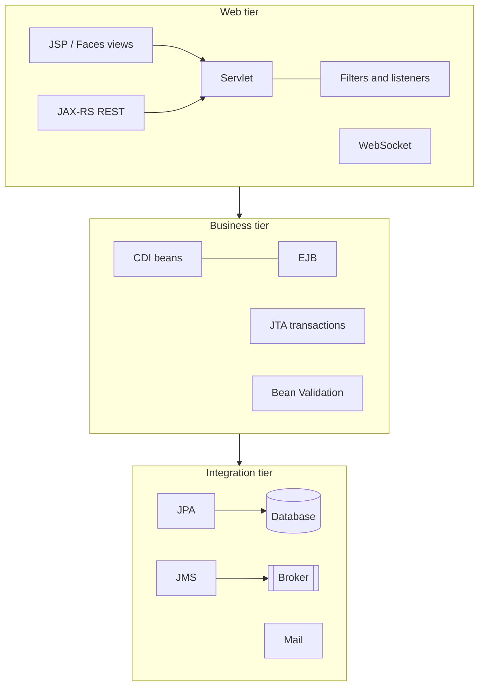
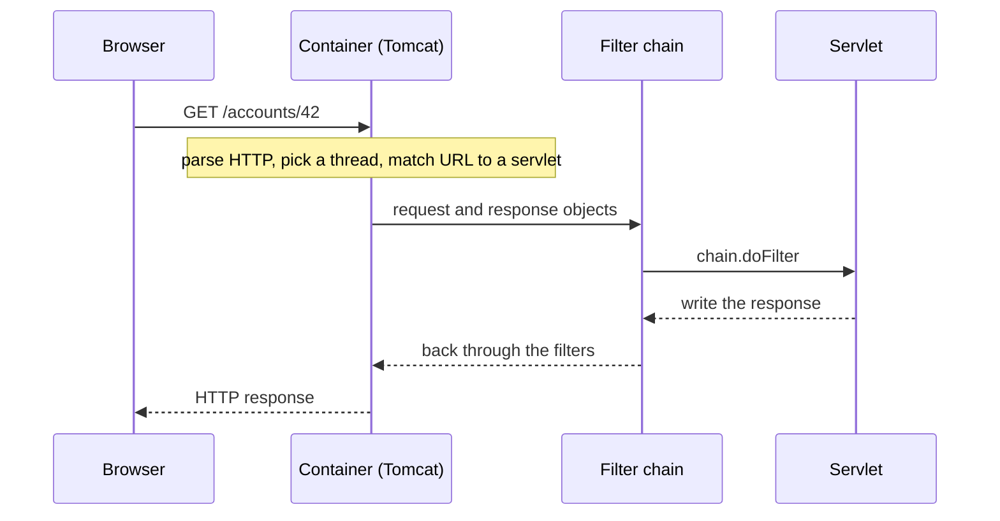

Spring Boot hides the web server from you. But banks that run older Java still ask about the platform underneath:

- What is a servlet, and what is JSP?
- What is the difference between a servlet container and an application server?
- What is Java EE, and how is Jakarta EE different?
- What do CDI, EJB, JPA and JAX-RS each do?
- Why did `javax` become `jakarta`?

This lesson is a map of the whole platform. It also connects to Spring:

- [Spring MVC](lesson:spring-mvc) is a framework built **on top of** the Servlet API.
- [Spring Boot](lesson:spring-boot) puts the container inside your application.
- The `javax` to `jakarta` change is the reason for most of the [Spring Boot 3](lesson:spring-boot-3) migration work.

> **One sentence to remember:** *Jakarta EE is a set of standards built on servlets, Tomcat runs only the web part, and Spring is another way to use the same base.*

## The big picture {#map}



Jakarta EE is a set of **specifications**. A specification is a document plus Java interfaces that say how a feature must behave. Vendors write the **implementations**, the code that actually does the work. Your code calls the API, and the server supplies the implementation.

| Specification | What it does | Common implementation |
| --- | --- | --- |
| **Servlet** | It handles HTTP requests and responses, sessions and filters. | Tomcat, Jetty, Undertow |
| **Pages (JSP)** and **Faces (JSF)** | They build HTML pages on the server. | Jasper (Tomcat), Mojarra, MyFaces |
| **CDI** | It provides dependency injection, scopes, events and interceptors. | Weld, OpenWebBeans |
| **Enterprise Beans (EJB)** | They are pooled business components with built-in transactions. | WildFly, WebLogic |
| **Transactions (JTA)** | It runs transactions, including ones that span several databases and queues. | Narayana, Atomikos |
| **Persistence (JPA)** | It maps Java objects to database tables. | Hibernate, EclipseLink |
| **RESTful Web Services (JAX-RS)** | It builds REST endpoints from annotations. | Jersey, RESTEasy |
| **Validation** | It checks values with annotations such as `@NotNull`, `@Size` and `@Valid`. | Hibernate Validator |
| **Messaging (JMS)** | It sends and receives messages through queues and topics. | ActiveMQ, Artemis, IBM MQ |
| **WebSocket, JSON-P, JSON-B, Mail, Security, Concurrency, Batch** | They cover the remaining needs. | They are built into the server. |

## Java EE becomes Jakarta EE {#history}

| Year | Release | What changed |
| --- | --- | --- |
| 1999 | J2EE 1.2 | It brought servlets, JSP, EJB 1.1, JMS and JNDI as one heavy platform. |
| 2006 | Java EE 5 | Annotations replaced XML, and EJB 3 and JPA made development simpler. |
| 2009 to 2013 | Java EE 6, 7 | They added CDI, the Web Profile, JAX-RS, WebSocket and batch jobs. |
| 2017 | Java EE 8 | This was the last Oracle release. It added Servlet 4.0 with HTTP/2. |
| 2017 to 2018 | | Oracle gave Java EE to the **Eclipse Foundation**. The foundation could not use the name "Java", so the platform became **Jakarta EE**. |
| 2019 | Jakarta EE 8 | It had the same APIs as Java EE 8 under new governance. The packages were still `javax.*`. |
| 2020 | **Jakarta EE 9** | This was the big break: every package was renamed from **`javax.*` to `jakarta.*`**. |
| 2022 | Jakarta EE 10 | It brought Servlet 6.0, CDI Lite and a small **Core Profile**, on Java 11 and 17. |
| 2025 | Jakarta EE 11 | It brought Servlet 6.1 and Jakarta Data, a Java 17 and 21 baseline, and support for virtual threads. |

**Why the rename?** Oracle kept the trademark on the `javax` name. So the Eclipse Foundation could not add to or change the APIs in those packages.

The rename itself is simple: `javax.servlet.http.HttpServlet` becomes `jakarta.servlet.http.HttpServlet`. But it breaks every library that still imports the old names:

- Spring Boot 3 and Spring Framework 6 require `jakarta.*`.
- Tomcat 10 and later run `jakarta.*` only.
- Tomcat 9 and earlier run `javax.*` only.

A `javax` JAR on a `jakarta` server fails with `ClassNotFoundException` or `NoSuchMethodError`. Tools such as the Eclipse Transformer and OpenRewrite can migrate both source code and compiled JARs.

Not every `javax` package moved. `javax.sql`, `javax.crypto` and `javax.naming` belong to the **JDK** itself, so they stay `javax`. Only the enterprise packages were renamed.

### Profiles {#profiles}

A **profile** is a named subset of the specifications that a server can choose to support.

- **Platform** (full) contains everything. Application servers such as WildFly or WebLogic implement it.
- **Web Profile** is a subset for web apps: Servlet, JSP, Faces, CDI, JPA, JAX-RS, Validation, JTA and WebSocket. It leaves out JMS and full EJB remoting.
- **Core Profile** (EE 10) is the minimum for microservices and native images: CDI Lite, JAX-RS and JSON. Quarkus and Helidon use it.

## The servlet container {#container}

A **servlet** is a Java class that handles HTTP requests. You do not start it yourself. A **servlet container** (also called a web container) runs it. The container does this work:

1. It owns the network sockets.
2. It parses the raw HTTP into an `HttpServletRequest` object.
3. It picks the servlet that matches the URL.
4. It runs the servlet on a thread from its pool.
5. It writes the `HttpServletResponse` back to the client.

Tomcat, Jetty and Undertow are servlet containers. WildFly, Payara, Open Liberty and WebLogic are **application servers**. An application server contains a servlet container plus the other EE services: CDI, EJB, JTA, JMS and JNDI.



**One servlet object serves every request**, from many threads at the same time. So a servlet must not keep request data in its instance fields.

The default model is one thread per request. A slow database call therefore keeps a container thread busy until it returns (see [Java concurrency](lesson:java-concurrency) and [reactive Spring](lesson:spring-reactive)).

## Servlets {#servlet}

```java
@WebServlet(urlPatterns = "/accounts/*", loadOnStartup = 1)
public class AccountServlet extends HttpServlet {

    private AccountService accounts;                       // shared by all threads: read-only after init

    @Override
    public void init() {                                   // once, when the servlet is created
        accounts = new AccountService();
    }

    @Override
    protected void doGet(HttpServletRequest req, HttpServletResponse res) throws IOException {
        String id = req.getPathInfo().substring(1);        // /accounts/42 gives "42"
        res.setContentType("application/json");
        res.setCharacterEncoding("UTF-8");
        res.getWriter().write(accounts.findAsJson(id));
    }

    @Override
    protected void doPost(HttpServletRequest req, HttpServletResponse res) throws IOException {
        // read req.getReader() or req.getParameter(...), then:
        res.setStatus(HttpServletResponse.SC_CREATED);
        res.setHeader("Location", "/accounts/99");
    }

    @Override
    public void destroy() { /* release resources, once, at shutdown */ }
}
```

### Lifecycle {#lifecycle}

1. **Load and create.** The container creates the servlet object on the first request, or at startup if `loadOnStartup` is set.
2. **`init()`** runs once.
3. **`service()`** runs for every request, on a container thread. `HttpServlet.service` passes the call on to `doGet`, `doPost`, `doPut`, `doDelete` and so on, based on the HTTP method.
4. **`destroy()`** runs once, when the app stops.

### Request, response and state {#request}

- **Request.** `getParameter` reads query and form values. `getHeader` reads a header. `getReader` or `getInputStream` reads the body. `getPathInfo` and `getCookies` give the extra path and the cookies. `getAttribute` and `setAttribute` pass data between components during one request.
- **Response.** You set the status and headers, then write with `getWriter` (text) or `getOutputStream` (bytes). Once the response is **committed** (its first bytes have been sent), the status and headers cannot change.
- **Four scopes** hold attributes. They are **request**, **session**, **application** (the `ServletContext`, shared by everyone) and, in JSP only, **page**.
- **Forward versus redirect.** `RequestDispatcher.forward` hands the same request to another resource inside the server. The URL stays the same, and there is one round trip. `sendRedirect` answers with status 302, and the browser makes a **new** request, so the URL changes.
- After a form POST, use **post, redirect, get**: redirect to a GET page, so that a refresh does not submit the form twice.

### Sessions and cookies {#session}

HTTP is **stateless**: each request arrives with no memory of the last one. So the container tracks a user with a **session**. It creates an `HttpSession`, keeps it in memory under a random id, and sends that id to the browser in a cookie named `JSESSIONID`.

```java
HttpSession session = req.getSession();            // creates one if missing; getSession(false) does not
session.setAttribute("customerId", 42L);
session.setMaxInactiveInterval(900);               // seconds of idleness before it expires
req.changeSessionId();                             // call after login, against session fixation
session.invalidate();                              // logout
```

**Session fixation** is an attack where someone plants a known session id in your browser before you log in, then uses it afterwards. Changing the id after login stops it.

Set the cookie flags `HttpOnly`, `Secure` and `SameSite`.

In a cluster, the session lives in the memory of one node. There are three ways to handle that:

- **Sticky sessions** send each user back to the same node.
- **Session replication** copies sessions between nodes.
- The best option is a **stateless** server: keep the state in a token or in a shared store such as Redis (see [authentication](lesson:authn-authz)).

### Filters and listeners {#filters}

A **filter** wraps the call to a servlet. It runs before and after the servlet, so it can:

- inspect a request,
- change it (by wrapping the request or response object),
- stop it early and answer itself,
- or log it.

Filters are the right layer for security, compression, character encoding, CORS and correlation ids. Spring Security is a chain of filters.

```java
@WebFilter("/*")
public class TimingFilter implements Filter {
    @Override
    public void doFilter(ServletRequest req, ServletResponse res, FilterChain chain) throws IOException, ServletException {
        long start = System.nanoTime();
        try {
            chain.doFilter(req, res);                  // go on to the next filter or the servlet
        } finally {
            log.info("{} took {} ms", ((HttpServletRequest) req).getRequestURI(), (System.nanoTime() - start) / 1_000_000);
        }
    }
}
```

The order of filters declared with `@WebFilter` is **not defined**. To control the order, declare the filters in `web.xml`, or register them in code as Spring Boot's `FilterRegistrationBean` does.

**Listeners** react to events:

- `ServletContextListener` runs when the app starts and stops, for example to fill a cache.
- `HttpSessionListener` runs when a session is created or destroyed.
- `ServletRequestListener` runs when a request starts and ends.

### Async and non-blocking {#async}

`request.startAsync()` returns an `AsyncContext`. The container thread goes back to the pool while a long task runs somewhere else, and you finish the response later.

Servlet 3.1 added **non-blocking I/O** with `ReadListener` and `WriteListener`, for large streams. Frameworks build on these features for `Callable`, `DeferredResult` and WebSocket.

From Java 21, **virtual threads** let plain blocking code scale again. A virtual thread is a very cheap thread managed by the JVM. Tomcat and Jetty can run each request on one.

### Configuration: annotations and web.xml {#webxml}

Since Servlet 3.0, the annotations `@WebServlet`, `@WebFilter` and `@WebListener` replace most of the **deployment descriptor**. The deployment descriptor is the XML file `WEB-INF/web.xml`. It is still used for filter order, error pages, security constraints and session settings.

Nothing under **`WEB-INF`** is ever sent directly to a browser. That is why JSP files and configuration are kept there.

Try it in the lab: [A request through a servlet container](lab:ee-servlet-flow).

## JSP, JSTL and JSF {#views}

**JSP** (Jakarta Server Pages) mixes HTML with special tags. The container **compiles each JSP into a servlet** the first time someone requests it. So a JSP *is* a servlet.

```html
<%@ taglib prefix="c" uri="jakarta.tags.core" %>
<html>
  <body>
    <h1>Accounts of ${customer.name}</h1>                  <%-- EL: ${...} reads request, session or bean attributes --%>
    <c:forEach var="a" items="${accounts}">
      <p>${a.iban}: <c:out value="${a.balance}"/></p>      <%-- c:out escapes HTML against XSS --%>
    </c:forEach>
  </body>
</html>
```

- **EL** (Expression Language) is the `${...}` syntax that reads values.
- **JSTL** is the standard tag library, with tags such as `c:if`, `c:forEach` and `fmt:formatNumber`.
- **Scriptlets** (`<% ... %>`) put Java code directly in the page. They are bad practice, because logic belongs in a servlet or controller.
- The classic pattern is **MVC Model 2**. A servlet (the controller) handles the request, puts the model in the request scope and **forwards** to a JSP (the view). Spring MVC's `ModelAndView` and view resolvers use the same idea.
- JSP is mostly legacy. It is hard to test and it mixes concerns. It also works poorly inside an executable Spring Boot JAR, so you would need a WAR. Modern server-rendered apps use Thymeleaf or Freemarker. Most new front ends are single-page apps that call a REST API (see [REST API design](lesson:rest-api-design)).
- **JSF** (Jakarta Faces) is a component-based framework. Its pages (Facelets, `.xhtml` files) bind to **backing beans**, which are Java objects that hold the page's data. JSF keeps a tree of components on the server and runs each request through a fixed lifecycle. PrimeFaces is the common component library. JSF is still common in older bank back-office tools.

## CDI: injection, scopes and events {#cdi}

**CDI** (Contexts and Dependency Injection) is the Jakarta EE version of the Spring container. It creates objects, called beans, and hands them to the classes that need them.

```java
@ApplicationScoped                                   // one instance for the whole application
public class TransferService {

    @Inject AccountRepository accounts;              // field, constructor or setter injection
    @Inject @Named("audit") Auditor auditor;         // qualifier to choose one of several implementations
    @Inject Event<TransferCompleted> events;

    @Transactional                                   // an interceptor binding (Jakarta Transactions)
    public void transfer(String from, String to, BigDecimal amount) {
        accounts.debit(from, amount);
        accounts.credit(to, amount);
        events.fire(new TransferCompleted(from, to, amount));
    }
}
```

- **Scopes** decide how long a bean lives. They are `@RequestScoped`, `@SessionScoped`, `@ApplicationScoped`, `@ConversationScoped` and `@Dependent`. `@Dependent` is the default: each injection point gets a new object, like Spring's prototype scope.
- **Client proxies** let a long-lived bean hold a shorter-lived one. For example, an application-scoped bean can hold a request-scoped one. The proxy finds the right object for the current request on each call.
- **Producers** (`@Produces`) create objects whose classes you do not control.
- **Qualifiers** choose between several implementations of the same type.
- **Interceptors** and **decorators** add behaviour that cuts across many classes, such as transactions or logging.
- **Events** (`@Observes`) let one component react to another without a direct reference.
- CDI finds beans by scanning archives that contain `beans.xml` or annotated beans. CDI Lite (EE 10) is a subset that does this work at build time, so the app starts faster.

Compared with Spring:

| CDI | Spring |
| --- | --- |
| `@Inject` | `@Autowired` |
| `@ApplicationScoped` | a singleton bean |
| `@RequestScoped` | `@RequestScope` |
| `@Produces` | `@Bean` |

Spring also understands `@Inject` and `@Named`.

## EJB and transactions {#ejb}

**Enterprise Beans** (EJBs) are components that the server manages for you. They came before CDI, and most of what they offer is now available through CDI.

| Type | Behaviour |
| --- | --- |
| **`@Stateless`** | The server keeps a pool of them. They hold no client state, so each call may reach a different object. |
| **`@Stateful`** | There is one object per client conversation. It holds state, and the server can save it to disk when idle (passivation). |
| **`@Singleton`** | There is one object, and the container manages locking on it. |
| **`@MessageDriven`** | The container calls it for each JMS message that arrives. |

EJBs give you:

- **container-managed transactions**,
- security with `@RolesAllowed`,
- pooling,
- timers with `@Schedule`,
- and remote calls over RMI and IIOP.

By default every business method runs in a transaction (`REQUIRED`). A runtime exception rolls the transaction back. A checked exception does not. This is the same rule as Spring's `@Transactional` (see [Spring transactions](lesson:spring-transactions)).

**JTA** (Jakarta Transactions) is the API behind this. `@Transactional` works on any CDI bean, with types such as `TxType.REQUIRED`, `REQUIRES_NEW` and `MANDATORY`.

JTA also supports **XA transactions**. An XA transaction uses a **two-phase commit**: every resource first promises it can commit, and then all of them commit together. This lets one unit of work span several databases and a JMS queue. XA is slow, so it is rarely used across microservices. Sagas replace it there.

## Persistence: JPA {#jpa}

**JPA** (Jakarta Persistence) maps objects to tables. Its main parts are:

- `@Entity` and `@Id` on your classes, plus annotations for relations,
- the `EntityManager`, which loads and saves entities,
- JPQL, a query language over entities,
- and the **persistence context**, which acts as a first-level cache and detects changed objects (dirty checking).

In a Jakarta EE server, the container injects the `EntityManager` and ties its life to the current transaction. Hibernate is the common provider.

The details (lazy loading, the N+1 problem, entity states) are in [Spring Data JPA](lesson:spring-data-jpa). The API is the same in Spring.

```java
@PersistenceContext EntityManager em;                // container-managed, transaction-scoped

public Account find(String iban) {
    return em.createQuery("select a from Account a where a.iban = :iban", Account.class)
             .setParameter("iban", iban)
             .getSingleResult();
}
```

## REST: JAX-RS {#jaxrs}

**Jakarta RESTful Web Services** (JAX-RS) builds REST endpoints from annotations. Jersey and RESTEasy are the implementations.

```java
@Path("/accounts")
@Produces(MediaType.APPLICATION_JSON)
@Consumes(MediaType.APPLICATION_JSON)
@ApplicationScoped
public class AccountResource {

    @Inject AccountService accounts;

    @GET @Path("/{id}")
    public Account get(@PathParam("id") String id) {
        return accounts.find(id).orElseThrow(NotFoundException::new);   // mapped to 404
    }

    @POST
    public Response create(@Valid NewAccount body, @Context UriInfo uri) {
        Account a = accounts.open(body);
        return Response.created(uri.getAbsolutePathBuilder().path(a.id()).build()).entity(a).build();
    }
}
```

Each JAX-RS piece has a Spring MVC counterpart:

| JAX-RS | Spring MVC |
| --- | --- |
| `@Path`, `@GET`, `@POST` | `@RequestMapping` and its shortcuts |
| `@PathParam` | `@PathVariable` |
| `@QueryParam` | `@RequestParam` |
| `@Produces`, `@Consumes` | `produces` and `consumes` |
| `ExceptionMapper` | `@ExceptionHandler` |
| `ContainerRequestFilter` | a filter |
| the JAX-RS client | `RestClient` |

JAX-RS runs on top of the Servlet API inside a container.

## The other specifications {#others}

- **Bean Validation** checks values with annotations such as `@NotNull`, `@Size`, `@Email` and `@Valid`, on fields and parameters. JAX-RS, JPA and Faces use it. Hibernate Validator is the implementation.
- **JMS** (Jakarta Messaging) sends messages to a `Queue` or a `Topic`. A queue gives each message to one consumer. A topic gives each message to all subscribers. JMS 2.0 added the simpler `JMSContext`. Message-driven beans consume messages. Common brokers are ActiveMQ Artemis and IBM MQ (see [messaging](lesson:messaging) and [Spring messaging](lesson:spring-messaging)).
- **WebSocket** uses `@ServerEndpoint` with `@OnOpen`, `@OnMessage` and `@OnClose`. It opens a two-way channel for push updates and chat.
- **JSON-P** parses and builds JSON, like a parser. **JSON-B** binds JSON to objects, like Jackson.
- **Mail** sends email. **Batch** runs chunk-oriented jobs.
- **Concurrency** gives managed executors. Inside a server, use these instead of creating raw threads.
- **Jakarta Security** provides `HttpAuthenticationMechanism` and `IdentityStore` (for example a database or LDAP), plus `@RolesAllowed` and `@DeclareRoles`. Older apps declare **security constraints** in `web.xml` with `BASIC`, `FORM` or `CLIENT-CERT` login. See [Spring Security](lesson:spring-security) for the Spring version.
- **JNDI** is a naming service. The server publishes resources in it under names such as `java:comp/env/jdbc/BankDS`. You inject such a resource with `@Resource`, so the connection pool belongs to the server, not the application.

```java
@Resource(lookup = "java:comp/env/jdbc/BankDS")      // a DataSource configured in the server, not in the code
DataSource dataSource;
```

## Packaging and deployment {#packaging}

```text
accounts.war
├── index.html, css/, js/                     public resources
└── WEB-INF/                                  never served directly
    ├── web.xml                               deployment descriptor (optional since Servlet 3.0)
    ├── classes/                              compiled code and resources
    ├── lib/                                  dependency JARs
    └── beans.xml                             CDI
```

- **Archive types.** A **JAR** holds a library or an EJB module. A **WAR** (Web Archive) holds one web application. An **EAR** (Enterprise Archive) holds several modules (WARs and EJB JARs) that are deployed together and share libraries. EARs are mostly legacy.
- **Context path.** A WAR named `accounts.war` is served under `/accounts` unless you configure otherwise. `ROOT.war` is served at `/`.
- **Libraries the server provides.** In Maven, give the Jakarta APIs the `provided` scope, because the server already has them (see [Maven](lesson:maven) scopes).
- **Class loading.** Each application gets its own class loader, so two apps on one server can use different library versions. A clash between the server's libraries and the app's libraries is a classic cause of `ClassCastException`.
- **Hot redeploy** (replacing an app without restarting the server) was an old benefit of servers. Containers and CI/CD pipelines have replaced it.

## Servers and runtimes {#servers}

| Kind | Examples | What you get |
| --- | --- | --- |
| **Servlet container** | Apache Tomcat, Jetty, Undertow | You get Servlet, JSP, WebSocket and sometimes EL. EJB, JTA and JMS are not built in. |
| **Web Profile server** | TomEE (Tomcat plus EE), Payara Micro | You get the Web Profile. |
| **Full application server** | WildFly (JBoss EAP), Payara, Open Liberty, WebLogic, WebSphere, GlassFish | You get the full platform, a management console, clustering and security realms. |
| **Embedded or microservice runtimes** | Spring Boot (embedded Tomcat), Quarkus, Helidon, Micronaut | You get one executable and no separate server. |

The trend has changed. Teams used to deploy many WARs to one big server. Now each service **embeds** its own server and ships as a container image.

- Spring Boot's `spring-boot-starter-web` embeds Tomcat.
- Boot's `DispatcherServletRegistrationBean` registers the `DispatcherServlet` in code, the way `web.xml` once did.
- To deploy a Boot app to an external server instead, package it as a WAR and extend `SpringBootServletInitializer`.

**MicroProfile** is a lightweight set of specifications for microservices, built on the Core Profile. It covers Config, Health, Metrics, Fault Tolerance (retry and circuit breaker), OpenAPI, JWT and a REST Client. Quarkus, Helidon and Open Liberty implement it. It plays the same role in the Jakarta world as Spring Cloud and Micrometer do in Spring (see [Spring Cloud](lesson:spring-cloud)).

## Spring and Jakarta EE {#spring}

Spring started as a lighter alternative to J2EE and EJB. Today the two overlap and work together.

| Need | Jakarta EE | Spring |
| --- | --- | --- |
| Programming model | CDI, EJB | IoC container, beans |
| Web layer | Servlet, JAX-RS, JSF | Spring MVC (on Servlet), WebFlux |
| Persistence | JPA | Spring Data JPA (uses JPA and Hibernate) |
| Transactions | JTA, `@Transactional` | `@Transactional` over JDBC, JPA or JTA |
| Messaging | JMS, MDB | `JmsTemplate`, `@JmsListener`, Kafka |
| Validation | Bean Validation | the same Bean Validation |
| Security | Jakarta Security | Spring Security |
| Runs on | an application server or Core Profile runtime | embedded Tomcat, Jetty or Undertow |

Spring **uses** several Jakarta specifications: Servlet, JPA, Bean Validation and JMS. So a Spring Boot app is not "outside" Jakarta EE. It only skips the application-server programming model.

How to choose:

- Choose **Jakarta EE** when the organisation has standardised on WebLogic, WebSphere or WildFly, or wants portable standards.
- Choose **Spring** when it wants the larger ecosystem and embedded deployment.

## Cheat sheet {#cheatsheet}

| Topic | Key point |
| --- | --- |
| Jakarta EE | It is the set of enterprise Java specifications, formerly Java EE, now run by the Eclipse Foundation. |
| Rename | Jakarta EE 9 changed `javax.*` to `jakarta.*`. Spring Boot 3 and Tomcat 10 need the new names. |
| Servlet | It is a Java class that handles HTTP. One object serves many threads. |
| Lifecycle | `init` runs once, `service` runs per request, and `destroy` runs once. |
| Container vs server | Tomcat is a servlet container. WildFly or WebLogic is a full application server. |
| JSP | It is HTML with EL and JSTL, compiled into a servlet. It is legacy. |
| JSF | It is a component-based UI with backing beans. |
| Filter | It wraps requests. Set the order in `web.xml` or in code. |
| Session | It is an `HttpSession` plus the `JSESSIONID` cookie. Call `changeSessionId` after login. |
| Forward / redirect | A forward stays on the server with the same URL. A redirect makes a new request. |
| CDI | It gives `@Inject` and scopes. Spring's counterpart is the IoC container. |
| EJB | They are pooled transactional beans. CDI plus `@Transactional` now covers most of their roles. |
| JTA | It runs transactions, including XA across several resources. |
| JPA | It maps objects to tables. Hibernate is the common provider. |
| JAX-RS | It builds REST with `@Path`, `@GET` and `@Produces`. Jersey and RESTEasy implement it. |
| JNDI | It holds resources the server publishes, such as a `DataSource`. |
| Packaging | The archive types are JAR, WAR (with `WEB-INF`) and EAR. |
| MicroProfile | It adds Config, Health, Metrics and Fault Tolerance for microservices. |

## Interview questions {#questions}

### [basic] What is a servlet? {#servlet-q}

A Java class that handles HTTP requests inside a servlet container. It is written against the Servlet API.

How it works:

1. The container parses the request.
2. It calls `service()` on one of its pool threads. `service()` routes the call to `doGet`, `doPost` and so on.
3. It sends back the response.

One servlet object serves all requests, so it must be thread-safe and must not keep per-request data in fields.

Frameworks build on servlets. For example, Spring MVC's `DispatcherServlet` is a servlet. See [Spring MVC](lesson:spring-mvc).

### [basic] What is the servlet lifecycle? {#lifecycle-q}

Create, `init` once, `service` per request, `destroy` once.

1. The container loads and creates the servlet, on the first request or at startup with `loadOnStartup`.
2. It calls `init()` once.
3. It calls `service()` for every request, from many threads at the same time.
4. It calls `destroy()` once, when the app is undeployed or the server shuts down.

For example, open shared, read-only resources in `init` and release them in `destroy`.

### [basic] What is JSP and how does it relate to servlets? {#jsp-q}

JSP is a template technology, and every JSP is compiled into a servlet.

- A JSP (Jakarta Server Pages) mixes HTML with EL (`${...}`), JSTL tags and, though discouraged, Java scriptlets.
- The container compiles each JSP into a servlet the first time it is used, so it runs as a servlet.
- The accepted pattern is that a servlet or controller prepares the model and then **forwards** to the JSP, which renders it.

JSP is mostly legacy today. Thymeleaf, Faces or a JavaScript front end replace it.

### [basic] What is the difference between a servlet container and an application server? {#container-q}

A servlet container runs only the web specifications. An application server runs the whole platform.

- A **servlet container** (Tomcat, Jetty) implements Servlet, JSP, WebSocket and EL.
- An **application server** (WildFly, Payara, WebLogic, WebSphere) implements all of Jakarta EE. It adds CDI, EJB, JTA, JMS, JNDI, security realms, clustering and management tools.
- TomEE sits between them: it is Tomcat plus the Web Profile.

Spring Boot usually embeds only a servlet container, because Spring supplies the rest.

### [basic] What is Jakarta EE and how is it different from Java EE? {#ee-q}

They are the same platform under a new name and owner.

1. Oracle donated Java EE to the Eclipse Foundation, which renamed it Jakarta EE.
2. Jakarta EE 8 (2019) was identical to Java EE 8.
3. From Jakarta EE 9, the packages moved from `javax.*` to `jakarta.*`.

The platform now evolves through an open, vendor-neutral process.

### [intermediate] Why did `javax` become `jakarta`, and what breaks? {#rename-q}

Because Oracle kept the `javax` name, so the Eclipse Foundation could not change those APIs while they kept it. Renaming was the price of moving the platform forward.

What breaks: the change is **binary-incompatible**, which means compiled code stops working, not just source code.

- Libraries compiled against `javax.servlet` do not run on a `jakarta` server (Tomcat 10 and later, Spring Boot 3, Spring Framework 6).
- The reverse fails too.

How to migrate:

1. Update the imports.
2. Update the dependencies to Jakarta versions (Hibernate 6, a Jakarta-aware Jersey and so on).
3. Update the namespaces in `web.xml` and `persistence.xml`.
4. Check every third-party JAR.

Tools such as OpenRewrite and the Eclipse Transformer help. Packages that belong to the JDK, such as `javax.sql` and `javax.crypto`, are not renamed.

### [intermediate] Is a servlet thread-safe? How do you make it so? {#threadsafe-q}

No, not by default. One servlet object is shared by all threads.

To make it safe:

1. Do not store request or user data in instance fields.
2. Use local variables, request attributes or the session for that data instead.
3. Make any shared field immutable, properly synchronised, or a thread-safe object.

The old `SingleThreadModel` was removed, because it did not really solve the problem.

### [intermediate] What is the difference between a filter and a servlet? {#filter-q}

A servlet **produces** the response. A filter **wraps** the call to it.

- A servlet answers requests for a URL pattern.
- A filter sits around a servlet (or a static file). It sees the request before and the response after, and it can change, block or log them.
- Filters form a chain around the servlet. They handle concerns that apply everywhere: security, compression, encoding, CORS and request ids.

For example, Spring Security is a chain of filters, and the `DispatcherServlet` is the servlet behind it.

### [intermediate] Forward or redirect? {#forward-q}

Forward to show a view. Redirect after a successful POST.

- **`forward`** happens inside the server. The same request and response objects go to another resource. The browser URL does not change, and there is one round trip.
- **`sendRedirect`** returns status 302. The browser then makes a second request to a new URL, and the request attributes are lost.

Redirect after a POST (post, redirect, get) so that a refresh does not submit the form again.

### [intermediate] How do sessions work and what are the risks in a cluster? {#session-q}

The container keeps an `HttpSession` in server memory and sends its id in the `JSESSIONID` cookie.

The cluster risk: the next request may reach another node that does not have that session. The options are:

1. **Sticky sessions.** Each user goes back to the same node, but a node failure still loses its sessions.
2. **Session replication.** Nodes copy sessions to each other, which costs time and adds complexity.
3. **An external store** (Redis) or **stateless tokens.**

Also protect the session itself. Call `changeSessionId` after login against **session fixation**, and set `HttpOnly`, `Secure` and `SameSite` on the cookie.

### [intermediate] What is CDI and how does it compare with Spring's container? {#cdi-q}

CDI is Jakarta EE's standard dependency injection, and it does the same job as Spring's IoC container.

- It provides `@Inject`, scopes such as `@RequestScoped` and `@ApplicationScoped`, qualifiers, producers, interceptors and events.
- Spring beans are singletons by default. CDI's default scope is `@Dependent`, a new object per injection point.
- CDI uses client proxies to implement scopes.
- Spring also accepts `@Inject` and `@Named`.

Many old EJB features are now just CDI beans with `@Transactional`.

### [intermediate] What are EJBs and are they still used? {#ejb-q}

Yes, mainly in legacy systems.

- Enterprise JavaBeans are components that the server manages. The types are stateless, stateful, singleton and message-driven.
- They give pooling, container-managed transactions, security and remote access.
- They dominated J2EE and were simplified in EJB 3. CDI beans plus `@Transactional` now cover many of their roles.

They remain in WebLogic and WebSphere estates, especially message-driven beans and remote EJBs. So you should be able to read them even if you write Spring.

### [intermediate] How does JAX-RS differ from Spring MVC for REST? {#jaxrs-q}

JAX-RS is a standard, and Spring MVC is Spring's own framework. Both map annotated methods to HTTP.

- **JAX-RS** uses `@Path`, `@GET`, `@PathParam`, `ExceptionMapper` and `Response`. Jersey or RESTEasy implement it, usually on an application server or Quarkus.
- **Spring MVC** uses `@RestController`, `@GetMapping` and `@ControllerAdvice`, and it fits with the rest of Spring.

The concepts carry over directly from one to the other.

### [intermediate] What are JNDI and a container-managed DataSource? {#jndi-q}

JNDI is a naming directory inside the server, and a container-managed `DataSource` is a connection pool that the server owns and publishes there.

1. An administrator defines the `DataSource` in the server.
2. The server publishes it under a name such as `java:comp/env/jdbc/BankDS`.
3. The application injects it with `@Resource`, or looks it up by name.

The benefits: credentials and pool settings stay out of the code and the WAR, and the server shares and monitors one pool. Spring Boot usually builds its own pool (HikariCP) from `application.yml` instead.

### [advanced] How does Spring Boot relate to the Servlet API and Tomcat? {#boot-q}

Spring Boot embeds a servlet container, Tomcat by default, and builds on the Servlet API.

- The embedded server starts inside the same JVM as your app.
- Boot registers the `DispatcherServlet` and the filters (security, encoding, your `FilterRegistrationBean`s) in code. A WAR would have used `web.xml` for this.
- So everything in Spring MVC is built on `HttpServletRequest` and `HttpServletResponse`.

For an external server, build a WAR and extend `SpringBootServletInitializer`. WebFlux is the exception: it does not need the Servlet API and runs on Netty by default.

### [advanced] How would you migrate a `javax` application to Jakarta EE 10 or Spring Boot 3? {#migrate-q}

Step by step, module by module:

1. Upgrade to Java 17 or later first.
2. Upgrade the dependencies to `jakarta` versions: Spring Boot 3, Hibernate 6, the JAX-RS and validator implementations, and the JDBC and security libraries.
3. Change the imports and the descriptor namespaces mechanically, with OpenRewrite or the IDE.
4. Check third-party JARs and the libraries your server provides.
5. Run the full test suite.

For binaries you cannot change, the Eclipse Transformer is a short-term bridge. Never mix `javax` and `jakarta` servlet JARs on one class path.

### [advanced] When would you choose a full application server over embedded Tomcat? {#choice-q}

When the organisation already runs one, or needs the services it provides.

Good reasons for a full server:

- The organisation already runs and supports one (WebLogic, WebSphere, JBoss EAP).
- You need XA transactions across several resources.
- You need JMS with managed connections, clustering, central security realms or the server's operations tools.
- Many apps share one server.

For new microservices in containers, an embedded server is simpler. You get one process, one image, independent scaling and no server to administer. That is why most new work uses Spring Boot or Quarkus.

### [coding] Write a servlet filter that adds a correlation id to the logs and the response. {#coding-filter}

A **correlation id** is one id attached to every log line of a request, so you can find all of them with one search.

```java
@WebFilter("/*")
public class CorrelationIdFilter implements Filter {

    private static final String HEADER = "X-Correlation-Id";

    @Override
    public void doFilter(ServletRequest request, ServletResponse response, FilterChain chain) throws IOException, ServletException {
        HttpServletRequest req = (HttpServletRequest) request;
        HttpServletResponse res = (HttpServletResponse) response;

        String id = Optional.ofNullable(req.getHeader(HEADER)).orElseGet(() -> UUID.randomUUID().toString());
        MDC.put("correlationId", id);                       // appears in every log line of this thread
        res.setHeader(HEADER, id);
        try {
            chain.doFilter(request, response);
        } finally {
            MDC.remove("correlationId");                    // container threads are reused: always clean up
        }
    }
}
```

Points to explain:

- The filter runs for every request, including static files.
- The header is set before the response is committed.
- The cleanup in `finally` matters. Container threads are reused, so without it one request's id would leak into the next request on the same thread.

In Spring you would extend `OncePerRequestFilter` instead.

### [coding] Write a servlet that returns an account as JSON and handles a missing id. {#coding-servlet}

```java
@WebServlet("/accounts/*")
public class AccountServlet extends HttpServlet {

    private final AccountRepository accounts = new AccountRepository();     // thread-safe and read only here
    private final ObjectMapper json = new ObjectMapper();                    // ObjectMapper is thread-safe

    @Override
    protected void doGet(HttpServletRequest req, HttpServletResponse res) throws IOException {
        String path = req.getPathInfo();                                     // "/42", or null for /accounts
        if (path == null || path.length() < 2) {
            res.sendError(HttpServletResponse.SC_BAD_REQUEST, "account id required");
            return;
        }
        Optional<Account> found = accounts.find(path.substring(1));
        if (found.isEmpty()) {
            res.sendError(HttpServletResponse.SC_NOT_FOUND);
            return;
        }
        res.setContentType("application/json");
        res.setCharacterEncoding("UTF-8");
        json.writeValue(res.getWriter(), found.get());
    }
}
```

Points to explain:

- A missing id returns 400, and an unknown account returns 404. Neither throws an exception that would become a 500.
- The shared fields are `final` and thread-safe, because one servlet object serves all threads.
- The content type and encoding are set before anything is written.
- In production you would use a framework (JAX-RS or Spring MVC) rather than write each servlet by hand.
