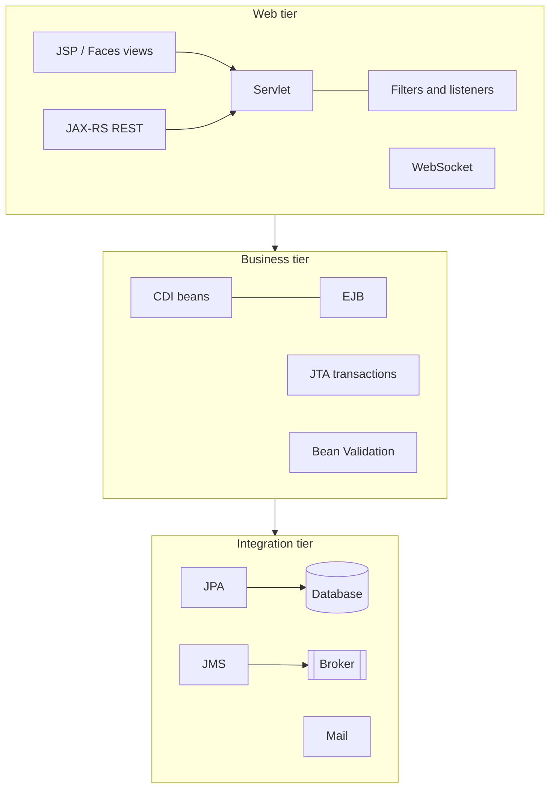
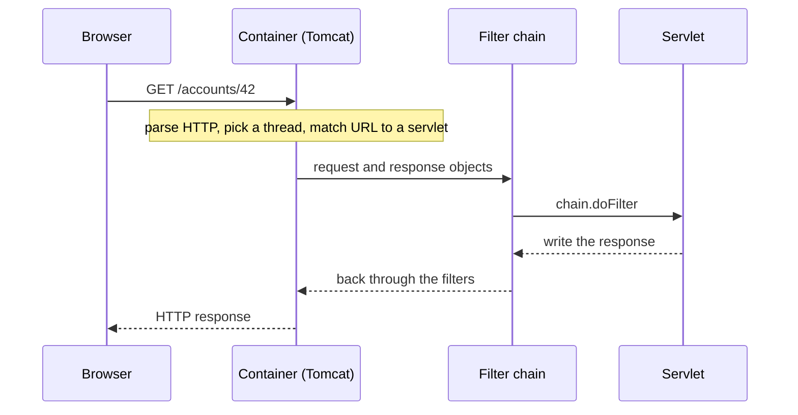

Spring Boot hides the web server, but interviews for a bank that runs older Java still ask the platform underneath: *what is a servlet, what is JSP, what is the difference between a servlet container and an application server, what is Java EE and how is Jakarta EE different, what do CDI, EJB, JPA and JAX-RS each do, and why did `javax` become `jakarta`?* This lesson is the map of the whole platform. [Spring MVC](lesson:spring-mvc) is a framework **on top of** the Servlet API, [Spring Boot](lesson:spring-boot) embeds the container, and the `javax` to `jakarta` change explains the [Spring Boot 3](lesson:spring-boot-3) migration.

> **One sentence to remember:** *Jakarta EE (formerly Java EE) is a set of specifications for enterprise Java, with the Servlet API as its base; a servlet container such as Tomcat runs servlets and JSPs, a full application server adds CDI, EJB, JTA, JMS and the rest, and Spring is an alternative programming model that still runs on the Servlet API.*

## The big picture {#map}



Jakarta EE is **specifications** (APIs and rules, written as documents and interfaces) with **implementations** from vendors. Your code uses the API; the server provides the implementation:

| Specification | What it does | Common implementation |
| --- | --- | --- |
| **Servlet** | HTTP request and response handling, sessions, filters | Tomcat, Jetty, Undertow |
| **Pages (JSP)** and **Faces (JSF)** | server-side views | Jasper (Tomcat), Mojarra, MyFaces |
| **CDI** | dependency injection, scopes, events, interceptors | Weld, OpenWebBeans |
| **Enterprise Beans (EJB)** | pooled, transactional business components | WildFly, WebLogic |
| **Transactions (JTA)** | distributed transactions across databases and queues | Narayana, Atomikos |
| **Persistence (JPA)** | object-relational mapping | Hibernate, EclipseLink |
| **RESTful Web Services (JAX-RS)** | REST endpoints with annotations | Jersey, RESTEasy |
| **Validation** | `@NotNull`, `@Size`, `@Valid` | Hibernate Validator |
| **Messaging (JMS)** | queues and topics | ActiveMQ, Artemis, IBM MQ |
| **WebSocket, JSON-P, JSON-B, Mail, Security, Concurrency, Batch** | the rest | built into the server |

## Java EE becomes Jakarta EE {#history}

| Year | Release | What changed |
| --- | --- | --- |
| 1999 | J2EE 1.2 | servlets, JSP, EJB 1.1, JMS, JNDI, one heavy platform |
| 2006 | Java EE 5 | annotations replace XML, EJB 3 and JPA simplify development |
| 2009 to 2013 | Java EE 6, 7 | CDI, Web Profile, JAX-RS, WebSocket, batch |
| 2017 | Java EE 8 | the last Oracle release: Servlet 4.0 (HTTP/2) |
| 2017 to 2018 | | Oracle gives Java EE to the **Eclipse Foundation**; it cannot reuse the name "Java", so it becomes **Jakarta EE** |
| 2019 | Jakarta EE 8 | the same APIs as Java EE 8, new governance, packages still `javax.*` |
| 2020 | **Jakarta EE 9** | the big break: every package is renamed **`javax.*` to `jakarta.*`** |
| 2022 | Jakarta EE 10 | Servlet 6.0, CDI Lite, a small **Core Profile**, Java 11 and 17 |
| 2025 | Jakarta EE 11 | Servlet 6.1, Jakarta Data, Java 17 and 21 baseline, virtual-thread support |

**Why the rename?** Oracle kept the `javax` trademark, so the Eclipse Foundation could not evolve those packages. The rename is mechanical (`javax.servlet.http.HttpServlet` becomes `jakarta.servlet.http.HttpServlet`) but it breaks every library that imports the old names: Spring Boot 3 and Spring Framework 6 require `jakarta.*`, Tomcat 10 and later runs `jakarta.*` only, and Tomcat 9 and earlier run `javax.*`. A `javax` JAR on a `jakarta` server fails with `ClassNotFoundException` or `NoSuchMethodError`. Tools such as the Eclipse Transformer and OpenRewrite migrate code and binaries. Note that `javax.sql`, `javax.crypto` and `javax.naming` are part of the **JDK** and stay `javax`; only the enterprise packages moved.

### Profiles {#profiles}

- **Platform** (full): everything, for application servers such as WildFly or WebLogic.
- **Web Profile**: a subset for web apps (Servlet, JSP, Faces, CDI, JPA, JAX-RS, Validation, JTA, WebSocket), without JMS and full EJB remoting.
- **Core Profile** (EE 10): the minimum for microservices and native images (CDI Lite, JAX-RS, JSON), used by Quarkus and Helidon.

## The servlet container {#container}

A **servlet** is a Java class that handles HTTP requests. You do not run it: a **servlet container** (also called web container) does. It owns the sockets, parses HTTP into `HttpServletRequest`, picks the servlet by URL, runs it on a pooled thread, and writes the `HttpServletResponse` back. Tomcat, Jetty and Undertow are servlet containers. WildFly, Payara, Open Liberty and WebLogic are **application servers** that contain a servlet container plus the EE services (CDI, EJB, JTA, JMS, JNDI).



**One servlet instance serves every request**, from many threads at once. That is why a servlet must not keep request data in instance fields. The default model is thread-per-request, so a slow database call holds a container thread (see [Java concurrency](lesson:java-concurrency) and [reactive Spring](lesson:spring-reactive)).

## Servlets {#servlet}

```java
@WebServlet(urlPatterns = "/accounts/*", loadOnStartup = 1)
public class AccountServlet extends HttpServlet {

    private AccountService accounts;                       // shared by all threads: read-only after init

    @Override
    public void init() {                                   // once, when the servlet is created
        accounts = new AccountService();
    }

    @Override
    protected void doGet(HttpServletRequest req, HttpServletResponse res) throws IOException {
        String id = req.getPathInfo().substring(1);        // /accounts/42 gives "42"
        res.setContentType("application/json");
        res.setCharacterEncoding("UTF-8");
        res.getWriter().write(accounts.findAsJson(id));
    }

    @Override
    protected void doPost(HttpServletRequest req, HttpServletResponse res) throws IOException {
        // read req.getReader() or req.getParameter(...), then:
        res.setStatus(HttpServletResponse.SC_CREATED);
        res.setHeader("Location", "/accounts/99");
    }

    @Override
    public void destroy() { /* release resources, once, at shutdown */ }
}
```

### Lifecycle {#lifecycle}

1. **Load and instantiate** (on the first request, or at startup with `loadOnStartup`).
2. **`init()`** is called once.
3. **`service()`** is called for every request on a container thread; `HttpServlet.service` dispatches to `doGet`, `doPost`, `doPut`, `doDelete` and so on.
4. **`destroy()`** is called once when the app stops.

### Request, response and state {#request}

- **Request**: `getParameter` (query and form), `getHeader`, `getReader` or `getInputStream` (body), `getPathInfo`, `getCookies`, `getAttribute` and `setAttribute` (data passed between components during one request).
- **Response**: status, headers, `getWriter` (text) or `getOutputStream` (bytes); once committed the status and headers cannot change.
- **Four scopes** hold attributes: **request**, **session**, **application** (`ServletContext`, shared by everyone) and, in JSP, **page**.
- **Forward versus redirect:** `RequestDispatcher.forward` hands the same request to another resource inside the server (the URL stays the same, one round trip). `sendRedirect` answers 302 and the browser makes a **new** request (the URL changes). Use *post, redirect, get* after a form POST to avoid a double submit on refresh.

### Sessions and cookies {#session}

HTTP is stateless, so the container tracks a user with a **session**: it creates an `HttpSession`, stores it in memory under a random id and sends the id in a cookie named `JSESSIONID`.

```java
HttpSession session = req.getSession();            // creates one if missing; getSession(false) does not
session.setAttribute("customerId", 42L);
session.setMaxInactiveInterval(900);               // seconds of idleness before it expires
req.changeSessionId();                             // call after login, against session fixation
session.invalidate();                              // logout
```

Set the cookie flags `HttpOnly`, `Secure` and `SameSite`. In a cluster the session lives in one node's memory: use **sticky sessions**, session replication or, best, keep the server stateless and put state in a token or a shared store such as Redis (see [authentication](lesson:authn-authz)).

### Filters and listeners {#filters}

A **filter** wraps requests before and after the servlet. It can inspect, modify (by wrapping), short-circuit or log a request. It is the layer for security, compression, encoding, CORS and correlation ids. Spring Security is a chain of filters.

```java
@WebFilter("/*")
public class TimingFilter implements Filter {
    @Override
    public void doFilter(ServletRequest req, ServletResponse res, FilterChain chain) throws IOException, ServletException {
        long start = System.nanoTime();
        try {
            chain.doFilter(req, res);                  // go on to the next filter or the servlet
        } finally {
            log.info("{} took {} ms", ((HttpServletRequest) req).getRequestURI(), (System.nanoTime() - start) / 1_000_000);
        }
    }
}
```

The order of filters declared with `@WebFilter` is **not defined**; declare the order in `web.xml` (or register them in code, as Spring Boot's `FilterRegistrationBean` does). **Listeners** react to events: `ServletContextListener` (app start and stop: initialise a cache), `HttpSessionListener` (a session created or destroyed), `ServletRequestListener`.

### Async and non-blocking {#async}

`request.startAsync()` returns an `AsyncContext`: the container thread is released while a long task runs elsewhere, and you complete the response later. Servlet 3.1 added **non-blocking I/O** (`ReadListener` and `WriteListener`) for large streams. Frameworks use this for `Callable`, `DeferredResult` and WebSocket. From Java 21, **virtual threads** make plain blocking code scale again; Tomcat and Jetty can run each request on one.

### Configuration: annotations and web.xml {#webxml}

Since Servlet 3.0 annotations (`@WebServlet`, `@WebFilter`, `@WebListener`) replace most of the **deployment descriptor** `WEB-INF/web.xml`, which is still used for filter order, error pages, security constraints and session settings. Anything under **`WEB-INF`** is never served directly to a browser, which is why JSP files and configuration are kept there.

Try it in the lab: [A request through a servlet container](lab:ee-servlet-flow).

## JSP, JSTL and JSF {#views}

**JSP** (Jakarta Server Pages) mixes HTML with Java-based tags. The container **compiles each JSP into a servlet** the first time it is requested, so a JSP *is* a servlet.

```html
<%@ taglib prefix="c" uri="jakarta.tags.core" %>
<html>
  <body>
    <h1>Accounts of ${customer.name}</h1>                  <%-- EL: ${...} reads request, session or bean attributes --%>
    <c:forEach var="a" items="${accounts}">
      <p>${a.iban}: <c:out value="${a.balance}"/></p>      <%-- c:out escapes HTML against XSS --%>
    </c:forEach>
  </body>
</html>
```

- **EL** (Expression Language) is the `${...}` syntax; **JSTL** is the standard tag library (`c:if`, `c:forEach`, `fmt:formatNumber`).
- **Scriptlets** (`<% ... %>`) put Java in the page and are considered bad practice: logic belongs in a servlet or controller.
- The classic pattern is **MVC Model 2**: a servlet (controller) handles the request, puts the model in the request scope and **forwards** to a JSP (view). Spring MVC's `ModelAndView` and view resolvers are the same idea.
- JSP is mostly legacy: it is hard to test, mixes concerns and is poorly supported in an executable Spring Boot JAR (use a WAR). Modern server-rendered apps use Thymeleaf or Freemarker, and most new front ends are single-page apps calling a REST API (see [REST API design](lesson:rest-api-design)).
- **JSF** (Jakarta Faces) is a component-based framework: pages (Facelets, `.xhtml`) bind to **backing beans** with a server-side component tree and a request lifecycle. PrimeFaces is the common component library. It is still common in older bank back-office tools.

## CDI: injection, scopes and events {#cdi}

**CDI** (Contexts and Dependency Injection) is Jakarta EE's counterpart of the Spring container.

```java
@ApplicationScoped                                   // one instance for the whole application
public class TransferService {

    @Inject AccountRepository accounts;              // field, constructor or setter injection
    @Inject @Named("audit") Auditor auditor;         // qualifier to choose one of several implementations
    @Inject Event<TransferCompleted> events;

    @Transactional                                   // an interceptor binding (Jakarta Transactions)
    public void transfer(String from, String to, BigDecimal amount) {
        accounts.debit(from, amount);
        accounts.credit(to, amount);
        events.fire(new TransferCompleted(from, to, amount));
    }
}
```

- **Scopes:** `@RequestScoped`, `@SessionScoped`, `@ApplicationScoped`, `@ConversationScoped`, and `@Dependent` (the default: a new instance per injection point, like Spring's prototype).
- **Client proxies** let a long-lived bean hold a shorter-lived one (an application-scoped bean holding a request-scoped one).
- **Producers** (`@Produces`) create objects you do not control, **qualifiers** disambiguate, **interceptors** and **decorators** add cross-cutting behaviour, **events** (`@Observes`) decouple components.
- Beans are discovered by scanning archives (`beans.xml` or annotated beans). CDI Lite (EE 10) is a build-time subset for fast start-up.

Spring comparison: `@Inject` ~ `@Autowired`, `@ApplicationScoped` ~ singleton, `@RequestScoped` ~ `@RequestScope`, `@Produces` ~ `@Bean`. Spring also understands `@Inject` and `@Named`.

## EJB and transactions {#ejb}

**Enterprise Beans** are server-managed components that came first; most of their value is now available through CDI:

| Type | Behaviour |
| --- | --- |
| **`@Stateless`** | pooled, no client state, each call may hit a different instance |
| **`@Stateful`** | one instance per client conversation, holds state, passivation |
| **`@Singleton`** | one instance, with container-managed locking |
| **`@MessageDriven`** | a consumer that the container calls for each JMS message |

EJBs bring **container-managed transactions**, security (`@RolesAllowed`), pooling, timers (`@Schedule`) and remote calls (RMI, IIOP). The default is that every business method runs in a transaction (`REQUIRED`): a runtime exception rolls it back, a checked exception does not (like Spring's `@Transactional`; see [Spring transactions](lesson:spring-transactions)).

**JTA** (Jakarta Transactions) is the API behind this. `@Transactional` (with `TxType.REQUIRED`, `REQUIRES_NEW`, `MANDATORY` and others) works on any CDI bean, and **XA transactions** with a two-phase commit can span several databases and a JMS queue in one unit of work. XA is slow and rarely used across microservices, where sagas replace it.

## Persistence: JPA {#jpa}

**JPA** (Jakarta Persistence) maps objects to tables: `@Entity`, `@Id`, relations, `EntityManager`, JPQL and the persistence context (first-level cache and dirty checking). In a Jakarta EE server the container injects the `EntityManager` and ties its lifecycle to the transaction. Hibernate is the common provider. The detail (lazy loading, N+1, entity states) is in [Spring Data JPA](lesson:spring-data-jpa); the API is the same in Spring.

```java
@PersistenceContext EntityManager em;                // container-managed, transaction-scoped

public Account find(String iban) {
    return em.createQuery("select a from Account a where a.iban = :iban", Account.class)
             .setParameter("iban", iban)
             .getSingleResult();
}
```

## REST: JAX-RS {#jaxrs}

**Jakarta RESTful Web Services** builds REST endpoints from annotations, with Jersey or RESTEasy as implementations.

```java
@Path("/accounts")
@Produces(MediaType.APPLICATION_JSON)
@Consumes(MediaType.APPLICATION_JSON)
@ApplicationScoped
public class AccountResource {

    @Inject AccountService accounts;

    @GET @Path("/{id}")
    public Account get(@PathParam("id") String id) {
        return accounts.find(id).orElseThrow(NotFoundException::new);   // mapped to 404
    }

    @POST
    public Response create(@Valid NewAccount body, @Context UriInfo uri) {
        Account a = accounts.open(body);
        return Response.created(uri.getAbsolutePathBuilder().path(a.id()).build()).entity(a).build();
    }
}
```

`@Path`, `@GET`, `@POST`, `@PathParam`, `@QueryParam`, `@Produces` and `@Consumes` correspond to Spring MVC's `@RequestMapping`, `@PathVariable`, `@RequestParam` and `produces` and `consumes`. **`ExceptionMapper`** is the equivalent of `@ExceptionHandler`, **`ContainerRequestFilter`** of a filter, and the **JAX-RS client** of `RestClient`. JAX-RS runs on top of the Servlet API in a container.

## The other specifications {#others}

- **Bean Validation:** `@NotNull`, `@Size`, `@Email`, `@Valid` on fields and parameters; used by JAX-RS, JPA and Faces (Hibernate Validator is the implementation).
- **JMS** (Jakarta Messaging): `Queue` (one consumer per message) and `Topic` (all subscribers); `JMSContext` in 2.0; message-driven beans consume. Brokers are ActiveMQ Artemis, IBM MQ and others (see [messaging](lesson:messaging) and [Spring messaging](lesson:spring-messaging)).
- **WebSocket:** `@ServerEndpoint` with `@OnOpen`, `@OnMessage` and `@OnClose`, a full-duplex channel for pushes and chat.
- **JSON-P** (processing, like a parser) and **JSON-B** (binding, like Jackson), **Mail**, **Batch** (chunk-oriented jobs), **Concurrency** (managed executors; use these, not raw threads, inside a server).
- **Jakarta Security:** the `HttpAuthenticationMechanism`, `IdentityStore` (for example a database or LDAP), `@RolesAllowed`, `@DeclareRoles` and the older declarative **security constraints** in `web.xml` (`BASIC`, `FORM`, `CLIENT-CERT`). See [Spring Security](lesson:spring-security) for the Spring equivalent.
- **JNDI:** a naming service where the server publishes resources such as `java:comp/env/jdbc/BankDS`. Container-managed resources are injected with `@Resource`, so the connection pool belongs to the server, not the application.

```java
@Resource(lookup = "java:comp/env/jdbc/BankDS")      // a DataSource configured in the server, not in the code
DataSource dataSource;
```

## Packaging and deployment {#packaging}

```text
accounts.war
├── index.html, css/, js/                     public resources
└── WEB-INF/                                  never served directly
    ├── web.xml                               deployment descriptor (optional since Servlet 3.0)
    ├── classes/                              compiled code and resources
    ├── lib/                                  dependency JARs
    └── beans.xml                             CDI
```

- **JAR**: libraries and an EJB module. **WAR** (Web Archive): one web application. **EAR** (Enterprise Archive): several modules (WARs and EJB JARs) deployed together, with shared libraries; mostly legacy.
- **Context path:** a WAR named `accounts.war` is served under `/accounts` unless configured (`ROOT.war` is served at `/`).
- **Container-provided libraries:** in Maven set the Jakarta APIs to `provided` scope, because the server already supplies them (see [Maven](lesson:maven) scopes).
- **Class loading:** each application has its own class loader, so two apps on one server can use different library versions. Conflicts between the server's libraries and the app's are a classic source of `ClassCastException`.
- **Hot redeploy** is the old benefit of servers; containers and CI/CD pipelines replaced it.

## Servers and runtimes {#servers}

| Kind | Examples | What you get |
| --- | --- | --- |
| **Servlet container** | Apache Tomcat, Jetty, Undertow | Servlet, JSP, WebSocket, sometimes EL; no EJB, JTA or JMS built in |
| **Web Profile server** | TomEE (Tomcat plus EE), Payara Micro | the Web Profile |
| **Full application server** | WildFly (JBoss EAP), Payara, Open Liberty, WebLogic, WebSphere, GlassFish | the full platform, management console, clustering, security realms |
| **Embedded or microservice runtimes** | Spring Boot (embedded Tomcat), Quarkus, Helidon, Micronaut | one executable, no separate server |

The trend: instead of deploying many WARs to one big server, each service **embeds** its server and ships as a container image. Spring Boot's `spring-boot-starter-web` embeds Tomcat; the Boot `DispatcherServletRegistrationBean` registers the `DispatcherServlet` the way `web.xml` once did. To deploy a Boot app to an external server, package a WAR and extend `SpringBootServletInitializer`.

**MicroProfile** is a lightweight set of specifications on top of the Core Profile for microservices: Config, Health, Metrics, Fault Tolerance (retry and circuit breaker), OpenAPI, JWT and REST Client. It is what Quarkus, Helidon and Open Liberty implement, and it is the Jakarta world's counterpart to Spring Cloud and Micrometer (see [Spring Cloud](lesson:spring-cloud)).

## Spring and Jakarta EE {#spring}

Spring began as a lighter alternative to J2EE and EJB, and the two now overlap and interoperate:

| Need | Jakarta EE | Spring |
| --- | --- | --- |
| Programming model | CDI, EJB | IoC container, beans |
| Web layer | Servlet, JAX-RS, JSF | Spring MVC (on Servlet), WebFlux |
| Persistence | JPA | Spring Data JPA (uses JPA and Hibernate) |
| Transactions | JTA, `@Transactional` | `@Transactional` over JDBC, JPA or JTA |
| Messaging | JMS, MDB | `JmsTemplate`, `@JmsListener`, Kafka |
| Validation | Bean Validation | the same |
| Security | Jakarta Security | Spring Security |
| Runs on | an application server or Core Profile runtime | embedded Tomcat, Jetty or Undertow |

Spring **uses** several Jakarta specs (Servlet, JPA, Bean Validation, JMS), so a Spring Boot app is not "outside" Jakarta EE; it only skips the application-server programming model. Choose Jakarta EE when an organisation standardises on WebLogic, WebSphere or WildFly, or wants portable standards; Spring when it wants the larger ecosystem and embedded deployment.

## Cheat sheet {#cheatsheet}

| Topic | Key point |
| --- | --- |
| Jakarta EE | specifications for enterprise Java, ex Java EE, run by the Eclipse Foundation |
| Rename | Jakarta EE 9 changed `javax.*` to `jakarta.*`; Spring Boot 3 and Tomcat 10 need it |
| Servlet | a Java class that handles HTTP; one instance, many threads |
| Lifecycle | `init` once, `service` per request, `destroy` once |
| Container vs server | Tomcat is a servlet container; WildFly or WebLogic is a full application server |
| JSP | HTML with EL and JSTL, compiled into a servlet; legacy |
| JSF | component-based UI with backing beans |
| Filter | wraps requests; order set in `web.xml` or in code |
| Session | `HttpSession` plus the `JSESSIONID` cookie; use `changeSessionId` after login |
| Forward / redirect | forward is server-side, same URL; redirect is a new request |
| CDI | `@Inject` and scopes; Spring's counterpart is the IoC container |
| EJB | pooled transactional beans; most roles now covered by CDI plus `@Transactional` |
| JTA | transactions, including XA across resources |
| JPA | ORM; Hibernate is the common provider |
| JAX-RS | REST with `@Path`, `@GET`, `@Produces`; Jersey, RESTEasy |
| JNDI | server-published resources such as a `DataSource` |
| Packaging | JAR, WAR (`WEB-INF`), EAR |
| MicroProfile | Config, Health, Metrics, Fault Tolerance for microservices |

## Interview questions {#questions}

### [basic] What is a servlet? {#servlet-q}

A Java class, written against the Servlet API, that handles HTTP requests inside a servlet container. The container parses the request, calls `service()` (which routes to `doGet`, `doPost` and so on) on one of its pool threads and sends back the response. One instance serves all requests, so it must be thread-safe and keep no per-request state in fields. Frameworks build on it: Spring MVC's `DispatcherServlet` is a servlet. See [Spring MVC](lesson:spring-mvc).

### [basic] What is the servlet lifecycle? {#lifecycle-q}

The container loads and instantiates the servlet (on the first request, or at startup with `loadOnStartup`), calls `init()` once, calls `service()` for every request (concurrently, from many threads), and calls `destroy()` once at undeploy or shutdown. Initialise shared, read-only resources in `init` and release them in `destroy`.

### [basic] What is JSP and how does it relate to servlets? {#jsp-q}

JSP (Jakarta Server Pages) is a template technology that mixes HTML with EL (`${...}`), JSTL tags and, discouragingly, Java scriptlets. The container compiles each JSP into a servlet on first use, so it runs as a servlet. The accepted pattern is a servlet or controller that prepares the model and **forwards** to the JSP for rendering. JSP is mostly legacy; Thymeleaf, Faces or a JavaScript front end replace it.

### [basic] What is the difference between a servlet container and an application server? {#container-q}

A **servlet container** (Tomcat, Jetty) implements the web specs: Servlet, JSP, WebSocket and EL. An **application server** (WildFly, Payara, WebLogic, WebSphere) implements the whole Jakarta EE platform: also CDI, EJB, JTA, JMS, JNDI, security realms, clustering and management. TomEE sits between them (Tomcat plus Web Profile). Spring Boot usually embeds a servlet container only, because Spring supplies the rest.

### [basic] What is Jakarta EE and how is it different from Java EE? {#ee-q}

They are the same platform. Oracle donated Java EE to the Eclipse Foundation, which renamed it Jakarta EE (version 8 in 2019 was identical to Java EE 8). From Jakarta EE 9 the packages moved from `javax.*` to `jakarta.*`, and the platform evolves in an open, vendor-neutral process.

### [intermediate] Why did `javax` become `jakarta`, and what breaks? {#rename-q}

Oracle retained the `javax` namespace, so the Eclipse Foundation could not change those APIs under that name. Renaming was the price of evolving the platform. It is a binary-incompatible change: libraries compiled against `javax.servlet` do not work on a `jakarta` server (Tomcat 10 and later, Spring Boot 3, Spring Framework 6) and the reverse. Migrate by updating imports, dependencies (Hibernate 6, Jakarta-aware Jersey and so on), `web.xml` and `persistence.xml` namespaces and any third-party JARs; tools such as OpenRewrite and the Eclipse Transformer help. Packages that belong to the JDK (`javax.sql`, `javax.crypto`) are not renamed.

### [intermediate] Is a servlet thread-safe? How do you make it so? {#threadsafe-q}

By default no: one instance is shared by all threads. Do not store request or user data in instance fields; use local variables, request attributes or the session. Shared fields must be immutable or properly synchronised, or be thread-safe objects. The old `SingleThreadModel` was removed because it did not solve this.

### [intermediate] What is the difference between a filter and a servlet? {#filter-q}

A servlet **produces** a response for a URL pattern. A filter **wraps** the call to a servlet (or static resource), sees the request before and the response after, and can modify, block or log it. Filters form a chain around the servlet and implement cross-cutting concerns: security, compression, encoding, CORS and request ids. Spring Security is a filter chain; the `DispatcherServlet` is the servlet behind it.

### [intermediate] Forward or redirect? {#forward-q}

`forward` is internal: the same request and response objects go to another resource, the browser URL does not change and there is one round trip. `sendRedirect` returns a 302 so the browser makes a second request to a new URL, and request attributes are lost. Redirect after a successful POST (post, redirect, get) so a refresh does not resubmit the form; forward to a view for rendering.

### [intermediate] How do sessions work and what are the risks in a cluster? {#session-q}

The container creates an `HttpSession` in server memory and sends its id in the `JSESSIONID` cookie. In a cluster the next request may reach another node that has no such session, so you need sticky sessions (a node failure still loses sessions), session replication (cost and complexity) or an external store (Redis) or stateless tokens. Mitigate **session fixation** by calling `changeSessionId` after login, and set `HttpOnly`, `Secure` and `SameSite` on the cookie.

### [intermediate] What is CDI and how does it compare with Spring's container? {#cdi-q}

CDI is Jakarta EE's standard dependency injection and context management: `@Inject`, scopes such as `@RequestScoped` and `@ApplicationScoped`, qualifiers, producers, interceptors and events. It has the same job as Spring's IoC container. Spring beans are singletons by default and CDI's default scope is `@Dependent`; CDI uses client proxies for scopes, and Spring offers `@Inject` and `@Named` compatibility. Many EJB features are now CDI beans with `@Transactional`.

### [intermediate] What are EJBs and are they still used? {#ejb-q}

Enterprise JavaBeans are server-managed components (stateless, stateful, singleton, message-driven) with pooling, container-managed transactions, security and remote access. They dominated J2EE, were simplified in EJB 3, and many roles are now covered by CDI beans plus `@Transactional`. They remain in legacy and WebLogic or WebSphere estates, especially message-driven beans and remote EJBs, so you should read them even if you write Spring.

### [intermediate] How does JAX-RS differ from Spring MVC for REST? {#jaxrs-q}

Both map annotated methods to HTTP. JAX-RS is a standard (`@Path`, `@GET`, `@PathParam`, `ExceptionMapper`, `Response`) with Jersey or RESTEasy as implementations, usually on an application server or Quarkus. Spring MVC is Spring's own framework (`@RestController`, `@GetMapping`, `@ControllerAdvice`) and integrates with the rest of Spring. Concepts transfer directly between them.

### [intermediate] What are JNDI and a container-managed DataSource? {#jndi-q}

JNDI is a naming directory inside the server. An administrator defines a `DataSource` (connection pool) in the server and publishes it under a name such as `java:comp/env/jdbc/BankDS`; the application injects it with `@Resource` or looks it up. Credentials and pool settings stay out of the code and the WAR, and one pool is shared and monitored by the server. Spring Boot usually creates its own pool (HikariCP) from `application.yml` instead.

### [advanced] How does Spring Boot relate to the Servlet API and Tomcat? {#boot-q}

Boot embeds a servlet container (Tomcat by default). The embedded server starts in the same JVM, and Boot registers the `DispatcherServlet` and filters (security, encoding, your `FilterRegistrationBean`s) programmatically where a WAR would have used `web.xml`. Everything in Spring MVC is therefore built on `HttpServletRequest` and `HttpServletResponse`. For an external server you build a WAR and extend `SpringBootServletInitializer`. WebFlux does not need the Servlet API; it runs on Netty by default.

### [advanced] How would you migrate a `javax` application to Jakarta EE 10 or Spring Boot 3? {#migrate-q}

Upgrade to Java 17 or later first, then upgrade dependencies to `jakarta` compatible versions (Spring Boot 3, Hibernate 6, the JAX-RS and validator implementations, the JDBC and security libraries), change imports and descriptor namespaces mechanically with OpenRewrite or the IDE, check third-party JARs and the ones your server provides, and run the full test suite. A short-term bridge for binaries you cannot change is the Eclipse Transformer. Do it module by module, and do not mix `javax` and `jakarta` servlet JARs on one class path.

### [advanced] When would you choose a full application server over embedded Tomcat? {#choice-q}

When the organisation already runs and supports one (WebLogic, WebSphere, JBoss EAP), when you need XA transactions across resources, JMS with managed connections, clustering, central security realms or operations tooling, or when many apps share one server. For new microservices in containers an embedded server is simpler: one process, one image, independent scaling and no server administration, which is why most new work uses Spring Boot or Quarkus.

### [coding] Write a servlet filter that adds a correlation id to the logs and the response. {#coding-filter}

```java
@WebFilter("/*")
public class CorrelationIdFilter implements Filter {

    private static final String HEADER = "X-Correlation-Id";

    @Override
    public void doFilter(ServletRequest request, ServletResponse response, FilterChain chain) throws IOException, ServletException {
        HttpServletRequest req = (HttpServletRequest) request;
        HttpServletResponse res = (HttpServletResponse) response;

        String id = Optional.ofNullable(req.getHeader(HEADER)).orElseGet(() -> UUID.randomUUID().toString());
        MDC.put("correlationId", id);                       // appears in every log line of this thread
        res.setHeader(HEADER, id);
        try {
            chain.doFilter(request, response);
        } finally {
            MDC.remove("correlationId");                    // container threads are reused: always clean up
        }
    }
}
```

Explain that the filter runs for every request including static files, the header is set before the response is committed, and the cleanup in `finally` stops one request's id leaking into the next on the same pooled thread. In Spring you would extend `OncePerRequestFilter` instead.

### [coding] Write a servlet that returns an account as JSON and handles a missing id. {#coding-servlet}

```java
@WebServlet("/accounts/*")
public class AccountServlet extends HttpServlet {

    private final AccountRepository accounts = new AccountRepository();     // thread-safe and read only here
    private final ObjectMapper json = new ObjectMapper();                    // ObjectMapper is thread-safe

    @Override
    protected void doGet(HttpServletRequest req, HttpServletResponse res) throws IOException {
        String path = req.getPathInfo();                                     // "/42", or null for /accounts
        if (path == null || path.length() < 2) {
            res.sendError(HttpServletResponse.SC_BAD_REQUEST, "account id required");
            return;
        }
        Optional<Account> found = accounts.find(path.substring(1));
        if (found.isEmpty()) {
            res.sendError(HttpServletResponse.SC_NOT_FOUND);
            return;
        }
        res.setContentType("application/json");
        res.setCharacterEncoding("UTF-8");
        json.writeValue(res.getWriter(), found.get());
    }
}
```

Explain the status handling (400 and 404 rather than an exception and a 500), that shared fields are final and thread-safe because one instance serves all threads, that the content type and encoding are set before writing, and that in production you would delegate to a framework (JAX-RS or Spring MVC) rather than hand-write each servlet.
