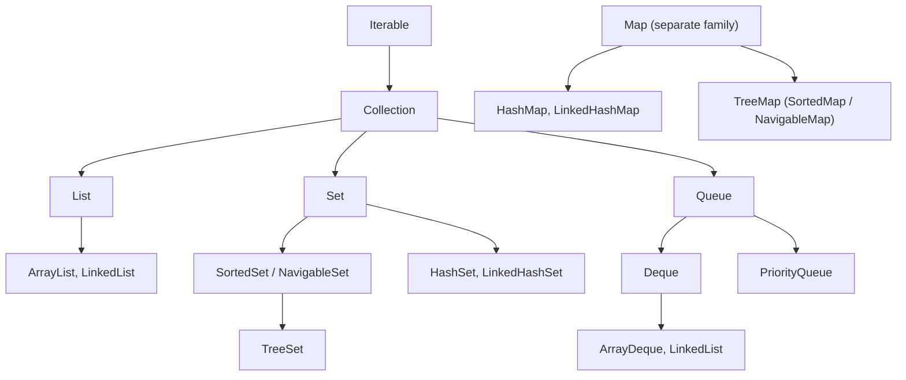

"Which collection would you use, and why?" is one of the most common Java interview questions, and it is really a question about **access patterns and complexity**. This lesson gives you the map of the framework and a way to choose. The deep dive on one class is in [HashMap internals](lesson:java-hashmap); thread-safe versions are in [Concurrent collections](lesson:java-concurrent-collections); and the functional style of working with them is in [Streams](lesson:java-streams). Play the four scenes first: choosing a collection, how an ArrayList grows, fail-fast iteration, and sorting with a comparator.

```demo
name: java-collections-walk
```

> **One sentence to remember:** *pick the interface for what you need to ask (List for position, Set for membership, Map for lookup by key, Queue or Deque for taking from the ends), then pick the implementation for how fast and in what order: ArrayList, HashSet, HashMap and ArrayDeque are the defaults.*

## The hierarchy {#hierarchy}

There are two families. `Collection` holds single elements; `Map` holds key-value pairs and is **not** a `Collection`.



| Interface | Order | Duplicates | Typical question it answers |
| --- | --- | --- | --- |
| `List` | insertion order, access by index | allowed | "what is the third transaction?" |
| `Set` | none (or insertion / sorted, by implementation) | not allowed | "have I seen this account number?" |
| `Queue` | by queue rule (FIFO, priority) | allowed | "what is next to process?" |
| `Deque` | both ends | allowed | "undo stack", "sliding window" |
| `Map` | none (or insertion / sorted) | keys unique, values may repeat | "what is the balance of account X?" |

Program to the interface: declare `List<Account> accounts = new ArrayList<>();`, not `ArrayList<Account>`, so you can change the implementation without touching callers.

## List {#list}

A `List` is an ordered sequence you access by index.

### ArrayList {#arraylist}

Backed by an array that grows by about 1.5× when full. `get(i)` is O(1), adding at the end is amortised O(1), inserting or removing in the middle is O(n) because later elements are shifted. It is the right default for almost every list.

### LinkedList {#linkedlist}

A doubly linked list that implements both `List` and `Deque`. Adding or removing at either end is O(1), but `get(i)` walks from the nearest end, O(n), and every node is a separate object (about 24 bytes of overhead each) scattered in memory, which is slow for the CPU cache. In practice `ArrayList` wins even for many inserts; use `ArrayDeque` when you need a queue.

### Vector, Stack and friends {#legacy}

`Vector` and `Stack` are legacy classes with every method synchronized. Do not use them: use `ArrayList` (or `CopyOnWriteArrayList` when you need thread safety) and `ArrayDeque` for a stack.

## Set {#set}

A `Set` has no duplicates; `add` returns `false` if the element was already there.

| Class | Order | Cost | Notes |
| --- | --- | --- | --- |
| `HashSet` | none | O(1) average | backed by a `HashMap`; needs correct `hashCode()` and `equals()` |
| `LinkedHashSet` | insertion order | O(1) | a `HashSet` plus a linked list through the entries |
| `TreeSet` | sorted | O(log n) | red-black tree; needs `Comparable` or a `Comparator`; has `first`, `floor`, `ceiling`, `headSet`, `tailSet` |
| `EnumSet` | enum declaration order | O(1) | a bit vector, extremely fast and small |

Two details worth knowing. A `HashSet` decides "same element" with `hashCode()` and `equals()`, while a `TreeSet` decides with `compareTo` or the comparator, so they can disagree: `new BigDecimal("1.0")` and `new BigDecimal("1.00")` are different in a `HashSet` but the same in a `TreeSet`. And mutating an element after adding it to a `HashSet` or as a `HashMap` key can make it unfindable.

## Queue and Deque {#queue}

| Class | Behaviour | Notes |
| --- | --- | --- |
| `ArrayDeque` | double-ended queue on a circular array | fastest queue and stack; no `null` elements |
| `LinkedList` | also a `Deque` | allows `null`, slower |
| `PriorityQueue` | binary heap: `poll()` returns the smallest (or by comparator) | `offer`/`poll` O(log n), `peek` O(1); iteration order is **not** sorted |

Queue methods come in pairs: one that throws and one that returns a special value.

| Operation | Throws | Returns special value |
| --- | --- | --- |
| insert | `add(e)` | `offer(e)` |
| remove head | `remove()` | `poll()` |
| examine head | `element()` | `peek()` |

Use `offer`, `poll` and `peek` unless an empty queue is a programming error.

## Map {#map}

A `Map` links unique keys to values. `HashMap` is the default; `LinkedHashMap` keeps insertion order (or access order, which makes an LRU cache); `TreeMap` keeps keys sorted and offers range queries; `EnumMap` is the fast map for enum keys. See the [HashMap lesson](lesson:java-hashmap) for the internals and [concurrent collections](lesson:java-concurrent-collections) for `ConcurrentHashMap`.

## Complexity cheat table {#complexity}

| Operation | ArrayList | LinkedList | HashSet / HashMap | TreeSet / TreeMap | ArrayDeque | PriorityQueue |
| --- | --- | --- | --- | --- | --- | --- |
| get by index | O(1) | O(n) | n/a | n/a | n/a | n/a |
| contains / get by key | O(n) | O(n) | O(1) avg | O(log n) | O(n) | O(n) |
| add at end | O(1) amortised | O(1) | O(1) avg | O(log n) | O(1) | O(log n) |
| add or remove at front | O(n) | O(1) | n/a | n/a | O(1) | n/a |
| insert in the middle | O(n) | O(n) (walk) + O(1) | n/a | n/a | n/a | n/a |
| smallest or largest | O(n) | O(n) | O(n) | O(log n) | n/a | O(1) peek |

## Ordering: Comparable and Comparator {#ordering}

`Comparable<T>` gives a class **one natural order** through `compareTo`. A `Comparator<T>` is a separate object with any order you want. Build them with the helpers instead of writing `compare` by hand:

```java
List<Transaction> txns = loadTransactions();

txns.sort(Comparator.comparing(Transaction::date).reversed()
        .thenComparing(Transaction::amount, Comparator.reverseOrder()));

TreeMap<String, BigDecimal> byAccount = new TreeMap<>(String.CASE_INSENSITIVE_ORDER);
```

Never subtract numbers inside a comparator (`a.amount - b.amount` can overflow); use `Integer.compare`, `Long.compare` or `Comparator.comparingInt`. A comparator must be consistent: it must not contradict itself, otherwise sorting can throw "Comparison method violates its general contract!".

## Iterating safely {#iteration}

Every collection is `Iterable`, so it works in a for-each loop. The standard collections have **fail-fast** iterators: they count structural changes (`modCount`) and throw `ConcurrentModificationException` if the collection changes behind the iterator's back, even in a single thread. To remove while iterating:

```java
accounts.removeIf(a -> a.isClosed());           // best: one pass, no iterator needed

for (Iterator<Account> it = accounts.iterator(); it.hasNext(); ) {
    if (it.next().isClosed()) it.remove();       // remove through the iterator
}
```

`ListIterator` can also walk backwards and `add`/`set` while iterating a `List`.

## Immutable and unmodifiable collections {#immutable}

| You write | What you get |
| --- | --- |
| `List.of(a, b)`, `Set.of(...)`, `Map.of(k, v, ...)` | truly immutable (Java 9+); no `null` elements; `Set.of` and `Map.of` throw on duplicates and have an unspecified iteration order |
| `List.copyOf(c)` | immutable copy (or the same list if it already is one) |
| `Collections.unmodifiableList(l)` | a read-only **view**: callers cannot change it, but changes to the original `l` show through |
| `Arrays.asList(a, b)` | a fixed-size list backed by the array: `set` works, `add`/`remove` throw |
| `stream.toList()` (Java 16) | unmodifiable list |

Return immutable copies from your public methods so callers cannot corrupt your state, and defensively copy collections you receive and store.

## Java 21: sequenced collections {#sequenced}

Java 21 added `SequencedCollection` (implemented by `List`, `Deque`, `LinkedHashSet`, `SortedSet`) with `getFirst()`, `getLast()`, `addFirst`, `addLast`, `removeFirst`, `removeLast` and `reversed()`, plus `SequencedMap` for `LinkedHashMap` and `TreeMap` (`firstEntry`, `lastEntry`, `reversed`). Before Java 21, getting the last element of a `List` was `list.get(list.size() - 1)`.

## Utilities worth knowing {#utilities}

`Collections.sort`, `reverse`, `shuffle`, `binarySearch` (the list must be sorted), `max`, `min`, `frequency`, `nCopies`, `emptyList`, `unmodifiable*`, `synchronized*` (wrappers, rarely the right tool). `Arrays.asList`, `Arrays.sort`, `Arrays.stream`, `Arrays.fill`. Bulk operations: `addAll`, `removeAll`, `retainAll`, `containsAll`.

## Cheat sheet {#cheatsheet}

| Need | Use |
| --- | --- |
| ordered list, read by index | `ArrayList` |
| no duplicates, fastest | `HashSet` |
| no duplicates, keep insertion order | `LinkedHashSet` |
| no duplicates, sorted or range queries | `TreeSet` |
| key to value, fastest | `HashMap` |
| key to value, insertion order or LRU | `LinkedHashMap` |
| key to value, sorted keys | `TreeMap` |
| stack or FIFO queue | `ArrayDeque` |
| always take the smallest or largest | `PriorityQueue` |
| keys are an enum | `EnumMap` / `EnumSet` |
| constant data | `List.of`, `Set.of`, `Map.of` |

## Interview questions {#questions}

### [basic] What is the Java Collections Framework? {#what-is}

A set of interfaces (`Collection`, `List`, `Set`, `Queue`, `Deque`, `Map`), implementations (`ArrayList`, `HashSet`, `HashMap`, ...) and algorithms (`Collections`, `Arrays`) for storing and processing groups of objects. It gives a common vocabulary and interchangeable implementations behind the same interface.

### [basic] What is the difference between Collection and Collections? {#collection-vs-collections}

`Collection` is the root interface of List, Set and Queue. `Collections` is a utility class of static methods such as `sort`, `unmodifiableList` and `emptyList`. A related pair is `Arrays` (utility) versus array (the type).

### [basic] Is Map part of the Collection hierarchy? {#map-collection}

No. `Map` does not extend `Collection` because it stores key-value pairs. You view a map as collections through `keySet()`, `values()` and `entrySet()`.

### [basic] What is the difference between List, Set and Map? {#list-set-map}

A `List` is an ordered sequence with duplicates and index access. A `Set` holds unique elements. A `Map` stores unique keys mapped to values. Use the one that matches the question you ask most: position, membership or lookup by key.

### [basic] ArrayList versus LinkedList: when would you use each? {#arraylist-vs-linkedlist}

`ArrayList` for nearly everything: O(1) index access, compact memory, cache friendly, amortised O(1) append. `LinkedList` has O(1) insert and remove at the ends but O(n) indexing and a large per-node overhead, and a plain `ArrayDeque` beats it as a queue. Benchmarks rarely favour `LinkedList`; the textbook "fast insert in the middle" is lost to the cost of walking to the position.

### [basic] How does ArrayList grow? {#arraylist-grow}

It allocates a backing array (capacity 10 on first add), and when it is full it creates a new array of about 1.5 times the size and copies the elements. Pass an initial capacity to the constructor (`new ArrayList<>(10_000)`) when you know the size to avoid repeated copying, and `ensureCapacity` before a big bulk add.

### [basic] What is the difference between HashSet, LinkedHashSet and TreeSet? {#set-flavours}

`HashSet`: no order, O(1). `LinkedHashSet`: insertion order, O(1), slightly more memory. `TreeSet`: sorted by natural order or a comparator, O(log n), supports range views such as `headSet` and `ceiling`. All reject duplicates.

### [basic] How does a HashSet detect duplicates? {#hashset-duplicates}

It is backed by a `HashMap` where the elements are the keys. `add` computes `hashCode()`, finds the bucket and uses `equals()` against entries there. So the element class must implement `hashCode()` and `equals()` consistently, otherwise "equal" objects appear twice.

### [basic] What is the difference between Iterator and ListIterator? {#iterator-vs-listiterator}

`Iterator` goes forward over any collection and supports `remove()`. `ListIterator` works only on lists, can go forward and backward (`hasPrevious`, `previous`), knows the index, and can `add`, `set` and `remove` while iterating.

### [basic] What is a fail-fast iterator? {#fail-fast-q}

An iterator that throws `ConcurrentModificationException` when the collection is structurally modified after the iterator was created, other than through the iterator's own `remove`. It detects bugs early by comparing a `modCount`. It is best-effort and is not a thread-safety mechanism. Concurrent collections have weakly consistent iterators instead (see [concurrent collections](lesson:java-concurrent-collections)).

### [basic] What is the difference between Comparable and Comparator? {#comparable-vs-comparator}

`Comparable` is implemented by the class and defines its single natural order (`compareTo`). `Comparator` is an external strategy (`compare(a, b)`) so you can define many orders, sort classes you cannot modify, and combine them with `thenComparing` and `reversed`. `TreeSet` and `sort()` use the natural order unless you pass a comparator.

### [basic] How do you remove elements from a list while iterating? {#remove-while-iterating}

Use `list.removeIf(predicate)`, or an explicit `Iterator` and `it.remove()`, or collect items and call `removeAll` afterwards, or build a new filtered list (`stream().filter(...).toList()`). Calling `list.remove` inside a for-each loop throws `ConcurrentModificationException`, with the quirky exception that removing the second-to-last element happens not to throw.

### [basic] What is the difference between List.of() and Arrays.asList()? {#listof-vs-aslist}

`List.of` (Java 9) returns a truly immutable list that rejects `null` and every modifying call. `Arrays.asList` returns a fixed-size list backed by the array: you can `set` elements (and the array changes) but not add or remove, and `null` is allowed. Wrap with `new ArrayList<>(...)` when you need a normal mutable list.

### [intermediate] What is the difference between an unmodifiable view and an immutable copy? {#view-vs-copy}

`Collections.unmodifiableList(list)` is a wrapper: it blocks changes through the wrapper, but if someone changes the underlying list the view changes too. `List.copyOf(list)` or `List.of(...)` creates an independent immutable snapshot. Prefer the copy for fields and return values; if you do return a view, own the underlying list privately.

### [intermediate] How would you choose between ArrayList, LinkedList, ArrayDeque and PriorityQueue for a queue? {#choose-queue}

A FIFO queue or a stack: `ArrayDeque` (fast, compact). When you need the smallest or highest-priority item first: `PriorityQueue`. When you need `null` elements or list methods on a queue: `LinkedList`, rarely. For threads, use a `BlockingQueue` (see [concurrent collections](lesson:java-concurrent-collections)).

### [intermediate] How does PriorityQueue work, and is its iteration sorted? {#priorityqueue}

It is a binary min-heap stored in an array: the smallest element is at index 0, so `peek` is O(1), and `offer` and `poll` are O(log n) by sifting up or down. Iterating it or printing it shows heap order, **not** sorted order; to get sorted output you must `poll` repeatedly. `remove(Object)` and `contains` are O(n). It is not thread-safe (use `PriorityBlockingQueue`).

### [intermediate] What is the difference between HashMap, LinkedHashMap and TreeMap? {#map-flavours-q}

`HashMap`: no order, O(1). `LinkedHashMap`: predictable order (insertion, or access order for LRU caches). `TreeMap`: sorted by key, O(log n), with navigation methods (`floorKey`, `ceilingEntry`, `subMap`). See the [HashMap lesson](lesson:java-hashmap).

### [intermediate] HashSet versus TreeSet: when do two elements count as equal? {#set-equality}

`HashSet` uses `hashCode()` and `equals()`. `TreeSet` uses `compareTo` (or the comparator) and treats two elements as the same if it returns 0. A comparator that is inconsistent with `equals` makes a `TreeSet` drop elements a `HashSet` would keep, for example `BigDecimal("1.0")` and `BigDecimal("1.00")`.

### [intermediate] What happens if you mutate an object after putting it into a HashSet? {#mutate-in-set}

If the mutation changes `hashCode()` or `equals()`, the element sits in the wrong bucket. `contains` and `remove` then fail to find it and a duplicate can be added. Use immutable elements (records, value objects) or never change the fields used in `equals` and `hashCode`.

### [intermediate] What is the difference between remove(int index) and remove(Object o) on a List<Integer>? {#remove-overload}

`list.remove(1)` removes the element at **index** 1; `list.remove(Integer.valueOf(1))` removes the first element **equal to** 1. With `List<Integer>` the overload chosen is by the argument type, so a plain `int` literal picks the index version, a common bug.

### [intermediate] What does Arrays.asList do with an int[]? {#aslist-int}

`Arrays.asList(new int[]{1, 2, 3})` returns a `List<int[]>` with a single element, because generics need objects and a primitive array is one object. Use an `Integer[]`, `List.of(1, 2, 3)`, or `Arrays.stream(array).boxed().toList()`.

### [intermediate] What is the cost of contains() on a list, and how do you speed up a lookup inside a loop? {#contains-cost}

`List.contains` is O(n). Calling it for every element makes a loop O(n²). Put the lookup values into a `HashSet` first and the loop becomes O(n). The same applies to `removeAll(list)` and `retainAll(list)`: pass a `Set`.

### [intermediate] What is a subList, and what can go wrong with it? {#sublist}

`list.subList(from, to)` is a **view** of part of the list, not a copy. Writes through it change the original. If the original list is structurally modified directly, any use of the subList then throws `ConcurrentModificationException`. Copy it with `new ArrayList<>(list.subList(...))` when you need to keep it.

### [intermediate] Can a collection hold primitives? Why does boxing matter? {#boxing}

No: generics work on objects, so `List<int>` is illegal and you use `List<Integer>`. Each element is a boxed object: more memory, an extra indirection, and unboxing a `null` throws `NullPointerException`. For large numeric data use primitive arrays, `IntStream`, or a primitive-collection library. Comparing boxed values with `==` also fails outside the small cache (-128 to 127); use `equals`.

### [intermediate] What are EnumMap and EnumSet and why use them? {#enum-collections}

Specialised collections for enum keys. `EnumSet` is a bit vector and `EnumMap` an array indexed by `ordinal()`, so they are faster and smaller than `HashSet` and `HashMap`, iterate in declaration order, and show intent. Use them for state sets such as `EnumSet.of(Role.TELLER, Role.AUDITOR)`.

### [intermediate] How do you make a collection thread-safe? {#thread-safe-q}

Prefer the concurrent collections: `ConcurrentHashMap`, `CopyOnWriteArrayList`, `ConcurrentLinkedQueue`, `BlockingQueue` implementations. `Collections.synchronizedList(...)` locks every call and still needs manual locking when you iterate or do check-then-act. Best of all, avoid shared mutable collections: confine them to one thread or publish immutable copies. See [concurrent collections](lesson:java-concurrent-collections).

### [deep] How does TreeMap (and TreeSet) work internally? {#treemap}

A red-black tree: a self-balancing binary search tree that keeps height at O(log n), so `put`, `get`, `remove` are O(log n). Order comes from `compareTo` or the comparator, so keys must be mutually comparable and `null` keys are not allowed with natural ordering. In-order traversal gives sorted iteration, which also makes range queries cheap (`subMap`, `headMap`, `tailMap`, `floorKey`).

### [deep] How does ArrayDeque work, and why is it faster than LinkedList? {#arraydeque}

It is a resizable circular array with a head and a tail index, so adding or removing at both ends is O(1) with no node allocation, and the elements are contiguous in memory (cache friendly). It rejects `null` because `poll` returns `null` for "empty". `LinkedList` allocates a node object for every element and chases pointers.

### [deep] What is the contract between equals, hashCode and compareTo? {#contracts}

Equal objects must have equal hash codes; `equals` must be reflexive, symmetric, transitive, consistent and false for `null`. `compareTo` should be consistent with `equals` (`a.compareTo(b) == 0` exactly when `a.equals(b)`), otherwise sorted collections and hashed collections disagree about what a duplicate is. Records generate all three consistently for you (apart from `compareTo`).

### [deep] Why does Collections.sort sometimes throw "Comparison method violates its general contract"? {#tim-sort-violation}

`List.sort` and `Collections.sort` use TimSort, which can detect a comparator that is not transitive or not antisymmetric (for example one built with `a - b` that overflows, or one that returns inconsistent results for floating point `NaN`). Fix the comparator: use `Integer.compare`, `Double.compare` or `Comparator.comparing`. The sort is stable, so equal elements keep their relative order.

### [deep] What does the modCount do, and is a fail-fast iterator reliable? {#modcount}

Structural modifications (add, remove, clear, resize) increment `modCount`, and the iterator throws if its saved copy differs on `next()`. It is a debugging aid, not a guarantee: in the presence of unsynchronised threads the check may not see the change, so you must never rely on `ConcurrentModificationException` for correctness.

### [deep] What are the sequenced collections added in Java 21? {#sequenced-q}

Interfaces `SequencedCollection`, `SequencedSet` and `SequencedMap` that give collections with a defined encounter order a uniform API: `getFirst`, `getLast`, `addFirst`, `addLast`, `removeFirst`, `removeLast` and `reversed()`. `List`, `Deque`, `LinkedHashSet`, `SortedSet`, `LinkedHashMap` and `TreeMap` implement them, replacing idioms like `list.get(list.size() - 1)`.

### [deep] When is LinkedList actually the right choice? {#linkedlist-right}

Almost never. It may suit a case where you hold an iterator or a `ListIterator` and insert or remove many items at that position, or need both `List` and `Deque` behaviour with `null` elements. Otherwise `ArrayList` for lists and `ArrayDeque` for queues are faster and use less memory.

### [coding] Remove duplicates from a list while keeping the order. {#coding-dedupe}

```java
static <T> List<T> distinct(List<T> items) {
    return new ArrayList<>(new LinkedHashSet<>(items));
}
// or: items.stream().distinct().toList();
```

`LinkedHashSet` removes duplicates in O(n) and remembers the first occurrence order.

### [coding] Find the first non-repeating character in a string. {#coding-first-unique}

```java
static OptionalInt firstUnique(String s) {
    Map<Character, Integer> counts = new LinkedHashMap<>();
    for (char c : s.toCharArray()) counts.merge(c, 1, Integer::sum);
    return counts.entrySet().stream()
            .filter(e -> e.getValue() == 1)
            .mapToInt(e -> s.indexOf(e.getKey()))
            .findFirst();
}
```

One pass to count (the `LinkedHashMap` keeps first-seen order), one pass to pick the first count of 1. O(n).

### [coding] Group accounts by branch. {#coding-group}

```java
Map<String, List<Account>> byBranch = new HashMap<>();
for (Account a : accounts) {
    byBranch.computeIfAbsent(a.branch(), k -> new ArrayList<>()).add(a);
}
// or: accounts.stream().collect(Collectors.groupingBy(Account::branch));
```

`computeIfAbsent` creates the list only when the key is new, replacing the "get, check null, put" dance.

### [coding] Return the k largest transactions from a big list. {#coding-topk}

```java
static List<Txn> topK(Collection<Txn> txns, int k) {
    PriorityQueue<Txn> heap = new PriorityQueue<>(Comparator.comparing(Txn::amount)); // min-heap
    for (Txn t : txns) {
        heap.offer(t);
        if (heap.size() > k) heap.poll();          // drop the smallest
    }
    List<Txn> result = new ArrayList<>(heap);
    result.sort(Comparator.comparing(Txn::amount).reversed());
    return result;
}
```

The heap never holds more than `k` items, so this is O(n log k) time and O(k) memory, better than sorting everything (O(n log n)).

### [coding] Implement a stack and a queue with the right collection. {#coding-stack-queue}

```java
Deque<Integer> stack = new ArrayDeque<>();
stack.push(1); stack.push(2);
int top = stack.pop();                 // 2: last in, first out

Queue<Integer> queue = new ArrayDeque<>();
queue.offer(1); queue.offer(2);
int head = queue.poll();               // 1: first in, first out
```

Do not use the legacy `Stack` class. A stack is a `Deque` used through `push`, `pop` and `peek`.
