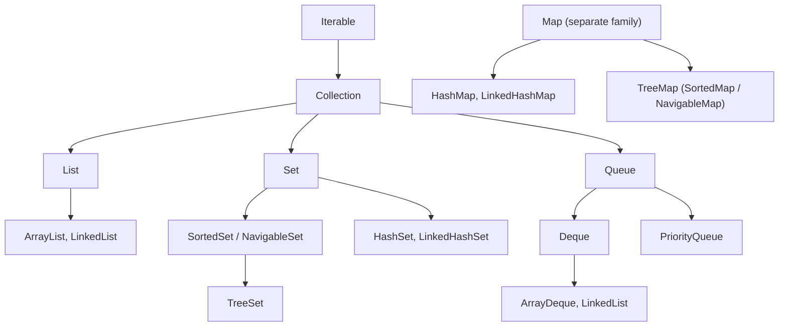

"Which collection would you use, and why?" is one of the most common Java interview questions. It is really a question about **access patterns**: what you do with the data most often, and how fast each operation is.

This lesson gives you a map of the framework and a simple way to choose. Related lessons:

- [HashMap internals](lesson:java-hashmap) looks inside one class in depth.
- [Concurrent collections](lesson:java-concurrent-collections) covers the thread-safe versions.
- [Streams](lesson:java-streams) shows the functional way to work with collections.

The animation has four scenes: choosing a collection, how an `ArrayList` grows, fail-fast iteration, and sorting with a comparator.

```demo
name: java-collections-walk
```

> **One sentence to remember:** *Choose the interface by the question you ask, and start with `ArrayList`, `HashSet`, `HashMap` or `ArrayDeque`.*

## The hierarchy {#hierarchy}

There are two families:

- A `Collection` holds single elements.
- A `Map` holds key-value pairs. A `Map` is **not** a `Collection`.



| Interface | Order | Duplicates | Typical question it answers |
| --- | --- | --- | --- |
| `List` | Elements keep the order you added them, and you can read them by index. | Allowed. | "What is the third transaction?" |
| `Set` | No order, unless the implementation keeps insertion or sorted order. | Not allowed. | "Have I seen this account number?" |
| `Queue` | The queue's rule decides the order, for example first in, first out (FIFO) or by priority. | Allowed. | "What should I process next?" |
| `Deque` | You can add and remove at both ends. | Allowed. | "Undo the last action" (a stack), or a sliding window. |
| `Map` | No order, unless the implementation keeps insertion or sorted order. | Keys are unique. Values may repeat. | "What is the balance of account X?" |

**Program to the interface.** Declare `List<Account> accounts = new ArrayList<>();`, not `ArrayList<Account>`. Then you can change the implementation later without changing the code that uses it.

## List {#list}

A `List` is an ordered sequence that you read by index.

### ArrayList {#arraylist}

An `ArrayList` keeps its elements in an array. When the array is full, it makes a new one about 1.5 times bigger.

- `get(i)` is O(1): it reads one array slot directly.
- Adding at the end is **amortised** O(1). Amortised means "on average": most adds are instant, and the rare copy into a bigger array is spread over all of them.
- Inserting or removing in the middle is O(n), because every later element must move one slot.

It is the right default for almost every list.

### LinkedList {#linkedlist}

A `LinkedList` is a doubly linked list: a chain of nodes, where each node points to the one before and the one after. It implements both `List` and `Deque`.

- Adding or removing at either end is O(1).
- `get(i)` is O(n), because it walks node by node from the nearest end.
- Every node is a separate object with about 24 bytes of overhead. The nodes are scattered in memory, which makes the CPU cache work poorly.

In practice `ArrayList` wins even when you insert a lot. When you need a queue, use `ArrayDeque`.

### Vector, Stack and friends {#legacy}

`Vector` and `Stack` are old (legacy) classes, and every one of their methods is synchronized. Do not use them:

- Instead of `Vector`, use `ArrayList`, or `CopyOnWriteArrayList` when you need thread safety.
- Instead of `Stack`, use `ArrayDeque`.

## Set {#set}

A `Set` has no duplicates. `add` returns `false` if the element was already there.

| Class | Order | Cost | Notes |
| --- | --- | --- | --- |
| `HashSet` | No order. | O(1) on average. | It is backed by a `HashMap`. Its elements need correct `hashCode()` and `equals()` methods. |
| `LinkedHashSet` | Insertion order. | O(1). | It is a `HashSet` plus a linked list through the entries. |
| `TreeSet` | Sorted. | O(log n). | It is a red-black tree. It needs `Comparable` elements or a `Comparator`. It has `first`, `floor`, `ceiling`, `headSet` and `tailSet`. |
| `EnumSet` | The order in which the enum values are declared. | O(1). | It is a bit vector (one bit per enum value), so it is very fast and small. |

Two details are worth knowing:

- **Two sets can disagree about what "the same" means.** A `HashSet` uses `hashCode()` and `equals()`. A `TreeSet` uses `compareTo` or the comparator. So `new BigDecimal("1.0")` and `new BigDecimal("1.00")` are two different elements in a `HashSet`, but the same element in a `TreeSet`.
- **Do not change an element after you add it.** If you change an element of a `HashSet`, or a `HashMap` key, the collection may no longer find it.

## Queue and Deque {#queue}

| Class | Behaviour | Notes |
| --- | --- | --- |
| `ArrayDeque` | A double-ended queue built on a circular array. | It is the fastest queue and stack. It does not allow `null` elements. |
| `LinkedList` | It is also a `Deque`. | It allows `null`, but it is slower. |
| `PriorityQueue` | A binary heap: `poll()` returns the smallest element, or the first one by your comparator. | `offer` and `poll` are O(log n), and `peek` is O(1). Iterating over it does **not** give sorted order. |

Queue methods come in pairs. One method throws an exception when it cannot do the job. The other returns a special value, such as `false` or `null`.

| Operation | Throws | Returns a special value |
| --- | --- | --- |
| Insert | `add(e)` | `offer(e)` |
| Remove the head | `remove()` | `poll()` |
| Look at the head | `element()` | `peek()` |

Use `offer`, `poll` and `peek`, unless an empty queue means there is a bug in your program.

## Map {#map}

A `Map` links unique keys to values. There are four main kinds:

- `HashMap` is the default.
- `LinkedHashMap` keeps insertion order. It can also keep access order, which is how you build an LRU (least recently used) cache.
- `TreeMap` keeps the keys sorted and supports range queries.
- `EnumMap` is the fast map for enum keys.

See the [HashMap lesson](lesson:java-hashmap) for how it works inside, and [concurrent collections](lesson:java-concurrent-collections) for `ConcurrentHashMap`.

## Complexity cheat table {#complexity}

O(1) means the time does not grow with the size. O(log n) grows slowly. O(n) grows in step with the number of elements.

| Operation | ArrayList | LinkedList | HashSet / HashMap | TreeSet / TreeMap | ArrayDeque | PriorityQueue |
| --- | --- | --- | --- | --- | --- | --- |
| get by index | O(1) | O(n) | n/a | n/a | n/a | n/a |
| contains / get by key | O(n) | O(n) | O(1) avg | O(log n) | O(n) | O(n) |
| add at end | O(1) amortised | O(1) | O(1) avg | O(log n) | O(1) | O(log n) |
| add or remove at front | O(n) | O(1) | n/a | n/a | O(1) | n/a |
| insert in the middle | O(n) | O(n) (walk) + O(1) | n/a | n/a | n/a | n/a |
| smallest or largest | O(n) | O(n) | O(n) | O(log n) | n/a | O(1) peek |

## Ordering: Comparable and Comparator {#ordering}

There are two ways to define an order:

- **`Comparable<T>`** gives a class **one natural order**, through its `compareTo` method.
- **`Comparator<T>`** is a separate object. You can make as many as you like, each with a different order.

Build comparators with the helper methods instead of writing `compare` by hand:

```java
List<Transaction> txns = loadTransactions();

txns.sort(Comparator.comparing(Transaction::date).reversed()
        .thenComparing(Transaction::amount, Comparator.reverseOrder()));

TreeMap<String, BigDecimal> byAccount = new TreeMap<>(String.CASE_INSENSITIVE_ORDER);
```

Never subtract numbers inside a comparator. `a.amount - b.amount` can overflow (go past the largest `int` and wrap round to a negative number). Use `Integer.compare`, `Long.compare` or `Comparator.comparingInt` instead.

A comparator must also be consistent: it must never contradict itself. If it does, sorting can throw "Comparison method violates its general contract!".

## Iterating safely {#iteration}

Every collection is `Iterable`, so you can use it in a for-each loop.

The standard collections have **fail-fast** iterators. Each collection counts its structural changes (adds and removes) in a field called `modCount`. If the collection changes behind the iterator's back, the iterator throws `ConcurrentModificationException`. This happens even with only one thread.

To remove elements while you iterate:

```java
accounts.removeIf(a -> a.isClosed());           // best: one pass, no iterator needed

for (Iterator<Account> it = accounts.iterator(); it.hasNext(); ) {
    if (it.next().isClosed()) it.remove();       // remove through the iterator
}
```

A `ListIterator` can also walk backwards, and it can `add` or `set` elements while it iterates over a `List`.

## Immutable and unmodifiable collections {#immutable}

| You write | What you get |
| --- | --- |
| `List.of(a, b)`, `Set.of(...)`, `Map.of(k, v, ...)` | A truly immutable collection (Java 9+). It does not allow `null` elements. `Set.of` and `Map.of` throw on duplicates, and their iteration order is not specified. |
| `List.copyOf(c)` | An immutable copy. If `c` is already immutable, you get the same list back. |
| `Collections.unmodifiableList(l)` | A read-only **view**. Callers cannot change it, but changes to the original `l` still show through. |
| `Arrays.asList(a, b)` | A fixed-size list backed by the array. `set` works, but `add` and `remove` throw. |
| `stream.toList()` (Java 16) | An unmodifiable list. |

Two habits protect your objects:

- Return immutable copies from your public methods, so callers cannot damage your data.
- Make a **defensive copy** of any collection you receive and store. A defensive copy is your own copy, so the caller cannot change your data later through their reference.

## Java 21: sequenced collections {#sequenced}

Java 21 added the `SequencedCollection` interface. `List`, `Deque`, `LinkedHashSet` and `SortedSet` implement it. It adds `getFirst()`, `getLast()`, `addFirst`, `addLast`, `removeFirst`, `removeLast` and `reversed()`.

It also added `SequencedMap`, which `LinkedHashMap` and `TreeMap` implement. It adds `firstEntry`, `lastEntry` and `reversed`.

Before Java 21, you got the last element of a `List` with `list.get(list.size() - 1)`.

## Utilities worth knowing {#utilities}

- **`Collections`:** `sort`, `reverse`, `shuffle`, `binarySearch` (the list must already be sorted), `max`, `min`, `frequency`, `nCopies`, `emptyList`, `unmodifiable*` and `synchronized*`. The `synchronized*` wrappers are rarely the right tool.
- **`Arrays`:** `Arrays.asList`, `Arrays.sort`, `Arrays.stream` and `Arrays.fill`.
- **Bulk operations:** `addAll`, `removeAll`, `retainAll` and `containsAll`.

Try it in the lab: [Choosing a collection by what you do with it](lab:collections-choose).

## Cheat sheet {#cheatsheet}

| Need | Use |
| --- | --- |
| An ordered list that you read by index | `ArrayList` |
| No duplicates, as fast as possible | `HashSet` |
| No duplicates, in insertion order | `LinkedHashSet` |
| No duplicates, sorted, or range queries | `TreeSet` |
| Key to value, as fast as possible | `HashMap` |
| Key to value, in insertion order or as an LRU cache | `LinkedHashMap` |
| Key to value, with sorted keys | `TreeMap` |
| A stack or a FIFO queue | `ArrayDeque` |
| Always take the smallest or largest item | `PriorityQueue` |
| The keys are enum values | `EnumMap` / `EnumSet` |
| Constant data | `List.of`, `Set.of`, `Map.of` |

## Interview questions {#questions}

### [basic] What is the Java Collections Framework? {#what-is}

It is a set of ready-made tools for storing and processing groups of objects. It has three parts:

1. **Interfaces:** `Collection`, `List`, `Set`, `Queue`, `Deque` and `Map`.
2. **Implementations:** `ArrayList`, `HashSet`, `HashMap` and others.
3. **Algorithms:** the utility classes `Collections` and `Arrays`.

It gives everyone a common vocabulary. You can swap one implementation for another behind the same interface.

### [basic] What is the difference between Collection and Collections? {#collection-vs-collections}

- `Collection` is the root interface of `List`, `Set` and `Queue`.
- `Collections` is a utility class full of static methods, such as `sort`, `unmodifiableList` and `emptyList`.

A similar pair is `Arrays` (the utility class) and an array (the type).

### [basic] Is Map part of the Collection hierarchy? {#map-collection}

**No.** `Map` does not extend `Collection`, because it stores key-value pairs instead of single elements.

You can still see a map as collections through three methods: `keySet()`, `values()` and `entrySet()`.

### [basic] What is the difference between List, Set and Map? {#list-set-map}

- A `List` is an ordered sequence. It allows duplicates, and you can read it by index.
- A `Set` holds unique elements.
- A `Map` stores unique keys, each linked to a value.

Choose the one that matches the question you ask most often: by position (`List`), "is it there?" (`Set`), or by key (`Map`).

### [basic] ArrayList versus LinkedList: when would you use each? {#arraylist-vs-linkedlist}

**Use `ArrayList` for nearly everything.**

1. `ArrayList` reads by index in O(1) and adds at the end in amortised O(1).
2. Its memory is compact, so the CPU cache works well.
3. `LinkedList` adds and removes at the ends in O(1), but reading by index is O(n), and every node costs extra memory.
4. As a queue, a plain `ArrayDeque` beats `LinkedList`.

Benchmarks rarely favour `LinkedList`. The textbook claim of "fast insert in the middle" is lost, because you must first walk to that position.

### [basic] How does ArrayList grow? {#arraylist-grow}

On the first add, it creates a backing array with room for 10 elements. When that array is full, it creates a new array about 1.5 times bigger and copies the elements across.

If you know the size in advance, pass it to the constructor, for example `new ArrayList<>(10_000)`. This avoids the repeated copying. Call `ensureCapacity` before a big bulk add for the same reason.

### [basic] What is the difference between HashSet, LinkedHashSet and TreeSet? {#set-flavours}

All three reject duplicates. They differ in order and speed:

- `HashSet` has no order and is O(1).
- `LinkedHashSet` keeps insertion order. It is O(1) and uses a little more memory.
- `TreeSet` keeps elements sorted, by natural order or by a comparator. It is O(log n) and supports range views such as `headSet` and `ceiling`.

### [basic] How does a HashSet detect duplicates? {#hashset-duplicates}

A `HashSet` is backed by a `HashMap`, and the elements are the map's keys.

`add` first computes the element's `hashCode()` to find the bucket. Then it calls `equals()` against the entries already in that bucket.

So the element class must implement `hashCode()` and `equals()` consistently. If it does not, two "equal" objects can both end up in the set.

### [basic] What is the difference between Iterator and ListIterator? {#iterator-vs-listiterator}

- An `Iterator` moves forward over any collection, and it supports `remove()`.
- A `ListIterator` works only on lists. It can move forward and backward (`hasPrevious`, `previous`), it knows the current index, and it can `add`, `set` and `remove` while iterating.

### [basic] What is a fail-fast iterator? {#fail-fast-q}

It is an iterator that throws `ConcurrentModificationException` when the collection changes its structure after the iterator was created. The only allowed change is through the iterator's own `remove`.

It finds the problem by comparing a change counter, `modCount`. This helps you find bugs early.

It is a best-effort check, not a thread-safety tool. The concurrent collections have **weakly consistent** iterators instead, which never throw (see [concurrent collections](lesson:java-concurrent-collections)).

### [basic] What is the difference between Comparable and Comparator? {#comparable-vs-comparator}

- **`Comparable`** is implemented by the class itself. It defines the class's single natural order, through `compareTo`.
- **`Comparator`** is a separate object with a `compare(a, b)` method. You can define many orders, sort classes you cannot change, and combine orders with `thenComparing` and `reversed`.

`TreeSet` and `sort()` use the natural order unless you pass a comparator.

### [basic] How do you remove elements from a list while iterating? {#remove-while-iterating}

There are four safe ways:

1. Call `list.removeIf(predicate)`.
2. Use an explicit `Iterator` and call `it.remove()`.
3. Collect the items to remove, then call `removeAll` after the loop.
4. Build a new filtered list with `stream().filter(...).toList()`.

Calling `list.remove` inside a for-each loop throws `ConcurrentModificationException`. There is one odd exception: removing the second-to-last element happens not to throw.

### [basic] What is the difference between List.of() and Arrays.asList()? {#listof-vs-aslist}

- **`List.of`** (Java 9) returns a truly immutable list. It rejects `null` and every call that would change it.
- **`Arrays.asList`** returns a fixed-size list backed by the array. You can `set` elements, and the array changes too, but you cannot add or remove. It allows `null`.

When you need a normal list that you can change, wrap either one: `new ArrayList<>(...)`.

### [intermediate] What is the difference between an unmodifiable view and an immutable copy? {#view-vs-copy}

- **`Collections.unmodifiableList(list)`** is a wrapper. It blocks changes made through the wrapper. But if someone changes the underlying list, the view changes too.
- **`List.copyOf(list)`** or **`List.of(...)`** creates an independent immutable snapshot.

Prefer the copy for fields and return values. If you do return a view, keep the underlying list private.

### [intermediate] How would you choose between ArrayList, LinkedList, ArrayDeque and PriorityQueue for a queue? {#choose-queue}

- For a FIFO queue or a stack, use **`ArrayDeque`**. It is fast and compact.
- When the smallest or highest-priority item must come out first, use **`PriorityQueue`**.
- Use **`LinkedList`** rarely, only when you need `null` elements or list methods on a queue.
- When several threads share the queue, use a **`BlockingQueue`** (see [concurrent collections](lesson:java-concurrent-collections)).

### [intermediate] How does PriorityQueue work, and is its iteration sorted? {#priorityqueue}

**Its iteration is not sorted.**

A `PriorityQueue` is a binary min-heap stored in an array. A min-heap is a tree where every parent is smaller than its children, so the smallest element is always at index 0.

- `peek` is O(1), because it reads index 0.
- `offer` and `poll` are O(log n), because they move one element up or down the tree.
- Iterating or printing it shows heap order. To get sorted output, call `poll` repeatedly.
- `remove(Object)` and `contains` are O(n).

It is not thread-safe. Use `PriorityBlockingQueue` for that.

### [intermediate] What is the difference between HashMap, LinkedHashMap and TreeMap? {#map-flavours-q}

- `HashMap` has no order and is O(1).
- `LinkedHashMap` has a predictable order: insertion order, or access order for LRU caches.
- `TreeMap` is sorted by key and is O(log n). It has navigation methods such as `floorKey`, `ceilingEntry` and `subMap`.

See the [HashMap lesson](lesson:java-hashmap).

### [intermediate] HashSet versus TreeSet: when do two elements count as equal? {#set-equality}

- A `HashSet` uses `hashCode()` and `equals()`.
- A `TreeSet` uses `compareTo` (or the comparator). It treats two elements as the same if the result is 0.

If the comparator does not agree with `equals`, a `TreeSet` drops elements that a `HashSet` would keep. For example, `BigDecimal("1.0")` and `BigDecimal("1.00")` are one element in a `TreeSet` and two in a `HashSet`.

### [intermediate] What happens if you mutate an object after putting it into a HashSet? {#mutate-in-set}

If the change affects `hashCode()` or `equals()`, the element now sits in the wrong bucket.

- `contains` and `remove` can no longer find it.
- A duplicate can be added.

Use immutable elements, such as records and value objects. Or never change the fields that `equals` and `hashCode` use.

### [intermediate] What is the difference between remove(int index) and remove(Object o) on a List<Integer>? {#remove-overload}

- `list.remove(1)` removes the element at **index** 1.
- `list.remove(Integer.valueOf(1))` removes the first element **equal to** 1.

Java picks the method by the argument's type. A plain `int` literal picks the index version, which is a common bug.

### [intermediate] What does Arrays.asList do with an int[]? {#aslist-int}

`Arrays.asList(new int[]{1, 2, 3})` returns a `List<int[]>` with **one** element.

The reason: generics need objects, and a primitive array is one object, so the whole array becomes the single element.

Use an `Integer[]`, `List.of(1, 2, 3)` or `Arrays.stream(array).boxed().toList()` instead.

### [intermediate] What is the cost of contains() on a list, and how do you speed up a lookup inside a loop? {#contains-cost}

`List.contains` is O(n), because it checks every element. If you call it for every element of a loop, the whole loop becomes O(n²): the work grows with the square of the size.

Put the values you look up into a `HashSet` first. Then each lookup is O(1), and the loop becomes O(n).

The same applies to `removeAll(list)` and `retainAll(list)`. Pass them a `Set`.

### [intermediate] What is a subList, and what can go wrong with it? {#sublist}

`list.subList(from, to)` is a **view** of part of the list, not a copy.

- Writing through the view changes the original list.
- If you change the structure of the original list directly, any later use of the subList throws `ConcurrentModificationException`.

When you need to keep it, copy it: `new ArrayList<>(list.subList(...))`.

### [intermediate] Can a collection hold primitives? Why does boxing matter? {#boxing}

**No.** Generics work only with objects, so `List<int>` is not allowed. You write `List<Integer>` instead. Turning an `int` into an `Integer` object is called **boxing**.

Boxing has costs:

- Each element is an object, so it uses more memory and needs an extra pointer jump.
- Unboxing a `null` throws `NullPointerException`.
- Comparing boxed values with `==` fails outside the small cache of -128 to 127. Use `equals`.

For large amounts of numeric data, use primitive arrays, `IntStream` or a primitive-collection library.

### [intermediate] What are EnumMap and EnumSet and why use them? {#enum-collections}

They are special collections for enum keys.

- `EnumSet` is a bit vector.
- `EnumMap` is an array indexed by each value's `ordinal()` (its position in the enum).

So they are faster and smaller than `HashSet` and `HashMap`. They iterate in the order the values are declared, and they make your intent clear. Use them for sets of states or roles, such as `EnumSet.of(Role.TELLER, Role.AUDITOR)`.

### [intermediate] How do you make a collection thread-safe? {#thread-safe-q}

**Prefer the concurrent collections:** `ConcurrentHashMap`, `CopyOnWriteArrayList`, `ConcurrentLinkedQueue` and the `BlockingQueue` implementations.

`Collections.synchronizedList(...)` locks every call. But you still need to lock by hand when you iterate, or when you check a value and then act on it.

Best of all, avoid shared collections that can change. Keep a collection inside one thread, or share only immutable copies. See [concurrent collections](lesson:java-concurrent-collections).

### [deep] How does TreeMap (and TreeSet) work internally? {#treemap}

It is a **red-black tree**: a binary search tree that rebalances itself, so its height stays O(log n). That makes `put`, `get` and `remove` O(log n).

- The order comes from `compareTo` or the comparator. So the keys must be comparable with each other.
- With natural ordering, `null` keys are not allowed.
- Walking the tree in order gives sorted iteration. This also makes range queries cheap: `subMap`, `headMap`, `tailMap` and `floorKey`.

### [deep] How does ArrayDeque work, and why is it faster than LinkedList? {#arraydeque}

An `ArrayDeque` is a circular array that can grow. It keeps a head index and a tail index.

- Adding or removing at either end is O(1), and it creates no node objects.
- The elements sit next to each other in memory, so the CPU cache works well.
- It rejects `null`, because `poll` returns `null` to mean "empty".

A `LinkedList`, by contrast, creates a node object for every element and follows pointers from node to node.

### [deep] What is the contract between equals, hashCode and compareTo? {#contracts}

1. **Equal objects must have equal hash codes.**
2. **`equals` must be** reflexive, symmetric, transitive and consistent, and it must return `false` for `null`.
3. **`compareTo` should agree with `equals`:** `a.compareTo(b) == 0` exactly when `a.equals(b)`.

If rule 3 is broken, sorted collections and hashed collections disagree about what a duplicate is.

Records generate `equals` and `hashCode` consistently for you. They do not generate `compareTo`.

### [deep] Why does Collections.sort sometimes throw "Comparison method violates its general contract"? {#tim-sort-violation}

`List.sort` and `Collections.sort` use an algorithm called **TimSort**. TimSort can detect a comparator that contradicts itself. Two common causes:

- A comparator built with `a - b`, which can overflow.
- A comparator that gives inconsistent results for the floating-point value `NaN`.

Fix the comparator: use `Integer.compare`, `Double.compare` or `Comparator.comparing`.

The sort is **stable**: equal elements keep their original order.

### [deep] What does the modCount do, and is a fail-fast iterator reliable? {#modcount}

Every structural change (add, remove, clear or resize) adds one to `modCount`. The iterator saves a copy when it starts. On each `next()`, it throws if the two numbers differ.

**It is not reliable.** It is a debugging aid. When several threads change the collection without synchronisation, the iterator may not see the change. Never rely on `ConcurrentModificationException` to keep your program correct.

### [deep] What are the sequenced collections added in Java 21? {#sequenced-q}

They are three interfaces: `SequencedCollection`, `SequencedSet` and `SequencedMap`. They give every collection with a defined order the same methods: `getFirst`, `getLast`, `addFirst`, `addLast`, `removeFirst`, `removeLast` and `reversed()`.

`List`, `Deque`, `LinkedHashSet`, `SortedSet`, `LinkedHashMap` and `TreeMap` implement them. They replace older idioms such as `list.get(list.size() - 1)`.

### [deep] When is LinkedList actually the right choice? {#linkedlist-right}

**Almost never.** It can suit two cases:

- You hold an iterator or a `ListIterator` and insert or remove many items at that position.
- You need both `List` and `Deque` behaviour, with `null` elements.

Otherwise, `ArrayList` for lists and `ArrayDeque` for queues are faster and use less memory.

### [coding] Remove duplicates from a list while keeping the order. {#coding-dedupe}

```java
static <T> List<T> distinct(List<T> items) {
    return new ArrayList<>(new LinkedHashSet<>(items));
}
// or: items.stream().distinct().toList();
```

A `LinkedHashSet` removes duplicates in O(n) and remembers the order in which each element first appeared.

### [coding] Find the first non-repeating character in a string. {#coding-first-unique}

```java
static OptionalInt firstUnique(String s) {
    Map<Character, Integer> counts = new LinkedHashMap<>();
    for (char c : s.toCharArray()) counts.merge(c, 1, Integer::sum);
    return counts.entrySet().stream()
            .filter(e -> e.getValue() == 1)
            .mapToInt(e -> s.indexOf(e.getKey()))
            .findFirst();
}
```

How it works:

1. The first pass counts each character. The `LinkedHashMap` keeps the order in which characters were first seen.
2. The second pass picks the first character with a count of 1.

It takes O(n) time.

### [coding] Group accounts by branch. {#coding-group}

```java
Map<String, List<Account>> byBranch = new HashMap<>();
for (Account a : accounts) {
    byBranch.computeIfAbsent(a.branch(), k -> new ArrayList<>()).add(a);
}
// or: accounts.stream().collect(Collectors.groupingBy(Account::branch));
```

`computeIfAbsent` creates the list only when the key is new. It replaces the longer "get, check for `null`, put" code.

### [coding] Return the k largest transactions from a big list. {#coding-topk}

```java
static List<Txn> topK(Collection<Txn> txns, int k) {
    PriorityQueue<Txn> heap = new PriorityQueue<>(Comparator.comparing(Txn::amount)); // min-heap
    for (Txn t : txns) {
        heap.offer(t);
        if (heap.size() > k) heap.poll();          // drop the smallest
    }
    List<Txn> result = new ArrayList<>(heap);
    result.sort(Comparator.comparing(Txn::amount).reversed());
    return result;
}
```

The heap never holds more than `k` items. Whenever it grows past `k`, it drops the smallest one. So this takes O(n log k) time and O(k) memory, which is better than sorting everything in O(n log n).

### [coding] Implement a stack and a queue with the right collection. {#coding-stack-queue}

```java
Deque<Integer> stack = new ArrayDeque<>();
stack.push(1); stack.push(2);
int top = stack.pop();                 // 2: last in, first out

Queue<Integer> queue = new ArrayDeque<>();
queue.offer(1); queue.offer(2);
int head = queue.poll();               // 1: first in, first out
```

Do not use the legacy `Stack` class. A stack is a `Deque` that you use through `push`, `pop` and `peek`.
