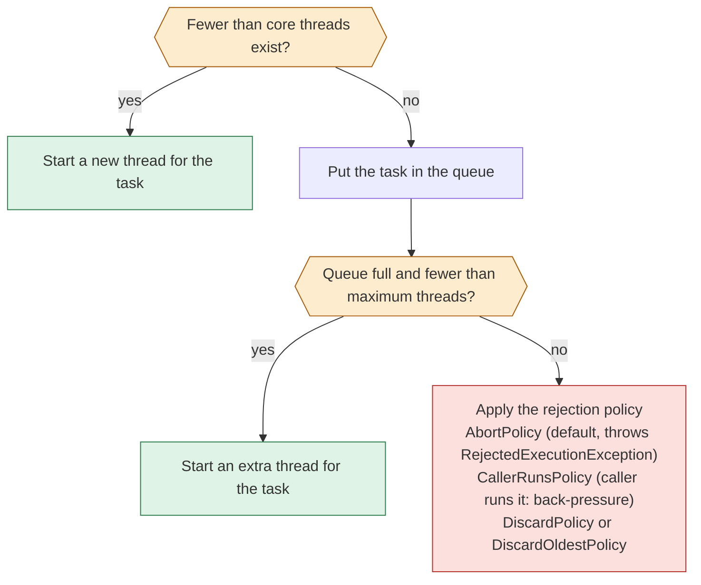

Concurrency questions appear in almost every Java interview. They test whether you understand what the machine really does.

This lesson first shows what goes wrong when threads share data. Then it shows the tools Java gives you, roughly in the order they were added:

1. `synchronized`
2. locks and atomics
3. executors (thread pools)
4. `CompletableFuture`
5. concurrent collections
6. virtual threads

The [memory lesson](lesson:java-memory-model#jmm) explains the visibility rules (happens-before) that make all of this work. Read it first if "volatile" or "visibility" feels vague.

The animation has four scenes: a lost update, the same code with a lock, a deadlock, and a thread pool. Press play and switch between them.

```demo
name: concurrency-walk
```

> **One sentence to remember:** *Data that many threads share and change is the danger, so do not share it, do not change it, or make the threads take turns.*

## Threads {#threads}

### Why use threads {#why-threads}

A **thread** is an independent path of execution inside a process. All threads of one process share the heap, but each thread has its own [stack](lesson:java-memory-model#stack).

Threads give you two things:

- **Parallelism:** the program can use several CPU cores at the same time.
- **Concurrency:** the program can keep doing useful work while one task waits for a network or disk response.

The cost is shared memory. Every variable that several threads share and change becomes a risk.

### Creating threads {#creating}

You rarely create threads by hand today, but you should know the options:

```java
Thread t = new Thread(() -> System.out.println("hello"));   // a Runnable
t.start();                                                    // start(), never run(): run() would just call the code on this thread

ExecutorService pool = Executors.newFixedThreadPool(4);      // normal production style
Future<Integer> f = pool.submit(() -> compute());             // a Callable returns a value and may throw
```

- A `Runnable` returns no result and cannot throw checked exceptions.
- A `Callable<V>` returns a value and may throw.

If an exception escapes the `run()` method of a plain thread, that thread dies and the exception is printed. An executor's `Future` is a better place to see the error: `future.get()` throws it again, wrapped in an `ExecutionException`.

### Thread states {#thread-states}

`Thread.getState()` returns one of six states:

| State | Meaning |
| --- | --- |
| `NEW` | The thread is created, but `start()` has not been called yet. |
| `RUNNABLE` | The thread is running, or it is ready and waiting for a CPU. |
| `BLOCKED` | The thread is waiting to enter a `synchronized` block that another thread holds. |
| `WAITING` | The thread waits with no time limit, in `wait()`, `join()` or `LockSupport.park()`. |
| `TIMED_WAITING` | The thread waits with a timeout, in `sleep(ms)`, `wait(ms)` or `join(ms)`. |
| `TERMINATED` | The thread has finished. |

A **thread dump** lists every thread with its state and its stack. You get one with `jcmd <pid> Thread.print` or `jstack <pid>`. It is the first tool to use when an application hangs.

### Interrupts and stopping a thread {#interrupt}

You cannot force a thread to stop safely. `Thread.stop()` is gone.

Java uses **cooperative interruption** instead:

1. `t.interrupt()` sets a flag on the thread.
2. A blocking method such as `sleep`, `wait` or `BlockingQueue.take()` notices the flag.
3. It throws `InterruptedException` and **clears** the flag.

Your code should either let the exception travel up, or set the flag again. Never swallow it:

```java
try {
    queue.take();
} catch (InterruptedException e) {
    Thread.currentThread().interrupt();   // restore the flag so callers can see it
    return;
}
```

A long loop should check `Thread.currentThread().isInterrupted()`. `ExecutorService.shutdownNow()` stops its workers by interrupting them.

### Daemon threads {#daemon}

The JVM exits when only **daemon** threads are left. A daemon thread is a background helper that should not keep the program alive.

- Background housekeeping, such as a cache cleaner or a heartbeat, is usually a daemon thread.
- Work that must finish is not.

A new thread gets the daemon flag of the thread that creates it. A thread pool sets the flag through its `ThreadFactory`.

## What goes wrong {#problems}

### Race conditions and lost updates {#race}

A **race condition** is a bug whose result depends on timing.

The simplest form is the **lost update**. `count++` looks like one step, but it is really three: read, add, write. So two threads can both read 0 and both write 1 (see the first animation).

Two common shapes:

- **Read-modify-write:** `count++`, `total += x` or `map.put(k, map.get(k) + 1)`.
- **Check-then-act:** `if (!map.containsKey(k)) map.put(k, v)`. Another thread can insert between the check and the action. The fix is one atomic operation, such as `putIfAbsent` or `computeIfAbsent`.

A **data race** is the same problem at the memory level. One thread writes a variable and another reads it, with no happens-before order between the two. Then even a plain `boolean` flag can stay stale for ever. See [visibility](lesson:java-memory-model#jmm-problems).

### Deadlock, livelock and starvation {#deadlock}

A **deadlock** happens when each thread holds a lock and waits for a lock that another thread holds (see the third animation). Nobody can continue.

A deadlock needs all four of these conditions. Removing any one of them prevents it:

1. **Mutual exclusion:** only one thread can hold a lock at a time.
2. **Hold and wait:** a thread holds one lock while it waits for another.
3. **No preemption:** nobody can take a lock away from a thread.
4. **Circular wait:** there is a cycle of threads, each waiting for the next one.

How to prevent it in practice:

- Take locks in one **global order**, for example by account id.
- Hold as few locks as possible.
- Never call unknown code, such as callbacks or overridable methods, while you hold a lock.
- Use `tryLock(timeout)`, so a thread can give up and back off.

To find a deadlock, take a thread dump. The JVM prints "Found one Java-level deadlock" with the threads and locks involved.

A **livelock** is when threads are not blocked, but they keep reacting to each other and make no progress. Think of two people who keep stepping aside for each other in a corridor.

**Starvation** is when a thread never gets the lock or the CPU. An unfair lock, or a high-priority task that never yields, can cause it.

## Locks and atomics {#locking}

### synchronized {#synchronized}

Every object has a built-in lock called a **monitor**. `synchronized` takes it:

```java
class Counter {
    private int count;

    synchronized void increment() { count++; }            // locks "this"
    synchronized int get()        { return count; }       // reads need the lock too, for visibility

    private final Object lock = new Object();
    void other() {
        synchronized (lock) { /* ... */ }                  // a private lock object cannot be taken by outsiders
    }
}
```

What to know about it:

- It gives **mutual exclusion**: only one thread at a time runs the code.
- It gives a **happens-before** edge: everything written before the unlock is visible to the next thread that locks the same monitor.
- It is **reentrant**: a thread that holds the lock can enter another `synchronized` block on the same object.
- A `static synchronized` method locks the `Class` object. That is a different lock from the one an instance method uses.
- Never lock on a `String` literal, a boxed `Integer` or another value-based class. Such objects may be shared or interned, so unrelated code can end up competing for the same lock.
- Prefer a **private final lock object** to `synchronized(this)`, so code outside your class cannot take your lock too.

### wait and notify {#wait-notify}

`wait()`, `notify()` and `notifyAll()` let threads signal each other through a monitor.

- You must hold the monitor when you call them.
- `wait()` must sit inside a **loop**. A thread can wake up without being notified (a **spurious wakeup**), and the condition may have changed again by the time it runs.

```java
synchronized (lock) {
    while (!ready) {          // always a while, never an if
        lock.wait();          // releases the monitor while waiting
    }
    // ready is true here
}
// elsewhere: synchronized (lock) { ready = true; lock.notifyAll(); }
```

Use `notifyAll()` unless you are sure that only one waiter can continue. In new code, a `BlockingQueue` or a `Condition` is usually clearer than `wait` and `notify`.

### volatile {#volatile}

`volatile` gives visibility and ordering, but not atomicity. So it fits a stop flag, or a reference to an immutable object that you publish once. It does not fit `count++`. The details are in [the memory lesson](lesson:java-memory-model#volatile-jmm).

### Explicit locks {#locks}

The package `java.util.concurrent.locks` (Java 5) gives more control than `synchronized`:

| Class | What it adds |
| --- | --- |
| `ReentrantLock` | `tryLock()` and `tryLock(timeout)`, `lockInterruptibly()`, an optional fair mode and several `Condition`s. |
| `ReentrantReadWriteLock` | Many readers at once, or one writer. |
| `StampedLock` (Java 8) | Optimistic reads with no lock, checked afterwards. It is not reentrant. |

The cost is that you must release the lock yourself, in `finally`:

```java
lock.lock();
try {
    // critical section
} finally {
    lock.unlock();            // never forget: an unreleased lock blocks everyone for ever
}
```

Use `synchronized` for simple cases. Use a `ReentrantLock` when you need a timeout, interruptible waiting or several conditions.

### Atomic variables and CAS {#atomics}

`AtomicInteger`, `AtomicLong`, `AtomicReference` and similar classes use a CPU instruction called **compare-and-swap** (CAS). CAS means: "set the value to *new*, but only if it is still *expected*".

If the CAS fails, another thread changed the value first, so the code simply tries again. There is no lock, so there is no blocking and no deadlock:

```java
AtomicInteger count = new AtomicInteger();
count.incrementAndGet();                       // atomic read-modify-write
count.updateAndGet(x -> Math.min(x + 1, 100)); // retries the function until the CAS succeeds
```

When many threads update the same value, many of them fail and retry. `LongAdder` (Java 8) solves this. It spreads the updates over several cells and adds them up when you read. It is much faster for counters that are written often and read rarely, such as metrics and statistics.

**The ABA problem:** a value may change from A to B and back to A. CAS sees A and cannot tell that anything happened. `AtomicStampedReference` adds a version number to detect this.

## Executors and thread pools {#executors}

Creating one thread per task is expensive, because a platform thread reserves memory for its stack. It also has no upper limit.

A **thread pool** reuses a fixed set of threads. The threads take tasks from a queue. The last animation shows the rules of `ThreadPoolExecutor`.

### The ThreadPoolExecutor rules {#pool-rules}

```java
new ThreadPoolExecutor(
        2,                                   // core pool size
        3,                                   // maximum pool size
        60, TimeUnit.SECONDS,                // keep-alive for threads above the core size
        new ArrayBlockingQueue<>(2),         // the work queue
        new ThreadPoolExecutor.CallerRunsPolicy());   // what to do when full
```

For each submitted task:



Note the order: the pool fills the queue **before** it adds threads above the core size. So with an *unbounded* queue, the maximum size is never used.

### The Executors factory traps {#executors-traps}

| Factory | What it builds | The trap |
| --- | --- | --- |
| `newFixedThreadPool(n)` | n threads and an **unbounded** `LinkedBlockingQueue`. | A backlog can grow until `OutOfMemoryError`. |
| `newCachedThreadPool()` | 0 core threads, an **unlimited** number of threads and a `SynchronousQueue`. | A burst of tasks can create thousands of threads. |
| `newSingleThreadExecutor()` | 1 thread and an unbounded queue. | The same backlog risk. |
| `newScheduledThreadPool(n)` | A pool for timed and repeating tasks. | A task that throws silently cancels its later runs. |

In production, prefer an explicit `ThreadPoolExecutor` with:

- a **bounded queue**,
- a **named thread factory**, so thread dumps are easy to read,
- a rejection policy that you chose.

In Spring, `ThreadPoolTaskExecutor` has the same settings.

### Sizing a pool {#pool-sizing}

- **CPU-bound** work (computation): use about the number of cores, or cores + 1.
- **I/O-bound** work (database, HTTP): use more threads, roughly `cores × (1 + wait time / compute time)`. If a task waits 90% of the time, that is about ten times the number of cores.
- Measure under load.
- Use several pools for different kinds of work. Then a slow downstream service cannot use up the threads of everything else. This is the **bulkhead** pattern.

### Shutting down {#shutdown}

- `shutdown()` stops accepting new tasks and lets queued tasks finish.
- `shutdownNow()` also interrupts running tasks, and returns the tasks that never started.

The usual pattern: call `shutdown()`, then `awaitTermination(...)`, then `shutdownNow()` if the wait times out.

Since Java 19, `ExecutorService` is `AutoCloseable`. So `try (var pool = ...) { }` waits for all tasks to finish.

### Fork/Join and parallel streams {#fork-join}

`ForkJoinPool` (Java 7) is built for tasks that split into smaller subtasks ("divide and conquer"). An idle worker **steals** work from the queue of a busy worker, so all cores stay busy.

Parallel streams and many `CompletableFuture` operations share one **common pool**. By default it has one thread fewer than the number of cores. This has consequences:

- Do not block or do slow I/O inside a parallel stream. You would starve every other user of the common pool.
- Do not change shared state from a stream.
- Use parallel streams only when there is a lot of data and the work per element is CPU-heavy.

## CompletableFuture {#futures}

A plain `Future` offers only one way to get the result: the blocking `get()`.

A **`CompletableFuture`** (Java 8) lets you describe a pipeline of asynchronous steps and combine their results:

```java
CompletableFuture<Order> order = CompletableFuture
        .supplyAsync(() -> inventory.reserve(sku), ioPool)          // runs on a pool you choose
        .thenApply(reservation -> orders.create(reservation))       // transforms the result
        .exceptionally(ex -> Order.failed(ex));                     // recovers from an error

CompletableFuture<Price> price = CompletableFuture.supplyAsync(() -> pricing.quote(sku), ioPool);
CompletableFuture<Stock> stock = CompletableFuture.supplyAsync(() -> warehouse.check(sku), ioPool);

CompletableFuture<Offer> offer = price.thenCombine(stock, Offer::new);   // waits for both
CompletableFuture.allOf(price, stock).join();                             // wait for all
```

Key points:

- `thenApply` transforms a value.
- `thenCompose` chains another future, like `flatMap`.
- `thenCombine` joins two independent futures.
- `allOf` waits for all futures, and `anyOf` waits for the first one.
- **Always pass your own executor** to the `...Async` methods for I/O work. The default is the shared common pool.
- Handle errors explicitly with `exceptionally`, `handle` or `whenComplete`. An unhandled failure just sits in the future until someone calls `join()` or `get()`, and then it is thrown.
- Add timeouts with `orTimeout` and `completeOnTimeout` (Java 9).
- `get()` throws checked exceptions. `join()` throws an unchecked `CompletionException`.

## Concurrent collections and utilities {#collections}

This is a summary. The full lesson on [concurrent collections](lesson:java-concurrent-collections) covers the inside of `ConcurrentHashMap`, `CopyOnWriteArrayList`, `BlockingQueue` and skip lists, with animations and interview questions.

### ConcurrentHashMap {#chm}

`ConcurrentHashMap` is the thread-safe map.

- In Java 5 to 7 it was divided into **segments**, and each segment had its own lock.
- **Since Java 8** there are no segments. An empty bucket is filled with a **CAS**. Otherwise the thread locks only the **first node of that bucket** with `synchronized`, so threads that use different keys never wait for each other.
- Reads take no lock.
- Long buckets turn into trees, as in `HashMap` (see [treeification](lesson:java-hashmap#treeify)).

What to know:

- **No null keys or values.** A `null` from `get` would be unclear: is the key missing, or is its value `null`?
- Its compound methods are **atomic**: `putIfAbsent`, `computeIfAbsent`, `merge` and `compute`. Do not write a check-then-put yourself. Keep the function you pass in **short, and free of other map updates**, because it runs while the bucket is locked.
- `size()` and iteration are **weakly consistent**. They show some state during the call, not a frozen snapshot. Iterators never throw `ConcurrentModificationException`.
- Compare it with the alternatives in [HashMap vs Hashtable vs synchronizedMap](lesson:java-hashmap#q-thread-safe).

### Other collections {#other-collections}

| Class | Use |
| --- | --- |
| `CopyOnWriteArrayList` / `CopyOnWriteArraySet` | Lists that are read often and changed rarely, such as listener lists. Every write copies the whole array. |
| `ConcurrentLinkedQueue` / `ConcurrentLinkedDeque` | Unbounded queues that use no locks. |
| `ArrayBlockingQueue`, `LinkedBlockingQueue` | **Blocking** queues for producer-consumer. `put` waits when the queue is full, and `take` waits when it is empty. |
| `PriorityBlockingQueue`, `DelayQueue` | Work ordered by priority, or work that becomes ready after a delay. |
| `ConcurrentSkipListMap` | A sorted map that many threads can use at once. |

### Coordination utilities {#coordination}

| Class | Purpose |
| --- | --- |
| `CountDownLatch` | One or more threads wait until N events have happened. It can be used only once. |
| `CyclicBarrier` | N threads wait for each other at one point. It can be reused. |
| `Semaphore` | Limits access to N permits at a time, for example N database connections. |
| `Phaser` (Java 7) | A flexible barrier that can be reused, with several phases. |
| `Exchanger` | Two threads swap objects. |

### Producer-consumer {#producer-consumer}

A **producer** creates work and a **consumer** processes it. A bounded `BlockingQueue` between them keeps them independent.

It also gives you **back-pressure** for free. Back-pressure means a fast part of the system is slowed down to the speed of the slowest part. When the queue is full, the producer waits (or the pool's rejection policy runs), so the system cannot run ahead of its slowest part:

```java
BlockingQueue<Task> queue = new ArrayBlockingQueue<>(100);

// producer
queue.put(task);                 // blocks while the queue is full

// consumer
Task t = queue.take();           // blocks while the queue is empty
process(t);
```

## Virtual threads and structured concurrency {#virtual-threads}

### Virtual threads {#virtual-threads-basics}

A **platform thread** is a thin wrapper around an operating-system thread. It reserves stack memory, so a few thousand of them is already a lot.

**Virtual threads** come from Project Loom. They were a preview in Java 19 and became **final in Java 21**. The JVM runs them on a small pool of **carrier threads** (ordinary platform threads). When a virtual thread blocks on I/O, it is **unmounted**, and the carrier runs another virtual thread.

So you can have millions of virtual threads, and you can write simple blocking code instead of chains of callbacks:

```java
try (var executor = Executors.newVirtualThreadPerTaskExecutor()) {
    for (Order o : orders) {
        executor.submit(() -> process(o));         // one cheap thread per task, no pool sizing
    }
}                                                    // close() waits for all tasks
```

Rules of thumb:

- **Do not pool virtual threads.** They are cheap, so create one per task. To limit how many tasks use a scarce resource, such as a database, use a `Semaphore`.
- They suit **I/O-bound** work, not CPU-bound work. A CPU-heavy virtual thread just occupies a carrier.
- **Pinning:** before Java 24, a virtual thread that blocked inside a `synchronized` block could not unmount, so it held on to its carrier thread. The same happens inside native code. Java 24 removed the `synchronized` case (JEP 491). On older versions, prefer `ReentrantLock`.
- `ThreadLocal` works, but each virtual thread gets its own copy. So millions of large thread-local values are expensive.
- They look like normal `Thread`s to the debugger and to `jcmd Thread.dump_to_file`.

How their stacks are stored is explained in [the memory lesson](lesson:java-memory-model#q-virtual-stack-q). For the history, see [Java 21](lesson:java-version-history#java-21) and the [concurrency trail](lesson:java-version-history#trail-concurrency).

### Structured concurrency and scoped values {#structured}

**Structured concurrency** (`StructuredTaskScope`) treats a group of related tasks as one unit:

- If one subtask fails, the others are cancelled.
- The scope cannot end until all subtasks are done, so no task is left running by accident.

It has been a preview feature for several releases, and it is still a preview in Java 27 (as announced). So do not use it in production code yet.

**Scoped values** (final in Java 25) pass unchangeable data to child tasks for a limited time. They are the modern replacement for `ThreadLocal`, especially with virtual threads.

## Design patterns for thread safety {#patterns}

The safest code does not need locks at all. In order of preference:

1. **Immutability.** An object whose fields are `final` and never change can be shared freely (see [final fields](lesson:java-memory-model#final-jmm)). Records and `String` are examples.
2. **Thread confinement.** Keep the data inside one thread. Local variables are confined automatically. A `ThreadLocal` gives each thread its own copy (clear it on pooled threads). A single-thread executor can own some state, so only its thread touches it, as in the actor style.
3. **Concurrent collections and atomics** for shared counters and maps.
4. **Locks** around compound updates, held for as short a time as possible.
5. **Safe publication.** Hand an object to other threads through a `volatile` field, a lock, a `final` field or a concurrent collection. The [double-checked locking](lesson:java-memory-model#dcl) example shows what goes wrong otherwise.

Write down how thread-safe each class is, with `@ThreadSafe`, `@Immutable` or a sentence in the Javadoc. Callers cannot guess.

## How concurrency evolved {#history}

| Version | Addition |
| --- | --- |
| 1.0 | `Thread`, `synchronized`, `wait` and `notify`. |
| [5](lesson:java-version-history#java-5) | `java.util.concurrent`: executors, locks, atomics and concurrent collections. The Java Memory Model was rewritten. |
| [7](lesson:java-version-history#java-7) | Fork/Join and `Phaser`. |
| [8](lesson:java-version-history#java-8) | `CompletableFuture`, `StampedLock`, `LongAdder` and parallel streams. `ConcurrentHashMap` was rewritten. |
| [9](lesson:java-version-history#java-9) | The Flow API (reactive streams) and `CompletableFuture` timeouts. |
| [19](lesson:java-version-history#java-19) | Virtual threads and structured concurrency as previews. |
| [21](lesson:java-version-history#java-21) | Virtual threads are final. |
| [24](lesson:java-version-history#java-24) | `synchronized` no longer pins virtual threads. |
| [25](lesson:java-version-history#java-25) | Scoped values are final. |

Try it in the lab: [A lost update: two threads, one counter](lab:java-race-condition).

## Cheat sheet {#cheatsheet}

| Need | Use |
| --- | --- |
| A thread-safe counter | `AtomicInteger`, or `LongAdder` when many threads write it |
| An atomic "add if missing" on a map | `ConcurrentHashMap.computeIfAbsent` |
| Mutual exclusion around a short block | `synchronized` on a private lock object |
| A try-lock or a timeout | `ReentrantLock.tryLock` |
| Run tasks on a limited set of threads | `ThreadPoolExecutor` with a bounded queue |
| Many blocking I/O tasks | Virtual threads (Java 21+) |
| Combine async results | `CompletableFuture.thenCombine` or `allOf` |
| Wait for N tasks to finish | `CountDownLatch` or `invokeAll` |
| Limit access to a resource | `Semaphore` |
| Pass data safely between threads | A `BlockingQueue` |
| Stop a thread | `interrupt()`, and handle `InterruptedException` |
| Find a hang | A thread dump: `jcmd <pid> Thread.print` |

## Interview questions {#questions}

### [basic] What is the difference between a process and a thread? {#process-vs-thread}

A process is a whole running program. A thread is one path of execution inside it.

- A **process** has its own memory space. Processes are isolated from each other.
- **Threads** of one process share the heap and static data. Each thread has its own stack and its own program counter (the position of the next instruction).
- Threads are cheaper to create and to switch between than processes.
- Shared memory makes it easy for threads to communicate, and also dangerous.

### [basic] What are the ways to create a thread, and what is the difference between start() and run()? {#create-thread}

You can extend `Thread`, or write a `Runnable` or `Callable` and give it to a `Thread` or an `ExecutorService`.

- `start()` asks the JVM to create a new thread, and that new thread calls `run()`.
- Calling `run()` yourself just runs the method on the **current** thread. Nothing runs in parallel.
- Calling `start()` twice on the same thread throws `IllegalThreadStateException`.

In real code you submit tasks to an executor instead of managing threads yourself.

### [basic] What is the difference between Runnable and Callable? {#runnable-callable}

A `Callable` returns a value and may throw. A `Runnable` does neither.

- `Runnable.run()` returns nothing and cannot throw checked exceptions.
- `Callable<V>.call()` returns a value and may throw any exception.

`ExecutorService.submit` accepts both and returns a `Future`. With a `Callable`, `future.get()` returns the result, or throws an `ExecutionException` that wraps what the task threw.

### [basic] What are the states of a Java thread? {#states-q}

There are six:

1. `NEW`: created, not started.
2. `RUNNABLE`: running or ready to run.
3. `BLOCKED`: waiting for a monitor.
4. `WAITING`: in `wait`, `join` or `park` with no timeout.
5. `TIMED_WAITING`: in `sleep` or a wait with a timeout.
6. `TERMINATED`: finished.

Note that "running" and "ready to run" are both `RUNNABLE`. A thread that waits for I/O is also `RUNNABLE`. A thread dump shows the state of each thread.

### [basic] What is a race condition? Give an example. {#race-q}

A race condition is a bug where the result depends on the timing of threads.

- **The classic example:** `count++` on a shared field. It is really read, add, write. Two threads can both read the same value, and one update is lost.
- **Another example:** check-then-act, `if (!map.containsKey(k)) map.put(k, v)`. Another thread can insert between the two calls.

The fix is to make the compound operation atomic: use a lock, an atomic class or an atomic method such as `computeIfAbsent`.

### [basic] What does synchronized do? {#synchronized-q}

It lets only one thread at a time run code guarded by the same monitor.

1. Before the block runs, it takes the monitor of an object, or of the class for static methods. It releases the monitor afterwards.
2. It creates a happens-before edge: changes made inside the block are visible to the next thread that locks the same monitor.
3. It is reentrant: the thread that holds the monitor can enter it again.

Use a private lock object, so outside code cannot take your lock.

### [basic] What is a deadlock, and how do you prevent it? {#deadlock-q}

A deadlock is when each thread holds a lock and waits for a lock that another thread holds, so none of them can continue.

It needs four conditions: mutual exclusion, hold-and-wait, no preemption and circular wait. Removing any one of them prevents it.

In practice:

1. Always take locks in the **same global order**, for example by account id.
2. Hold fewer locks, for a shorter time.
3. Do not call outside code while you hold a lock.
4. Use `tryLock` with a timeout.

To find one, take a thread dump. It reports Java-level deadlocks.

### [basic] What is the difference between sleep(), wait() and join()? {#sleep-wait-join}

All three make a thread pause, but they differ in locks and in what wakes them.

- `Thread.sleep(ms)` pauses the current thread and **keeps** every lock it holds.
- `Object.wait()` must be called while holding the object's monitor. It **releases** the monitor while it waits. It wakes up on `notify` or `notifyAll`, or after a timeout.
- `thread.join()` makes the caller wait until another thread has finished.

All three can throw `InterruptedException`.

### [basic] What does the volatile keyword do? {#volatile-q-basic}

It makes a write by one thread visible to later reads by other threads.

- It also prevents certain reorderings of reads and writes.
- It does **not** make compound operations such as `count++` atomic.

Good uses are a stop flag, or publishing an immutable object. The details are in the [memory lesson](lesson:java-memory-model#q-volatile-q).

### [intermediate] What is the difference between synchronized and ReentrantLock? {#sync-vs-lock}

Both are reentrant and give mutual exclusion and visibility. The difference is control versus simplicity.

- `synchronized` is simpler. It releases the lock automatically, even when an exception is thrown.
- `ReentrantLock` adds `tryLock()` with or without a timeout, waiting that can be interrupted, an optional fair mode and several `Condition` objects. But you must release it in `finally`.

Use `synchronized` by default, and a `ReentrantLock` when you need those features. With virtual threads before Java 24, a `ReentrantLock` also avoids pinning, which `synchronized` could not.

### [intermediate] What is CAS, and what are atomic classes? {#cas-q}

**Compare-and-swap** is a CPU instruction. In one atomic step, it sets a variable to a new value only if the variable still holds the expected value.

- `AtomicInteger`, `AtomicReference` and the other atomic classes repeat their CAS in a loop until it succeeds.
- So they update shared values without locks, with no blocking and no deadlock.
- When many threads compete, the many retries waste CPU. `LongAdder` solves this by spreading the updates over several cells.
- CAS has the **ABA problem**: a value goes from A to B and back to A, and looks unchanged. A version stamp solves it (`AtomicStampedReference`).

### [intermediate] How does a ThreadPoolExecutor decide whether to create a thread, queue a task or reject it? {#pool-q}

It checks four rules in order for each task:

1. If fewer than **corePoolSize** threads exist, start a new thread.
2. Otherwise, try to put the task in the **queue**.
3. If the queue is full and fewer than **maximumPoolSize** threads exist, start an extra thread.
4. Otherwise, apply the **rejection policy**. The default policy throws an exception.

Threads above the core size stop after they have been idle for the keep-alive time.

The surprising part: the pool fills the queue before it adds threads. So with an unbounded queue, it never goes above the core size.

### [intermediate] Why do many teams avoid Executors.newFixedThreadPool and newCachedThreadPool? {#executors-q}

Because each one has no limit on something that matters.

- `newFixedThreadPool` uses an **unbounded** queue. If the consumers are slow, the backlog grows until memory runs out.
- `newCachedThreadPool` allows an **unlimited number of threads**. A burst of tasks can create thousands.
- Both hide the two numbers that matter: the queue size and the maximum number of threads.

Build a `ThreadPoolExecutor` instead, with a bounded queue, a named thread factory and an explicit rejection policy. For one thread per I/O task on Java 21+, use `newVirtualThreadPerTaskExecutor`.

### [intermediate] How would you size a thread pool? {#pool-size-q}

It depends on what the tasks do.

- For **CPU-bound** tasks, use about the number of cores, plus one.
- For **I/O-bound** tasks, use more: roughly `cores × (1 + wait/compute)`.
- Then measure under realistic load and adjust. Keep the queue bounded.
- Use separate pools for different kinds of work, so a slow dependency cannot take all the threads. This is the bulkhead pattern.

With virtual threads, pool sizing mostly disappears for blocking work. You limit access to the downstream resource with a semaphore instead.

### [intermediate] What is the difference between Future and CompletableFuture? {#future-vs-cf}

A `Future` can only be waited on. A `CompletableFuture` can be chained and combined without waiting.

- A `Future` represents a result that will come later. The only way to get it is the blocking `get()`.
- A `CompletableFuture` can also be:
  - **completed by hand**,
  - **chained** with `thenApply` and `thenCompose`,
  - **combined** with `thenCombine`, `allOf` and `anyOf`,
  - given **error handling** with `exceptionally` and `handle`,
  - given **timeouts**.

None of these steps block. Pass your own executor for I/O work, because the default is the shared common pool.

### [intermediate] How is ConcurrentHashMap implemented, and how does it differ from Hashtable and synchronizedMap? {#chm-q}

`Hashtable` and `synchronizedMap` lock the whole map. `ConcurrentHashMap` locks only one bucket at a time.

- `Hashtable` and `Collections.synchronizedMap` take one lock for the **whole map** on every operation, so threads queue up.
- `ConcurrentHashMap` locks far less. In Java 5 to 7 it had lock segments. **Since Java 8** it uses CAS for empty buckets, and `synchronized` on just the first node of a bucket otherwise.
- So reads take no lock, and writes to different buckets do not wait for each other.
- It forbids `null` keys and values, it has atomic `computeIfAbsent` and `merge`, and its iterators are weakly consistent.

See also [HashMap thread safety](lesson:java-hashmap#q-thread-safe).

### [intermediate] Why is check-then-put on a ConcurrentHashMap still a bug? {#check-then-act}

Because each method is atomic on its own, but two calls in a row are not.

In `if (!map.containsKey(k)) map.put(k, v)`, another thread can insert between the two calls. Use one atomic method instead: `putIfAbsent`, `computeIfAbsent`, `compute` or `merge`.

Keep the function you pass to `compute*` short, and do not update the same map inside it.

### [intermediate] How do you stop a thread safely? {#stop-thread}

You ask it to stop with `interrupt()`, and the task cooperates.

- Blocking calls throw `InterruptedException`.
- Loops check `isInterrupted()` and exit cleanly.
- For a pool, call `shutdown()` and then `awaitTermination`. Use `shutdownNow()` as the last resort.
- Never swallow `InterruptedException`. Either throw it again, or restore the flag with `Thread.currentThread().interrupt()`.

`Thread.stop()` is unsafe and no longer works.

### [intermediate] What problems can ThreadLocal cause? {#threadlocal-q}

Mainly memory leaks and data leaking between requests.

A `ThreadLocal` stores a separate copy of a variable for each thread, which is handy for per-request context. The problems:

1. **Leaks in thread pools.** The thread lives longer than the request. A value that is never `remove()`d stays behind, and can even leak data from one request into the next.
2. **Class loaders.** In application servers it can hold on to class loaders.
3. **Virtual threads.** Millions of threads mean millions of copies.

Clear it in a `finally` block, or use scoped values on Java 25 and later.

### [intermediate] What are CountDownLatch, CyclicBarrier and Semaphore? {#utilities-q}

They are three tools for making threads wait for each other or take turns.

- A **CountDownLatch** lets threads wait until a count of events reaches zero, for example until N workers have finished. It cannot be reset.
- A **CyclicBarrier** makes N threads wait for each other at one point, and then all continue. It can be reused.
- A **Semaphore** hands out a fixed number of permits. It limits how many threads use a resource at once, such as a pool of database connections.

### [intermediate] What is the fork/join framework and what are the dangers of parallel streams? {#fork-join-q}

Fork/Join runs tasks that split into smaller tasks. Its idle workers **steal** work from busy workers, so all cores stay busy.

Parallel streams and some `CompletableFuture` calls use its shared common pool. The dangers:

1. Blocking or slow I/O inside a parallel stream starves everything else that uses the pool.
2. Changing shared state from the stream is a race.
3. For small data, or cheap work per item, the overhead makes it slower than a normal stream.

### [deep] How do virtual threads work, and when should you not use them? {#virtual-q}

A virtual thread (final in Java 21) is a lightweight thread that the JVM schedules itself.

- It runs on a carrier thread.
- When it blocks on I/O or on a lock, it is unmounted, and its stack is saved on the heap. The carrier is then free to run another virtual thread.
- This makes one thread per request affordable, even for blocking code.

When not to use them, or what to watch:

- They do not help CPU-bound work.
- Do not pool them. Use a semaphore to limit how much they use a resource.
- Before Java 24, they could be **pinned** to the carrier when they blocked inside `synchronized` or native code.
- Keep large `ThreadLocal`s out of them.

### [deep] What is thread pinning? {#pinning}

Pinning is when a blocked virtual thread cannot leave its carrier thread, so the carrier is blocked too.

- A virtual thread normally unmounts when it blocks. It cannot while it holds a monitor (`synchronized`), or while a native frame is on its stack.
- A pinned thread blocks its carrier. That lowers throughput, and the program can even deadlock if all carriers are pinned.
- Java 24 (JEP 491) lets virtual threads block inside `synchronized` without pinning. Native calls can still pin.
- On older versions, replace `synchronized` around blocking calls with `ReentrantLock`.

The flag `-Djdk.tracePinnedThreads` shows where pinning happens. Java 24 replaced it with a Flight Recorder event.

### [deep] What is the difference between parallelism and concurrency? {#parallel-vs-concurrent-q}

Concurrency is about structure, and parallelism is about speed-up.

- **Concurrency** means handling several tasks whose lifetimes overlap. It works even on one core, by switching between tasks, for example running one task while another waits for I/O.
- **Parallelism** means running several tasks at the same instant on several cores.

A web server that handles thousands of waiting requests is concurrent. A stream that sums a huge array on eight cores is parallel.

### [deep] How does synchronized relate to the Java Memory Model? {#sync-jmm}

An unlock of a monitor **happens-before** every later lock of the same monitor.

- So everything the first thread wrote before unlocking is visible to the second thread after it locks, even writes to normal, non-volatile fields.
- That is why a synchronized getter is needed as well as a synchronized setter. Without the lock, the reader has no happens-before edge and may see a stale value.

The same reasoning explains `volatile`, `Thread.start` and `join`, and `final` fields (see [happens-before](lesson:java-memory-model#happens-before)).

### [deep] What is livelock and starvation, and how do fair locks help? {#livelock}

Both are cases where a thread makes no progress, even though nothing is deadlocked.

- **Livelock:** the threads are active, but they keep reacting to each other and make no progress. For example, two threads back off and retry at exactly the same moments, again and again. A random back-off time helps.
- **Starvation:** one thread never gets the resource, because other threads always win.

A **fair** `ReentrantLock(true)` gives the lock to the thread that has waited longest, which prevents starvation. The cost is lower throughput, because the lock cannot go to a thread that is already running on the CPU.

### [deep] When would you choose reactive programming over virtual threads? {#reactive-vs-virtual}

Choose reactive for streaming with built-in back-pressure, or when the codebase is already reactive. Otherwise prefer virtual threads.

- Reactive libraries (Reactor, RxJava, Spring WebFlux) use a few threads, non-blocking I/O and a pipeline of callbacks. This scales without blocking, but it is harder to write, debug and trace.
- Virtual threads give similar scalability for simple **blocking-style** code that is easy to read and debug.

So prefer virtual threads for new services on Java 21+ that use one thread per request.

### [coding] Fix this counter so it gives the right answer. {#fix-counter}

```java
public class HitCounter {
    private int hits;
    private final Map<String, Integer> perPage = new HashMap<>();

    public void record(String page) {
        hits++;
        Integer n = perPage.get(page);
        perPage.put(page, n == null ? 1 : n + 1);
    }
}
```

The problems:

- `hits++` and the map update are both read-modify-write steps with no lock, so counts are lost.
- `HashMap` is not thread-safe, so the map itself can be corrupted.

A fix with types that need no lock:

```java
public class HitCounter {
    private final LongAdder hits = new LongAdder();
    private final ConcurrentHashMap<String, LongAdder> perPage = new ConcurrentHashMap<>();

    public void record(String page) {
        hits.increment();
        perPage.computeIfAbsent(page, p -> new LongAdder()).increment();
    }

    public long total() { return hits.sum(); }
}
```

- `LongAdder` suits a counter that is written often and read rarely.
- `computeIfAbsent` creates the counter for a page atomically.

When few threads compete, `synchronized` methods or one `AtomicLong` are also correct.

### [coding] Why can this program hang, and how do you fix it? {#fix-hang}

```java
class Worker implements Runnable {
    private boolean running = true;

    public void run() {
        while (running) {
            // do work
        }
    }

    public void stop() { running = false; }
}
```

It can hang because the worker may never see the change to `running`.

- `running` is not `volatile`, so there is no happens-before edge between the worker thread and the thread that calls `stop()`.
- The JIT compiler may read the field once and keep it in a CPU register, so the loop can run for ever.

Two fixes:

1. Declare the field `private volatile boolean running = true;`.
2. Better: use interruption. Loop on `!Thread.currentThread().isInterrupted()` and stop the worker with `thread.interrupt()`. This also wakes it from a blocking call.
