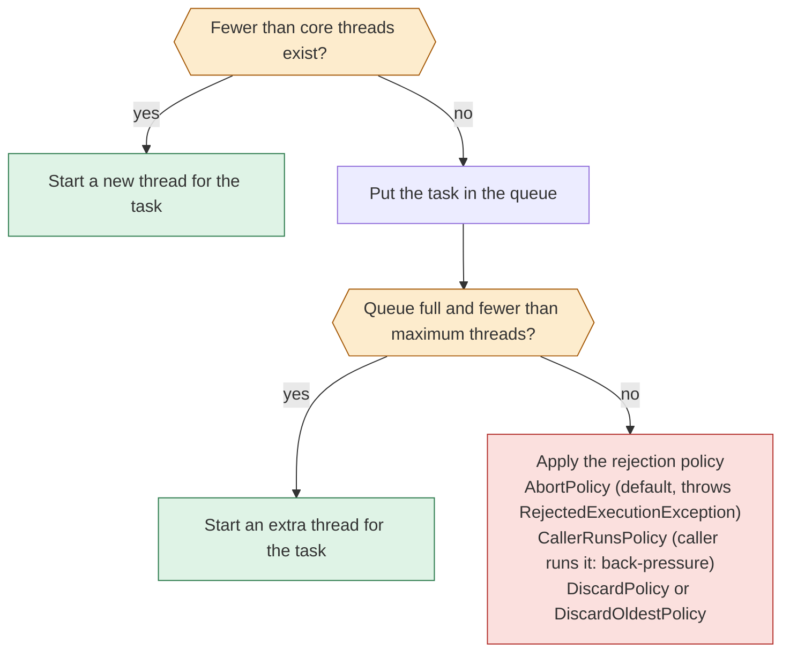

Concurrency questions appear in almost every Java interview, because they test whether you understand what the machine really does. This lesson starts with what goes wrong when threads share data, then shows the tools Java gives you, in roughly the order they were added: `synchronized`, locks and atomics, executors, `CompletableFuture`, concurrent collections, and finally virtual threads. Press play and switch between the four examples. The [memory lesson](lesson:java-memory-model#jmm) explains the visibility rules (happens-before) that make all of this work; read it first if "volatile" or "visibility" feels vague.

```demo
name: concurrency-walk
```

> **One sentence to remember:** *shared mutable data is the problem; the cures are to not share it, not to mutate it, or to make every access to it take turns safely.*

## Threads {#threads}

### Why use threads {#why-threads}

A **thread** is an independent path of execution inside a process. All threads of one process share the heap but each has its own [stack](lesson:java-memory-model#stack). Threads let a program use several CPU cores at once (parallelism) and keep doing useful work while one task waits for a network or disk response (concurrency). The cost is that they share memory, so every shared mutable variable becomes a risk.

### Creating threads {#creating}

You rarely create threads by hand today, but you should know the options:

```java
Thread t = new Thread(() -> System.out.println("hello"));   // a Runnable
t.start();                                                    // start(), never run(): run() would just call the code on this thread

ExecutorService pool = Executors.newFixedThreadPool(4);      // normal production style
Future<Integer> f = pool.submit(() -> compute());             // a Callable returns a value and may throw
```

`Runnable` has no result and cannot throw checked exceptions; `Callable<V>` returns a value and may throw. An exception that escapes a plain thread's `run()` kills that thread and is printed, so an executor's `Future` is the better place to see it (`future.get()` rethrows it wrapped in an `ExecutionException`).

### Thread states {#thread-states}

`Thread.getState()` returns one of six states:

| State | Meaning |
| --- | --- |
| `NEW` | created, `start()` not yet called |
| `RUNNABLE` | running, or ready and waiting for a CPU |
| `BLOCKED` | waiting to enter a `synchronized` block held by another thread |
| `WAITING` | waiting indefinitely: `wait()`, `join()`, `LockSupport.park()` |
| `TIMED_WAITING` | waiting with a timeout: `sleep(ms)`, `wait(ms)`, `join(ms)` |
| `TERMINATED` | finished |

A thread dump (`jcmd <pid> Thread.print` or `jstack <pid>`) lists every thread with its state and stack, which is the first tool for a hung application.

### Interrupts and stopping a thread {#interrupt}

You cannot force a thread to stop safely (`Thread.stop()` is gone). Java uses **cooperative interruption**: `t.interrupt()` sets a flag. A blocking method such as `sleep`, `wait` or `BlockingQueue.take()` notices it, throws `InterruptedException` and **clears** the flag. Code should either let the exception propagate or restore the flag, never swallow it:

```java
try {
    queue.take();
} catch (InterruptedException e) {
    Thread.currentThread().interrupt();   // restore the flag so callers can see it
    return;
}
```

Long loops should check `Thread.currentThread().isInterrupted()`. `ExecutorService.shutdownNow()` works by interrupting its workers.

### Daemon threads {#daemon}

The JVM exits when only **daemon** threads are left. Background housekeeping (a cache cleaner, a heartbeat) is usually a daemon thread; work that must finish is not. Threads inherit the daemon flag of the thread that creates them, and thread pools expose it through their `ThreadFactory`.

## What goes wrong {#problems}

### Race conditions and lost updates {#race}

A **race condition** is a bug whose outcome depends on timing. The simplest form is the **lost update**: `count++` is really *read, add, write*, so two threads can both read 0 and both write 1 (see the first animation). Two common shapes:

- **Read-modify-write:** `count++`, `total += x`, `map.put(k, map.get(k) + 1)`.
- **Check-then-act:** `if (!map.containsKey(k)) map.put(k, v)`: another thread can insert between the check and the action. The fix is an atomic operation such as `putIfAbsent` or `computeIfAbsent`.

A **data race** is the memory-level version: a read and a write of the same variable with no happens-before ordering between them. Even a plain `boolean` flag can then be stale for ever, see [visibility](lesson:java-memory-model#jmm-problems).

### Deadlock, livelock and starvation {#deadlock}

A **deadlock** happens when threads hold locks and each waits for a lock another one holds (see the third animation). All four of these conditions must hold, and removing any one prevents deadlock:

1. **Mutual exclusion:** a lock can be held by one thread at a time.
2. **Hold and wait:** a thread holds one lock while waiting for another.
3. **No preemption:** locks cannot be taken away.
4. **Circular wait:** a cycle of threads each waiting for the next.

Prevention in practice: take locks in a **global order** (for example by account id), hold as few locks as possible, never call unknown code (callbacks, overridable methods) while holding a lock, and use `tryLock(timeout)` so a thread can back off. To diagnose, take a thread dump: the JVM prints "Found one Java-level deadlock" with the threads and locks involved.

A **livelock** is when threads are not blocked but keep reacting to each other without progress (two people stepping aside in a corridor). **Starvation** is when a thread never gets the lock or CPU, for example because of an unfair lock or a high-priority task that never yields.

## Locks and atomics {#locking}

### synchronized {#synchronized}

Every object has a built-in **monitor**. `synchronized` takes it:

```java
class Counter {
    private int count;

    synchronized void increment() { count++; }            // locks "this"
    synchronized int get()        { return count; }       // reads need the lock too, for visibility

    private final Object lock = new Object();
    void other() {
        synchronized (lock) { /* ... */ }                  // a private lock object cannot be taken by outsiders
    }
}
```

Properties worth knowing:

- It gives **mutual exclusion** and a **happens-before** edge: everything written before unlock is visible after the next lock on the same monitor.
- It is **reentrant**: a thread holding the lock can enter another `synchronized` block on the same object.
- A `static synchronized` method locks the `Class` object, a different lock from an instance method.
- Never lock on a `String` literal, a boxed `Integer` or other value-based classes: they may be shared or interned, so unrelated code can contend on the same lock.
- Prefer a **private final lock object** to `synchronized(this)`, so code outside your class cannot lock it too.

### wait and notify {#wait-notify}

`wait()`, `notify()` and `notifyAll()` coordinate threads on a monitor. They must be called while holding it, and `wait()` must be in a **loop**, because a thread can wake without being notified (a spurious wakeup) and the condition may already have changed again:

```java
synchronized (lock) {
    while (!ready) {          // always a while, never an if
        lock.wait();          // releases the monitor while waiting
    }
    // ready is true here
}
// elsewhere: synchronized (lock) { ready = true; lock.notifyAll(); }
```

Use `notifyAll()` unless you are certain only one waiter can proceed. In new code a `BlockingQueue` or a `Condition` is usually clearer than `wait`/`notify`.

### volatile {#volatile}

`volatile` gives visibility and ordering but not atomicity, so it fits a flag or a safely published immutable value, not `count++`. The details are in [the memory lesson](lesson:java-memory-model#volatile-jmm).

### Explicit locks {#locks}

`java.util.concurrent.locks` (Java 5) offers more control than `synchronized`:

| Class | Adds |
| --- | --- |
| `ReentrantLock` | `tryLock()` and `tryLock(timeout)`, `lockInterruptibly()`, optional fairness, several `Condition`s |
| `ReentrantReadWriteLock` | many readers or one writer |
| `StampedLock` (Java 8) | optimistic reads without locking, then validate; not reentrant |

The cost is that you must release in `finally`:

```java
lock.lock();
try {
    // critical section
} finally {
    lock.unlock();            // never forget: an unreleased lock blocks everyone for ever
}
```

Use `synchronized` for simple cases and a `ReentrantLock` when you need a timeout, interruptibility or several conditions.

### Atomic variables and CAS {#atomics}

`AtomicInteger`, `AtomicLong`, `AtomicReference` and friends use the CPU's **compare-and-swap** (CAS) instruction: "set the value to *new* only if it is still *expected*". A failed CAS means another thread won, so the code retries. There is no lock, so no blocking and no deadlock:

```java
AtomicInteger count = new AtomicInteger();
count.incrementAndGet();                       // atomic read-modify-write
count.updateAndGet(x -> Math.min(x + 1, 100)); // retries the function until the CAS succeeds
```

Under heavy contention many threads fail and retry. `LongAdder` (Java 8) spreads the updates over several cells and sums them on read, which is much faster for counters that are written often and read rarely (metrics, statistics). **ABA problem:** a value may change A to B and back to A, so CAS cannot tell; `AtomicStampedReference` adds a version number to detect it.

## Executors and thread pools {#executors}

Creating a thread per task is expensive (a platform thread reserves memory for its stack) and unbounded. A **thread pool** reuses a fixed set of threads that take tasks from a queue. The animation's last example shows the rules of `ThreadPoolExecutor`.

### The ThreadPoolExecutor rules {#pool-rules}

```java
new ThreadPoolExecutor(
        2,                                   // core pool size
        3,                                   // maximum pool size
        60, TimeUnit.SECONDS,                // keep-alive for threads above the core size
        new ArrayBlockingQueue<>(2),         // the work queue
        new ThreadPoolExecutor.CallerRunsPolicy());   // what to do when full
```

For each submitted task:



Note the order: the pool queues **before** it grows beyond the core size. With an *unbounded* queue the maximum size is therefore never used.

### The Executors factory traps {#executors-traps}

| Factory | What it builds | The trap |
| --- | --- | --- |
| `newFixedThreadPool(n)` | n threads, **unbounded** `LinkedBlockingQueue` | a backlog can grow until `OutOfMemoryError` |
| `newCachedThreadPool()` | 0 core, **unlimited** threads, `SynchronousQueue` | a burst can create thousands of threads |
| `newSingleThreadExecutor()` | 1 thread, unbounded queue | same backlog risk |
| `newScheduledThreadPool(n)` | timed and periodic tasks | a task that throws silently cancels its later runs |

For production prefer an explicit `ThreadPoolExecutor` with a **bounded queue**, a **named thread factory** (so thread dumps are readable) and a rejection policy you chose. In Spring, `ThreadPoolTaskExecutor` exposes the same settings.

### Sizing a pool {#pool-sizing}

- **CPU-bound** work (computation): about the number of cores, or cores + 1.
- **I/O-bound** work (database, HTTP): more threads, roughly `cores × (1 + wait time / compute time)`. If a task waits 90% of the time, that is about ten times the core count.
- Measure under load. Several pools of different types isolate failures: a slow downstream service should not use up the threads of everything else (the **bulkhead** pattern).

### Shutting down {#shutdown}

`shutdown()` stops accepting tasks and lets queued ones finish. `shutdownNow()` also interrupts running tasks and returns the tasks that never started. The usual pattern is `shutdown()`, `awaitTermination(...)`, then `shutdownNow()` if it times out. Since Java 19 `ExecutorService` is `AutoCloseable`, so `try (var pool = ...) { }` waits for completion.

### Fork/Join and parallel streams {#fork-join}

`ForkJoinPool` (Java 7) is built for tasks that split into subtasks (divide and conquer). Idle workers **steal** work from busy workers' queues, keeping all cores busy. Parallel streams and many `CompletableFuture` operations use one shared **common pool** (by default one thread fewer than the number of cores). Consequences: do not block or do slow I/O inside a parallel stream, because you would starve every other user of the common pool; do not mutate shared state from a stream; and use parallel streams only when there is a lot of data and the work per element is CPU-heavy.

## CompletableFuture {#futures}

A plain `Future` can only be waited on with a blocking `get()`. **`CompletableFuture`** (Java 8) lets you describe a pipeline of asynchronous steps and combine results:

```java
CompletableFuture<Order> order = CompletableFuture
        .supplyAsync(() -> inventory.reserve(sku), ioPool)          // runs on a pool you choose
        .thenApply(reservation -> orders.create(reservation))       // transforms the result
        .exceptionally(ex -> Order.failed(ex));                     // recovers from an error

CompletableFuture<Price> price = CompletableFuture.supplyAsync(() -> pricing.quote(sku), ioPool);
CompletableFuture<Stock> stock = CompletableFuture.supplyAsync(() -> warehouse.check(sku), ioPool);

CompletableFuture<Offer> offer = price.thenCombine(stock, Offer::new);   // waits for both
CompletableFuture.allOf(price, stock).join();                             // wait for all
```

Key points:

- `thenApply` maps a value, `thenCompose` chains another future (like `flatMap`), `thenCombine` joins two independent futures, `allOf` waits for all, `anyOf` for the first.
- **Always pass your own executor** to the `...Async` methods for I/O work; the default is the shared common pool.
- Handle errors explicitly (`exceptionally`, `handle`, `whenComplete`): an unhandled failure just sits in the future and is thrown at `join()`/`get()`.
- Add timeouts: `orTimeout` and `completeOnTimeout` (Java 9).
- `get()` throws checked exceptions; `join()` throws an unchecked `CompletionException`.

## Concurrent collections and utilities {#collections}

### ConcurrentHashMap {#chm}

The thread-safe map. In Java 5 to 7 it was divided into **segments**, each with its own lock. **Since Java 8** there are no segments: an empty bucket is filled with a **CAS**, and otherwise the thread locks only the **first node of that bucket** with `synchronized`, so unrelated keys never contend. Reads do not lock. Buckets turn into trees like in `HashMap` (see [treeification](lesson:java-hashmap#treeify)). Behaviours to know:

- **No null keys or values**, because `null` would be ambiguous in `get`.
- Its compound methods are **atomic**: `putIfAbsent`, `computeIfAbsent`, `merge`, `compute`. Do not do a check-then-put yourself, and keep the function you pass **short and free of other map updates**, because it runs inside the lock.
- `size()` and iteration are **weakly consistent**: they reflect some state during the call, not a frozen snapshot, and iterators never throw `ConcurrentModificationException`.
- Compare with the alternatives in [HashMap vs Hashtable vs synchronizedMap](lesson:java-hashmap#q-thread-safe).

### Other collections {#other-collections}

| Class | Use |
| --- | --- |
| `CopyOnWriteArrayList` / `CopyOnWriteArraySet` | read-mostly lists such as listener lists; every write copies the whole array |
| `ConcurrentLinkedQueue` / `ConcurrentLinkedDeque` | lock-free, unbounded queues |
| `ArrayBlockingQueue`, `LinkedBlockingQueue` | **blocking** queues for producer-consumer; `put` blocks when full, `take` blocks when empty |
| `PriorityBlockingQueue`, `DelayQueue` | priority and time-delayed work |
| `ConcurrentSkipListMap` | a sorted, concurrent map |

### Coordination utilities {#coordination}

| Class | Purpose |
| --- | --- |
| `CountDownLatch` | one or more threads wait until N events happen; single-use |
| `CyclicBarrier` | N threads wait for each other at a point; reusable |
| `Semaphore` | limit concurrent access to N permits (for example connections) |
| `Phaser` (Java 7) | a flexible, reusable barrier with phases |
| `Exchanger` | two threads swap objects |

### Producer-consumer {#producer-consumer}

A bounded `BlockingQueue` decouples a producer from a consumer and gives **back-pressure** for free: when the queue is full the producer blocks (or the pool's rejection policy kicks in), which stops the system from running ahead of its slowest part:

```java
BlockingQueue<Task> queue = new ArrayBlockingQueue<>(100);

// producer
queue.put(task);                 // blocks while the queue is full

// consumer
Task t = queue.take();           // blocks while the queue is empty
process(t);
```

## Virtual threads and structured concurrency {#virtual-threads}

### Virtual threads {#virtual-threads-basics}

A platform thread is a thin wrapper around an operating-system thread: it reserves stack memory and a few thousand of them is a lot. **Virtual threads** (Project Loom; preview in 19, **final in Java 21**) are scheduled by the JVM onto a small pool of carrier threads. When a virtual thread blocks on I/O, it is **unmounted** and the carrier runs another one, so you can have millions of them and write simple blocking code instead of callback chains:

```java
try (var executor = Executors.newVirtualThreadPerTaskExecutor()) {
    for (Order o : orders) {
        executor.submit(() -> process(o));         // one cheap thread per task, no pool sizing
    }
}                                                    // close() waits for all tasks
```

Rules of thumb:

- **Do not pool virtual threads.** They are cheap; create one per task. To limit concurrency on a scarce resource (a database), use a `Semaphore`.
- They suit **I/O-bound** work, not CPU-bound work: a CPU-heavy virtual thread just occupies a carrier.
- **Pinning:** a virtual thread blocking while inside a `synchronized` block (before Java 24) or inside native code could not unmount and held its carrier thread. Java 24 removed the `synchronized` case (JEP 491). Prefer `ReentrantLock` on older versions.
- `ThreadLocal` works but each virtual thread gets its own copy, so millions of large thread-locals are expensive.
- They look like normal `Thread`s to the debugger and to `jcmd Thread.dump_to_file`.

How the stacks are stored is explained in [the memory lesson](lesson:java-memory-model#q-virtual-stack-q). See [Java 21](lesson:java-version-history#java-21) and the [concurrency trail](lesson:java-version-history#trail-concurrency) for the history.

### Structured concurrency and scoped values {#structured}

**Structured concurrency** (`StructuredTaskScope`) treats a group of related tasks as one unit: if one subtask fails the others are cancelled, and the scope cannot end until all subtasks are done, so no task is left running by accident. It has been in preview for several releases and is still a preview feature in Java 27 (as announced), so do not use it in production code yet. **Scoped values** (final in Java 25) pass immutable data to child tasks for a bounded time, and are the modern replacement for `ThreadLocal`, especially with virtual threads.

## Design patterns for thread safety {#patterns}

The safest code does not need locks. In order of preference:

1. **Immutability:** objects whose fields are `final` and never change can be shared freely (see [final fields](lesson:java-memory-model#final-jmm)). Records and `String` are examples.
2. **Thread confinement:** keep data inside one thread. Local variables are confined automatically. `ThreadLocal` confines per thread (clear it on pooled threads), and an actor-style single-thread executor confines state to its thread.
3. **Concurrent collections and atomics** for shared counters and maps.
4. **Locks** around compound updates, held as briefly as possible.
5. **Safe publication:** hand an object to other threads through a `volatile` field, a lock, a final field or a concurrent collection (the [double-checked locking](lesson:java-memory-model#dcl) example shows what goes wrong otherwise).

Document the thread-safety of your classes (`@ThreadSafe`, `@Immutable`, or a sentence in the Javadoc), because callers cannot guess.

## How concurrency evolved {#history}

| Version | Addition |
| --- | --- |
| 1.0 | `Thread`, `synchronized`, `wait`/`notify` |
| [5](lesson:java-version-history#java-5) | `java.util.concurrent`: executors, locks, atomics, concurrent collections; the Java Memory Model rewrite |
| [7](lesson:java-version-history#java-7) | Fork/Join, `Phaser` |
| [8](lesson:java-version-history#java-8) | `CompletableFuture`, `StampedLock`, `LongAdder`, parallel streams; `ConcurrentHashMap` rewritten |
| [9](lesson:java-version-history#java-9) | Flow API (reactive streams), `CompletableFuture` timeouts |
| [19](lesson:java-version-history#java-19) | virtual threads and structured concurrency in preview |
| [21](lesson:java-version-history#java-21) | virtual threads final |
| [24](lesson:java-version-history#java-24) | `synchronized` no longer pins virtual threads |
| [25](lesson:java-version-history#java-25) | scoped values final |

## Cheat sheet {#cheatsheet}

| Need | Use |
| --- | --- |
| A thread-safe counter | `AtomicInteger`; `LongAdder` if heavily contended |
| An atomic "add if missing" on a map | `ConcurrentHashMap.computeIfAbsent` |
| Mutual exclusion around a short block | `synchronized` on a private lock object |
| A try-lock or timeout | `ReentrantLock.tryLock` |
| Run tasks on a bounded set of threads | `ThreadPoolExecutor` with a bounded queue |
| Many blocking I/O tasks | virtual threads (Java 21+) |
| Combine async results | `CompletableFuture.thenCombine` / `allOf` |
| Wait for N tasks to finish | `CountDownLatch` or `invokeAll` |
| Limit concurrent access to a resource | `Semaphore` |
| Pass data safely between threads | a `BlockingQueue` |
| Stop a thread | `interrupt()` and handle `InterruptedException` |
| Find a hang | a thread dump: `jcmd <pid> Thread.print` |

## Interview questions {#questions}

### [basic] What is the difference between a process and a thread? {#process-vs-thread}

A **process** is a running program with its own memory space; processes are isolated from each other. A **thread** is a path of execution inside a process. Threads of one process share the heap and static data, but each has its own stack and program counter. Threads are cheaper to create and switch between than processes, and the shared memory makes communication easy and also dangerous.

### [basic] What are the ways to create a thread, and what is the difference between start() and run()? {#create-thread}

Extend `Thread`, implement `Runnable` or `Callable` and give it to a `Thread` or an `ExecutorService`. Calling `start()` asks the JVM to create a new thread that calls `run()`. Calling `run()` directly just executes the method on the **current** thread, with no concurrency. Calling `start()` twice throws `IllegalThreadStateException`. In real code you submit tasks to an executor instead of managing threads.

### [basic] What is the difference between Runnable and Callable? {#runnable-callable}

`Runnable.run()` returns nothing and cannot throw checked exceptions. `Callable<V>.call()` returns a value and may throw. `ExecutorService.submit` accepts both and returns a `Future`; with a `Callable`, `future.get()` returns the result or throws an `ExecutionException` wrapping what the task threw.

### [basic] What are the states of a Java thread? {#states-q}

`NEW`, `RUNNABLE`, `BLOCKED` (waiting for a monitor), `WAITING` (`wait`, `join`, `park` with no timeout), `TIMED_WAITING` (`sleep` or a timed wait) and `TERMINATED`. Note that "running" and "ready to run" are both `RUNNABLE`, and a thread waiting for I/O is `RUNNABLE` too. A thread dump shows the state of each thread.

### [basic] What is a race condition? Give an example. {#race-q}

A bug where the result depends on the timing of threads. `count++` on a shared field is the classic one: it is read, add, write, so two threads can both read the same value and one update is lost. Another is check-then-act: `if (!map.containsKey(k)) map.put(k, v)`. The fix is to make the compound operation atomic with a lock, an atomic class or an atomic method such as `computeIfAbsent`.

### [basic] What does synchronized do? {#synchronized-q}

It acquires the monitor of an object (or class, for static methods) before running the block, and releases it afterwards, so only one thread at a time can run code guarded by the same monitor. It also creates a happens-before edge, so changes made inside are visible to the next thread that locks the same monitor. It is reentrant. Use a private lock object so outsiders cannot take your lock.

### [basic] What is a deadlock, and how do you prevent it? {#deadlock-q}

Threads each hold a lock and wait for a lock held by another, so none can proceed. It needs mutual exclusion, hold-and-wait, no preemption and circular wait; removing one prevents it. In practice: always acquire locks in the **same global order**, hold fewer locks and for less time, avoid calling external code while locked, and use `tryLock` with a timeout. Detect it with a thread dump, which reports Java-level deadlocks.

### [basic] What is the difference between sleep(), wait() and join()? {#sleep-wait-join}

`Thread.sleep(ms)` pauses the current thread and **keeps** any locks it holds. `Object.wait()` must be called while holding the object's monitor, **releases** it while waiting, and resumes on `notify`/`notifyAll` or a timeout. `thread.join()` makes the caller wait until another thread terminates. All three can throw `InterruptedException`.

### [basic] What does the volatile keyword do? {#volatile-q-basic}

It ensures that a write by one thread is visible to subsequent reads by other threads, and prevents certain reorderings. It does not make compound operations such as `count++` atomic. Good uses: a stop flag, or publishing an immutable object. Details are in the [memory lesson](lesson:java-memory-model#q-volatile-q).

### [intermediate] What is the difference between synchronized and ReentrantLock? {#sync-vs-lock}

Both are reentrant and give mutual exclusion and visibility. `synchronized` is simpler and releases automatically, even on exceptions. `ReentrantLock` adds `tryLock()` with or without a timeout, interruptible lock acquisition, optional fairness, and several `Condition` objects, but you must release it in `finally`. Use `synchronized` by default and a `ReentrantLock` when you need those features. With virtual threads on versions before Java 24, a lock avoids pinning where `synchronized` could not.

### [intermediate] What is CAS, and what are atomic classes? {#cas-q}

**Compare-and-swap** is a CPU instruction that sets a variable to a new value only if it still holds the expected one, atomically. `AtomicInteger`, `AtomicReference` and the others retry in a loop until their CAS succeeds, so they update shared values without locks, with no blocking or deadlock. Under heavy contention many retries waste CPU, so `LongAdder` spreads updates across cells. CAS has the ABA problem (a value goes A, B, A and looks unchanged), solved with a version stamp (`AtomicStampedReference`).

### [intermediate] How does a ThreadPoolExecutor decide whether to create a thread, queue a task or reject it? {#pool-q}

For each task: if fewer than **corePoolSize** threads exist, start a thread. Otherwise try to put the task in the **queue**. If the queue is full and fewer than **maximumPoolSize** threads exist, start an extra thread. Otherwise apply the **rejection policy** (abort by default). Threads above the core size die after the keep-alive time when idle. The surprising consequence is that the pool queues before it grows, so with an unbounded queue it never exceeds the core size.

### [intermediate] Why do many teams avoid Executors.newFixedThreadPool and newCachedThreadPool? {#executors-q}

`newFixedThreadPool` uses an **unbounded** queue, so a slow consumer lets the backlog grow until memory runs out. `newCachedThreadPool` has an **unlimited number of threads**, so a burst can create thousands. Both hide the two numbers that matter (queue size and maximum threads). Build a `ThreadPoolExecutor` with a bounded queue, a named thread factory and an explicit rejection policy instead. For one-thread-per-task I/O work on Java 21+, use `newVirtualThreadPerTaskExecutor`.

### [intermediate] How would you size a thread pool? {#pool-size-q}

It depends on what the tasks do. For **CPU-bound** tasks use about the number of cores (plus one). For **I/O-bound** tasks use more: roughly `cores × (1 + wait/compute)`. Then measure under realistic load and adjust, keeping the queue bounded. Use separate pools for different kinds of work so that a slow dependency cannot take all threads (the bulkhead pattern). With virtual threads sizing mostly disappears for blocking work, and you limit concurrency of the downstream resource with a semaphore.

### [intermediate] What is the difference between Future and CompletableFuture? {#future-vs-cf}

A `Future` represents a result to come, and the only way to get it is the blocking `get()`. A `CompletableFuture` can also be **completed manually**, **chained** (`thenApply`, `thenCompose`), **combined** (`thenCombine`, `allOf`, `anyOf`), given **error handling** (`exceptionally`, `handle`) and **timeouts**, all without blocking. Pass your own executor for I/O work, because the default is the shared common pool.

### [intermediate] How is ConcurrentHashMap implemented, and how does it differ from Hashtable and synchronizedMap? {#chm-q}

`Hashtable` and `Collections.synchronizedMap` lock the **whole map** on every operation, so threads queue up. `ConcurrentHashMap` locks far less: in Java 5 to 7 it had lock segments, and **since Java 8** it uses CAS for empty buckets and `synchronized` on just the first node of a bucket, so reads do not lock and writes to different buckets do not contend. It forbids null keys and values, provides atomic `computeIfAbsent`/`merge`, and its iterators are weakly consistent. See also [HashMap thread safety](lesson:java-hashmap#q-thread-safe).

### [intermediate] Why is check-then-put on a ConcurrentHashMap still a bug? {#check-then-act}

Because each method is atomic on its own, but the sequence `if (!map.containsKey(k)) map.put(k, v)` is not: another thread can insert between the two calls. Use the single atomic methods `putIfAbsent`, `computeIfAbsent`, `compute` or `merge`. Keep the function passed to `compute*` short and do not update the same map inside it.

### [intermediate] How do you stop a thread safely? {#stop-thread}

Cooperatively: call `interrupt()` and make the task respond. Blocking calls throw `InterruptedException`, and loops check `isInterrupted()` and exit cleanly. For pools, `shutdown()` and then `awaitTermination`, with `shutdownNow()` as the last resort. Never swallow `InterruptedException`: either rethrow it or restore the flag with `Thread.currentThread().interrupt()`. `Thread.stop()` is unsafe and no longer works.

### [intermediate] What problems can ThreadLocal cause? {#threadlocal-q}

It stores a separate copy of a variable per thread, which is handy for per-request context. In thread pools the thread outlives the request, so a value that is never `remove()`d **leaks** and can even leak data from one request into the next. It also holds on to class loaders in application servers. With virtual threads, millions of threads mean millions of copies. Clear it in a `finally`, or use scoped values on Java 25 and later.

### [intermediate] What are CountDownLatch, CyclicBarrier and Semaphore? {#utilities-q}

A **CountDownLatch** lets threads wait until a count of events reaches zero (for example wait for N workers to finish); it cannot be reset. A **CyclicBarrier** makes N threads wait for each other at a point and then continues, and it is reusable. A **Semaphore** hands out a fixed number of permits to limit concurrent access to a resource, such as a pool of database connections.

### [intermediate] What is the fork/join framework and what are the dangers of parallel streams? {#fork-join-q}

Fork/Join runs tasks that split into smaller tasks on a pool whose idle workers **steal** work from others, so cores stay busy. Parallel streams and some `CompletableFuture` calls use the shared common pool. Dangers: blocking or slow I/O in a parallel stream starves everything else that uses the pool, mutating shared state from the pipeline is a race, and for small data or cheap per-item work the overhead makes it slower than sequential.

### [deep] How do virtual threads work, and when should you not use them? {#virtual-q}

A virtual thread (final in Java 21) is a lightweight thread scheduled by the JVM. It runs on a carrier thread, and when it blocks in I/O or on a lock it is unmounted and its stack is saved on the heap, freeing the carrier for another virtual thread. That makes thread-per-request affordable for blocking code. They do not help CPU-bound work, should not be pooled (use a semaphore to limit resource use), and before Java 24 could be **pinned** to the carrier when blocking inside `synchronized` or native code. Keep large `ThreadLocal`s out of them.

### [deep] What is thread pinning? {#pinning}

A virtual thread normally unmounts when it blocks, but cannot while it holds a monitor (`synchronized`) or while a native frame is on its stack. It then blocks its carrier thread, reducing throughput and possibly deadlocking if all carriers are pinned. Java 24 (JEP 491) lets virtual threads block inside `synchronized` without pinning. Native calls can still pin. On older versions, replace `synchronized` around blocking calls with `ReentrantLock`; the flag `-Djdk.tracePinnedThreads` shows where it happens (Java 24 replaced it with a Flight Recorder event).

### [deep] What is the difference between parallelism and concurrency? {#parallel-vs-concurrent-q}

**Concurrency** means managing several tasks whose lifetimes overlap, even on one core by switching between them (waiting for I/O while another task runs). **Parallelism** means running several tasks at the same instant on several cores. A web server handling thousands of waiting requests is concurrent; a stream summing a huge array on eight cores is parallel. Concurrency is about structure, parallelism about speed-up.

### [deep] How does synchronized relate to the Java Memory Model? {#sync-jmm}

An unlock of a monitor **happens-before** every later lock of the same monitor, so everything written by the first thread before unlocking is visible to the second after locking, even writes to non-volatile fields. That is why a synchronized getter is needed as well as a synchronized setter: without the lock, the reader has no happens-before edge and may see a stale value. The same reasoning explains `volatile`, `Thread.start`/`join` and `final` fields (see [happens-before](lesson:java-memory-model#happens-before)).

### [deep] What is livelock and starvation, and how do fair locks help? {#livelock}

**Livelock:** threads are active but make no progress because they keep reacting to each other, for example two threads repeatedly backing off and retrying in lockstep; randomised back-off helps. **Starvation:** a thread never gets the resource, because others always win. A **fair** `ReentrantLock(true)` grants the lock to the longest-waiting thread, preventing starvation at the cost of lower throughput, because the lock cannot be handed to a thread that is already running on the CPU.

### [deep] When would you choose reactive programming over virtual threads? {#reactive-vs-virtual}

Reactive libraries (Reactor, RxJava, Spring WebFlux) use a few threads and non-blocking I/O with a callback pipeline, which scales without blocking but is harder to write, debug and trace. Virtual threads give a similar scalability for **blocking-style** code that is simple to read and debug. Prefer virtual threads for new request-per-thread services on Java 21+. Reactive still fits when you need streaming with built-in back-pressure, or when you are already in a reactive codebase.

### [coding] Fix this counter so it gives the right answer. {#fix-counter}

```java
public class HitCounter {
    private int hits;
    private final Map<String, Integer> perPage = new HashMap<>();

    public void record(String page) {
        hits++;
        Integer n = perPage.get(page);
        perPage.put(page, n == null ? 1 : n + 1);
    }
}
```

Both `hits++` and the map update are unsynchronized read-modify-write operations, and `HashMap` is not thread-safe, so counts are lost and the map can even be corrupted. A fix using lock-free types:

```java
public class HitCounter {
    private final LongAdder hits = new LongAdder();
    private final ConcurrentHashMap<String, LongAdder> perPage = new ConcurrentHashMap<>();

    public void record(String page) {
        hits.increment();
        perPage.computeIfAbsent(page, p -> new LongAdder()).increment();
    }

    public long total() { return hits.sum(); }
}
```

`LongAdder` suits a counter that is written often and read rarely; `computeIfAbsent` atomically creates the per-page counter. For a simple low-contention case `synchronized` methods, or one `AtomicLong`, are also correct.

### [coding] Why can this program hang, and how do you fix it? {#fix-hang}

```java
class Worker implements Runnable {
    private boolean running = true;

    public void run() {
        while (running) {
            // do work
        }
    }

    public void stop() { running = false; }
}
```

`running` is not `volatile`, so the worker thread has no happens-before edge with the thread that calls `stop()`. The JIT may read the field once and keep it in a register, so the loop can run forever. Declare the field `private volatile boolean running = true;`, or better, use interruption: loop on `!Thread.currentThread().isInterrupted()` and stop it with `thread.interrupt()`, which also wakes it from a blocking call.
