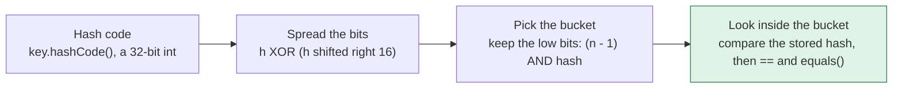
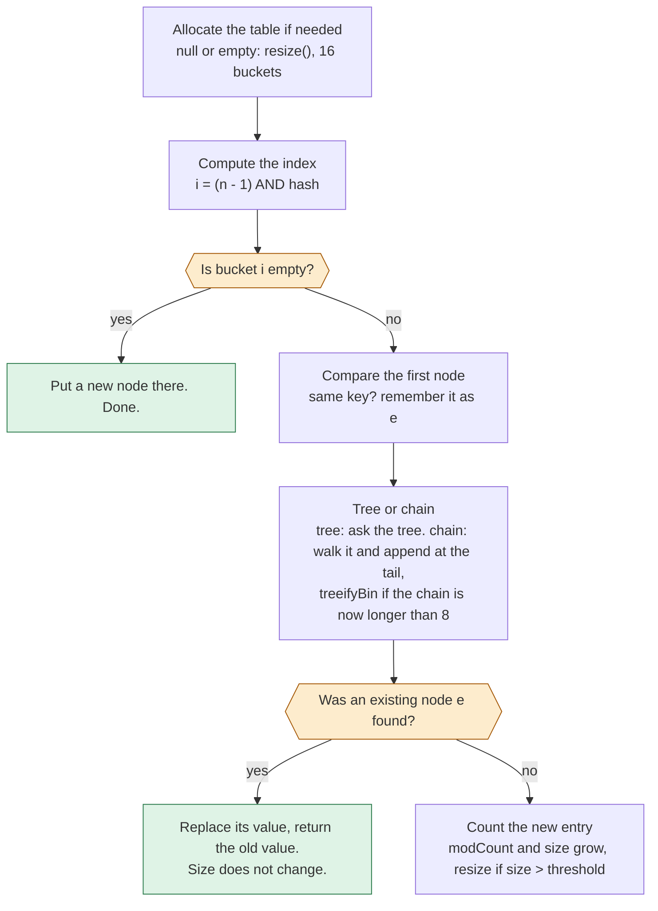

Read the sections from top to bottom once and play every animation. Then go to the **interview questions** and answer each one out loud before you open it. Words with a dotted underline explain themselves when you hover over, focus or tap them.

## The one-minute picture {#overview}

A `HashMap` is an **array of buckets**. A bucket is one slot of the array. To store or find a key, the map does four things:



Two different keys can land in the same bucket. This is called a **collision**, and the bucket then holds a chain of nodes. If a chain gets long, the bucket turns into a tree. If the whole table gets too full, the array doubles in size.

> **One sentence to remember:** *The hash picks the bucket, `equals()` picks the entry, and the table doubles when it is 75% full.*

| Constant | Value | What it means |
| --- | --- | --- |
| default capacity | 16 | A new map has 16 buckets. They are created on the first `put`. |
| load factor | 0.75 | This is how full the table may get before it grows. |
| threshold | 12 | This is `16 × 0.75`. The 13th entry makes the table grow. |
| `TREEIFY_THRESHOLD` | 8 | A bucket with more than 8 nodes may become a tree. |
| `MIN_TREEIFY_CAPACITY` | 64 | Below 64 buckets, HashMap grows the table instead of making a tree. |
| `UNTREEIFY_THRESHOLD` | 6 | A tree turns back into a list at 6 nodes or fewer. |
| maximum capacity | 2³⁰ | That is about a billion buckets. |

## Anatomy of a HashMap {#anatomy}

Everything lives in a few fields. This is a simplified view of `java.util.HashMap` in Java 8 and later:

```java
transient Node<K,V>[] table;   // the buckets; null until the first put
transient int size;            // number of entries
transient int modCount;        // structural changes, used by fail-fast iterators
int threshold;                 // resize when size > threshold
final float loadFactor;        // 0.75f by default

static class Node<K,V> implements Map.Entry<K,V> {
    final int hash;            // the spread hash, stored so it is never recomputed
    final K key;
    V value;
    Node<K,V> next;           // next node in the same bucket (the chain)
}
```

Notice that each node **stores its hash**. This helps in two ways:

- A lookup is cheaper. The map compares two `int`s before it calls `equals()`.
- A resize is cheaper. Nobody calls `hashCode()` again.

A bucket can be in one of four states:

- An empty bucket is just `null`.
- A bucket with one entry holds one node.
- A bucket with several entries holds a chain of nodes.
- After treeification, a bucket holds a tree of `TreeNode`s.

## Step 1: from key to bucket {#bucket-index}

The JDK calculates the bucket index in two lines:

```java
static final int hash(Object key) {
    int h;
    return (key == null) ? 0 : (h = key.hashCode()) ^ (h >>> 16);
}

int index = (n - 1) & hash;     // n = table.length, always a power of two
```

Play the animation and watch the 32 bits. In a table of 16 buckets, only the highlighted low bits choose the bucket.

```demo
name: bucket-index
```

**Why `(n - 1) & hash` and not `%`?** Because `n` is a power of two, `n - 1` is a row of 1-bits: `16 - 1 = 0b1111`. An AND with that row keeps only the low bits of the hash. The result is the same as `hash mod n`, but it is faster and never negative.

This matters because `hashCode()` can be negative. In Java, `-7 % 16` is `-7`, which is not a valid array index.

**Why spread the bits with `h ^ (h >>> 16)`?** In a small table, only the low bits count. Without the spread, two hash codes that differ only in their high bits would always land in the same bucket. The XOR mixes the top 16 bits into the bottom 16, so every bit can affect the bucket. It costs almost nothing.

**Why must the capacity be a power of two?** Because the mask trick above needs it, and because it makes resizing cheap (see [Resizing](#resize)).

## Step 2: put() and get() {#put-get}

`put(key, value)` follows these steps. In the source code they are in a method called `putVal`.



`get(key)` follows the same path until it finds the node, but it does not write anything. At every node, it runs this test:

```java
e.hash == hash && ((k = e.key) == key || (key != null && key.equals(k)))
```

The order is on purpose: **the cheapest check comes first**.

1. Compare the stored hash, which is one `int` comparison.
2. Compare the references with `==`.
3. Only then call `equals()`, which may be slow.

This also explains why equal keys must have equal hash codes. If the hashes differ, `equals()` is never even called.

> **Gotcha:** replacing a value does not replace the key. If `put` finds an equal key, the *old key object* stays in the node, and only the value changes.

## Collisions {#collisions}

A collision happens when two keys map to the same bucket. It is not a bug. There are about four billion possible hash codes and only a few buckets, so some keys must share a bucket. (This is the **pigeonhole principle**: if you have more pigeons than holes, some holes hold more than one pigeon.)

HashMap handles collisions with **separate chaining**: each bucket holds a linked list of nodes.

There are two kinds of collision, and the animation shows both:

- **Same bucket, different hash.** `"banana"` and `"date"` have different hash codes. Only their low bits agree. The stored hash tells them apart at once, so `equals()` is never called.
- **Same hash, different keys.** `"Aa"` and `"BB"` both have `hashCode() == 2112`. Only `equals()` can tell them apart.

```demo
name: collision-chain
```

Two details are worth remembering:

- **Java 8 adds new nodes at the tail** of a chain. Java 7 added them at the head. This matters for the old bug with resizing from two threads at once, and for keeping the order during a resize.
- A lookup in a chain costs O(chain length). With a good hash function, the average chain holds well under one node. That is where "O(1) on average" comes from.

Try `Aa`, `BB`, `AaAa` and `BBBB` in the box above. Strings built from `"Aa"` and `"BB"` blocks all share one hash. Attackers use this to create collisions on purpose (see the hash-flooding question).

## Chains become trees {#treeify}

Since Java 8 (JEP 180), a long chain can turn into a **red-black tree**. A red-black tree is a sorted tree that keeps itself balanced. A lookup in it costs O(log n) instead of O(n).

The rule has two parts, and people often forget the second one:

1. The chain must grow past `TREEIFY_THRESHOLD` (8). The **9th** node calls `treeifyBin`.
2. The table must have at least `MIN_TREEIFY_CAPACITY` (64) buckets. If it has fewer, `treeifyBin` **grows the table instead**, hoping the keys will spread out.

Play the animation and watch what happens at the 9th, 10th and 11th key. All of them share bucket 1, so the table doubles twice before the tree appears.

```demo
name: treeify
```

**Why 8?** The JDK source explains it. With well-spread hash codes, the number of nodes in a bucket follows a Poisson distribution with an average of about 0.5. The chance that one bucket reaches 8 nodes is about 0.00000006. So trees only appear when the hash function is bad, or when someone attacks it.

Tree nodes are also about twice as big as plain nodes. That is another reason not to use them early.

**Why 6 on the way back?** The gap between 8 and 6 stops a bucket from flipping between list and tree when its size hovers around the limit.

> **Interview tip:** if you only say "it becomes a tree at 8", the interviewer will ask "always?". The complete answer is: more than 8 nodes *and* a table of at least 64 buckets. Otherwise the table grows instead.

## Resizing and the load factor {#resize}

When `size` passes `threshold` (capacity × load factor), HashMap creates a table twice as big and moves the nodes over.

The capacity is a power of two and it doubles, so each node has only two possible places in the new table:

- It **stays** at the same index `i` if `hash & oldCap == 0`. This is the "lo" group.
- It **moves** to `i + oldCap` if `hash & oldCap != 0`. This is the "hi" group.

One bit of the stored hash decides. Nothing is rehashed and no `hashCode()` is called. The order of the nodes inside each chain stays the same.

```demo
name: resize
```

A resize costs O(n), but it happens rarely, because the table doubles each time. So the cost per `put` is **amortized** O(1), which means O(1) on average over many calls. The table never shrinks.

**Pre-sizing.** If you know roughly how many entries are coming, size the map up front. Note that the constructor argument is a *capacity*, not a number of entries, and HashMap rounds it up to a power of two:

```java
// 100 entries: 100 / 0.75 = 133.3 -> ask for 134 -> capacity 256, threshold 192, no resize
Map<String, Integer> a = new HashMap<>(134);

// new HashMap<>(100) is a trap: capacity 128, threshold 96, so the 97th put resizes

// Java 19+ does the arithmetic for you
Map<String, Integer> b = HashMap.newHashMap(100);
```

**The load factor is a trade-off.**

- A lower value, such as 0.5, wastes memory but keeps chains short.
- A higher value, such as 1.0, saves memory but makes lookups slower.

0.75 is the JDK's compromise. There is rarely a reason to change it.

## hashCode() and equals() {#contract}

A `HashMap` only works if the key class follows the **contract** (a set of rules):

1. **Consistent:** while the object does not change, `hashCode()` returns the same value every time.
2. **Equal means same hash:** if `a.equals(b)`, then `a.hashCode() == b.hashCode()`.
3. Unequal objects *may* share a hash code. This is allowed, but it makes the map slower.

By default, `Object.equals` checks identity (the same object), and `Object.hashCode` returns a number based on identity. For classes that represent *values*, you must override both methods, and you must do it together.

The animation shows two objects, `p1` and `p2`, with the same coordinates. It shows what each combination of overrides does. Step through all four tabs.

```demo
name: contract
```

Here is a correct key class, first written the classic way and then the modern way:

```java
public final class Point {
    private final int x, y;
    public Point(int x, int y) { this.x = x; this.y = y; }

    @Override public boolean equals(Object o) {
        if (this == o) return true;
        if (!(o instanceof Point p)) return false;   // pattern matching, Java 16+
        return x == p.x && y == p.y;
    }

    @Override public int hashCode() { return Objects.hash(x, y); }
}

// Java 16+: equals, hashCode and toString are generated for you
public record Point(int x, int y) {}
```

**Rules of thumb:**

- Use the same fields in both methods.
- Prefer **immutable** keys, which cannot change: `String`, `Integer`, enums and records.
- Never use arrays as keys. Their `hashCode()` is based on identity, so `map.get(new int[]{1, 2})` will not find a key stored as `new int[]{1, 2}`.
- Never change a field that `hashCode()` uses while the object is inside a map. The "Mutable key trap" tab shows the entry stuck in a bucket where nobody will ever look.

## Behaviours worth knowing {#behaviours}

- **Null.** One `null` key is allowed. Its hash is defined as 0, so it lives in bucket 0. Any number of `null` values are allowed.
- **No order.** Iteration goes bucket by bucket. So the order depends on the hash codes and on the capacity, and it can change after a resize. Never depend on it.
- **Fail-fast iterators.** Each structural change adds one to `modCount`. An iterator remembers the value it saw, and it throws `ConcurrentModificationException` if the value changes. It is a best-effort bug detector, not a guarantee. To remove entries while iterating, use `iterator.remove()` or `removeIf`.
- **Not thread-safe.** When several threads write at once, updates can be lost. In [Java 7](lesson:java-version-history#java-7), two threads resizing at once could also create a loop in a chain. A later `get` would then run forever at 100% CPU.
- **Memory.** Each entry costs a node object (about 32 bytes with compressed pointers) plus a table slot. The key and value objects come on top of that.

| Map | Order | Null key | Thread-safe | get / put |
| --- | --- | --- | --- | --- |
| `HashMap` | None. | One is allowed. | No. | O(1) on average. |
| `LinkedHashMap` | Insertion order or access order. | One is allowed. | No. | O(1). |
| `TreeMap` | Sorted by key. | Not with natural ordering. | No. | O(log n). |
| `Hashtable` | None. | Not allowed. | Yes, with one big lock. | O(1). |
| `ConcurrentHashMap` | None. | Not allowed. | Yes, with many small locks. | O(1). |

Try it in the lab: [Inside HashMap.put: hash, bucket, collision, resize](lab:hashmap-put-resize).

## Cheat sheet {#cheatsheet}

- The bucket index is `index = (n - 1) & (h ^ (h >>> 16))`, and `n` is a power of two.
- The defaults are capacity 16, load factor 0.75 and threshold 12. The table is created on the first `put`.
- At each node, the map compares the stored hash first, then `==`, then `equals()`.
- A chain becomes a tree when a bucket has more than 8 nodes **and** the table has at least 64 buckets. Otherwise the table grows. A tree becomes a list again at 6 nodes or fewer.
- A resize doubles the table. Each node either stays (`hash & oldCap == 0`) or moves by `oldCap`. Nothing is rehashed.
- Lookups are O(1) on average. The worst case is O(log n) with a tree and `Comparable` keys, and O(n) otherwise.
- Keys should be immutable, with consistent `hashCode()` and `equals()` methods.
- For thread safety, use `ConcurrentHashMap`, never a plain `HashMap`.

## Interview questions {#questions}

Each question has a tag that shows how deep it goes:

- **basic** questions come up in a screening call.
- **intermediate** questions come up in a typical technical round.
- **deep** questions are senior-level or "why" follow-ups.
- **coding** questions are for the whiteboard.

Use the filters, try to answer first, then open each one.

### [basic] How does a HashMap work internally? {#how-it-works}

**Thirty-second answer.** A HashMap stores entries in an array of buckets.

1. For a key, it calls `hashCode()` and spreads the bits with `h ^ (h >>> 16)`.
2. It takes `(n - 1) & hash` as the bucket index.
3. If the bucket is empty, the new node goes there.
4. If not, it walks the chain and compares the stored hash, then `equals()`. A match replaces the value. Otherwise the new node is added at the tail.
5. When a chain gets too long (more than 8 nodes, in a table of at least 64 buckets), it becomes a red-black tree.
6. When the size passes capacity × 0.75, the table doubles.

`get` does the same lookup. The average cost is O(1).

**Follow-ups to expect:** why the size is a power of two, what happens on a collision, what changed in Java 8, and whether it is thread-safe.

### [basic] What are the default capacity, load factor and threshold? {#defaults}

- The capacity is **16** and the load factor is **0.75**, so the threshold is **12**.
- The 13th entry makes the table grow to 32 buckets, with a threshold of 24.
- The table is created lazily, on the first `put`.
- A capacity you pass to the constructor is rounded up to the next power of two.
- The maximum capacity is 2³⁰.

### [basic] What is a hash collision, and how does HashMap handle it? {#collision-q}

A collision is when two different keys map to the same bucket. Collisions cannot be avoided, because there are far more possible keys than buckets.

HashMap uses **separate chaining**. The bucket holds a linked list of nodes, and a lookup walks the list, comparing the hash and then `equals()`.

Since [Java 8](lesson:java-version-history#java-8), a chain of more than 8 nodes in a table of at least 64 buckets becomes a red-black tree. Then a lookup in that bucket costs O(log n) instead of O(n).

### [basic] What is the time complexity of get and put? {#complexity}

- **On average:** O(1) for both, as long as the hash function spreads the keys well.
- **In the worst case:** O(n), if every key lands in one bucket and the bucket is a list ([Java 7](lesson:java-version-history#java-7) and earlier). In [Java 8](lesson:java-version-history#java-8) and later, a tree bucket gives **O(log n)**, if the keys are `Comparable`.
- **A resize** is O(n), but it is rare, so `put` is amortized O(1).
- **Iteration** is O(capacity + size). So a huge map that is mostly empty is slow to iterate.

### [basic] Does HashMap allow null keys and values? {#nulls}

**Yes.** It allows **one** `null` key and any number of `null` values. The `null` key has hash 0, so it sits in bucket 0.

`Hashtable` and `ConcurrentHashMap` allow neither.

One consequence: `map.get(k) == null` can mean "the key is absent" or "the key is mapped to `null`". Use `containsKey` when the difference matters.

### [basic] What is the difference between HashMap and Hashtable? {#hashmap-vs-hashtable}

- **Locking.** `Hashtable` is legacy (Java 1.0). Every method is `synchronized` on one lock, so it is thread-safe but slow when many threads use it. `HashMap` has no locks and is faster.
- **Null.** `Hashtable` rejects `null` keys and values. `HashMap` allows them.
- **Index formula.** `Hashtable` uses `(hash & 0x7FFFFFFF) % length`, starts with a capacity of 11 and grows to `2n + 1`. `HashMap` uses power-of-two sizes and a bit mask.
- **Trees.** `HashMap` has tree bins since Java 8. `Hashtable` does not.

For thread safety, use `ConcurrentHashMap`, not `Hashtable`.

### [basic] What is the difference between HashMap, LinkedHashMap and TreeMap? {#map-flavours}

- **`HashMap`** has no order. It is O(1).
- **`LinkedHashMap`** is a HashMap plus a doubly linked list through the entries. So iteration follows insertion order, or access order if you ask for it. It is O(1), and it is the easy way to build an LRU cache.
- **`TreeMap`** is a red-black tree that keeps keys sorted, by natural order or by a `Comparator`. It is O(log n) and supports range queries such as `floorKey` and `subMap`. It does not use hashing, so it does not need `hashCode()`, but the keys must be comparable.

### [basic] Is HashMap thread-safe? What do you use instead? {#thread-safe}

**No.**

- Two threads calling `put` at the same time can lose updates.
- A `get` that runs during a resize can miss entries.
- In [Java 7](lesson:java-version-history#java-7), two threads resizing at once could even create a loop in a chain and hang a thread.

Your options:

1. `ConcurrentHashMap`, the default choice.
2. `Collections.synchronizedMap`, which puts one lock around everything.
3. Keeping the map inside one thread.

See the "make it thread-safe" question for the trade-offs, and the [concurrent collections lesson](lesson:java-concurrent-collections) for how the thread-safe collections work.

### [basic] What happens when you put() a key that already exists? {#duplicate-key}

The lookup finds the node whose key `equals()` the new key. Then HashMap:

1. **replaces the value**,
2. keeps the old key object,
3. returns the old value,
4. and leaves `size` and `modCount` unchanged.

If the key was new, `put` returns `null`.

### [basic] Is the iteration order of a HashMap guaranteed? {#iteration-order}

**No.** Iteration walks the table bucket by bucket. So the order depends on the hash codes and the capacity, and it can change after a resize.

Code that works only "because the entries came out in the right order" is a bug waiting to happen. Use `LinkedHashMap` for insertion order or `TreeMap` for sorted order.

The immutable [`Map.of(...)`](lesson:java-version-history#java-9) maps even shuffle their order on purpose, differently in each JVM run.

### [basic] How are HashSet and HashMap related? {#hashset}

A `HashSet` is a thin wrapper around a `HashMap`.

- The set's elements are the map's **keys**.
- Every value is the same placeholder object, called `PRESENT`.
- `add(e)` is simply `map.put(e, PRESENT) == null`.

So a `HashSet` behaves exactly like a `HashMap`. Its elements also need correct `hashCode()` and `equals()` methods.

### [basic] Why should map keys be immutable? {#immutable-keys}

Because the bucket is chosen from the key's hash code when you insert it.

If a field used by `hashCode()` changes later, the key now hashes to a different bucket. `get` looks in the wrong bucket and reports "not found". Meanwhile, the entry still sits in the old bucket, still referenced, and you can never reach it or remove it.

`String`, `Integer`, enums and records are safe choices, because they cannot change.

### [intermediate] Explain the hashCode() and equals() contract. What breaks if you override only one? {#contract-q}

**The contract:**

- If `a.equals(b)`, then `a.hashCode() == b.hashCode()`.
- `hashCode()` must stay the same while the object does not change.
- Unequal objects may share a hash code.

**If you override only `equals()`:** two equal objects keep their different identity hash codes, so they usually land in different buckets. `map.get(equalKey)` returns `null`, and a `HashSet` happily stores both "duplicates". It can even work by luck, about 1 time in 16 in a 16-bucket table, which makes the bug hard to find.

**If you override only `hashCode()`:** equal-looking objects reach the same bucket, but `equals()` still compares identity, so the lookup does not match. You get collisions and no benefit.

Always override both, using the same fields, and prefer immutable keys.

### [intermediate] How is the bucket index calculated, and why use (n - 1) & hash instead of %? {#index-formula}

The index is `index = (n - 1) & hash`. Here `hash = h ^ (h >>> 16)` and `n` is the table length.

Because `n` is a power of two, `n - 1` is a mask of low 1-bits. The AND keeps the low bits of the hash. For non-negative numbers this gives the same result as `hash mod n`, but it is one cheap CPU instruction instead of a division.

It is also **never negative**. `hashCode() % n` can be negative, and a negative index would throw an exception.

### [intermediate] Why is the capacity always a power of two? {#power-of-two}

There are three reasons:

1. It lets `(n - 1) & hash` replace the slower modulo operation.
2. Every bit of the mask is used, so every bucket can be reached.
3. When the table doubles, each node either stays at index `i` or moves to `i + oldCap`. A single bit (`hash & oldCap`) decides, so a resize needs no recalculation.

HashMap enforces this with a method called `tableSizeFor`, which rounds any requested capacity up to the next power of two.

### [intermediate] Why does HashMap XOR the hash with its upper 16 bits? {#spread}

In a small table, only the lowest bits pick the bucket. Hash codes that differ only in their upper bits would all fall into the same few buckets. Examples are some `Float` values, or numbers that are multiples of a large power of two.

`h ^ (h >>> 16)` folds the high half of the hash into the low half, so every bit affects the index. It costs one shift and one XOR. It is a cheap defence against hash codes that are poorly spread.

[Java 7](lesson:java-version-history#java-7) used a longer series of shifts. [Java 8](lesson:java-version-history#java-8) made it simpler, because tree bins now limit the damage that collisions can do.

### [intermediate] What is the load factor, and why is the default 0.75? {#load-factor}

The load factor is how full the table may get before it grows. The map resizes when `size > capacity × loadFactor`.

- A lower value means fewer collisions but more wasted memory.
- A higher value saves memory but makes chains longer.

0.75 is a well-tested balance between time and space. The JDK source notes that at this level, the number of nodes per bucket follows a Poisson distribution with an average of about 0.5. So long chains are very rare.

### [intermediate] What happens during a resize? Are all keys rehashed? {#resize-q}

The table is replaced by one twice as large, and every node is moved. But **no hash is recomputed**.

1. Each node stores its hash.
2. The capacity is a power of two, so one bit (`hash & oldCap`) decides whether the node stays at index `i` or goes to `i + oldCap`.
3. Each chain is split into a "lo" list and a "hi" list, and the order inside each list is kept.

The cost is O(n), but it is paid rarely, so each `put` is amortized O(1).

In [Java 7](lesson:java-version-history#java-7), nodes were re-indexed one by one and inserted at the head. That reversed the chains and caused the loop when two threads resized at once.

### [intermediate] What changed in HashMap in Java 8? {#java8}

- **Tree bins:** long chains turn into red-black trees ([JEP 180](lesson:java-version-history#java-8)). This improves the worst case from O(n) to O(log n).
- **Tail insertion** replaced head insertion, and a resize now keeps the node order. Chains are no longer reversed.
- **A simpler hash function:** `h ^ (h >>> 16)`.
- **A cheaper resize:** the lo/hi split uses one bit and needs no rehashing.
- **New functional methods on `Map`:** `computeIfAbsent`, `merge`, `getOrDefault` and `forEach`.
- **No more alternative String hashing.** Java 7 had an optional alternative hash for strings. Java 8 removed it, because trees replaced it as the defence.

### [intermediate] How does get() decide it found the right entry? {#get-compare}

After it picks the bucket, it checks the nodes in order. For each node it tests:

`node.hash == hash && (node.key == key || key.equals(node.key))`

1. First, the stored hash. This cheap `int` comparison rejects almost every wrong node.
2. Then, reference equality with `==`.
3. Last, `equals()`.

So `equals()` is only called when the hashes already match.

In a tree bin, the search is guided by the hash. When two hashes are equal, it uses `compareTo` if the keys are comparable.

### [intermediate] What is a fail-fast iterator? How do you remove entries safely during iteration? {#fail-fast}

A HashMap iterator remembers `modCount` when it is created, and it checks it on every step. If the map's structure changed in between, it throws `ConcurrentModificationException`.

It is *best-effort*. It helps you find bugs, but it guarantees nothing in code with several threads. Removing the second-to-last element can even slip through without an exception.

Safe ways to remove entries while iterating:

```java
map.entrySet().removeIf(e -> e.getValue() < 0);        // simplest

Iterator<Map.Entry<String, Integer>> it = map.entrySet().iterator();
while (it.hasNext()) {
    if (it.next().getValue() < 0) it.remove();         // the iterator's own remove is allowed
}
```

Calling `map.remove(key)` inside a for-each loop is the classic mistake.

### [intermediate] How do you pre-size a HashMap to avoid resizing? {#presize}

Work out the capacity from the number of entries you expect: `capacity ≥ expected / 0.75`. Pass that number to the constructor, and HashMap rounds it up to a power of two.

For example, for 100 entries, ask for 134. That gives 256 buckets.

The common mistake is `new HashMap<>(100)`. It gives 128 buckets and a threshold of 96, so the 97th entry still causes a resize. On Java 19 and later, use `HashMap.newHashMap(100)`.

### [intermediate] What happens if hashCode() always returns the same value? {#constant-hash}

**The map still works**, because correctness comes from `equals()`. But it becomes slow:

- Every key lands in one bucket, so the map turns into a single chain.
- Each lookup is O(n).
- The table keeps resizing for no benefit, until it reaches 64 buckets and the bucket becomes a tree.
- With `Comparable` keys, the tree gives O(log n). With keys that are not comparable, the tree cannot order them, and a lookup may need to search both subtrees.

The lesson: a legal hash function is not always a good one.

### [intermediate] Can you use a mutable object as a key? What can go wrong? {#mutable-key}

You can, but you must not change any field that `hashCode()` or `equals()` uses while the object is in the map.

If you do, the entry stays in the bucket chosen from the *old* hash, while lookups use the *new* hash. Then:

- `get` and `containsKey` report "not found", and `remove` fails.
- The entry is still counted in `size`, still appears when you iterate, and still uses memory.

This is a **memory leak** that is very hard to see.

The fix: use immutable keys. Or remove the entry before you change the key, and put it back afterwards.

### [intermediate] How would you make a HashMap thread-safe, and which option do you pick? {#make-thread-safe}

- **`ConcurrentHashMap`** is the default choice. Reads need no lock, and a write locks at most one bucket. It has atomic `compute`, `merge` and `putIfAbsent`. It allows no `null` keys or values.
- **`Collections.synchronizedMap(map)`** uses one lock for every method. It is simple, but every thread waits in line, and you must still wrap iteration in `synchronized (map)` by hand.
- **`Hashtable`** works like `synchronizedMap`, but it is legacy. Avoid it.
- **Immutability or confinement:** build the map once and share it as unmodifiable (`Map.copyOf`), or keep it inside one thread.

Also mention that compound actions, such as "check, then put", are only atomic with the special methods like `putIfAbsent` and `computeIfAbsent`. Two separate calls are still a race, even on a thread-safe map.

### [intermediate] What is the difference between keySet(), values() and entrySet()? {#views}

All three are **live views** of the same map, not copies:

- Removing from a view removes from the map.
- Changes to the map show in the view.
- Adding through a view is not supported.

Prefer `entrySet()` when you need both the key and the value. If you loop over `keySet()` and call `get(key)`, you repeat a hash lookup for every key.

### [intermediate] Which classes make good HashMap keys? {#good-keys}

**Good keys:**

- `String`, which is immutable and caches its hash code.
- `Integer`, `Long` and the other wrapper classes.
- Enums, or use an `EnumMap`.
- Records, and any immutable value class with proper `hashCode()` and `equals()` methods.

**Keys to avoid:**

- Arrays, because their hash code is based on identity. Wrap them in a `List`, or use `Arrays.hashCode`.
- Mutable objects.
- JPA entities whose `hashCode()` uses a database id that is `null` until the entity is saved. The hash then changes at `persist()`.

### [intermediate] A key you are sure is in the map returns null from get(). How do you debug it? {#debug-missing-key}

Check these causes in order:

1. **The wrong key type.** With `Map<Long, String>`, `map.get(1)` passes an `Integer`. An `Integer` is never equal to a `Long`, so the result is `null`. Use `1L`.
2. **A changed key.** A field used by `hashCode()` changed after the key was stored. Print `key.hashCode()` now and compare it with the hash from when it was stored.
3. **A broken contract.** `equals()` was overridden without `hashCode()`, or the two use different fields.
4. **An `equals()` that is not symmetric**, or that compares different classes. This happens with a `getClass()` versus `instanceof` mismatch in subclasses.
5. **Floating-point or `BigDecimal` keys.** `new BigDecimal("1.0")` and `new BigDecimal("1.00")` are *not* equal, because the scale matters, and they have different hash codes.
6. **Another thread writing** to a plain `HashMap`.

### [deep] Exactly when does a bucket turn into a tree, and why 8, 6 and 64? {#treeify-q}

`treeifyBin` is called when adding a node makes a chain longer than `TREEIFY_THRESHOLD` (8). That is, on the **9th** node. Then:

- If the table has fewer than `MIN_TREEIFY_CAPACITY` (**64**) buckets, HashMap **resizes** instead. A small table with a long chain usually means the table is too small, and doubling it often splits the chain.
- Otherwise, the nodes become `TreeNode`s in a red-black tree.

**Why 8:** with good hash codes, the bucket size follows a Poisson distribution with an average of about 0.5. The chance of reaching 8 is about 0.00000006. So trees practically only appear with bad or malicious hashes. Tree nodes use about twice the memory, so the map uses them only when it must.

**Why 6 on the way back:** `UNTREEIFY_THRESHOLD` is lower than 8 to leave a gap (called **hysteresis**). Then a bucket that hovers around the limit does not flip between list and tree. A tree turns back into a list in two cases:

- During a **resize split**, when one half has 6 nodes or fewer.
- On removal, when the tree gets too small.

**Why 64:** below 64 buckets, doubling the table is cheap, and a larger table is the better cure for collisions.

### [deep] How does a tree bin order its nodes, and what if the keys are not Comparable? {#tree-order}

Nodes are ordered by **hash** first. When two hashes are equal:

1. If both keys are the same class and that class implements `Comparable` of itself, `compareTo` breaks the tie.
2. If that is not possible, a method called `tieBreakOrder` compares the class names, and finally the `System.identityHashCode` values.

The identity tie-break only keeps the tree consistent when you insert. It cannot help a lookup. So when many keys share a hash and are not comparable, `find` must search **both** subtrees, and it gets close to O(n).

So trees only rescue a bad `hashCode()` when the keys are also `Comparable`, such as `String` or `Integer`.

### [deep] Explain the Java 7 infinite loop caused by concurrent resize. {#java7-loop}

Java 7's `transfer()` method moved each node to the **head** of its new bucket. That reverses the order of a chain: A → B becomes B → A.

Now suppose two threads resize at the same time:

1. Thread 1 reads `e = A` and `next = B`, and then it pauses.
2. Thread 2 finishes the whole resize. The new table now holds B → A.
3. Thread 1 continues with its old pointers. It puts A at the head. Then it moves on to B, whose `next` is now A, and puts B at the head.
4. Now A.next points to B, and B.next points to A.

The chain has become a **cycle** (a loop). Any later `get` that walks that bucket never ends, and it burns 100% CPU.

Java 8 keeps the original order, with lo/hi lists and tail insertion. That removes this particular cycle. But `HashMap` is still **not** thread-safe: updates can be lost, and a resize that races with a write can drop entries. The fix is `ConcurrentHashMap`, not "it was fixed in Java 8".

### [deep] How does ConcurrentHashMap work internally (Java 8+)? {#chm}

- **Layout:** the same table of bins as HashMap, with the same tree bins.
- **Empty bucket:** the first node is inserted with a **CAS** (compare-and-swap, a single atomic CPU instruction), so no lock is needed at all.
- **Non-empty bucket:** the thread takes a `synchronized` lock on the **first node** of that bucket only. So writers to different buckets never block each other.
- **Reads need no lock**, because the node fields `value` and `next` are `volatile`.
- **Size** is kept in a base counter plus several separate counter cells, to avoid threads fighting over one counter. This is the idea behind `LongAdder`. While threads are writing, `size()` is an estimate.
- **Resize** is shared: threads that arrive during a resize help move bins, in chunks.
- **No `null`** keys or values are allowed. Its iterators are *weakly consistent*: they never throw `ConcurrentModificationException`.

Java 7 instead split the map into 16 `Segment`s by default, each with its own `ReentrantLock`. That limited how many threads could write at once. Java 8 replaced it with a lock per bin.

### [deep] Why does ConcurrentHashMap not allow null keys or values? {#chm-null}

Because `get(k) == null` would be ambiguous. It could mean the key is absent, or that it is mapped to `null`.

In a plain map, you can check with `containsKey(k)`. In a concurrent map, another thread may change the map between the two calls, so no correct answer exists.

Forbidding `null` makes `null` always mean "absent". This is the reason given by the designers of `ConcurrentHashMap`.

### [deep] What is the memory overhead of a HashMap entry? {#memory}

On a 64-bit JVM with compressed pointers, it costs roughly:

- **32 bytes per node**: a 12-byte object header, plus 4 bytes each for `hash`, `key`, `value` and `next`. That makes 28 bytes, rounded up to 32.
- **4 bytes** for the table slot.
- The key and value objects themselves. A boxed `Integer` is 16 bytes.

At a load factor of 0.75, the table is between 37% and 75% full, so there are also empty slots. A tree node is about twice the size of a plain node.

For millions of small primitive keys, this is why people use special collection libraries (fastutil, Eclipse Collections, Koloboke) or an `EnumMap`.

### [deep] What is a hash-flooding attack, and how does Java defend against it? {#hash-flooding}

Suppose an attacker can choose the keys, for example HTTP parameters or JSON field names, and knows the hash function. They can send thousands of keys with the same hash code. One bucket becomes a long chain, and each request costs O(n) instead of O(1). This is a cheap denial-of-service attack.

For `String`, collisions are easy to make, because of blocks such as `"Aa"` and `"BB"`.

Defences:

- [Java 8](lesson:java-version-history#java-8) tree bins make each lookup O(log n) for `Comparable` keys. JEP 180 replaced Java 7's optional alternative hashing with this.
- Frameworks limit the number of parameters and the size of a request.
- Sensitive code can use a keyed or randomized hash.

### [deep] Why doesn't HashMap shrink, and does remove() free memory? {#no-shrink}

`remove` unlinks the node, so the garbage collector can free it. But the table array keeps its length. The table only ever **doubles**.

So a map that once held a million entries and now holds ten still has a million-slot array, and iteration still scans every slot.

If that matters, build a new `HashMap` from the remaining entries: `new HashMap<>(old)`. Or call `clear()` and reuse the map with care. Note that `clear()` empties the buckets but also keeps the array.

### [deep] What are the pitfalls of computeIfAbsent, compute and merge? {#compute-pitfalls}

- **The mapping function must not change the same map.** In [Java 9](lesson:java-version-history#java-9) and later, `HashMap` detects this and throws `ConcurrentModificationException`. Earlier versions could corrupt the map. This catches out recursive memoization, such as a Fibonacci cache that calls `computeIfAbsent` from inside itself.
- **On `ConcurrentHashMap`**, a recursive update can **deadlock or throw** `IllegalStateException("Recursive update")`.
- **They are atomic only on `ConcurrentHashMap`.** On `HashMap` they are just convenient.
- **Returning `null` from the function means "no mapping".** `compute` removes the key, and `computeIfAbsent` stores nothing.
- **Keep the function short**, especially on `ConcurrentHashMap`, because it runs while the bucket is locked.

`merge(word, 1, Integer::sum)` is the usual way to count words.

### [deep] How do HashMap.equals() and hashCode() work, and can a map be a key? {#map-equals}

`AbstractMap.equals` says two maps are equal if they contain the same mappings, whatever the map class. So a `HashMap` can equal a `TreeMap`.

`hashCode()` is the **sum of the hash codes of the entries**. An entry's hash is `Objects.hashCode(key) ^ Objects.hashCode(value)`. Because it is a sum, the iteration order does not matter.

A map *can* be a key, but it is a bad idea:

- A map can change, and changing it afterwards breaks the map it sits in.
- Computing its hash is O(n) every time.

If you really need a map as a key, use an immutable one from `Map.copyOf`.

### [deep] Why is HashMap's table transient, and how is a HashMap serialized? {#serialization}

The `table` field is `transient`, so default serialization skips it. Instead:

- `writeObject` writes the capacity, the size, and then each key and value.
- `readObject` rebuilds the table by calling `putVal` for each entry.

The bucket layout is not saved, because it depends on hash codes. Hash codes are **not guaranteed to be the same in another JVM**. Identity hashes certainly differ, and some classes' hash codes depend on the JVM's state. Rebuilding the layout when loading is the only safe way.

### [coding] Implement a simple HashMap with put, get, remove and resize. {#implement}

Keep it small, and say out loud what you leave out: generics bounds, treeification, iterators, and `null` checks beyond the key.

```java
public class SimpleHashMap<K, V> {
    private static class Node<K, V> {
        final int hash; final K key; V value; Node<K, V> next;
        Node(int hash, K key, V value, Node<K, V> next) {
            this.hash = hash; this.key = key; this.value = value; this.next = next;
        }
    }

    private Node<K, V>[] table = newTable(16);
    private int size;

    @SuppressWarnings("unchecked")
    private static <K, V> Node<K, V>[] newTable(int n) { return (Node<K, V>[]) new Node[n]; }

    private static int hash(Object key) {
        int h;
        return (key == null) ? 0 : (h = key.hashCode()) ^ (h >>> 16);
    }

    public V get(Object key) {
        int h = hash(key);
        for (Node<K, V> e = table[(table.length - 1) & h]; e != null; e = e.next)
            if (e.hash == h && Objects.equals(e.key, key)) return e.value;
        return null;
    }

    public V put(K key, V value) {
        int h = hash(key);
        int i = (table.length - 1) & h;
        Node<K, V> last = null;
        for (Node<K, V> e = table[i]; e != null; last = e, e = e.next) {
            if (e.hash == h && Objects.equals(e.key, key)) {
                V old = e.value; e.value = value; return old;     // replace
            }
        }
        Node<K, V> n = new Node<>(h, key, value, null);
        if (last == null) table[i] = n; else last.next = n;        // append at the tail
        if (++size > table.length * 0.75) resize();
        return null;
    }

    public V remove(Object key) {
        int h = hash(key);
        int i = (table.length - 1) & h;
        Node<K, V> prev = null;
        for (Node<K, V> e = table[i]; e != null; prev = e, e = e.next) {
            if (e.hash == h && Objects.equals(e.key, key)) {
                if (prev == null) table[i] = e.next; else prev.next = e.next;
                size--;
                return e.value;
            }
        }
        return null;
    }

    private void resize() {
        Node<K, V>[] old = table;
        table = newTable(old.length * 2);
        for (Node<K, V> head : old) {
            for (Node<K, V> e = head; e != null; ) {
                Node<K, V> next = e.next;
                int i = (table.length - 1) & e.hash;               // stored hash reused
                e.next = table[i]; table[i] = e;                   // simple head insert
                e = next;
            }
        }
    }

    public int size() { return size; }
}
```

**Talking points:**

- Storing the hash means it never has to be computed again.
- `Objects.equals` makes a `null` key safe.
- The resize doubles the table, so the mask trick still works.
- The real class also keeps the chain order during a resize, turns long chains into trees, and detects changes during iteration.

### [coding] Write a correct equals() and hashCode() for an Employee class. {#equals-hashcode-code}

First decide what makes two objects "the same". Here, two employees are the same person when they have the same `id`. The other fields describe state that may change.

```java
public final class Employee {
    private final long id;          // business key: never changes
    private String name;            // mutable, deliberately NOT part of equals/hashCode
    private String department;

    public Employee(long id, String name, String department) {
        this.id = id; this.name = name; this.department = department;
    }

    @Override public boolean equals(Object o) {
        if (this == o) return true;
        if (!(o instanceof Employee other)) return false;
        return id == other.id;
    }

    @Override public int hashCode() { return Long.hashCode(id); }
}
```

**What interviewers look for:**

- The `this == o` shortcut.
- The `instanceof` (or `getClass()`) check, with a reason for your choice.
- The same fields in both methods.
- Fields that can change are left out.
- A primitive `long` is hashed with `Long.hashCode`.
- A mention that a `record` does all of this for you, for a plain data holder.
- For JPA entities, a warning not to use a generated id that is `null` before the first save.

### [coding] Build an LRU cache with LinkedHashMap. {#lru}

An LRU (least recently used) cache throws out the entry that was used longest ago. A `LinkedHashMap` can order its entries by *access* instead of insertion. It also calls `removeEldestEntry` after every insert, so you can evict the oldest entry:

```java
public class LruCache<K, V> extends LinkedHashMap<K, V> {
    private final int maxEntries;

    public LruCache(int maxEntries) {
        super(16, 0.75f, true);          // true = access order: get() moves an entry to the end
        this.maxEntries = maxEntries;
    }

    @Override
    protected boolean removeEldestEntry(Map.Entry<K, V> eldest) {
        return size() > maxEntries;      // evict the least recently used
    }
}
```

An example with `maxEntries = 2`: put `a`, put `b`, call `get(a)`, then put `c`. The cache evicts `b`, because `a` was used more recently.

Say that it is **not thread-safe**. Wrap it with `Collections.synchronizedMap`, or use a library such as Caffeine. Be ready to build it by hand with a `HashMap` plus a doubly linked list, for O(1) get and put.

### [coding] Solve common problems with a map: Two Sum and word frequency. {#map-patterns}

These two patterns cover many "use a HashMap" questions: *remember what you have seen*, and *count things*.

```java
// Two Sum: indices of two numbers adding up to target, in one pass, O(n)
static int[] twoSum(int[] nums, int target) {
    Map<Integer, Integer> seen = new HashMap<>();          // value -> index
    for (int i = 0; i < nums.length; i++) {
        Integer j = seen.get(target - nums[i]);
        if (j != null) return new int[] { j, i };
        seen.put(nums[i], i);
    }
    return new int[0];
}

// Word frequency
Map<String, Integer> counts = new HashMap<>();
for (String w : text.split("\\s+")) {
    counts.merge(w, 1, Integer::sum);
}
```

Explain that the map turns an O(n²) double loop into O(n) time, using O(n) extra memory. Also mention the edge cases: duplicates, no solution, and negative numbers.
