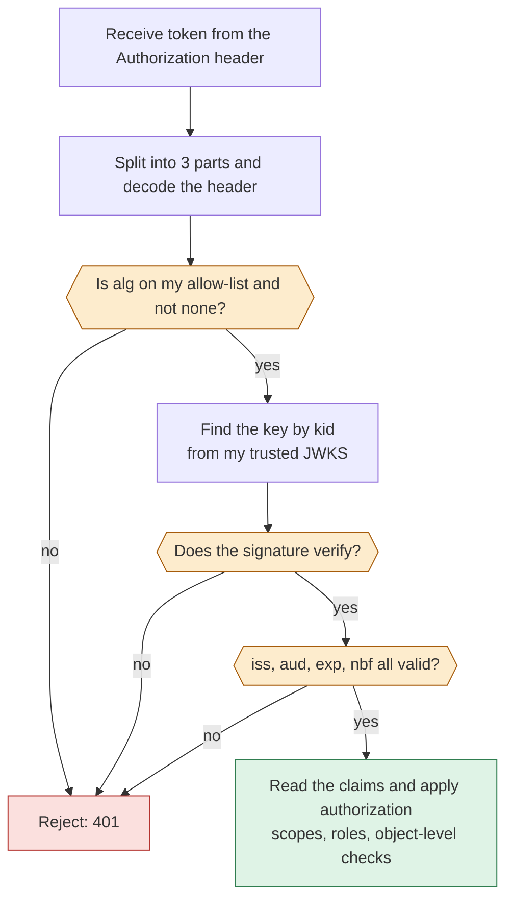

JWT (pronounced "jot") is the token format behind most modern API security: OAuth access tokens, OpenID Connect ID tokens and many session-less logins. Interviewers ask *what is inside a JWT, is it encrypted, HS256 vs RS256, how do you validate one, how do you revoke it, and what goes wrong?* This lesson builds on [signatures and HMAC](lesson:cryptography#signatures), the [sessions vs tokens comparison](lesson:authn-authz#session-vs-token), and is the token format used by [OAuth 2.0](lesson:oauth2#validate) and the [OIDC ID token](lesson:oidc#id-token). Play the three scenes: issue and verify, tampering attacks, and HS256 vs RS256.

```demo
name: jwt-walk
```

> **One sentence to remember:** *a JWT is three Base64URL parts, header.payload.signature: anyone can read it, only the key holder can sign it, and the receiver must verify the signature and the claims with algorithms and keys that it chose, not that the token chose.*

## What a JWT is {#what}

### The three parts {#structure}

A **JSON Web Token** (RFC 7519) is a compact, URL-safe string of three **Base64URL** parts separated by dots:

```text
eyJhbGciOiJSUzI1NiIsImtpZCI6ImsxIn0 . eyJzdWIiOiJhbGljZSIsInJvbGUiOiJhbmFseXN0IiwiZXhwIjoxNzk0NTAwMDAwfQ . Sx4pQ...
        header                                       payload                                            signature
```

| Part | Contents | Example (decoded) |
| --- | --- | --- |
| **Header** | token type, signing **algorithm** (`alg`) and the key id (`kid`) | `{"alg":"RS256","typ":"JWT","kid":"k1"}` |
| **Payload** | the **claims**: statements about the subject and the token | `{"sub":"alice","role":"analyst","exp":1794500000}` |
| **Signature** | signature over `base64url(header) + "." + base64url(payload)` | binary, Base64URL encoded |

Two facts to remember: the payload is **only encoded, not encrypted** (anyone can decode it, so never put passwords or secrets in it), and the signature protects **integrity and authenticity**, not secrecy. Base64URL is the Base64 alphabet with `-` and `_` and no padding, so it is safe in URLs and headers.

### JWS and JWE {#jws-jwe}

"JWT" is the claims format; how it is protected is defined by two related standards:

- **JWS** (JSON Web Signature): the token is **signed**. This is what people mean by JWT in 95% of cases (three parts).
- **JWE** (JSON Web Encryption): the token is **encrypted**, so the claims are hidden from everyone but the recipient (five parts). Use it when the claims themselves are sensitive and the token passes through untrusted parties. See [hybrid encryption](lesson:cryptography#hybrid): a content key encrypts the payload and is itself wrapped with the recipient's key.

A **JWK** is a key in JSON form; a **JWKS** is a set of them, published by the issuer so verifiers can fetch the public keys.

### Claims {#claims}

| Claim | Name | Meaning |
| --- | --- | --- |
| `iss` | issuer | who created the token (the identity provider URL) |
| `sub` | subject | who the token is about (stable user id) |
| `aud` | audience | who the token is **for** (the API or client id) |
| `exp` | expiration | after this time the token is invalid (seconds since epoch) |
| `nbf` | not before | not valid before this time |
| `iat` | issued at | when it was issued |
| `jti` | JWT id | unique id, for revocation lists and replay detection |

These are the **registered claims**. Anything else is a **public** or **private** claim (`role`, `scope`, `tenant`, `email`). Keep the payload small: it travels with every request, and a bigger token costs bandwidth and header space (many proxies limit headers to 8 KB).

## Signing algorithms {#algorithms}

### Choosing an algorithm {#choosing}

| Algorithm | Type | Key | Typical use |
| --- | --- | --- | --- |
| **HS256** (HMAC-SHA-256) | symmetric | one shared secret | one service that both issues and verifies |
| **RS256** (RSA, SHA-256) | asymmetric | private key signs, public key verifies | identity providers, many verifiers (widest support) |
| **PS256** (RSA-PSS) | asymmetric | same as RS | newer, preferred RSA padding |
| **ES256** (ECDSA P-256) | asymmetric | smaller keys and tokens | modern default for new systems |
| **EdDSA** (Ed25519) | asymmetric | small, fast | modern, supported by [Java 15+](lesson:java-version-history#java-15) |
| **none** | none | none | **never accept it** |

**The deciding question:** *who needs to verify tokens, and should they be able to create them too?* With **HS256** every verifier holds the secret and can therefore **forge** tokens: if any one service leaks it, all are compromised, and the secret must be long and random (at least 256 bits) or it can be brute-forced offline. With **RS256/ES256** only the issuer holds the private key and verifiers use a public key obtained from the issuer's **JWKS** endpoint. That is why identity providers use asymmetric algorithms, as in the third demo scene. See [HMAC vs signatures](lesson:cryptography#hmac).

### Key ids and rotation {#kid}

The header `kid` names the key that signed the token. The issuer publishes several public keys in its JWKS; verifiers pick the right one by `kid`, cache the set, and refetch when they meet an unknown `kid`. This lets the issuer **rotate keys** without downtime: publish the new key, start signing with it, keep the old public key until old tokens expire, then remove it.

## Validating a token {#validation}

### The checks, in order {#checks}



Do not skip any step, and do not trust the payload before the signature is verified. Allow a little **clock skew** (a few seconds) on `exp` and `nbf`. Use a maintained library (Nimbus JOSE + JWT, jjwt, Spring Security) rather than parsing yourself.

### The classic attacks {#attacks}

| Attack | How it works | Defence |
| --- | --- | --- |
| **Modified payload** | attacker edits the claims (role to admin) | signature check fails; always verify |
| **`alg: none`** | header says no signature and the library accepts it | reject `none`; allow-list algorithms |
| **Algorithm confusion** | server expects RS256, attacker sends HS256 signed with the *public key* as the HMAC secret | pin the algorithm to the key, never take it from the token |
| **Weak HS256 secret** | short or guessable secret is cracked offline from one token | 256-bit random secret, or use asymmetric keys |
| **`kid` / `jku` / `x5u` abuse** | header points at an attacker's key or URL (or injects into a file or SQL lookup) | only use keys from your own trusted JWKS; ignore `jku`/`x5u`; never use `kid` in a path or query |
| **Missing `aud` / `iss` check** | a token for another API or issuer is accepted | validate both |
| **No expiry or very long expiry** | a stolen token works forever | short `exp` plus refresh tokens |
| **Token theft (XSS, logs, URLs)** | token is replayed by someone else | `HttpOnly` cookies or in-memory storage, never in URLs or logs, short lifetime, TLS |
| **Sensitive data in the payload** | secrets are readable by anyone | keep claims minimal, or use JWE |

### Revocation {#revocation}

Self-contained tokens are valid until they expire, which is both their strength (no lookup) and their weakness (cannot be cancelled simply). Options: keep access tokens **short-lived** (5 to 15 minutes) and revoke the **refresh token** so no new ones are issued; keep a **deny list** of `jti` ids (or a per-user "valid after" timestamp) that services check, which reintroduces some state; or use **opaque tokens** with introspection for the most sensitive APIs. Details and trade-offs are in [OAuth token revocation](lesson:oauth2#q-revoke-q).

## Using JWTs {#using}

### Where to keep and send the token {#storage}

Send it as `Authorization: Bearer <token>` over **TLS**. In a browser, `localStorage` is readable by any injected script (XSS), while an `HttpOnly`, `Secure`, `SameSite` cookie cannot be read by script but needs CSRF protection (see [cookie flags](lesson:authn-authz#q-cookie-flags)). The safest pattern for a single-page app is a backend-for-frontend that holds the token and gives the browser a session cookie. Never put a JWT in a URL query string: it ends up in logs and browser history.

### When a JWT is a good fit, and when not {#fit}

Good: stateless APIs, microservices passing identity between services, short-lived access tokens, ID tokens. Not ideal: classic server-rendered sessions that need instant logout and revocation (use a server session), or storing large or sensitive data. "JWT instead of a session cookie" is not automatically better: you trade easy revocation for statelessness.

## In Java {#java}

### Creating and verifying with jjwt {#jjwt}

```java
// issuing (private key)
String token = Jwts.builder()
    .header().keyId("k1").and()
    .issuer("https://auth.example.com")
    .subject("alice")
    .audience().add("reports-api").and()
    .claim("role", "analyst")
    .issuedAt(new Date())
    .expiration(Date.from(Instant.now().plus(15, ChronoUnit.MINUTES)))
    .id(UUID.randomUUID().toString())
    .signWith(privateKey, Jwts.SIG.RS256)
    .compact();

// verifying (public key): signature, expiry, issuer and audience are checked
Jws<Claims> jws = Jwts.parser()
    .verifyWith(publicKey)                       // the key decides the algorithm family
    .requireIssuer("https://auth.example.com")
    .requireAudience("reports-api")
    .build()
    .parseSignedClaims(token);                   // throws JwtException if anything is wrong
String subject = jws.getPayload().getSubject();
```

### Verifying in Spring Security {#spring}

In a resource server Spring does the whole checklist for you, using the issuer's JWKS:

```java
@Bean
JwtDecoder jwtDecoder() {
    NimbusJwtDecoder decoder = NimbusJwtDecoder
        .withJwkSetUri("https://auth.example.com/.well-known/jwks.json")
        .jwsAlgorithm(SignatureAlgorithm.RS256)             // pin the algorithm
        .build();
    decoder.setJwtValidator(new DelegatingOAuth2TokenValidator<>(
        JwtValidators.createDefaultWithIssuer("https://auth.example.com"),   // signature, exp, nbf, iss
        new JwtClaimValidator<List<String>>("aud", a -> a != null && a.contains("reports-api"))));
    return decoder;
}
```

Roles and scopes become authorities through a `JwtAuthenticationConverter` (`scope` claim to `SCOPE_x` by default, custom claims such as `roles` to `ROLE_x`). The full filter chain is in the [Spring Security lesson](lesson:spring-security).

## Cheat sheet {#cheatsheet}

| Question | Answer |
| --- | --- |
| Structure | `header.payload.signature`, each Base64URL |
| Is it encrypted? | no (JWS), only signed; JWE is the encrypted form |
| Who can read it? | anyone who has the token |
| Who can forge it? | only holders of the signing key |
| HS256 vs RS256 | shared secret vs key pair: prefer asymmetric when several verify |
| Must validate | signature, `alg` allow-list, `iss`, `aud`, `exp`, `nbf` |
| Pick the key by | `kid` from your own trusted JWKS |
| Never accept | `alg: none`, algorithm chosen by the token |
| Revocation | short expiry, revoke refresh token, `jti` deny list |
| Registered claims | `iss sub aud exp nbf iat jti` |

## Interview questions {#questions}

### [basic] What is a JWT and what are its parts? {#what-is-jwt}

A JSON Web Token is a compact string of three Base64URL-encoded parts separated by dots: a **header** (algorithm, type, key id), a **payload** (claims such as `sub`, `iss`, `aud`, `exp` and custom ones) and a **signature** over header and payload. The receiver verifies the signature and claims and then trusts the data without calling the issuer.

### [basic] Is a JWT encrypted? {#encrypted-q}

No. A normal signed JWT (JWS) is only Base64URL **encoded**, so anyone holding it can read the claims; the signature prevents modification, not reading. Never store secrets in it. If you need confidentiality use a JWE (encrypted JWT), or keep sensitive data on the server and put only an identifier in the token.

### [basic] What are the registered claims `iss`, `sub`, `aud`, `exp`, `nbf`, `iat` and `jti`? {#claims-q}

`iss` the issuer, `sub` the subject (user id), `aud` the intended audience (which API or client the token is for), `exp` the expiry time, `nbf` the earliest valid time, `iat` the issue time and `jti` a unique token id used for revocation or replay checks. A verifier should check `iss`, `aud`, `exp` and `nbf` at least.

### [basic] What is the difference between HS256 and RS256? {#hs-vs-rs-q}

HS256 uses **one shared secret** for both signing and verifying (HMAC): fast and simple, but every verifier can also forge tokens, so it suits a single service that issues and verifies its own tokens. RS256 uses an **RSA key pair**: only the issuer's private key signs, and services verify with the public key, so a leak at a verifier cannot forge tokens. Identity providers and multi-service systems therefore use RS256 (or ES256, EdDSA).

### [basic] Where would you store a JWT in a browser app? {#storage-q}

Not in `localStorage` if you can avoid it: any XSS can read it. Better: in memory with short lifetimes and refresh, or in an `HttpOnly`, `Secure`, `SameSite` cookie (with CSRF protection), ideally issued by a backend-for-frontend so the browser never sees the access token. Never in a URL.

### [intermediate] How do you validate a JWT? {#validate-q}

Check the algorithm against an allow-list (reject `none`), select the key by `kid` from the issuer's trusted JWKS, **verify the signature**, then check `iss` equals the expected issuer, `aud` contains your API, and `exp` and `nbf` against the current time with small skew. Only then read the claims and apply authorization (scopes, roles, object-level checks). Use a library that does all of this.

### [intermediate] What is the `alg: none` attack? {#alg-none}

The header can claim `"alg":"none"` meaning "unsigned". A verifier that obeys the header would accept a token with an empty signature, so an attacker can write any claims. Prevention: the verifier chooses acceptable algorithms (an allow-list that excludes `none`) and always requires a valid signature; modern libraries reject `none` by default.

### [intermediate] What is the algorithm confusion attack? {#alg-confusion}

A server verifies tokens with an RSA public key (RS256). The attacker takes that public key, which is public, changes the header to HS256 and signs the token as an HMAC using the public key bytes as the secret. A library that selects the algorithm from the header uses the public key as an HMAC secret and accepts the forgery. Prevent by binding the algorithm to the key (an RSA key can only verify RS/PS algorithms) and never trusting the header's `alg`.

### [intermediate] How do you revoke a JWT? {#revoke-q}

You cannot cancel a self-contained token before `exp` without extra state, so design for it: short-lived access tokens (minutes) with revocable refresh tokens; a deny list of `jti` values or a per-user "tokens issued before" timestamp checked by services; key rotation to invalidate everything in an emergency; or opaque tokens with introspection for highly sensitive APIs. Each revocation check reintroduces some state, which is the trade-off to state.

### [intermediate] What is `kid`, and how does key rotation work? {#kid-q}

`kid` (key id) is a header that names the key used to sign. The issuer publishes its public keys in a JWKS, verifiers choose the key by `kid`, cache the set and refetch on an unknown `kid`. To rotate: add the new key to the JWKS, begin signing with it, keep the old public key until tokens signed with it have expired, then drop it. No downtime and no coordination with verifiers.

### [intermediate] What is the difference between JWS and JWE? {#jws-jwe-q}

JWS signs a token: integrity and authenticity, content readable, three parts. JWE encrypts it: confidentiality (and integrity), content readable only by the recipient, five parts (protected header, encrypted key, IV, ciphertext, tag). They can be nested (sign then encrypt). Most OAuth and OIDC tokens are JWS only.

### [intermediate] Are JWTs better than sessions? {#jwt-vs-session}

Not in general; they trade differently. JWTs are stateless and verifiable by any service with the public key, which suits microservices, mobile and cross-domain APIs, but they cannot be revoked easily, grow with their claims and, if stored in `localStorage`, expose XSS risk. Server sessions give instant revocation and small cookies but need shared state or sticky sessions. Choose by architecture, and often combine short-lived JWT access tokens with a server-side refresh or session.

### [deep] Why is a weak HS256 secret dangerous, even though the signature is "secure"? {#weak-secret}

HMAC verification needs no interaction with the issuer: an attacker who captures a single token can try millions of candidate secrets offline until one reproduces the signature, then forge any token. Short, human-chosen or default secrets (`secret`, `changeme`) fall in seconds. Use at least 256 random bits from a secure generator and store it in a secret manager, or avoid the problem with asymmetric keys.

### [deep] What risks come from the `jku`, `x5u` and `jwk` headers? {#jku}

These headers let a token tell the verifier **where to find the key** (a URL or an embedded key). If the verifier follows them, an attacker simply points to their own key and signs a valid-looking token. Verifiers must ignore these headers and use only keys from a configured, trusted JWKS URL (and pin the issuer), and treat `kid` as an opaque lookup key, never concatenating it into file paths or queries.

### [deep] How do you handle clock skew and the time claims? {#skew}

Services and the issuer have slightly different clocks, so a fresh token can appear not yet valid (`nbf`, `iat`) or just expired. Allow a small leeway (30 to 60 seconds at most) when checking `exp` and `nbf`, keep clocks synchronised with NTP, and keep lifetimes short so that leeway is negligible. Do not use a long leeway to hide clock problems, because it extends the useful life of a stolen token.

### [deep] How would you make an access token safe against theft? {#theft}

Minimise the damage window and bind the token: short lifetime; refresh token rotation with reuse detection; TLS everywhere; keep it out of URLs, logs and `localStorage`; restrict the audience and scopes; and for high-value APIs use sender-constrained tokens (DPoP or mTLS-bound) so a copied token is useless without the client's key. Detect abuse through monitoring of unusual use and revoke the refresh token on suspicion.

### [coding] What is wrong with this verification code? {#coding-bug}

```java
DecodedJWT jwt = JWT.decode(token);                       // decode only, no verification
String role = jwt.getClaim("role").asString();
if ("admin".equals(role)) {
    allowAdminAccess();
}
```

It only **decodes** the token (Base64URL) and never checks the signature, so anybody can craft a token with `role=admin`. It also skips issuer, audience and expiry. Fix by verifying with a configured verifier before reading any claim:

```java
Algorithm alg = Algorithm.RSA256(publicKey, null);        // algorithm and key fixed by the server
DecodedJWT jwt = JWT.require(alg)
    .withIssuer("https://auth.example.com")
    .withAudience("reports-api")
    .build()
    .verify(token);                                       // throws JWTVerificationException on any failure
```

### [coding] Issue a short-lived token with HS256 correctly. {#coding-hs256}

```java
byte[] secret = Base64.getDecoder().decode(System.getenv("JWT_SECRET_B64"));   // 32+ random bytes from a secret manager
SecretKey key = Keys.hmacShaKeyFor(secret);

String token = Jwts.builder()
    .subject("alice")
    .issuer("orders-service")
    .claim("role", "analyst")
    .issuedAt(new Date())
    .expiration(Date.from(Instant.now().plusSeconds(600)))
    .signWith(key)                                        // jjwt picks HS256/384/512 from the key length
    .compact();

Claims claims = Jwts.parser().verifyWith(key).requireIssuer("orders-service").build()
    .parseSignedClaims(token).getPayload();
```

Mention: only one service should both issue and verify with HS256; the secret is random and not hard-coded or derived from a password; expiry is short; and if other services must verify, switch to an asymmetric algorithm.

### [coding] Read roles from a JWT claim in Spring Security. {#coding-roles}

```java
@Bean
JwtAuthenticationConverter jwtAuthConverter() {
    JwtGrantedAuthoritiesConverter roles = new JwtGrantedAuthoritiesConverter();
    roles.setAuthoritiesClaimName("roles");                // custom claim, e.g. ["ADMIN", "ANALYST"]
    roles.setAuthorityPrefix("ROLE_");
    JwtAuthenticationConverter converter = new JwtAuthenticationConverter();
    converter.setJwtGrantedAuthoritiesConverter(roles);
    return converter;
}

// in the filter chain
http.oauth2ResourceServer(o -> o.jwt(j -> j.jwtAuthenticationConverter(jwtAuthConverter())));
```

After this `hasRole("ADMIN")` and `@PreAuthorize("hasRole('ADMIN')")` work from the token's `roles` claim; the converter runs only after Spring has validated the signature, issuer and expiry.
