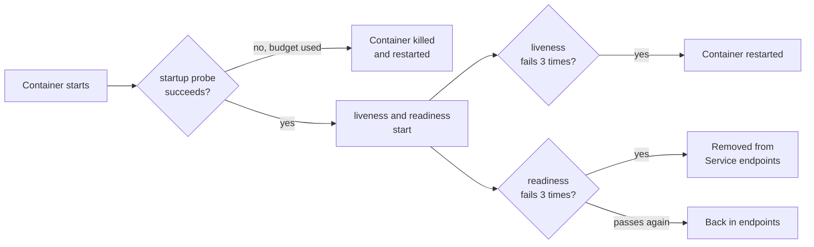

"What is the difference between a readiness and a liveness probe?" is the first question; the interviews that matter go on: *what exactly does a failed readiness probe change, why did our rolling update stall, why do all pods restart when the database is down, how do you size a startup probe for a slow JVM, what happens between SIGTERM and the pod disappearing, and how do you debug a pod that is Running but not Ready?* The [Kubernetes lesson](lesson:kubernetes#probes) has the short version; this lesson is the detail, and it ties to [Spring Boot health probes](lesson:spring-observability#health), [deployment strategies](lesson:deployment-strategies) and [microservice resilience](lesson:microservice-resilience).

> **One sentence to remember:** *A probe is a question the kubelet asks a container on a timer: **startup** asks "have you finished starting?", **liveness** asks "should I restart you?" and **readiness** asks "should I send you traffic?"; each answer changes a different thing, so each probe must check a different, carefully chosen condition.*

## The pod lifecycle {#lifecycle}

A pod has a **phase**, its containers have a **state**, and the pod has **conditions**. Probes feed the conditions.

| Level | Values | Meaning |
| --- | --- | --- |
| Pod **phase** | `Pending`, `Running`, `Succeeded`, `Failed`, `Unknown` | coarse stage: scheduled? at least one container running? finished? |
| Container **state** | `Waiting`, `Running`, `Terminated` | what the container is doing, with a reason (`ContainerCreating`, `CrashLoopBackOff`, `OOMKilled`) |
| Pod **conditions** | `PodScheduled`, `Initialized`, `ContainersReady`, **`Ready`** | each is `True`, `False` or `Unknown` |

Two points that cause confusion:

- **`Running` does not mean working.** It only means the container process started. The `READY 1/1` column and the `Ready` condition are what readiness controls.
- **`Ready`** is true when all containers are ready (and every **readiness gate**, a custom condition set by an external controller such as the AWS load balancer controller, is true). A container without a readiness probe is ready as soon as it **starts**: it receives traffic before the application can serve it.

The order for one pod: scheduled, **init containers** run to completion one by one, the app containers start, the **startup probe** runs until it succeeds, then **liveness** and **readiness** run for the rest of the container's life.

Try it in the lab: [From start to Ready](lab:k8s-probe-timeline).

## How a probe works {#mechanism}

The **kubelet on the pod's node** runs every probe, on its own timer, **independently of the Deployment and the Service**. It runs one of four handlers:

| Handler | Success means | Notes |
| --- | --- | --- |
| **`httpGet`** | status code from **200 to 399** | sent from the node to the pod IP; 401, 404, 500 and 503 all fail; the app must listen on `0.0.0.0`, not only `localhost` |
| **`tcpSocket`** | the TCP connection opens | proves only that something listens, nothing about health |
| **`exec`** | the command exits with **0** | starts a process in the container each time: costly at a short period, and it needs the tool inside the image |
| **`grpc`** | the standard gRPC health check answers `SERVING` | for gRPC services, no extra binary needed |

### The settings and their defaults {#settings}

| Setting | Meaning | Default |
| --- | --- | --- |
| `initialDelaySeconds` | wait after the container starts before the first probe | 0 |
| `periodSeconds` | how often to probe | 10 |
| `timeoutSeconds` | how long to wait for an answer before counting a failure | **1** |
| `successThreshold` | consecutive successes to count as healthy again | 1 (**must be 1** for liveness and startup) |
| `failureThreshold` | consecutive failures to count as unhealthy | **3** |
| `terminationGracePeriodSeconds` (per probe) | grace period used when this probe's failure kills the container | the pod's value |

The result changes only after `failureThreshold` **consecutive** failures, so with the defaults a dead container is detected after about **30 seconds** (3 failures × 10 s). A **timeout counts as a failure**, and one second is a short timeout for a JVM that is paused by garbage collection or a CPU-throttled container.

```yaml
readinessProbe:
  httpGet:
    path: /actuator/health/readiness
    port: 8080
    httpHeaders: [{ name: Accept, value: application/json }]
  periodSeconds: 5
  timeoutSeconds: 2
  failureThreshold: 3
  successThreshold: 1
```

## The three probes {#three}



| Probe | Asks | While it fails | When it fails enough |
| --- | --- | --- | --- |
| **Startup** | has the application finished starting? | liveness and readiness are **not run** yet | the container is **killed** and restarted |
| **Liveness** | is the process stuck beyond recovery? | nothing visible | the container is **restarted** (the pod stays) |
| **Readiness** | can it serve requests right now? | `Ready=False`, pod **out of the Service** | nothing is restarted; it keeps running and is probed again |

### Startup probe {#startup}

It exists for **slow starts**. While it has not succeeded, liveness and readiness do not run, so a JVM that needs 90 seconds to start is not killed by a liveness probe that expected an answer in 30. Its **budget** is `failureThreshold × periodSeconds`:

```yaml
startupProbe:
  httpGet: { path: /actuator/health/liveness, port: 8080 }
  periodSeconds: 2
  failureThreshold: 60        # up to 120 s to start; a fast start passes after the first success
```

Prefer this to a big `initialDelaySeconds` on liveness: a fixed delay always waits the full time, while a startup probe lets a fast start continue **as soon as it succeeds** and still allows a slow one. Size the budget to the **slowest realistic start** (cold node, image pull excluded, busy cluster) plus margin.

### Liveness probe {#liveness}

It answers one question: *is this process in a state it can never recover from by itself?* (a deadlock, a stuck event loop, an exhausted thread pool that does not clear). The remedy is a restart, so check **only the process itself**:

- **Do not** check the database, a queue or another service. When that dependency is down every pod fails liveness together and the platform **restarts all of them**, turning a database outage into a full outage with a restart storm on top.
- **Do not** make it heavy or dependent on load: a check that fails under high traffic restarts the pods that were holding the load, which pushes the rest further over.
- A **simple, fast, local** check is right: "the application context is up and the request threads can answer".

Try it in the lab: [Restarts that make things worse](lab:k8s-liveness-loop).

### Readiness probe {#readiness}

It answers *should this pod receive traffic **now**?* and it is **continuous**: a pod can become unready and ready again many times without restarting.

When a pod is not ready:

- its IP is **removed from the Service's `EndpointSlice`** (the `ready` condition is false), so `kube-proxy` and the Ingress controller stop routing to it. Existing connections are not necessarily cut, new ones go elsewhere;
- it is **not counted as available** by a Deployment, so a **rolling update** waits for it ([below](#rollouts));
- it is not counted as healthy by a **PodDisruptionBudget**.

What to put in it: the application is started, **warmed up** (caches, connection pools) and the dependencies **it cannot work at all without**. Be careful with the last point. If readiness checks a shared dependency such as the database, an outage there makes **every** pod unready at once, the Service has **no endpoints**, and requests that could have been served from cache or with a degraded answer get a connection error instead. Use readiness for **this pod's own ability**, and use [resilience patterns](lesson:resilience4j) (circuit breakers, fallbacks) for dependency failures.

A pod also uses readiness **on purpose** to leave traffic: during **graceful shutdown** the application reports not-ready first.

### Which probe for which problem {#choose}

| Situation | Probe |
| --- | --- |
| JVM needs 60 to 120 s to start | startup |
| Deadlocked process that answers nothing | liveness |
| Warming caches after start | readiness |
| Temporary overload, shed traffic for a while | readiness |
| Database is down | **neither**: circuit breaker and fallback |
| Draining before shutdown | readiness (and `preStop`) |

## Spring Boot and the probes {#spring}

Spring Boot Actuator models both questions as **availability states** and exposes them as **health groups**. On Kubernetes they are enabled automatically (otherwise `management.endpoint.health.probes.enabled=true`):

| State | Values | Endpoint |
| --- | --- | --- |
| `LivenessState` | `CORRECT`, `BROKEN` | `/actuator/health/liveness` |
| `ReadinessState` | `ACCEPTING_TRAFFIC`, `REFUSING_TRAFFIC` | `/actuator/health/readiness` |

```yaml
management:
  endpoint:
    health:
      probes:
        enabled: true
        add-additional-paths: true        # also /livez and /readyz on the main port
      group:
        liveness:
          include: livenessState          # only the process: no database, no other service
        readiness:
          include: readinessState         # add "db" only if this pod really cannot work without it
  server:
    port: 9090                            # optional: probes on their own port and thread pool
server:
  shutdown: graceful
spring:
  lifecycle:
    timeout-per-shutdown-phase: 25s
```

- **Readiness goes `REFUSING_TRAFFIC`** when graceful shutdown starts, and **while the application is still starting**, so `/readiness` returns `503` until the context is ready.
- Application code can change the state: `AvailabilityChangeEvent.publish(context, LivenessState.BROKEN)` tells Kubernetes to restart this instance, for a failure only a restart can fix (for example a corrupted internal state). Publishing `REFUSING_TRAFFIC` sheds traffic while it recovers.
- A **separate management port** keeps probes working when request threads are saturated, but then a pod can pass its probe while the **real** port is stuck: decide which risk you prefer, and keep the probe on the path that real traffic uses when in doubt.
- Probe endpoints must **not need authentication**: a `401` is a failure. Permit them in Spring Security.

Try it in the Spring lesson: [Health and probes](lesson:spring-observability#health).

## Probes and rollouts {#rollouts}

A Deployment treats a new pod as **available** only when it is **Ready** (and has stayed so for `minReadySeconds`). With `maxUnavailable: 0` it removes an old pod only after a new one is available.

That makes the **readiness probe the gate of a release**:

- A good new version becomes ready, and old pods are replaced one by one with no gap.
- A **broken new version never becomes ready** (it starts but fails its dependency, or reads a bad config). The rollout **stalls** with the old pods still serving all traffic. Users see nothing; `kubectl rollout status` waits; after `progressDeadlineSeconds` (600 s by default) the Deployment is marked `ProgressDeadlineExceeded`. Kubernetes does **not** roll back by itself: `kubectl rollout undo` or the pipeline does.
- With **no readiness probe**, the new pods count as available when the containers **start**, the old ones are removed, and a broken version takes all the traffic.
- `minReadySeconds` makes a pod stay ready for N seconds before it counts, so a pod that becomes ready and then crashes does not pass the gate.

Try it in the lab: [A broken release that never becomes Ready](lab:k8s-readiness-rollout).

## Graceful shutdown {#shutdown}

When a pod is deleted (a rollout, a scale-down, a node drain), two things start **at the same moment**, and they are **not coordinated**:

1. The pod is marked `Terminating` and removed from the Service endpoints. Controllers and proxies on every node learn that **after a delay** (a second or several).
2. The kubelet runs the **`preStop` hook**, then sends `SIGTERM` to the container, and after **`terminationGracePeriodSeconds`** (30 by default) sends `SIGKILL`.

The race: if the application exits on `SIGTERM` at once, for a moment some proxies **still route** to it and those requests fail with connection errors. The fix has three parts:

```yaml
spec:
  terminationGracePeriodSeconds: 45
  containers:
    - name: payments
      lifecycle:
        preStop:
          exec: { command: ["sleep", "10"] }     # keep serving while the endpoint removal spreads
```

- **`preStop` sleep** (about 5 to 10 s) delays `SIGTERM` until the endpoint removal has propagated;
- **`server.shutdown=graceful`** makes Spring stop accepting new connections, report readiness `REFUSING_TRAFFIC`, and **finish in-flight requests** within `timeout-per-shutdown-phase`;
- the **grace period** must cover `preStop` + the shutdown phase (`10 + 25 < 45`), otherwise `SIGKILL` cuts requests off.

Also close the rest: consumers stop polling, scheduled jobs stop, and the connection pool drains. A pod that ignores `SIGTERM` (a shell script as `PID 1` that does not forward signals) is always killed after the full grace period, which makes every rollout slow.

Try it in the lab: [Terminating without dropping requests](lab:k8s-graceful-shutdown).

## Tuning and sizing {#tuning}

- **Timeout.** Set `timeoutSeconds` above the **99th percentile** of the endpoint under load (usually 2 to 5 s), not the default 1 s. CPU **throttling** (a low CPU limit) and **garbage-collection pauses** are the usual reasons a healthy pod misses a 1 s probe.
- **Period and threshold.** Liveness `periodSeconds` 10 with `failureThreshold` 3 means 30 s to notice a hang, which is slow enough to ride out a pause and fast enough to recover. Readiness may be quicker (5 s) so a bad pod leaves traffic soon.
- **Startup budget.** `failureThreshold × periodSeconds` ≥ the slowest start, with margin.
- **Probe cost.** A probe runs every few seconds on every pod: it must be **cheap** (no database query on every call, no heavy health indicators; cache the result).
- **Thread pool.** If probes share the request thread pool, a saturated service **fails its probes** and gets restarted exactly when it is busiest. Keep the endpoint trivial, or serve it on a separate port.
- **Same endpoint for both?** Different **paths** for liveness and readiness. The same path for both makes them fail together and is the most common mistake.

## When probes make things worse {#failures}

| Symptom | Likely cause | Fix |
| --- | --- | --- |
| `CrashLoopBackOff`, events say `Liveness probe failed` | liveness too strict, a slow start without a startup probe, or the timeout too short | add a startup probe, raise `timeoutSeconds` and `failureThreshold` |
| Restarts at peak traffic, then more restarts | liveness depends on load, thread pool or CPU | check only the process; separate port; raise the CPU limit |
| Pod `Running`, `READY 0/1` forever | readiness failing: wrong path or port, a dependency missing, the app bound to `localhost` | `kubectl describe pod` events, call the endpoint with `kubectl exec` or `port-forward` |
| Every pod becomes unready when the database is down | readiness includes the database | readiness only for the pod's own state; use a circuit breaker and fallback |
| Probe returns `401` | the health endpoint is behind authentication | permit the probe paths |
| Rollout stalls | the new pods never become ready (bad config, missing dependency, wrong probe) | `kubectl rollout status`, describe the new pods, `kubectl rollout undo` |
| Errors during every deploy | no `preStop` delay, `SIGTERM` handled badly, a grace period that is too short | `preStop` sleep, graceful shutdown, grace period above the sum |
| Slow rollouts: every pod takes 30 s to stop | the process ignores `SIGTERM` and waits for `SIGKILL` | run the app as PID 1 or use `exec`, handle the signal |

```text
kubectl describe pod payments-7d9f8   -> Events: "Readiness probe failed: HTTP probe failed with statuscode: 503"
kubectl get endpointslices -l kubernetes.io/service-name=payments   -> which pod IPs are ready
kubectl get pod payments-7d9f8 -o jsonpath='{.status.conditions}'    -> the condition that is False
kubectl logs payments-7d9f8 --previous                               -> why the last container died
kubectl port-forward payments-7d9f8 8080  then  curl localhost:8080/actuator/health/readiness
```

## Related pieces {#related}

- **Init containers** run before the app containers and must finish; **native sidecars** (an init container with `restartPolicy: Always`) keep running and can have their own startup probe.
- **PodDisruptionBudget** counts **ready** pods: a node drain waits when evicting would drop below the budget, so a broken readiness probe can block maintenance.
- **HorizontalPodAutoscaler** scales on pod metrics, and pods that are not ready are treated carefully to avoid scaling on startup noise.
- **Cloud load balancers** have their own health check (an ALB target group check) which is **separate** from readiness: use a **readiness gate** or point both at the same path so a pod is not in rotation before the balancer has registered it. See [AWS networking](lesson:aws-networking).
- On **OpenShift** the same probes apply; see [OpenShift](lesson:openshift).

## A routine for a bank team {#routine}

1. **Every service has a startup, a readiness and a liveness probe**, each on the right path.
2. **Liveness checks only the process**, never a dependency.
3. **Readiness checks the pod's own ability**; dependency failures are handled by circuit breakers and fallbacks.
4. **Startup budget sized** for the slowest start, instead of a long `initialDelaySeconds`.
5. **`timeoutSeconds` above the p99**, not 1 s; the endpoint is cheap and not behind authentication.
6. **`preStop` sleep, graceful shutdown and a grace period** that covers both.
7. **`maxUnavailable: 0`**, a sensible `minReadySeconds`, and a pipeline that waits on `kubectl rollout status` and rolls back on failure.
8. **Alerts** on `kube_pod_container_status_restarts_total`, pods not ready, and `ProgressDeadlineExceeded`.

## Cheat sheet {#cheatsheet}

| Need | Setting |
| --- | --- |
| Slow application start | `startupProbe` with `failureThreshold × periodSeconds` |
| Restart a hung process | `livenessProbe` (process only) |
| Stop sending traffic | `readinessProbe` |
| Probe handlers | `httpGet` (200 to 399), `tcpSocket`, `exec` (exit 0), `grpc` |
| Defaults | period 10, timeout 1, failure 3, success 1, delay 0 |
| Time to detect with defaults | about 30 s |
| Spring endpoints | `/actuator/health/liveness`, `/actuator/health/readiness` |
| Spring states | `CORRECT`/`BROKEN`, `ACCEPTING_TRAFFIC`/`REFUSING_TRAFFIC` |
| Zero-downtime gate | readiness + `maxUnavailable: 0` + `minReadySeconds` |
| Shutdown order | `preStop` → `SIGTERM` → grace period → `SIGKILL` |
| Who is ready | `kubectl get endpointslices`, `kubectl describe pod` |
| Rollout stuck | `kubectl rollout status`, `kubectl rollout undo` |

## Interview questions {#questions}

### [basic] What are the three kinds of probe and what does each one do on failure? {#three-q}

Startup checks that the application has finished starting; until it passes, the other two do not run, and if it never passes the container is killed and restarted. Liveness checks that the process is not stuck; on failure the container is restarted. Readiness checks that it can serve traffic now; on failure the pod is removed from the Service endpoints, and nothing restarts.

### [basic] What are the probe handlers? {#handlers-q}

`httpGet` (success is a status from 200 to 399), `tcpSocket` (the connection opens), `exec` (the command exits with 0) and `grpc` (the gRPC health check returns `SERVING`). HTTP is the usual choice; TCP only proves that something is listening, and exec starts a process on every probe.

### [basic] What are the default probe settings? {#defaults-q}

`initialDelaySeconds` 0, `periodSeconds` 10, `timeoutSeconds` 1, `successThreshold` 1 and `failureThreshold` 3. So a hung container is noticed after about 30 seconds, and a 1 second timeout is easy to miss under garbage collection or CPU throttling, so it is often raised.

### [basic] A pod shows `Running` but `0/1` Ready. What does it mean and what do you check? {#notready-q}

The container started but its readiness probe is failing, so the pod is not in the Service endpoints. `kubectl describe pod` shows the probe failure in the events (status code or connection refused); check the path and port, whether the app listens on `0.0.0.0`, dependencies and configuration, and call the endpoint through `port-forward`.

### [intermediate] Why use a startup probe instead of a large `initialDelaySeconds`? {#startup-q}

A fixed delay always waits the full time, so every fast start is held back, and if the application is slower than the delay, liveness starts too early and kills it in a loop. A startup probe polls and lets the container continue as soon as it succeeds, while still allowing up to `failureThreshold × periodSeconds` for a slow start, with liveness and readiness held back meanwhile.

### [intermediate] Why must liveness not check the database? {#liveness-db-q}

If the database is down, every pod fails liveness at the same time and Kubernetes restarts all of them. The restart does not fix the database, it removes the capacity that could have served requests that did not need it, and a restart storm follows when it comes back. Liveness checks only the process; dependency problems belong to readiness (carefully) or to circuit breakers and fallbacks.

### [intermediate] Should readiness include the database? {#readiness-db-q}

Only if the pod really cannot do any useful work without it, and even then with care. Because all pods share the dependency, an outage makes all of them unready, the Service has no endpoints and every request fails at once, even those that could have been served from a cache or degraded. Prefer readiness for the pod's own state and handle the dependency with a circuit breaker and a fallback.

### [intermediate] What exactly changes in the cluster when a readiness probe fails? {#readiness-effect-q}

The pod's `Ready` condition becomes false, its address is marked not ready in the Service's EndpointSlice, so `kube-proxy` and the Ingress controller stop sending new connections to it. The container keeps running and keeps being probed, and when the probe passes again it returns to the endpoints. It is also not counted as available by the Deployment or the PodDisruptionBudget.

### [intermediate] How do probes affect a rolling update? {#rollout-q}

A new pod counts as available only when it is Ready (and has stayed so for `minReadySeconds`), and with `maxUnavailable: 0` an old pod is removed only after that. So readiness gates the release: a broken version never becomes ready, the rollout stalls, and the old pods keep serving until the progress deadline marks the Deployment failed. Without a readiness probe, the new pods count as soon as they start and a broken version takes the traffic.

### [intermediate] What does Spring Boot provide for Kubernetes probes? {#spring-q}

Availability states and health groups: `/actuator/health/liveness` backed by `LivenessState` and `/actuator/health/readiness` backed by `ReadinessState`, enabled automatically on Kubernetes. Readiness is `REFUSING_TRAFFIC` while starting and during graceful shutdown. The groups can be changed (`management.endpoint.health.group.readiness.include`), the application can publish a state change, and the endpoints should be unauthenticated and, if wanted, on a separate management port.

### [intermediate] What happens between "delete pod" and the pod being gone? {#shutdown-q}

The pod becomes `Terminating` and is removed from the endpoints, while at the same time the kubelet runs `preStop` and then sends `SIGTERM`. After `terminationGracePeriodSeconds` it sends `SIGKILL`. The two start together and are not coordinated, so proxies may still send requests for a moment after `SIGTERM`: a short `preStop` sleep, graceful shutdown in the application and a grace period larger than their sum avoid dropped requests.

### [intermediate] Why do requests fail during every deployment even with readiness probes? {#deploy-errors-q}

Usually the shutdown race: the application exits on `SIGTERM` immediately while some nodes still route to it. Add a `preStop` sleep, enable graceful shutdown so in-flight requests finish and readiness reports not-ready, and set a grace period that covers both. Also check that the process receives the signal (PID 1) and that connections are closed cleanly.

### [deep] Pods restart under heavy load and it gets worse. Diagnose it. {#loop-q}

Liveness (or the timeout) is failing under load: the probe shares the saturated request thread pool or the CPU is throttled or garbage collection pauses, so a healthy but busy pod misses its 1 second timeout three times and is restarted. The remaining pods take its load and fail too. Confirm from the events (`Liveness probe failed: context deadline exceeded`), then keep liveness trivial and independent of load, raise `timeoutSeconds` and `failureThreshold`, serve the probe from a separate port, fix the CPU limits, and scale on load instead.

### [deep] A new version is released and the rollout hangs with the old pods still serving. What happened and what do you do? {#stuck-q}

The new pods never pass readiness (bad config, missing secret, a dependency or a wrong probe path), so with `maxUnavailable: 0` Kubernetes keeps the old pods. That is the safety working. Look at `kubectl rollout status`, describe the new pods and their events and logs, then fix forward or `kubectl rollout undo`. The pipeline should wait with a timeout and roll back automatically, because Kubernetes only marks `ProgressDeadlineExceeded` and does not undo.

### [deep] How would you set the probes for a Spring Boot service that needs 90 seconds to start? {#size-q}

A startup probe on the liveness endpoint with `periodSeconds: 5` and `failureThreshold: 30` (up to 150 s), then liveness with period 10, timeout 3 and threshold 3, and readiness with period 5, timeout 3 and threshold 3 on `/readiness`. Add `server.shutdown=graceful`, a `preStop` sleep of about 10 seconds and a grace period of 45 or more. Liveness includes only `livenessState`, and the service has no dependency checks in either group unless it truly needs them.

### [deep] How do readiness probes relate to the load balancer's own health check? {#lb-q}

They are separate mechanisms. Readiness controls the Kubernetes Service endpoints; a cloud load balancer (an ALB target group) has its own check and registration time, and during a rollout a pod can be Ready before the balancer sends traffic to it, or leave before it is deregistered. Use a **readiness gate** from the load balancer controller, a `preStop` delay that covers the deregistration delay, and the same path for both checks where possible.

### [coding] Write the probes for a Spring Boot service with a slow start and graceful shutdown. {#coding-probes}

```yaml
spec:
  terminationGracePeriodSeconds: 45
  containers:
    - name: payments
      image: registry.example/bank/payments:1.4
      ports: [{ containerPort: 8080 }]
      startupProbe:
        httpGet: { path: /actuator/health/liveness, port: 8080 }
        periodSeconds: 5
        failureThreshold: 30          # up to 150 s
      livenessProbe:
        httpGet: { path: /actuator/health/liveness, port: 8080 }
        periodSeconds: 10
        timeoutSeconds: 3
        failureThreshold: 3
      readinessProbe:
        httpGet: { path: /actuator/health/readiness, port: 8080 }
        periodSeconds: 5
        timeoutSeconds: 3
        failureThreshold: 3
      lifecycle:
        preStop:
          exec: { command: ["sleep", "10"] }
```

```yaml
management:
  endpoint:
    health:
      probes: { enabled: true }
      group:
        liveness:  { include: livenessState }
        readiness: { include: readinessState }
server:
  shutdown: graceful
spring:
  lifecycle:
    timeout-per-shutdown-phase: 25s
```

Explain: the startup probe allows 150 seconds and holds the other two back; liveness checks only the process state and tolerates a 3 second pause; readiness controls traffic and flips to not-ready on shutdown; the grace period covers the 10 second `preStop` plus the 25 second shutdown phase; and the probe paths are not behind authentication.

### [coding] A pod restarts every few minutes. Which commands do you run and what do you look for? {#coding-debug}

```text
kubectl get pod payments-7d9f8                              # RESTARTS count and STATUS
kubectl describe pod payments-7d9f8                         # Events, Last State, Exit Code, probe failures
kubectl logs payments-7d9f8 --previous                      # output of the container that died
kubectl get pod payments-7d9f8 -o jsonpath='{.status.containerStatuses[0].lastState}'
kubectl top pod payments-7d9f8                              # CPU throttling or memory near the limit
```

Explain how to read it: `Liveness probe failed` in the events means the probe killed it, so check its path, timeout and load; `Exit Code: 137` with `OOMKilled` means the memory limit; exit code 1 or a stack trace in `--previous` means the application crashed; `Startup probe failed` means the budget is too small; and a restart exactly at peak traffic points to probe timeouts under load.
