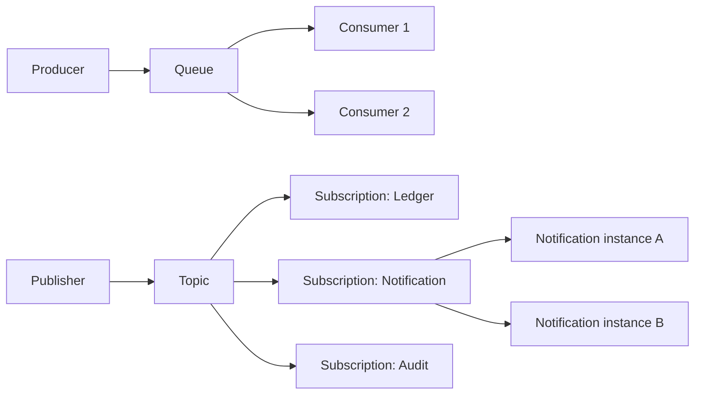
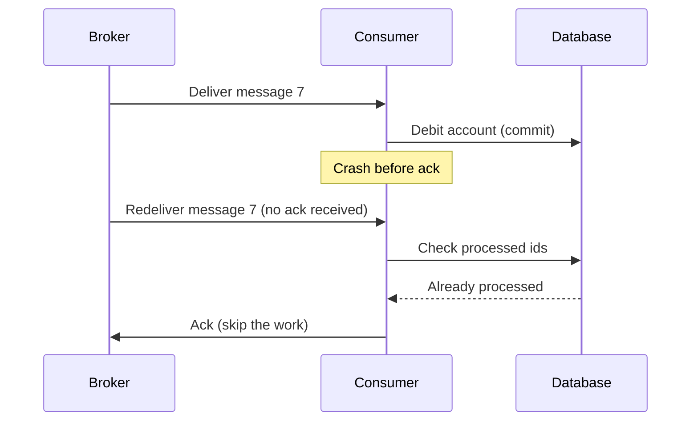

Almost every microservice interview includes "how do your services talk asynchronously, and what happens when a message is lost, duplicated or arrives out of order?" The answer does not depend on a product: RabbitMQ, ActiveMQ, Amazon SQS/SNS, Azure Service Bus, Google Pub/Sub, Pulsar and Kafka all share the same ideas. This lesson teaches those ideas first and treats specific brokers as implementations. It deepens the [asynchronous communication section](lesson:microservice-patterns#sync-async) of the patterns lesson and is the foundation for the [outbox pattern](lesson:microservice-patterns#outbox), [sagas](lesson:saga) and [reliable job queues](lesson:distributed-scheduler#skip-locked). Examples use a banking-style system. Play the four scenes: queue vs publish/subscribe, acknowledgement and duplicates, retries and dead letters, and ordering.

```demo
name: messaging-walk
```

> **One sentence to remember:** *messaging decouples services in time and load, at the price of duplicates, reordering and eventual consistency, so design consumers to be idempotent, order-tolerant and observable, and give failing messages somewhere to go.*

## Why messaging {#why}


### What it buys and what it costs {#tradeoffs}

A **message broker** sits between a **producer** (sender) and one or more **consumers** (receivers) and stores messages until they are handled. Compared with calling a service directly:

| Benefit | Meaning |
| --- | --- |
| **Temporal decoupling** | the consumer can be down or slow; the producer does not wait or fail |
| **Load leveling** | a burst fills the queue and consumers work through it at their own pace |
| **Fan-out** | one event can feed many consumers without the producer knowing them |
| **Resilience** | the broker buffers during outages and enables retries |
| **Independent scaling** | add consumers to increase throughput |

| Cost | Meaning |
| --- | --- |
| **Eventual consistency** | the result is not available when the producer's call returns |
| **Duplicates and reordering** | normal behaviour, must be designed for |
| **Harder debugging** | no single call stack; need correlation ids and tracing |
| **Operations** | the broker is critical infrastructure to run and monitor |
| **No immediate answer** | request-reply needs extra design |

Use messaging for notifications, propagating changes, long or heavy work, and integration between bounded contexts. Use synchronous calls when the caller needs the answer now.

### Commands, events and documents {#message-types}

| Kind | Meaning | Receivers | Naming |
| --- | --- | --- | --- |
| **Command** | "do this" (an intent that can be rejected) | one | imperative: `DebitAccount` |
| **Event** | "this happened" (a fact, cannot be rejected) | any number | past tense: `AccountDebited` |
| **Document / query reply** | data being transferred, a response | one | noun: `StatementReady` |

Events decouple best: the publisher announces a fact and does not care who reacts. Commands couple the sender to a specific receiver's capability, so use them when you need one service to act (as in an orchestrated [saga](lesson:saga#orchestration)).

### Anatomy of a message {#anatomy}

A message has a **payload** (the body, often JSON or Avro) and **headers/metadata**: a unique **message id** (for deduplication), a **correlation id** (to tie a reply or a whole flow together), a type and schema version, a timestamp, a routing key or **partition key**, and optional reply-to and expiry. The id and correlation id are what make idempotency and tracing possible.

## Models and brokers {#models}


### Queue and publish/subscribe {#queue-pubsub}



- **Point-to-point (queue):** each message is processed by exactly **one** consumer. Several consumers on the same queue are **competing consumers**: this is how you scale work.
- **Publish/subscribe (topic):** each message is delivered to **every subscription**. Each subscriber has its own copy; the instances of one subscriber share it (a **consumer group**), so it combines fan-out and scaling.
- **Routing:** brokers route by exchange and binding rules (direct, topic pattern, fanout, headers) or by topic name. Content-based routing lets a router pick the destination from the message.
- **Request-reply:** the requester sends a message with a **reply-to** queue and a **correlation id**, and matches the reply by that id. Use sparingly; a synchronous call is often simpler.

### Queue brokers and log brokers {#broker-types}

| | Queue-style broker | Log-style broker |
| --- | --- | --- |
| Examples | RabbitMQ, ActiveMQ, SQS, Azure Service Bus | Kafka, Pulsar, Kinesis |
| After consumption | message is **removed** once acknowledged | message **stays** in a retained log; consumers track their position (offset) |
| Replay | not normally | yes: re-read history, rebuild state, add new consumers later |
| Ordering | per queue (broken by competing consumers) | per partition |
| Routing | rich (exchanges, filters, priorities, per-message TTL) | simple (topic and partition key) |
| Per-message features | delays, priorities, dead-letter built in | consumers implement retries and parking themselves |
| Typical fit | task distribution, workflows, request routing | event streaming, high throughput, audit, replay, analytics |

Neither is better: pick by the need for **replay and throughput** (log) or **rich routing and per-message handling** (queue). Cloud brokers (SQS plus SNS, Pub/Sub) blur the lines. The rest of this lesson applies to both.

### Choosing messaging or REST {#choose}

| Situation | Prefer |
| --- | --- |
| The caller needs a result now | synchronous (REST, gRPC) |
| Fire and forget, notifications | messaging |
| Spikes of work, background processing | queue |
| Several services react to one fact | publish/subscribe events |
| Services must keep working while another is down | messaging |
| Strong, immediate consistency across data | avoid: restructure, or accept eventual consistency |

## Reliability {#reliability}

### Delivery guarantees {#delivery}

| Guarantee | Meaning | How |
| --- | --- | --- |
| **At-most-once** | delivered zero or one time; may be lost | acknowledge before processing, no retry |
| **At-least-once** | delivered one or more times; never lost, **may duplicate** | acknowledge after processing, redeliver if no ack |
| **Exactly-once** | processed exactly once | not achievable end to end by delivery alone; achieved as **effectively-once** with at-least-once delivery plus idempotent processing (or transactions within one system) |

At-least-once is the default for serious systems. The producer side needs **publisher confirms** (the broker confirms it stored the message) and the **outbox pattern** to make "update database and publish" atomic. The consumer side acknowledges **after** its work is durable.

### Acknowledgement and redelivery {#ack}



The broker keeps a delivered message **in flight** until it is acknowledged; if the consumer disconnects, or a **visibility timeout** (SQS) or **ack timeout** passes, it is redelivered. Acknowledging **before** the work risks losing it (at-most-once); acknowledging **after** risks duplicates (at-least-once). Set the visibility timeout above the longest processing time, or extend it with heartbeats, otherwise a slow message is delivered twice at the same time.

### Idempotent consumers {#idempotent}

Because duplicates are certain, every consumer is an **idempotent receiver**: the effect of processing a message twice equals once.

- **Natural idempotency:** set a value instead of incrementing, upsert by key.
- **Deduplication table:** insert the **message id** into a `processed_message` table with a unique constraint **in the same transaction** as the business change; a duplicate violates the constraint and is skipped.
- **Business keys:** use an idempotency key that is part of the domain (transfer id) so even different messages for the same operation are safe.
- **Side effects outside the database** (an email, a call to another API) need an idempotency key at the target, or an outbox of their own.

### Retries and dead letters {#retries}

Failures are either **transient** (database briefly down: retry will work) or **permanent** (malformed message, a bug: retry never works, a **poison message**). Handle both:

1. Retry transient failures with **exponential backoff and jitter**, via delayed redelivery or a retry queue, with a **maximum number of attempts**. Do not retry in a tight loop, which blocks the queue.
2. After the limit, move the message to a **dead-letter queue (DLQ)** with the error and attempt count in its headers, so it no longer blocks the flow.
3. **Alert on the DLQ depth**, inspect, fix the cause, and **redrive** the messages. Keep the DLQ monitored: an unwatched DLQ is silent data loss.
4. Distinguish error types: validation errors go straight to the DLQ, transient errors are retried.

### Ordering {#ordering}

There is **no global order** in a distributed broker. What you can get:

- **Per queue** in FIFO order, which **competing consumers** or retries break, because several messages are in progress at once.
- **Per key:** route messages with the same key (account id) to the same queue or partition (consistent hashing, FIFO message groups, partition keys) and process that key sequentially. Different keys run in parallel.
- **Detect and tolerate:** put a **sequence or version number** in the message; reject or park messages that arrive out of order, and ignore stale ones. Prefer designs where the order does not matter (commutative updates, last-writer-wins by version, events that carry the full new state).

Strict ordering costs parallelism, so only require it per entity, not globally.

### Backpressure and capacity {#backpressure}

Queues turn overload into **latency** instead of failure, but an unbounded queue only hides a consumer that cannot keep up. Control it: limit **prefetch** (how many unacknowledged messages a consumer holds), set concurrency per consumer, scale consumers on **queue depth or age of the oldest message**, apply **rate limits** and **bounded queues** with overflow rules (reject, drop, or push back to the producer), and use **message TTL** for data that becomes useless. Track **consumer lag** and message age as the key health metrics.

## Message design {#design}

### Events: thin or fat {#events}

| Style | Content | Trade-off |
| --- | --- | --- |
| **Event notification** | thin: just ids ("AccountOpened, id 42") | small, but consumers call back for details (coupling, load) |
| **Event-carried state transfer** | fat: the data consumers need (`AccountOpened` with owner and limits) | no callback, consumers keep a local copy; larger, schema changes matter |
| **Domain event** | what happened in business terms | stable contract between bounded contexts |

Keep events as **facts about the past**, not remote procedure calls in disguise. Do not publish your internal database rows as the public contract.

### Schemas and evolution {#schema}

Producers and consumers deploy independently, so message formats must evolve safely. Rules: **add optional fields** (backward compatible), never remove or repurpose a field, never change a type; give every message a **type and version**; consumers **ignore unknown fields** (the tolerant reader); use a **schema registry** with a format such as Avro, Protobuf or JSON Schema and compatibility checks in the build; and test with **consumer-driven contracts**. A breaking change means a new message type or a new version published in parallel until all consumers have moved.

### Large payloads and sensitive data {#claim-check}

Brokers favour small messages. For large payloads use the **claim check pattern**: store the data (object storage) and send only a reference. Never put secrets or unnecessary personal data in messages, since they are retained, copied to dead-letter queues and visible to many readers; encrypt or reference sensitive fields, and secure the broker with TLS and access control (see [security](lesson:authn-authz)).

## Enterprise integration patterns {#eip}

A few named patterns appear in interviews:

| Pattern | Idea |
| --- | --- |
| **Competing consumers** | several consumers on one queue share the work |
| **Publish/subscribe channel** | one message copied to all subscribers |
| **Idempotent receiver** | tolerate duplicates |
| **Dead letter channel** | park messages that cannot be processed |
| **Message router / content-based router** | choose the destination from the content |
| **Splitter and aggregator** | split a batch into messages, then combine the results |
| **Claim check** | send a reference instead of the data |
| **Request-reply (correlation id)** | match a response to its request |
| **Transactional outbox / inbox** | atomic database change and publication, and deduplicated consumption |
| **Priority queue / delayed message** | urgent first, or deliver later |

## In Spring {#spring}

### Broker-independent consumers with Spring Cloud Stream {#stream}

Spring Cloud Stream describes processing as functions and binds them to a broker through a **binder** (RabbitMQ, Kafka, and others), so business code does not name the broker:

```java
@Configuration
class TransferHandlers {

    @Bean
    Consumer<TransferCompleted> notify(NotificationService notifications, ProcessedMessages processed) {
        return event -> {
            if (!processed.markIfNew(event.eventId())) return;             // idempotent receiver
            notifications.sendTransferNotice(event);
        };
    }
}
```

```yaml
spring:
  cloud:
    function:
      definition: notify
    stream:
      bindings:
        notify-in-0:
          destination: transfers            # topic or exchange
          group: notification-service        # consumer group: instances compete, other groups get their own copy
          consumer:
            max-attempts: 4                  # retries with backoff before the DLQ
            back-off-initial-interval: 1000
            back-off-multiplier: 3.0
```

### A broker-specific listener: RabbitMQ and Spring AMQP {#amqp}

When you need broker features directly, use the template for it. With Spring AMQP:

```java
@RabbitListener(queues = "payments")
public void handle(PaymentCommand cmd, Message raw) {
    // throwing here triggers the configured retry; after the last attempt the message goes to the DLQ
    paymentService.process(cmd);
}
```

```yaml
spring:
  rabbitmq:
    listener:
      simple:
        acknowledge-mode: auto          # ack after the method returns normally
        prefetch: 20                    # unacknowledged messages per consumer (backpressure)
        retry:
          enabled: true
          max-attempts: 4
          initial-interval: 1s
          multiplier: 3.0
        default-requeue-rejected: false # rejected messages go to the dead-letter exchange, not back to the queue
```

Declare the queue with `x-dead-letter-exchange` so exhausted messages are parked. On other brokers the same concepts have other names: Kafka consumers implement retry and dead-letter topics through error handlers, SQS uses a redrive policy and visibility timeout.

### Producing reliably {#producing}

Do not publish inside a database transaction and hope: use the [transactional outbox](lesson:microservice-patterns#q-outbox-q) (write the event with the data, publish from a relay) or an equivalent. Use **publisher confirms** so the application knows the broker has stored the message, include a message id and correlation id in every message, and publish **after commit**, never before.

### Testing {#testing}

Run a real broker in tests with **Testcontainers** (RabbitMQ, Kafka or localstack for SQS), assert behaviour (the notification is sent once, even if the message is delivered twice), test the failure paths (poison message ends in the DLQ, a consumer crash redelivers), and use **contract tests** for message schemas between teams.

## Cheat sheet {#cheatsheet}

| Topic | Key point |
| --- | --- |
| Models | queue: one consumer per message; topic: copy to every subscription; consumer group: instances share one subscription |
| Message kinds | command (do this), event (it happened), document |
| Guarantees | at-most-once (may lose), **at-least-once** (may duplicate), exactly-once = at-least-once + idempotency |
| Ack | after the work is durable; redelivery if missing |
| Consumers | idempotent: processed-id table, business keys, upserts |
| Failures | retry with backoff and jitter, limit attempts, DLQ, alert, redrive |
| Ordering | only per key or queue; use keys, versions, tolerant design |
| Capacity | prefetch, concurrency, scale on depth and age, bounded queues, TTL |
| Producer | outbox + publisher confirms, publish after commit |
| Evolution | add optional fields, tolerant reader, schema registry, versioned types |
| Observe | queue depth, oldest message age, consumer lag, DLQ size, correlation ids |

## Interview questions {#questions}

### [basic] What is a message broker and why use asynchronous messaging? {#broker-q}

A broker stores and routes messages between producers and consumers. Asynchronous messaging decouples services in time (the consumer can be down or slow), smooths load spikes with a queue, allows one fact to fan out to many consumers, and lets consumers scale independently. The costs are eventual consistency, duplicates and reordering, harder debugging and an extra system to operate.

### [basic] What is the difference between a queue and a topic (publish/subscribe)? {#queue-vs-topic}

In a queue each message goes to exactly one consumer; several consumers compete to share the work. In a topic each message is delivered to every subscription, so many independent services each get a copy. In practice subscribers use consumer groups: each subscription is a queue shared by the instances of that service.

### [basic] What is the difference between a command and an event? {#command-vs-event}

A command is an instruction to a specific receiver to do something and may be rejected (`DebitAccount`); an event is a fact that already happened, published to anyone interested (`AccountDebited`). Events decouple the producer from consumers; commands couple the sender to the receiver's capability, which is appropriate when exactly one service must act.

### [basic] What delivery guarantees exist? {#guarantees-q}

At-most-once (acknowledge first: no duplicates but messages can be lost), at-least-once (acknowledge after processing: no loss but possible duplicates) and exactly-once. True exactly-once across independent systems is not achievable by delivery alone; in practice you use at-least-once delivery with idempotent processing, which gives effectively-once results.

### [basic] What is a dead-letter queue? {#dlq-q}

A queue where messages are moved when they cannot be processed after the allowed attempts, or are rejected, expired or malformed. It stops poison messages from blocking the main flow and keeps them, with error details, for inspection and redrive. It must be monitored and alerted on, otherwise failures go unnoticed.

### [basic] Why must message consumers be idempotent? {#idempotent-q}

Because at-least-once delivery, retries and redelivery after a crash all produce duplicates, and processing a duplicate must not repeat the business effect (a second debit). Make them idempotent by naturally idempotent operations, or by recording processed message ids with a unique constraint in the same transaction as the work.

### [intermediate] A consumer processes a message and crashes before acknowledging it. What happens? {#crash-q}

The broker never got the ack, so when the connection drops or the visibility or ack timeout passes it redelivers the message to the same or another consumer, which then processes it a second time. The first run's effects are already committed, so without idempotency you get a duplicate effect. The fix is the idempotent receiver, and acknowledging only after the work is committed.

### [intermediate] How do you guarantee ordering? {#ordering-q}

You cannot have global order cheaply, so guarantee order per key: route all messages of one entity (for example an account id) to the same queue or partition and process them sequentially, while different keys run in parallel. Competing consumers and retries break order within a queue, so add sequence or version numbers and let consumers reject, park or ignore out-of-order and stale messages. Better still, design so the order is not important.

### [intermediate] How do you handle poison messages and retries? {#poison-q}

Classify failures: transient ones are retried with exponential backoff and jitter (via delayed redelivery or retry queues) up to a maximum; permanent ones, such as invalid payloads, go straight to the dead-letter queue. The DLQ holds the message with its error and attempt count, an alert fires on its depth, and after the fix the messages are redriven. Never retry in a tight loop that blocks the queue.

### [intermediate] How do you update a database and publish a message atomically? {#atomic-publish}

You cannot with a single transaction across database and broker without 2PC. Use the transactional outbox: insert the message into an outbox table in the same local transaction as the data change, and let a relay (polling or change data capture) publish it afterwards, retrying until the broker confirms. Delivery is at-least-once, so consumers are idempotent. The mirror on the consumer side is the inbox, a processed-messages table.

### [intermediate] What is backpressure and how do you apply it with queues? {#backpressure-q}

Backpressure stops a slow consumer from being overwhelmed. Queues absorb bursts as latency, but a growing queue means consumers are too slow. Limit prefetch and concurrency, scale consumers on queue depth and message age, bound queues with a policy (reject, drop, slow the producer), use TTLs for stale work, and alert on consumer lag. Do not rely on an infinite queue.

### [intermediate] How do you evolve message formats without breaking consumers? {#schema-q}

Treat the message as a public contract. Add only optional fields, never remove or change the meaning or type of existing ones, include a type and version, have consumers ignore unknown fields (tolerant reader), validate compatibility in the build with a schema registry (Avro, Protobuf, JSON Schema) and consumer-driven contract tests, and for breaking changes publish a new version in parallel until all consumers have migrated.

### [intermediate] What is a consumer group? {#consumer-group-q}

A set of consumer instances that share one subscription, so each message is handled by one instance in the group, giving horizontal scaling. Different groups (different services) each receive all the messages independently. In log-based brokers the group also tracks the shared position in the log.

### [intermediate] When would you choose a queue-style broker and when a log-style broker? {#queue-vs-log-q}

Queue-style (RabbitMQ, SQS) for task distribution and workflows needing rich routing, per-message delay, priority and built-in dead-letter handling, where a message is done once acknowledged. Log-style (Kafka, Pulsar) for high-throughput event streams where consumers need to replay history, rebuild state, add new consumers later or process in order per partition. Many systems use both for different needs.

### [intermediate] What is the claim check pattern? {#claim-check-q}

Instead of sending a large payload through the broker, store it in external storage (an object store) and send a message that contains only a reference or key. Consumers fetch the payload when needed. It keeps messages small, avoids broker size limits and keeps sensitive data out of retained messages and dead-letter queues, at the cost of an extra storage dependency and lifecycle management.

### [deep] Is exactly-once delivery possible? {#exactly-once-q}

Not end to end between independent systems: after a failure the sender cannot know whether the receiver processed a message, so it must resend (at-least-once) or not (at-most-once). Systems offer "exactly-once" as effectively-once: at-least-once delivery plus deduplication or idempotent writes, or atomic read-process-write inside one system that supports transactions. External side effects (emails, payments to third parties) still need idempotency keys.

### [deep] How would you design reliable request-reply over messaging? {#request-reply-q}

The requester generates a correlation id and a reply-to address (a temporary or dedicated reply queue), sends the request, and matches the reply by correlation id with a timeout, since the reply may never come. The responder must be idempotent in case the request is redelivered. Handle late replies after a timeout, and prefer a synchronous call or a callback event when the latency of a reply matters, because request-reply over a broker adds complexity.

### [deep] What problems appear when a consumer is slower than the producer, and how do you diagnose them? {#lag-q}

Queue depth and the age of the oldest message grow (consumer lag), latency rises, memory or disk fills, TTLs expire useful work, and recovery takes longer than the outage. Diagnose with lag and age metrics, consumer concurrency and prefetch, processing time per message, slow dependencies and errors causing redeliveries. Fix by scaling consumers, optimising the handler, batching, shedding load or limiting the producer, and set alerts on age rather than just depth.

### [coding] Write an idempotent message handler. {#coding-idempotent}

```java
@Transactional
public void handle(TransferCompleted event) {
    try {
        processedMessages.saveAndFlush(new ProcessedMessage(event.eventId()));   // unique constraint on event_id
    } catch (DataIntegrityViolationException duplicate) {
        log.info("duplicate {}, skipping", event.eventId());
        return;                                                                  // the broker will be acked, no work repeated
    }
    notifications.sendTransferNotice(event);        // same transaction as the marker; rolls back together on failure
}
```

Explain that the marker and the work commit together (a crash does both or neither), that the message is acknowledged only after the method returns, that old ids are purged on a schedule, and that external side effects need their own idempotency key.

### [coding] Configure retries with a dead-letter queue in Spring. {#coding-retry-dlq}

```java
@Bean
Queue payments() {
    return QueueBuilder.durable("payments")
        .deadLetterExchange("payments.dlx")
        .deadLetterRoutingKey("payments.dead")
        .build();
}

@Bean Queue paymentsDead() { return QueueBuilder.durable("payments.dead").build(); }
@Bean DirectExchange dlx() { return new DirectExchange("payments.dlx"); }
@Bean Binding deadBinding() { return BindingBuilder.bind(paymentsDead()).to(dlx()).with("payments.dead"); }
```

```yaml
spring.rabbitmq.listener.simple:
  retry: { enabled: true, max-attempts: 4, initial-interval: 1s, multiplier: 3.0 }
  default-requeue-rejected: false
```

Walk through the result: the listener retries up to four times with growing delays, then the message is rejected and RabbitMQ routes it to the dead-letter exchange and queue; an alert watches `payments.dead`, and a redrive tool moves messages back after the fix. Mention that validation exceptions should be marked non-retryable so they go straight to the DLQ.

### [coding] Keep messages of one account in order while processing in parallel. {#coding-keyed}

```java
// producer: the key decides the queue or partition
messageSender.send("transfers", event.accountId(), event);     // same account id -> same queue/partition

// consumer: process by version to tolerate retries and reordering
@Transactional
public void apply(AccountEvent e) {
    Account acc = accounts.findById(e.accountId()).orElseThrow();
    if (e.version() <= acc.getVersion()) return;                      // stale or duplicate: ignore
    if (e.version() > acc.getVersion() + 1) throw new OutOfOrderException();   // gap: retry later, version in between not yet seen
    acc.apply(e);                                                     // version becomes e.version()
}
```

Explain that the key gives ordering per account (one consumer at a time for that key) while other accounts proceed in parallel, that the version check makes the handler safe against duplicates and reordering from retries, and that the out-of-order exception triggers a delayed retry until the missing message arrives.
