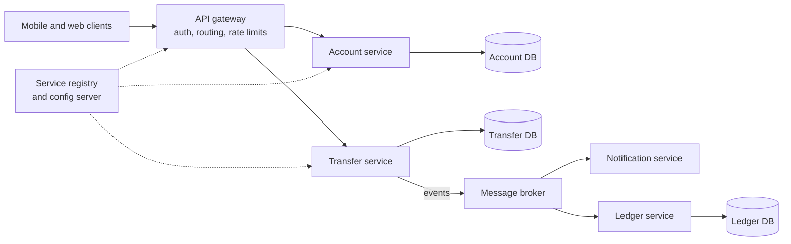
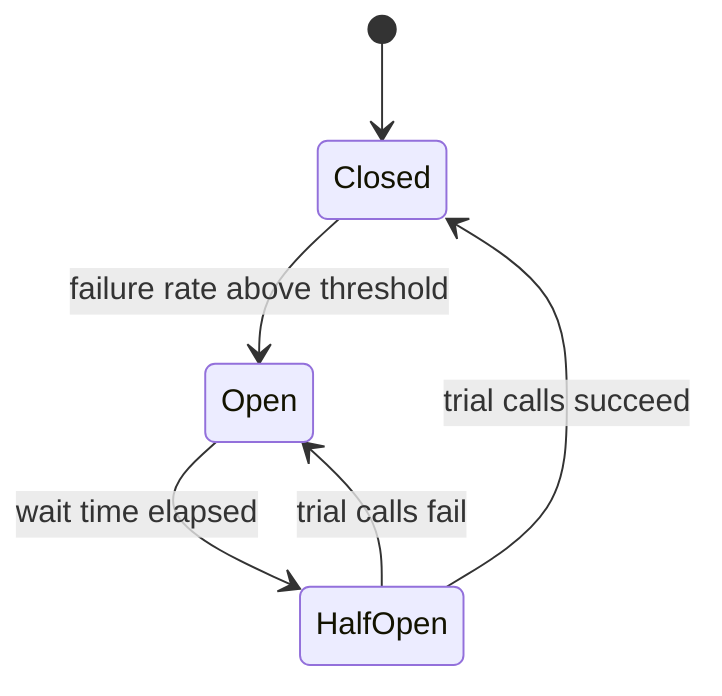

"Tell me about microservice patterns" is a standard question for a Java and Spring Boot role. The expected answer is not a list of names but the *problem each pattern solves and what it costs*. This lesson groups them: structure, communication, resilience, data and operations. Distributed transactions get their own lesson, [the Saga pattern](lesson:saga). Examples use a small banking-style system (account, ledger, transfer and notification services) so they stay general. The security side (gateway authentication, tokens between services) is in [Spring Security](lesson:spring-security) and [OAuth 2.0](lesson:oauth2). Play the three scenes: circuit breaker, API gateway with discovery, and the transactional outbox.

```demo
name: microservice-walk
```

> **One sentence to remember:** *microservices trade the simplicity of one deployable for independent teams and scaling, and every pattern here exists to pay the new costs of that trade: network failures, data spread over many databases, and operating many moving parts.*

## When and why {#why}

### Monolith vs microservices {#monolith}

A **monolith** is one deployable unit with one database; a **microservice** architecture splits the system into small services, each owning a business capability and its data, deployed and scaled independently and talking over the network.

| | Monolith | Microservices |
| --- | --- | --- |
| Deployment | one unit, simple | many units, needs automation |
| Scaling | everything together | per service |
| Team independence | shared codebase, coordination | teams own services |
| Data | one database, ACID transactions | database per service, eventual consistency |
| Failure | in-process calls | network calls that fail, time out and lag |
| Technology | one stack | freedom, but more to maintain |
| Complexity | in the code | in the system: tracing, deployment, testing |

**Do not start with microservices by default.** They pay off with large teams, clear domain boundaries and different scaling needs; for a small team a well-structured **modular monolith** is usually faster and safer, and can be split later. A "distributed monolith" (services that must be deployed and changed together) has the costs of both.

### Characteristics {#traits}

Single responsibility around a **business capability**; owns its data; communicates through APIs or events; independently deployable; **built to fail** (assume the network is unreliable); automated build, test and deployment; observable. The twelve-factor ideas apply: configuration in the environment, stateless processes, logs as streams.

## Structure {#structure}

### Decomposition {#decomposition}

- **By business capability or subdomain:** split along what the business does (accounts, payments, notifications), not along technical layers.
- **Bounded context** (domain-driven design): each service has its own model; the word "customer" can mean different things in different services, and that is fine. Boundaries should match team ownership.
- **Strangler fig:** migrate a monolith gradually. Put a facade in front, move one capability at a time into a new service and route traffic to it, until the old code withers away. Avoids the big-bang rewrite.
- **Anti-corruption layer:** a translation layer protecting a new service's model from a legacy system's.

### Database per service {#db-per-service}

Each service owns its data and nobody else reads its tables; others use its API or events. That keeps services independently changeable and lets each pick a suitable store. The cost: **no cross-service joins and no cross-service ACID transaction**. Queries that span services are answered by **API composition** (a gateway or aggregator calls several services and merges) or by **CQRS** read models; changes that span services use the [Saga pattern](lesson:saga).



## Communication {#communication}

### Synchronous vs asynchronous {#sync-async}

| | Synchronous (REST, gRPC) | Asynchronous (messaging, events) |
| --- | --- | --- |
| Coupling | caller waits, knows the callee | decoupled in time, knows only the message |
| Failure | callee down means caller fails or degrades | broker buffers, consumer catches up |
| Latency | direct response | eventual |
| Use | queries, commands needing an answer now | notifications, propagating changes, long workflows |
| Tools | Spring `RestClient`/`WebClient`, OpenFeign, gRPC | Kafka, RabbitMQ, Spring Cloud Stream |

Prefer **asynchronous events** between services where you can, because a chain of synchronous calls multiplies latency and failure probability (five services at 99.9% each are about 99.5% together). Distinguish a **command** ("debit account", one receiver, may fail) from an **event** ("account debited", a fact, any number of subscribers). Messaging brings new concerns: **at-least-once delivery** (so consumers must be idempotent), ordering (per key or partition), poison messages (dead-letter queues), and schema evolution.

### API gateway and BFF {#gateway}

An **API gateway** is the single entry point for clients. It routes requests, and centralises cross-cutting concerns: authentication, rate limiting, TLS termination, request logging and correlation ids, response caching, and sometimes aggregation. Examples: Spring Cloud Gateway, Kong, cloud gateways. Keep business logic out of it. A **Backend for Frontend (BFF)** is a gateway tailored to one client type (mobile, web), so each gets an API shaped to its needs.

### Service discovery and load balancing {#discovery}

Instances come and go, so addresses cannot be hard-coded. **Service discovery** keeps a registry of healthy instances: **client-side** (the caller asks the registry, for example Eureka or Consul, and load-balances itself) or **server-side** (a load balancer or Kubernetes `Service` DNS does it). In Kubernetes, DNS and `Service` objects usually replace a separate registry. **Health checks** (liveness and readiness probes, Spring Boot Actuator) tell the platform which instances may receive traffic.

### Configuration {#config}

Keep configuration outside the artifact and per environment: environment variables, Kubernetes ConfigMaps and Secrets, Spring Cloud Config, or a secret manager (Vault). The same image runs everywhere; secrets are never in the repository.

## Resilience {#resilience}

### Failure is normal {#failure}

Every remote call can be slow, fail, or fail halfway. Resilience patterns keep one sick service from taking down its callers (a **cascading failure**). They are usually applied together:

| Pattern | What it does |
| --- | --- |
| **Timeout** | never wait forever; always set connect and read timeouts |
| **Retry** (with exponential backoff and jitter) | repeat transient failures, only for **idempotent** operations; unbounded retries cause a retry storm |
| **Circuit breaker** | stop calling a failing service, fail fast, probe for recovery |
| **Bulkhead** | isolate resources (thread or connection pools) per dependency so one slow dependency cannot exhaust everything |
| **Rate limiter** | cap the call rate to protect a service |
| **Fallback** | a degraded answer (cache, default) when the call fails |
| **Load shedding / back-pressure** | reject excess work early instead of collapsing |

### Circuit breaker {#circuit-breaker}



In **closed** state calls pass and failures are counted; above the threshold the breaker **opens** and calls fail immediately (with a fallback); after a wait it goes **half-open** and lets a few trial calls through to decide whether to close again. With Resilience4j and Spring Boot:

```java
@Service
class BalanceClient {

    @CircuitBreaker(name = "ledger", fallbackMethod = "cachedBalance")
    @Retry(name = "ledger")                                  // applied inside the breaker
    @TimeLimiter(name = "ledger")
    public Balance fetch(String accountId) {
        return ledgerClient.balanceOf(accountId);
    }

    Balance cachedBalance(String accountId, Throwable cause) {   // same signature plus the exception
        return cache.lastKnown(accountId);
    }
}
```

```yaml
resilience4j:
  circuitbreaker:
    instances:
      ledger:
        sliding-window-size: 10
        failure-rate-threshold: 50
        wait-duration-in-open-state: 30s
        permitted-number-of-calls-in-half-open-state: 3
  retry:
    instances:
      ledger:
        max-attempts: 3
        wait-duration: 200ms
        enable-exponential-backoff: true
```

### Idempotency {#idempotency}

Because retries and at-least-once messaging deliver the same request twice, operations must be **idempotent**: doing them twice has the same effect as once. Reads and `PUT`/`DELETE` are naturally so; for `POST` (create a transfer) the client sends an **idempotency key**, and the server stores the key with the result and returns the stored result for a repeat. On the consumer side keep a table of processed message ids.

## Data patterns {#data}

### Transactional outbox {#outbox}

A service often must update its database **and** publish an event. Doing both is not atomic (a crash between them loses or invents the event), and a distributed transaction over database and broker (2PC) is avoided. The **outbox** pattern writes the event into an `outbox` table in the **same local transaction** as the business change; a relay (polling publisher or change data capture such as Debezium) publishes unsent rows to the broker and marks them sent. Delivery is at-least-once, so pair it with an **idempotent consumer**.

```java
@Transactional
public void createTransfer(TransferRequest req) {
    Transfer t = transferRepository.save(Transfer.from(req));
    outboxRepository.save(new OutboxEvent(
        UUID.randomUUID(), "Transfer", t.getId(), "TransferCreated", json.write(t)));   // same transaction
}

// relay: a scheduled job or CDC connector
@Scheduled(fixedDelay = 500)
@Transactional
public void publishPending() {
    for (OutboxEvent e : outboxRepository.findTop100BySentFalseOrderByCreatedAt()) {
        kafka.send("transfers", e.getAggregateId(), e.getPayload()).join();
        e.markSent();
    }
}
```

### CQRS and event sourcing {#cqrs}

**CQRS** (command query responsibility segregation) separates the write model from one or more read models built for queries, usually updated from events. It answers cross-service queries and lets reads scale and be shaped independently, at the price of **eventual consistency** between the two sides. **Event sourcing** stores the *sequence of events* as the source of truth instead of the current state; the current state is rebuilt by replaying events, which gives a full audit trail and time travel, but adds complexity (versioning events, snapshots, rebuilding). They are often used together and are not needed for most services.

### Distributed transactions {#saga-link}

Without a transaction spanning services, a business process that touches several of them (move money, book a trip) is coordinated with a **saga**: a sequence of local transactions, each with a **compensating action** that undoes it if a later step fails. Choreography and orchestration, compensation, and failure handling are covered in the [Saga lesson](lesson:saga). Two-phase commit is generally avoided in microservices because it blocks and couples services to a coordinator.

## Operating microservices {#operations}

### Observability {#observability}

You cannot debug what you cannot see across many processes. The three pillars: **logs** (structured, aggregated centrally, with a **correlation id** in every line), **metrics** (rates, errors, durations, saturation; Micrometer with Prometheus and Grafana), and **distributed tracing** (a trace id follows a request across services, as in OpenTelemetry, Zipkin or Jaeger; Spring Boot 3 uses Micrometer Tracing). Add health endpoints and alerts on symptoms users feel.

### Deployment and the platform {#deployment}

Package each service as a container image and run it on an orchestrator (Kubernetes) with rolling updates. Safer release strategies: **blue-green** (two environments, switch traffic), **canary** (a small percentage first), and **feature flags**. A **service mesh** (Istio, Linkerd) moves cross-cutting concerns such as mutual TLS, retries and telemetry into sidecar proxies so services do not each implement them. Contract tests (**consumer-driven contracts**, such as Pact or Spring Cloud Contract) catch breaking API changes without end-to-end environments.

### Spring Cloud in one table {#spring-cloud}

| Need | Spring option |
| --- | --- |
| Gateway | Spring Cloud Gateway |
| Discovery | Eureka, Consul, or Kubernetes DNS |
| Client calls | `RestClient`, `WebClient`, OpenFeign / HTTP interface clients, with load balancing |
| Resilience | Resilience4j (circuit breaker, retry, bulkhead, rate limiter) |
| Configuration | Spring Cloud Config, Kubernetes ConfigMaps, Vault |
| Messaging | Spring Cloud Stream, Spring for Apache Kafka, Spring AMQP |
| Tracing and metrics | Micrometer, Micrometer Tracing, Actuator |
| Security | Spring Security resource server, OAuth 2.0 client credentials |

## Cheat sheet {#cheatsheet}

| Problem | Pattern |
| --- | --- |
| Splitting a system | business capability, bounded context, strangler fig |
| Data ownership | database per service |
| Clients and many services | API gateway, BFF |
| Finding services | service discovery, health checks |
| Slow or failing dependency | timeout, retry with backoff, circuit breaker, bulkhead, fallback |
| Duplicate delivery | idempotency key, idempotent consumer |
| Update DB and publish event | transactional outbox |
| Query across services | API composition, CQRS |
| Multi-service business transaction | saga with compensation |
| Debugging | correlation id, tracing, central logs, metrics |
| Config and secrets | externalized config, secret manager |

## Interview questions {#questions}

### [basic] What are microservices and what are their main trade-offs? {#what-are-ms}

An architecture of small, independently deployable services, each owning a business capability and its data and communicating over the network. Benefits: independent deployment and scaling, team autonomy, technology choice, fault isolation. Costs: distributed-system complexity (network failures, latency), data consistency without cross-service transactions, harder testing and debugging, and operational overhead (deployment, monitoring). They fit large teams and clear domains; small teams often do better with a modular monolith.

### [basic] What is an API gateway and what does it do? {#gateway-q}

The single entry point between clients and services. It routes requests, authenticates and authorizes tokens, applies rate limiting, handles TLS, adds correlation ids, can cache and aggregate responses, and hides the internal service layout from clients. It should stay thin: business logic belongs in services. It is also a potential single point of failure, so it is run redundantly.

### [basic] What is service discovery? {#discovery-q}

A way for services to find each other without fixed addresses, because instances are created and destroyed dynamically. Instances register with a registry (Eureka, Consul) and callers look them up (client-side discovery) or call a load balancer that does (server-side discovery, such as a Kubernetes Service). Health checks remove unhealthy instances.

### [basic] What is the database-per-service pattern and what are its consequences? {#db-per-service-q}

Each service has its own private database that only it accesses, so services stay loosely coupled and can change schema or technology independently. Consequences: no joins or ACID transactions across services, so cross-service queries use API composition or CQRS read models, and cross-service transactions use sagas with eventual consistency; data may be duplicated between services deliberately.

### [basic] Synchronous or asynchronous communication: how do you choose? {#sync-vs-async-q}

Use synchronous calls (REST, gRPC) when the caller needs an answer now, such as a query, and accept coupling in time. Use asynchronous messaging for events and long workflows, which decouples availability, buffers load and lets many consumers react. A long chain of synchronous calls multiplies latency and failure risk. Asynchronous brings eventual consistency, ordering, duplicate delivery and monitoring concerns.

### [basic] What is a circuit breaker? {#circuit-breaker-q}

A pattern that wraps a remote call and tracks failures. While **closed**, calls pass; when the failure rate exceeds a threshold it **opens** and fails fast (usually with a fallback) instead of waiting on a failing service; after a wait it is **half-open** and allows trial calls, closing if they succeed. It prevents cascading failure, frees threads and gives the dependency time to recover. In Spring use Resilience4j.

### [intermediate] How do retries go wrong, and how do you make them safe? {#retries-q}

Retrying a failing dependency immediately and in lockstep creates a retry storm that keeps it down, and retrying non-idempotent operations can duplicate their effects (two transfers). Make them safe with a limited number of attempts, **exponential backoff with jitter**, a timeout on each attempt, retrying only transient errors (not 4xx), idempotency keys for writes, and a circuit breaker around the retries.

### [intermediate] What is the bulkhead pattern? {#bulkhead-q}

Isolating resources per dependency (a separate thread pool, semaphore or connection pool for each downstream service) so that a slow dependency can use up only its own share, as watertight compartments limit a leak in a ship. Without it one slow service can exhaust the shared thread pool and take down unrelated features.

### [intermediate] What is the transactional outbox pattern and what problem does it solve? {#outbox-q}

Updating the database and publishing a message are two systems and cannot be atomic: a crash between them loses the event or publishes one for a change that rolled back. With an outbox, the service writes the event to an outbox table in the same local transaction as the business data. A relay (polling or change data capture) publishes the rows to the broker afterwards and marks them sent. It guarantees at-least-once publication without a distributed transaction, so consumers must be idempotent.

### [intermediate] What is idempotency and how do you implement it? {#idempotency-q}

An operation is idempotent if repeating it has the same effect as doing it once, which is essential because retries and at-least-once delivery produce duplicates. Implement by making the operation naturally idempotent (set a value rather than increment), or by an **idempotency key**: the client sends a unique key, the server stores key plus result in the same transaction and returns the stored result for a repeat. Consumers record processed message ids (a unique constraint on the id).

### [intermediate] What is CQRS and when is it worth it? {#cqrs-q}

Splitting the model for changing data (commands) from the model for reading it (queries), often with separate stores, the read side updated from events. It lets reads be optimised and scaled independently and answers queries spanning several services. It costs eventual consistency, duplication and complexity, so it is worth it where read and write needs differ a lot, not as a default.

### [intermediate] What is the strangler fig pattern? {#strangler-q}

A way to migrate a monolith incrementally: put a facade or proxy in front, build one capability as a new service, route that traffic to it and keep the rest on the monolith, repeating until the monolith can be retired. It avoids a risky big-bang rewrite and delivers value continuously, and the facade allows rollback per feature.

### [intermediate] How do you handle distributed tracing and logging across services? {#tracing-q}

Generate a trace and correlation id at the entry point (the gateway) and propagate it in headers (W3C `traceparent`) through HTTP calls and message headers; every service adds it to its structured logs and creates spans. Ship logs, metrics and traces to central systems (ELK or Loki, Prometheus, Jaeger or Tempo via OpenTelemetry). In Spring Boot 3 Micrometer Tracing does the propagation automatically for supported clients.

### [intermediate] How do you test microservices? {#testing-q}

A pyramid: many fast unit tests, slice and integration tests per service with real dependencies from Testcontainers (database, broker), **consumer-driven contract tests** (Pact, Spring Cloud Contract) to verify that providers and consumers agree on APIs and messages without a shared environment, and a small number of end-to-end tests of critical flows. Also test failure behaviour: timeouts, retries, circuit breaker and duplicate messages.

### [deep] Why is a distributed transaction (two-phase commit) avoided between microservices? {#two-phase}

2PC needs a coordinator and makes all participants hold locks until everyone votes, so it reduces availability (any participant or the coordinator being down blocks), adds latency, couples services tightly and is unsupported by many modern stores and brokers. Microservices usually accept eventual consistency and use [sagas](lesson:saga) with compensating transactions, plus the outbox pattern for reliable messaging.

### [deep] How do you prevent a cascading failure? {#cascading-q}

Combine patterns so a failure stays local: timeouts on every call, circuit breakers to stop calling failing dependencies, bulkheads so they cannot exhaust shared resources, bounded retries with backoff, rate limiting and load shedding, fallbacks that degrade gracefully, asynchronous messaging that buffers load, autoscaling, and health checks so traffic leaves unhealthy instances. Then test with chaos experiments.

### [deep] How would you split a monolith, and how do you decide the boundaries? {#split-q}

Start from the business domain rather than technical layers: find bounded contexts through domain analysis (event storming), looking for capabilities with their own data, language and change rate, and align them with team ownership. Extract the most independent or most valuable capability first behind a strangler facade, give it its own database (copying data via events or migration), keep contracts stable, and measure before splitting further. Avoid too-fine splitting that creates chatty services and a distributed monolith.

### [deep] What is the difference between orchestration and choreography? {#orchestration-q}

In **orchestration** a central coordinator tells each service what to do and tracks the process state: explicit flow and easy to monitor, but the orchestrator is a coupling point. In **choreography** services react to each other's events with no central controller: loosely coupled and simple for short flows, but the overall flow is implicit and hard to follow as it grows. Both are used for sagas, and the [Saga lesson](lesson:saga) compares them.

### [coding] Add a circuit breaker and retry to a Spring Boot REST client. {#coding-breaker}

```java
@Service
class LedgerGateway {
    private final RestClient rest;

    LedgerGateway(RestClient.Builder builder) {
        this.rest = builder.baseUrl("http://ledger-service").build();
    }

    @CircuitBreaker(name = "ledger", fallbackMethod = "unavailable")
    @Retry(name = "ledger")
    public Balance balance(String accountId) {
        return rest.get().uri("/accounts/{id}/balance", accountId)
                   .retrieve().body(Balance.class);
    }

    private Balance unavailable(String accountId, Throwable t) {
        return Balance.unknown(accountId);                     // degrade instead of failing the whole page
    }
}
```

Explain the configuration (sliding window, failure rate threshold, wait in open state, retry attempts with exponential backoff), that retry runs inside the breaker so each attempt counts, that the call needs a timeout, and that only idempotent calls (a GET) are retried.

### [coding] Make a message consumer idempotent. {#coding-idempotent}

```java
@KafkaListener(topics = "transfers")
@Transactional
public void on(TransferCreated event) {
    // unique constraint on message_id makes the insert fail for a duplicate delivery
    try {
        processedMessages.saveAndFlush(new ProcessedMessage(event.messageId()));
    } catch (DataIntegrityViolationException duplicate) {
        return;                                                  // already handled: ignore
    }
    notificationService.sendTransferNotice(event);               // same transaction as the marker
}
```

Explain that recording the id and doing the work in one transaction means a crash either does both or neither, that the broker may redeliver, and that for side effects outside the database (sending an email) you need an idempotency key at the downstream system or an outbox of your own.

### [coding] Implement a transactional outbox in Spring. {#coding-outbox}

```java
@Entity
class OutboxEvent {
    @Id UUID id;
    String aggregateType;
    String aggregateId;
    String type;
    @Column(columnDefinition = "text") String payload;
    Instant createdAt = Instant.now();
    boolean sent;
}

@Service
class TransferService {
    @Transactional
    public Transfer create(TransferRequest req) {
        Transfer t = transfers.save(Transfer.from(req));
        outbox.save(OutboxEvent.of("Transfer", t.getId(), "TransferCreated", json.write(t)));
        return t;                                               // both rows commit together, or neither
    }
}

@Component
class OutboxRelay {
    @Scheduled(fixedDelay = 500)
    @Transactional
    void publish() {
        for (OutboxEvent e : outbox.findTop100BySentFalseOrderByCreatedAt()) {
            kafka.send("transfers", e.getAggregateId(), e.getPayload()).join();
            e.setSent(true);
        }
    }
}
```

Mention the alternatives (change data capture with Debezium instead of polling), that publishing is at-least-once so consumers are idempotent, that the key keeps events of one aggregate ordered in a partition, and that old sent rows are cleaned up.
