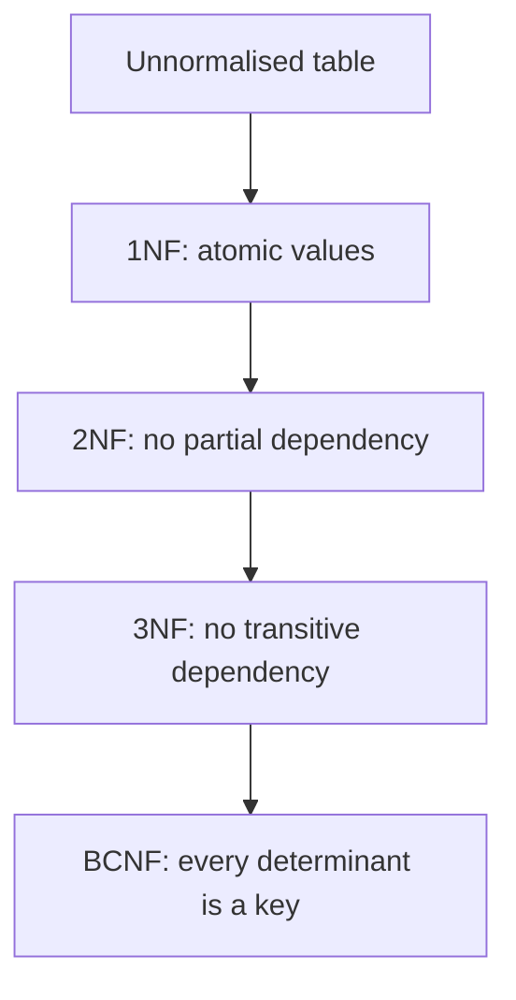
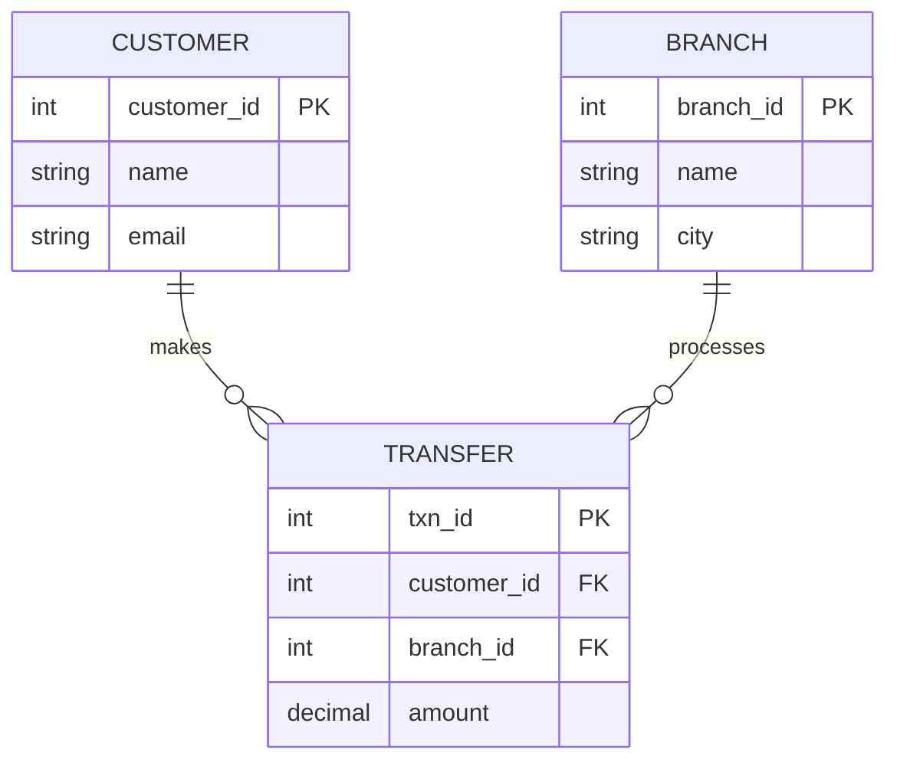

Normalization is the standard schema-design question in relational interviews: *what is it, what are 1NF, 2NF and 3NF, what anomalies does it prevent, and when would you denormalize?* The honest short answer is "store each fact in one place so the database cannot contradict itself, and break that rule on purpose only for measured read performance". It sits next to [SQL vs NoSQL](lesson:sql-vs-nosql) (normalise or embed) and [ACID and BASE](lesson:acid-base) (constraints keep data consistent). Play the animated tables below: the anomalies of one wide table, splitting it, the normal forms, and denormalizing on purpose.

```demo
name: normalize-walk
```

> **One sentence to remember:** *every non-key column must depend on the key, the whole key, and nothing but the key (so help me Codd).*

## The problem {#problem}

### One wide table {#wide}

The tempting design is one table with everything about an event:

| txn_id | customer | email | branch | branch_city | amount |
| --- | --- | --- | --- | --- | --- |
| 1 | Alice | alice@mail.com | Orchard | Singapore | 500 |
| 2 | Alice | alice@mail.com | Orchard | Singapore | 120 |
| 3 | Bob | bob@mail.com | Orchard | Singapore | 80 |
| 4 | Carol | carol@mail.com | Marina | Singapore | 300 |

It works for the first query, and then **the same fact is stored many times**: Alice's email on every Alice row, the city on every Orchard row. That redundancy wastes space, but the real damage is to correctness.

### The three anomalies {#anomalies}

| Anomaly | What happens | Example above |
| --- | --- | --- |
| **Update** | a fact stored in many rows is changed in some and not others, leaving contradictions | Alice's new email is written to one row, the other keeps the old one |
| **Insert** | you cannot record one fact without another that does not exist yet | a new branch with no transfers cannot be added without blank (NULL) columns |
| **Delete** | deleting a row destroys unrelated facts that shared it | removing Carol's only transfer also loses her email and the Marina branch |

**Normalization** is the process of restructuring tables, by a series of rules called normal forms, so that each fact lives in exactly one place and these anomalies cannot occur.

## Keys and dependencies {#theory}

### Keys {#keys}

- **Superkey:** a set of columns that uniquely identifies a row.
- **Candidate key:** a minimal superkey (remove any column and it stops being unique). A table can have several.
- **Primary key (PK):** the candidate key you choose; not null, unique.
- **Composite key:** a key of two or more columns (for example `account_id, fund_id`).
- **Foreign key (FK):** a column that references a key in another table; the database enforces that it points at an existing row.
- **Prime attribute:** a column that is part of some candidate key. A **non-key attribute** is not.

### Functional dependency {#fd}

**A → B** ("A determines B") means that whenever two rows have the same A, they have the same B. `customer_id → email` holds: a customer has one email. `branch_id → branch_city` holds. Normal forms are rules about which dependencies are allowed in a table:

- a **partial dependency** is a non-key column depending on **part** of a composite key;
- a **transitive dependency** is a non-key column depending on **another non-key column** (A → B and B → C, so A → C through B).

## The normal forms {#forms}



Each form includes the previous ones: a table in 3NF is also in 2NF and 1NF.

### First normal form (1NF) {#nf1}

**Every column holds a single atomic value, there are no repeating groups, and rows are uniquely identifiable.**

Violation: a `phones` cell containing `6123 4567, 9123 4567`, or columns `phone1, phone2, phone3`. You cannot index, search or constrain one number, and the count of phones is capped by the table shape.

Fix: move the repeating group to its own table, one row per value, linked by a foreign key (`customer_phone(customer_id, phone)`).

### Second normal form (2NF) {#nf2}

**1NF, and every non-key column depends on the whole primary key, not just part of it.** It only matters for **composite keys**; a table with a single-column key is automatically in 2NF if it is in 1NF.

Violation: `holding(account_id, fund_id, units, fund_name)` with key `(account_id, fund_id)`. `units` depends on both, but `fund_name` depends only on `fund_id`. "Global Equity" repeats on every holding of that fund, and renaming the fund needs many updates.

Fix: split into `fund(fund_id, fund_name)` and `holding(account_id, fund_id, units)`.

### Third normal form (3NF) {#nf3}

**2NF, and no non-key column depends on another non-key column (no transitive dependencies).**

Violation: `account(account_id, owner, branch_id, branch_city)`. `branch_city` depends on `branch_id`, which is not the key; the chain `account_id → branch_id → branch_city` repeats the city on every account of that branch.

Fix: `branch(branch_id, city)` and `account(account_id, owner, branch_id)`.

### BCNF (Boyce-Codd) {#bcnf}

**For every non-trivial dependency A → B, A must be a superkey.** It is a slightly stricter 3NF. It differs only when a table has several overlapping candidate keys and a non-key column determines part of a key. Example: `tutor_slot(student, subject, tutor)` where each tutor teaches one subject (`tutor → subject`) but `tutor` is not a key. 3NF allows it (subject is a prime attribute); BCNF splits it into `tutor(tutor, subject)` and `assignment(student, tutor)`. In practice 3NF design usually reaches BCNF.

### Higher forms {#higher}

- **4NF:** no independent multi-valued facts about a key in one table (a person's skills and languages in a single table force a cross product of rows; split them).
- **5NF:** no table that can be rebuilt only by joining three or more pieces in a way the key does not imply.

Interviews rarely go beyond BCNF; mention 4NF and 5NF exist, and what multi-valued dependencies are.

### Worked result {#result}

Splitting the wide table gives one table per kind of thing, linked by keys:



Alice's email is now one cell, a new branch is one row in `branch`, and deleting a transfer leaves customers and branches alone. The original wide view is recovered by a `JOIN`.

```sql
CREATE TABLE customer (
  customer_id BIGINT PRIMARY KEY,
  name        VARCHAR(100) NOT NULL,
  email       VARCHAR(255) NOT NULL UNIQUE
);
CREATE TABLE branch (
  branch_id BIGINT PRIMARY KEY,
  name      VARCHAR(100) NOT NULL,
  city      VARCHAR(100) NOT NULL
);
CREATE TABLE transfer (
  txn_id      BIGINT PRIMARY KEY,
  customer_id BIGINT NOT NULL REFERENCES customer(customer_id),
  branch_id   BIGINT NOT NULL REFERENCES branch(branch_id),
  amount      NUMERIC(19,2) NOT NULL CHECK (amount > 0)
);
CREATE INDEX idx_transfer_customer ON transfer(customer_id);     -- foreign keys are not indexed automatically in most databases
```

## Denormalization {#denormalization}

### When and how {#when}

**Denormalization** deliberately adds redundancy to make reads cheaper. Normalise first, measure, then denormalise only the hot paths. Common forms:

- **Derived columns** (an order `total`, an account `balance` kept alongside the ledger entries it summarises).
- **Copied columns** (the customer name stored on a statement row).
- **Summary or reporting tables** and **materialised views**, refreshed on a schedule or by events.
- **Caches and search documents** built from the source of truth.
- **Embedding** in document stores ([embed or reference](lesson:sql-vs-nosql#embed)).

### Costs {#costs}

The anomalies come back unless something keeps copies in sync: triggers, application code, scheduled refreshes, events ([CQRS read models](lesson:microservice-patterns#cqrs)), or a reconciliation job. Writes get slower and more complex, and storage grows. Keep a single **source of truth** (the normalised tables) and treat copies as rebuildable.

| | Normalised | Denormalised |
| --- | --- | --- |
| Redundancy | minimal | deliberate |
| Writes | simple, one place | must update every copy |
| Reads | joins | fewer or no joins, faster |
| Consistency | enforced by structure | maintained by code |
| Flexibility for new queries | high | tuned to the known queries |
| Typical fit | transactional systems (OLTP) | reporting, analytics, read-heavy paths, NoSQL |

Transactional (OLTP) systems favour normalisation; analytical (OLAP) systems favour denormalised **star schemas** (a central fact table joined to dimension tables).

## In Java and JPA {#jpa}

Normalised tables map naturally to entities with relationships:

```java
@Entity
class Customer {
    @Id Long id;
    String name;
    @Column(unique = true, nullable = false) String email;
}

@Entity
class Transfer {
    @Id Long id;

    @ManyToOne(fetch = FetchType.LAZY, optional = false)
    @JoinColumn(name = "customer_id")
    Customer customer;

    @ManyToOne(fetch = FetchType.LAZY, optional = false)
    @JoinColumn(name = "branch_id")
    Branch branch;

    @Column(nullable = false) BigDecimal amount;
}
```

Points: use `LAZY` on `@ManyToOne` (the default is eager) and `join fetch` or projections where you need the data, to avoid the **N+1 problem**; a composite key is mapped with `@EmbeddedId` and an `@Embeddable` class; read-only denormalised views can map to a **DTO projection** or a database view instead of duplicating columns in the entity. Schema changes belong in migrations (Flyway or Liquibase), not `ddl-auto=update`.

## Cheat sheet {#cheatsheet}

| Topic | Key point |
| --- | --- |
| Goal | each fact stored once; no update, insert or delete anomalies |
| Functional dependency | A → B: the same A always means the same B |
| 1NF | atomic values, no repeating groups |
| 2NF | 1NF + no partial dependency on part of a composite key |
| 3NF | 2NF + no transitive dependency (non-key on non-key) |
| BCNF | every determinant is a superkey; stricter 3NF |
| Mnemonic | the key, the whole key, and nothing but the key |
| Cost | more tables and joins; reads slower |
| Denormalise | derived or copied data, summary tables, caches; keep a source of truth |
| OLTP vs OLAP | normalised for transactions, denormalised star schemas for analytics |

## Interview questions {#questions}

### [basic] What is normalization and why do we do it? {#what-q}

Organising a relational schema into tables so that each fact is stored once, using rules called normal forms. It prevents update, insert and delete anomalies, reduces redundancy and storage, and makes integrity easier to enforce with keys and constraints. The cost is more tables and joins.

### [basic] What are the update, insert and delete anomalies? {#anomalies-q}

They are problems caused by redundant data in one table. Update: a repeated fact is changed in some rows but not others, producing contradictions. Insert: a fact cannot be recorded without another unrelated fact (a branch with no transfers needs blank columns). Delete: removing a row also destroys unrelated facts that shared it (deleting a customer's last order loses the customer).

### [basic] Explain 1NF, 2NF and 3NF. {#forms-q}

1NF: atomic values in every cell, no repeating groups. 2NF: in 1NF and every non-key column depends on the whole composite key, not part of it. 3NF: in 2NF and no non-key column depends on another non-key column (no transitive dependency). Summarised: every non-key column depends on the key, the whole key and nothing but the key.

### [basic] What is a primary key, candidate key and foreign key? {#keys-q}

A candidate key is a minimal set of columns that uniquely identifies a row; a table may have several. The primary key is the candidate key chosen as the main identifier (unique and not null). A foreign key is a column that references a key in another table and is enforced by the database to point at an existing row (or be null).

### [basic] What is a functional dependency? {#fd-q}

A → B means that rows with the same value of A always have the same value of B: customer_id determines email. Normal forms restrict which dependencies may exist in a table: partial dependencies (on part of a key) and transitive ones (through a non-key column) are removed by 2NF and 3NF.

### [intermediate] What is a partial dependency and a transitive dependency? {#partial-q}

A partial dependency is a non-key column depending on only part of a composite key (fund_name depends on fund_id inside key account_id plus fund_id). A transitive dependency is a non-key column depending on another non-key column (account_id determines branch_id, which determines branch_city). Removing the first gives 2NF, the second 3NF.

### [intermediate] What is the difference between 3NF and BCNF? {#bcnf-q}

3NF allows a dependency A → B if B is a prime attribute (part of some candidate key) even when A is not a key. BCNF requires every determinant to be a superkey. They differ only for tables with several overlapping candidate keys; BCNF decomposition can occasionally lose the ability to enforce a dependency with a simple constraint, which is why 3NF is the usual practical target.

### [intermediate] Is a table with a single-column primary key always in 2NF? {#single-key-q}

Yes, if it is in 1NF. Partial dependencies need a composite key to exist, because a column cannot depend on part of a single-column key. A table can still violate 3NF through a transitive dependency.

### [intermediate] What is denormalization and when is it justified? {#denormalize-q}

Deliberately introducing redundancy to speed reads: derived columns, copied columns, summary tables, materialised views, caches. It is justified when measurements show joins or aggregations are a bottleneck on a hot read path, or for analytics. It must be paired with a mechanism to keep copies consistent, and the normalised data stays the source of truth.

### [intermediate] Normalised or denormalised for an OLTP system and for a data warehouse? {#oltp-q}

OLTP (many small concurrent transactions) favours normalisation: small writes touch one place and constraints guarantee integrity. Data warehouses (OLAP) favour denormalised star schemas, with a large fact table of measurements joined to wide dimension tables, because they are read-heavy and scan or aggregate huge volumes.

### [intermediate] How does normalization relate to NoSQL data modelling? {#nosql-q}

Relational design models the data and normalises it, then joins answer queries. Document and wide-column stores usually model the queries and denormalise: embed or duplicate data so one read serves a query. The trade is the same one: faster reads and easier scaling against duplicated data that the application must keep in sync ([SQL vs NoSQL](lesson:sql-vs-nosql#modelling)).

### [intermediate] Should foreign keys be indexed? {#fk-index-q}

Usually yes. PostgreSQL and Oracle do not index the referencing column automatically (MySQL InnoDB does), and without an index, joins on it and checks when a parent row is deleted or its key updated scan the child table. Add an index on the foreign key column for the queries and deletes you run.

### [deep] Is it ever right to store a derived value such as an account balance? {#derived-q}

Yes, when recomputing it is too slow, but treat it carefully: the ledger entries remain the source of truth, the stored balance is updated in the same transaction as the entry (or recomputed by a job), protected by constraints and tested by reconciliation that compares the balance with the sum of entries. Concurrent updates need locking or atomic updates ([ACID and BASE](lesson:acid-base#lost-update)).

### [deep] Normalise this table: orders(order_id, customer_id, customer_name, customer_city, product_id, product_name, quantity). {#normalise-q}

Identify dependencies: order_id → customer_id; customer_id → customer_name, customer_city; product_id → product_name; an order can have many products, so a line is identified by (order_id, product_id) with quantity depending on both. Result: `customer(customer_id, name, city)`, `product(product_id, name)`, `orders(order_id, customer_id)`, `order_line(order_id, product_id, quantity)`. Customer details moved out (transitive), product name moved out (partial), and the repeating products became rows.

### [coding] Find the normal form violations in this table and fix them. {#coding-violations}

```text
employee(emp_id, name, dept_id, dept_name, skills)
   emp_id       -> name, dept_id, skills
   dept_id      -> dept_name
```

`skills` holding a list violates 1NF; `dept_name` depends on `dept_id`, a non-key column, which is a transitive dependency violating 3NF.

```sql
CREATE TABLE department (dept_id BIGINT PRIMARY KEY, dept_name VARCHAR(100) NOT NULL);
CREATE TABLE employee (
  emp_id  BIGINT PRIMARY KEY,
  name    VARCHAR(100) NOT NULL,
  dept_id BIGINT NOT NULL REFERENCES department(dept_id)
);
CREATE TABLE employee_skill (
  emp_id BIGINT NOT NULL REFERENCES employee(emp_id),
  skill  VARCHAR(50) NOT NULL,
  PRIMARY KEY (emp_id, skill)
);
```

### [coding] Recover the denormalised statement view with a query, and make it a materialised view. {#coding-view}

```sql
SELECT t.txn_id, c.name AS customer, b.city, t.amount
FROM transfer t
JOIN customer c ON c.customer_id = t.customer_id
JOIN branch   b ON b.branch_id   = t.branch_id;

CREATE MATERIALIZED VIEW statement_view AS
SELECT t.txn_id, c.name AS customer, b.city, t.amount
FROM transfer t
JOIN customer c ON c.customer_id = t.customer_id
JOIN branch   b ON b.branch_id   = t.branch_id;

REFRESH MATERIALIZED VIEW CONCURRENTLY statement_view;      -- needs a unique index on the view
```

Explain that the join recreates the wide table at query time, the materialised view stores the result for fast reads, and the cost is staleness until refreshed (so the source tables stay the source of truth).

### [coding] Map a table with a composite key in JPA. {#coding-composite}

```java
@Embeddable
record HoldingId(Long accountId, String fundId) implements Serializable {}

@Entity
class Holding {
    @EmbeddedId HoldingId id;
    BigDecimal units;

    @ManyToOne(fetch = FetchType.LAZY) @MapsId("fundId") @JoinColumn(name = "fund_id")
    Fund fund;                                // fund_name lives in Fund, not copied here (2NF)
}
```

Explain that the key class needs `equals`, `hashCode` and `Serializable`, that `@MapsId` ties the association to the key part, and that fund attributes stay in their own table so the holding holds only what depends on the whole key.
