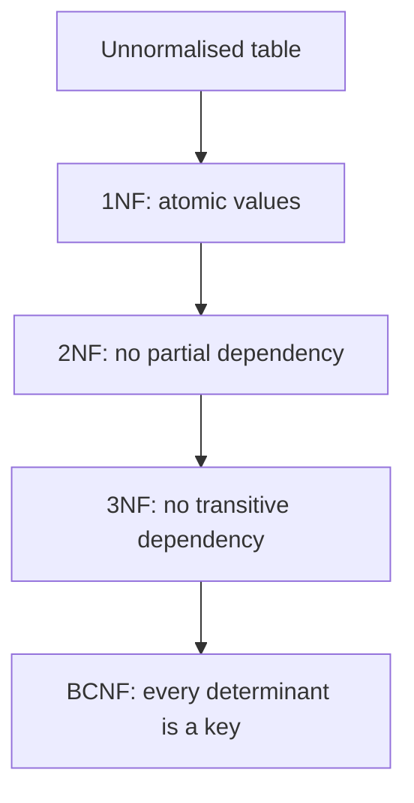
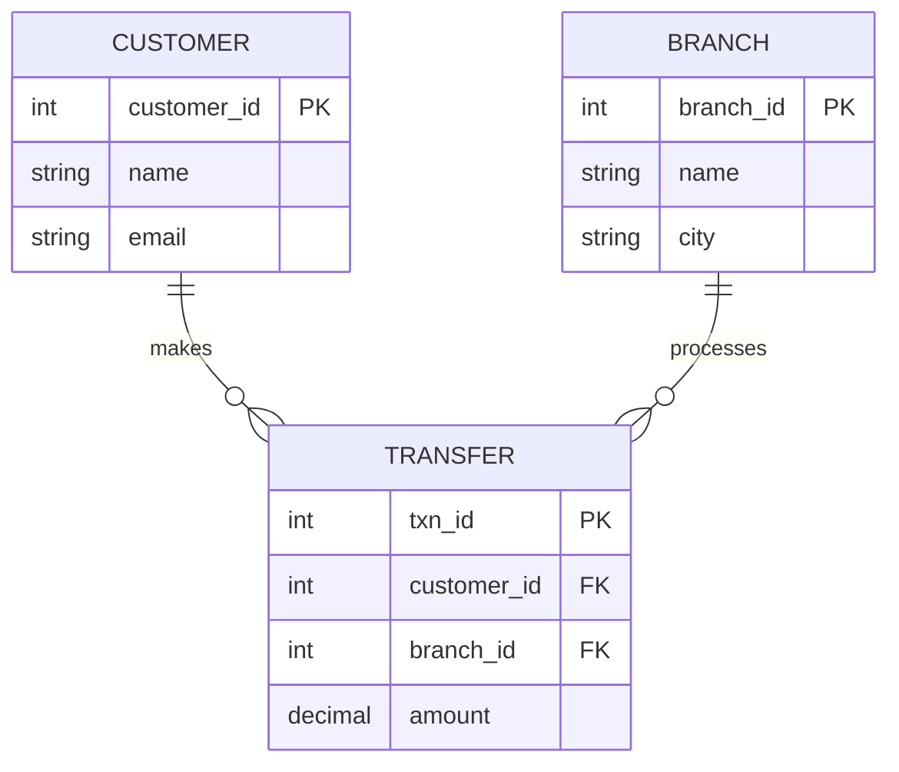

Normalization is the standard schema design question in relational database interviews. Expect these questions:

- What is normalization?
- What are 1NF, 2NF and 3NF?
- Which problems (anomalies) does it prevent?
- When would you denormalize?

The short answer: store each fact in one place, so the database cannot contradict itself. Break that rule on purpose only when you have measured that reads are too slow.

Related lessons: [SQL vs NoSQL](lesson:sql-vs-nosql) (normalise or embed) and [ACID and BASE](lesson:acid-base) (constraints keep data consistent).

The animation has four scenes: the problems of one wide table, splitting it, the normal forms, and denormalizing on purpose.

```demo
name: normalize-walk
```

> **One sentence to remember:** *Every non-key column must depend on the key, the whole key, and nothing but the key.*

## The problem {#problem}

### One wide table {#wide}

The tempting design is one table that holds everything about an event:

| txn_id | customer | email | branch | branch_city | amount |
| --- | --- | --- | --- | --- | --- |
| 1 | Alice | alice@mail.com | Orchard | Singapore | 500 |
| 2 | Alice | alice@mail.com | Orchard | Singapore | 120 |
| 3 | Bob | bob@mail.com | Orchard | Singapore | 80 |
| 4 | Carol | carol@mail.com | Marina | Singapore | 300 |

It works for the first query. But **the same fact is stored many times**. Alice's email is on every Alice row, and the city is on every Orchard row. This repetition is called **redundancy**. It wastes space, but the real damage is to correctness.

### The three anomalies {#anomalies}

An **anomaly** is an error that the table design makes possible.

| Anomaly | What happens | Example from the table above |
| --- | --- | --- |
| **Update** | A fact is stored in many rows, and a change reaches only some of them, so the rows contradict each other. | Alice's new email is written to one row, and the other row keeps the old one. |
| **Insert** | You cannot record one fact without another fact that does not exist yet. | A new branch with no transfers cannot be added without empty (NULL) columns. |
| **Delete** | Deleting a row also destroys other facts that shared it. | Removing Carol's only transfer also loses her email and the Marina branch. |

**Normalization** fixes this. It restructures the tables, following a series of rules called **normal forms**, so that each fact lives in exactly one place. Then these anomalies cannot happen.

## Keys and dependencies {#theory}

### Keys {#keys}

- A **superkey** is a set of columns that identifies each row uniquely.
- A **candidate key** is a minimal superkey: if you remove any column, it is no longer unique. A table can have several.
- The **primary key (PK)** is the candidate key you choose as the main identifier. It must be unique and not null.
- A **composite key** is a key made of two or more columns, for example `account_id, fund_id`.
- A **foreign key (FK)** is a column that refers to a key in another table. The database makes sure it points at a row that exists.
- A **prime attribute** is a column that is part of some candidate key. A **non-key attribute** is a column that is not.

### Functional dependency {#fd}

**A → B** means "A determines B". Whenever two rows have the same A, they also have the same B.

- `customer_id → email` holds, because a customer has one email.
- `branch_id → branch_city` holds, because a branch is in one city.

The normal forms are rules about which dependencies are allowed in a table. Two kinds cause trouble:

- A **partial dependency** is a non-key column that depends on only **part** of a composite key.
- A **transitive dependency** is a non-key column that depends on **another non-key column**. If A → B and B → C, then A → C goes through B.

## The normal forms {#forms}



Each form includes the ones before it. A table in 3NF is also in 2NF and 1NF.

### First normal form (1NF) {#nf1}

**The rule:** every column holds one **atomic** (single, indivisible) value, there are no repeating groups, and every row can be identified uniquely.

**A violation:** a `phones` cell that holds `6123 4567, 9123 4567`, or three columns `phone1, phone2, phone3`. You cannot index, search or constrain one number. The number of phones is also limited by the shape of the table.

**The fix:** move the repeating group to its own table, with one row per value, linked by a foreign key: `customer_phone(customer_id, phone)`.

### Second normal form (2NF) {#nf2}

**The rule:** the table is in 1NF, and every non-key column depends on the **whole** primary key, not just part of it.

2NF only matters for **composite keys**. A table in 1NF with a single-column key is automatically in 2NF.

**A violation:** `holding(account_id, fund_id, units, fund_name)`, with the key `(account_id, fund_id)`.

- `units` depends on both columns of the key, which is correct.
- `fund_name` depends only on `fund_id`, which is a partial dependency.

As a result, "Global Equity" repeats on every holding of that fund, and renaming the fund needs many updates.

**The fix:** split it into `fund(fund_id, fund_name)` and `holding(account_id, fund_id, units)`.

### Third normal form (3NF) {#nf3}

**The rule:** the table is in 2NF, and no non-key column depends on another non-key column. In other words, there are no transitive dependencies.

**A violation:** `account(account_id, owner, branch_id, branch_city)`. Here `branch_city` depends on `branch_id`, which is not the key. The chain is `account_id → branch_id → branch_city`. So the city repeats on every account of that branch.

**The fix:** split it into `branch(branch_id, city)` and `account(account_id, owner, branch_id)`.

### BCNF (Boyce-Codd) {#bcnf}

**The rule:** for every non-trivial dependency A → B, A must be a superkey. A **determinant** is the A side of a dependency, so the short form is "every determinant is a key".

BCNF is a slightly stricter 3NF. It differs from 3NF only when a table has several candidate keys that overlap, and a non-key column determines part of a key.

**An example:** `tutor_slot(student, subject, tutor)`, where each tutor teaches one subject.

- The dependency `tutor → subject` holds, but `tutor` is not a key.
- 3NF allows this, because `subject` is a prime attribute.
- BCNF does not allow it. It splits the table into `tutor(tutor, subject)` and `assignment(student, tutor)`.

In practice, a 3NF design usually reaches BCNF as well.

### Higher forms {#higher}

- **4NF:** a table must not hold two independent lists of facts about the same key. For example, a person's skills and languages in one table force a row for every skill-language pair (a cross product). Split them into two tables.
- **5NF:** a table must not be one that can only be rebuilt by joining three or more pieces in a way the key does not imply.

Interviews rarely go beyond BCNF. It is enough to mention that 4NF and 5NF exist, and to explain what a multi-valued dependency is: one key with several independent lists of values.

### Worked result {#result}

Splitting the wide table gives one table for each kind of thing, linked by keys:



Now Alice's email is one cell. A new branch is one row in `branch`. Deleting a transfer leaves customers and branches untouched. A `JOIN` rebuilds the original wide view when you need it.

```sql
CREATE TABLE customer (
  customer_id BIGINT PRIMARY KEY,
  name        VARCHAR(100) NOT NULL,
  email       VARCHAR(255) NOT NULL UNIQUE
);
CREATE TABLE branch (
  branch_id BIGINT PRIMARY KEY,
  name      VARCHAR(100) NOT NULL,
  city      VARCHAR(100) NOT NULL
);
CREATE TABLE transfer (
  txn_id      BIGINT PRIMARY KEY,
  customer_id BIGINT NOT NULL REFERENCES customer(customer_id),
  branch_id   BIGINT NOT NULL REFERENCES branch(branch_id),
  amount      NUMERIC(19,2) NOT NULL CHECK (amount > 0)
);
CREATE INDEX idx_transfer_customer ON transfer(customer_id);     -- foreign keys are not indexed automatically in most databases
```

## Denormalization {#denormalization}

### When and how {#when}

**Denormalization** adds redundancy on purpose to make reads cheaper. Normalise first, measure, and then denormalise only the busiest read paths.

Common forms:

- **Derived columns**, such as an order `total`, or an account `balance` kept next to the ledger entries it adds up.
- **Copied columns**, such as the customer name stored on a statement row.
- **Summary or reporting tables** and **materialised views** (a stored query result), refreshed on a schedule or by events.
- **Caches and search documents** built from the source of truth.
- **Embedding** in document stores ([embed or reference](lesson:sql-vs-nosql#embed)).

### Costs {#costs}

The anomalies come back unless something keeps the copies in sync. The options are triggers, application code, scheduled refreshes, events ([CQRS read models](lesson:microservice-patterns#cqrs)) or a reconciliation job that compares and repairs data.

Writes also get slower and more complex, and storage grows. Keep one **source of truth** (the normalised tables), and treat every copy as something you can rebuild.

| | Normalised | Denormalised |
| --- | --- | --- |
| Redundancy | It is kept to a minimum. | It is added on purpose. |
| Writes | They are simple, because each fact is in one place. | They must update every copy. |
| Reads | They need joins. | They need fewer joins or none, so they are faster. |
| Consistency | The table structure enforces it. | Code must maintain it. |
| Flexibility for new queries | It is high. | It is tuned to the known queries. |
| Typical fit | Transactional systems (OLTP). | Reporting, analytics, read-heavy paths and NoSQL. |

**OLTP** (online transaction processing) systems handle many small transactions, and they favour normalisation. **OLAP** (online analytical processing) systems run big analytical queries, and they favour denormalised **star schemas**. A star schema has a central fact table joined to several dimension tables.

## In Java and JPA {#jpa}

Normalised tables map naturally to entities with relationships:

```java
@Entity
class Customer {
    @Id Long id;
    String name;
    @Column(unique = true, nullable = false) String email;
}

@Entity
class Transfer {
    @Id Long id;

    @ManyToOne(fetch = FetchType.LAZY, optional = false)
    @JoinColumn(name = "customer_id")
    Customer customer;

    @ManyToOne(fetch = FetchType.LAZY, optional = false)
    @JoinColumn(name = "branch_id")
    Branch branch;

    @Column(nullable = false) BigDecimal amount;
}
```

Points to know:

- Use `LAZY` on `@ManyToOne`, because the default is eager. Use `join fetch` or projections where you need the data. This avoids the **N+1 problem**, where loading a list runs one extra query for every item.
- Map a composite key with `@EmbeddedId` and an `@Embeddable` class.
- A read-only denormalised view can map to a **DTO projection** or a database view. Do not copy its columns into the entity.
- Schema changes belong in migrations (Flyway or Liquibase), not in `ddl-auto=update`.

Try it in the lab: [Normalization: from one wide table to three](lab:normalization-anomalies).

## Cheat sheet {#cheatsheet}

| Topic | Key point |
| --- | --- |
| Goal | Store each fact once, so there are no update, insert or delete anomalies. |
| Functional dependency | A → B means the same A always gives the same B. |
| 1NF | Atomic values and no repeating groups. |
| 2NF | 1NF, and no column depends on only part of a composite key. |
| 3NF | 2NF, and no non-key column depends on another non-key column. |
| BCNF | Every determinant is a superkey. It is a stricter 3NF. |
| Mnemonic | The key, the whole key, and nothing but the key, "so help me Codd" (Edgar Codd invented the relational model). |
| Cost | More tables and joins, so reads are slower. |
| Denormalise | Add derived or copied data, summary tables or caches, and keep one source of truth. |
| OLTP vs OLAP | Normalise for transactions, and use denormalised star schemas for analytics. |

## Interview questions {#questions}

### [basic] What is normalization and why do we do it? {#what-q}

It is organising a relational schema so that each fact is stored once. The rules for doing this are called normal forms.

Why we do it:

1. It prevents update, insert and delete anomalies.
2. It reduces redundancy and storage.
3. It makes integrity easier to enforce with keys and constraints.

The cost is more tables and more joins.

### [basic] What are the update, insert and delete anomalies? {#anomalies-q}

They are errors caused by repeated data in one table.

- **Update anomaly:** a repeated fact is changed in some rows but not in others, so the rows contradict each other.
- **Insert anomaly:** you cannot record a fact without another unrelated fact. For example, a branch with no transfers needs empty columns.
- **Delete anomaly:** removing a row also destroys other facts that shared it. For example, deleting a customer's last order loses the customer.

### [basic] Explain 1NF, 2NF and 3NF. {#forms-q}

Each form adds one rule to the one before it:

1. **1NF:** every cell holds one atomic value, and there are no repeating groups.
2. **2NF:** the table is in 1NF, and every non-key column depends on the whole composite key, not just part of it.
3. **3NF:** the table is in 2NF, and no non-key column depends on another non-key column (no transitive dependency).

In one line: every non-key column depends on the key, the whole key and nothing but the key.

### [basic] What is a primary key, candidate key and foreign key? {#keys-q}

- A **candidate key** is a minimal set of columns that identifies each row uniquely. A table may have several.
- The **primary key** is the candidate key chosen as the main identifier. It is unique and not null.
- A **foreign key** is a column that refers to a key in another table. The database makes sure it points at a row that exists, or is null.

### [basic] What is a functional dependency? {#fd-q}

**A → B** means that rows with the same value of A always have the same value of B. For example, `customer_id` determines `email`.

The normal forms limit which dependencies may exist in a table. 2NF removes partial dependencies (on part of a key). 3NF removes transitive ones (through a non-key column).

### [intermediate] What is a partial dependency and a transitive dependency? {#partial-q}

Both are dependencies that the normal forms remove.

- A **partial dependency** is a non-key column that depends on only part of a composite key. Example: `fund_name` depends on `fund_id`, inside the key `account_id` plus `fund_id`. Removing it gives 2NF.
- A **transitive dependency** is a non-key column that depends on another non-key column. Example: `account_id` determines `branch_id`, and `branch_id` determines `branch_city`. Removing it gives 3NF.

### [intermediate] What is the difference between 3NF and BCNF? {#bcnf-q}

BCNF is stricter.

- **3NF** allows a dependency A → B when B is a prime attribute (part of some candidate key), even if A is not a key.
- **BCNF** requires every determinant to be a superkey.

They differ only for tables with several candidate keys that overlap. A BCNF split can sometimes make a dependency impossible to enforce with a simple constraint. That is why 3NF is the usual practical target.

### [intermediate] Is a table with a single-column primary key always in 2NF? {#single-key-q}

**Yes, if it is in 1NF.** A partial dependency needs a composite key, because a column cannot depend on part of a single-column key.

The table can still break 3NF through a transitive dependency.

### [intermediate] What is denormalization and when is it justified? {#denormalize-q}

It is adding redundancy on purpose to make reads faster. Examples are derived columns, copied columns, summary tables, materialised views and caches.

It is justified in two cases:

1. Measurements show that joins or totals are a bottleneck on a busy read path.
2. The data is used for analytics.

It always needs a way to keep the copies consistent, and the normalised data stays the source of truth.

### [intermediate] Normalised or denormalised for an OLTP system and for a data warehouse? {#oltp-q}

Normalised for OLTP, and denormalised for a data warehouse.

- **OLTP** systems run many small transactions at the same time. Normalisation means each small write touches one place, and constraints guarantee integrity.
- **Data warehouses (OLAP)** read and total huge volumes of data. They use denormalised star schemas: a large fact table of measurements joined to wide dimension tables.

### [intermediate] How does normalization relate to NoSQL data modelling? {#nosql-q}

They solve the same problem from opposite ends.

- **Relational design** models the data and normalises it. Joins then answer the queries.
- **Document and wide-column stores** usually model the queries and denormalise. They embed or duplicate data so one read answers a query.

The trade is the same: faster reads and easier scaling, in exchange for duplicate data that the application must keep in sync ([SQL vs NoSQL](lesson:sql-vs-nosql#modelling)).

### [intermediate] Should foreign keys be indexed? {#fk-index-q}

**Usually yes.**

PostgreSQL and Oracle do not index the foreign key column automatically. MySQL InnoDB does.

Without an index, two things scan the whole child table:

1. Joins on the foreign key.
2. The checks that run when a parent row is deleted or its key changes.

Add an index on the foreign key column for the queries and deletes you run.

### [deep] Is it ever right to store a derived value such as an account balance? {#derived-q}

**Yes, when recalculating it is too slow.** But handle it carefully:

1. The ledger entries stay the source of truth.
2. Update the stored balance in the same transaction as the entry, or recalculate it with a job.
3. Protect it with constraints.
4. Run reconciliation that compares the balance with the sum of the entries.

Concurrent updates need locking or atomic updates ([ACID and BASE](lesson:acid-base#lost-update)).

### [deep] Normalise this table: orders(order_id, customer_id, customer_name, customer_city, product_id, product_name, quantity). {#normalise-q}

Start by finding the dependencies:

- `order_id → customer_id`.
- `customer_id → customer_name, customer_city`.
- `product_id → product_name`.
- An order can have many products. So an order line is identified by `(order_id, product_id)`, and `quantity` depends on both.

The result has four tables:

- `customer(customer_id, name, city)`
- `product(product_id, name)`
- `orders(order_id, customer_id)`
- `order_line(order_id, product_id, quantity)`

What moved and why:

- The customer details moved out, because they were a transitive dependency.
- The product name moved out, because it was a partial dependency.
- The repeating products became rows in `order_line`.

### [coding] Find the normal form violations in this table and fix them. {#coding-violations}

```text
employee(emp_id, name, dept_id, dept_name, skills)
   emp_id       -> name, dept_id, skills
   dept_id      -> dept_name
```

There are two violations:

1. `skills` holds a list, which breaks 1NF.
2. `dept_name` depends on `dept_id`, a non-key column. That is a transitive dependency, which breaks 3NF.

```sql
CREATE TABLE department (dept_id BIGINT PRIMARY KEY, dept_name VARCHAR(100) NOT NULL);
CREATE TABLE employee (
  emp_id  BIGINT PRIMARY KEY,
  name    VARCHAR(100) NOT NULL,
  dept_id BIGINT NOT NULL REFERENCES department(dept_id)
);
CREATE TABLE employee_skill (
  emp_id BIGINT NOT NULL REFERENCES employee(emp_id),
  skill  VARCHAR(50) NOT NULL,
  PRIMARY KEY (emp_id, skill)
);
```

### [coding] Recover the denormalised statement view with a query, and make it a materialised view. {#coding-view}

```sql
SELECT t.txn_id, c.name AS customer, b.city, t.amount
FROM transfer t
JOIN customer c ON c.customer_id = t.customer_id
JOIN branch   b ON b.branch_id   = t.branch_id;

CREATE MATERIALIZED VIEW statement_view AS
SELECT t.txn_id, c.name AS customer, b.city, t.amount
FROM transfer t
JOIN customer c ON c.customer_id = t.customer_id
JOIN branch   b ON b.branch_id   = t.branch_id;

REFRESH MATERIALIZED VIEW CONCURRENTLY statement_view;      -- needs a unique index on the view
```

How it works:

- The join rebuilds the wide table when the query runs.
- The materialised view stores that result, so reads are fast.
- The cost is that the view is stale until it is refreshed. So the source tables stay the source of truth.

### [coding] Map a table with a composite key in JPA. {#coding-composite}

```java
@Embeddable
record HoldingId(Long accountId, String fundId) implements Serializable {}

@Entity
class Holding {
    @EmbeddedId HoldingId id;
    BigDecimal units;

    @ManyToOne(fetch = FetchType.LAZY) @MapsId("fundId") @JoinColumn(name = "fund_id")
    Fund fund;                                // fund_name lives in Fund, not copied here (2NF)
}
```

How it works:

- The key class needs `equals`, `hashCode` and `Serializable`. A record gives you `equals` and `hashCode`.
- `@MapsId` ties the `fund` association to the `fundId` part of the key.
- The fund's details stay in their own table. The holding keeps only what depends on the whole key, which is the number of units.
