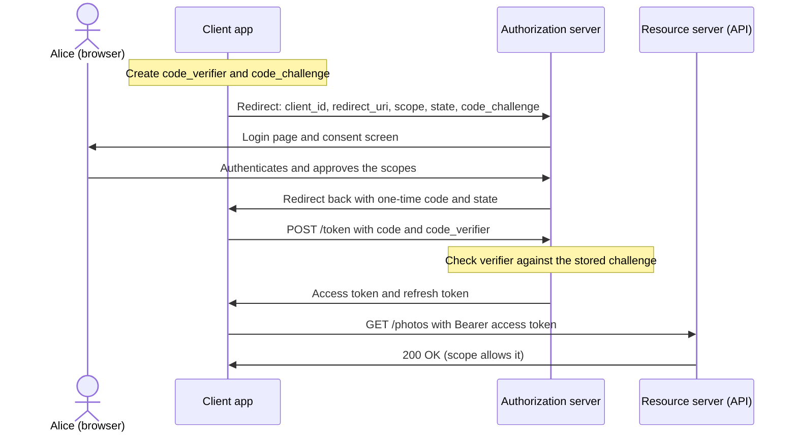

OAuth 2.0 is the standard behind "let this app access my data" and behind most API security in microservices. Interviewers ask *what are the roles, which grant type for which client, what does PKCE fix, and is OAuth for login?* This lesson builds on the [authentication and authorization overview](lesson:authn-authz) and the [cryptography basics](lesson:cryptography); login on top of OAuth is the [OpenID Connect lesson](lesson:oidc) and the token format is the [JWT lesson](lesson:jwt). Play the three flows below: authorization code with PKCE, client credentials, and refresh tokens.

```demo
name: oauth-walk
```

> **One sentence to remember:** *OAuth 2.0 lets an application obtain a limited, revocable access token for an API from an authorization server, with the user's consent, without ever handling the user's password; it is about authorization, not login.*

## What problem it solves {#problem}

### Delegated authorization {#delegation}

Before OAuth, a third-party app that wanted your data asked for your password. That gives it full access, forever, you cannot limit or revoke it separately, and you are teaching users to type passwords into random apps. OAuth 2.0 (RFC 6749) replaces the password with an **access token** that is **scoped** (limited permissions), **short-lived** and **revocable**, issued by an **authorization server** after the user consents.

It is **not** an authentication protocol: an access token says what the holder may do, not who just logged in. For login and single sign-on use [OpenID Connect](lesson:oidc), which is built on OAuth 2.0.

### The four roles {#roles}

| Role | What it is | Example |
| --- | --- | --- |
| **Resource owner** | the user (or entity) who owns the data and can grant access | Alice |
| **Client** | the application that wants access | a print app, a mobile app, a backend job |
| **Authorization server (AS)** | authenticates the owner, takes consent, issues tokens | Keycloak, Auth0, Okta, Entra ID, Spring Authorization Server |
| **Resource server (RS)** | the API holding the data; accepts and validates access tokens | the photo API |

The authorization server and resource server are often separate deployments, but can be one system.

### Key vocabulary {#vocab}

- **Access token:** the credential the client sends to the API, usually as `Authorization: Bearer <token>`. Lives minutes.
- **Refresh token:** a longer-lived credential used only at the token endpoint to get new access tokens.
- **Scope:** a named permission the client asks for (`photos.read`, `invoices.write`). The token is limited to the scopes the user and policy granted.
- **Client id / client secret:** the identity of the app and its secret. **Public clients** (SPAs, mobile apps) cannot keep a secret; **confidential clients** (server-side apps) can.
- **Redirect URI:** where the AS sends the user back; it must be registered and matched **exactly**.
- **Authorization endpoint** (browser interaction) and **token endpoint** (back-channel call from the client).
- **State:** a random value the client sends and checks on return, to prevent CSRF on the redirect.

## Grant types {#grants}

### Authorization code flow with PKCE {#code-flow}

The flow for anything with a user: server-rendered web apps, single-page apps, mobile and desktop apps.



Why two steps and a code? The browser (front channel) can leak URLs, so tokens are never placed in the redirect. The code is exchanged over a direct, TLS-protected back channel.

**PKCE** (Proof Key for Code Exchange, pronounced "pixie", RFC 7636) stops a stolen authorization code from being redeemed: only the party that holds the original verifier can finish the exchange. It was created for mobile apps and is now recommended for **all** clients, and mandatory in OAuth 2.1.

### Client credentials {#client-credentials}

For **machine-to-machine** calls with no user: the client authenticates with its own credentials (secret, or better a signed JWT or mTLS certificate) at the token endpoint and receives a token that represents **the client itself**. No redirect, no consent, usually no refresh token. This is the standard way for one microservice to call another, with the scopes limited to what that service needs.

```http
POST /oauth2/token HTTP/1.1
Content-Type: application/x-www-form-urlencoded
Authorization: Basic base64(client_id:client_secret)

grant_type=client_credentials&scope=invoices.read
```

### Refresh token {#refresh}

Access tokens are short-lived on purpose. A **refresh token** lets the client get a new one without asking the user again:

```http
POST /oauth2/token
grant_type=refresh_token&refresh_token=RT1&client_id=print-app
```

Best practice is **refresh token rotation**: each use returns a new refresh token and invalidates the old one, so a reused (stolen) token is detected and the whole token family revoked. Store refresh tokens securely, bind them to the client, and revoke them on logout.

### Other grants, and the ones to avoid {#other-grants}

| Grant | Status | Notes |
| --- | --- | --- |
| **Authorization code (+ PKCE)** | use | the default for user-facing clients |
| **Client credentials** | use | service-to-service |
| **Refresh token** | use | with rotation |
| **Device code** | use | for TVs and CLIs: the user approves on another device by entering a short code |
| **Token exchange** (RFC 8693) | use | swap a token for one with a different audience or scope, for downstream calls on behalf of a user |
| **Implicit** | **removed in OAuth 2.1** | returned the token in the URL fragment; leaks, no refresh, replaced by code + PKCE |
| **Resource owner password** | **removed in OAuth 2.1** | the app collects the password: defeats the purpose, breaks MFA |

### Which grant for which client? {#choosing}

| Client | Grant |
| --- | --- |
| Server-side web app (confidential) | authorization code (+ PKCE) with client secret |
| Single-page app | authorization code + PKCE, no secret; or a backend-for-frontend that holds the tokens |
| Mobile or desktop app | authorization code + PKCE, system browser (not an embedded web view) |
| Service, batch job, daemon | client credentials |
| TV, CLI, device without a browser | device code |
| Service acting for a user downstream | token exchange |

## Tokens and validation {#tokens}

### Scopes and audience {#scopes}

A **scope** limits what the token allows. The client asks for scopes, the user can approve fewer, and the resource server **enforces** them (`SCOPE_photos.read`). Request the **least** scope needed. The token's **audience** (`aud`) says which API it is for, so one API cannot reuse a token meant for another (see the confused-deputy question below). Scopes limit the *app*; they do not replace the user's own permissions: the effective right is what both the scope and the user allow.

### Opaque or JWT access tokens {#token-format}

OAuth does not mandate a format. An **opaque** token is a random string; the resource server calls the AS **introspection endpoint** (RFC 7662) to learn whether it is active and what it grants. A **JWT** access token carries claims and is validated locally. Trade-offs are in the [overview](lesson:authn-authz#token-types) and the [JWT lesson](lesson:jwt).

### What a resource server must check {#validate}

For a JWT access token the API verifies, in this order of concern:

1. **Signature**, with the public key from the AS (fetched from its **JWKS** endpoint and cached), and that the algorithm is the expected one.
2. **Issuer** (`iss`) is the trusted authorization server.
3. **Audience** (`aud`) includes this API.
4. **Expiry** (`exp`) and not-before (`nbf`), allowing small clock skew.
5. **Scope or roles** allow the requested operation, and then the usual object-level checks on the data.

### Discovery and JWKS {#discovery}

An AS publishes its configuration at `/.well-known/oauth-authorization-server` (OAuth) or `/.well-known/openid-configuration` (OIDC): endpoint URLs, supported grants, and the `jwks_uri` with the public signing keys. Clients and resource servers read it instead of hard-coding URLs, and key rotation works because tokens carry a key id (`kid`) that selects the right key. See [signatures](lesson:cryptography#signatures) for why verifying only needs the public key.

## Security best practices {#security}

### Pitfalls and defences {#pitfalls}

| Pitfall | Defence |
| --- | --- |
| Authorization code interception | **PKCE**, exact `redirect_uri` matching, HTTPS |
| **Open redirect / wildcard redirect URIs** let an attacker receive the code | register exact URIs, never wildcards |
| CSRF on the callback | check the `state` value (or the PKCE and nonce) |
| Token in the URL (implicit flow, query string) | never; use the code flow and the Authorization header |
| Token stored in `localStorage` is readable by XSS | keep in memory or in a backend-for-frontend with an `HttpOnly` cookie; strong CSP |
| Long-lived access tokens | minutes, plus rotating refresh tokens |
| Over-broad scopes | least privilege, separate read and write scopes |
| Token accepted by the wrong API | validate `aud` and `iss` |
| Secrets in mobile or SPA code | treat them as public clients: no secret, use PKCE |
| Embedded web views for login | use the system browser (RFC 8252) so the app cannot capture the password |
| Mix-up between multiple authorization servers | validate the issuer (`iss` parameter, RFC 9207) |

### OAuth 2.1 {#oauth21}

OAuth 2.1 is a consolidation of 2.0 and current best practice: **PKCE required** for the code flow, **implicit and password grants removed**, exact redirect URI matching, no bearer tokens in query strings, and refresh tokens for public clients must be sender-constrained or rotated. Advanced hardening you may be asked about: **DPoP** and **mTLS-bound tokens** (the token only works with the client's key, so a stolen token is useless), and **PAR** (pushed authorization requests, which move the request parameters to a back channel).

## In Spring Boot {#spring}

### Resource server {#spring-rs}

An API that accepts JWT access tokens needs one dependency (`spring-boot-starter-oauth2-resource-server`) and the issuer:

```yaml
spring:
  security:
    oauth2:
      resourceserver:
        jwt:
          issuer-uri: https://auth.example.com/realms/demo   # discovers the JWKS and validates iss
```

```java
@Bean
SecurityFilterChain api(HttpSecurity http) throws Exception {
    return http
        .authorizeHttpRequests(a -> a
            .requestMatchers(HttpMethod.GET, "/photos/**").hasAuthority("SCOPE_photos.read")
            .requestMatchers("/admin/**").hasRole("ADMIN")
            .anyRequest().authenticated())
        .oauth2ResourceServer(o -> o.jwt(Customizer.withDefaults()))
        .sessionManagement(s -> s.sessionCreationPolicy(SessionCreationPolicy.STATELESS))
        .build();
}
```

Spring maps the `scope` claim to authorities with the `SCOPE_` prefix. Add an audience validator on the `JwtDecoder` so tokens for other APIs are rejected, and use `@PreAuthorize` or object-level checks for the data.

### Client {#spring-client}

A web app that logs users in and calls APIs uses `spring-boot-starter-oauth2-client` (`oauth2Login()` for login, `OAuth2AuthorizedClientManager` or `WebClient` with the client filter to attach tokens). A service using client credentials is configured as a registration with `authorization-grant-type: client_credentials`, and Spring fetches and caches the token and refreshes it on expiry. The authorization server itself can be Keycloak or another product, or you can build one with **Spring Authorization Server**. Details of the filter chain are in the Spring Security lesson (coming).

## Cheat sheet {#cheatsheet}

| Need | Answer |
| --- | --- |
| Roles | resource owner, client, authorization server, resource server |
| User-facing app | authorization code + **PKCE** |
| Service to service | client credentials |
| Device without browser | device code |
| Get a new access token silently | refresh token (rotate it) |
| Limit what an app can do | scopes, least privilege |
| Which API a token is for | audience `aud` |
| Login / who is the user | **OpenID Connect** (ID token), not plain OAuth |
| Never use | implicit flow, password grant, wildcard redirect URIs |

| Endpoint | Purpose |
| --- | --- |
| `/authorize` | browser: log in and consent, returns a code |
| `/token` | back channel: exchange code, credentials or refresh token for tokens |
| `/introspect` | resource server asks if an opaque token is active |
| `/revoke` | client revokes a token |
| `/jwks` | public keys for verifying JWT signatures |

## Interview questions {#questions}

### [basic] What is OAuth 2.0 and what problem does it solve? {#what-is-oauth}

An authorization framework that lets an application access a user's resources on an API **without the user's password**. The user consents at an authorization server, which issues a scoped, short-lived, revocable access token to the app. Without it, third-party apps would need the password, giving unlimited access that cannot be limited or revoked separately.

### [basic] Name the four OAuth roles. {#roles-q}

The **resource owner** (the user who owns the data), the **client** (the application asking for access), the **authorization server** (authenticates the user, gets consent, issues tokens) and the **resource server** (the API that validates tokens and serves data).

### [basic] What is the difference between an access token and a refresh token? {#access-vs-refresh}

The access token is sent to the **API** on every call, is short-lived (minutes) and limited by scope. The refresh token is sent **only to the token endpoint** to obtain new access tokens, lives longer, and must be protected more carefully and ideally rotated. The split limits the damage of a leaked access token while avoiding repeated logins.

### [basic] What is a scope? {#scope-q}

A named permission the client requests and the user approves, for example `photos.read`. The token carries the granted scopes and the resource server enforces them. Scopes limit what the app can do on behalf of the user; they do not give the user rights they do not already have.

### [basic] Is OAuth 2.0 an authentication protocol? {#oauth-authn-q}

No, it is delegated **authorization**. The access token tells an API what the bearer may do, not who logged in or when. Using it as proof of login leads to bugs (a token issued to a different app can be replayed). OpenID Connect adds an ID token, nonce and standard claims so the client can authenticate the user properly.

### [basic] Which grant type would you use for a microservice calling another microservice? {#s2s-grant}

**Client credentials**: the service authenticates with its own credentials (secret, signed JWT or mTLS certificate) and gets a token representing itself, with only the scopes it needs. If the call is on behalf of a user, forward or exchange the user's token (token exchange) rather than using the service identity, so the downstream service can authorize the real user.

### [intermediate] Walk through the authorization code flow. {#code-flow-q}

The client sends the user's browser to the authorization endpoint (with `client_id`, `redirect_uri`, `scope`, `state` and the PKCE challenge). The user authenticates and consents at the authorization server. The server redirects back with a one-time code and the `state`. The client verifies `state`, then calls the token endpoint directly with the code, the PKCE verifier (and client authentication if confidential). The server returns an access token and usually a refresh token. The client uses the access token as a bearer token with the API.

### [intermediate] Why return a code and not the token directly? {#why-code}

The redirect travels through the browser, where it can appear in history, logs, referrer headers and be read by other apps. A code is short-lived and single-use and is worthless without the back-channel exchange, which is authenticated and over TLS, so the token itself is never exposed to the browser URL. The implicit flow returned the token in the redirect and was removed for that reason.

### [intermediate] What is PKCE and what attack does it prevent? {#pkce-q}

The client generates a random **code verifier**, sends its hash (the **code challenge**) in the authorization request and later proves possession of the verifier when redeeming the code. If an attacker intercepts the authorization code (a malicious app registered for the same redirect scheme, a leaked URL), they cannot exchange it because they lack the verifier. It protects public clients that cannot keep a secret, and is now recommended for every client.

### [intermediate] What is the `state` parameter for? {#state-q}

A random, unguessable value the client generates per request, stores (for example in the session) and compares to the value returned on the redirect. It binds the response to the request and prevents **CSRF** on the callback, where an attacker feeds the victim's client the attacker's authorization code so the victim's account becomes linked to the attacker's. (PKCE also gives this protection, and OIDC adds `nonce` for the ID token.)

### [intermediate] Which clients are confidential and which are public? {#confidential-public}

Confidential clients can keep a secret: server-side web apps and backends. Public clients cannot: single-page apps and native or mobile apps, since any secret shipped in the code can be extracted. Public clients must not rely on a client secret; they use the authorization code flow with PKCE (or a backend-for-frontend that is itself a confidential client).

### [intermediate] Why were the implicit and password grants removed? {#removed-grants}

**Implicit** returned the access token in the URL fragment, exposing it to the browser history, scripts and extensions, with no way to bind it to the client; code + PKCE does the job securely. **Resource owner password** has the app collect the user's credentials, which breaks the point of OAuth, trains users to type passwords into apps, and cannot support MFA or federated login. Both are gone from OAuth 2.1.

### [intermediate] How does a resource server validate a JWT access token? {#validate-q}

Verify the **signature** using the authorization server's public key from its JWKS endpoint (with the expected algorithm), then check **issuer**, **audience** (this API), **expiry** (and not-before, with small clock skew), then enforce **scope or roles** for the operation, and finally the object-level rules. In Spring: `issuer-uri` or `jwk-set-uri` configuration, an audience validator, and `hasAuthority("SCOPE_...")` rules.

### [intermediate] How do you handle logout and revoking access? {#revoke-q}

Revoke the **refresh token** at the revocation endpoint (`/revoke`) and end the session at the authorization server, so no new access tokens are issued; existing access tokens expire shortly because they are short-lived. For immediate effect on critical APIs use opaque tokens with introspection or a deny list keyed by token id. Users can also revoke an app's grant from the provider's account page.

### [intermediate] What is token introspection and when would you use it? {#introspection}

An endpoint (RFC 7662) where a resource server posts an opaque token and gets back whether it is active, its scopes, subject and expiry. It allows instant revocation and keeps tokens meaningless to clients, at the cost of a network call per request (mitigate with a short cache). JWTs avoid the call by being validated locally.

### [deep] What is the confused deputy problem in OAuth, and how do you prevent it? {#confused-deputy-q}

An API that accepts any valid token from the authorization server might be given a token that was issued for a **different** API (same issuer), and then act on it. Prevent it by validating the **audience** claim, using narrowly scoped tokens, requesting a separate token for each downstream API (token exchange) instead of forwarding the user's token everywhere, and keeping scopes specific to each resource server.

### [deep] How do you secure tokens in a single-page application? {#spa-tokens}

Use authorization code + PKCE. The safest pattern is a **backend-for-frontend** (BFF): a server-side component is the confidential client, keeps access and refresh tokens, and gives the browser only an `HttpOnly`, `Secure`, `SameSite` session cookie; API calls go through the BFF, which adds the token. If tokens must live in the browser, keep them in memory only, short-lived, with refresh rotation, a strict Content Security Policy and no third-party scripts. Avoid `localStorage` since any XSS can read it.

### [deep] What are sender-constrained tokens (DPoP, mTLS-bound)? {#dpop}

A normal bearer token works for whoever holds it. A **sender-constrained** token is bound to a key held by the client: with **DPoP** the client signs each request with a private key and the token carries a hash of the matching public key; with **mTLS-bound** tokens the token is tied to the client certificate. A stolen token is then useless without the key. Used for high-security (financial) APIs.

### [deep] How do refresh token rotation and reuse detection work? {#rotation-q}

Each refresh request returns a new refresh token and invalidates the previous one. The server remembers the chain. If a token that was already used is presented again (a stolen copy, or a client bug), the server cannot tell who is legitimate, so it **revokes the whole family** and the user must log in again. This turns a silent token theft into a detectable event, which is why it suits public clients that cannot authenticate themselves.

### [deep] How would you add authorization to an API behind a gateway with several microservices? {#gateway-q}

The gateway validates the token (signature, issuer, expiry) and rejects unauthenticated traffic early, but each service still validates the token or a trusted internal one, checks audience and scopes, and performs object-level authorization; trust is not given for being inside the network. For service-to-service calls use client credentials or token exchange to get a token with the right audience, and keep tokens short-lived. Central policy can live in the authorization server (scopes, roles in claims) while fine-grained rules stay in the services that own the data.

### [coding] Configure a Spring Boot API as an OAuth 2.0 resource server. {#coding-rs}

```java
@Configuration
@EnableMethodSecurity
class SecurityConfig {

    @Bean
    SecurityFilterChain api(HttpSecurity http) throws Exception {
        return http
            .csrf(c -> c.disable())                                         // stateless bearer API, no cookies
            .sessionManagement(s -> s.sessionCreationPolicy(SessionCreationPolicy.STATELESS))
            .authorizeHttpRequests(a -> a
                .requestMatchers("/actuator/health").permitAll()
                .requestMatchers(HttpMethod.GET, "/reports/**").hasAuthority("SCOPE_reports.read")
                .anyRequest().authenticated())
            .oauth2ResourceServer(o -> o.jwt(Customizer.withDefaults()))
            .build();
    }

    @Bean
    JwtDecoder jwtDecoder(OAuth2ResourceServerProperties props) {
        NimbusJwtDecoder decoder = JwtDecoders.fromIssuerLocation(props.getJwt().getIssuerUri());
        OAuth2TokenValidator<Jwt> audience = new JwtClaimValidator<List<String>>("aud", aud -> aud != null && aud.contains("reports-api"));
        OAuth2TokenValidator<Jwt> withIssuer = JwtValidators.createDefaultWithIssuer(props.getJwt().getIssuerUri());
        decoder.setJwtValidator(new DelegatingOAuth2TokenValidator<>(withIssuer, audience));
        return decoder;
    }
}
```

Point out: `issuer-uri` discovers the JWKS; the default validators already check signature, issuer and expiry; the extra audience validator is what blocks tokens issued for other APIs; scopes become `SCOPE_` authorities.

### [coding] Call a protected API from a service with client credentials. {#coding-client}

```yaml
spring:
  security:
    oauth2:
      client:
        registration:
          billing:
            provider: demo
            client-id: reporting-job
            client-secret: ${REPORTING_CLIENT_SECRET}      # from a secret manager, not the repository
            authorization-grant-type: client_credentials
            scope: invoices.read
        provider:
          demo:
            token-uri: https://auth.example.com/oauth2/token
```

```java
@Bean
WebClient billingClient(OAuth2AuthorizedClientManager manager) {
    ServletOAuth2AuthorizedClientExchangeFilterFunction oauth = new ServletOAuth2AuthorizedClientExchangeFilterFunction(manager);
    oauth.setDefaultClientRegistrationId("billing");
    return WebClient.builder().baseUrl("https://billing.example.com").apply(oauth.oauth2Configuration()).build();
}
```

Spring fetches the token from the token endpoint, caches it until it expires, attaches `Authorization: Bearer ...` to each request and renews it automatically. Mention that a certificate or signed-JWT client authentication (`private_key_jwt`) is preferable to a shared secret.
