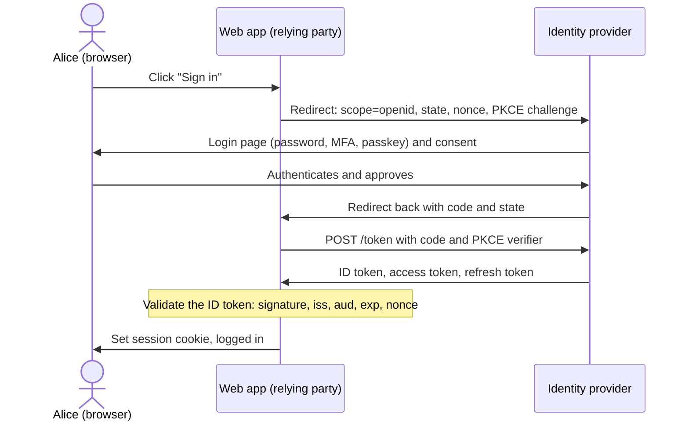

[OAuth 2.0](lesson:oauth2) answers "what may this app do?". It does not tell the app who the user is. **OpenID Connect (OIDC)** is the thin identity layer on top that does: it is how "Sign in with Google" and corporate single sign-on work. Interviewers ask *how OIDC differs from OAuth, what is in an ID token, what must you validate, and how SSO and logout work*. It builds on the [overview](lesson:authn-authz) and uses signed tokens covered in the [JWT lesson](lesson:jwt). Play the three scenes: the login flow, ID token vs access token, and single sign-on.

```demo
name: oidc-walk
```

> **One sentence to remember:** *OIDC = OAuth 2.0 authorization code flow + scope `openid` + an ID token (a signed JWT that says who logged in, for which app, when) + standard claims and endpoints.*

## What OIDC adds {#what}

### OAuth is not login {#oauth-not-login}

An OAuth access token is meant for an **API**. The client cannot rely on it to learn who the user is: the token may be opaque, it has no standard identity claims, and it can be obtained by *another* app and replayed to yours. Early "login with OAuth" implementations were vulnerable for exactly this reason. OIDC (2014, built on OAuth 2.0) standardises authentication: the identity provider returns an **ID token** addressed to your app, with the user's identifier and details of how and when they logged in.

| | OAuth 2.0 | OpenID Connect |
| --- | --- | --- |
| Purpose | delegated **authorization** | **authentication** (and identity) |
| Main token | access token (for an API) | **ID token** (for the app), plus the access token |
| Tells the app who the user is | no | yes (`sub` and claims) |
| Scope | any custom scopes | the special scope **`openid`** is required |
| Extra endpoint | none | **userinfo**, plus discovery document |
| Typical use | "app may read my photos" | "sign in with Google" |

### Roles {#roles}

OIDC renames two OAuth roles:

- **OpenID Provider (OP):** the identity provider, which is the OAuth authorization server that also authenticates users and issues ID tokens (Keycloak, Auth0, Okta, Entra ID, Google).
- **Relying Party (RP):** the application (OAuth client) that relies on the provider to log users in.
- The **end user** logs in at the provider.

## The login flow {#flow}

### Authorization code flow with `openid` {#code-flow}

OIDC uses the same [authorization code flow with PKCE](lesson:oauth2#code-flow), with these differences:



Other flows exist (implicit and hybrid), but the code flow with PKCE is the current recommendation for every client, including SPAs and mobile apps.

### The ID token {#id-token}

The ID token is a signed **JWT** (see [cryptography on signatures](lesson:cryptography#signatures)) whose audience is the **relying party**. Key claims:

| Claim | Meaning |
| --- | --- |
| `iss` | issuer: the URL of the provider |
| `sub` | **subject**: a stable, unique id of the user at this provider (use this, not the email, as the key) |
| `aud` | audience: must contain your **client id** |
| `exp`, `iat` | expiry and issue time |
| `nonce` | the value your app sent, echoed back |
| `auth_time` | when the user actually authenticated |
| `acr`, `amr` | the authentication assurance level and methods used (password, MFA) |
| `azp` | authorized party: the client the token was issued to |
| `at_hash` | hash of the access token it was issued with |
| `name`, `email`, `picture`... | profile claims, depending on the granted scopes |

### Validating the ID token {#validation}

The client must check, before trusting it:

1. The **signature**, with the provider's public key from its **JWKS** endpoint, using the expected algorithm (never accept `none`, never let the token choose a weaker algorithm).
2. **`iss`** equals the provider you intended to talk to.
3. **`aud`** contains your own client id.
4. **`exp`** is in the future (allow small clock skew), and `iat` is sensible.
5. **`nonce`** equals the value you sent in this login attempt (blocks replay).
6. Optionally `auth_time` and `acr` if you demand a recent login or MFA.

Libraries (Spring Security, Nimbus) do this when configured correctly. Never just decode the JWT and trust the payload.

### Userinfo, claims and scopes {#userinfo}

Scopes control which claims you may receive: `openid` (just `sub`), `profile` (name, picture, locale), `email` (`email`, `email_verified`), `phone`, `address`. Claims can be in the ID token or fetched from the **userinfo endpoint** by calling it with the access token. Keep the ID token small and fetch extra data from userinfo. Always check **`email_verified`** before trusting an email address, and never use the email as the primary key.

## Using OIDC {#using}

### Discovery and endpoints {#discovery}

A provider publishes a **discovery document** at `<issuer>/.well-known/openid-configuration` containing the endpoint URLs (`authorization_endpoint`, `token_endpoint`, `userinfo_endpoint`, `end_session_endpoint`, `jwks_uri`), the supported scopes, claims and algorithms. Clients configure only the **issuer URL** and discover the rest, and key rotation works because the ID token header names the key (`kid`) in the JWKS.

### Single sign-on and logout {#sso}

The provider keeps its own login session (a cookie at the provider). When a second app redirects the user there, the provider finds the session and sends the user straight back with a code: no password prompt. That is **SSO**. Each app still builds its own local session from its ID token.

**Logout** has layers: logging out of one app ends only that app's session; **RP-initiated logout** redirects to the provider `end_session_endpoint` (with `id_token_hint`) to end the provider session; and the other apps learn about it through **front-channel logout** (hidden iframes, unreliable with browser privacy changes) or **back-channel logout** (the provider POSTs a signed logout token to each app, which is more reliable). Also set short sessions, since propagation is not guaranteed.

### OIDC vs SAML {#vs-saml}

| | OIDC | SAML 2.0 |
| --- | --- | --- |
| Format | JSON, JWT | XML assertions |
| Built on | OAuth 2.0 over HTTPS | its own bindings (HTTP redirect and POST) |
| Typical clients | web, SPA, mobile, APIs | enterprise web apps |
| Complexity | lower, developer friendly | higher, XML signature pitfalls |
| Mobile and API support | native | awkward |
| Era | modern (2014) | older (2005), still common in enterprises |

New systems choose OIDC; SAML remains where legacy enterprise applications require it, often bridged by the identity provider.

### Federation and social login {#federation}

An identity provider can itself delegate to others (Google, a corporate Active Directory or another SAML IdP), so apps talk to one OIDC provider while users sign in with their existing accounts. This is **identity federation**. Authenticate once with the trusted source, then map the stable `sub` (and issuer) to a local user record rather than creating separate passwords.

## In Spring Boot {#spring}

### Login with OIDC {#spring-login}

A web app using `spring-boot-starter-oauth2-client` needs only the registration and the issuer:

```yaml
spring:
  security:
    oauth2:
      client:
        registration:
          corp:
            client-id: web-app
            client-secret: ${WEB_APP_SECRET}
            scope: openid,profile,email
        provider:
          corp:
            issuer-uri: https://auth.example.com/realms/demo     # discovery fills in the endpoints and JWKS
```

```java
@Bean
SecurityFilterChain web(HttpSecurity http) throws Exception {
    return http
        .authorizeHttpRequests(a -> a.requestMatchers("/", "/public/**").permitAll().anyRequest().authenticated())
        .oauth2Login(Customizer.withDefaults())                                   // redirect, code exchange, ID token validation
        .logout(l -> l.logoutSuccessHandler(oidcLogoutHandler))                   // RP-initiated logout
        .build();
}
```

Spring performs the redirect, state and nonce handling, the code exchange, PKCE for public clients and ID token validation, then stores an `OidcUser` in the session. In a controller read it with `@AuthenticationPrincipal OidcUser user` (`user.getSubject()`, `user.getEmail()`, `user.getIdToken()`). For logout, `OidcClientInitiatedLogoutSuccessHandler` redirects to the provider's `end_session_endpoint`.

## Security notes {#security}

### Pitfalls {#pitfalls}

| Pitfall | Defence |
| --- | --- |
| Treating the access token as proof of login | use the ID token, validated |
| Not checking `aud`, `iss` or `nonce` | validate all, use a library |
| Accepting an ID token for API access | APIs accept access tokens with their own audience only |
| Using `email` as the user key | use `iss` + `sub`; check `email_verified` |
| Accepting `alg: none` or algorithm confusion | pin the expected algorithms |
| Skipping `state` | CSRF: attacker logs the victim into the attacker's account |
| Long-lived sessions after provider logout | back-channel logout, short sessions |
| Open redirect after login | validate `post_logout_redirect_uri` and `redirect_uri` against exact registered values |
| Implicit flow in SPAs | code flow with PKCE |

## Cheat sheet {#cheatsheet}

| Need | Answer |
| --- | --- |
| Who logged in? | **ID token**, validated: `sub`, `iss`, `aud`, `exp`, `nonce` |
| What may the app do? | **access token** (OAuth), checked by the API |
| Required scope | `openid` (plus `profile`, `email`) |
| More user data | **userinfo endpoint** with the access token |
| Endpoints and keys | discovery `/.well-known/openid-configuration`, **JWKS** |
| Stable user key | `iss` + `sub`, never email |
| Replay protection | `nonce` (ID token), `state` (callback) |
| SSO | provider session cookie; apps keep own sessions |
| Logout everywhere | RP-initiated + back-channel logout |
| Roles | OpenID Provider (OP), Relying Party (RP) |

## Interview questions {#questions}

### [basic] What is OpenID Connect and how does it relate to OAuth 2.0? {#what-is-oidc}

An identity layer on top of OAuth 2.0. OAuth gives an app an access token to call APIs; OIDC adds an **ID token** (a signed JWT with the user's identity and login details), standard claims and scopes, a userinfo endpoint and discovery. Use OAuth to authorize API access and OIDC to authenticate users (login and single sign-on).

### [basic] What is an ID token, and how is it different from an access token? {#id-vs-access}

The **ID token** is for the client application: it says who authenticated, when and how, and its audience is the client id. The **access token** is for an API: it says what the client may do, and its audience is that API. The app reads the ID token; it sends the access token to APIs. An API must not accept an ID token for authorization, and an app must not use the access token as proof of identity.

### [basic] What is the `openid` scope? {#openid-scope}

The scope that turns an OAuth request into an OIDC request. Without it the provider returns no ID token. Additional scopes (`profile`, `email`, `phone`, `address`) select which standard claims are released.

### [basic] What are the standard claims `sub`, `iss`, `aud` and `exp`? {#claims-q}

`sub` is the stable unique identifier of the user at the provider, `iss` the issuer URL, `aud` the intended audience (the client id), and `exp` the expiry time. Together they say who, from whom, for whom and until when. Use `iss` + `sub` as the account key.

### [basic] What is single sign-on? {#sso-q}

The user authenticates once at the identity provider and then gains access to multiple applications without logging in again, because the provider keeps its own session and silently issues codes and ID tokens to each app that redirects there. It reduces password fatigue and centralises MFA, auditing and offboarding.

### [intermediate] Walk through the OIDC authorization code login. {#flow-q}

The app redirects the browser to the provider's authorization endpoint with `scope=openid ...`, `state`, `nonce` and a PKCE challenge. The user logs in and consents. The provider redirects back with a code and the state. The app calls the token endpoint over the back channel with the code and PKCE verifier and receives the ID token, access token and refresh token. It validates the ID token (signature, issuer, audience, expiry, nonce), creates its own session and may call userinfo for more claims.

### [intermediate] What must you validate in an ID token? {#validate-q}

The **signature** using the provider's JWKS and the expected algorithm, **`iss`** equals the expected issuer, **`aud`** contains your client id (and `azp` if present), **`exp`** has not passed (with small skew), **`nonce`** equals the one you sent, and where required `auth_time`/`acr`. Skipping any of these opens token substitution, replay or mix-up attacks.

### [intermediate] What are `state` and `nonce` for? {#state-nonce}

`state` ties the authorization response to the request your app started, preventing CSRF on the callback (an attacker injecting their own code). `nonce` is placed inside the ID token and checked by the app, binding the token to this login attempt and preventing replay of a stolen ID token. They protect different messages, so both are used.

### [intermediate] What is the userinfo endpoint and when would you use it? {#userinfo-q}

A protected endpoint where the app presents the access token and receives the claims allowed by the granted scopes. It keeps ID tokens small, returns fresh data and lets you obtain profile details the app only occasionally needs. The `sub` returned must match the ID token's `sub`.

### [intermediate] What is the discovery document and the JWKS endpoint? {#discovery-q}

The discovery document at `/.well-known/openid-configuration` lists the provider's endpoints, supported scopes, claims and signing algorithms, so a client only needs the issuer URL. The JWKS endpoint (`jwks_uri`) serves the public keys used to verify token signatures, identified by `kid`; clients cache them and refetch when they see an unknown `kid`, which makes key rotation seamless.

### [intermediate] Why should you not use the email as the user identifier? {#email-key}

Emails can change, be reassigned to another person, and are not always verified (check `email_verified`). Different providers may also assert the same email for different people, which enables account takeover when accounts are linked by email. The stable, unique key is the pair **issuer + `sub`**.

### [intermediate] OIDC vs SAML: how do they compare? {#oidc-vs-saml}

Both provide federated login and SSO. SAML is XML-based, older and common in enterprise web apps; OIDC is JSON and JWT over OAuth 2.0 and works naturally for SPAs, mobile apps and APIs, with simpler libraries. Choose OIDC for new work and SAML when integrating with a partner or legacy system that requires it.

### [intermediate] How does logout work with SSO? {#logout-q}

Ending the local app session is not enough, because the provider session would silently log the user in again. **RP-initiated logout** redirects the browser to the provider's `end_session_endpoint` with an `id_token_hint` to end the provider session. To end other apps' sessions the provider uses **front-channel logout** (browser-based, unreliable) or **back-channel logout** (a signed logout token posted server to server). Keep sessions short because propagation can fail.

### [deep] How does the implicit flow in OIDC differ from the code flow, and why is it avoided? {#implicit-oidc}

The implicit flow returned tokens directly from the authorization endpoint in the URL fragment, with no back-channel exchange and no client authentication. Tokens leaked via history, referrers and scripts, could not be bound to the client, and refresh was impossible. The code flow with PKCE keeps tokens off the front channel and works for SPAs, so implicit is deprecated and removed in OAuth 2.1.

### [deep] How would you add "Sign in with Google" and also support your own accounts safely? {#linking}

Use OIDC with Google as one provider. Create a local user keyed by (`iss`, `sub`), not by email. To link a social login to an existing local account, require the user to prove control of the local account (log in with it) rather than matching on email, and require `email_verified`. Keep one identity per user and allow several linked providers, store no passwords for federated users, and handle provider outages and revoked consent.

### [deep] Can you use an ID token to call your API? {#id-token-api}

You should not. The ID token's audience is the client application, so a correct API rejects it, and it carries no scopes meant for authorization. Accepting it lets any app that obtained an ID token for the same user call your API (token substitution). The API should accept only access tokens issued for it, with the right audience and scopes.

### [deep] How do you handle token refresh and session lifetime in an OIDC web app? {#session-lifetime}

The app has its own session (cookie) with its own timeout; the ID token is checked once at login. Use the refresh token to renew the access token for API calls, with rotation, and when it fails (revoked, expired, user disabled) end the session. To re-verify the user, send `prompt=login` or `max_age` and check `auth_time`; to require MFA, request an `acr` value and check it in the returned token.

### [coding] Read the logged-in user in a Spring controller. {#coding-principal}

```java
@GetMapping("/me")
public Map<String, Object> me(@AuthenticationPrincipal OidcUser user) {
    return Map.of(
        "subject", user.getSubject(),                         // stable id: issuer + subject is the key
        "name", user.getFullName(),
        "email", user.getEmail(),
        "emailVerified", Boolean.TRUE.equals(user.getEmailVerified()),
        "issuer", user.getIssuer().toString());
}
```

Mention that Spring has already validated the ID token (signature, issuer, audience, expiry, nonce) before an `OidcUser` is created, that the app then runs on its own session cookie, and that roles usually come from a claim you map to authorities with a `GrantedAuthoritiesMapper` or `OidcUserService`.

### [coding] Map a roles claim from the ID token to Spring authorities. {#coding-roles}

```java
@Bean
GrantedAuthoritiesMapper authoritiesMapper() {
    return authorities -> authorities.stream()
        .flatMap(a -> a instanceof OidcUserAuthority oidc
            ? ((List<String>) oidc.getIdToken().getClaims().getOrDefault("roles", List.of())).stream()
            : Stream.empty())
        .map(role -> new SimpleGrantedAuthority("ROLE_" + role.toUpperCase()))
        .collect(Collectors.toSet());
}
```

Then `hasRole("ADMIN")` works in `authorizeHttpRequests`. Note: roles are provider specific (Keycloak puts them under `realm_access.roles`), so adjust the claim path; only trust claims from the validated token; and keep authorization decisions server-side, not in the UI.
