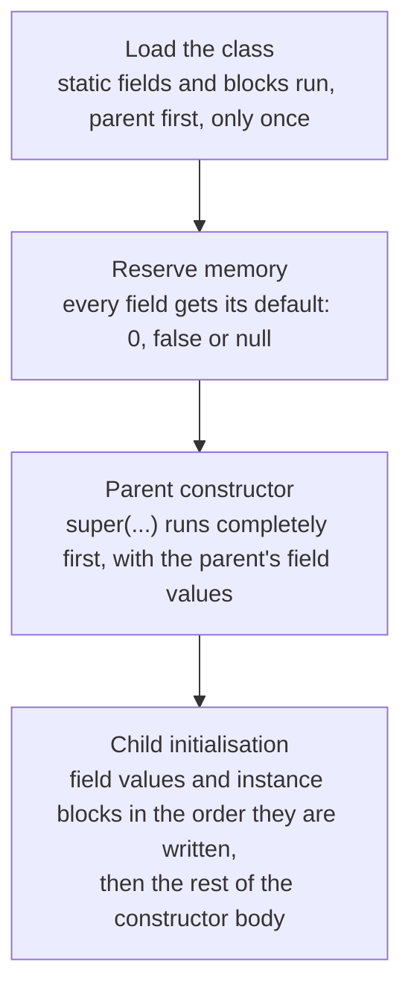

"Explain the four pillars of OOP" opens many interviews. The follow-up questions show whether you understand the ideas or only memorised them:

- What is the difference between abstraction and encapsulation?
- Why should you prefer composition?
- Which method runs here?

This lesson explains each idea in plain language. Every example uses one small **e-commerce and warehouse** model: products, orders and stock. The lesson ends with interview questions and code exercises.

The animation shows the part people most often get wrong: which method actually runs. It has three scenes: how Java finds the method to run, overloads versus overrides, and the order in which constructors run.

```demo
name: oop-walk
```

> **One sentence to remember:** *Keep data and its rules together, and depend on interfaces, not details.*

## Objects and classes {#objects}

### Class and object {#class-object}

A **class** is a blueprint. It declares the data something has (its **fields**) and what it can do (its **methods**).

An **object** is one thing built from that blueprint. It lives on the heap and has its own copy of the fields. Every object has three things:

- **State:** the current values of its fields, such as a product's price or an order's status.
- **Behaviour:** the methods that read or change that state.
- **Identity:** every object is different from every other object, even one with the same state. `==` compares identity. `equals()` compares meaning (see [the equals and hashCode contract](lesson:java-hashmap#contract)).

```java
class Product {
    private final String sku;
    private long priceCents;                 // state

    Product(String sku, long priceCents) {   // constructor: builds a valid object
        this.sku = sku;
        this.priceCents = priceCents;
    }

    long price() { return priceCents; }       // behaviour
}

Product a = new Product("SKU-1", 500);
Product b = new Product("SKU-1", 500);       // same state, different identity: a == b is false
```

A variable of a class type holds a **reference** to the object, not the object itself. So copying the variable copies the reference, and both variables then point to the same object. See [where objects live](lesson:java-memory-model#where-things-live) and why Java is [pass by value](lesson:java-memory-model#pass-by-value).

### Static versus instance members {#static}

An **instance** member belongs to one object. A **static** member belongs to the class itself, so there is only one, shared by everyone. Examples are a counter, a constant or a factory method.

Static methods have limits:

- They cannot use `this`.
- They cannot be overridden. A subclass can only **hide** them with a method of the same signature.
- They make code harder to test and to replace.

So keep static members for constants and for utility methods that hold no state.

### Constructors and this {#constructors}

A constructor has the same name as the class and no return type. It runs once, when the object is created. Its job is to leave the object in a **valid state**. For example, it should be impossible to create an order with no customer.

Rules worth knowing:

- If you write no constructor, the compiler adds one with no arguments. As soon as you write any constructor, that default one disappears.
- `this(...)` calls another constructor of the same class. `super(...)` calls a constructor of the parent class. Either one must be the first statement. Java 25 relaxed this rule: statements that do not use `this` may now come before `super(...)` (see [flexible constructor bodies](lesson:java-version-history#java-25)).
- Constructors are **not inherited**.
- `this` means the current object. Use it to tell a field apart from a parameter with the same name, or to pass the object to other code.

### Initialization order {#init-order}

When you write `new FrozenItem()`, the parent part of the object is always built before the child part. The steps are:



The third animation scene shows these steps.

One consequence matters in practice: **never call an overridable method from a constructor**. The parent constructor runs before the child's fields are set. If it calls a method that the child overrides, the child's version runs and sees `null` or 0 where it expects real values.

### The Object class {#object-class}

Every class extends `Object`. From `Object`, every object gets `equals`, `hashCode`, `toString`, `getClass`, `clone`, and the monitor methods `wait` and `notify`.

- Override `toString` so logs are readable.
- For value objects, override `equals` and `hashCode` **together**.
- Do not override `clone`. Its design is flawed, so write a copy constructor instead.
- Do not override `finalize`. It is deprecated for removal (see [finalizers](lesson:garbage-collector#references)).

## The four pillars {#pillars}

### Encapsulation {#encapsulation}

**Encapsulation** means keeping data together with the code that works on it, and **hiding the internals**. The object can then protect its own rules. Such a rule, one that must always be true for the object, is called an **invariant**. Other code talks to the object through its methods and never reaches into its fields.

```java
// Weak: anyone can break the rule
class Stock { public int quantity; }
stock.quantity = -5;                         // nothing stops this

// Strong: the object guards its rule
class Stock {
    private int quantity;
    void remove(int n) {
        if (n <= 0 || n > quantity) throw new IllegalArgumentException("bad quantity");
        quantity -= n;
    }
    int quantity() { return quantity; }
}
```

Java's access modifiers are the tool for this:

| Modifier | Who can see the member |
| --- | --- |
| `private` | Only the same class. |
| *(none)*, called package-private | Classes in the same package. |
| `protected` | The same package, and subclasses. |
| `public` | Everyone. |

Guidelines:

- Make fields `private`. Make public only the methods that other code really needs.
- A getter and a setter for every field is **not** encapsulation. It is a public field with extra typing. Write methods that say what you want to happen instead: `order.cancel()`, not `order.setStatus(CANCELLED)`. This rule is called *tell, don't ask*.
- Never hand out an internal object that can change. Return a copy or a read-only view (`List.copyOf(items)`). Also copy changeable arguments in the constructor. Such a copy is called a **defensive copy**.
- The strongest encapsulation is **immutability**. An object that cannot change can never be put into an invalid state, and threads can share it freely ([see thread-safety patterns](lesson:java-concurrency#patterns)).

### Abstraction {#abstraction}

**Abstraction** means showing *what* something does and hiding *how* it does it. Callers then depend on a simple idea instead of the details. In Java you create abstractions with **interfaces** and **abstract classes**:

```java
interface PaymentGateway {                          // the abstraction: what callers need
    Receipt charge(Money amount, Card card);
}

class StripeGateway implements PaymentGateway { /* details of the HTTP calls */ }
class FakeGateway   implements PaymentGateway { /* used in tests */ }
```

The checkout code uses `PaymentGateway` and does not care which class it gets. That is what lets you swap one implementation for another, test without a network, and change the details later.

**Abstraction versus encapsulation** is a very common question. The short answer:

- **Abstraction** works at the **design** level. You choose which behaviour to show, as an interface. It hides *complexity*.
- **Encapsulation** works at the **implementation** level. You protect the data with private fields and rules. It hides *data*.

They work together: an abstraction is usually implemented by encapsulated classes.

### Inheritance {#inheritance}

**Inheritance** lets one class (the **subclass**) reuse and extend another class (the **superclass**) with `extends`. It models an **is-a** relationship: a perishable product *is a* product.

```java
class Product {
    long price() { return basePrice; }
    String describe() { return "Product " + sku; }
}

class PerishableProduct extends Product {
    @Override long price() { return isNearExpiry() ? basePrice / 2 : basePrice; }
}
```

- A subclass inherits the members that are not private. It can add its own members and **override** methods, which means replacing the parent's version.
- A Java class can extend only **one** class (single inheritance), but it can implement many interfaces.
- `super.method()` calls the parent's version of a method. `super(...)` calls the parent's constructor.
- `final` on a class stops anyone from extending it. `final` on a method stops anyone from overriding it.
- Use inheritance only for a true *is-a* relationship, where the subclass also works correctly everywhere the parent is expected. This is the [Liskov substitution principle](lesson:solid-principles#lsp). Otherwise use composition.

Inheritance is the most overused feature in OOP. It ties classes together more tightly than anything else: a subclass depends on how its parent is *implemented*, not just on what the parent promises. So a change to the parent can break its children. This is called the **fragile base class** problem. See [composition](lesson:oop-concepts#composition).

### Polymorphism {#polymorphism}

**Polymorphism** means "many forms": the same call behaves differently depending on the object. There are two kinds:

- **Overriding** (run-time polymorphism, also called **dynamic dispatch**). A subclass redefines a method. The version that runs is chosen from the **actual class of the object**, at the moment the call runs.
- **Overloading** (compile-time polymorphism). Several methods in one class share a name but take different parameters. The compiler picks one from the **declared types of the arguments**.

```java
Product p = new PerishableProduct("milk");   // declared type Product, actual type PerishableProduct
p.price();                                    // runs PerishableProduct.price(): decided at run time
```

The benefit: code written for the general type works with every subtype, including subtypes written later. So one polymorphic call can replace a chain of `if (type == X) ... else if (type == Y)` checks:

```java
// before: every new product type means editing this method
double shipping(Product p) {
    if (p instanceof Perishable) return 9.0;
    else if (p instanceof Bulky) return 15.0;
    else return 4.0;
}

// after: each class knows its own cost; adding a type adds a class and changes nothing here
double shipping(Product p) { return p.shippingCost(); }
```

#### Rules for overriding {#overriding-rules}

- The method must have the same name and the same parameter types. The return type may be a **subtype** of the parent's return type. This is called a **covariant return**.
- The access level may be widened but never narrowed. A `public` method cannot become `protected`.
- It may not throw broader checked exceptions than the parent's method.
- `static`, `private` and `final` methods cannot be overridden. A static method with the same signature **hides** the parent's method instead.
- **Fields are never polymorphic.** A field with the same name in the subclass hides the parent's field, and the declared type decides which one you see.
- Always write `@Override`. The compiler then tells you if you did not really override anything.

#### How the call is dispatched {#dispatch}

A call such as `p.price()` is handled in two steps:

1. **At compile time**, the compiler checks that the *declared* type has the method. If there are overloads, it picks one here.
2. **At run time**, the JVM looks for the method starting at the *actual* class of the object, then walks up through the parents until it finds one.

The first animation scene shows this search. The second scene compares overloads with overrides.

How the JVM makes this fast: HotSpot keeps a table of virtual methods for each class, called a **vtable**. The JIT compiler often **inlines** a call that always reaches the same class, which means it copies the method's code into the caller.

At the bytecode level there are four call instructions:

- `invokevirtual` for methods of a class.
- `invokeinterface` for methods of an interface.
- `invokespecial` for constructors and `super` calls (and for private methods before Java 11).
- `invokestatic` for static methods.

## Interfaces and abstract classes {#interfaces}

Both define a contract that other classes fulfil, and you cannot create an object of either one directly. They differ in what they can hold and how many a class can use:

| | Interface | Abstract class |
| --- | --- | --- |
| Instance state (fields) | No. Only `public static final` constants. | Yes. |
| Constructors | No. | Yes. Subclasses call them. |
| Method bodies | `default` and `static` methods, and `private` methods since Java 9. | Any methods, plus abstract ones. |
| How many a class can use | It can **implement many**. | It can **extend only one**. |
| What it expresses | A capability or role, such as "can be shipped". | A partial implementation shared by related classes. |
| Member visibility | Methods are `public`. | Any access modifier. |

**Default methods** (Java 8, see [Java 8](lesson:java-version-history#java-8)) let an interface gain a new method without breaking the classes that implement it. That is how `List.sort` and `Collection.stream` were added.

If a class inherits the same default method from two interfaces, it does not compile until the class overrides that method. Inside the override, it can pick one version with `Shippable.super.label()`. Two rules decide other conflicts:

- A method in a **class** always beats an interface default.
- A **more specific** interface beats a less specific one.

**Which one to choose:** start with an interface. Use an abstract class when subclasses share real state, or share a fixed series of steps (the **template method** [pattern](lesson:design-patterns#template-method)). Many designs use both: an interface for the contract, and an abstract base class that provides most of the code.

A **marker interface**, such as `Serializable`, has no methods. It only tags a class. In new code, annotations have mostly replaced this idea.

## Composition over inheritance {#composition}

**Composition** means building a class by holding other objects and passing work to them. This is called **delegation**. It models a **has-a** relationship: an order *has a* shipping policy.

Composition is the preferred way to reuse behaviour. The parts can be replaced, and you depend only on their public interface.

```java
// Inheritance: a new class for every combination, fixed at compile time
class FrozenOrder extends Order { /* ... */ }
class FrozenExpressOrder extends FrozenOrder { /* ... */ }

// Composition: behaviour is a part you plug in
class Order {
    private final ShippingPolicy shipping;    // an interface
    private final DiscountPolicy discount;    // an interface

    Order(ShippingPolicy shipping, DiscountPolicy discount) { ... }

    Money total() { return discount.apply(subtotal()).plus(shipping.cost(this)); }
}
```

Why composition wins:

- **Flexibility.** You can change a part while the program runs. You can combine parts freely, without a subclass for every combination.
- **No fragile base class.** The classic example is a counting set that extends `HashSet` and overrides both `add` and `addAll`. Inside `HashSet`, `addAll` calls `add`, so every item gets counted twice. A class that *wraps* a set and delegates to it does not depend on such hidden details.
- **Easy testing.** You can pass in a fake part.
- **Encapsulation.** A subclass can see its parent's protected internals. A class that uses composition sees only the public interface.

Use inheritance when the relationship really is *is-a*, you control the base class, and the base class was **designed for extension**. That means it documents how to extend it and has few overridable methods. Otherwise follow the rule "design and document for inheritance or else prohibit it": make the class `final`.

## Design principles and patterns {#solid}

Two topics grew big enough to get their own lessons:

- **[SOLID and design principles](lesson:solid-principles)**: single responsibility, open/closed, Liskov substitution, interface segregation and dependency inversion, plus DRY, KISS, YAGNI, the Law of Demeter, coupling and cohesion.
- **[Design patterns](lesson:design-patterns)**: Singleton, Factory, Builder, Adapter, Decorator, Proxy, Strategy, Observer, Template Method and more, with Java and Spring examples.

Read this lesson first. Both lessons build on classes, abstraction, inheritance, polymorphism and composition.

## Modern Java for object design {#modern-java}

### Records {#records}

A **record** (Java 16, see [Java 16](lesson:java-version-history#java-16)) is a short way to write a class that only carries data and never changes. Java writes the constructor, the accessor methods, `equals`, `hashCode` and `toString` for you. Use records for value objects and for **DTOs** (data transfer objects: simple objects that carry data between layers or over the network).

A record is `final`. It cannot extend a class, but it can implement interfaces. It can check its values in a **compact constructor**:

```java
record Money(long cents, String currency) {
    Money {                                              // compact constructor
        if (cents < 0) throw new IllegalArgumentException("negative amount");
    }
    Money plus(Money other) { return new Money(cents + other.cents, currency); }
}
```

### Enums with behaviour {#enums}

An `enum` is a fixed set of constants, and each constant is the only object of its kind. Each constant can have fields and behaviour, and an enum can implement an interface. An enum is a clean replacement for "a type code plus a switch", and it is also the safest way to write a singleton:

```java
enum ShippingMethod implements ShippingPolicy {
    STANDARD(4_00) { public long cost(Order o) { return base; } },
    EXPRESS(9_00)  { public long cost(Order o) { return base + 2 * o.itemCount(); } };

    protected final long base;
    ShippingMethod(long base) { this.base = base; }
}
```

### Sealed hierarchies and pattern matching {#sealed}

A **sealed** class or interface (Java 17) lists exactly which subtypes are allowed. No other class can extend it, so the set of subtypes is *closed*.

Combine this with pattern matching for `switch` (Java 21), and the compiler checks that your `switch` handles every case:

```java
sealed interface PaymentResult permits Approved, Declined, Pending {}
record Approved(String receipt) implements PaymentResult {}
record Declined(String reason) implements PaymentResult {}
record Pending(String ticket) implements PaymentResult {}

String message(PaymentResult r) {
    return switch (r) {
        case Approved a -> "Paid: " + a.receipt();
        case Declined d -> "Refused: " + d.reason();
        case Pending p  -> "Waiting: " + p.ticket();      // no default needed: adding a subtype breaks the build here
    };
}
```

This is the opposite trade-off to normal polymorphism:

- Use an *open* hierarchy with overridden methods when you expect new types to be added.
- Use a *sealed* hierarchy when the set of cases is fixed, and you want the compiler to check that you handle them all.

See [sealed classes in Java 17](lesson:java-version-history#java-17) and [pattern matching in Java 21](lesson:java-version-history#java-21).

### Nested classes {#nested}

| Kind | What to know |
| --- | --- |
| **Static nested class** | An ordinary class placed inside another class to group them. It has no hidden link to an outer object. |
| **Inner class** (not static) | It holds a hidden reference to the outer object. So it can read the outer fields, but it also **keeps the outer object alive**. This is a common cause of [memory leaks](lesson:java-memory-model#leaks). |
| **Local or anonymous class** | It is declared inside a method. It can use local variables that never change after they are set (effectively final). |
| **Lambda** | It is not a class of its own in the source code. Inside a lambda, `this` means the enclosing object. Inside an anonymous class, `this` means the anonymous object. |

Prefer a static nested class, unless you really need the outer object.

## Common pitfalls {#pitfalls}

| Pitfall | Why it hurts | Fix |
| --- | --- | --- |
| Public fields that can change | Anyone can break the object's rules. | Use private fields and methods that say what they do. |
| Returning internal collections | Callers can change your data. | Return `List.copyOf` or a read-only view. |
| Calling overridable methods in a constructor | The child's fields are not set yet. | Call only `private` or `final` methods. |
| Deep inheritance trees | They are hard to follow and tightly tied together. | Use composition and interfaces. |
| `equals` across a class hierarchy | Symmetry breaks when a subclass adds state. | Use `final` value classes, records or composition. |
| `instanceof` chains on the type | Every new type means editing the chain. | Use polymorphism, or a sealed type with a pattern `switch`. |
| Anemic domain model | Objects have only getters and setters, and the logic is scattered in "service" classes. | Put the rules in the entity, for example `order.cancel()`. |
| God class | One class does everything. | Split it by responsibility. |
| Inheritance only to reuse code | There is no real is-a relationship. | Use composition. |

Try it in the lab: [Polymorphism: which method actually runs?](lab:oop-dynamic-dispatch).

## Cheat sheet {#cheatsheet}

| Question | Short answer |
| --- | --- |
| What are the four pillars? | Encapsulation, abstraction, inheritance and polymorphism. |
| Abstraction or encapsulation? | Abstraction hides complexity behind a contract. Encapsulation hides data and guards the object's rules. |
| Overload or override? | An overload has the same name and different parameters, and is chosen at compile time. An override has the same signature in a subclass, and is chosen at run time. |
| Interface or abstract class? | An interface is a capability: a class can have many, and it holds no instance state. An abstract class shares state and partial code: a class can extend only one. |
| Can you override a static or private method? | No. A static method is hidden, and a private method is not visible. |
| Is a constructor inherited? | No. |
| Which constructor runs first, parent or child? | The parent. |
| Single or multiple inheritance in Java? | Single for classes, multiple for interfaces. |
| Is-a or has-a? | Inheritance is *is-a*. Composition is *has-a*. |
| Are fields polymorphic? | No. Only instance methods are. |

## Interview questions {#questions}

### [basic] What are the four pillars of OOP? {#four-pillars}

1. **Encapsulation** keeps data together with the methods that act on it, and hides the internals behind a controlled interface.
2. **Abstraction** shows what something does and hides how, using interfaces and abstract classes.
3. **Inheritance** lets a class reuse and extend another class. It models an is-a relationship.
4. **Polymorphism** lets the same call behave differently depending on the object's actual type. It works through overriding and overloading.

Be ready to give a one-line example of each. The warehouse examples in this lesson work well, for example `Stock.remove(n)` refusing a negative quantity for encapsulation.

### [basic] What is the difference between a class and an object? {#class-vs-object}

A class is the blueprint. An object is one thing built from it.

- The class defines the fields and the methods.
- An object is created with `new`. It lives on the heap, has its own state, and is reached through its own reference.
- One class can have many objects.

Two objects of the same class with equal field values are still different objects, so `==` is false. That is why `equals()` exists.

### [basic] What is encapsulation, and how do you achieve it in Java? {#encapsulation-q}

Encapsulation hides an object's internal state and exposes behaviour through methods, so the object can enforce its own rules. In Java you achieve it with:

1. `private` fields.
2. A small public interface.
3. Checks in constructors and methods.
4. Defensive copies of data that can change.
5. Ideally, immutability.

A public getter and setter for every field is not real encapsulation. Prefer methods that express behaviour, such as `order.cancel()`.

### [basic] What is the difference between abstraction and encapsulation? {#abstraction-vs-encapsulation}

Abstraction is about **what** the user sees. Encapsulation is about **how** the data is protected.

- **Abstraction** gives a simple contract, such as an interface, that hides complexity. Example: `PaymentGateway.charge()`. It works at the design level.
- **Encapsulation** uses private fields and methods that guard the object's rules. It works at the implementation level.

An abstraction is usually implemented by encapsulated classes.

### [basic] What is inheritance, and what are its drawbacks? {#inheritance-q}

A subclass gets the fields and methods of a superclass with `extends`. It reuses code and models an is-a relationship.

The drawbacks:

1. It is the strongest link between two classes. A subclass depends on its parent's implementation, so a parent change can break it (the fragile base class problem).
2. It exposes internals through `protected` members.
3. Deep hierarchies are hard to understand.
4. A Java class can have only one superclass.

Use it only for a real is-a relationship that works correctly everywhere the parent is expected ([Liskov substitution](lesson:solid-principles#lsp)). Otherwise prefer composition.

### [basic] What is polymorphism? Explain compile-time and run-time polymorphism. {#polymorphism-q}

Polymorphism means one interface with many behaviours. There are two kinds:

- **Compile-time polymorphism** is overloading. Methods share a name but take different parameters, and the compiler chooses one from the declared types of the arguments.
- **Run-time polymorphism** is overriding. A subclass redefines a method, and the JVM chooses the version from the **actual** object's class when the call runs. This is dynamic dispatch.

Run-time polymorphism lets code written for a supertype work with any subtype, including subtypes written in the future.

### [basic] What is the difference between method overloading and overriding? {#overload-vs-override}

- **Overloading:** the same name with **different parameter lists**, in one class or between a class and its parent. The compiler chooses at **compile time** from the declared types.
- **Overriding:** the **same signature** in a subclass, which replaces the parent's behaviour. The JVM chooses at **run time** from the actual type.

Overriding needs inheritance. The overriding method may return a subtype (covariant return). It cannot reduce visibility or throw broader checked exceptions. It does not apply to `static`, `private` or `final` methods. Always mark it with `@Override`.

### [basic] What is the difference between an abstract class and an interface? {#abstract-vs-interface}

An **interface** is a contract of capabilities:

- It has no instance state and no constructors.
- Its methods are public.
- A class can implement many interfaces.
- Since Java 8 it can have `default` and `static` methods, and since Java 9 `private` ones.

An **abstract class** is a partial implementation:

- It can have fields, constructors, any visibility and some finished methods.
- A class can extend only one.

Choose an interface for a capability or role. Choose an abstract class for closely related classes that share state or a fixed series of steps. Often you use both together.

### [basic] Can you override a static or private method? What about a constructor? {#override-static}

**No, none of them.**

- A `private` method is not visible to the subclass. A method with the same name there is simply a new method.
- A `static` method belongs to the class. A static method with the same signature in a subclass **hides** the parent's method. Which one runs is chosen by the declared type, not by the object.
- Constructors are not inherited at all, so they cannot be overridden. A subclass calls them with `super(...)`.

### [basic] What is the difference between this and super? {#this-vs-super}

- **`this`** is the current object. You use it to reach its fields, to call another constructor of the same class with `this(...)`, or to pass the object to other code.
- **`super`** is the parent-class part of the current object. `super.method()` calls the parent's version of an overridden method, and `super(...)` calls a parent constructor.

Both constructor calls, `this(...)` and `super(...)`, must be the first statement.

### [basic] What does final do on a variable, a method and a class? {#final-q}

- A `final` **variable** can be assigned only once. If it holds a reference, the object it points to can still change.
- A `final` **method** cannot be overridden.
- A `final` **class** cannot be extended. Examples are `String`, records and the wrapper classes.

Final fields also have special visibility guarantees between threads ([see final fields](lesson:java-memory-model#final-jmm)).

### [basic] What are the access modifiers in Java? {#access-modifiers}

There are four levels:

1. `private`: the same class only.
2. Package-private (no keyword): the same package.
3. `protected`: the same package and subclasses.
4. `public`: everywhere.

Prefer the narrowest level that works. Two details: `protected` also opens the member to the whole package, and a top-level class can only be public or package-private.

### [intermediate] How do you create an immutable class in Java? {#immutable-class}

1. Make the class `final`, or make all constructors private.
2. Make all fields `private final`.
3. Write no setters, and set every field in the constructor.
4. **Copy changeable arguments** when they come in, and **copy or wrap them** when they go out.
5. Do not let `this` escape from the constructor.

Or use a record, but take care if it holds a component that can change, such as a normal `List`.

Immutable objects are thread-safe, can be shared freely and make ideal map keys. That is why `String` and `Integer` are immutable.

### [intermediate] What is the order of initialization when you create an object? {#init-order-q}

**Parent before child, always.** The steps:

1. **Class loading**, once: static fields and static blocks run, parent class first.
2. **Memory** is reserved, and every field gets its default value.
3. **The constructor starts** with `super(...)`, so the parent's field values and constructor finish first.
4. **The child's** field values and instance blocks run, in the order they are written.
5. **The rest of the child's constructor body** runs.

That is why an overridable method called from a parent constructor can see child fields that are not set yet.

### [intermediate] Why is calling an overridable method from a constructor a bad idea? {#ctor-overridable}

Because the parent constructor runs **before** the child's fields are set.

If the parent constructor calls a method that the child overrides, the child's version runs on a half-built object. It may see `null` or 0 instead of the values it expects, and the resulting bugs are confusing.

From a constructor, only call `private`, `final` or `static` methods. Or use a factory method, or an `init` step after construction.

### [intermediate] Why prefer composition over inheritance? {#composition-q}

Composition reuses behaviour by delegating to an object you hold. Its advantages:

1. It depends only on that object's public interface.
2. You can swap parts while the program runs.
3. It avoids a class explosion, meaning one subclass for every combination.
4. It is easy to test with fakes.

Inheritance ties the subclass to the parent's implementation (the fragile base class problem), is fixed at compile time and breaks encapsulation.

The standard example: a set that extends `HashSet` to count additions counts twice, because `addAll` calls `add`. Use inheritance only for a true is-a relationship, on a class designed to be extended.

### [intermediate] What is the diamond problem, and how does Java handle it? {#diamond}

With multiple inheritance, a class could inherit the same member from two parents, and there would be no clear winner. This is the diamond problem.

Java avoids it for state and code by allowing **only one superclass**. With interfaces and default methods (Java 8), a conflict can still happen:

- If two interfaces give the same default method, the class **must override it**. It can choose one with `InterfaceName.super.method()`.
- A class method always wins over an interface default.
- A more specific interface wins over a less specific one.

### [intermediate] What are covariant return types? {#covariant}

An overriding method may return a **subtype** of the parent method's return type.

For example, `Product copy()` can be overridden by `PerishableProduct copy()`. Callers of the subclass then need no cast. The compiler also generates a hidden **bridge method** with the original signature, so dispatch at run time still works.

### [intermediate] How does Java decide which overloaded method to call? {#overload-resolution}

The compiler decides at compile time, from the declared types of the arguments. It tries in three phases:

1. An exact match, or primitive **widening** (for example `int` to `long`).
2. **Boxing and unboxing** (for example `int` to `Integer`).
3. **Varargs**.

The most specific method that fits wins. Two examples:

- With `print(long)` and `print(Integer)`, the call `print(5)` runs `print(long)`, because widening beats boxing.
- A variable declared as `Product` that holds a `Perishable` selects `print(Product)`, even though the object is a `Perishable`.

If two methods are equally specific, the call is ambiguous and does not compile.

### [intermediate] What are the types of nested classes, and what is the memory-leak risk of inner classes? {#nested-q}

There are four types: static nested, inner (not static), local and anonymous classes.

An **inner** class object holds a hidden reference to its outer object. So a long-lived inner object, such as a listener or a cached task, keeps the whole outer object alive and can leak memory.

Prefer static nested classes, or lambdas that capture only what they need. Note one difference: in an anonymous class `this` is the anonymous object, but in a lambda it is the enclosing object.

### [intermediate] When would you use a record, an enum or a sealed interface? {#modern-types}

- A **record** for an immutable value or a DTO, such as `Money` or `OrderLine`.
- An **enum** for a fixed set of constants that may have data and behaviour, such as a status or a shipping method. It is also a safe singleton.
- A **sealed interface** with records for a closed set of alternatives, such as a payment result that is approved, declined or pending. The compiler then checks that a pattern `switch` covers every case.

Use ordinary classes and interfaces with open polymorphism when you expect new variants.

### [deep] How does the JVM implement dynamic dispatch? {#vtable}

Each class has a table of its virtual methods, called a **vtable**.

1. An override replaces the parent's entry at the same position in the table.
2. So `invokevirtual` can find the code with one lookup at a known position, whatever the actual class is.
3. Interface calls (`invokeinterface`) use a slower search through an interface table, because the same interface method has no fixed position across unrelated classes.

The JIT compiler makes this cheap. Using **class hierarchy analysis** and **inline caches**, it can prove that a call site only ever sees one class (**monomorphic**) or two classes (**bimorphic**). It then inlines the target method behind a cheap type check. That is why virtual calls are usually not a performance problem in Java.

### [deep] What is the fragile base class problem? {#fragile-base}

A change to a superclass that looks safe breaks its subclasses. It happens because subclasses depend on the parent's implementation, not only on its contract.

Example: a base collection's `addAll` stops calling `add`. A subclass that counted items by overriding `add` now counts too few.

A subclass inherits implementation details, such as which method calls which. So inheriting from code you do not control is risky. The fixes:

- Use composition and delegation.
- Make classes `final` unless they are designed and documented for extension.
- Keep overridable methods few, and document which of its own methods a class calls ("self-use").

### [deep] Why is implementing equals tricky in a class hierarchy? {#equals-hierarchy}

`equals` must be **symmetric** (if a equals b, then b equals a) and **transitive** (if a equals b and b equals c, then a equals c).

Suppose `Point` compares x and y, and `ColorPoint extends Point` adds a colour. Then `point.equals(colorPoint)` can be true while `colorPoint.equals(point)` is false, or the reverse. That breaks symmetry, and with `instanceof` checks it cannot be fixed. Comparing with `getClass()` restores the contract, but it breaks [Liskov substitution](lesson:solid-principles#lsp).

There is no way to extend a class you can create objects of, add a value field, and keep the `equals` contract. Prefer composition (a `ColorPoint` that *has* a `Point`), a `final` class or a record. See the [contract in the HashMap lesson](lesson:java-hashmap#contract).

### [deep] What is an anemic domain model, and why do people criticise it? {#anemic}

An **anemic domain model** has entities with only fields, getters and setters. All the business rules sit in separate "service" classes that read and write the data.

It looks like OOP, but it is procedural code:

1. The rules are not protected: any service can set any field.
2. The rules are scattered and repeated.
3. Entities can end up in invalid states.

A **rich** domain model puts behaviour next to the data it guards, such as `order.cancel()` or `stock.reserve(n)`. That was the original idea of encapsulation. In practice, keep thin services for coordination (transactions, calls to other systems) and put the rules in the domain objects.

### [coding] Replace the type checks with polymorphism. {#coding-polymorphism}

```java
double shippingCost(Item item) {
    if (item.getType().equals("PERISHABLE")) {
        return 9.0 + item.getWeight() * 0.5;
    } else if (item.getType().equals("BULKY")) {
        return 15.0 + item.getVolume() * 2.0;
    } else {
        return 4.0;
    }
}
```

Every new type means editing this method, and the string comparisons are easy to get wrong. Move each rule into its type:

```java
sealed interface Item permits PerishableItem, BulkyItem, StandardItem {
    double shippingCost();
}

record PerishableItem(double weight) implements Item {
    public double shippingCost() { return 9.0 + weight * 0.5; }
}
record BulkyItem(double volume) implements Item {
    public double shippingCost() { return 15.0 + volume * 2.0; }
}
record StandardItem() implements Item {
    public double shippingCost() { return 4.0; }
}

// caller: item.shippingCost();
```

A new item type is a new class, and the caller does not change.

If other teams should be able to add types, drop `sealed`. If the set is closed and you want the compiler to check that every type is handled, keep it.

### [coding] What does this print? {#coding-init-order}

```java
class Product {
    Product() { System.out.println("Product, label=" + label()); }
    String label() { return "base"; }
}

class FrozenItem extends Product {
    private String tag = "frozen";
    FrozenItem() { System.out.println("FrozenItem, tag=" + tag); }
    @Override String label() { return tag; }
}

new FrozenItem();
```

It prints `Product, label=null` and then `FrozenItem, tag=frozen`. Why:

1. The `FrozenItem` constructor first calls the `Product` constructor.
2. The `Product` constructor calls `label()`. Through dynamic dispatch, the **overridden** `FrozenItem.label()` runs.
3. `tag` is not set yet, because its value is assigned only after `super()` returns. So it still has its default value, `null`.

The fix: do not call overridable methods from a constructor.

### [coding] This immutable-looking class is not immutable. Fix it. {#coding-immutable}

```java
public final class Shipment {
    private final String id;
    private final List<String> skus;
    private final Date shippedAt;

    public Shipment(String id, List<String> skus, Date shippedAt) {
        this.id = id;
        this.skus = skus;
        this.shippedAt = shippedAt;
    }

    public List<String> getSkus() { return skus; }
    public Date getShippedAt() { return shippedAt; }
}
```

The fields are `final`, but the **objects they point to can change**, and they are shared with the caller. Someone can:

- keep the list they passed to the constructor and add to it later,
- call `getSkus().add(...)`,
- or call `getShippedAt().setTime(...)`.

Copy on the way in and on the way out, and prefer types that cannot change:

```java
public record Shipment(String id, List<String> skus, Instant shippedAt) {
    public Shipment {
        skus = List.copyOf(skus);            // defensive, unmodifiable copy (also rejects nulls)
    }
}
```

`Instant` cannot change. `List.copyOf` makes a list that cannot change and is separate from the caller's list. The record supplies the accessors, `equals`, `hashCode` and `toString`.
