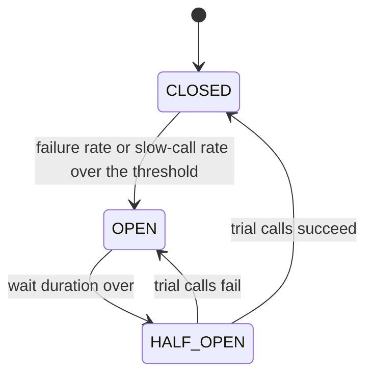

[Microservice resilience](lesson:microservice-resilience) explains the **patterns**: timeouts, retries, circuit breakers, bulkheads. Resilience4j is the **library** most Spring teams use to build them.

Interviewers go past the definitions. They ask:

- How do you configure a circuit breaker?
- What is the minimum number of calls?
- Which exceptions count as failures?
- Why is my annotation ignored?
- In what order are the decorators applied?
- Why does the time limiter not stop my blocking call?
- How do you know it works in production?

This lesson covers the library in depth. [Spring Cloud](lesson:spring-cloud#resilience) shows where it sits in the wider stack.

> **One sentence to remember:** *Resilience4j wraps each call in small decorators, configured per dependency.*

The decorators are the circuit breaker, retry, bulkhead, time limiter and rate limiter. Each is configured by name, for one dependency. The settings decide what counts as a failure, and when to stop calling. The order of the decorators decides what each of them sees.

## What it is {#what}

Resilience4j is a lightweight, **functional** fault-tolerance library for Java 17 and later. It depends on nothing except its own small modules. It replaced Netflix **Hystrix**, which has been in maintenance mode since 2018.

You decorate a lambda, a `Supplier`, a `Callable` or a reactive stream. Each **decorator** wraps the call and adds one behaviour.

| Module | Decorator | Protects against |
| --- | --- | --- |
| `resilience4j-circuitbreaker` | **CircuitBreaker** | Calling a failing or slow dependency again and again. |
| `resilience4j-retry` | **Retry** | Short, transient failures. |
| `resilience4j-bulkhead` | **Bulkhead** (semaphore or thread pool) | One dependency using up all threads or connections. |
| `resilience4j-timelimiter` | **TimeLimiter** | An asynchronous call that takes too long. |
| `resilience4j-ratelimiter` | **RateLimiter** | Sending more calls than you or the dependency allow. |
| `resilience4j-cache` | Cache (JCache) | Repeating an expensive call. Rarely used. |

Each one is **independent**: use one, or stack several.

State lives in a **registry** (`CircuitBreakerRegistry`, `RetryRegistry`...). Every protected dependency has its own **named instance** (`cardService`, `ledger`). So one failing dependency never trips another one's breaker.

## The circuit breaker {#breaker}



- **CLOSED:** calls pass through. Their outcome is recorded in a sliding window.
- **OPEN:** calls are **rejected at once** with `CallNotPermittedException`, without touching the dependency. This lasts for `waitDurationInOpenState`.
- **HALF_OPEN:** a limited number of **trial calls** is allowed. If enough succeed, the breaker closes. Otherwise it opens again.
- **Special states**, useful for rollout and operations:
  - `DISABLED`: always allow,
  - `FORCED_OPEN`: always reject,
  - `METRICS_ONLY`: record, but never open.

Try it in the lab: [Closed, open, half-open](lab:r4j-breaker-states).

### The settings that matter {#breaker-config}

| Setting | Meaning | Default |
| --- | --- | --- |
| `slidingWindowType` | `COUNT_BASED` (the last N calls) or `TIME_BASED` (the last N seconds). | count |
| `slidingWindowSize` | The size of that window. | 100 |
| `minimumNumberOfCalls` | Calls needed **before** the rate is checked at all. | 100 |
| `failureRateThreshold` | The percentage of failed calls that opens the breaker. | 50 |
| `slowCallDurationThreshold` / `slowCallRateThreshold` | A call slower than this counts as slow. A high share of slow calls opens the breaker. | 60 s / 100 % |
| `waitDurationInOpenState` | How long to stay open. | 60 s |
| `permittedNumberOfCallsInHalfOpenState` | The number of trial calls. | 10 |
| `automaticTransitionFromOpenToHalfOpenEnabled` | Move to half-open on a timer, not on the next call. | false |
| `recordExceptions` / `ignoreExceptions` | Which exceptions count as failures, and which are ignored entirely. | All exceptions count. |

Two points interviewers probe:

- **`minimumNumberOfCalls`.** With the defaults, nothing can open until 100 calls were recorded. So a low-traffic service never trips. Set it to a realistic number, for example 10 with a window of 20.
- **Slow calls count.** A dependency that answers every call in 8 seconds never *fails*, yet it uses up your threads. `slowCallDurationThreshold` makes slowness open the breaker too.

```yaml
resilience4j:
  circuitbreaker:
    configs:
      default:
        sliding-window-type: COUNT_BASED
        sliding-window-size: 20
        minimum-number-of-calls: 10
        failure-rate-threshold: 50
        slow-call-duration-threshold: 2s
        slow-call-rate-threshold: 80
        wait-duration-in-open-state: 30s
        permitted-number-of-calls-in-half-open-state: 3
        register-health-indicator: true
        ignore-exceptions:
          - com.bank.cards.InsufficientFundsException     # a business answer, not a failure
    instances:
      cardService:
        base-config: default
      ledger:
        base-config: default
        failure-rate-threshold: 30                       # stricter for this dependency
```

**What counts as a failure** is the most important design decision. A `400` or an `InsufficientFundsException` means the dependency worked correctly. Recording it opens the breaker for the wrong reason.

Record timeouts, connection errors and `5xx`. Ignore business and validation errors.

## Retry {#retry}

```yaml
resilience4j:
  retry:
    instances:
      cardService:
        max-attempts: 3                    # the first call plus two retries
        wait-duration: 200ms
        enable-exponential-backoff: true
        exponential-backoff-multiplier: 2
        enable-randomized-wait: true       # jitter
        randomized-wait-factor: 0.5
        retry-exceptions:
          - java.io.IOException
          - org.springframework.web.client.ResourceAccessException
        ignore-exceptions:
          - com.bank.cards.InsufficientFundsException
```

- `max-attempts` **includes the first call**, so `3` means two retries.
- Retry only **transient** failures, and only **idempotent** operations (or calls with an idempotency key). A retried payment `POST` without one can charge twice.
- Use **exponential backoff with jitter** (a random part of the wait). Then many callers do not retry at the same moment and cause a [retry storm](lesson:microservice-resilience#storm-q).
- `retryOnResultPredicate` retries on a **return value**, not only on an exception. For example, on a response flagged `PENDING`.
- When the attempts run out, the **last exception** is thrown. For a result predicate, it is `MaxRetriesExceededException`.

## Bulkhead {#bulkhead}

There are two implementations, with different costs:

| Type | How it limits | Notes |
| --- | --- | --- |
| **Semaphore** (default) | At most `maxConcurrentCalls` calls run at once, **on the caller's thread**. Extra callers wait `maxWaitDuration` (default 0), or get `BulkheadFullException`. | Cheap: no thread switch, and `ThreadLocal`s are kept. The right default, and the right choice with **virtual threads**. |
| **Thread pool** | Calls run on a **dedicated pool** (`maxThreadPoolSize`, `queueCapacity`) and return a `CompletableFuture`. | Real isolation, with its own threads and queue. But the thread changes, so **MDC, security context and transactions are lost** unless you pass them on. |

```yaml
resilience4j:
  bulkhead:
    instances:
      cardService:
        max-concurrent-calls: 10
        max-wait-duration: 0ms            # reject at once when full
  thread-pool-bulkhead:
    instances:
      reportService:
        core-thread-pool-size: 4
        max-thread-pool-size: 8
        queue-capacity: 20
```

Try it in the lab: [Bulkhead and time limiter](lab:r4j-bulkhead-timelimiter).

## Time limiter {#timelimiter}

A `TimeLimiter` limits how long an **asynchronous** call may take. When the time is up, it throws `TimeoutException`. It can also **cancel** the future (`cancelRunningFuture: true`).

It works on `CompletableFuture`, or on a reactive `Mono`/`Flux`. It **cannot interrupt a blocking method** that runs on the calling thread. So `@TimeLimiter` on a plain synchronous method does nothing useful.

For a blocking `RestClient` or `JDBC` call, the real timeout is the **client's own**: the connect and read timeouts, or the query timeout. Set those first. Use the time limiter for async work, and as an outer deadline.

```java
@TimeLimiter(name = "reports")
@Bulkhead(name = "reports", type = Bulkhead.Type.THREADPOOL)
CompletableFuture<Report> build(String id) {
    return CompletableFuture.supplyAsync(() -> reports.generate(id));
}
```

## Rate limiter {#ratelimiter}

It limits how many calls pass in each period. The settings are:

- `limitForPeriod`: how many calls,
- `limitRefreshPeriod`: the length of the period,
- `timeoutDuration`: how long a caller waits for a permit before `RequestNotPermitted`.

```yaml
resilience4j:
  ratelimiter:
    instances:
      partnerApi:
        limit-for-period: 50
        limit-refresh-period: 1s
        timeout-duration: 0
```

It protects a **partner's quota**, or limits your own outgoing calls.

It works **per instance of your application**. With ten pods, the real total is ten times the limit. A limit shared by the whole fleet needs a gateway, or a distributed limiter such as [Redis](lesson:redis-caching).

## In Spring Boot {#spring}

```xml
<dependency><groupId>io.github.resilience4j</groupId><artifactId>resilience4j-spring-boot3</artifactId></dependency>
<dependency><groupId>org.springframework.boot</groupId><artifactId>spring-boot-starter-aop</artifactId></dependency>
<dependency><groupId>org.springframework.boot</groupId><artifactId>spring-boot-starter-actuator</artifactId></dependency>
```

**Spring AOP** applies the annotations, so the rules of [proxies](lesson:spring-aop) apply.

```java
@Service
class CardClient {
    private final RestClient client;

    CardClient(RestClient.Builder builder) {
        this.client = builder.baseUrl("http://card-service").build();
    }

    @Retry(name = "cardService")
    @CircuitBreaker(name = "cardService", fallbackMethod = "limitsFallback")
    @Bulkhead(name = "cardService")
    public CardLimits limits(String cardId) {
        return client.get().uri("/cards/{id}/limits", cardId).retrieve().body(CardLimits.class);
    }

    // same return type, same parameters, plus the exception as the last parameter
    private CardLimits limitsFallback(String cardId, CallNotPermittedException e) {
        return CardLimits.conservativeDefaults();      // breaker open: a safe default
    }

    private CardLimits limitsFallback(String cardId, Throwable t) {
        return CardLimits.conservativeDefaults();      // any other failure
    }
}
```

**Fallbacks:**

- A fallback has the **same return type and parameters** as the method, plus a final exception parameter.
- Resilience4j picks the fallback with the **most specific** matching exception type.
- It must return something **safe**: a conservative default, a cached value, or "pending". Never an invented "everything is fine".
- A fallback hides the error from the caller. So keep metrics and logs on how often it runs.

### Decorator order {#order}

By default the aspects nest like this, **from outermost to innermost**:

`Retry` → `CircuitBreaker` → `RateLimiter` → `TimeLimiter` → `Bulkhead` → your method

So a retry goes through the breaker again on every attempt, and the breaker **records** each attempt. Once the breaker opens, the next attempt gets `CallNotPermittedException` at once. The retry should **not** retry that, so add it to `ignore-exceptions`.

The order can be changed with `resilience4j.circuitbreaker.circuitBreakerAspectOrder`, and the matching properties for the others.

Try it in the lab: [What each decorator sees](lab:r4j-decorator-order).

### The proxy pitfalls {#pitfalls}

- **Self-invocation.** A method that calls another annotated method of the **same class** (`this.limits(id)`) skips the proxy, so no breaker or retry applies. Move the protected call into another bean, or use the programmatic API.
- **Visibility.** The method must be callable through the proxy: `public`, not `final`, on a Spring bean (not created with `new`).
- **Swallowed exceptions.** If the method catches the exception itself and returns a default, the breaker never sees a failure.
- **Wrong fallback signature.** A mismatch fails at the first call, not at start-up.
- **`@Transactional` order.** A retry should wrap the transaction, not run inside it. Otherwise a retry reuses a transaction that is already marked rollback-only.

Try it in the lab: [Why the annotation is ignored](lab:r4j-self-invocation).

## Programmatic use and reactive code {#programmatic}

Without annotations, and so without proxies, you compose the decorators around a lambda. In `Decorators`, **each `with...` wraps the previous one, so the last one added is the outermost**:

```java
CircuitBreaker breaker = circuitBreakerRegistry.circuitBreaker("cardService");
Retry retry = retryRegistry.retry("cardService");
Bulkhead bulkhead = bulkheadRegistry.bulkhead("cardService");

Supplier<CardLimits> call = Decorators
        .ofSupplier(() -> client.limits(cardId))
        .withBulkhead(bulkhead)            // innermost
        .withCircuitBreaker(breaker)
        .withRetry(retry)                  // outermost
        .withFallback(List.of(CallNotPermittedException.class), e -> CardLimits.conservativeDefaults())
        .decorate();

CardLimits limits = call.get();
```

For Reactor, the `resilience4j-reactor` operators apply to a `Mono` or `Flux` (`mono.transformDeferred(CircuitBreakerOperator.of(breaker))`). The annotations also work on methods that return `Mono` or `Flux`.

**Spring Cloud CircuitBreaker** (`CircuitBreakerFactory`, `ReactiveCircuitBreakerFactory`) is a thin layer over the same library. Use it when you do not want to depend on Resilience4j directly.

## Seeing what it does {#observability}

- **Actuator:** `/actuator/circuitbreakers`, `/actuator/circuitbreakerevents`, `/actuator/retries`, `/actuator/bulkheads`, `/actuator/ratelimiters`, `/actuator/timelimiters`. There is also a **health indicator** per breaker (`register-health-indicator: true`).
- **Micrometer metrics:** `resilience4j_circuitbreaker_state`, `resilience4j_circuitbreaker_failure_rate`, `resilience4j_circuitbreaker_calls_seconds` (tagged `kind=successful|failed|ignored`), `resilience4j_circuitbreaker_not_permitted_calls_total`, and matching metrics for retry, bulkhead and rate limiter. Alert on a breaker that is **open**, on **not-permitted calls** and on **fallback rates**.
- **Events:** `breaker.getEventPublisher().onStateTransition(e -> log.warn("{}", e))` logs every change of state. In an incident, that is the first thing to look at.

**State is per application instance.** Each pod has its own breaker, so ten pods open at slightly different moments. That is usually fine, and needs no shared state.

## Testing it {#testing}

- Make the dependency fail with **WireMock** faults: `withFixedDelay(3000)`, a `503` response, a connection reset. Check that the breaker opens after the configured number of calls, and that the fallback is returned.
- Use `breaker.transitionToOpenState()` and `transitionToHalfOpenState()` to test the open and trial paths without waiting 30 seconds.
- **Reset the registry** between tests, because the state lives in a shared bean.
- Keep the test configuration small: `minimum-number-of-calls: 2`, `wait-duration-in-open-state: 100ms`.
- Check it **under load** in a pre-production run. A configuration that looks right is often wrong in its numbers (see the [retry storm](lesson:microservice-resilience#storm-q)).

## Mistakes that make it worse {#mistakes}

| Mistake | Effect |
| --- | --- |
| No client timeout, only a breaker. | Slow calls hold threads for a minute, until the breaker finally opens. |
| Retrying calls that are not idempotent. | Duplicate payments or orders. |
| Retrying at every layer (client, gateway, service). | Attempts **multiply**: 3 × 3 × 3 = 27 calls for one request. |
| Recording business errors as failures. | The breaker opens on valid `4xx` answers. |
| `minimumNumberOfCalls` too low, or the window too small. | The breaker **flaps** (opens and closes) on a few bad calls. |
| One shared instance for several dependencies. | One slow service opens the breaker for all of them. |
| A fallback that returns an optimistic default. | Wrong data presented as right. |
| A thread-pool bulkhead with `ThreadLocal` data. | The new thread is missing the security context, the MDC or the transaction. |

## A routine for a bank team {#routine}

1. Put a **client timeout** on every call first. Then add the decorators.
2. Use **one named instance per dependency**, with shared `configs.default` and small overrides.
3. Record **infrastructure** failures and slow calls. Ignore business exceptions.
4. **Retry only idempotent, transient** failures, with backoff and jitter, outside the breaker.
5. Use a **semaphore bulkhead** by default. Use a thread pool only for real isolation, and pass the context on.
6. Give each call a **safe fallback**, plus a metric for how often it ran.
7. Set **alerts** on open breakers and not-permitted calls. Write a test that proves the breaker opens.

## Cheat sheet {#cheatsheet}

| Need | Use |
| --- | --- |
| Stop calling a failing dependency | `@CircuitBreaker(name, fallbackMethod)` |
| Retry a transient failure | `@Retry` with backoff, jitter, `retry-exceptions` |
| Limit concurrent calls | `@Bulkhead` (semaphore) or `type = THREADPOOL` |
| Time out an async call | `@TimeLimiter` on `CompletableFuture` |
| Limit calls per period | `@RateLimiter` |
| Default order | Retry → CircuitBreaker → RateLimiter → TimeLimiter → Bulkhead |
| Rejected by an open breaker | `CallNotPermittedException` |
| Bulkhead full | `BulkheadFullException` |
| Rate limit exceeded | `RequestNotPermitted` |
| Health and state | `/actuator/circuitbreakers`, `resilience4j_circuitbreaker_state` |
| Test state changes | `transitionToOpenState()` |

## Interview questions {#questions}

### [basic] What is Resilience4j and which problems does it solve? {#what-q}

It is a lightweight, functional fault-tolerance library for Java. It replaced Hystrix.

Its decorators (circuit breaker, retry, bulkhead, time limiter, rate limiter) stop one failing or slow dependency from taking down the caller. Each decorator is independent, named per dependency, and configured in YAML or code. It reports Micrometer metrics.

### [basic] What are the states of a Resilience4j circuit breaker? {#states-q}

- `CLOSED`: calls pass, and are recorded.
- `OPEN`: calls are rejected at once with `CallNotPermittedException`, for the wait duration.
- `HALF_OPEN`: a few trial calls decide whether to close, or open again.

It also has `DISABLED`, `FORCED_OPEN` and `METRICS_ONLY`, for operations and rollout.

### [basic] What does `max-attempts: 3` mean in Retry? {#attempts-q}

Three calls in total: the original and two retries. Not three retries.

Add backoff and jitter, so callers do not all retry at the same moment.

### [basic] Which exception is thrown when the breaker is open, and what do you do with it? {#cnp-q}

`CallNotPermittedException`.

Handle it in a fallback: a safe default, a cached value, or a clear `503`. Make sure Retry does not retry it, because the next attempt would be rejected too.

### [intermediate] How does the circuit breaker decide to open? {#open-q}

1. It records each call in a sliding window, count-based or time-based.
2. Once the window holds at least `minimumNumberOfCalls`, it computes the failure rate and the slow-call rate.
3. If either reaches its threshold (`failureRateThreshold`, `slowCallRateThreshold`), the breaker opens.

Until the minimum is reached, it cannot open. That is why a low-traffic service with the default of 100 never trips.

### [intermediate] What is the difference between a count-based and a time-based sliding window? {#window-q}

**Count-based** looks at the last N calls, however old they are. It reacts to the number of calls, and suits steady traffic.

**Time-based** looks at the calls of the last N seconds. Old failures drop out with time, so it suits bursty or low traffic.

Both need a sensible minimum number of calls.

### [intermediate] Which exceptions should count as failures? {#record-q}

Infrastructure problems: timeouts, connection errors, `5xx`.

Business and validation outcomes (`InsufficientFundsException`, `400`, `404`) mean the dependency worked. Put them in `ignoreExceptions` (or use `recordExceptions`, or a predicate). Recording them opens the breaker for the wrong reason.

### [intermediate] What are slow calls and why do they matter? {#slow-q}

They are calls slower than `slowCallDurationThreshold`.

A dependency that answers everything in eight seconds never fails, but it uses up your threads. With `slowCallRateThreshold`, the breaker opens on slowness too. Slowness is often the earliest sign of trouble.

### [intermediate] In what order are the decorators applied, and why does it matter? {#order-q}

From outermost to innermost: Retry, CircuitBreaker, RateLimiter, TimeLimiter, Bulkhead.

- Retry wraps the breaker, so every attempt is recorded, and an open breaker stops further attempts.
- The bulkhead and time limiter act closest to the call.

In the programmatic `Decorators` builder, the last `with...` is the outermost.

### [intermediate] What is the difference between a semaphore and a thread-pool bulkhead? {#bulkhead-q}

A **semaphore** bulkhead counts concurrent calls on the caller's own thread. It is cheap, with no thread switch, and it keeps `ThreadLocal`s. It is the right choice with virtual threads.

A **thread-pool** bulkhead runs calls on a dedicated pool with a queue, and returns a `CompletableFuture`. It isolates more strongly. But the thread changes, so the MDC, security context and transactions are lost unless you pass them on.

### [intermediate] Why does `@TimeLimiter` not stop my blocking method? {#timelimiter-q}

The time limiter works on asynchronous types (`CompletableFuture`, `Mono`). It can stop waiting and cancel the future. But it cannot interrupt a blocking call that runs on the calling thread.

For blocking code, set the client's connect and read timeouts, and query timeouts. Use the time limiter for async work.

### [intermediate] Your `@CircuitBreaker` annotation has no effect. What do you check? {#ignored-q}

First, whether the call goes through the Spring proxy. A call from another method in the same class (`this.call()`) skips it.

Then check that:

- `spring-boot-starter-aop` is present,
- the method is public and not final, on a Spring-managed bean,
- the exception is not caught inside the method,
- the instance name exists in the configuration.

To fix self-invocation, use another bean or the programmatic API.

### [intermediate] What are the rules for a fallback method? {#fallback-q}

- Same return type and parameters as the protected method, plus a final exception parameter.
- Several fallbacks may exist, for different exception types. The most specific one wins.
- It must return a safe result, not an optimistic one.

Count how often it runs, because it hides the failure from the caller.

### [deep] Each of three layers retries 3 times. What happens when the dependency is down? {#multiply-q}

Attempts multiply: 3 × 3 × 3 = 27 calls for one user request, just when the dependency is struggling.

- Retry at **one** layer, usually the one closest to the call.
- Let the other layers fail fast.
- Use backoff with jitter.
- Add a retry budget or a circuit breaker.
- Keep the total time within the caller's deadline.

### [deep] The breaker flaps between open and closed. What is wrong? {#flap-q}

Usually one of these:

- the window is too small, or `minimumNumberOfCalls` too low, so a few failures open it,
- `waitDurationInOpenState` is too short,
- there are too few trial calls (`permittedNumberOfCallsInHalfOpenState`) to judge,
- business errors are being recorded.

Increase the window and the minimum, lengthen the wait, ignore business exceptions, and watch the state transition events.

### [deep] How do you know in production that your resilience configuration works? {#prove-q}

- **Metrics and alerts:** breaker state, failure and slow-call rates, not-permitted calls, retry counts and fallback rates, with a dashboard per dependency.
- **Pre-production:** inject faults (a delay, `503`s, a dropped connection). Watch the breaker open, the fallback run, and the system recover.
- **Unit tests:** test the state transitions with `transitionToOpenState()`.

### [deep] Each pod has its own breaker. Is that a problem? {#state-q}

Usually not. Each instance learns about the failure from its own calls. So the pods open within seconds of each other, and there is no shared state that could fail.

The rate limiter is the exception. Its limit is per instance, so a quota for the whole fleet needs a gateway or a distributed limiter.

### [coding] Configure and use a circuit breaker and retry for a card service, with a safe fallback. {#coding-spring}

```yaml
resilience4j:
  circuitbreaker:
    instances:
      cardService:
        sliding-window-size: 20
        minimum-number-of-calls: 10
        failure-rate-threshold: 50
        slow-call-duration-threshold: 2s
        slow-call-rate-threshold: 80
        wait-duration-in-open-state: 30s
        permitted-number-of-calls-in-half-open-state: 3
        ignore-exceptions: [com.bank.cards.InsufficientFundsException]
  retry:
    instances:
      cardService:
        max-attempts: 3
        wait-duration: 200ms
        enable-exponential-backoff: true
        exponential-backoff-multiplier: 2
        enable-randomized-wait: true
        retry-exceptions: [java.io.IOException]
        ignore-exceptions:
          - io.github.resilience4j.circuitbreaker.CallNotPermittedException
          - com.bank.cards.InsufficientFundsException
```

```java
@Retry(name = "cardService")
@CircuitBreaker(name = "cardService", fallbackMethod = "fallback")
public CardLimits limits(String cardId) {
    return client.get().uri("/cards/{id}/limits", cardId).retrieve().body(CardLimits.class);
}

private CardLimits fallback(String cardId, Throwable t) {
    return CardLimits.conservativeDefaults();
}
```

Explain these points:

- The client has its own read timeout, set separately.
- Slow calls count towards opening.
- The breaker judges only after 10 calls.
- Both decorators ignore business exceptions.
- Retry will not retry an open breaker.
- The fallback is conservative, not optimistic.

### [coding] Test that the breaker opens and the fallback is used. {#coding-test}

```java
@SpringBootTest
class CardClientResilienceTest {
    @Autowired CardClient client;
    @Autowired CircuitBreakerRegistry registry;
    @RegisterExtension static WireMockExtension card = WireMockExtension.newInstance().build();

    @BeforeEach void reset() { registry.circuitBreaker("cardService").reset(); }

    @Test void opensAfterRepeatedFailuresAndFallsBack() {
        card.stubFor(get(urlPathMatching("/cards/.*")).willReturn(serverError()));

        for (int i = 0; i < 10; i++) client.limits("c1");           // each returns the fallback

        assertThat(registry.circuitBreaker("cardService").getState()).isEqualTo(CircuitBreaker.State.OPEN);
        card.resetRequests();
        assertThat(client.limits("c1")).isEqualTo(CardLimits.conservativeDefaults());
        card.verify(0, getRequestedFor(urlPathMatching("/cards/.*")));   // rejected without a call
    }
}
```

Explain these points:

- The test configuration uses a small minimum number of calls.
- The registry is reset between tests, because breaker state is shared.
- After the breaker opens, the dependency gets **no** request at all. That proves the breaker works, not just the fallback.
