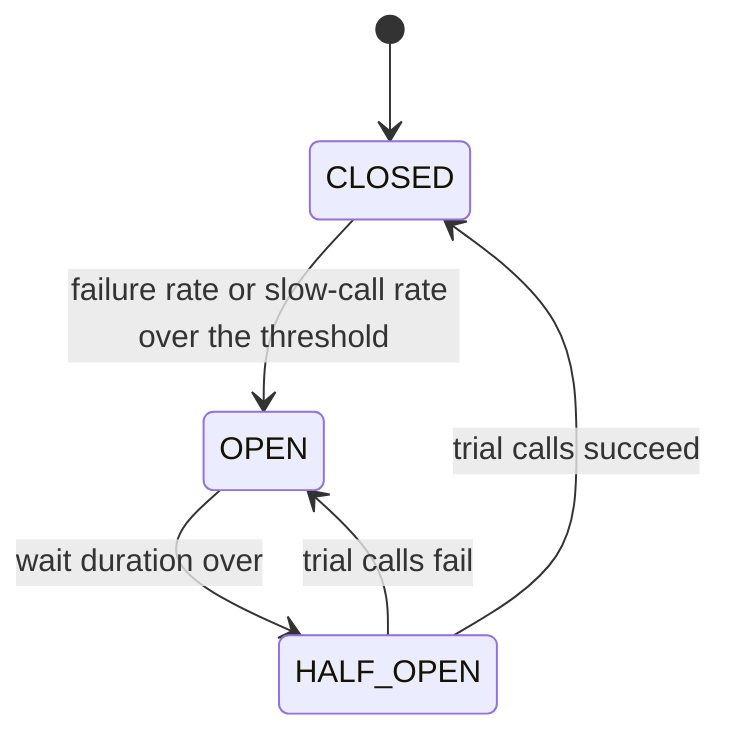

[Microservice resilience](lesson:microservice-resilience) explains the **patterns**: timeouts, retries, circuit breakers, bulkheads. Resilience4j is the **library** most Spring teams use to implement them, and interviewers go past the definitions: *how do you configure a circuit breaker, what is the minimum number of calls, which exceptions count as failures, why is my annotation ignored, in what order are the decorators applied, why does the time limiter not stop my blocking call, and how do you know it is working in production?* This lesson is the library in depth; [Spring Cloud](lesson:spring-cloud#resilience) shows where it sits in the wider stack.

> **One sentence to remember:** *Resilience4j wraps a call in small, independent decorators (circuit breaker, retry, bulkhead, time limiter, rate limiter), each configured per dependency by name; the settings decide what counts as a failure and when to stop calling, and the order of the decorators decides what each of them sees.*

## What it is {#what}

Resilience4j is a lightweight, **functional** fault-tolerance library for Java 17 and later, with no dependency except its own small modules (it replaced Netflix **Hystrix**, which has been in maintenance mode since 2018). You decorate a lambda, a `Supplier`, a `Callable` or a reactive stream, and the decorator adds one behaviour.

| Module | Decorator | Protects against |
| --- | --- | --- |
| `resilience4j-circuitbreaker` | **CircuitBreaker** | repeatedly calling a dependency that is failing or slow |
| `resilience4j-retry` | **Retry** | short, transient failures |
| `resilience4j-bulkhead` | **Bulkhead** (semaphore or thread pool) | one dependency using up all threads or connections |
| `resilience4j-timelimiter` | **TimeLimiter** | an asynchronous call that takes too long |
| `resilience4j-ratelimiter` | **RateLimiter** | sending more calls than you or the dependency allow |
| `resilience4j-cache` | Cache (JCache) | repeating an expensive call (rarely used) |

Each is **independent**: use one or stack several. State lives in a **registry** (`CircuitBreakerRegistry`, `RetryRegistry`...), and every protected dependency has its own **named instance** (`cardService`, `ledger`), so one failing dependency never trips another's breaker.

## The circuit breaker {#breaker}



- **CLOSED**: calls pass through and their outcome is recorded in a sliding window.
- **OPEN**: calls are **rejected at once** with `CallNotPermittedException`, without touching the dependency, for `waitDurationInOpenState`.
- **HALF_OPEN**: a limited number of **trial calls** is allowed. If enough succeed the breaker closes, otherwise it opens again.
- Special states: `DISABLED` (always allow), `FORCED_OPEN` (always reject) and `METRICS_ONLY` (record, never open), useful for rollout and operations.

Try it in the lab: [Closed, open, half-open](lab:r4j-breaker-states).

### The settings that matter {#breaker-config}

| Setting | Meaning | Default |
| --- | --- | --- |
| `slidingWindowType` | `COUNT_BASED` (last N calls) or `TIME_BASED` (last N seconds) | count |
| `slidingWindowSize` | size of that window | 100 |
| `minimumNumberOfCalls` | calls needed **before** the rate is evaluated at all | 100 |
| `failureRateThreshold` | percent of failed calls that opens the breaker | 50 |
| `slowCallDurationThreshold` / `slowCallRateThreshold` | a call slower than this counts as slow, and a high share of slow calls opens it | 60 s / 100 % |
| `waitDurationInOpenState` | how long to stay open | 60 s |
| `permittedNumberOfCallsInHalfOpenState` | trial calls | 10 |
| `automaticTransitionFromOpenToHalfOpenEnabled` | move to half-open by a timer, not on the next call | false |
| `recordExceptions` / `ignoreExceptions` | which exceptions count as failures, and which are ignored entirely | all exceptions count |

Two points interviewers probe:

- **`minimumNumberOfCalls`.** With the defaults, nothing can open until 100 calls were recorded, so a low-traffic service never trips. Set it to a realistic number (for example 10 with a window of 20).
- **Slow calls count.** A dependency that answers every call in 8 seconds never *fails*, yet it exhausts your threads. `slowCallDurationThreshold` makes slowness open the breaker too.

```yaml
resilience4j:
  circuitbreaker:
    configs:
      default:
        sliding-window-type: COUNT_BASED
        sliding-window-size: 20
        minimum-number-of-calls: 10
        failure-rate-threshold: 50
        slow-call-duration-threshold: 2s
        slow-call-rate-threshold: 80
        wait-duration-in-open-state: 30s
        permitted-number-of-calls-in-half-open-state: 3
        register-health-indicator: true
        ignore-exceptions:
          - com.bank.cards.InsufficientFundsException     # a business answer, not a failure
    instances:
      cardService:
        base-config: default
      ledger:
        base-config: default
        failure-rate-threshold: 30                       # stricter for this dependency
```

**What counts as a failure** is the most important design decision. A `400` or `InsufficientFundsException` is the dependency working correctly: recording it opens the breaker for the wrong reason. Record timeouts, connection errors and `5xx`; ignore business and validation errors.

## Retry {#retry}

```yaml
resilience4j:
  retry:
    instances:
      cardService:
        max-attempts: 3                    # the first call plus two retries
        wait-duration: 200ms
        enable-exponential-backoff: true
        exponential-backoff-multiplier: 2
        enable-randomized-wait: true       # jitter
        randomized-wait-factor: 0.5
        retry-exceptions:
          - java.io.IOException
          - org.springframework.web.client.ResourceAccessException
        ignore-exceptions:
          - com.bank.cards.InsufficientFundsException
```

- `max-attempts` **includes the first call**, so `3` means two retries.
- Retry only **transient** failures and only **idempotent** operations (or with an idempotency key): a retried payment `POST` without one can charge twice.
- Use **exponential backoff with jitter** so many callers do not retry in step and cause a [retry storm](lesson:microservice-resilience#storm-q).
- `retryOnResultPredicate` retries on a **return value** (for example a response flagged `PENDING`), not only on an exception.
- When attempts run out, the **last exception** is thrown (or `MaxRetriesExceededException` for a result predicate).

## Bulkhead {#bulkhead}

Two implementations, with different costs:

| Type | How it limits | Notes |
| --- | --- | --- |
| **Semaphore** (default) | at most `maxConcurrentCalls` calls run at once, **on the caller's thread**; extra callers wait `maxWaitDuration` (default 0) or get `BulkheadFullException` | cheap, no thread switch, keeps `ThreadLocal`s; the right default, and the right choice with **virtual threads** |
| **Thread pool** | calls run on a **dedicated pool** (`maxThreadPoolSize`, `queueCapacity`) and return a `CompletableFuture` | real isolation of threads and a queue, but a thread hop: **MDC, security context and transactions are lost** unless propagated |

```yaml
resilience4j:
  bulkhead:
    instances:
      cardService:
        max-concurrent-calls: 10
        max-wait-duration: 0ms            # reject at once when full
  thread-pool-bulkhead:
    instances:
      reportService:
        core-thread-pool-size: 4
        max-thread-pool-size: 8
        queue-capacity: 20
```

Try it in the lab: [Bulkhead and time limiter](lab:r4j-bulkhead-timelimiter).

## Time limiter {#timelimiter}

A `TimeLimiter` bounds how long an **asynchronous** call may take and, when the time is up, throws `TimeoutException` and can **cancel** the future (`cancelRunningFuture: true`).

It works on `CompletableFuture` (or a reactive `Mono`/`Flux`). It **cannot interrupt a blocking method** that runs on the calling thread, so `@TimeLimiter` on a plain synchronous method does nothing useful. For a blocking `RestClient` or `JDBC` call, the real timeout is the **client's own** (connect and read timeout, query timeout): set those first, and use the time limiter for async work and as an outer deadline.

```java
@TimeLimiter(name = "reports")
@Bulkhead(name = "reports", type = Bulkhead.Type.THREADPOOL)
CompletableFuture<Report> build(String id) {
    return CompletableFuture.supplyAsync(() -> reports.generate(id));
}
```

## Rate limiter {#ratelimiter}

Limits how many calls pass in a period, with the settings `limitForPeriod`, `limitRefreshPeriod` and `timeoutDuration` (how long a caller waits for a permit before `RequestNotPermitted`).

```yaml
resilience4j:
  ratelimiter:
    instances:
      partnerApi:
        limit-for-period: 50
        limit-refresh-period: 1s
        timeout-duration: 0
```

It protects a **partner's quota** or your own outbound calls. It is **per instance of your application**: with ten pods, the real total is ten times the limit. A limit shared by the whole fleet needs a gateway or a distributed limiter such as [Redis](lesson:redis-caching).

## In Spring Boot {#spring}

```xml
<dependency><groupId>io.github.resilience4j</groupId><artifactId>resilience4j-spring-boot3</artifactId></dependency>
<dependency><groupId>org.springframework.boot</groupId><artifactId>spring-boot-starter-aop</artifactId></dependency>
<dependency><groupId>org.springframework.boot</groupId><artifactId>spring-boot-starter-actuator</artifactId></dependency>
```

The annotations are applied by **Spring AOP**, so the rules of [proxies](lesson:spring-aop) apply.

```java
@Service
class CardClient {
    private final RestClient client;

    CardClient(RestClient.Builder builder) {
        this.client = builder.baseUrl("http://card-service").build();
    }

    @Retry(name = "cardService")
    @CircuitBreaker(name = "cardService", fallbackMethod = "limitsFallback")
    @Bulkhead(name = "cardService")
    public CardLimits limits(String cardId) {
        return client.get().uri("/cards/{id}/limits", cardId).retrieve().body(CardLimits.class);
    }

    // same return type, same parameters, plus the exception as the last parameter
    private CardLimits limitsFallback(String cardId, CallNotPermittedException e) {
        return CardLimits.conservativeDefaults();      // breaker open: a safe default
    }

    private CardLimits limitsFallback(String cardId, Throwable t) {
        return CardLimits.conservativeDefaults();      // any other failure
    }
}
```

**Fallbacks:** the fallback has the **same return type and parameters** plus a final exception parameter, and Resilience4j picks the **most specific** matching exception type. It must return something **safe** (a conservative default, a cached value, "pending"), never an invented "everything is fine". A fallback hides the error from the caller, so keep metrics and logs on how often it runs.

### Decorator order {#order}

By default the aspects nest, **outermost to innermost**, as:

`Retry` → `CircuitBreaker` → `RateLimiter` → `TimeLimiter` → `Bulkhead` → your method

So a retry re-enters the breaker on every attempt: each attempt is **recorded** by it, and when the breaker opens, the next attempt gets `CallNotPermittedException` at once, which the retry should **not** retry (add it to `ignore-exceptions`). The order is configurable (`resilience4j.circuitbreaker.circuitBreakerAspectOrder` and the matching properties for the others).

Try it in the lab: [What each decorator sees](lab:r4j-decorator-order).

### The proxy pitfalls {#pitfalls}

- **Self-invocation.** A method that calls another annotated method of the **same class** (`this.limits(id)`) bypasses the proxy, so no breaker or retry applies. Move the protected call into another bean, or use the programmatic API.
- **Visibility.** The advised method must be callable through the proxy: `public`, non-`final`, on a Spring bean (not created with `new`).
- **Swallowed exceptions.** If the method catches the exception itself and returns a default, the breaker never sees a failure.
- **Wrong fallback signature.** A mismatch fails at the first call, not at start-up.
- **`@Transactional` order.** A retry should wrap the transaction, not run inside it, otherwise a retry reuses a transaction that is already marked rollback-only.

Try it in the lab: [Why the annotation is ignored](lab:r4j-self-invocation).

## Programmatic use and reactive code {#programmatic}

Without annotations (and without proxies), compose decorators around a lambda. In `Decorators`, **each `with...` wraps the previous one, so the last one added is the outermost**:

```java
CircuitBreaker breaker = circuitBreakerRegistry.circuitBreaker("cardService");
Retry retry = retryRegistry.retry("cardService");
Bulkhead bulkhead = bulkheadRegistry.bulkhead("cardService");

Supplier<CardLimits> call = Decorators
        .ofSupplier(() -> client.limits(cardId))
        .withBulkhead(bulkhead)            // innermost
        .withCircuitBreaker(breaker)
        .withRetry(retry)                  // outermost
        .withFallback(List.of(CallNotPermittedException.class), e -> CardLimits.conservativeDefaults())
        .decorate();

CardLimits limits = call.get();
```

For Reactor, the `resilience4j-reactor` operators apply to a `Mono` or `Flux` (`mono.transformDeferred(CircuitBreakerOperator.of(breaker))`), and the annotations also work on methods returning `Mono` or `Flux`. **Spring Cloud CircuitBreaker** (`CircuitBreakerFactory`, `ReactiveCircuitBreakerFactory`) is a thin abstraction over the same library when you do not want to depend on it directly.

## Seeing what it does {#observability}

- **Actuator:** `/actuator/circuitbreakers`, `/actuator/circuitbreakerevents`, `/actuator/retries`, `/actuator/bulkheads`, `/actuator/ratelimiters`, `/actuator/timelimiters`, and a **health indicator** per breaker (`register-health-indicator: true`).
- **Micrometer metrics:** `resilience4j_circuitbreaker_state`, `resilience4j_circuitbreaker_failure_rate`, `resilience4j_circuitbreaker_calls_seconds` (tagged `kind=successful|failed|ignored`), `resilience4j_circuitbreaker_not_permitted_calls_total`, plus retry, bulkhead and rate limiter counterparts. Alert on a breaker that is **open**, on **not-permitted calls** and on **fallback rates**.
- **Events:** `breaker.getEventPublisher().onStateTransition(e -> log.warn("{}", e))` logs every change of state, which is the first thing to look at in an incident.

**State is per application instance.** Each pod has its own breaker, so ten pods open at slightly different moments, which is usually fine and needs no shared state.

## Testing it {#testing}

- Call the dependency with **WireMock** faults: `withFixedDelay(3000)`, a `503` response, a connection reset, and assert that the breaker opens after the configured number of calls and the fallback is returned.
- Use `breaker.transitionToOpenState()` and `transitionToHalfOpenState()` to test the open and trial paths without waiting 30 seconds, and **reset the registry** between tests, because state lives in a shared bean.
- Keep the test configuration small (`minimum-number-of-calls: 2`, `wait-duration-in-open-state: 100ms`).
- Check it **under load** in a pre-production run: configuration that looks right is often wrong in numbers (see the [retry storm](lesson:microservice-resilience#storm-q)).

## Mistakes that make it worse {#mistakes}

| Mistake | Effect |
| --- | --- |
| No client timeout, only a breaker | slow calls hold threads for a minute until the breaker finally opens |
| Retrying non-idempotent calls | duplicate payments or orders |
| Retry at every layer (client, gateway, service) | attempts **multiply** (3 × 3 × 3 = 27 calls for one request) |
| Recording business errors as failures | the breaker opens on valid `4xx` answers |
| `minimumNumberOfCalls` too low or window too small | the breaker **flaps** on a few bad calls |
| One shared instance for several dependencies | one slow service opens the breaker for all |
| A fallback that returns an optimistic default | wrong data presented as right |
| Thread-pool bulkhead with `ThreadLocal` data | missing security context, MDC or transaction in the new thread |

## A routine for a bank team {#routine}

1. A **client timeout** on every call first, then the decorators.
2. **One named instance per dependency**, with shared `configs.default` and small overrides.
3. Record **infrastructure** failures and slow calls; ignore business exceptions.
4. **Retry only idempotent, transient** failures, with backoff and jitter, outside the breaker.
5. **Semaphore bulkhead** by default; a thread pool only for real isolation, with context propagated.
6. A **safe fallback** for each call, plus a metric for how often it ran.
7. **Alerts** on open breakers and not-permitted calls, and a test that proves the breaker opens.

## Cheat sheet {#cheatsheet}

| Need | Use |
| --- | --- |
| Stop calling a failing dependency | `@CircuitBreaker(name, fallbackMethod)` |
| Retry a transient failure | `@Retry` with backoff, jitter, `retry-exceptions` |
| Limit concurrent calls | `@Bulkhead` (semaphore) or `type = THREADPOOL` |
| Time out an async call | `@TimeLimiter` on `CompletableFuture` |
| Limit calls per period | `@RateLimiter` |
| Default order | Retry → CircuitBreaker → RateLimiter → TimeLimiter → Bulkhead |
| Rejected by an open breaker | `CallNotPermittedException` |
| Bulkhead full | `BulkheadFullException` |
| Rate limit exceeded | `RequestNotPermitted` |
| Health and state | `/actuator/circuitbreakers`, `resilience4j_circuitbreaker_state` |
| Test state changes | `transitionToOpenState()` |

## Interview questions {#questions}

### [basic] What is Resilience4j and which problems does it solve? {#what-q}

A lightweight, functional fault-tolerance library for Java that replaced Hystrix. Its decorators (circuit breaker, retry, bulkhead, time limiter, rate limiter) stop one failing or slow dependency from taking down the caller. Each decorator is independent, named per dependency and configured in YAML or code, with Micrometer metrics.

### [basic] What are the states of a Resilience4j circuit breaker? {#states-q}

`CLOSED` (calls pass and are recorded), `OPEN` (calls are rejected at once with `CallNotPermittedException` for the wait duration) and `HALF_OPEN` (a few trial calls decide whether to close or open again). It also has `DISABLED`, `FORCED_OPEN` and `METRICS_ONLY` for operations and rollout.

### [basic] What does `max-attempts: 3` mean in Retry? {#attempts-q}

Three calls in total: the original and two retries, not three retries. Add backoff and jitter so callers do not retry in step.

### [basic] Which exception is thrown when the breaker is open, and what do you do with it? {#cnp-q}

`CallNotPermittedException`. Handle it in a fallback (a safe default, a cached value or a clear `503`), and make sure Retry does not retry it, because the next attempt would be rejected too.

### [intermediate] How does the circuit breaker decide to open? {#open-q}

It records each call in a sliding window (count-based or time-based). Once at least `minimumNumberOfCalls` are in it, it computes the failure rate and the slow-call rate; if either reaches its threshold (`failureRateThreshold`, `slowCallRateThreshold`) the breaker opens. Until that minimum is reached it cannot open, which is why a low-traffic service with the default of 100 never trips.

### [intermediate] What is the difference between a count-based and a time-based sliding window? {#window-q}

Count-based looks at the last N calls, whatever their age, so it reacts to the number of calls and suits steady traffic. Time-based looks at the calls of the last N seconds, so old failures drop out with time and it suits bursty or low traffic. Both need a sensible minimum number of calls.

### [intermediate] Which exceptions should count as failures? {#record-q}

Infrastructure problems: timeouts, connection errors, `5xx`. Business and validation outcomes (`InsufficientFundsException`, `400`, `404`) mean the dependency worked, so put them in `ignoreExceptions` (or use `recordExceptions` or a predicate). Recording them opens the breaker for the wrong reason.

### [intermediate] What are slow calls and why do they matter? {#slow-q}

Calls slower than `slowCallDurationThreshold`. A dependency that answers everything in eight seconds never fails but exhausts your threads. With `slowCallRateThreshold` the breaker opens on slowness too, which is often the earliest sign of trouble.

### [intermediate] In what order are the decorators applied, and why does it matter? {#order-q}

Outermost to innermost: Retry, CircuitBreaker, RateLimiter, TimeLimiter, Bulkhead. Retry wraps the breaker so every attempt is recorded and an open breaker stops further attempts; the bulkhead and time limiter act closest to the call. In the programmatic `Decorators` builder, the last `with...` is the outermost.

### [intermediate] What is the difference between a semaphore and a thread-pool bulkhead? {#bulkhead-q}

A semaphore bulkhead counts concurrent calls on the caller's own thread: cheap, no thread switch, keeps `ThreadLocal`s, and the right choice with virtual threads. A thread-pool bulkhead runs calls on a dedicated pool with a queue and returns a `CompletableFuture`: stronger isolation, but a thread hop that loses MDC, security context and transactions unless you propagate them.

### [intermediate] Why does `@TimeLimiter` not stop my blocking method? {#timelimiter-q}

The time limiter works on asynchronous types (`CompletableFuture`, `Mono`). It can give up waiting and cancel the future, but it cannot interrupt a blocking call running on the calling thread. Set the client's connect and read timeouts (and query timeouts) for blocking code, and use the time limiter for async work.

### [intermediate] Your `@CircuitBreaker` annotation has no effect. What do you check? {#ignored-q}

Whether the call goes through the Spring proxy: a call from another method in the same class (`this.call()`) bypasses it. Then check that `spring-boot-starter-aop` is present, that the method is public and not final on a Spring-managed bean, that the exception is not caught inside, and that the instance name exists in the configuration. The fix for self-invocation is another bean or the programmatic API.

### [intermediate] What are the rules for a fallback method? {#fallback-q}

Same return type and parameters as the protected method plus a final exception parameter; several fallbacks may exist for different exception types and the most specific one wins. It must return a safe result, not an optimistic one, and you should count how often it runs because it hides the failure from the caller.

### [deep] Each of three layers retries 3 times. What happens when the dependency is down? {#multiply-q}

Attempts multiply: 3 × 3 × 3 = 27 calls for one user request, just when the dependency is struggling. Retry at **one** layer (usually the closest to the call), give the others fast failure, use backoff with jitter, add a retry budget or a circuit breaker, and keep the total within the caller's deadline.

### [deep] The breaker flaps between open and closed. What is wrong? {#flap-q}

Usually a window that is too small or `minimumNumberOfCalls` too low, so a few failures open it; a `waitDurationInOpenState` that is too short; trial calls (`permittedNumberOfCallsInHalfOpenState`) that are too few to judge; or business errors being recorded. Increase the window and minimum, lengthen the wait, ignore business exceptions and watch the state transition events.

### [deep] How do you know in production that your resilience configuration works? {#prove-q}

Metrics and alerts: breaker state, failure and slow-call rates, not-permitted calls, retry counts and fallback rates, with a dashboard per dependency. In pre-production, inject faults (a delay, `503`s, a dropped connection) and watch the breaker open, the fallback run and the system recover. Test the state transitions in unit tests with `transitionToOpenState()`.

### [deep] Each pod has its own breaker. Is that a problem? {#state-q}

Usually not. Each instance learns about the failure from its own calls, so pods open within seconds of each other and there is no shared state to fail. The rate limiter is the exception: its limit is per instance, so a fleet-wide quota needs a gateway or a distributed limiter.

### [coding] Configure and use a circuit breaker and retry for a card service, with a safe fallback. {#coding-spring}

```yaml
resilience4j:
  circuitbreaker:
    instances:
      cardService:
        sliding-window-size: 20
        minimum-number-of-calls: 10
        failure-rate-threshold: 50
        slow-call-duration-threshold: 2s
        slow-call-rate-threshold: 80
        wait-duration-in-open-state: 30s
        permitted-number-of-calls-in-half-open-state: 3
        ignore-exceptions: [com.bank.cards.InsufficientFundsException]
  retry:
    instances:
      cardService:
        max-attempts: 3
        wait-duration: 200ms
        enable-exponential-backoff: true
        exponential-backoff-multiplier: 2
        enable-randomized-wait: true
        retry-exceptions: [java.io.IOException]
        ignore-exceptions:
          - io.github.resilience4j.circuitbreaker.CallNotPermittedException
          - com.bank.cards.InsufficientFundsException
```

```java
@Retry(name = "cardService")
@CircuitBreaker(name = "cardService", fallbackMethod = "fallback")
public CardLimits limits(String cardId) {
    return client.get().uri("/cards/{id}/limits", cardId).retrieve().body(CardLimits.class);
}

private CardLimits fallback(String cardId, Throwable t) {
    return CardLimits.conservativeDefaults();
}
```

Explain: the client has its own read timeout set separately; slow calls count towards opening; the breaker only judges after 10 calls; business exceptions are ignored by both; retry will not retry an open breaker; and the fallback is conservative, not optimistic.

### [coding] Test that the breaker opens and the fallback is used. {#coding-test}

```java
@SpringBootTest
class CardClientResilienceTest {
    @Autowired CardClient client;
    @Autowired CircuitBreakerRegistry registry;
    @RegisterExtension static WireMockExtension card = WireMockExtension.newInstance().build();

    @BeforeEach void reset() { registry.circuitBreaker("cardService").reset(); }

    @Test void opensAfterRepeatedFailuresAndFallsBack() {
        card.stubFor(get(urlPathMatching("/cards/.*")).willReturn(serverError()));

        for (int i = 0; i < 10; i++) client.limits("c1");           // each returns the fallback

        assertThat(registry.circuitBreaker("cardService").getState()).isEqualTo(CircuitBreaker.State.OPEN);
        card.resetRequests();
        assertThat(client.limits("c1")).isEqualTo(CardLimits.conservativeDefaults());
        card.verify(0, getRequestedFor(urlPathMatching("/cards/.*")));   // rejected without a call
    }
}
```

Explain: the test configuration uses a small minimum number of calls; the registry is reset between tests because breaker state is shared; after it opens, the dependency receives **no** request at all, which proves the breaker works, not just the fallback.
