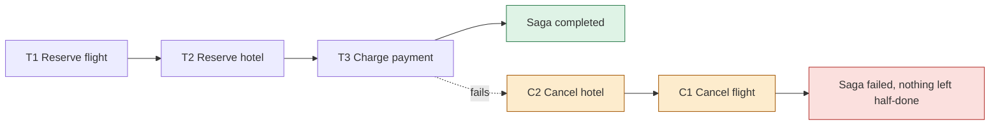
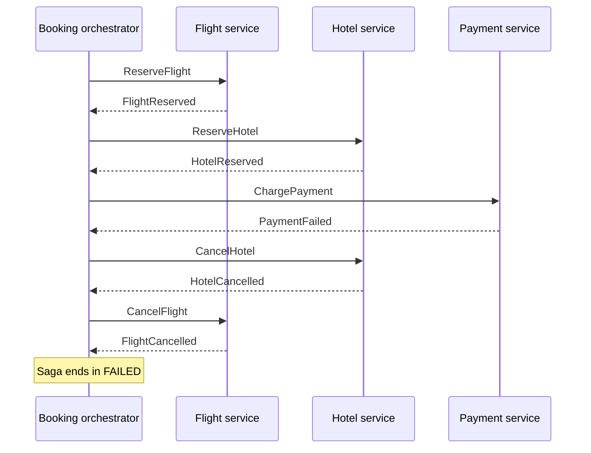
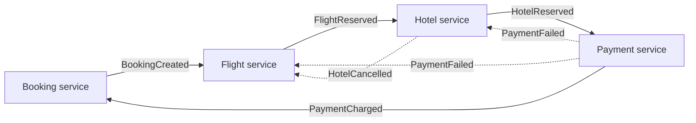

"How do you keep data consistent when a business operation spans several microservices?" is one of the most common architecture questions, and the expected answer is the **saga**. With [database per service](lesson:microservice-patterns#db-per-service) there is no single ACID transaction across services, and two-phase commit is avoided ([why](lesson:microservice-patterns#q-two-phase)). This lesson uses a trip booking (a flight, a hotel and a payment, each its own service) as the example, which is deliberately simple. It builds on the [microservice patterns lesson](lesson:microservice-patterns), especially the [transactional outbox](lesson:microservice-patterns#outbox) and [idempotency](lesson:microservice-patterns#idempotency). Play the three scenes: an orchestrated saga, failure with compensation, and a choreographed saga.

```demo
name: saga-walk
```

> **One sentence to remember:** *a saga is a sequence of local transactions, one per service; if one fails, the saga runs compensating transactions for the steps already done, giving eventual consistency without locks held across services.*

## The problem and the idea {#idea}

### Why a normal transaction does not work {#problem}

Booking a trip touches three services with three databases. A single `@Transactional` cannot span them, and a distributed transaction (**two-phase commit**) would make every participant hold locks until all have voted, so one slow or dead service blocks the rest and couples them all to a coordinator. If you simply call the services one after another and the third fails, the first two have already committed: the customer has a seat and a room but no payment.

### The saga {#saga}

A **saga** (Garcia-Molina and Salem, 1987; applied to microservices by Chris Richardson and others) breaks the business transaction into a series of **local transactions** `T1, T2, ... Tn`, each committed in its own service. Each step `Ti` that can be undone has a **compensating transaction** `Ci`. If step `Tk` fails, the saga runs `C(k-1), ..., C1` in reverse order to semantically undo the completed steps.



The price is **ACD without I**: atomicity and durability hold in the end (all or nothing, via compensation) and each local step is consistent, but there is **no isolation**: other requests can see the intermediate state (a reserved seat for a booking that will fail). The system is **eventually consistent**, and the design must cope with that (see [isolation](#isolation)).

### Kinds of steps {#step-kinds}

| Kind | Meaning | Example |
| --- | --- | --- |
| **Compensable** | can be undone with a compensating transaction | reserve flight (cancel it) |
| **Pivot** | the go/no-go point: if it succeeds the saga will complete; cannot be compensated | charge payment, or confirm the booking |
| **Retriable** | after the pivot, must eventually succeed, so it is retried until it does | issue the ticket, send the confirmation |

Order steps so that the steps most likely to fail and the hardest to undo come as early as possible (check and reserve before charging), and put steps that cannot be compensated after the pivot.

## Two ways to coordinate {#coordination}

### Orchestration {#orchestration}

A central **orchestrator** (a saga coordinator, itself a service or a workflow engine) knows the steps. It sends a command to each participant, waits for the reply, decides the next step, and on failure sends the compensating commands. Participants know nothing about the saga.



The orchestrator is modelled as a **state machine** and persists its state (`STARTED`, `FLIGHT_RESERVED`, `HOTEL_RESERVED`, `COMPLETED`, `COMPENSATING`, `FAILED`) so it survives a crash.

### Choreography {#choreography}

No coordinator: each service performs its local transaction and publishes an **event**; other services subscribe and react. Compensation also works through events (`PaymentFailed` makes the hotel and flight services undo their steps).



### Which to choose {#choose}

| | Choreography | Orchestration |
| --- | --- | --- |
| Control | decentralised, event reactions | central coordinator |
| Coupling | services know the events of others | services know only the orchestrator's commands |
| Visibility of the flow | implicit, spread over subscriptions | explicit in one place, easy to monitor and change |
| Complexity as steps grow | grows fast, cyclic dependencies | stays manageable |
| Extra component | none | the orchestrator (a single point to make resilient) |
| Good for | 2 to 4 steps, simple flows | longer or branching processes, timeouts, human steps |

A frequent answer is: **choreography for simple, short sagas; orchestration once there are more than a few steps, branching or a need to see the state of each business transaction.** Orchestration is not a distributed monolith if the orchestrator holds only the process, not the business rules of the participants.

## Designing compensations {#compensation}

### Rules for compensating transactions {#compensation-rules}

- **Semantic undo, not a database rollback:** the original step is already committed and visible. Compensate with a new business action (cancel the reservation, issue a refund), often leaving an audit trail (state `CANCELLED`), rather than deleting data.
- **Idempotent:** the compensation may be delivered or retried several times; running it twice must equal running it once.
- **Retriable and eventually successful:** it must not fail permanently; retry with backoff, and alert a human if it keeps failing.
- **Commutative with the original action where messages arrive out of order:** a `CancelHotel` can arrive **before** `ReserveHotel` (network reordering). The participant must handle it, for example by recording the cancellation and refusing the late reservation.
- **Some actions cannot be undone** (an email was sent, money was paid out). Reorder them after the pivot, make them retriable steps, or use a countermeasure (send a correction email, issue a refund as a new transaction).

### Isolation anomalies and countermeasures {#isolation}

Because intermediate states are visible, a saga can suffer anomalies:

| Anomaly | Example | Countermeasure |
| --- | --- | --- |
| **Lost update** | one saga overwrites changes another saga made between steps | versioned values, re-read before writing |
| **Dirty read** | another request sees a reserved seat that is later cancelled | **semantic lock**: mark the record `PENDING`, and treat it accordingly |
| **Non-repeatable read** | two reads in one saga return different data | pessimistic view (reorder steps), re-read the value |

Common countermeasures: the **semantic lock** (a state flag such as `RESERVATION_PENDING` that other transactions respect or wait on), **commutative updates** (decrement and increment instead of set), **pessimistic view** (order steps to limit exposure), **re-read the value** before updating, **version file** (record the operations to apply them in the right order) and **by-value** (choose the mechanism by the risk of the business request). Show pending data to users as pending.

## Making it reliable {#reliability}

### Atomic publish: outbox {#outbox}

Each step must update its database **and** send its reply or event; if only one happens, the saga hangs or lies. Use the [transactional outbox](lesson:microservice-patterns#outbox): the message is written in the same local transaction as the data and published by a relay (polling or change data capture). Without it a crash between the commit and the send breaks the saga.

### Idempotent participants and at-least-once messages {#idempotent}

Messaging delivers **at least once**, and retries repeat work, so every participant is an **idempotent consumer**: it records the processed message id (or uses a business key such as the saga id plus step) and ignores duplicates, performing the check and the work in one transaction. Use a **saga id** (correlation id) in every message so replies map to the right saga.

### Timeouts, retries and stuck sagas {#timeouts}

A participant may never reply. The orchestrator sets a **timeout** per step and either retries (the commands are idempotent) or starts compensation. Persist saga state and have a recovery job that finds sagas stuck in a state too long. Messages that fail repeatedly go to a **dead-letter queue** for investigation, and sagas that cannot compensate raise an alert for manual handling.

### Observability {#observability-saga}

With the flow spread over services you must be able to answer "where is booking TRIP-7?". Log and trace with the saga id, expose saga state (an orchestrator gives it for free), and track metrics such as sagas started, completed, compensated, and time stuck in each state.

## Implementing it {#implementing}

### Orchestrator in Spring {#spring-orchestrator}

A small hand-written orchestrator is a persisted state machine plus a reaction to each reply:

```java
@Entity
class BookingSaga {
    @Id UUID id;
    @Enumerated(EnumType.STRING) SagaState state = SagaState.STARTED;
    @Version long version;                       // optimistic locking: parallel replies cannot corrupt it
    Instant updatedAt = Instant.now();
}

@Service
class BookingOrchestrator {

    @Transactional
    public void start(BookingRequest req) {
        BookingSaga saga = sagas.save(new BookingSaga(req));
        outbox.send("flight.commands", new ReserveFlight(saga.id, req));     // outbox: same transaction
    }

    @KafkaListener(topics = "booking.replies")
    @Transactional
    public void on(SagaReply reply) {
        BookingSaga saga = sagas.findById(reply.sagaId()).orElseThrow();
        if (saga.state.isFinal()) return;                                    // duplicate or late reply: ignore
        switch (reply) {
            case FlightReserved r -> { saga.state = FLIGHT_RESERVED; outbox.send("hotel.commands", new ReserveHotel(saga.id)); }
            case HotelReserved r  -> { saga.state = HOTEL_RESERVED;  outbox.send("payment.commands", new ChargePayment(saga.id)); }
            case PaymentCharged r -> saga.state = COMPLETED;
            case PaymentFailed r  -> { saga.state = COMPENSATING;    outbox.send("hotel.commands", new CancelHotel(saga.id)); }
            case HotelCancelled r -> outbox.send("flight.commands", new CancelFlight(saga.id));
            case FlightCancelled r -> saga.state = FAILED;
            default -> throw new IllegalStateException("unexpected " + reply);
        }
    }
}
```

### A participant {#participant}

```java
@KafkaListener(topics = "hotel.commands")
@Transactional
public void on(HotelCommand cmd) {
    if (!processed.markIfNew(cmd.messageId())) return;           // idempotent consumer
    switch (cmd) {
        case ReserveHotel c -> {
            Reservation r = hotel.reserve(c.sagaId());           // local transaction
            outbox.send("booking.replies", new HotelReserved(c.sagaId(), r.id()));
        }
        case CancelHotel c -> {
            hotel.cancel(c.sagaId());                            // idempotent, also safe if nothing was reserved yet
            outbox.send("booking.replies", new HotelCancelled(c.sagaId()));
        }
    }
}
```

### Frameworks and tools {#tools}

Writing orchestration by hand is fine for small flows; for larger ones use a tool: **Temporal** or **Cadence** (durable workflow code, retries and timers built in), **Camunda / Zeebe** (BPMN process engines), **Axon Framework** (sagas with event sourcing), **Eventuate Tram Sagas**, **Spring State Machine**, and cloud services such as **AWS Step Functions**. Choreography is just events on Kafka or RabbitMQ plus the outbox pattern.

### Saga compared with other approaches {#compare}

| Approach | Consistency | Isolation | Coupling and availability |
| --- | --- | --- | --- |
| Local ACID transaction | strong | full | one database only |
| **Two-phase commit (2PC)** | atomic, immediate | locks held | blocks on failures, tight coupling |
| **Saga** | eventual, with compensation | none (countermeasures) | loose, services stay available |
| **TCC** (Try-Confirm/Cancel) | eventual | resources reserved in the Try step | needs three operations per service, a stricter reservation model |
| Do nothing, reconcile later | eventual | none | batch reconciliation fixes mismatches |

## Cheat sheet {#cheatsheet}

| Topic | Key point |
| --- | --- |
| What | sequence of local transactions plus compensations |
| Why | no ACID across services, 2PC blocks and couples |
| Coordination | orchestration (central, explicit) or choreography (events, decentralised) |
| Compensation | semantic undo, idempotent, retriable, handle out-of-order |
| Step kinds | compensable, pivot, retriable |
| Missing isolation | semantic lock, commutative updates, re-read, version |
| Reliability | outbox, idempotent consumers, saga id, timeouts, DLQ |
| Failure | compensate in reverse order, persist state, alert if compensation fails |
| Tools | Temporal, Camunda, Axon, Eventuate, Step Functions |

## Interview questions {#questions}

### [basic] What is the Saga pattern and why is it used? {#what-is-saga}

A way to maintain data consistency across several services without a distributed ACID transaction. The business transaction is split into local transactions, one per service, each committed on its own; if a step fails, compensating transactions undo the previous steps in reverse order. It is used because each service owns its database, and two-phase commit blocks and couples services. The result is eventual consistency.

### [basic] What is a compensating transaction? {#compensation-q}

An action that semantically undoes a completed step, for example cancelling a reservation or refunding a payment. It is not a database rollback (the original transaction is already committed): it is a new business operation, often leaving the original record in a `CANCELLED` state for audit. It must be idempotent and retriable, because it will be retried until it succeeds.

### [basic] What is the difference between choreography and orchestration? {#choreo-vs-orch}

In **choreography** each service reacts to events from others and publishes its own; there is no central controller, so coupling is low and it is simple for short flows, but the flow is implicit and hard to follow as it grows. In **orchestration** a central orchestrator tells each participant what to do and tracks the saga state, so the flow is explicit and easy to monitor, at the cost of an extra component and participants depending on its commands.

### [basic] Why not use two-phase commit between microservices? {#why-not-2pc}

2PC holds locks in every participant until the coordinator decides, so latency and lock contention rise, any unavailable participant or the coordinator blocks everyone, and services become tightly coupled. Many brokers and NoSQL stores do not support it, and it conflicts with independent deployment and availability. Sagas trade immediate consistency for availability and loose coupling.

### [basic] What consistency does a saga give? {#consistency-q}

Eventual consistency. Each local transaction is atomic and the saga as a whole ends either completed or fully compensated, but while it runs other requests can see intermediate states. It provides atomicity (eventually), consistency and durability, but not isolation.

### [intermediate] What happens if a compensating transaction fails? {#compensation-fails}

Compensations must not fail permanently, so they are retried (with backoff) until they succeed, which requires them to be idempotent and the commands to be persisted (the outbox pattern). If they still fail after many attempts, the saga is marked as needing attention, an alert is raised and the case goes to a dead-letter queue or manual resolution. Design compensations to be as simple and reliable as possible.

### [intermediate] What are compensable, pivot and retriable steps? {#step-kinds-q}

Compensable steps can be undone by a compensation (reserve flight). The pivot is the point of no return: if it succeeds the saga will finish, and it is not compensated (for example the payment or confirmation). Retriable steps come after the pivot and must eventually succeed, so they are retried rather than undone (issue the ticket). Order steps so compensable ones come first and the riskiest ones as early as possible.

### [intermediate] How do you make saga participants idempotent? {#idempotent-q}

Messages are delivered at least once and commands are retried, so each participant records processed message ids (or a business key such as saga id plus step) with a unique constraint, in the same transaction as its work, and ignores repeats. Operations are designed to be repeat-safe (set state instead of increment). Replies carry the saga id so the orchestrator can also discard duplicates and late replies.

### [intermediate] How do you guarantee that a service both updates its database and sends the saga message? {#outbox-q}

With the transactional outbox: the message is inserted in an outbox table in the same local transaction as the state change, and a relay (a poller or change data capture) publishes it to the broker later, marking it sent. This makes publication atomic with the change without a distributed transaction. Delivery becomes at-least-once, which is why participants are idempotent.

### [intermediate] What problems come from the lack of isolation in sagas? {#isolation-q}

Anomalies such as lost updates (another saga overwrites a change made between steps), dirty reads (someone acts on data that a failing saga will compensate) and non-repeatable reads. Countermeasures: a semantic lock (a `PENDING` state other transactions respect), commutative updates, a pessimistic view that reorders steps to reduce the exposure, re-reading values before updating, versioning, and showing pending states to users.

### [intermediate] How do you handle a participant that never responds? {#timeout-q}

Set a timeout per step. On timeout the orchestrator retries the (idempotent) command a limited number of times and then starts compensation. Persist the saga state and run a recovery job that finds sagas stuck in a state beyond a threshold. In choreography the equivalent is a timeout event or a watchdog service. Monitor stuck sagas and dead-letter queues.

### [intermediate] What happens if a compensation arrives before the original command? {#out-of-order}

Messages can be reordered or delayed, so `CancelHotel` can reach the hotel service before `ReserveHotel`. The participant must handle it: record the cancellation (a tombstone keyed by saga id) and, when the late `ReserveHotel` arrives, ignore it. Without this the reservation is made after the cancellation and leaks.

### [intermediate] When would you choose choreography, and when orchestration? {#when-which}

Choreography for short, simple sagas with a few steps and independent teams, where adding a central component is unnecessary. Orchestration when there are more steps or branching, a need for visibility of state, timeouts and human steps, or complex compensation logic, because the flow is in one place and easier to understand, test and change. Avoid choreography with many steps and cyclic event dependencies.

### [intermediate] How do you track and debug a saga? {#debug-q}

Give every saga an id and put it in all messages, logs and trace spans (correlation id); keep the saga state persistent and queryable (an orchestrator gives this directly, choreography needs an aggregated view built from events); emit metrics for started, completed, compensated and stuck sagas; and keep dead-letter queues and alerts. Distributed tracing (OpenTelemetry) shows the path across services.

### [deep] How does a saga differ from TCC (Try-Confirm/Cancel)? {#tcc-q}

In TCC each service exposes three operations: **Try** reserves resources (without making them final), **Confirm** commits them, **Cancel** releases them. A coordinator tries all, then confirms all or cancels all, so resources are held in a provisional state, which gives better isolation than a plain saga but needs a reservation model in every service and three endpoints. A saga commits each step immediately and compensates afterwards, which is simpler but exposes intermediate states.

### [deep] Is orchestration a single point of failure or a distributed monolith? {#orchestrator-risk}

The orchestrator must be resilient: stateless instances over persisted saga state, run several replicas, with recovery for in-flight sagas, or a durable workflow engine. It stays a good design when it contains only the process (the order of steps, timeouts, compensation) and the participants keep their own business rules and local transactions; if it starts to hold their domain logic, services become dependent on it and it turns into a distributed monolith. Each team can still deploy participants independently.

### [deep] How would you model a money transfer between two services as a saga? {#transfer-saga}

Steps: reserve the amount on the source account (debit into a `HELD` state, a semantic lock), credit the target account, then confirm the debit (the pivot is the credit). If the credit fails, compensate by releasing the hold. Each step is a local transaction with the outbox, commands carry a transfer id for idempotency, the held state prevents double spending during the saga, and a reconciliation job finds transfers stuck mid-way. Money is never "in between" invisibly: the hold is explicit.

### [deep] Can sagas be nested, or run in parallel? {#parallel}

Yes. Independent steps can run in parallel (the flight and hotel reserved at the same time) with the orchestrator waiting for all replies before the next step; if one fails, the others that succeeded are compensated. Nested sagas (a step that is itself a saga in another service) work but make failure handling and observability harder, so keep sagas flat where you can and keep the number of steps small.

### [coding] Make a saga participant idempotent and safe against reordering. {#coding-participant}

```java
@KafkaListener(topics = "hotel.commands")
@Transactional
public void on(HotelCommand cmd) {
    if (!processed.markIfNew(cmd.messageId())) return;                 // duplicate delivery

    switch (cmd) {
        case ReserveHotel c -> {
            if (cancellations.exists(c.sagaId())) {                    // CancelHotel arrived first
                outbox.send("booking.replies", new HotelReservationRejected(c.sagaId()));
                return;
            }
            Reservation r = reservations.save(Reservation.pending(c.sagaId(), c.room()));
            outbox.send("booking.replies", new HotelReserved(c.sagaId(), r.getId()));
        }
        case CancelHotel c -> {
            cancellations.save(new Cancellation(c.sagaId()));          // tombstone for late reservations
            reservations.findBySagaId(c.sagaId()).ifPresent(Reservation::cancel);   // no-op if absent or already cancelled
            outbox.send("booking.replies", new HotelCancelled(c.sagaId()));
        }
    }
}
```

Explain the three protections: the processed-message table (idempotent consumer), the tombstone for a cancellation that arrives early, and the outbox so the reply is atomic with the state change.

### [coding] Write the orchestrator transition for a failed payment. {#coding-compensate}

```java
case PaymentFailed r -> {
    saga.state = SagaState.COMPENSATING;
    saga.failureReason = r.reason();
    outbox.send("hotel.commands", new CancelHotel(saga.id));      // compensate in reverse order: hotel, then flight
}
case HotelCancelled r -> outbox.send("flight.commands", new CancelFlight(saga.id));
case FlightCancelled r -> {
    saga.state = SagaState.FAILED;
    outbox.send("booking.events", new BookingFailed(saga.id, saga.failureReason));
}
```

Point out that state and the outgoing command are saved in one transaction (outbox), that a duplicate reply for a finished saga is ignored, that compensation runs in reverse order, and that a timeout job resends commands for sagas stuck in `COMPENSATING`.

### [coding] Show a choreographed saga with Spring Cloud Stream or Kafka. {#coding-choreography}

```java
@Component
class FlightEvents {

    @KafkaListener(topics = "booking.events")
    @Transactional
    public void onBookingCreated(BookingCreated e) {
        if (!processed.markIfNew(e.eventId())) return;
        flights.reserve(e.bookingId(), e.flight());                        // local transaction
        outbox.send("flight.events", new FlightReserved(e.bookingId()));   // reliably published event
    }

    @KafkaListener(topics = "payment.events")
    @Transactional
    public void onPaymentFailed(PaymentFailed e) {                         // compensation by event
        if (!processed.markIfNew(e.eventId())) return;
        flights.cancel(e.bookingId());
        outbox.send("flight.events", new FlightCancelled(e.bookingId()));
    }
}
```

Mention that each service only knows the events it consumes and produces, that keys (the booking id) keep events of one saga ordered in a partition, and why this style becomes hard to follow with many steps (the process exists only as the sum of subscriptions).
