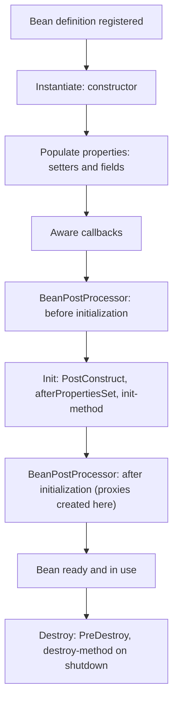

Every Spring interview starts here. Typical questions are:

- What is IoC, and what is dependency injection?
- What is a bean?
- What is the difference between `BeanFactory` and `ApplicationContext`?
- What are the bean scopes and the bean lifecycle?
- Which injection style should you use?

Everything else in Spring (Boot, MVC, Data, transactions, security) is built on this container. The next lessons are [Spring Boot essentials](lesson:spring-boot) and [AOP and proxies](lesson:spring-aop). The examples use a small banking domain.

The demo has four scenes: the container starting up, bean scopes, the bean lifecycle, and a circular dependency.

```demo
name: spring-core-walk
```

> **One sentence to remember:** *You say what each object needs, and the Spring container creates the objects and connects them.*

## The idea {#idea}


### Inversion of Control {#ioc}

Normally a class creates the objects it needs itself:

```java
class TransferService {
    private final AccountRepository accounts = new JdbcAccountRepository();   // hard-wired, hard to test or replace
}
```

Here `TransferService` is tied to one repository class. You cannot swap it, and a test cannot pass in a fake.

**Inversion of Control (IoC)** hands the job of *creating and connecting* objects to a framework. Your class only says what it needs, and something else provides it.

**Dependency Injection (DI)** is the main way to do IoC. The objects a class needs (its *dependencies*) are passed in from outside, through a constructor, a setter or a field. The class does not create them or look them up.

```java
@Service
class TransferService {
    private final AccountRepository accounts;                  // an interface
    TransferService(AccountRepository accounts) { this.accounts = accounts; }   // injected
}
```

The benefits:

- **Loose coupling.** The class depends on an interface, so you can swap the implementation.
- **Testability.** A unit test creates the class with plain `new` and passes in a mock or a fake.
- **One place for configuration.** Which implementation is used is decided in one place, not in every class.
- **Extra behaviour for free.** Because the container creates the objects, it can wrap them in proxies that add transactions, security or caching.

### Bean, container and context {#bean}

A **bean** is an object that the Spring container creates, connects and manages.

The **container** reads **configuration metadata**: annotations, Java `@Configuration` classes or XML. From it, the container builds **bean definitions**. A bean definition is a recipe for one bean. Then the container creates the beans, connects them and manages them.

Spring has two container types:

| | `BeanFactory` | `ApplicationContext` |
| --- | --- | --- |
| Role | The basic container. It creates beans and connects them. | It extends `BeanFactory` with features that real applications need. |
| When beans are created | Lazily, the first time a bean is asked for. | Singletons are created eagerly at startup, so a broken configuration fails straight away. |
| Extras | None. | Events, `MessageSource` (translated messages), resource loading, environment and profiles, annotation support and AOP integration. |
| Use | Rarely used directly. | The normal choice: `AnnotationConfigApplicationContext`, or the context that Spring Boot creates. |

## Defining beans {#defining}

### Stereotype annotations {#stereotypes}

A **stereotype annotation** marks a class as a bean and says which layer it belongs to.

| Annotation | Meaning |
| --- | --- |
| `@Component` | A general Spring-managed class. |
| `@Service` | Business logic. It adds no behaviour. It only documents the intent. |
| `@Repository` | Data access. It also converts database exceptions into Spring's `DataAccessException`. |
| `@Controller` / `@RestController` | The web layer. |
| `@Configuration` | A class that declares beans with `@Bean` methods. |

Spring finds these classes by **component scanning**. `@ComponentScan` scans the package of the main class and all its sub-packages. (`@SpringBootApplication` includes `@ComponentScan`.) A bean outside that package tree is not found unless you scan its package explicitly.

### Java configuration with @Bean {#java-config}

Use a `@Bean` method for objects you cannot annotate, such as third-party classes, or for objects that need some construction logic:

```java
@Configuration
class AppConfig {

    @Bean
    Clock clock() { return Clock.systemUTC(); }

    @Bean
    RateLimiter rateLimiter(Clock clock) {            // parameters are injected from other beans
        return new RateLimiter(clock, 100);
    }
}
```

Spring wraps a `@Configuration` class in a proxy. So when one `@Bean` method calls another, it gets back the same singleton instead of a new object. This is called **full mode**.

A `@Bean` method inside a plain `@Component` is not wrapped like this. This is called **lite mode**. There, a call from one `@Bean` method to another is a normal Java call and creates a new object.

### Choosing between several candidates {#qualifier}

Sometimes two beans match the same type, for example two `PaymentGateway` implementations. Then injection fails with `NoUniqueBeanDefinitionException`. You can fix it in four ways:

- Put `@Primary` on the default implementation.
- Put `@Qualifier("name")` at the injection point to pick one by name.
- Inject `List<PaymentGateway>` or `Map<String, PaymentGateway>` to receive all of them.
- Use profiles (`@Profile("test")`) or conditions (`@ConditionalOnProperty`) so that only one is registered.

## Dependency injection styles {#injection}

```java
// constructor injection (recommended)
@Service
class TransferService {
    private final AccountRepository accounts;
    private final Clock clock;
    TransferService(AccountRepository accounts, Clock clock) { this.accounts = accounts; this.clock = clock; }
}

// setter injection (optional dependencies)
@Autowired void setNotifier(Notifier notifier) { this.notifier = notifier; }

// field injection (avoid)
@Autowired private AccountRepository accounts;
```

| | Constructor | Setter | Field |
| --- | --- | --- | --- |
| Fields can be `final` (cannot change) | Yes. | No. | No. |
| Required dependencies are easy to see | Yes. | No. | No. |
| Usable in a plain unit test without Spring | Yes, with `new`. | Yes. | No. It needs reflection or the container. |
| Circular dependencies | Detected at startup, which is good. | Allowed, which hides a design problem. | Allowed. |
| Verdict | **Preferred.** | Only for optional dependencies. | Avoid. |

If a class has only one constructor, you do not need `@Autowired` on it.

Constructor injection also shows when a class does too much. A constructor with eight parameters is a design warning.

## Scopes {#scopes}

The **scope** of a bean decides how many instances exist and how long each one lives.

| Scope | How many instances | Notes |
| --- | --- | --- |
| **singleton** (default) | One per container. | All threads share it, so keep it stateless or thread-safe. |
| **prototype** | A new one every time the bean is asked for. | The container does not call destroy callbacks on it. |
| **request** | One per HTTP request. | Web applications only. |
| **session** | One per HTTP session. | Web applications only. |
| **application**, **websocket** | One per `ServletContext`, or one per WebSocket session. | Less common. |

A Spring "singleton" means one per container. It is not the classic Gang of Four singleton, which means one per JVM (or per class loader).

A common trap: you inject a **prototype or request-scoped bean into a singleton**. The injection happens once, when the singleton is created. So the singleton keeps that one instance forever. To get the right instance on each call, do one of these:

- inject an `ObjectProvider<T>` and call `getObject()` each time, or
- use a scoped proxy: `@Scope(value = "request", proxyMode = ScopedProxyMode.TARGET_CLASS)`.

Another classic bug is a singleton that holds state. For example, a field `private BigDecimal lastAmount;` in a `@Service` is shared by every request and every thread.

## Lifecycle {#lifecycle}



- **`@PostConstruct` and `@PreDestroy`.** Use `@PostConstruct` for setup that needs the injected dependencies, such as checking configuration or preloading data. Use `@PreDestroy` for cleanup, such as closing pools or flushing buffers. Both come from the Jakarta annotations (`jakarta.annotation` in Spring 6 and Boot 3).
- **Post-processors.** A `BeanPostProcessor` can change every bean after it is created. AOP proxies and `@Autowired` processing both work this way. A `BeanFactoryPostProcessor` is different: it changes bean *definitions* before any bean exists. For example, `PropertySourcesPlaceholderConfigurer` fills in `${...}` placeholders.
- **Lazy initialisation.** `@Lazy` delays creating a bean until it is first used. Spring Boot can make every bean lazy with `spring.main.lazy-initialization=true`. The cost is that errors show up later, not at startup.
- **Circular dependencies.** A needs B, and B needs A. With constructor injection, startup fails with `BeanCurrentlyInCreationException`. Since Boot 2.6, even cycles through setters are rejected by default. Fix the design: move the shared logic into a third bean, or use events. Putting `@Lazy` on one dependency is only a workaround.

## Environment, properties and profiles {#environment}

```java
@Component
class FeeCalculator {
    private final BigDecimal rate;
    FeeCalculator(@Value("${bank.fee-rate:0.01}") BigDecimal rate) { this.rate = rate; }   // property with a default
}

@Profile("prod")
@Configuration
class ProdOnlyConfig { ... }
```

- `@Value` injects one property. The part after `:` is the default value.
- For a group of related settings, prefer type-safe `@ConfigurationProperties` (see [Spring Boot essentials](lesson:spring-boot#properties)).
- A **profile** turns on a set of beans and properties for one environment. You choose it with `spring.profiles.active=prod`.

## Application events {#events}

Beans can talk to each other without knowing each other, through the context's events:

```java
record TransferCompleted(long transferId) {}

@Service class TransferService {
    private final ApplicationEventPublisher events;
    void complete(long id) { ...; events.publishEvent(new TransferCompleted(id)); }
}

@Component class AuditListener {
    @EventListener void on(TransferCompleted e) { ... }                      // synchronous, same thread and transaction
}
@Component class NotifyListener {
    @TransactionalEventListener void after(TransferCompleted e) { ... }      // runs after the transaction commits
}
```

- `TransferService` publishes an event. It does not know who listens.
- `@EventListener` runs straight away, on the same thread and in the same transaction.
- `@TransactionalEventListener` runs only after the transaction commits.

Events decouple beans and can break circular dependencies. But they stay inside one application and are synchronous by default. They do not replace a message broker ([messaging](lesson:messaging)).

Try it in the lab: [A bean from definition to destruction](lab:spring-bean-lifecycle).

## Cheat sheet {#cheatsheet}

| Topic | Key point |
| --- | --- |
| IoC | The container creates and connects objects, not your code. |
| DI | Dependencies are passed in through a constructor, setter or field. |
| Bean | An object managed by the container. |
| `ApplicationContext` | `BeanFactory` plus events, messages, profiles and AOP. It creates singletons at startup. |
| Stereotypes | `@Component`, `@Service`, `@Repository` (also converts exceptions) and `@Controller`. |
| `@Bean` | Declares a bean from a method, for third-party or computed objects. |
| Choosing one of several | `@Primary`, `@Qualifier`, `List<T>` or profiles. |
| Preferred injection | Constructor: fields can be final, the class is testable, dependencies are visible. |
| Scopes | Singleton (default), prototype, request and session. |
| Singleton trap | State is shared across threads. A prototype inside a singleton stays one instance. |
| Lifecycle | Construct, populate, post-process, `@PostConstruct`, use, `@PreDestroy`. |
| Proxies | Created by the after-initialisation post-processor. |
| Circular dependency | A design problem. A constructor cycle fails at startup. |

## Interview questions {#questions}

### [basic] What is Inversion of Control? {#ioc-q}

IoC is a design principle: the framework creates your objects and connects them, not your code.

A class does not build its collaborators with `new` or look them up. It only declares what it needs, and the container supplies it.

This gives:

1. loose coupling,
2. easier testing,
3. configuration kept in one place.

### [basic] What is dependency injection and what are its types? {#di-q}

Dependency injection is the technique that implements IoC. A class receives the objects it needs from outside, instead of creating them.

Spring supports three types:

- **Constructor injection**: the dependencies are constructor parameters.
- **Setter injection**: the dependencies are passed through setter methods.
- **Field injection**: the dependencies are written straight into annotated fields.

### [basic] Which injection type should you prefer and why? {#constructor-q}

Constructor injection.

1. Fields can be `final`, so they never change.
2. The required dependencies are easy to see.
3. A unit test can create the class with plain `new` and mocks.
4. Missing or circular dependencies fail at startup, not later.
5. A class with too many dependencies stands out, because its constructor gets long.

Setter injection fits optional dependencies. Field injection hides the dependencies, and a test needs reflection or the container to fill them.

### [basic] What is a Spring bean? {#bean-q}

A bean is an object that the Spring container creates, connects and manages.

You define beans with stereotype annotations such as `@Component`, with `@Bean` methods, or with XML.

An object you create yourself with `new` is not a bean. Spring does not inject anything into it or wrap it in a proxy.

### [basic] What is the difference between BeanFactory and ApplicationContext? {#context-q}

`BeanFactory` is the basic container. `ApplicationContext` is the full one, and you almost always use it.

- `BeanFactory` creates and connects beans, and it creates them lazily.
- `ApplicationContext` adds events, translated messages, resource loading, environment and profile support, and annotation and AOP integration.
- `ApplicationContext` also creates singletons at startup, so configuration errors appear straight away.

### [basic] What are the bean scopes? {#scopes-q}

- **Singleton** (the default): one instance per container.
- **Prototype**: a new instance every time the bean is asked for.
- **Web scopes**: request, session, application and websocket.

"Singleton" here means one per Spring container, not one per JVM. You can also register your own custom scopes.

### [basic] Difference between @Component, @Service, @Repository and @Controller? {#stereotype-q}

All four register a bean through component scanning.

- `@Service` and `@Controller` only document which layer the class belongs to.
- `@Repository` also converts database exceptions into Spring's `DataAccessException` hierarchy.
- `@RestController` is `@Controller` plus `@ResponseBody`.

### [intermediate] Is a Spring singleton bean thread-safe? {#thread-safe-q}

No. Spring does not make it thread-safe.

One instance is shared by all threads, so any field that changes is a race condition. To stay safe:

- keep singleton beans stateless: only final fields and injected collaborators,
- keep per-request data in method parameters and local variables,
- if you really need state, use request scope or thread-safe classes.

### [intermediate] Explain the bean lifecycle. {#lifecycle-q}

The container goes through these steps for each bean:

1. It creates the bean by calling the constructor.
2. It injects dependencies through setters and fields.
3. It calls the Aware callbacks.
4. It runs `BeanPostProcessor.postProcessBeforeInitialization`.
5. It runs the init callbacks: `@PostConstruct`, `afterPropertiesSet` and any custom init method.
6. It runs `postProcessAfterInitialization`. AOP proxies are created here.
7. The bean is ready and in use.
8. On shutdown, for singletons, it runs `@PreDestroy`, `destroy` and any custom destroy method.

### [intermediate] What happens when two beans of the same type exist? {#ambiguity-q}

Injection by type fails with `NoUniqueBeanDefinitionException`.

You can fix it by:

- marking the default one with `@Primary`,
- naming the one you want with `@Qualifier` at the injection point (or naming the parameter the same as the bean),
- injecting a `List` or `Map` of all implementations,
- registering only one, through profiles or conditions.

### [intermediate] What is a circular dependency and how do you handle it? {#circular-q}

A circular dependency is when bean A needs B and bean B needs A.

With constructor injection, the container cannot create either one, so startup fails with `BeanCurrentlyInCreationException`. Since Spring Boot 2.6, cycles through setters or fields are also rejected by default.

Fix the design:

- move the shared logic into a third bean,
- merge the two classes, or
- decouple them with events.

`@Lazy` on one dependency, or switching to setter injection, are workarounds. They hide the problem instead of fixing it.

### [intermediate] What happens if you inject a prototype bean into a singleton? {#prototype-q}

The singleton keeps one prototype instance forever.

Injection happens only once, when the singleton is created. To get a new instance each time you use it:

- inject `ObjectProvider<T>` (or `Provider`) and call `getObject()`,
- use a `@Lookup` method, or
- use a scoped proxy.

### [intermediate] What is the difference between @Autowired, @Resource and @Inject? {#autowired-q}

They differ in where they come from and in how they pick a bean.

- `@Autowired` is Spring's own annotation. It matches by type first, then by qualifier or name. It supports `required=false`.
- `@Inject` (JSR-330) is the standard Java equivalent. It has no `required` flag.
- `@Resource` (JSR-250) matches by name first, then by type.

In practice, use constructor injection. With a single constructor, you do not even need `@Autowired`.

### [intermediate] What is component scanning and why might a bean not be found? {#scan-q}

`@ComponentScan` registers every class with a stereotype annotation in a base package and its sub-packages. `@SpringBootApplication` scans the package of the main class.

A bean is missed when:

- it is outside that package tree,
- it has no stereotype annotation,
- a filter or a profile excludes it, or
- it was created with `new` instead of by the container.

### [intermediate] What is the difference between @Configuration and @Component for @Bean methods? {#full-lite-q}

The difference is what happens when one `@Bean` method calls another.

- In a `@Configuration` class (full mode), Spring makes a CGLIB subclass of the class. A call to another `@Bean` method returns the container's singleton. The method body does not run again.
- In a `@Component` (lite mode), `@Bean` methods are plain Java methods. A call between them creates a new object.

So use `@Configuration`, or pass the dependency in as a method parameter.

### [deep] How does Spring wrap beans with proxies and why does it matter? {#proxy-q}

After a bean is initialised, a `BeanPostProcessor` replaces it with a proxy. The proxy is a JDK dynamic proxy if the bean has an interface, and a CGLIB subclass otherwise. It adds behaviour, such as transactions, caching and security, around the method calls.

It matters because only calls that go through the proxy get that behaviour. If a method calls another method on `this` (self-invocation), the call skips the proxy ([AOP and proxies](lesson:spring-aop)).

### [deep] How would you design beans so they are easy to unit test? {#testable-q}

Make every dependency something a test can replace.

- Use constructor injection with interfaces.
- Do not use static state, and do not call `new` on collaborators inside business methods.
- Do not use field injection.
- Keep classes small, with few dependencies.
- Inject time, randomness and ID generation (for example a `Clock` bean), so tests can control them.

Then you can test the class with plain JUnit and mocks, without starting the Spring context.

### [coding] Fix this class so it can be tested without Spring. {#coding-testable}

```java
@Service
class FeeService {
    @Autowired private AccountRepository accounts;
    public BigDecimal fee(long id) {
        Account a = accounts.findById(id).orElseThrow();
        return a.getBalance().multiply(new BigDecimal("0.01"));
    }
}
```

```java
@Service
class FeeService {
    private final AccountRepository accounts;
    private final BigDecimal rate;

    FeeService(AccountRepository accounts, @Value("${bank.fee-rate:0.01}") BigDecimal rate) {
        this.accounts = accounts;
        this.rate = rate;
    }

    public BigDecimal fee(long id) {
        return accounts.findById(id).orElseThrow().getBalance().multiply(rate);
    }
}

// plain unit test, no Spring
FeeService service = new FeeService(mockRepository, new BigDecimal("0.02"));
```

Explain three things:

- The constructor makes the dependencies visible and `final`.
- The rate is now configuration, not a magic number in the code.
- The test needs no container.

### [coding] Two implementations of one interface: select the right one. {#coding-qualifier}

```java
interface PaymentGateway { void pay(Payment p); }

@Component @Primary class CardGateway implements PaymentGateway { ... }
@Component("bankTransfer") class BankTransferGateway implements PaymentGateway { ... }

@Service
class PaymentService {
    private final PaymentGateway defaultGateway;
    private final PaymentGateway transfer;
    private final Map<String, PaymentGateway> all;

    PaymentService(PaymentGateway defaultGateway,                              // gets @Primary: CardGateway
                   @Qualifier("bankTransfer") PaymentGateway transfer,         // chosen by name
                   Map<String, PaymentGateway> all) {                          // every implementation, keyed by bean name
        this.defaultGateway = defaultGateway; this.transfer = transfer; this.all = all;
    }
}
```

Explain the three choices:

- `@Primary` gives the default.
- `@Qualifier` picks one explicitly.
- The map lets you look up a strategy by name.

### [coding] Get a fresh prototype bean on each call from a singleton. {#coding-provider}

```java
@Component @Scope("prototype")
class QuoteBuilder { private final List<Line> lines = new ArrayList<>(); /* mutable state */ }

@Service
class QuoteService {
    private final ObjectProvider<QuoteBuilder> builders;
    QuoteService(ObjectProvider<QuoteBuilder> builders) { this.builders = builders; }

    Quote create() {
        QuoteBuilder builder = builders.getObject();         // a new instance every call
        ...
    }
}
```

Explain why this is needed. If you injected `QuoteBuilder` directly, the singleton would get one shared builder, and every thread would use it. That is a thread-safety bug. `ObjectProvider` delays the lookup until each call, so each call gets its own builder.
