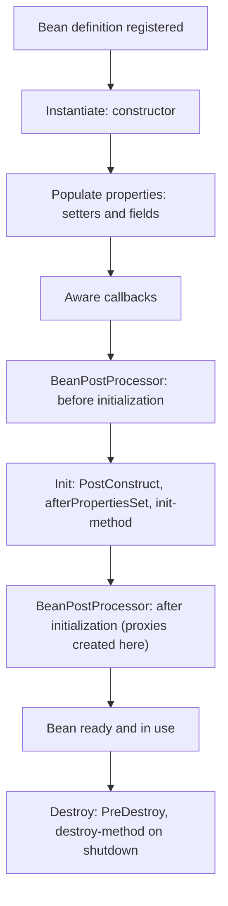

Every Spring interview starts here: *what is IoC, what is dependency injection, what is a bean, what is the difference between `BeanFactory` and `ApplicationContext`, what are the bean scopes and the lifecycle, and which injection style should you use?* Everything else in Spring (Boot, MVC, Data, transactions, security) is built on this container. The next lessons are [Spring Boot essentials](lesson:spring-boot) and [AOP and proxies](lesson:spring-aop). Examples use a small banking domain. Play the four scenes: container startup, bean scopes, the bean lifecycle, and a circular dependency.

```demo
name: spring-core-walk
```

> **One sentence to remember:** *you declare what your objects are and what they need; the Spring container creates them, wires them together and manages their lifecycle, so your classes depend on abstractions rather than constructing their own collaborators.*

## The idea {#idea}

### Inversion of Control {#ioc}

Normally your code controls its own dependencies:

```java
class TransferService {
    private final AccountRepository accounts = new JdbcAccountRepository();   // hard-wired, hard to test or replace
}
```

With **Inversion of Control (IoC)** the control of *creating and connecting* objects is handed to a framework: your class states what it needs and something else provides it. **Dependency Injection (DI)** is the main way to achieve IoC: the dependencies are passed in (through a constructor, setter or field) rather than created or looked up inside the class.

```java
@Service
class TransferService {
    private final AccountRepository accounts;                  // an interface
    TransferService(AccountRepository accounts) { this.accounts = accounts; }   // injected
}
```

Benefits: **loose coupling** (depend on an interface, swap the implementation), **testability** (pass a mock or fake in a unit test with plain `new`), **centralised configuration**, and the container can add behaviour around beans (transactions, security, caching) through proxies.

### Bean, container and context {#bean}

A **bean** is an object that is instantiated, assembled and managed by the Spring IoC container. The **container** reads **configuration metadata** (annotations, Java `@Configuration` classes, or XML) to build **bean definitions**, then creates, wires and manages the beans.

| | `BeanFactory` | `ApplicationContext` |
| --- | --- | --- |
| Role | basic container: creates and wires beans | extends BeanFactory with enterprise features |
| Bean creation | lazy (on first request) | eager for singletons at startup (fails fast) |
| Extras | none | events, `MessageSource` (i18n), resource loading, environment and profiles, annotation support, AOP integration |
| Use | rarely directly | the normal choice (`AnnotationConfigApplicationContext`, or Spring Boot's context) |

## Defining beans {#defining}

### Stereotype annotations {#stereotypes}

| Annotation | Meaning |
| --- | --- |
| `@Component` | generic Spring-managed class |
| `@Service` | business logic (a specialisation; no extra behaviour, it documents intent) |
| `@Repository` | data access; also translates persistence exceptions to Spring's `DataAccessException` |
| `@Controller` / `@RestController` | web layer |
| `@Configuration` | a class that declares beans with `@Bean` methods |

Classes are found by **component scanning**: `@ComponentScan` (included in `@SpringBootApplication`) scans the package of the main class and its sub-packages. A bean outside that package is not found unless you scan it explicitly.

### Java configuration with @Bean {#java-config}

Use `@Bean` to register objects you cannot annotate (third-party classes) or that need construction logic:

```java
@Configuration
class AppConfig {

    @Bean
    Clock clock() { return Clock.systemUTC(); }

    @Bean
    RateLimiter rateLimiter(Clock clock) {            // parameters are injected from other beans
        return new RateLimiter(clock, 100);
    }
}
```

`@Configuration` classes are proxied so that calling one `@Bean` method from another returns the same singleton instead of creating a new object each time ("full mode"). `@Bean` methods in a plain `@Component` ("lite mode") are not intercepted that way.

### Choosing between several candidates {#qualifier}

If two beans match a type (two `PaymentGateway` implementations), injection fails with `NoUniqueBeanDefinitionException`. Resolve it with:

- `@Primary` on the default implementation;
- `@Qualifier("name")` at the injection point to pick one;
- injecting `List<PaymentGateway>` or `Map<String, PaymentGateway>` to receive all of them;
- profiles (`@Profile("test")`) or conditions (`@ConditionalOnProperty`) so only one is registered.

## Dependency injection styles {#injection}

```java
// constructor injection (recommended)
@Service
class TransferService {
    private final AccountRepository accounts;
    private final Clock clock;
    TransferService(AccountRepository accounts, Clock clock) { this.accounts = accounts; this.clock = clock; }
}

// setter injection (optional dependencies)
@Autowired void setNotifier(Notifier notifier) { this.notifier = notifier; }

// field injection (avoid)
@Autowired private AccountRepository accounts;
```

| | Constructor | Setter | Field |
| --- | --- | --- | --- |
| Immutable (`final`) fields | yes | no | no |
| Required dependencies obvious | yes | no | no |
| Usable in a plain unit test without Spring | yes (`new`) | yes | needs reflection or the container |
| Circular dependencies | detected at startup (good) | tolerated (hides a smell) | tolerated |
| Verdict | **preferred** | optional dependencies only | avoid |

With a single constructor, `@Autowired` is optional. Constructor injection also reveals a class doing too much: a constructor with eight parameters is a design warning.

## Scopes {#scopes}

| Scope | Instances | Notes |
| --- | --- | --- |
| **singleton** (default) | one per container | shared by all threads: keep it stateless or thread-safe |
| **prototype** | a new one on every request for the bean | container does not call destroy callbacks |
| **request** | one per HTTP request | web applications |
| **session** | one per HTTP session | web applications |
| **application**, **websocket** | one per `ServletContext` or WebSocket session | less common |

"Singleton" in Spring means one per container, not the GoF singleton (one per JVM or class loader). Injecting a **prototype or request-scoped bean into a singleton** gives you only one instance, created at wiring time. Inject an `ObjectProvider<T>` (call `getObject()` each time) or use a scoped proxy (`@Scope(value = "request", proxyMode = ScopedProxyMode.TARGET_CLASS)`) to get the right instance per call.

Stateful singletons are a classic bug: a field such as `private BigDecimal lastAmount;` in a `@Service` is shared by every request and thread.

## Lifecycle {#lifecycle}



- Use `@PostConstruct` for initialisation that needs injected dependencies (validate configuration, preload data) and `@PreDestroy` for cleanup (close pools, flush buffers). Both come from Jakarta annotations (`jakarta.annotation` in Spring 6 and Boot 3).
- A `BeanPostProcessor` can modify every bean; AOP proxies and `@Autowired` processing are implemented this way. A `BeanFactoryPostProcessor` modifies bean *definitions* before any bean is created (`PropertySourcesPlaceholderConfigurer` resolves `${...}`).
- **Lazy initialisation:** `@Lazy` delays creation to first use; Spring Boot can make all beans lazy (`spring.main.lazy-initialization=true`) at the cost of failing later instead of at startup.
- **Circular dependencies:** A needs B and B needs A. With constructor injection startup fails (`BeanCurrentlyInCreationException`); Boot 2.6+ forbids even setter-based cycles by default. Fix the design (extract a third bean, use events); `@Lazy` on one dependency is a workaround.

## Environment, properties and profiles {#environment}

```java
@Component
class FeeCalculator {
    private final BigDecimal rate;
    FeeCalculator(@Value("${bank.fee-rate:0.01}") BigDecimal rate) { this.rate = rate; }   // property with a default
}

@Profile("prod")
@Configuration
class ProdOnlyConfig { ... }
```

`@Value` injects single properties; for groups of settings prefer type-safe `@ConfigurationProperties` (covered in [Spring Boot essentials](lesson:spring-boot#properties)). **Profiles** activate sets of beans and properties per environment (`spring.profiles.active=prod`).

## Application events {#events}

Beans can communicate without knowing each other through the context's event mechanism:

```java
record TransferCompleted(long transferId) {}

@Service class TransferService {
    private final ApplicationEventPublisher events;
    void complete(long id) { ...; events.publishEvent(new TransferCompleted(id)); }
}

@Component class AuditListener {
    @EventListener void on(TransferCompleted e) { ... }                      // synchronous, same thread and transaction
}
@Component class NotifyListener {
    @TransactionalEventListener void after(TransferCompleted e) { ... }      // runs after the transaction commits
}
```

Events decouple beans and break circular dependencies. They are in-process and synchronous by default, not a replacement for a message broker ([messaging](lesson:messaging)).

## Cheat sheet {#cheatsheet}

| Topic | Key point |
| --- | --- |
| IoC | the container, not your code, creates and wires objects |
| DI | dependencies are passed in (constructor, setter, field) |
| Bean | an object managed by the container |
| `ApplicationContext` | BeanFactory plus events, i18n, profiles, AOP; eager singletons |
| Stereotypes | `@Component`, `@Service`, `@Repository` (+ exception translation), `@Controller` |
| `@Bean` | declare a bean from a method, for third-party or computed objects |
| Disambiguation | `@Primary`, `@Qualifier`, `List<T>`, profiles |
| Preferred injection | constructor (immutable, testable, explicit) |
| Scopes | singleton (default), prototype, request, session |
| Singleton trap | shared state across threads; prototype in singleton gives one instance |
| Lifecycle | construct, populate, post-process, `@PostConstruct`, use, `@PreDestroy` |
| Proxies | created in the after-initialisation post-processor |
| Circular dependency | design smell; constructor cycle fails at startup |

## Interview questions {#questions}

### [basic] What is Inversion of Control? {#ioc-q}

A design principle where the control of creating objects and wiring them together moves from your code to a framework. Instead of a class constructing its collaborators with `new` or looking them up, it declares what it needs and the container supplies them. It gives loose coupling, easier testing and centralised configuration.

### [basic] What is dependency injection and what are its types? {#di-q}

DI is the technique that implements IoC: a class receives its dependencies from outside instead of creating them. Spring supports constructor injection (dependencies as constructor parameters), setter injection (through setter methods) and field injection (directly into annotated fields).

### [basic] Which injection type should you prefer and why? {#constructor-q}

Constructor injection. It allows `final` fields (immutability), makes required dependencies explicit, lets you create the class in a unit test with plain `new` and mocks, fails fast on missing or circular dependencies at startup, and exposes classes with too many dependencies. Setter injection suits optional dependencies; field injection hides dependencies and needs reflection or the container to test.

### [basic] What is a Spring bean? {#bean-q}

An object that is instantiated, assembled and managed by the Spring IoC container, defined through annotations (`@Component` and stereotypes), `@Bean` methods or XML. Anything you create yourself with `new` is not a bean and gets no injection or proxies.

### [basic] What is the difference between BeanFactory and ApplicationContext? {#context-q}

`BeanFactory` is the basic container that creates and wires beans lazily. `ApplicationContext` extends it with application-level features: event publication, internationalisation, resource loading, environment and profile support, annotation and AOP integration, and eager initialisation of singletons so that configuration errors appear at startup. You almost always use `ApplicationContext`.

### [basic] What are the bean scopes? {#scopes-q}

Singleton (default, one instance per container), prototype (new instance per request for the bean), and web scopes request, session, application and websocket. Singleton here means one per Spring container, not per JVM. Custom scopes can also be registered.

### [basic] Difference between @Component, @Service, @Repository and @Controller? {#stereotype-q}

All register a bean through component scanning. `@Service` and `@Controller` are specialisations that document the layer. `@Repository` also enables translation of persistence exceptions into Spring's `DataAccessException` hierarchy. `@RestController` is `@Controller` plus `@ResponseBody`.

### [intermediate] Is a Spring singleton bean thread-safe? {#thread-safe-q}

No, Spring does not make it thread-safe. One instance is shared by all threads, so mutable instance state is a race condition. Keep singleton beans stateless (only immutable fields and injected collaborators), keep per-request data in method parameters or locals, or use request scope or thread-safe constructs when state is needed.

### [intermediate] Explain the bean lifecycle. {#lifecycle-q}

The container instantiates the bean (constructor), injects dependencies (setters, fields), calls Aware callbacks, runs `BeanPostProcessor.postProcessBeforeInitialization`, then initialisation callbacks (`@PostConstruct`, `afterPropertiesSet`, custom init-method), then `postProcessAfterInitialization` (where AOP proxies are created). The bean is then in use; on shutdown `@PreDestroy`, `destroy` and the custom destroy-method run for singletons.

### [intermediate] What happens when two beans of the same type exist? {#ambiguity-q}

Injection by type fails with `NoUniqueBeanDefinitionException`. Resolve with `@Primary` (default choice), `@Qualifier` at the injection point (or matching the parameter name to the bean name), by injecting a `List` or `Map` of all implementations, or by making only one registered through profiles or conditions.

### [intermediate] What is a circular dependency and how do you handle it? {#circular-q}

Bean A needs B and B needs A. With constructor injection the container cannot create either and startup fails with `BeanCurrentlyInCreationException`; Spring Boot 2.6+ also rejects setter or field cycles by default. Fix the design: extract the shared logic into a third bean, merge the classes, or decouple with events. `@Lazy` on one dependency or setter injection are workarounds that hide the smell.

### [intermediate] What happens if you inject a prototype bean into a singleton? {#prototype-q}

Injection happens once when the singleton is created, so the singleton keeps that single prototype instance forever. To get a new instance per use, inject `ObjectProvider<T>` (or `Provider`) and call `getObject()`, use a `@Lookup` method, or a scoped proxy.

### [intermediate] What is the difference between @Autowired, @Resource and @Inject? {#autowired-q}

`@Autowired` is Spring's annotation: injects by type first (then qualifier or name), supports `required=false`. `@Inject` (JSR-330) is the standard equivalent without the `required` flag. `@Resource` (JSR-250) injects by name first and then by type. In practice use constructor injection, where `@Autowired` is not even needed for a single constructor.

### [intermediate] What is component scanning and why might a bean not be found? {#scan-q}

`@ComponentScan` registers classes annotated with stereotypes found in a base package and its sub-packages (`@SpringBootApplication` scans the main class's package). A bean is missed when it lives outside that package tree, lacks a stereotype annotation, is excluded by a filter or profile, or is created with `new` instead of by the container.

### [intermediate] What is the difference between @Configuration and @Component for @Bean methods? {#full-lite-q}

In a `@Configuration` class (full mode) Spring subclasses the class with CGLIB so that calling one `@Bean` method from another returns the container's singleton rather than executing the method again. In a `@Component` (lite mode) `@Bean` methods are plain method calls, so inter-bean calls create new objects. Use `@Configuration`, or pass dependencies as method parameters.

### [deep] How does Spring wrap beans with proxies and why does it matter? {#proxy-q}

A `BeanPostProcessor` replaces the bean after initialisation with a proxy (JDK dynamic proxy for interfaces, CGLIB subclass otherwise) that adds behaviour such as transactions, caching and security around method calls. It matters because only calls that go through the proxy get that behaviour: a method calling another method on `this` (self-invocation) bypasses it ([AOP and proxies](lesson:spring-aop)).

### [deep] How would you design beans so they are easy to unit test? {#testable-q}

Constructor injection of interfaces, no static state or `new` of collaborators inside business methods, no field injection, small classes with few dependencies, and time, randomness and IDs injected (a `Clock` bean) so tests control them. Then the class can be tested with plain JUnit and mocks, without starting the Spring context.

### [coding] Fix this class so it can be tested without Spring. {#coding-testable}

```java
@Service
class FeeService {
    @Autowired private AccountRepository accounts;
    public BigDecimal fee(long id) {
        Account a = accounts.findById(id).orElseThrow();
        return a.getBalance().multiply(new BigDecimal("0.01"));
    }
}
```

```java
@Service
class FeeService {
    private final AccountRepository accounts;
    private final BigDecimal rate;

    FeeService(AccountRepository accounts, @Value("${bank.fee-rate:0.01}") BigDecimal rate) {
        this.accounts = accounts;
        this.rate = rate;
    }

    public BigDecimal fee(long id) {
        return accounts.findById(id).orElseThrow().getBalance().multiply(rate);
    }
}

// plain unit test, no Spring
FeeService service = new FeeService(mockRepository, new BigDecimal("0.02"));
```

Explain that the constructor makes dependencies explicit and `final`, the rate becomes configuration instead of a magic number, and the test needs no container.

### [coding] Two implementations of one interface: select the right one. {#coding-qualifier}

```java
interface PaymentGateway { void pay(Payment p); }

@Component @Primary class CardGateway implements PaymentGateway { ... }
@Component("bankTransfer") class BankTransferGateway implements PaymentGateway { ... }

@Service
class PaymentService {
    private final PaymentGateway defaultGateway;
    private final PaymentGateway transfer;
    private final Map<String, PaymentGateway> all;

    PaymentService(PaymentGateway defaultGateway,                              // gets @Primary: CardGateway
                   @Qualifier("bankTransfer") PaymentGateway transfer,         // chosen by name
                   Map<String, PaymentGateway> all) {                          // every implementation, keyed by bean name
        this.defaultGateway = defaultGateway; this.transfer = transfer; this.all = all;
    }
}
```

Explain `@Primary` for the default, `@Qualifier` for an explicit choice, and the map for a strategy lookup by name.

### [coding] Get a fresh prototype bean on each call from a singleton. {#coding-provider}

```java
@Component @Scope("prototype")
class QuoteBuilder { private final List<Line> lines = new ArrayList<>(); /* mutable state */ }

@Service
class QuoteService {
    private final ObjectProvider<QuoteBuilder> builders;
    QuoteService(ObjectProvider<QuoteBuilder> builders) { this.builders = builders; }

    Quote create() {
        QuoteBuilder builder = builders.getObject();         // a new instance every call
        ...
    }
}
```

Explain that injecting `QuoteBuilder` directly would give the singleton one shared builder (a thread-safety bug), and that `ObjectProvider` defers the lookup to each call.
