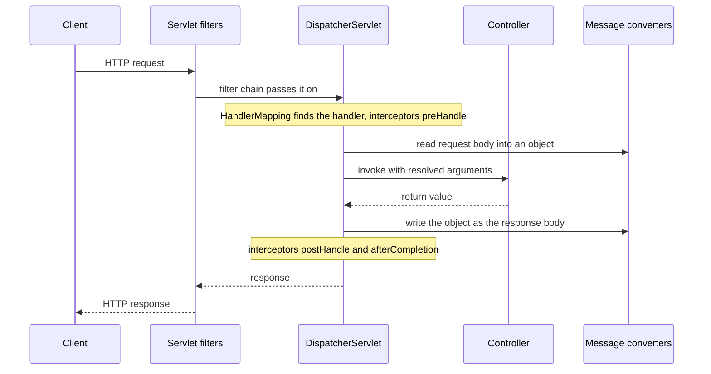

For a Spring Boot role the web layer questions are guaranteed: *walk me through what happens to an HTTP request, what is the `DispatcherServlet`, `@Controller` versus `@RestController`, how do you validate input and handle errors globally, what is the difference between a filter and an interceptor, and how do you design a REST API?* It sits on [Spring Boot](lesson:spring-boot) (embedded Tomcat, Jackson), the [core container](lesson:spring-core) and is secured by [Spring Security](lesson:spring-security) (a filter chain). Idempotency and API contract design are explored further in a later REST lesson. Play the three scenes: the request flow, validation and errors, and filter versus interceptor versus advice.

```demo
name: spring-mvc-walk
```

> **One sentence to remember:** *every request enters through one front controller, the `DispatcherServlet`, which finds the handler method, converts the body, calls your controller, converts the result back, and routes any exception to a single global handler.*

## Request flow {#flow}



1. **Filters** (servlet layer: security, CORS, encoding, logging) run first.
2. The **`DispatcherServlet`** is the front controller; it uses **`HandlerMapping`** to find the `@RequestMapping` method (and interceptors).
3. **Argument resolvers** and **`HttpMessageConverter`s** (Jackson for JSON) turn path variables, query parameters and the body into method arguments; `@Valid` triggers validation.
4. The **controller** runs and returns an object or `ResponseEntity`.
5. **Return value handlers** and converters write the response (content negotiation chooses JSON or XML by the `Accept` header).
6. Exceptions at any point go to **`HandlerExceptionResolver`s**, in practice your `@RestControllerAdvice`.

## Controllers {#controllers}

### Mapping and binding {#mapping}

```java
@RestController                                  // @Controller + @ResponseBody on every method
@RequestMapping("/api/accounts")
class AccountController {

    private final AccountService accounts;
    AccountController(AccountService accounts) { this.accounts = accounts; }

    @GetMapping("/{id}")
    AccountDto get(@PathVariable Long id) { return accounts.find(id); }

    @GetMapping
    Page<AccountDto> list(@RequestParam(defaultValue = "ACTIVE") Status status, Pageable pageable) {
        return accounts.list(status, pageable);
    }

    @PostMapping
    ResponseEntity<AccountDto> create(@Valid @RequestBody CreateAccount request, UriComponentsBuilder uri) {
        AccountDto created = accounts.create(request);
        return ResponseEntity.created(uri.path("/api/accounts/{id}").build(created.id())).body(created);   // 201 + Location
    }

    @DeleteMapping("/{id}")
    @ResponseStatus(HttpStatus.NO_CONTENT)
    void delete(@PathVariable Long id) { accounts.close(id); }
}
```

| Annotation | Purpose |
| --- | --- |
| `@Controller` | web component returning view names (server-side templates) |
| `@RestController` | `@Controller` + `@ResponseBody`: return values are written as the body (JSON) |
| `@GetMapping` ... `@PatchMapping` | HTTP method plus path (shortcuts for `@RequestMapping`) |
| `@PathVariable` | a value in the URL path |
| `@RequestParam` | a query or form parameter |
| `@RequestBody` | deserialise the request body (JSON) into an object |
| `@RequestHeader`, `@CookieValue` | header or cookie value |
| `@ResponseStatus`, `ResponseEntity` | set status, headers and body explicitly |

Keep controllers **thin**: map HTTP to a service call, no business logic or transactions, and use **DTOs** (records) for requests and responses instead of exposing entities.

### REST conventions {#rest}

- **Nouns for resources, HTTP verbs for actions:** `GET /accounts/42`, `POST /accounts`, `PUT` (replace), `PATCH` (partial update), `DELETE`.
- **Status codes:** 200 OK, 201 Created (+ `Location`), 204 No Content, 400 Bad Request (malformed or invalid), 401 Unauthorized (not authenticated), 403 Forbidden, 404 Not Found, 409 Conflict (state or version conflict), 422 Unprocessable Content (business rule), 429 Too Many Requests, 500, 503.
- **Idempotent methods:** `GET`, `PUT`, `DELETE` (and `HEAD`, `OPTIONS`) are idempotent; `POST` is not (use an `Idempotency-Key` header for payments); `GET` is safe (no side effects).
- **Pagination and filtering** through query parameters; **versioning** by path (`/v1/`) or header; consistent **error format**; and **HATEOAS** links where it pays off.

## Validation {#validation}

```java
public record CreateAccount(
        @NotBlank @Size(max = 34) String iban,
        @NotNull @Positive BigDecimal initialDeposit,
        @Email String contactEmail) {}

@PostMapping
AccountDto create(@Valid @RequestBody CreateAccount request) { ... }          // violations throw MethodArgumentNotValidException

@GetMapping("/{id}")
AccountDto get(@PathVariable @Min(1) Long id) { ... }                           // needs @Validated on the class for parameter constraints
```

Bean Validation (Jakarta, `spring-boot-starter-validation`) declares constraints on the model; `@Valid` on a `@RequestBody` argument triggers it, `@Validated` on the class enables it for `@PathVariable` and `@RequestParam`. Use groups for different rules (create versus update), custom constraints (`@ValidIban`) for domain rules, and still enforce invariants in the service and database: **validation at the edge is not a substitute for business rules or constraints**.

## Error handling {#errors}

```java
@RestControllerAdvice
class ApiExceptionHandler extends ResponseEntityExceptionHandler {

    @ExceptionHandler(AccountNotFoundException.class)
    ProblemDetail notFound(AccountNotFoundException e) {
        ProblemDetail p = ProblemDetail.forStatusAndDetail(HttpStatus.NOT_FOUND, e.getMessage());
        p.setTitle("Account not found");
        return p;
    }

    @ExceptionHandler(InsufficientFundsException.class)
    ProblemDetail unprocessable(InsufficientFundsException e) {
        return ProblemDetail.forStatusAndDetail(HttpStatus.UNPROCESSABLE_ENTITY, e.getMessage());
    }

    @Override
    protected ResponseEntity<Object> handleMethodArgumentNotValid(MethodArgumentNotValidException ex, HttpHeaders headers, HttpStatusCode status, WebRequest request) {
        ProblemDetail p = ProblemDetail.forStatusAndDetail(HttpStatus.BAD_REQUEST, "Validation failed");
        p.setProperty("errors", ex.getFieldErrors().stream().collect(Collectors.toMap(FieldError::getField, FieldError::getDefaultMessage, (a, b) -> a)));
        return ResponseEntity.badRequest().body(p);
    }

    @ExceptionHandler(Exception.class)
    ProblemDetail unexpected(Exception e) {
        log.error("Unhandled", e);                                                        // log the details, return a safe message
        return ProblemDetail.forStatusAndDetail(HttpStatus.INTERNAL_SERVER_ERROR, "Unexpected error");
    }
}
```

- `@RestControllerAdvice` (= `@ControllerAdvice` + `@ResponseBody`) centralises handling for all controllers; `@ExceptionHandler` inside a single controller applies only to it.
- **`ProblemDetail`** is Spring 6's implementation of **RFC 9457** (`application/problem+json`: `type`, `title`, `status`, `detail`, `instance`, plus extension members). Enable the default handling with `spring.mvc.problemdetails.enabled=true`.
- Map **domain exceptions** to statuses in one place; never leak stack traces, SQL or internal class names to clients, and include a correlation id for support.
- `@ResponseStatus` on an exception class gives a fixed status; `ResponseStatusException` throws one inline.

## Filters, interceptors and advice {#layers}

| | Servlet **filter** | Spring MVC **interceptor** | **Controller advice** | **AOP** aspect |
| --- | --- | --- | --- | --- |
| Layer | servlet container, before `DispatcherServlet` | Spring MVC, around the handler | exception mapping and body advice | any Spring bean method |
| Knows the handler method | no | yes (`HandlerMethod`) | partly | the method signature |
| Can modify request or response objects | yes (wrap them) | limited | response body | arguments and return value |
| Typical use | security, CORS, request id, compression | per-endpoint checks, locale, timing | error mapping | transactions, caching, audit |
| Spring Security | a filter chain | no | no | method security |

Extend `OncePerRequestFilter` for a filter that runs once per request, implement `HandlerInterceptor` (`preHandle`, `postHandle`, `afterCompletion`) and register it through `WebMvcConfigurer`. Order matters: filters run before and after the whole `DispatcherServlet` cycle.

## Other points {#other}

- **Content negotiation:** `produces` and `consumes` on mappings, the `Accept` header, Jackson settings (`spring.jackson.*`; dates as ISO strings, never timestamps for money-related APIs; unknown properties).
- **Async and non-blocking:** returning `Callable`, `DeferredResult` or `CompletableFuture` frees the container thread, and WebFlux is a separate reactive stack. Java 21 virtual threads (`spring.threads.virtual.enabled=true`) make the blocking model scale.
- **CORS** with `@CrossOrigin` or a `CorsConfigurationSource` in the security config (not wildcard origins with credentials).
- **File upload** with `MultipartFile`; size limits in `spring.servlet.multipart.*`.
- **API documentation** with springdoc-openapi (OpenAPI/Swagger) and **clients** with `RestClient` or `WebClient`.
- **Testing:** `@WebMvcTest(AccountController.class)` with `MockMvc` loads only the web layer, services are `@MockitoBean` mocks.

## Cheat sheet {#cheatsheet}

| Topic | Key point |
| --- | --- |
| Front controller | `DispatcherServlet` receives every request |
| Flow | filter, DispatcherServlet, HandlerMapping, interceptor, converters, controller, converters |
| `@RestController` | `@Controller` + `@ResponseBody` |
| Binding | `@PathVariable`, `@RequestParam`, `@RequestBody`, `@RequestHeader` |
| Validation | `@Valid` on the body, `@Validated` for parameters; `MethodArgumentNotValidException` |
| Global errors | `@RestControllerAdvice` + `@ExceptionHandler`, `ProblemDetail` (RFC 9457) |
| Status codes | 201 + Location on create, 204 on delete, 400, 401, 403, 404, 409, 422 |
| Idempotent | GET, PUT, DELETE; POST needs an idempotency key |
| Filter vs interceptor | servlet layer, before Spring, vs MVC layer with handler knowledge |
| Controllers | thin, DTOs not entities, no business logic |
| Testing | `@WebMvcTest` + `MockMvc` |

## Interview questions {#questions}

### [basic] What is the DispatcherServlet? {#dispatcher-q}

The front controller of Spring MVC: a single servlet that receives every request, uses handler mappings to find the controller method, resolves its arguments, invokes it, converts the return value into a response (or a view) and delegates exceptions to resolvers. It centralises request handling so controllers contain only application logic.

### [basic] Walk me through what happens when a request hits a Spring Boot application. {#flow-q}

The embedded server passes it through the servlet filter chain (security, CORS), then to the `DispatcherServlet`, which finds the handler via `HandlerMapping`, runs interceptor `preHandle`, resolves arguments (message converters deserialise the JSON body, `@Valid` validates), calls the controller method, serialises the return value with a message converter, runs `postHandle` and `afterCompletion`, and the response passes back through the filters. Exceptions go to the `@ControllerAdvice`.

### [basic] What is the difference between @Controller and @RestController? {#rest-controller-q}

`@Controller` returns view names resolved by a view resolver to render templates. `@RestController` is `@Controller` plus `@ResponseBody`, so every return value is written directly to the response body through a message converter (usually JSON). Use `@RestController` for APIs.

### [basic] What are @PathVariable, @RequestParam and @RequestBody? {#binding-q}

`@PathVariable` binds a segment of the URL path (`/accounts/{id}`), `@RequestParam` binds a query or form parameter (`?status=ACTIVE`), and `@RequestBody` deserialises the HTTP request body (JSON) into an object using a message converter.

### [basic] Which HTTP status codes do you return for create, update, delete and errors? {#status-q}

201 Created with a `Location` header for POST creating a resource; 200 or 204 for updates; 204 for delete; 400 for malformed or invalid input; 401 when not authenticated; 403 when not allowed; 404 for a missing resource; 409 for conflicts (duplicate, version mismatch); 422 for business-rule violations; 429 when rate limited; 500 for unexpected server errors.

### [basic] Which HTTP methods are idempotent and safe? {#idempotent-q}

Safe (no side effects): GET, HEAD, OPTIONS. Idempotent (repeating gives the same server state): GET, PUT, DELETE, HEAD, OPTIONS. POST is neither, and PATCH is not guaranteed to be idempotent. For operations such as payments that clients may retry, add an idempotency key so a repeated POST is not applied twice.

### [intermediate] How do you handle exceptions globally? {#global-q}

With a `@RestControllerAdvice` class containing `@ExceptionHandler` methods that map exceptions to responses, ideally `ProblemDetail` (RFC 9457) with the right status, a consistent body and no internal details. Extend `ResponseEntityExceptionHandler` to customise Spring's built-in exceptions such as `MethodArgumentNotValidException`. A handler inside one controller applies only to that controller.

### [intermediate] How does validation work in Spring MVC? {#validation-q}

Constraints from Bean Validation (`@NotBlank`, `@Positive`, `@Email`, custom ones) are declared on the DTO; `@Valid` on a `@RequestBody` argument runs them before the controller method and throws `MethodArgumentNotValidException` with the field errors, which the advice turns into a 400. `@Validated` on the class enables checks on `@PathVariable` and `@RequestParam` (which throw `ConstraintViolationException`). Business invariants must still be checked in the service.

### [intermediate] What is the difference between a filter and an interceptor? {#filter-q}

A filter is a servlet-container component that runs before and after the whole `DispatcherServlet`, sees raw requests and responses (and can wrap them), and does not know which handler will run; Spring Security is a filter chain. An interceptor is a Spring MVC component around handler execution (`preHandle`, `postHandle`, `afterCompletion`) that knows the chosen `HandlerMethod`. Filters for low-level concerns, interceptors for handler-aware ones.

### [intermediate] What is ProblemDetail? {#problem-q}

Spring 6's model for RFC 9457 "Problem Details for HTTP APIs": a standard JSON error format (`application/problem+json`) with `type`, `title`, `status`, `detail` and `instance`, extensible with custom properties (field errors, correlation id). It gives clients a consistent, machine-readable error body.

### [intermediate] How do you design the API for creating a resource? {#create-q}

`POST /accounts` with a validated request DTO, returning `201 Created`, a `Location` header pointing to the new resource and the created representation in the body. Make it safe to retry (idempotency key or a natural unique constraint with a 409 on duplicates), do the work in a transactional service, and keep entities out of the response.

### [intermediate] Why use DTOs instead of returning entities? {#dto-q}

Entities expose the persistence model: lazy associations (serialisation triggers `LazyInitializationException` or extra queries), internal fields, and a tight coupling between database schema and API contract. DTOs give a stable, minimal API shape, allow versioning and validation per use case, and avoid accidental exposure and over-posting (mass assignment).

### [intermediate] How do you version a REST API? {#versioning-q}

Common choices: a path prefix (`/v1/accounts`, easy to route and cache), a header or media type (`Accept: application/vnd.bank.v2+json`, cleaner URLs, harder to test) or a query parameter. Prefer additive, backwards-compatible changes, deprecate old versions with notice, and keep the number of live versions small.

### [intermediate] How do you test a controller? {#test-q}

With `@WebMvcTest(AccountController.class)` and `MockMvc`: it loads only the web layer (controllers, advice, converters, security filters if configured) and the services are mocked with `@MockitoBean`. Assert status, headers and JSON. For a full integration test use `@SpringBootTest` with a random port and `TestRestTemplate` or `WebTestClient`.

### [deep] What threading model does Spring MVC use and how does it scale? {#threading-q}

Thread-per-request: a container thread (Tomcat pool, 200 by default) handles a request from start to finish and blocks during I/O, so concurrency is limited by the pool and slow downstream calls exhaust it. Remedies: timeouts and bulkheads, asynchronous return types (`DeferredResult`, `CompletableFuture`) to free the thread, Java 21 virtual threads (`spring.threads.virtual.enabled=true`) which make blocking cheap, or the reactive WebFlux stack.

### [deep] How do message converters and content negotiation work? {#converter-q}

`HttpMessageConverter`s read and write bodies for a type and media type (Jackson for JSON, others for XML, strings, bytes). For `@RequestBody` Spring picks a converter matching the request `Content-Type`; for the response it picks one matching the `Accept` header and the `produces` constraint, returning 406 if none fits and 415 for an unsupported request type.

### [coding] Write a controller and global handler for creating and fetching an account. {#coding-controller}

```java
record CreateAccount(@NotBlank String iban, @NotNull @Positive BigDecimal deposit) {}
record AccountDto(Long id, String iban, BigDecimal balance) {}

@RestController
@RequestMapping("/api/accounts")
class AccountController {
    private final AccountService service;
    AccountController(AccountService service) { this.service = service; }

    @PostMapping
    ResponseEntity<AccountDto> create(@Valid @RequestBody CreateAccount req, UriComponentsBuilder uri) {
        AccountDto dto = service.create(req);
        return ResponseEntity.created(uri.path("/api/accounts/{id}").build(dto.id())).body(dto);
    }

    @GetMapping("/{id}")
    AccountDto get(@PathVariable Long id) { return service.find(id); }               // throws AccountNotFoundException
}

@RestControllerAdvice
class Errors {
    @ExceptionHandler(AccountNotFoundException.class)
    ProblemDetail notFound(AccountNotFoundException e) { return ProblemDetail.forStatusAndDetail(HttpStatus.NOT_FOUND, e.getMessage()); }
}
```

Explain the 201 plus `Location`, validation through `@Valid`, DTO records, a thin controller and the single place where the exception becomes a 404.

### [coding] Write a filter that adds a correlation id to every request and log line. {#coding-filter}

```java
@Component
class CorrelationIdFilter extends OncePerRequestFilter {
    @Override
    protected void doFilterInternal(HttpServletRequest req, HttpServletResponse res, FilterChain chain) throws ServletException, IOException {
        String id = Optional.ofNullable(req.getHeader("X-Correlation-Id")).orElse(UUID.randomUUID().toString());
        MDC.put("correlationId", id);
        res.setHeader("X-Correlation-Id", id);
        try {
            chain.doFilter(req, res);
        } finally {
            MDC.remove("correlationId");                      // threads are reused: always clean up
        }
    }
}
```

Explain that a filter is the right layer (it runs for every request, including errors), `OncePerRequestFilter` avoids running twice on forwards, the MDC makes the id appear in logs, and cleanup in `finally` prevents leaking ids across requests.

### [coding] Add a custom validation annotation for an IBAN. {#coding-validator}

```java
@Target({FIELD, PARAMETER}) @Retention(RUNTIME)
@Constraint(validatedBy = IbanValidator.class)
public @interface ValidIban {
    String message() default "invalid IBAN";
    Class<?>[] groups() default {};
    Class<? extends Payload>[] payload() default {};
}

class IbanValidator implements ConstraintValidator<ValidIban, String> {
    public boolean isValid(String value, ConstraintValidatorContext ctx) {
        return value == null || IbanChecker.isValid(value);          // null is handled by @NotNull separately
    }
}

record Transfer(@ValidIban String from, @ValidIban String to, @Positive BigDecimal amount) {}
```

Explain that the validator can be a Spring bean with injected dependencies, that null handling is left to `@NotNull`, and that the failure appears as a field error in the 400 response.
