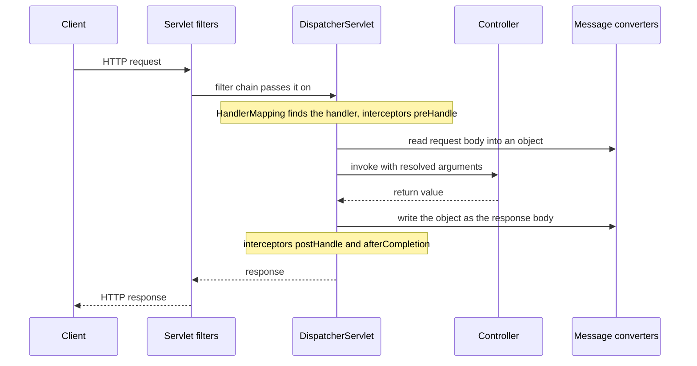

For a Spring Boot role, web layer questions always come up. Expect:

- "Walk me through what happens to an HTTP request."
- "What is the `DispatcherServlet`?"
- "`@Controller` or `@RestController`?"
- "How do you validate input and handle errors in one place?"
- "What is the difference between a filter and an interceptor?"
- "How do you design a REST API?"

Spring MVC sits on [Spring Boot](lesson:spring-boot), which provides embedded Tomcat and Jackson, and on the [core container](lesson:spring-core). [Spring Security](lesson:spring-security) protects it with a chain of filters. The Servlet API underneath (the container, servlets, sessions, JSP) is explained in [Jakarta EE and servlets](lesson:jakarta-ee). A later REST lesson goes deeper into idempotency and API contracts.

The demo has three scenes: the request flow, validation and errors, and filter versus interceptor versus advice.

```demo
name: spring-mvc-walk
```

> **One sentence to remember:** *Every request goes through one `DispatcherServlet`, which calls your controller and sends every error to one global handler.*

## Request flow {#flow}




1. **Filters** run first. They belong to the servlet layer and handle things like security, CORS, character encoding and logging.
2. The **`DispatcherServlet`** comes next. It is the *front controller*: one servlet that receives every request. It asks a **`HandlerMapping`** which `@RequestMapping` method should handle the request, and which interceptors apply.
3. **Argument resolvers** and **`HttpMessageConverter`s** build the method's arguments from the path variables, query parameters and body. Jackson is the converter for JSON. `@Valid` triggers validation at this point.
4. The **controller** method runs and returns an object or a `ResponseEntity`.
5. **Return value handlers** and converters write the response. *Content negotiation* picks JSON or XML based on the `Accept` header.
6. If an exception is thrown anywhere, it goes to the **`HandlerExceptionResolver`s**. In practice that means your `@RestControllerAdvice`.

## Controllers {#controllers}

### Mapping and binding {#mapping}

```java
@RestController                                  // @Controller + @ResponseBody on every method
@RequestMapping("/api/accounts")
class AccountController {

    private final AccountService accounts;
    AccountController(AccountService accounts) { this.accounts = accounts; }

    @GetMapping("/{id}")
    AccountDto get(@PathVariable Long id) { return accounts.find(id); }

    @GetMapping
    Page<AccountDto> list(@RequestParam(defaultValue = "ACTIVE") Status status, Pageable pageable) {
        return accounts.list(status, pageable);
    }

    @PostMapping
    ResponseEntity<AccountDto> create(@Valid @RequestBody CreateAccount request, UriComponentsBuilder uri) {
        AccountDto created = accounts.create(request);
        return ResponseEntity.created(uri.path("/api/accounts/{id}").build(created.id())).body(created);   // 201 + Location
    }

    @DeleteMapping("/{id}")
    @ResponseStatus(HttpStatus.NO_CONTENT)
    void delete(@PathVariable Long id) { accounts.close(id); }
}
```

| Annotation | What it does |
| --- | --- |
| `@Controller` | Marks a web component that returns view names, for server-side templates. |
| `@RestController` | Is `@Controller` plus `@ResponseBody`. Return values are written as the response body (JSON). |
| `@GetMapping` ... `@PatchMapping` | Map an HTTP method and a path. They are shortcuts for `@RequestMapping`. |
| `@PathVariable` | Reads a value from the URL path. |
| `@RequestParam` | Reads a query or form parameter. |
| `@RequestBody` | Turns the request body (JSON) into an object. |
| `@RequestHeader`, `@CookieValue` | Read a header or a cookie value. |
| `@ResponseStatus`, `ResponseEntity` | Set the status, headers and body yourself. |

Keep controllers **thin**:

- A controller turns HTTP into a service call and back.
- It holds no business logic and no transactions.
- It uses **DTOs** (data transfer objects, usually records) for requests and responses, and never exposes entities.

### REST conventions {#rest}

- **Nouns for resources, HTTP verbs for actions:** `GET /accounts/42`, `POST /accounts`, `PUT` (replace), `PATCH` (partial update), `DELETE`.
- **Status codes:**
  - 200 OK, 201 Created (with a `Location` header), 204 No Content.
  - 400 Bad Request (malformed or invalid input), 401 Unauthorized (not authenticated), 403 Forbidden, 404 Not Found.
  - 409 Conflict (a state or version conflict), 422 Unprocessable Content (a business rule failed), 429 Too Many Requests.
  - 500 and 503 for server problems.
- **Idempotent methods:** a method is *idempotent* if repeating it leaves the server in the same state. `GET`, `PUT`, `DELETE`, `HEAD` and `OPTIONS` are idempotent. `POST` is not, so use an `Idempotency-Key` header for payments. `GET` is also *safe*: it has no side effects.
- **Other habits:**
  - pagination and filtering through query parameters,
  - versioning by path (`/v1/`) or by header,
  - one consistent **error format**,
  - **HATEOAS** links (links to related actions in the response) where they are worth it.

## Validation {#validation}

```java
public record CreateAccount(
        @NotBlank @Size(max = 34) String iban,
        @NotNull @Positive BigDecimal initialDeposit,
        @Email String contactEmail) {}

@PostMapping
AccountDto create(@Valid @RequestBody CreateAccount request) { ... }          // violations throw MethodArgumentNotValidException

@GetMapping("/{id}")
AccountDto get(@PathVariable @Min(1) Long id) { ... }                           // needs @Validated on the class for parameter constraints
```

Bean Validation (Jakarta, from `spring-boot-starter-validation`) lets you declare rules on the model:

- `@Valid` on a `@RequestBody` argument runs the rules.
- `@Validated` on the class turns validation on for `@PathVariable` and `@RequestParam`.
- Validation groups let you use different rules for create and update.
- Custom constraints such as `@ValidIban` express domain rules.

Still enforce the important rules in the service and in the database. **Validation at the edge does not replace business rules or database constraints.**

## Error handling {#errors}

```java
@RestControllerAdvice
class ApiExceptionHandler extends ResponseEntityExceptionHandler {

    @ExceptionHandler(AccountNotFoundException.class)
    ProblemDetail notFound(AccountNotFoundException e) {
        ProblemDetail p = ProblemDetail.forStatusAndDetail(HttpStatus.NOT_FOUND, e.getMessage());
        p.setTitle("Account not found");
        return p;
    }

    @ExceptionHandler(InsufficientFundsException.class)
    ProblemDetail unprocessable(InsufficientFundsException e) {
        return ProblemDetail.forStatusAndDetail(HttpStatus.UNPROCESSABLE_ENTITY, e.getMessage());
    }

    @Override
    protected ResponseEntity<Object> handleMethodArgumentNotValid(MethodArgumentNotValidException ex, HttpHeaders headers, HttpStatusCode status, WebRequest request) {
        ProblemDetail p = ProblemDetail.forStatusAndDetail(HttpStatus.BAD_REQUEST, "Validation failed");
        p.setProperty("errors", ex.getFieldErrors().stream().collect(Collectors.toMap(FieldError::getField, FieldError::getDefaultMessage, (a, b) -> a)));
        return ResponseEntity.badRequest().body(p);
    }

    @ExceptionHandler(Exception.class)
    ProblemDetail unexpected(Exception e) {
        log.error("Unhandled", e);                                                        // log the details, return a safe message
        return ProblemDetail.forStatusAndDetail(HttpStatus.INTERNAL_SERVER_ERROR, "Unexpected error");
    }
}
```

- `@RestControllerAdvice` is `@ControllerAdvice` plus `@ResponseBody`. It handles exceptions for all controllers in one place. An `@ExceptionHandler` inside one controller applies only to that controller.
- **`ProblemDetail`** is Spring 6's support for **RFC 9457**, a standard error body. Its media type is `application/problem+json`, and it has the fields `type`, `title`, `status`, `detail` and `instance`, plus any extra fields you add. Turn on the default handling with `spring.mvc.problemdetails.enabled=true`.
- Map **domain exceptions** to status codes in one place. Never send stack traces, SQL or internal class names to clients. Include a correlation ID so support can find the request in the logs.
- `@ResponseStatus` on an exception class gives that exception a fixed status. `ResponseStatusException` lets you throw one with a status inline.

## Filters, interceptors and advice {#layers}

| | Servlet **filter** | Spring MVC **interceptor** | **Controller advice** | **AOP** aspect |
| --- | --- | --- | --- | --- |
| Layer | The servlet container, before `DispatcherServlet`. | Spring MVC, around the handler. | Exception mapping and changes to the body. | Any method of a Spring bean. |
| Knows the handler method | No. | Yes, it gets the `HandlerMethod`. | Partly. | It knows the method signature. |
| Can change the request or response | Yes, by wrapping them. | Only a little. | It can change the response body. | It can change arguments and the return value. |
| Typical use | Security, CORS, request ID, compression. | Per-endpoint checks, locale, timing. | Turning errors into responses. | Transactions, caching, auditing. |
| Spring Security | It is a filter chain. | Not used. | Not used. | Method security. |

How to write each one:

- For a filter, extend `OncePerRequestFilter`, which runs once per request.
- For an interceptor, implement `HandlerInterceptor` (`preHandle`, `postHandle`, `afterCompletion`) and register it through `WebMvcConfigurer`.

Order matters. Filters run before and after the whole `DispatcherServlet` cycle.

## Other points {#other}

- **Content negotiation:** `produces` and `consumes` on mappings, plus the `Accept` header, decide the format. Jackson is configured with `spring.jackson.*`. Send dates as ISO strings, never as timestamps, in money-related APIs, and decide how to treat unknown properties.
- **Async and non-blocking:** returning `Callable`, `DeferredResult` or `CompletableFuture` frees the container thread while the work runs. WebFlux is a separate, reactive stack. Java 21 virtual threads (`spring.threads.virtual.enabled=true`) let the blocking model scale.
- **CORS:** use `@CrossOrigin` or a `CorsConfigurationSource` in the security configuration. Never allow wildcard origins together with credentials.
- **File upload:** use `MultipartFile`, and set size limits in `spring.servlet.multipart.*`.
- **API documentation and clients:** springdoc-openapi generates OpenAPI (Swagger) docs. `RestClient` or `WebClient` call other services.
- **Testing:** `@WebMvcTest(AccountController.class)` with `MockMvc` loads only the web layer. Services are replaced by `@MockitoBean` mocks.

Try it in the lab: [A request through DispatcherServlet](lab:mvc-dispatcher-flow).

## Cheat sheet {#cheatsheet}

| Topic | Key point |
| --- | --- |
| Front controller | `DispatcherServlet` receives every request. |
| Flow | Filter, DispatcherServlet, HandlerMapping, interceptor, converters, controller, converters. |
| `@RestController` | `@Controller` plus `@ResponseBody`. |
| Binding | `@PathVariable`, `@RequestParam`, `@RequestBody`, `@RequestHeader`. |
| Validation | `@Valid` on the body, `@Validated` for parameters. Failures throw `MethodArgumentNotValidException`. |
| Global errors | `@RestControllerAdvice` with `@ExceptionHandler`, returning `ProblemDetail` (RFC 9457). |
| Status codes | 201 with `Location` on create, 204 on delete, then 400, 401, 403, 404, 409, 422. |
| Idempotent | GET, PUT and DELETE are. POST needs an idempotency key. |
| Filter vs interceptor | A filter is in the servlet layer, before Spring. An interceptor is in MVC and knows the handler. |
| Controllers | Thin, DTOs instead of entities, no business logic. |
| Testing | `@WebMvcTest` with `MockMvc`. |

## Interview questions {#questions}

### [basic] What is the DispatcherServlet? {#dispatcher-q}

It is the front controller of Spring MVC: a single servlet that receives every request. It:

- uses handler mappings to find the controller method,
- resolves the method's arguments and calls it,
- turns the return value into a response (or a view),
- passes any exception to the exception resolvers.

Because all of this happens in one place, your controllers contain only application logic.

### [basic] Walk me through what happens when a request hits a Spring Boot application. {#flow-q}

1. The embedded server passes the request through the servlet filter chain (security, CORS).
2. The `DispatcherServlet` finds the handler through a `HandlerMapping`.
3. Interceptors run `preHandle`.
4. Arguments are resolved: message converters turn the JSON body into an object, and `@Valid` validates it.
5. The controller method runs.
6. A message converter writes the return value as the response body.
7. Interceptors run `postHandle` and `afterCompletion`.
8. The response goes back out through the filters.

If an exception is thrown, it goes to the `@ControllerAdvice`.

### [basic] What is the difference between @Controller and @RestController? {#rest-controller-q}

`@Controller` returns view names, and a view resolver renders the matching template.

`@RestController` is `@Controller` plus `@ResponseBody`. Every return value is written straight into the response body by a message converter, usually as JSON.

Use `@RestController` for APIs.

### [basic] What are @PathVariable, @RequestParam and @RequestBody? {#binding-q}

- `@PathVariable` reads a part of the URL path, as in `/accounts/{id}`.
- `@RequestParam` reads a query or form parameter, as in `?status=ACTIVE`.
- `@RequestBody` turns the HTTP request body (JSON) into an object, using a message converter.

### [basic] Which HTTP status codes do you return for create, update, delete and errors? {#status-q}

- **Create (POST):** 201 Created, with a `Location` header.
- **Update:** 200, or 204 if there is no body.
- **Delete:** 204.
- **Client errors:** 400 for malformed or invalid input, 401 when not authenticated, 403 when not allowed, 404 for a missing resource, 409 for a conflict (a duplicate or a version mismatch), 422 when a business rule fails, 429 when rate limited.
- **Server errors:** 500 for unexpected failures.

### [basic] Which HTTP methods are idempotent and safe? {#idempotent-q}

- **Safe** (no side effects): GET, HEAD, OPTIONS.
- **Idempotent** (repeating them leaves the same server state): GET, PUT, DELETE, HEAD, OPTIONS.

POST is neither. PATCH is not guaranteed to be idempotent.

Clients may retry operations such as payments. For those, add an idempotency key so a repeated POST is not applied twice.

### [intermediate] How do you handle exceptions globally? {#global-q}

With a `@RestControllerAdvice` class. Its `@ExceptionHandler` methods turn exceptions into responses. The best response is a `ProblemDetail` (RFC 9457) with the right status, a consistent body and no internal details.

To customise Spring's built-in exceptions, such as `MethodArgumentNotValidException`, extend `ResponseEntityExceptionHandler`.

A handler inside one controller applies only to that controller.

### [intermediate] How does validation work in Spring MVC? {#validation-q}

You declare Bean Validation constraints on the DTO: `@NotBlank`, `@Positive`, `@Email`, or your own.

`@Valid` on a `@RequestBody` argument runs them before the controller method. If any fail, Spring throws `MethodArgumentNotValidException` with the field errors, and the advice turns it into a 400.

`@Validated` on the class turns on checks for `@PathVariable` and `@RequestParam`. Those failures throw `ConstraintViolationException`.

Business rules must still be checked in the service.

### [intermediate] What is the difference between a filter and an interceptor? {#filter-q}

A **filter** belongs to the servlet container. It runs before and after the whole `DispatcherServlet`, sees the raw request and response, and can wrap them. It does not know which handler will run. Spring Security is a chain of filters.

An **interceptor** belongs to Spring MVC. It runs around the handler (`preHandle`, `postHandle`, `afterCompletion`) and knows the chosen `HandlerMethod`.

Use filters for low-level concerns and interceptors for concerns that depend on the handler.

### [intermediate] What is ProblemDetail? {#problem-q}

It is Spring 6's model for RFC 9457, "Problem Details for HTTP APIs". This is a standard JSON error format, with the media type `application/problem+json`. It has the fields `type`, `title`, `status`, `detail` and `instance`, and you can add your own, such as field errors or a correlation ID.

Clients get one consistent, machine-readable error body.

### [intermediate] How do you design the API for creating a resource? {#create-q}

Use `POST /accounts` with a validated request DTO. Return:

- `201 Created`,
- a `Location` header pointing to the new resource,
- the created resource in the body.

Also:

- Make it safe to retry, with an idempotency key or a natural unique constraint that returns 409 on duplicates.
- Do the work in a transactional service.
- Keep entities out of the response.

### [intermediate] Why use DTOs instead of returning entities? {#dto-q}

Entities expose the persistence model:

- Lazy associations cause trouble when serialised: a `LazyInitializationException` or extra queries.
- Internal fields leak out.
- The API contract becomes tied to the database schema.

DTOs give a stable, minimal API shape. They allow versioning and validation per use case. They also prevent accidental exposure and *over-posting* (mass assignment), where a client sets fields it should not.

### [intermediate] How do you version a REST API? {#versioning-q}

There are three common choices:

- **A path prefix** (`/v1/accounts`): easy to route and to cache.
- **A header or media type** (`Accept: application/vnd.bank.v2+json`): cleaner URLs, but harder to test.
- **A query parameter.**

Prefer changes that only add things and stay backwards compatible. Give notice before removing old versions, and keep the number of live versions small.

### [intermediate] How do you test a controller? {#test-q}

Use `@WebMvcTest(AccountController.class)` with `MockMvc`. It loads only the web layer: controllers, advice, converters, and security filters if configured. Services are mocked with `@MockitoBean`. You assert the status, headers and JSON.

For a full integration test, use `@SpringBootTest` with a random port and `TestRestTemplate` or `WebTestClient`.

### [deep] What threading model does Spring MVC use and how does it scale? {#threading-q}

It uses one thread per request. A container thread from the Tomcat pool (200 threads by default) handles a request from start to finish, and it blocks while waiting for I/O. So the pool limits how many requests run at once, and slow downstream calls can use it all up.

The remedies:

- timeouts and bulkheads (separate limits for each dependency),
- asynchronous return types (`DeferredResult`, `CompletableFuture`) that free the thread,
- Java 21 virtual threads (`spring.threads.virtual.enabled=true`), which make blocking cheap,
- or the reactive WebFlux stack.

### [deep] How do message converters and content negotiation work? {#converter-q}

An `HttpMessageConverter` reads and writes bodies for a given type and media type. Jackson handles JSON, and other converters handle XML, strings and bytes.

- For a `@RequestBody`, Spring picks a converter that matches the request's `Content-Type`. If none does, it returns 415.
- For the response, it picks one that matches the `Accept` header and the `produces` setting. If none does, it returns 406.

### [coding] Write a controller and global handler for creating and fetching an account. {#coding-controller}

```java
record CreateAccount(@NotBlank String iban, @NotNull @Positive BigDecimal deposit) {}
record AccountDto(Long id, String iban, BigDecimal balance) {}

@RestController
@RequestMapping("/api/accounts")
class AccountController {
    private final AccountService service;
    AccountController(AccountService service) { this.service = service; }

    @PostMapping
    ResponseEntity<AccountDto> create(@Valid @RequestBody CreateAccount req, UriComponentsBuilder uri) {
        AccountDto dto = service.create(req);
        return ResponseEntity.created(uri.path("/api/accounts/{id}").build(dto.id())).body(dto);
    }

    @GetMapping("/{id}")
    AccountDto get(@PathVariable Long id) { return service.find(id); }               // throws AccountNotFoundException
}

@RestControllerAdvice
class Errors {
    @ExceptionHandler(AccountNotFoundException.class)
    ProblemDetail notFound(AccountNotFoundException e) { return ProblemDetail.forStatusAndDetail(HttpStatus.NOT_FOUND, e.getMessage()); }
}
```

Explain these points:

- Create returns 201 with a `Location` header.
- `@Valid` validates the request.
- Requests and responses are DTO records.
- The controller stays thin.
- The exception becomes a 404 in one single place.

### [coding] Write a filter that adds a correlation id to every request and log line. {#coding-filter}

```java
@Component
class CorrelationIdFilter extends OncePerRequestFilter {
    @Override
    protected void doFilterInternal(HttpServletRequest req, HttpServletResponse res, FilterChain chain) throws ServletException, IOException {
        String id = Optional.ofNullable(req.getHeader("X-Correlation-Id")).orElse(UUID.randomUUID().toString());
        MDC.put("correlationId", id);
        res.setHeader("X-Correlation-Id", id);
        try {
            chain.doFilter(req, res);
        } finally {
            MDC.remove("correlationId");                      // threads are reused: always clean up
        }
    }
}
```

Explain these points:

- A filter is the right layer, because it runs for every request, including errors.
- `OncePerRequestFilter` stops it running twice when a request is forwarded.
- The MDC (mapped diagnostic context) makes the ID appear in every log line.
- The cleanup in `finally` matters, because threads are reused. Without it, one request's ID would leak into the next.

### [coding] Add a custom validation annotation for an IBAN. {#coding-validator}

```java
@Target({FIELD, PARAMETER}) @Retention(RUNTIME)
@Constraint(validatedBy = IbanValidator.class)
public @interface ValidIban {
    String message() default "invalid IBAN";
    Class<?>[] groups() default {};
    Class<? extends Payload>[] payload() default {};
}

class IbanValidator implements ConstraintValidator<ValidIban, String> {
    public boolean isValid(String value, ConstraintValidatorContext ctx) {
        return value == null || IbanChecker.isValid(value);          // null is handled by @NotNull separately
    }
}

record Transfer(@ValidIban String from, @ValidIban String to, @Positive BigDecimal amount) {}
```

Explain these points:

- The validator can be a Spring bean with injected dependencies.
- It leaves null handling to `@NotNull`.
- A failure shows up as a field error in the 400 response.
