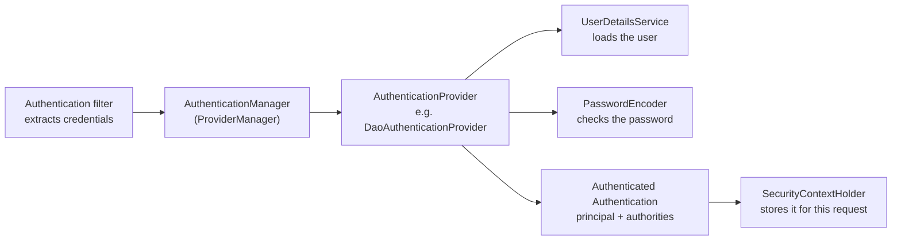

This is where the theory of the earlier lessons becomes code. For a Spring Boot role the questions are practical:

- How does the filter chain work?
- How do you configure security without `WebSecurityConfigurerAdapter`?
- What is the difference between `hasRole` and `hasAuthority`?
- How do you secure a REST API with JWT?
- Why is CSRF disabled, and when is that safe?
- How do you test it?

It applies [authentication and authorization](lesson:authn-authz), [OAuth 2.0](lesson:oauth2), [OIDC](lesson:oidc) and [JWT](lesson:jwt). The examples use Spring Security 6 on Spring Boot 3, which needs [Java 17](lesson:java-version-history#java-17) or newer.

The demo has four scenes. Each follows one request down the filter chain, drawn as a column of filters in their real order.

```demo
name: security-walk
```

> **One sentence to remember:** *Spring Security is a chain of filters that runs before your controllers.*

Inside that chain, authentication filters put an `Authentication` into the `SecurityContext`. The `AuthorizationFilter` checks the rules against it. The `ExceptionTranslationFilter` turns failures into 401 or 403.

## How it works inside {#architecture}


### The filter chain {#filter-chain}

Spring Security is a servlet **filter**.

1. One registered filter, `DelegatingFilterProxy` (Boot sets it up), hands every request to **`FilterChainProxy`**.
2. `FilterChainProxy` picks the first **`SecurityFilterChain`** whose request matcher fits the URL.
3. It runs that chain's filters in a fixed order.

You configure security by declaring `SecurityFilterChain` beans. You can have several, for example one for `/api/**` and one for the web UI.

The important filters, in order:

| Filter | Job |
| --- | --- |
| `SecurityContextHolderFilter` | Loads the `SecurityContext` (from the session, or empty) and clears it at the end. |
| `HeaderWriterFilter` | Adds security headers to the response (`X-Content-Type-Options`, HSTS, frame options). |
| `CorsFilter` | Applies the CORS configuration. |
| `CsrfFilter` | Checks the CSRF token on unsafe methods. |
| `LogoutFilter` | Handles `/logout`. |
| Authentication filter | One of `UsernamePasswordAuthenticationFilter` (form login), `BasicAuthenticationFilter`, `BearerTokenAuthenticationFilter` (JWT) or `OAuth2LoginAuthenticationFilter`. |
| `AnonymousAuthenticationFilter` | Gives requests without a login an anonymous identity. |
| `ExceptionTranslationFilter` | Turns security exceptions into a login redirect, 401 or 403. |
| `AuthorizationFilter` | Runs last. It checks the URL rules (`authorizeHttpRequests`). |

### Authentication objects {#objects}



- **`Authentication`** is the object for the current user. It holds:
  - the **principal**: who the user is,
  - the **credentials**: cleared after login,
  - the **authorities**: what the user may do,
  - an `isAuthenticated` flag.
- **`SecurityContext` and `SecurityContextHolder`** hold the current `Authentication`. By default it is kept in a `ThreadLocal`. Read it anywhere with `SecurityContextHolder.getContext().getAuthentication()`, or inject `Authentication` or `@AuthenticationPrincipal` into a controller.
- **`AuthenticationManager`** is the entry point: `authenticate(Authentication)`. The default, `ProviderManager`, asks each **`AuthenticationProvider`** in turn until one supports the type of credential.
- **`UserDetailsService` and `UserDetails`** load a user by name, from a database, LDAP or memory. The `DaoAuthenticationProvider` then checks the password with a **`PasswordEncoder`**.
- **`GrantedAuthority`** is a permission string, such as `ROLE_ADMIN` or `SCOPE_reports.read`.

### 401 and 403 inside the chain {#errors}

If `AuthorizationFilter` denies access, it throws `AccessDeniedException`, and `ExceptionTranslationFilter` catches it. What happens next depends on the user:

- **Anonymous user:** it calls the **`AuthenticationEntryPoint`**. That redirects to the login page, or returns 401 with a `WWW-Authenticate` header.
- **Logged-in user:** it calls the **`AccessDeniedHandler`**, which returns 403.

For an API, customise both to return JSON errors.

## Configuring it {#config}

### The modern configuration {#modern}

Since Spring Security 5.7 (and required in 6), you declare a `SecurityFilterChain` bean with the lambda DSL. These were **removed**:

- `WebSecurityConfigurerAdapter`,
- `antMatchers` and `mvcMatchers` (use `requestMatchers`),
- `authorizeRequests` (use `authorizeHttpRequests`).

```java
@Configuration
@EnableWebSecurity
@EnableMethodSecurity                                   // turns on @PreAuthorize and friends
class SecurityConfig {

    @Bean
    SecurityFilterChain web(HttpSecurity http) throws Exception {
        return http
            .authorizeHttpRequests(auth -> auth
                .requestMatchers("/", "/css/**", "/login").permitAll()
                .requestMatchers("/admin/**").hasRole("ADMIN")
                .requestMatchers(HttpMethod.DELETE, "/reports/**").hasAuthority("reports:delete")
                .anyRequest().authenticated())           // deny by default
            .formLogin(Customizer.withDefaults())
            .logout(Customizer.withDefaults())
            .build();
    }

    @Bean
    PasswordEncoder passwordEncoder() {
        return PasswordEncoderFactories.createDelegatingPasswordEncoder();
    }
}
```

**Rule order matters.** Rules are checked from top to bottom, and the **first match wins**. So put specific rules before general ones, and finish with `anyRequest()` (`authenticated()` or `denyAll()`).

In Spring Boot, adding the starter alone secures everything with a generated password and form login. That lasts until you declare your own chain.

### Users and passwords {#users}

```java
@Bean
UserDetailsService users(UserRepository repo) {
    return username -> repo.findByEmail(username)
        .map(u -> User.withUsername(u.getEmail())
            .password(u.getPasswordHash())                  // already encoded, e.g. {bcrypt}$2a$...
            .roles(u.getRoles().toArray(String[]::new))     // adds the ROLE_ prefix
            .disabled(!u.isActive())
            .build())
        .orElseThrow(() -> new UsernameNotFoundException("unknown user"));
}
```

Never store passwords as plain text.

`DelegatingPasswordEncoder` (what the default factory creates) puts the algorithm's ID in front of each hash, such as `{bcrypt}` or `{argon2}`. So you can switch to a better algorithm and still check old hashes. `UserDetailsPasswordService` can re-encode a password when the user logs in. For why this matters, see [storing passwords](lesson:cryptography#passwords).

### Roles and authorities {#roles}

A **role** is just an authority with the **`ROLE_` prefix**.

- `hasRole("ADMIN")` checks for the authority `ROLE_ADMIN`.
- `hasAuthority("ADMIN")` checks for the exact string `ADMIN`.
- `User.roles("ADMIN")` adds the prefix for you. `authorities("reports:delete")` does not.

Use roles for broad groups, and authorities (or OAuth scopes) for fine-grained permissions.

A common bug is to store `ADMIN` and then check `hasRole("ADMIN")`, which needs `ROLE_ADMIN`.

## Securing a REST API {#rest}


### JWT resource server {#jwt-rs}

A stateless API checks bearer tokens issued by an identity provider ([JWT validation](lesson:jwt#validation), [OAuth resource server](lesson:oauth2#spring-rs)):

```java
@Bean
SecurityFilterChain api(HttpSecurity http) throws Exception {
    return http
        .securityMatcher("/api/**")
        .csrf(csrf -> csrf.disable())                                  // no cookies, so no CSRF risk
        .sessionManagement(s -> s.sessionCreationPolicy(SessionCreationPolicy.STATELESS))
        .cors(Customizer.withDefaults())
        .authorizeHttpRequests(a -> a
            .requestMatchers(HttpMethod.GET, "/api/reports/**").hasAuthority("SCOPE_reports.read")
            .anyRequest().authenticated())
        .oauth2ResourceServer(o -> o.jwt(Customizer.withDefaults()))   // issuer-uri in application.yml
        .exceptionHandling(e -> e
            .authenticationEntryPoint(new BearerTokenAuthenticationEntryPoint())
            .accessDeniedHandler(new BearerTokenAccessDeniedHandler()))
        .build();
}
```

### Login with OIDC and sessions {#oidc-login}

A server-rendered web app uses `oauth2Login()` and a session cookie ([OIDC login](lesson:oidc#spring-login)). A single-page app often goes through a *backend-for-frontend*: a small server that does this login and gives the browser only a session cookie.

Choose by type of client:

- **Browsers:** a session plus CSRF protection.
- **APIs and mobile apps:** stateless bearer tokens.

### CSRF, CORS and headers {#csrf-cors}

- **CSRF** protection is on by default. It protects requests that change state and are authenticated by a cookie (see [CSRF](lesson:authn-authz#q-csrf-q)).
  - Keep it for session-based web apps.
  - Turning it off is acceptable only for stateless token APIs.
  - Single-page apps often use `CookieCsrfTokenRepository.withHttpOnlyFalse()`, so the script can read the token and send it in `X-XSRF-TOKEN`.
- **CORS** is a browser rule that decides which other origins may call your API. It is **not** protection against clients that are not browsers.
  - Configure it with a `CorsConfigurationSource` bean and `http.cors(...)`.
  - List exact origins and methods. Never use `*` together with credentials.
  - CORS must run before security, which is why it belongs in the chain.
- **Headers:** Spring Security adds sensible defaults (HSTS, `X-Content-Type-Options`, frame options, cache control). For browser apps, add a **Content Security Policy** too.

## Authorization in depth {#authorization}

### Method security {#method-security}

`@EnableMethodSecurity` turns on annotations that evaluate [SpEL](lesson:authn-authz#enforcement) expressions on bean methods. This lets you secure the service layer, and make **object-level** decisions that URL rules cannot:

```java
@Service
class DocumentService {

    @PreAuthorize("hasAuthority('SCOPE_documents.read')")
    public List<Document> list() { ... }

    @PreAuthorize("hasRole('ADMIN') or #ownerId == authentication.name")
    public List<Document> forOwner(String ownerId) { ... }

    @PostAuthorize("returnObject.owner == authentication.name")        // checked after the method returns
    public Document get(long id) { ... }

    @PreAuthorize("@docAccess.canEdit(#id, authentication)")           // delegate to a bean
    public void update(long id, DocumentUpdate update) { ... }
}
```

- `@PreAuthorize` runs before the call.
- `@PostAuthorize` runs after it, and can inspect the returned object.
- `@PreFilter` and `@PostFilter` filter collections.

Method security works through **proxies**. So a call from one method to another in the same class (*self-invocation*) **skips** it, and `private` methods are not protected.

### Custom filters and the security context {#custom}

To add your own authentication, for example an API key header:

1. Write a `OncePerRequestFilter`.
2. Build an `Authentication` and put it into the context.
3. Register the filter relative to a known one.

```java
class ApiKeyFilter extends OncePerRequestFilter {
    @Override
    protected void doFilterInternal(HttpServletRequest req, HttpServletResponse res, FilterChain chain)
            throws ServletException, IOException {
        String key = req.getHeader("X-API-Key");
        if (key != null && keyService.isValid(key)) {
            var auth = new PreAuthenticatedAuthenticationToken(keyService.ownerOf(key), null, List.of(new SimpleGrantedAuthority("ROLE_SERVICE")));
            SecurityContextHolder.getContext().setAuthentication(auth);
        }
        chain.doFilter(req, res);                                   // always continue the chain
    }
}

http.addFilterBefore(new ApiKeyFilter(), UsernamePasswordAuthenticationFilter.class);
```

The `SecurityContext` belongs to one **thread**. Work handed to another thread (`@Async`, a thread pool) does not see it unless you pass it on, with `DelegatingSecurityContextExecutor` or `MODE_INHERITABLETHREADLOCAL`. Virtual threads need the same care.

## Testing and pitfalls {#testing}

### Testing secured code {#test}

```java
@WebMvcTest(ReportController.class)
@Import(SecurityConfig.class)
class ReportControllerTest {
    @Autowired MockMvc mvc;

    @Test
    void anonymousGets401() throws Exception {
        mvc.perform(get("/api/reports")).andExpect(status().isUnauthorized());
    }

    @Test
    @WithMockUser(username = "alice", roles = "ANALYST")
    void analystCanRead() throws Exception {
        mvc.perform(get("/reports")).andExpect(status().isOk());
    }

    @Test
    void tokenWithScopeCanRead() throws Exception {
        mvc.perform(get("/api/reports")
                .with(jwt().authorities(new SimpleGrantedAuthority("SCOPE_reports.read"))))
           .andExpect(status().isOk());
    }

    @Test
    @WithMockUser
    void postNeedsCsrf() throws Exception {
        mvc.perform(post("/transfer")).andExpect(status().isForbidden());                       // no token
        mvc.perform(post("/transfer").with(csrf())).andExpect(status().isOk());                 // with token
    }
}
```

### Common mistakes {#mistakes}

| Mistake | Fix |
| --- | --- |
| Rules in the wrong order: `anyRequest()` first, or broad rules before specific ones. | Put specific rules first and `anyRequest()` last. |
| `hasRole("ROLE_ADMIN")`. | Use `hasRole("ADMIN")` (the prefix is added), or `hasAuthority("ROLE_ADMIN")`. |
| Turning off CSRF on a cookie-based app. | Keep it on, or move to stateless tokens. |
| Securing only URLs, with no object-level checks. | Add `@PreAuthorize` and ownership checks, to prevent IDOR (insecure direct object references). |
| Forgetting `permitAll()` for static and error paths, or making it too wide (`/**`). | List the exact public paths. |
| Plain, MD5 or SHA passwords. | Use `DelegatingPasswordEncoder` with bcrypt or Argon2. |
| Trusting the `X-Forwarded-*` headers blindly. | Configure the forwarded-header strategy for your proxy. |
| Secrets, keys and client secrets in `application.yml`. | Use environment variables or a secret manager. |
| Method security on private or self-invoked methods. | Put it on public methods of another bean. |
| Leaking details in 401 and 403 messages. | Return generic errors and log the details. |
| Using the deprecated `WebSecurityConfigurerAdapter` or `antMatchers`. | Use `SecurityFilterChain` and `requestMatchers`. |

Try it in the lab: [A request through the Spring Security filter chain](lab:security-filter-chain).

## Cheat sheet {#cheatsheet}

| Need | Use |
| --- | --- |
| Configure security | A `SecurityFilterChain` bean with the lambda DSL. |
| URL rules | `authorizeHttpRequests` with `requestMatchers`. Specific first, `anyRequest()` last. |
| Where the user lives | `SecurityContextHolder`, one per thread. |
| Who authenticates | `AuthenticationManager`, which asks an `AuthenticationProvider`. |
| Load users | `UserDetailsService` with a delegating `PasswordEncoder`. |
| Role vs authority | The `ROLE_` prefix: `hasRole("X")` equals `hasAuthority("ROLE_X")`. |
| Object-level rules | `@PreAuthorize` and `@PostAuthorize`, with `@EnableMethodSecurity`. |
| REST API with tokens | Stateless, CSRF off, `oauth2ResourceServer().jwt()`. |
| Browser app | Form login or `oauth2Login()`, a session, CSRF on. |
| 401 / 403 | `AuthenticationEntryPoint` / `AccessDeniedHandler`. |
| Test | `@WithMockUser`, `jwt()`, `csrf()`. |

## Interview questions {#questions}

### [basic] How does Spring Security work at a high level? {#how-it-works}

It is a chain of servlet filters in front of the application. `FilterChainProxy` picks the matching `SecurityFilterChain` and runs its filters:

1. Authentication filters read the credentials and ask the `AuthenticationManager` to verify them. The result is stored as an `Authentication` in the `SecurityContext`.
2. The `AuthorizationFilter` checks the URL rules.
3. The `ExceptionTranslationFilter` turns failures into a login redirect, 401 or 403.

Controllers run only if the chain lets the request through.

### [basic] What is the difference between authentication and authorization in Spring Security? {#authn-authz-q}

**Authentication** establishes **who** the caller is. An `AuthenticationManager` produces an `Authentication` with a principal and authorities.

**Authorization** decides **what** that identity may do: URL rules in `authorizeHttpRequests`, and method security with `@PreAuthorize`.

Failing authentication leads to a login redirect or 401. Failing authorization leads to 403.

### [basic] What is the SecurityContext and SecurityContextHolder? {#security-context}

The `SecurityContext` holds the current `Authentication`.

`SecurityContextHolder` gives static access to it. By default it stores it in a `ThreadLocal`, so it is available anywhere on the request thread. It is loaded at the start of the request (from the session, for session-based apps) and cleared at the end.

Other threads do not see it unless you pass it on explicitly.

### [basic] What is the difference between hasRole and hasAuthority? {#role-vs-authority}

`hasRole("ADMIN")` checks for the authority `ROLE_ADMIN`; the prefix is added automatically. `hasAuthority("ADMIN")` checks the exact string.

By convention, roles are broad groups, while authorities and OAuth scopes (`SCOPE_reports.read`) are fine-grained permissions.

Mixing them up is a common cause of "403 although the user has the role".

### [basic] How do you store and check passwords? {#passwords-q}

Store only a salted, slow hash, made by a `PasswordEncoder`.

Use `PasswordEncoderFactories.createDelegatingPasswordEncoder()`, which uses `{bcrypt}` by default. Each hash then records its algorithm, so you can upgrade later.

During login, the `DaoAuthenticationProvider` calls `encoder.matches(raw, stored)`.

Never use plain text, MD5 or SHA-256.

### [basic] Why was WebSecurityConfigurerAdapter removed, and what replaced it? {#adapter-removed}

Extending a configuration class and overriding its methods was replaced by a component-based model. You declare a `SecurityFilterChain` bean, plus `WebSecurityCustomizer`, `AuthenticationManager` or `UserDetailsService` beans as needed. This is easier to compose and test, and you can have several chains.

The adapter was deprecated in 5.7 and removed in Spring Security 6. `antMatchers` became `requestMatchers`, and `authorizeRequests` became `authorizeHttpRequests`, at the same time.

### [intermediate] Explain the order of the filters and why it matters. {#filter-order}

The order decides what each filter can rely on:

- The context is loaded first.
- CORS and CSRF run before authentication, so cross-site and forged requests are rejected cheaply.
- Authentication filters run before the anonymous filter.
- `ExceptionTranslationFilter` sits just before `AuthorizationFilter`, so it can catch its exceptions.
- Authorization runs last.

You insert custom filters relative to known ones with `addFilterBefore`, `addFilterAfter` or `addFilterAt`.

### [intermediate] What is the difference between 401 and 403 inside the chain? {#401-403-chain}

`AuthorizationFilter` throws `AccessDeniedException`. `ExceptionTranslationFilter` then looks at the authentication:

- For an **anonymous** user, it calls the `AuthenticationEntryPoint`. That redirects to the login page, or returns 401 with `WWW-Authenticate` for APIs.
- For a **logged-in** user, it calls the `AccessDeniedHandler`, which returns 403.

You can customise both, for example to return a JSON problem body.

### [intermediate] How do you secure a REST API with JWTs in Spring Boot? {#jwt-api}

1. Add the resource-server starter.
2. Set `spring.security.oauth2.resourceserver.jwt.issuer-uri`.
3. In the chain, use `oauth2ResourceServer(o -> o.jwt(...))` and a stateless session policy.
4. Write `authorizeHttpRequests` rules on `SCOPE_` authorities, or on roles mapped by a `JwtAuthenticationConverter`.

Spring checks the signature, issuer and expiry using the issuer's JWKS (its published public keys). Add an audience validator yourself.

CSRF can be turned off, because the credential is not a cookie. Add object-level checks with `@PreAuthorize`.

### [intermediate] When can you disable CSRF protection? {#csrf-disable}

When the app authenticates with credentials the browser does **not** send automatically, such as a bearer token in the `Authorization` header, and uses no session cookies. A forged cross-site request then carries no credential.

For a form-login or session-cookie app, keep CSRF on (the default), and send the token with every request that changes state.

Turning it off "to make Postman work" on a cookie-based app creates a vulnerability.

### [intermediate] What is CORS, and is it a security feature for your API? {#cors-q}

CORS is a browser mechanism. The server states which other origins may read its responses, and the browser enforces it. For requests that are not "simple", the browser first sends a preflight `OPTIONS` request.

It protects users' browsers from other websites reading your API with the users' credentials. It does not stop curl, scripts or servers from calling your API. So it does not replace authentication and authorization.

In Spring, use a `CorsConfigurationSource` with exact origins and `http.cors(...)`, so the CORS filter runs before security.

### [intermediate] How does method security work and what are its limits? {#method-security-q}

`@EnableMethodSecurity` registers interceptors that evaluate `@PreAuthorize` and `@PostAuthorize` expressions around bean method calls, through proxies. They allow object-level rules, such as `#ownerId == authentication.name`, `returnObject.owner == authentication.name` or `@bean.check(...)`.

The limits:

- They only work on calls that go through the proxy. Self-invocation inside a class, and private methods, are not protected.
- They run after the URL rules, so they add to those rules rather than replace them.

### [intermediate] How do you get the current user in a controller or service? {#current-user}

- In a controller, inject `Authentication` or `Principal` into the method, or use `@AuthenticationPrincipal` for your `UserDetails` (or `OidcUser` or `Jwt`) type.
- Elsewhere, read `SecurityContextHolder.getContext().getAuthentication()`.

Prefer passing the user into services explicitly. Calling the static holder deep inside business code hides a dependency, and it breaks on other threads.

### [intermediate] How do you handle security for @Async or a thread pool? {#async-context}

The `SecurityContext` is stored per thread, so a task that runs on another thread has no user. Options:

- Wrap the executor with `DelegatingSecurityContextExecutorService` (or use `DelegatingSecurityContextRunnable`).
- Set the `SecurityContextHolder` strategy to `MODE_INHERITABLETHREADLOCAL`.
- Simply pass the user information the task needs as arguments.

Virtual threads and reactive code need the same attention. Reactive code uses `ReactiveSecurityContextHolder`.

### [deep] Walk through a form login from the browser to the controller. {#form-login-q}

1. The first request is anonymous. `AuthorizationFilter` denies it. `ExceptionTranslationFilter` saves the request and redirects to `/login`.
2. The user posts their credentials. `UsernamePasswordAuthenticationFilter` builds an unauthenticated token and calls the `AuthenticationManager`.
3. Its `DaoAuthenticationProvider` loads the user with the `UserDetailsService` and checks the password with the `PasswordEncoder`.
4. On success, the session ID is changed (this prevents *session fixation*). The `Authentication` is stored in the context and saved in the session.
5. The user is redirected to the saved request.

Later requests are authenticated from the session by `SecurityContextHolderFilter`.

### [deep] How do you secure a microservice architecture with Spring Security? {#microservices}

- Authenticate at the edge with an OIDC provider, and validate tokens in the gateway.
- Also make each service a resource server that validates the JWT (issuer, audience, scopes). Nothing is trusted just because it is inside the network.
- On calls between services, pass the user's token on (or exchange it). For a service's own identity, use client-credentials tokens or mTLS.
- Keep authorization rules close to the data: `@PreAuthorize` and ownership checks.
- Use short-lived tokens, and keep keys and secrets in a secret manager.

### [deep] What are the common causes of "my secured endpoint returns 403 or 401 unexpectedly"? {#debugging}

Common causes of **403**:

- the wrong role prefix (`hasRole("ROLE_X")`, or storing `X`),
- authorities not mapped from the token (the converter reads `scope`, but you check a `roles` claim),
- a missing CSRF token on a POST,
- rule order: a broad rule matched first,
- method security denying after the URL rules passed.

Common causes of **401**:

- a missing or expired token,
- the wrong issuer or audience,
- a different `securityMatcher` matching than you expected,
- a CORS preflight (`OPTIONS`) blocked before authentication.

Turn on `logging.level.org.springframework.security=DEBUG` to see which filters and rules ran.

### [coding] Write a SecurityFilterChain for a stateless JWT API with an admin area. {#coding-chain}

```java
@Bean
SecurityFilterChain api(HttpSecurity http, JwtAuthenticationConverter converter) throws Exception {
    return http
        .csrf(c -> c.disable())
        .sessionManagement(s -> s.sessionCreationPolicy(SessionCreationPolicy.STATELESS))
        .authorizeHttpRequests(a -> a
            .requestMatchers("/actuator/health", "/v3/api-docs/**").permitAll()
            .requestMatchers("/admin/**").hasRole("ADMIN")
            .requestMatchers(HttpMethod.GET, "/reports/**").hasAnyAuthority("SCOPE_reports.read", "ROLE_ADMIN")
            .anyRequest().authenticated())
        .oauth2ResourceServer(o -> o.jwt(j -> j.jwtAuthenticationConverter(converter)))
        .build();
}
```

Point out these things:

- The order: specific rules before general ones, and `anyRequest()` last.
- `hasRole("ADMIN")` expects the `ROLE_ADMIN` authority, which the converter produces.
- CSRF is off and the session is stateless, because the API uses tokens, not cookies.
- Health checks and API docs are the only public paths.

### [coding] Allow users to read only their own documents. {#coding-owner}

```java
@Service
class DocumentService {

    @PostAuthorize("hasRole('ADMIN') or returnObject.ownerId == authentication.name")
    public Document get(long id) {
        return repository.findById(id).orElseThrow(() -> new ResponseStatusException(HttpStatus.NOT_FOUND));
    }

    @PreAuthorize("isAuthenticated()")
    public List<Document> mine(Authentication auth) {
        return repository.findByOwnerId(auth.getName());              // the query itself is scoped to the caller
    }
}
```

Explain these points:

- Scoping the query to the owner is better than loading everything and filtering.
- `@PostAuthorize` is a safety net for single objects.
- This needs `@EnableMethodSecurity` and a call through the proxy.
- An unauthorised user can get 404 instead of 403, so you do not reveal that the document exists.

### [coding] Test that an endpoint is protected for anonymous users, ordinary users and admins. {#coding-test}

```java
@Test
void anonymous_is_unauthorized() throws Exception {
    mvc.perform(get("/admin/stats")).andExpect(status().isUnauthorized());
}

@Test
@WithMockUser(roles = "USER")
void user_is_forbidden() throws Exception {
    mvc.perform(get("/admin/stats")).andExpect(status().isForbidden());
}

@Test
@WithMockUser(roles = "ADMIN")
void admin_is_allowed() throws Exception {
    mvc.perform(get("/admin/stats")).andExpect(status().isOk());
}
```

Explain these points:

- For a token API, replace `@WithMockUser` with `.with(jwt().authorities(...))`.
- For state-changing requests in a form-login app, add `.with(csrf())`.
- Testing all three identities on each endpoint catches both missing rules and rules that are too broad.
