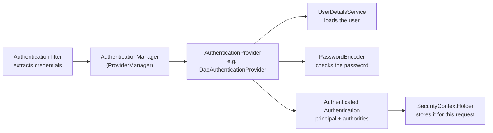

This is where the theory of the earlier lessons becomes code. For a Spring Boot role the interview questions are practical: *how does the filter chain work, how do you configure security without `WebSecurityConfigurerAdapter`, what is the difference between `hasRole` and `hasAuthority`, how do you secure a REST API with JWT, why is CSRF disabled, how do you test it?* It applies [authentication and authorization](lesson:authn-authz), [OAuth 2.0](lesson:oauth2), [OIDC](lesson:oidc) and [JWT](lesson:jwt). Examples use Spring Security 6 on Spring Boot 3 (which needs [Java 17](lesson:java-version-history#java-17) or newer). Play the four scenes of a request travelling through the filter chain.

```demo
name: security-walk
```

> **One sentence to remember:** *Spring Security is a chain of servlet filters in front of your controllers: authentication filters put an `Authentication` into the `SecurityContext`, the `AuthorizationFilter` checks rules against it, and `ExceptionTranslationFilter` turns failures into 401 or 403.*

## How it works inside {#architecture}


### The filter chain {#filter-chain}

Spring Security is a servlet **filter**. A single registered filter (`DelegatingFilterProxy`, handled by Boot) hands every request to **`FilterChainProxy`**, which selects the first **`SecurityFilterChain`** whose request matcher fits the URL and runs that chain's filters in a fixed order. You configure security by declaring `SecurityFilterChain` beans; you can have several (for example one for `/api/**` and one for the web UI).

The important filters, in order:

| Filter | Job |
| --- | --- |
| `SecurityContextHolderFilter` | loads the `SecurityContext` (from the session, or empty) and clears it at the end |
| `HeaderWriterFilter` | adds security response headers (`X-Content-Type-Options`, HSTS, frame options) |
| `CorsFilter` | applies the CORS configuration |
| `CsrfFilter` | checks the CSRF token on unsafe methods |
| `LogoutFilter` | handles `/logout` |
| authentication filter | `UsernamePasswordAuthenticationFilter` (form login), `BasicAuthenticationFilter`, `BearerTokenAuthenticationFilter` (JWT), `OAuth2LoginAuthenticationFilter` |
| `AnonymousAuthenticationFilter` | gives unauthenticated requests an anonymous identity |
| `ExceptionTranslationFilter` | converts security exceptions into a login redirect, 401 or 403 |
| `AuthorizationFilter` | the last one: evaluates the URL rules (`authorizeHttpRequests`) |

### Authentication objects {#objects}



- **`Authentication`:** the object representing the current user: the **principal** (who), the **credentials** (cleared after login) and the **authorities** (what they may do), plus an `isAuthenticated` flag.
- **`SecurityContext` / `SecurityContextHolder`:** the holder of the current `Authentication`, kept in a `ThreadLocal` by default. Read the user anywhere with `SecurityContextHolder.getContext().getAuthentication()`, or inject `Authentication` or `@AuthenticationPrincipal` into a controller.
- **`AuthenticationManager`:** the entry point: `authenticate(Authentication)`. The default `ProviderManager` asks each **`AuthenticationProvider`** in turn until one supports the credential type.
- **`UserDetailsService` and `UserDetails`:** load a user by name (from a database, LDAP, in memory); the `DaoAuthenticationProvider` compares the password with a **`PasswordEncoder`**.
- **`GrantedAuthority`:** a permission string such as `ROLE_ADMIN` or `SCOPE_reports.read`.

### 401 and 403 inside the chain {#errors}

If `AuthorizationFilter` denies access it throws `AccessDeniedException`; `ExceptionTranslationFilter` catches it. If the user is **anonymous** it calls the **`AuthenticationEntryPoint`** (redirect to the login page, or 401 with `WWW-Authenticate`). If the user is **authenticated** it calls the **`AccessDeniedHandler`** (403). Customise both to return JSON errors from an API.

## Configuring it {#config}

### The modern configuration {#modern}

Since Spring Security 5.7 (and required in 6) you declare a `SecurityFilterChain` bean with the lambda DSL. `WebSecurityConfigurerAdapter` was **removed**, as were `antMatchers`/`mvcMatchers` (use `requestMatchers`) and `authorizeRequests` (use `authorizeHttpRequests`).

```java
@Configuration
@EnableWebSecurity
@EnableMethodSecurity                                   // turns on @PreAuthorize and friends
class SecurityConfig {

    @Bean
    SecurityFilterChain web(HttpSecurity http) throws Exception {
        return http
            .authorizeHttpRequests(auth -> auth
                .requestMatchers("/", "/css/**", "/login").permitAll()
                .requestMatchers("/admin/**").hasRole("ADMIN")
                .requestMatchers(HttpMethod.DELETE, "/reports/**").hasAuthority("reports:delete")
                .anyRequest().authenticated())           // deny by default
            .formLogin(Customizer.withDefaults())
            .logout(Customizer.withDefaults())
            .build();
    }

    @Bean
    PasswordEncoder passwordEncoder() {
        return PasswordEncoderFactories.createDelegatingPasswordEncoder();
    }
}
```

**Rule order matters**: rules are checked top to bottom and the **first match wins**, so put specific rules before general ones and finish with `anyRequest()` (`authenticated()` or `denyAll()`). In Spring Boot, adding the starter alone secures everything with a generated password and form login, until you declare your own chain.

### Users and passwords {#users}

```java
@Bean
UserDetailsService users(UserRepository repo) {
    return username -> repo.findByEmail(username)
        .map(u -> User.withUsername(u.getEmail())
            .password(u.getPasswordHash())                  // already encoded, e.g. {bcrypt}$2a$...
            .roles(u.getRoles().toArray(String[]::new))     // adds the ROLE_ prefix
            .disabled(!u.isActive())
            .build())
        .orElseThrow(() -> new UsernameNotFoundException("unknown user"));
}
```

Never store plain-text passwords. `DelegatingPasswordEncoder` (the default factory) prefixes each hash with its algorithm id (`{bcrypt}`, `{argon2}`), so you can upgrade algorithms and still verify old hashes (`UserDetailsPasswordService` can re-encode on login). Why this matters: see [storing passwords](lesson:cryptography#passwords).

### Roles and authorities {#roles}

A **role** is just an authority with the **`ROLE_` prefix**: `hasRole("ADMIN")` checks the authority `ROLE_ADMIN`, while `hasAuthority("ADMIN")` checks the literal string. `User.roles("ADMIN")` adds the prefix for you; `authorities("reports:delete")` does not. Use roles for coarse groups and authorities (or OAuth scopes) for fine-grained permissions. A common bug is storing `ADMIN` and checking `hasRole("ADMIN")`, which needs `ROLE_ADMIN`.

## Securing a REST API {#rest}


### JWT resource server {#jwt-rs}

A stateless API validates bearer tokens from an identity provider ([JWT validation](lesson:jwt#validation), [OAuth resource server](lesson:oauth2#spring-rs)):

```java
@Bean
SecurityFilterChain api(HttpSecurity http) throws Exception {
    return http
        .securityMatcher("/api/**")
        .csrf(csrf -> csrf.disable())                                  // no cookies, so no CSRF risk
        .sessionManagement(s -> s.sessionCreationPolicy(SessionCreationPolicy.STATELESS))
        .cors(Customizer.withDefaults())
        .authorizeHttpRequests(a -> a
            .requestMatchers(HttpMethod.GET, "/api/reports/**").hasAuthority("SCOPE_reports.read")
            .anyRequest().authenticated())
        .oauth2ResourceServer(o -> o.jwt(Customizer.withDefaults()))   // issuer-uri in application.yml
        .exceptionHandling(e -> e
            .authenticationEntryPoint(new BearerTokenAuthenticationEntryPoint())
            .accessDeniedHandler(new BearerTokenAccessDeniedHandler()))
        .build();
}
```

### Login with OIDC and sessions {#oidc-login}

A server-rendered web app uses `oauth2Login()` and a session cookie ([OIDC login](lesson:oidc#spring-login)); a SPA often goes through a backend-for-frontend that does this and exposes only a session cookie. Choose per client type: **session + CSRF** for browsers, **stateless bearer tokens** for APIs and mobile.

### CSRF, CORS and headers {#csrf-cors}

- **CSRF** is on by default and protects cookie-authenticated, state-changing requests (see [CSRF](lesson:authn-authz#q-csrf-q)). Keep it for session-based web apps; disabling it is acceptable only for stateless token APIs. Single-page apps commonly use `CookieCsrfTokenRepository.withHttpOnlyFalse()` so the script can read the token and send it in `X-XSRF-TOKEN`.
- **CORS** is a browser rule that decides which other origins may call your API; it is **not** security against non-browser clients. Configure it with a `CorsConfigurationSource` bean and `http.cors(...)`, listing exact origins and methods; never `*` together with credentials. CORS must run before security, which is why it belongs in the chain.
- **Headers:** Spring Security adds sensible defaults (HSTS, `X-Content-Type-Options`, frame options, cache control); add a **Content Security Policy** for browser apps.

## Authorization in depth {#authorization}

### Method security {#method-security}

`@EnableMethodSecurity` turns on annotations that evaluate [SpEL](lesson:authn-authz#enforcement) expressions on beans, which lets you secure the service layer and make **object-level** decisions that URL rules cannot:

```java
@Service
class DocumentService {

    @PreAuthorize("hasAuthority('SCOPE_documents.read')")
    public List<Document> list() { ... }

    @PreAuthorize("hasRole('ADMIN') or #ownerId == authentication.name")
    public List<Document> forOwner(String ownerId) { ... }

    @PostAuthorize("returnObject.owner == authentication.name")        // checked after the method returns
    public Document get(long id) { ... }

    @PreAuthorize("@docAccess.canEdit(#id, authentication)")           // delegate to a bean
    public void update(long id, DocumentUpdate update) { ... }
}
```

`@PreAuthorize` runs before the call, `@PostAuthorize` can inspect the returned object, and `@PreFilter`/`@PostFilter` filter collections. Method security works through **proxies**, so a call from one method to another in the same class (self-invocation) **bypasses** it, and `private` methods are not protected.

### Custom filters and the security context {#custom}

To add your own authentication (an API key header, for example), write a `OncePerRequestFilter`, build an `Authentication` and put it into the context, then register the filter relative to a known one:

```java
class ApiKeyFilter extends OncePerRequestFilter {
    @Override
    protected void doFilterInternal(HttpServletRequest req, HttpServletResponse res, FilterChain chain)
            throws ServletException, IOException {
        String key = req.getHeader("X-API-Key");
        if (key != null && keyService.isValid(key)) {
            var auth = new PreAuthenticatedAuthenticationToken(keyService.ownerOf(key), null, List.of(new SimpleGrantedAuthority("ROLE_SERVICE")));
            SecurityContextHolder.getContext().setAuthentication(auth);
        }
        chain.doFilter(req, res);                                   // always continue the chain
    }
}

http.addFilterBefore(new ApiKeyFilter(), UsernamePasswordAuthenticationFilter.class);
```

The `SecurityContext` is bound to the **thread**. Work handed to another thread (`@Async`, a thread pool) does not see it unless you propagate it (`DelegatingSecurityContextExecutor`, or `MODE_INHERITABLETHREADLOCAL`); virtual threads need the same care.

## Testing and pitfalls {#testing}

### Testing secured code {#test}

```java
@WebMvcTest(ReportController.class)
@Import(SecurityConfig.class)
class ReportControllerTest {
    @Autowired MockMvc mvc;

    @Test
    void anonymousGets401() throws Exception {
        mvc.perform(get("/api/reports")).andExpect(status().isUnauthorized());
    }

    @Test
    @WithMockUser(username = "alice", roles = "ANALYST")
    void analystCanRead() throws Exception {
        mvc.perform(get("/reports")).andExpect(status().isOk());
    }

    @Test
    void tokenWithScopeCanRead() throws Exception {
        mvc.perform(get("/api/reports")
                .with(jwt().authorities(new SimpleGrantedAuthority("SCOPE_reports.read"))))
           .andExpect(status().isOk());
    }

    @Test
    @WithMockUser
    void postNeedsCsrf() throws Exception {
        mvc.perform(post("/transfer")).andExpect(status().isForbidden());                       // no token
        mvc.perform(post("/transfer").with(csrf())).andExpect(status().isOk());                 // with token
    }
}
```

### Common mistakes {#mistakes}

| Mistake | Fix |
| --- | --- |
| Rules in the wrong order (`anyRequest()` first, broad before specific) | specific first, `anyRequest()` last |
| `hasRole("ROLE_ADMIN")` | `hasRole("ADMIN")` (prefix added), or `hasAuthority("ROLE_ADMIN")` |
| Disabling CSRF on a cookie-based app | keep it, or move to stateless tokens |
| Only securing URLs, no object-level checks | `@PreAuthorize`/ownership checks (IDOR) |
| `permitAll()` on the static and error paths forgotten, or too wide (`/**`) | list the exact public paths |
| Plain or MD5/SHA passwords | `DelegatingPasswordEncoder`, bcrypt or Argon2 |
| Trusting the `X-Forwarded-*` headers blindly | configure the forwarded-header strategy for your proxy |
| Secrets, keys and client secrets in `application.yml` | environment variables or a secret manager |
| Method security on private or self-invoked methods | put it on public methods of another bean |
| Leaking details in 401/403 messages | generic errors, log the detail |
| Using the deprecated `WebSecurityConfigurerAdapter` or `antMatchers` | `SecurityFilterChain` and `requestMatchers` |

## Cheat sheet {#cheatsheet}

| Need | Use |
| --- | --- |
| Configure security | `SecurityFilterChain` bean with the lambda DSL |
| URL rules | `authorizeHttpRequests` + `requestMatchers`, specific first, `anyRequest()` last |
| Where the user lives | `SecurityContextHolder` (thread-bound) |
| Who authenticates | `AuthenticationManager` → `AuthenticationProvider` |
| Load users | `UserDetailsService` + `PasswordEncoder` (delegating) |
| Role vs authority | `ROLE_` prefix: `hasRole("X")` = `hasAuthority("ROLE_X")` |
| Object-level rules | `@PreAuthorize` / `@PostAuthorize` with `@EnableMethodSecurity` |
| REST API with tokens | stateless + CSRF off + `oauth2ResourceServer().jwt()` |
| Browser app | form or `oauth2Login()` + session + CSRF on |
| 401 / 403 | `AuthenticationEntryPoint` / `AccessDeniedHandler` |
| Test | `@WithMockUser`, `jwt()`, `csrf()` |

## Interview questions {#questions}

### [basic] How does Spring Security work at a high level? {#how-it-works}

It is a chain of servlet filters in front of the application. `FilterChainProxy` picks the matching `SecurityFilterChain` and runs its filters: authentication filters extract credentials and have the `AuthenticationManager` verify them, storing the result as an `Authentication` in the `SecurityContext`; the `AuthorizationFilter` then checks the URL rules; `ExceptionTranslationFilter` turns failures into a login redirect, 401 or 403. Controllers only run if the chain lets the request through.

### [basic] What is the difference between authentication and authorization in Spring Security? {#authn-authz-q}

Authentication establishes **who** the caller is (an `Authentication` with principal and authorities, produced by an `AuthenticationManager`). Authorization decides **what** that identity may do (URL rules in `authorizeHttpRequests`, method security with `@PreAuthorize`). Failing the first leads to a login redirect or 401, failing the second to 403.

### [basic] What is the SecurityContext and SecurityContextHolder? {#security-context}

The `SecurityContext` holds the current `Authentication`. `SecurityContextHolder` gives static access to it and by default stores it in a `ThreadLocal`, so it is available anywhere on the request thread. It is loaded at the start of the request (from the session for session apps), and cleared at the end. Other threads do not see it unless you propagate it explicitly.

### [basic] What is the difference between hasRole and hasAuthority? {#role-vs-authority}

`hasRole("ADMIN")` checks for the authority `ROLE_ADMIN` (the prefix is added automatically). `hasAuthority("ADMIN")` checks the exact string. Roles are conventionally coarse groups; authorities or OAuth scopes (`SCOPE_reports.read`) are fine-grained permissions. Mixing them up is a common source of "403 although the user has the role".

### [basic] How do you store and check passwords? {#passwords-q}

Store only a salted, slow hash with a `PasswordEncoder`; use `PasswordEncoderFactories.createDelegatingPasswordEncoder()` (`{bcrypt}` by default) so that hashes carry their algorithm and can be upgraded later. The `DaoAuthenticationProvider` calls `encoder.matches(raw, stored)` during login. Never plain text, MD5 or SHA-256.

### [basic] Why was WebSecurityConfigurerAdapter removed, and what replaced it? {#adapter-removed}

Extending a configuration class and overriding methods was replaced by a component-based model: you declare a `SecurityFilterChain` bean (and `WebSecurityCustomizer`, `AuthenticationManager` or `UserDetailsService` beans as needed), which is easier to compose, to test and to have several of. It was deprecated in 5.7 and removed in Spring Security 6, together with `antMatchers` (now `requestMatchers`) and `authorizeRequests` (now `authorizeHttpRequests`).

### [intermediate] Explain the order of the filters and why it matters. {#filter-order}

Order decides what each filter can rely on: the context is loaded first, CORS and CSRF run before authentication so cross-site and forged requests are rejected cheaply, authentication filters run before the anonymous filter, `ExceptionTranslationFilter` sits just before `AuthorizationFilter` so it can catch its exceptions, and authorization is last. Custom filters are inserted relative to known ones with `addFilterBefore`, `addFilterAfter` or `addFilterAt`.

### [intermediate] What is the difference between 401 and 403 inside the chain? {#401-403-chain}

`AuthorizationFilter` throws `AccessDeniedException`. `ExceptionTranslationFilter` checks the authentication: for an anonymous user it calls the `AuthenticationEntryPoint` (redirect to the login page, or 401 with `WWW-Authenticate` for APIs); for an authenticated user it calls the `AccessDeniedHandler` (403). Both can be customised, for example to return a JSON problem body.

### [intermediate] How do you secure a REST API with JWTs in Spring Boot? {#jwt-api}

Add the resource-server starter, set `spring.security.oauth2.resourceserver.jwt.issuer-uri`, and in the chain use `oauth2ResourceServer(o -> o.jwt(...))`, a stateless session policy and `authorizeHttpRequests` rules on `SCOPE_` authorities or roles mapped by a `JwtAuthenticationConverter`. Spring validates signature, issuer and expiry from the issuer's JWKS; add an audience validator. CSRF can be disabled because the credential is not a cookie. Add object-level checks with `@PreAuthorize`.

### [intermediate] When can you disable CSRF protection? {#csrf-disable}

When the application authenticates with credentials that the browser does **not** send automatically, such as a bearer token in the `Authorization` header, and uses no session cookies. Then a forged cross-site request has no credential. For a form-login or session-cookie application keep CSRF on (the default) and send the token with state-changing requests. Disabling it "to make Postman work" on a cookie-based app is a vulnerability.

### [intermediate] What is CORS, and is it a security feature for your API? {#cors-q}

CORS is a browser mechanism: the server states which other origins may read its responses (and the browser enforces it with a preflight `OPTIONS` request for non-simple calls). It protects users' browsers from other websites reading your API with their credentials; it does not stop curl, scripts or servers from calling it, so it is no substitute for authentication and authorization. In Spring use a `CorsConfigurationSource` with exact origins and `http.cors(...)` so that the CORS filter runs before security.

### [intermediate] How does method security work and what are its limits? {#method-security-q}

`@EnableMethodSecurity` registers interceptors that evaluate `@PreAuthorize` and `@PostAuthorize` expressions around bean method calls, through proxies. They allow object-level rules (`#ownerId == authentication.name`, `returnObject.owner == authentication.name`, `@bean.check(...)`). Limits: they work only on calls that go through the proxy, so self-invocation inside a class and private methods are not protected; and they run after the URL rules, so they complement them.

### [intermediate] How do you get the current user in a controller or service? {#current-user}

Inject `Authentication` or `Principal` into the controller method, or use `@AuthenticationPrincipal` for your `UserDetails` (or `OidcUser`/`Jwt`) type; elsewhere read `SecurityContextHolder.getContext().getAuthentication()`. Prefer passing the user explicitly into services over calling the static holder deep inside business code, which hides a dependency and breaks on other threads.

### [intermediate] How do you handle security for @Async or a thread pool? {#async-context}

The `SecurityContext` is stored per thread, so a task run on another thread has no user. Wrap the executor with `DelegatingSecurityContextExecutorService` (or `DelegatingSecurityContextRunnable`), or configure the `SecurityContextHolder` strategy `MODE_INHERITABLETHREADLOCAL`, or simply pass the needed user information as arguments. Virtual threads and reactive code need the same attention (reactive uses `ReactiveSecurityContextHolder`).

### [deep] Walk through a form login from the browser to the controller. {#form-login-q}

The first request is anonymous, `AuthorizationFilter` denies it, and `ExceptionTranslationFilter` saves the request and redirects to `/login`. The user posts credentials; `UsernamePasswordAuthenticationFilter` builds an unauthenticated token and calls the `AuthenticationManager`, whose `DaoAuthenticationProvider` loads the user with `UserDetailsService` and checks the password with the `PasswordEncoder`. On success the session id is changed (session fixation protection), the `Authentication` is stored in the context and saved in the session, and the user is redirected to the saved request. Later requests are authenticated from the session by `SecurityContextHolderFilter`.

### [deep] How do you secure a microservice architecture with Spring Security? {#microservices}

Authenticate at the edge with an OIDC provider and validate tokens in the gateway, but also make each service a resource server that validates the JWT (issuer, audience, scopes) so that nothing is trusted just for being inside the network. Propagate the user's token (or exchange it) on service-to-service calls, or use client-credentials tokens or mTLS for service identities. Keep authorization rules close to the data (`@PreAuthorize`, ownership checks), use short-lived tokens, and keep keys and secrets in a secret manager.

### [deep] What are the common causes of "my secured endpoint returns 403 or 401 unexpectedly"? {#debugging}

For 403: wrong role prefix (`hasRole("ROLE_X")` or storing `X`), authorities not mapped from the token (the converter reads `scope` but you check a `roles` claim), CSRF token missing on POST, rule order (a broad rule matched first), or method security denying after URL rules passed. For 401: missing or expired token, wrong issuer or audience, the filter chain matching a different `securityMatcher` than expected, or CORS preflight (`OPTIONS`) being blocked before authentication. Enable `logging.level.org.springframework.security=DEBUG` to see which filters and rules ran.

### [coding] Write a SecurityFilterChain for a stateless JWT API with an admin area. {#coding-chain}

```java
@Bean
SecurityFilterChain api(HttpSecurity http, JwtAuthenticationConverter converter) throws Exception {
    return http
        .csrf(c -> c.disable())
        .sessionManagement(s -> s.sessionCreationPolicy(SessionCreationPolicy.STATELESS))
        .authorizeHttpRequests(a -> a
            .requestMatchers("/actuator/health", "/v3/api-docs/**").permitAll()
            .requestMatchers("/admin/**").hasRole("ADMIN")
            .requestMatchers(HttpMethod.GET, "/reports/**").hasAnyAuthority("SCOPE_reports.read", "ROLE_ADMIN")
            .anyRequest().authenticated())
        .oauth2ResourceServer(o -> o.jwt(j -> j.jwtAuthenticationConverter(converter)))
        .build();
}
```

Point out the order (specific before general, `anyRequest()` last), that `hasRole("ADMIN")` expects the `ROLE_ADMIN` authority produced by the converter, why CSRF is off and the session stateless, and that health checks are the only public paths.

### [coding] Allow users to read only their own documents. {#coding-owner}

```java
@Service
class DocumentService {

    @PostAuthorize("hasRole('ADMIN') or returnObject.ownerId == authentication.name")
    public Document get(long id) {
        return repository.findById(id).orElseThrow(() -> new ResponseStatusException(HttpStatus.NOT_FOUND));
    }

    @PreAuthorize("isAuthenticated()")
    public List<Document> mine(Authentication auth) {
        return repository.findByOwnerId(auth.getName());              // the query itself is scoped to the caller
    }
}
```

Explain that scoping the query by owner is better than loading everything and filtering, that `@PostAuthorize` is a safety net for single objects, that this needs `@EnableMethodSecurity` and a call through the proxy, and that an unauthorised user can receive 404 instead of 403 to avoid leaking existence.

### [coding] Test that an endpoint is protected for anonymous users, ordinary users and admins. {#coding-test}

```java
@Test
void anonymous_is_unauthorized() throws Exception {
    mvc.perform(get("/admin/stats")).andExpect(status().isUnauthorized());
}

@Test
@WithMockUser(roles = "USER")
void user_is_forbidden() throws Exception {
    mvc.perform(get("/admin/stats")).andExpect(status().isForbidden());
}

@Test
@WithMockUser(roles = "ADMIN")
void admin_is_allowed() throws Exception {
    mvc.perform(get("/admin/stats")).andExpect(status().isOk());
}
```

For a token API replace `@WithMockUser` with `.with(jwt().authorities(...))`, and for form-login state-changing requests add `.with(csrf())`. Testing all three identities per endpoint catches both missing and over-broad rules.
