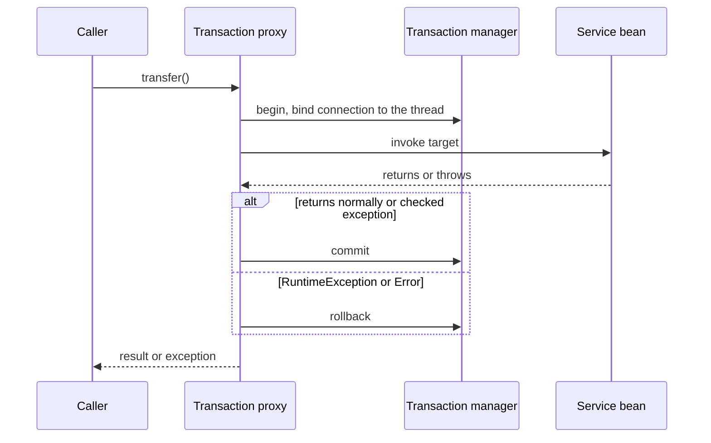

`@Transactional` is the most questioned annotation in Spring interviews, and a source of subtle production bugs. Expect:

- What does it do?
- What are the propagation types?
- When does it roll back?
- Why did my transaction not start?
- What is `UnexpectedRollbackException`?
- What is the difference between `REQUIRED` and `REQUIRES_NEW`?

This lesson goes deeper than the introduction in [ACID and BASE](lesson:acid-base#transactional). It builds on [AOP and proxies](lesson:spring-aop) (the mechanism) and [Spring Data JPA](lesson:spring-data-jpa) (the persistence context). It leads into the [Saga pattern](lesson:saga), for transactions that span services.

The demo has three scenes: propagation, rollback rules, and publishing after commit. Transactions are drawn as boxes, and a method inside a box runs in that transaction.

```demo
name: spring-tx-walk
```

> **One sentence to remember:** *`@Transactional` is a proxy that commits on a normal return and rolls back on an unchecked exception.*

So when a transaction misbehaves, check three things. Does the call go through the proxy? Does the exception actually leave the method? Does the propagation do what you think?

## How it works {#how}

### The pieces {#pieces}

| Piece | Role |
| --- | --- |
| `@Transactional` | Declares where the transaction starts and ends, and its settings. |
| **Transaction proxy** (AOP advice) | Begins, commits or rolls back around the call. |
| `PlatformTransactionManager` | The interface for the actual work. Implementations: `DataSourceTransactionManager` (JDBC), `JpaTransactionManager` (JPA, which Boot picks with Data JPA), `JtaTransactionManager` (XA). |
| `TransactionSynchronizationManager` | Binds the connection or `EntityManager` to the **current thread**, so all repository calls share the transaction. |
| Connection pool (HikariCP) | The connection is taken at the start and held until commit or rollback. |



Boot configures the transaction manager and turns on `@Transactional` processing for you (`@EnableTransactionManagement` is implied).

- Annotate **service-layer** methods: one transaction per business use case.
- Annotating the **class** applies to all its public methods. An annotation on a method overrides the class.

### Attributes {#attributes}

```java
@Transactional(
    propagation = Propagation.REQUIRED,        // default
    isolation = Isolation.DEFAULT,             // database default (PostgreSQL: read committed)
    timeout = 5,                               // seconds
    readOnly = false,
    rollbackFor = Exception.class,             // also roll back on checked exceptions
    noRollbackFor = ValidationWarning.class,
    transactionManager = "ledgerTx")           // which manager when there are several
```

- `isolation` is sent to the database for **new** transactions only (see [isolation levels](lesson:acid-base#levels)). A method that joins a transaction keeps that transaction's level.
- `timeout` also applies only when a transaction is started.
- `readOnly` is a hint. Hibernate skips dirty checking and sets the flush mode to manual, and drivers may send the work to a replica.

## Propagation {#propagation}


*Propagation* decides what happens when a transactional method is called while a transaction already exists:

| Propagation | Behaviour |
| --- | --- |
| **REQUIRED** (default) | Join the existing transaction, or start a new one if there is none. |
| **REQUIRES_NEW** | Suspend the existing one and start a new, **independent** one. It uses a separate connection and commits or rolls back on its own. |
| **NESTED** | Run inside the existing one, with a **savepoint**, so only the inner part can be rolled back. With no existing transaction, it behaves like REQUIRED. It needs JDBC savepoints, so on most setups it does not work with JPA and Hibernate. |
| **SUPPORTS** | Join one if it exists, otherwise run without a transaction. |
| **NOT_SUPPORTED** | Suspend any transaction and run without one. |
| **MANDATORY** | Must run inside an existing transaction, otherwise throw an exception. |
| **NEVER** | Must run without a transaction, otherwise throw an exception. |

Typical uses:

- `REQUIRED` almost everywhere.
- `REQUIRES_NEW` for **audit logs and failure records** that must be saved even if the caller rolls back, or for a unit of work that should commit on its own.
- `NOT_SUPPORTED` for long reads, or calls that should not hold a transaction.
- `MANDATORY` on helper methods that must never run outside a service transaction.

**Rollback-only and joined transactions.** With `REQUIRED` there is **one physical transaction**.

1. A joined inner method throws a `RuntimeException`.
2. The proxy marks the shared transaction **rollback-only**. This happens even if the outer method catches the exception.
3. When the outer method later tries to commit, Spring throws **`UnexpectedRollbackException`** and rolls back.

So catching an exception from a joined call does not save the transaction. If the inner work may fail on its own, use `REQUIRES_NEW` or `NESTED`.

## Rollback rules {#rollback}

- **Default:** roll back on **unchecked** exceptions (`RuntimeException` and `Error`), but **commit** on checked exceptions. This differs from EJB and surprises many people.
- `rollbackFor = Exception.class` (or specific types) adds checked exceptions. `noRollbackFor` excludes some.
- **Swallowed exceptions commit:** the proxy only sees what leaves the method.
- **Marking in code:** `TransactionAspectSupport.currentTransactionStatus().setRollbackOnly()`.
- An exception thrown **during the commit itself** (a constraint violation at flush, deferred constraints) appears after your method has returned, at the proxy.

### Why it sometimes does not start {#not-starting}

| Cause | Fix |
| --- | --- |
| Self-invocation (`this.other()`). | Call through another bean ([AOP](lesson:spring-aop#self-invocation)). |
| A `private`, `final` or `static` method, or an object that is not a bean. | Use a public method on a Spring-managed bean. |
| The annotation is on the interface and the proxy is CGLIB, in old versions. | Annotate the class. |
| `@Async`, or a new thread started inside. | The transaction belongs to one thread, so start it in that thread. |
| The wrong `@Transactional` import. (`javax` or `jakarta.transaction` works, but has fewer attributes.) | Use `org.springframework.transaction.annotation.Transactional`. |
| The exception is caught inside. | Rethrow it, or mark the transaction rollback-only. |
| Several transaction managers. | Name one with `transactionManager`. |

## Programmatic transactions {#programmatic}

For finer control, use `TransactionTemplate`. Examples are a transaction around part of a method, or many short transactions in a loop:

```java
@Service
class BatchService {
    private final TransactionTemplate tx;
    BatchService(PlatformTransactionManager tm) {
        this.tx = new TransactionTemplate(tm);
        this.tx.setPropagationBehavior(TransactionDefinition.PROPAGATION_REQUIRES_NEW);
    }

    void importAll(List<Row> rows) {
        for (List<Row> chunk : Lists.partition(rows, 500)) {
            tx.executeWithoutResult(status -> repository.saveAll(map(chunk)));   // commit per chunk, one bad chunk does not undo the rest
        }
    }
}
```

It avoids the proxy's limits (there is no self-invocation problem), and the transaction's scope is visible in the code.

## Events, commit and consistency {#events}

Publishing a message or event **inside** a transaction is risky. Consumers may run before the data is committed. And if the transaction later rolls back, there is a message about something that never happened.

The options:

1. **`@TransactionalEventListener(phase = AFTER_COMMIT)`** handles an `ApplicationEvent` only after a successful commit. By default it runs only if a transaction exists. The phases are `BEFORE_COMMIT`, `AFTER_COMMIT`, `AFTER_ROLLBACK` and `AFTER_COMPLETION`. Work done in an `AFTER_COMMIT` listener runs **outside** the transaction, so starting a new one needs `REQUIRES_NEW`.
2. **`TransactionSynchronizationManager.registerSynchronization(...)`** with an `afterCommit()` method.
3. **The transactional outbox:** write the event to an outbox table in the same transaction, and publish it from there. This guarantees delivery ([outbox](lesson:microservice-patterns#outbox), [messaging](lesson:messaging)). AFTER_COMMIT alone can lose the message if the process crashes between the commit and the send.

## Design guidance {#design}

- **Keep transactions short.** They hold a pooled connection and database locks. Do no remote calls, file I/O, `Thread.sleep` or user interaction inside. A slow downstream call inside a transaction can use up the pool (`HikariPool: Connection is not available`).
- **One transaction per use case, at the service layer.** Not one per repository call, and not in controllers.
- **Read-only methods:** put `readOnly = true` on query services.
- **Large reads:** stream or page instead of loading everything in one transaction. Consider `NOT_SUPPORTED` for long reports.
- **Concurrency:** combine transactions with optimistic or pessimistic locking and retries ([lost updates](lesson:acid-base#lost-update)). Keep the retry loop **outside** the transaction.
- **Across services,** a local transaction cannot span them. Use [sagas](lesson:saga), idempotency and the outbox, not distributed (XA) transactions.
- **Tests:** `@Transactional` on a test rolls back after each test. That can hide flush problems (nothing gets flushed), and differs from production. Use `@Commit`, call `flush()` and `clear()`, or test the transaction boundary through the real service call.

Try it in the lab: [@Transactional: rollback rules and propagation](lab:tx-propagation-rollback).

## Cheat sheet {#cheatsheet}

| Topic | Key point |
| --- | --- |
| Mechanism | An AOP proxy plus a `PlatformTransactionManager`, bound to the thread. |
| Default rollback | On unchecked exceptions and errors. Checked exceptions commit. |
| `rollbackFor` | Adds checked exceptions: `rollbackFor = Exception.class`. |
| `REQUIRED` | Join or create (the default). One physical transaction. |
| `REQUIRES_NEW` | An independent transaction on a new connection. Suspends the outer one. |
| `NESTED` | A savepoint inside the outer transaction. |
| Rollback-only | An inner exception dooms a joined transaction: `UnexpectedRollbackException`. |
| `readOnly` | A hint. Skips dirty checking, but does not truly block writes. |
| Self-invocation, private | No proxy, so no transaction. |
| After-commit work | `@TransactionalEventListener(AFTER_COMMIT)` or the outbox. |
| Keep short | No remote calls inside. They cause pool and lock contention. |
| Programmatic | `TransactionTemplate` for partial scopes and loops. |

## Interview questions {#questions}

### [basic] How does @Transactional work? {#how-q}

Spring wraps the bean in an AOP proxy. On each call, the proxy:

1. asks the `PlatformTransactionManager` to begin a transaction, which takes a connection and binds it to the thread,
2. calls the method,
3. commits on a normal return, or rolls back on an unchecked exception.

The method body contains no transaction code. It works only for calls that go through the proxy.

### [basic] When does a transaction roll back by default? {#rollback-q}

On `RuntimeException` and `Error`.

Checked exceptions do not trigger a rollback: the transaction commits. Use `rollbackFor = Exception.class` to roll back on checked exceptions too, or make your domain exceptions unchecked.

### [basic] What is the default propagation and what does it mean? {#required-q}

`REQUIRED`. If a transaction exists, the method joins it. Otherwise a new one starts.

A chain of `REQUIRED` methods shares one physical transaction, so they all commit or roll back together.

### [basic] Why is my @Transactional method not transactional? {#not-working-q}

Common causes:

- self-invocation: the method is called through `this` inside the same class,
- the method is `private`, `final` or `static`,
- the object is not a Spring bean,
- an exception is swallowed, so the proxy sees a normal return,
- a checked exception, with the default rollback rules,
- a new thread, because the transaction belongs to one thread,
- the wrong annotation import.

### [basic] What does readOnly = true do? {#readonly-q}

It hints that the transaction will not write. Hibernate skips dirty checking and flushing, and the driver or database may optimise or use a read replica.

It does not reliably block writes on every database. Use it on query methods, for efficiency and to show your intent.

### [intermediate] Explain the propagation types. {#propagation-q}

- `REQUIRED` joins a transaction or creates one.
- `REQUIRES_NEW` suspends the current transaction and starts an independent one.
- `NESTED` uses a savepoint inside the current transaction.
- `SUPPORTS` joins if there is one, and otherwise runs without a transaction.
- `NOT_SUPPORTED` suspends any transaction and runs without one.
- `MANDATORY` requires an existing transaction.
- `NEVER` requires that there is none.

Most code uses `REQUIRED`. `REQUIRES_NEW` suits audit or failure logs that must be saved independently.

### [intermediate] What is the difference between REQUIRES_NEW and NESTED? {#new-vs-nested-q}

`REQUIRES_NEW` creates a separate physical transaction on its own connection, and suspends the outer one. It commits or rolls back independently.

`NESTED` stays in the same physical transaction and uses a savepoint. An inner failure can be rolled back to the savepoint. But the inner work is finally committed or rolled back together with the outer transaction.

NESTED needs JDBC savepoint support, and is not generally available with JPA.

### [intermediate] What is UnexpectedRollbackException? {#unexpected-q}

Spring throws it when a transaction marked rollback-only reaches commit. The mark comes from a joined `REQUIRED` method that threw a `RuntimeException`.

It happens when the outer method catches the inner exception and carries on, thinking it recovered.

Fix it by letting the exception propagate, or by running the risky part with `REQUIRES_NEW` or `NESTED`.

### [intermediate] What happens if a REQUIRES_NEW method is called many times in a loop? {#new-cost-q}

Each call suspends the outer transaction and takes another connection from the pool, so the thread holds two connections at once.

Under load this can use up the pool and deadlock: every thread holds its first connection while waiting for a second.

Use it sparingly. Size the pool for it, or restructure, for example by committing chunks with `TransactionTemplate`.

### [intermediate] Where should @Transactional be placed? {#placement-q}

On public methods of service-layer beans, one transaction per business use case. Put it on the class or on the method.

Do not put it on controllers or private methods. Prefer the concrete class over the interface.

Repositories already have their own transactional defaults. The service's transaction makes several repository calls atomic.

### [intermediate] How do you run code only after the transaction commits? {#aftercommit-q}

Use `@TransactionalEventListener(phase = AFTER_COMMIT)` on a listener for an `ApplicationEvent`, or register a `TransactionSynchronization` with `afterCommit()`.

The code runs outside the transaction, so use `REQUIRES_NEW` if it must write.

For reliable delivery to other systems, use the transactional outbox: a crash right after the commit can lose an AFTER_COMMIT action.

### [intermediate] Why shouldn't you call a remote service inside a transaction? {#remote-q}

The transaction holds a database connection and locks for the whole call. A slow or hung downstream service keeps them busy, uses up the connection pool and blocks other transactions.

Also, if the remote call fails after your local changes, the data becomes inconsistent unless you design compensation.

Make the remote call outside the transaction, or use events, an outbox and sagas.

### [intermediate] How do transactions behave with @Async or new threads? {#async-q}

The transaction and its connection belong to the calling thread. A method run on another thread (`@Async`, an executor, parallel streams) is outside it.

If the async method is annotated, it starts its own transaction, and the caller cannot roll it back.

Pass data to the other thread, not entities from a closed context.

### [deep] How does Spring bind a transaction to a thread? {#thread-q}

`TransactionSynchronizationManager` keeps `ThreadLocal` resources, keyed by the `DataSource` or `EntityManagerFactory`.

When the transaction begins, the manager stores the connection or `EntityManager` there. `JdbcTemplate` and Spring Data repositories look it up instead of opening their own, so all calls on the thread share one transaction. It is removed when the transaction completes.

### [deep] Does a transaction guarantee consistency across two databases? {#xa-q}

No. A single `@Transactional` with one transaction manager covers one resource.

Two data sources need two managers (`@Transactional("name")`), so they are two independent transactions: one can commit while the other fails.

The options:

- JTA with XA two-phase commit, which is heavy, blocking and rarely used,
- best-effort ordering with compensation,
- the saga and outbox patterns ([2PC](lesson:distributed-systems#two-pc)).

### [deep] Why can an exception appear after your method has returned successfully? {#commit-failure-q}

Hibernate delays SQL until flush, which normally happens at commit, after the proxy has taken back control.

So a constraint violation, an optimistic lock failure or a serialization failure appears when the proxy commits. It is thrown to the caller, outside your method's try/catch.

Call `flush()` inside the method if you need to handle it there, or handle it at the service boundary.

### [coding] Fix the two transaction bugs in this service. {#coding-bugs}

```java
@Service
class TransferService {
    @Transactional
    public void transfer(long from, long to, BigDecimal amount) throws BankException {
        debit(from, amount);
        try {
            credit(to, amount);               // throws a RuntimeException on failure
        } catch (Exception e) {
            log.warn("credit failed", e);     // swallowed: transaction will commit the debit
        }
        recordAudit(from, to, amount);        // self-invocation: REQUIRES_NEW ignored
    }

    @Transactional(propagation = Propagation.REQUIRES_NEW)
    public void recordAudit(long from, long to, BigDecimal amount) { ... }
}
```

```java
@Service
class TransferService {
    private final AuditService audit;
    TransferService(AuditService audit) { this.audit = audit; }

    @Transactional(rollbackFor = Exception.class)
    public void transfer(long from, long to, BigDecimal amount) throws BankException {
        debit(from, amount);
        credit(to, amount);                   // let it propagate: everything rolls back
        audit.record(from, to, amount);       // another bean: goes through the proxy
    }
}

@Service
class AuditService {
    @Transactional(propagation = Propagation.REQUIRES_NEW)
    public void record(long from, long to, BigDecimal amount) { ... }
}
```

Explain these points:

- Swallowing the exception committed a debit with no credit.
- The self-call skipped the proxy, so `REQUIRES_NEW` was ignored.
- `rollbackFor` covers the checked `BankException`.
- The audit now commits independently. Note that it would not record a failed transfer unless it is also called from a `catch` or `finally` path.

### [coding] Commit in chunks so one bad batch does not undo everything. {#coding-chunks}

```java
@Service
class ImportService {
    private final TransactionTemplate tx;
    private final RowRepository rows;

    ImportService(PlatformTransactionManager tm, RowRepository rows) {
        this.tx = new TransactionTemplate(tm);
        this.tx.setPropagationBehavior(TransactionDefinition.PROPAGATION_REQUIRES_NEW);
        this.rows = rows;
    }

    ImportResult run(List<Row> all) {
        int ok = 0, failed = 0;
        for (List<Row> chunk : Lists.partition(all, 500)) {
            try {
                tx.executeWithoutResult(s -> rows.saveAll(chunk));
                ok += chunk.size();
            } catch (DataAccessException e) {
                failed += chunk.size();           // log and continue with the next chunk
            }
        }
        return new ImportResult(ok, failed);
    }
}
```

Explain these points:

- Each chunk is its own short transaction, which limits lock time and memory.
- The loop itself runs outside any transaction.
- `TransactionTemplate` avoids self-invocation problems.

### [coding] Send a notification only after the transfer commits. {#coding-after-commit}

```java
record TransferCompleted(long id, BigDecimal amount) {}

@Service
class TransferService {
    private final ApplicationEventPublisher events;
    @Transactional
    public void transfer(...) {
        // update balances, save the transfer
        events.publishEvent(new TransferCompleted(id, amount));       // not delivered to the listener yet
    }
}

@Component
class NotificationListener {
    @TransactionalEventListener(phase = TransactionPhase.AFTER_COMMIT)
    void on(TransferCompleted e) { notifier.send(e); }                // runs only if the transaction committed
}
```

Explain these points:

- On rollback, the listener never runs.
- The listener runs outside the transaction, so use `REQUIRES_NEW` if it must write.
- For guaranteed delivery, the outbox pattern replaces it.
