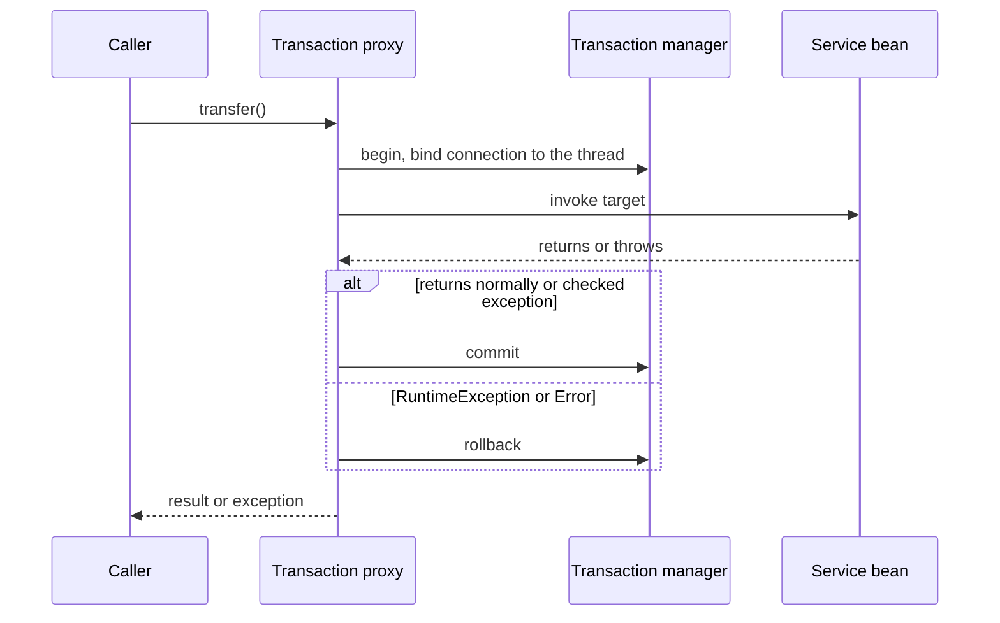

`@Transactional` is the most questioned annotation in Spring interviews and the source of subtle production bugs: *what does it do, what are the propagation types, when does it roll back, why did my transaction not start, what is `UnexpectedRollbackException`, what is the difference between `REQUIRED` and `REQUIRES_NEW`?* This lesson goes deeper than the introduction in [ACID and BASE](lesson:acid-base#transactional), builds on [AOP and proxies](lesson:spring-aop) (the mechanism) and [Spring Data JPA](lesson:spring-data-jpa) (the persistence context), and leads into the [Saga pattern](lesson:saga) for transactions across services. Play the three scenes: propagation, rollback rules, and publishing after commit.

```demo
name: spring-tx-walk
```

> **One sentence to remember:** *`@Transactional` is a proxy that begins a transaction on entry and commits on normal return or rolls back on an unchecked exception, so check the call goes through the proxy, the exception actually leaves the method, and the propagation does what you think.*

## How it works {#how}

### The pieces {#pieces}

| Piece | Role |
| --- | --- |
| `@Transactional` | declares the boundary and its attributes |
| **Transaction proxy** (AOP advice) | begins, commits or rolls back around the call |
| `PlatformTransactionManager` | strategy interface: `DataSourceTransactionManager` (JDBC), `JpaTransactionManager` (JPA, Boot's choice with Data JPA), `JtaTransactionManager` (XA) |
| `TransactionSynchronizationManager` | binds the connection or `EntityManager` to the **current thread** so all repository calls share the transaction |
| Connection pool (HikariCP) | the connection is checked out at the start and held until commit or rollback |



Boot auto-configures the transaction manager and enables `@Transactional` processing (`@EnableTransactionManagement` is implicit). Annotate **service-layer** methods: one transaction per business use case. Annotate the **class** to apply to all its public methods, a method annotation overrides it.

### Attributes {#attributes}

```java
@Transactional(
    propagation = Propagation.REQUIRED,        // default
    isolation = Isolation.DEFAULT,             // database default (PostgreSQL: read committed)
    timeout = 5,                               // seconds
    readOnly = false,
    rollbackFor = Exception.class,             // also roll back on checked exceptions
    noRollbackFor = ValidationWarning.class,
    transactionManager = "ledgerTx")           // which manager when there are several
```

`isolation` is passed to the database for **new** transactions only (see [isolation levels](lesson:acid-base#levels)); a joined transaction keeps its own. `timeout` also applies only when a transaction is started. `readOnly` is a hint: Hibernate skips dirty checking and sets flush mode to manual, and drivers may route to a replica.

## Propagation {#propagation}

What happens when a transactional method is called while a transaction already exists:

| Propagation | Behaviour |
| --- | --- |
| **REQUIRED** (default) | join the existing transaction, else start a new one |
| **REQUIRES_NEW** | suspend the existing one and start a new **independent** one (separate connection, commits or rolls back on its own) |
| **NESTED** | run inside the existing one with a **savepoint**: can roll back just the inner part; if none exists, behaves like REQUIRED (JDBC only, not JPA with Hibernate on most setups) |
| **SUPPORTS** | join if there is one, else run without |
| **NOT_SUPPORTED** | suspend any transaction and run without one |
| **MANDATORY** | must run inside an existing transaction, else exception |
| **NEVER** | must run without a transaction, else exception |

Typical uses: `REQUIRED` almost everywhere; `REQUIRES_NEW` for **audit logs and failure records** that must persist even if the caller rolls back, or to isolate a unit that should commit independently; `NOT_SUPPORTED` for long reads or calls that should not hold a transaction; `MANDATORY` on repository-like helpers that must never run outside a service transaction.

**Rollback-only and joined transactions:** with `REQUIRED` there is **one physical transaction**. If an inner method (joined) throws a `RuntimeException`, the proxy marks the shared transaction **rollback-only**, even if the outer method catches the exception. When the outer method then tries to commit, Spring throws **`UnexpectedRollbackException`** and rolls back. Catching an exception from a joined call does not save the transaction; use `REQUIRES_NEW` or `NESTED` if the inner work may fail independently.

## Rollback rules {#rollback}

- **Default:** roll back on **unchecked** exceptions (`RuntimeException`, `Error`); **commit** on checked exceptions. This differs from EJB semantics and surprises many people.
- `rollbackFor = Exception.class` (or specific types) includes checked exceptions; `noRollbackFor` excludes some.
- **Swallowed exceptions** commit: the proxy only sees what leaves the method.
- **Programmatic marking:** `TransactionAspectSupport.currentTransactionStatus().setRollbackOnly()`.
- An exception thrown **in the commit itself** (constraint violation at flush, deferred constraints) surfaces after your method returns, at the proxy.

### Why it sometimes does not start {#not-starting}

| Cause | Fix |
| --- | --- |
| self-invocation (`this.other()`) | call through another bean ([AOP](lesson:spring-aop#self-invocation)) |
| `private`, `final` or `static` method, or non-bean object | public method on a Spring-managed bean |
| annotation on the interface with a CGLIB proxy, in old versions | annotate the class |
| `@Async` or a new thread started inside | the transaction is thread-bound; start it in the thread |
| wrong `@Transactional` import (`javax` or `jakarta.transaction` works but fewer attributes) | use `org.springframework.transaction.annotation.Transactional` |
| exception caught inside | rethrow or mark rollback-only |
| multiple transaction managers | name one with `transactionManager` |

## Programmatic transactions {#programmatic}

For finer control (a transaction around part of a method, or many short transactions in a loop) use `TransactionTemplate`:

```java
@Service
class BatchService {
    private final TransactionTemplate tx;
    BatchService(PlatformTransactionManager tm) {
        this.tx = new TransactionTemplate(tm);
        this.tx.setPropagationBehavior(TransactionDefinition.PROPAGATION_REQUIRES_NEW);
    }

    void importAll(List<Row> rows) {
        for (List<Row> chunk : Lists.partition(rows, 500)) {
            tx.executeWithoutResult(status -> repository.saveAll(map(chunk)));   // commit per chunk, one bad chunk does not undo the rest
        }
    }
}
```

It avoids the proxy limitations (no self-invocation problem) and the transaction scope is explicit in code.

## Events, commit and consistency {#events}

Publishing a message or event **inside** a transaction is risky: consumers may run before the data is committed, and a later rollback leaves a message about something that never happened. Options:

1. `@TransactionalEventListener(phase = AFTER_COMMIT)` handles an `ApplicationEvent` only after a successful commit (and by default only if a transaction exists). Phases: `BEFORE_COMMIT`, `AFTER_COMMIT`, `AFTER_ROLLBACK`, `AFTER_COMPLETION`. Work done in an `AFTER_COMMIT` listener runs **outside** the transaction (a new one needs `REQUIRES_NEW`).
2. `TransactionSynchronizationManager.registerSynchronization(...)` with `afterCommit()`.
3. The **transactional outbox**: write the event to an outbox table in the same transaction and publish it from there, for guaranteed delivery ([outbox](lesson:microservice-patterns#outbox), [messaging](lesson:messaging)). AFTER_COMMIT alone can lose the message if the process crashes between commit and send.

## Design guidance {#design}

- **Keep transactions short:** they hold a pooled connection and database locks. No remote calls, file I/O, `Thread.sleep` or user interaction inside. A slow downstream call inside a transaction exhausts the pool (`HikariPool: Connection is not available`).
- **Transaction per use case at the service layer,** not per repository call and not in controllers.
- **Read-only methods:** `readOnly = true` on query services.
- **Large reads:** stream or page, avoid loading everything inside one transaction; consider `NOT_SUPPORTED` for long reports.
- **Concurrency:** pair with optimistic or pessimistic locking and retries ([lost updates](lesson:acid-base#lost-update)); keep the retry **outside** the transaction.
- **Across services** a local transaction cannot span them: use [sagas](lesson:saga), idempotency and the outbox, not distributed (XA) transactions.
- **Tests:** `@Transactional` on a test rolls back after each test, which can hide flush problems (nothing is flushed) and differs from production; use `@Commit`, call `flush()` and `clear()`, or test the transaction boundary with the real service call.

## Cheat sheet {#cheatsheet}

| Topic | Key point |
| --- | --- |
| Mechanism | AOP proxy plus `PlatformTransactionManager`, bound to the thread |
| Default rollback | unchecked exceptions and errors; checked commit |
| `rollbackFor` | include checked exceptions: `rollbackFor = Exception.class` |
| `REQUIRED` | join or create (default); one physical transaction |
| `REQUIRES_NEW` | independent transaction on a new connection; suspends the outer |
| `NESTED` | savepoint inside the outer transaction |
| Rollback-only | an inner exception dooms a joined transaction: `UnexpectedRollbackException` |
| `readOnly` | hint; skips dirty checking, no real enforcement |
| Self-invocation, private | no proxy, no transaction |
| After-commit work | `@TransactionalEventListener(AFTER_COMMIT)` or outbox |
| Keep short | no remote calls inside; pool and lock contention |
| Programmatic | `TransactionTemplate` for partial scopes and loops |

## Interview questions {#questions}

### [basic] How does @Transactional work? {#how-q}

Spring wraps the bean in an AOP proxy. On a call the proxy asks the `PlatformTransactionManager` to begin a transaction (acquiring a connection and binding it to the thread), invokes the method, then commits on normal return or rolls back on an unchecked exception. The method body has no transaction code. It works only for calls that go through the proxy.

### [basic] When does a transaction roll back by default? {#rollback-q}

On `RuntimeException` and `Error`. Checked exceptions do not trigger a rollback; the transaction commits. Use `rollbackFor = Exception.class` to roll back on checked exceptions too, or make domain exceptions unchecked.

### [basic] What is the default propagation and what does it mean? {#required-q}

`REQUIRED`: if a transaction exists, the method joins it; otherwise a new one is started. A chain of `REQUIRED` methods shares one physical transaction, so they commit or roll back together.

### [basic] Why is my @Transactional method not transactional? {#not-working-q}

Common causes: self-invocation (called via `this` inside the same class), a `private`, `final` or `static` method, the object is not a Spring bean, an exception is swallowed so the proxy sees a normal return, a checked exception with default rollback rules, a new thread (the transaction is thread-bound), or a wrong annotation import.

### [basic] What does readOnly = true do? {#readonly-q}

It is a hint that the transaction will not write: Hibernate skips dirty checking and flush, and the driver or database may optimise or route to a read replica. It does not reliably prevent writes on every database. Use it on query methods for efficiency and intent.

### [intermediate] Explain the propagation types. {#propagation-q}

`REQUIRED` joins or creates; `REQUIRES_NEW` suspends the current transaction and starts an independent one; `NESTED` uses a savepoint inside the current transaction; `SUPPORTS` joins if present else runs non-transactionally; `NOT_SUPPORTED` suspends and runs without one; `MANDATORY` requires an existing one; `NEVER` requires none. Most code uses `REQUIRED`; `REQUIRES_NEW` for audit or failure logs that must persist independently.

### [intermediate] What is the difference between REQUIRES_NEW and NESTED? {#new-vs-nested-q}

`REQUIRES_NEW` creates a separate physical transaction on its own connection that commits or rolls back independently of the outer one (the outer is suspended). `NESTED` stays in the same physical transaction and uses a savepoint, so an inner failure can be rolled back to the savepoint, but the inner work is committed or rolled back with the outer one. NESTED needs JDBC savepoint support and is not generally available with JPA.

### [intermediate] What is UnexpectedRollbackException? {#unexpected-q}

Thrown when a transaction that was marked rollback-only (because a joined `REQUIRED` method threw a `RuntimeException`) reaches commit. It happens when the outer method catches the inner exception and continues, thinking it recovered. Fix by letting the exception propagate, or run the risky part with `REQUIRES_NEW` or `NESTED`.

### [intermediate] What happens if a REQUIRES_NEW method is called many times in a loop? {#new-cost-q}

Each call suspends the outer transaction and takes another connection from the pool, so the thread holds two connections at once; under load this can exhaust the pool and deadlock (all threads wait for a second connection while holding the first). Use it sparingly, and size the pool or restructure (commit chunks with `TransactionTemplate` instead).

### [intermediate] Where should @Transactional be placed? {#placement-q}

On public methods of service-layer beans (one transaction per business use case), on the class or the method; not on controllers, not on private methods, and preferably on the concrete class rather than the interface. Repositories already have their own transactional defaults, and the service transaction makes several repository calls atomic.

### [intermediate] How do you run code only after the transaction commits? {#aftercommit-q}

`@TransactionalEventListener(phase = AFTER_COMMIT)` on a listener for an `ApplicationEvent`, or register a `TransactionSynchronization` with `afterCommit()`. The code runs outside the transaction (use `REQUIRES_NEW` if it must write). For reliable delivery to other systems use the transactional outbox because a crash after commit can lose an AFTER_COMMIT action.

### [intermediate] Why shouldn't you call a remote service inside a transaction? {#remote-q}

The transaction holds a database connection and locks for the whole call. A slow or hung downstream service keeps them, exhausting the connection pool and blocking other transactions. If the remote call fails after local changes the data is inconsistent unless you design compensation. Do the remote call outside the transaction or use events, an outbox and sagas.

### [intermediate] How do transactions behave with @Async or new threads? {#async-q}

The transaction and its connection are bound to the calling thread, so a method run on another thread (`@Async`, an executor, parallel streams) is outside it. The async method starts its own transaction if annotated, and the caller cannot roll it back. Pass data, not entities from the closed context, to the other thread.

### [deep] How does Spring bind a transaction to a thread? {#thread-q}

`TransactionSynchronizationManager` keeps `ThreadLocal` resources keyed by the `DataSource` or `EntityManagerFactory`. When the transaction begins the manager stores the connection or `EntityManager` there; `JdbcTemplate` and Spring Data repositories look it up instead of opening their own, so all calls on the thread share one transaction. It is removed on completion.

### [deep] Does a transaction guarantee consistency across two databases? {#xa-q}

A single `@Transactional` with one transaction manager covers one resource. Two data sources need two managers (`@Transactional("name")`), so they are two independent transactions: one can commit and the other fail. Options: JTA with XA two-phase commit (heavy, blocking, rarely used), best-effort ordering with compensation, or the saga and outbox patterns ([2PC](lesson:distributed-systems#two-pc)).

### [deep] Why can an exception appear after your method has returned successfully? {#commit-failure-q}

Hibernate defers SQL until flush, which normally happens at commit, after the proxy has regained control. A constraint violation, optimistic lock failure or serialization failure therefore surfaces when the proxy commits, thrown to the caller outside your method's try/catch. Call `flush()` inside the method if you need to handle it there, or handle it at the service boundary.

### [coding] Fix the two transaction bugs in this service. {#coding-bugs}

```java
@Service
class TransferService {
    @Transactional
    public void transfer(long from, long to, BigDecimal amount) throws BankException {
        debit(from, amount);
        try {
            credit(to, amount);               // throws a RuntimeException on failure
        } catch (Exception e) {
            log.warn("credit failed", e);     // swallowed: transaction will commit the debit
        }
        recordAudit(from, to, amount);        // self-invocation: REQUIRES_NEW ignored
    }

    @Transactional(propagation = Propagation.REQUIRES_NEW)
    public void recordAudit(long from, long to, BigDecimal amount) { ... }
}
```

```java
@Service
class TransferService {
    private final AuditService audit;
    TransferService(AuditService audit) { this.audit = audit; }

    @Transactional(rollbackFor = Exception.class)
    public void transfer(long from, long to, BigDecimal amount) throws BankException {
        debit(from, amount);
        credit(to, amount);                   // let it propagate: everything rolls back
        audit.record(from, to, amount);       // another bean: goes through the proxy
    }
}

@Service
class AuditService {
    @Transactional(propagation = Propagation.REQUIRES_NEW)
    public void record(long from, long to, BigDecimal amount) { ... }
}
```

Explain that swallowing the exception committed a debit with no credit, that the self-call skipped the proxy, that `rollbackFor` covers the checked `BankException`, and that audit now commits independently (and note it would not record a failed transfer unless called in a `catch` or finally path).

### [coding] Commit in chunks so one bad batch does not undo everything. {#coding-chunks}

```java
@Service
class ImportService {
    private final TransactionTemplate tx;
    private final RowRepository rows;

    ImportService(PlatformTransactionManager tm, RowRepository rows) {
        this.tx = new TransactionTemplate(tm);
        this.tx.setPropagationBehavior(TransactionDefinition.PROPAGATION_REQUIRES_NEW);
        this.rows = rows;
    }

    ImportResult run(List<Row> all) {
        int ok = 0, failed = 0;
        for (List<Row> chunk : Lists.partition(all, 500)) {
            try {
                tx.executeWithoutResult(s -> rows.saveAll(chunk));
                ok += chunk.size();
            } catch (DataAccessException e) {
                failed += chunk.size();           // log and continue with the next chunk
            }
        }
        return new ImportResult(ok, failed);
    }
}
```

Explain that each chunk is its own short transaction (limits lock time and memory), the loop is outside any transaction, and `TransactionTemplate` avoids self-invocation problems.

### [coding] Send a notification only after the transfer commits. {#coding-after-commit}

```java
record TransferCompleted(long id, BigDecimal amount) {}

@Service
class TransferService {
    private final ApplicationEventPublisher events;
    @Transactional
    public void transfer(...) {
        // update balances, save the transfer
        events.publishEvent(new TransferCompleted(id, amount));       // not delivered to the listener yet
    }
}

@Component
class NotificationListener {
    @TransactionalEventListener(phase = TransactionPhase.AFTER_COMMIT)
    void on(TransferCompleted e) { notifier.send(e); }                // runs only if the transaction committed
}
```

Explain that on rollback the listener never runs, that the listener executes outside the transaction (use `REQUIRES_NEW` if it must write), and that for guaranteed delivery the outbox pattern replaces it.
