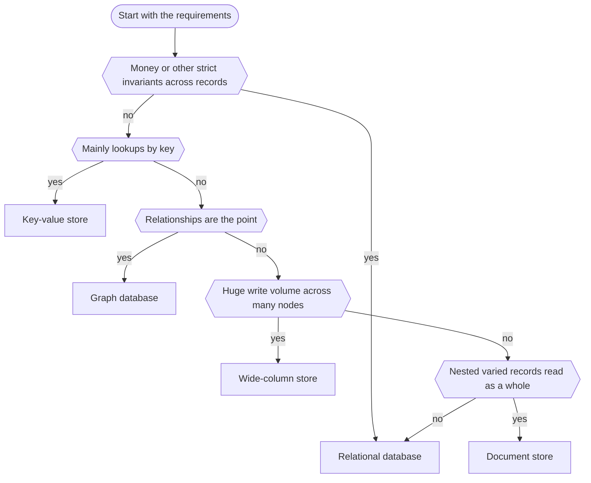

"SQL or NoSQL?" comes up in almost every interview. The weak answer is "SQL is for structured data and NoSQL is for big data". A good answer talks about four things:

- **Access patterns:** how the data is read and written.
- **Consistency needs:** how up to date every read must be.
- **Data shape:** fixed and related, or varied and nested.
- **Scale:** how much data and traffic there is.

A good answer also admits that most systems start with a relational database.

This lesson builds on [ACID and BASE](lesson:acid-base) (what transactions guarantee) and [distributed systems fundamentals](lesson:distributed-systems) (sharding, replication and CAP).

The animation has three scenes: the data model, scaling, and choosing a store.

```demo
name: sqlnosql-walk
```

> **One sentence to remember:** *SQL stores data by its relationships so you can ask any question later, and NoSQL stores data the way you read it so it scales more easily.*

## Relational (SQL) databases {#sql}

### The relational model {#model}

A relational database keeps data in **tables** made of rows and columns. Every table has a fixed **schema**: the list of columns and their types.

- Each row is identified by a **primary key**.
- Tables are linked by **foreign keys**: a column that holds the primary key of a row in another table.
- You query the data with **SQL**. SQL is declarative: you say *what* you want, and the query optimizer decides *how* to get it.

Examples are PostgreSQL, MySQL, Oracle and SQL Server.

What a relational database gives you:

- **[Normalisation](lesson:normalization)** stores each fact once. For example, the customer, the address and the phone number go in separate tables. This removes duplicate data and the errors that come from updating only some copies. A **join** puts the data back together when you query it.
- **Constraints** (primary key, foreign key, unique, not null and check) let the database itself keep the data valid.
- **Indexes**, usually B-trees, make lookups and range scans fast. The cost is slower writes and more disk space.
- **ACID transactions** can change many rows in many tables as one unit ([ACID and BASE](lesson:acid-base#acid)).
- **Ad hoc queries** work: you can add any new filter, join or total later without changing how the data is stored.

### Strengths and limits {#sql-trade}

| Strengths | Limits |
| --- | --- |
| It gives strong consistency and transactions across many rows. | Changing the schema of a huge table (a migration) needs care. |
| Queries are powerful, with joins, totals and window functions. | Joins and transactions across nodes get expensive once the data is split across servers. |
| The tools are mature, the language is standard and many people know it. | Scaling writes beyond one main server is hard. |
| The database enforces integrity with foreign keys and constraints. | Objects in code do not map neatly to tables (the "ORM impedance mismatch"). |
| It is flexible, because new questions need no remodelling. | The fixed schema is awkward for very varied or deeply nested data. |

Modern relational databases are not rigid. PostgreSQL has **JSONB** columns that can be indexed, plus full-text search and partitioning. MySQL has JSON types too. A relational database with a JSON column covers many "flexible schema" needs.

## NoSQL databases {#nosql}

"NoSQL" means "not only SQL". It is not one technology. It is several families, grouped by how they model data.

Most NoSQL stores share these traits:

- The schema is flexible, or there is none.
- The data model is shaped for one particular way of reading the data.
- They are built to **scale horizontally**, which means adding more machines.
- Consistency is often relaxed, and transactions and joins are often limited.

### The four main families {#families}

| Family | How it stores data | Good at | Examples | Watch out for |
| --- | --- | --- | --- | --- |
| **Key-value** | Each key points to a value that the database does not look inside. | Very fast lookups, caching, sessions, counters and rate limits. | Redis, DynamoDB, Memcached | You can only read by key. There are no rich queries. |
| **Document** | Each key points to a JSON-like document, and fields inside it can be indexed. | Nested, varied records that are read as a whole, such as profiles, catalogs and content. | MongoDB, Couchbase, Firestore | Data gets duplicated, joins are weak, and copies must be kept in sync. |
| **Wide-column** | Rows are grouped by a partition key, and each row holds sorted columns. | Huge write volumes, time series and query patterns known in advance. | Cassandra, HBase, ScyllaDB | You must design one table per query, and ad hoc queries are limited. |
| **Graph** | Data is stored as nodes and the relationships between them. | Highly connected data, such as fraud rings, recommendations and social links. | Neo4j, Amazon Neptune | It is a poor fit for bulk analytics and harder to spread across machines. |

Other specialised stores sit beside these four:

- **Search engines**, such as Elasticsearch and OpenSearch, use an inverted index (a map from each word to the documents that contain it) and rank results by relevance.
- **Time-series databases**, such as InfluxDB and TimescaleDB, store values over time.
- **Column stores and data warehouses**, such as BigQuery, Redshift and ClickHouse, run analytics over huge tables.
- **Vector databases** store vectors for similarity search.

### Newer in-betweens {#newsql}

- **NewSQL, or distributed SQL** (Google Spanner, CockroachDB, YugabyteDB, TiDB), gives you SQL and ACID transactions and also scales across machines. The nodes agree on each write using consensus ([Raft](lesson:distributed-systems#raft)), so writes take longer.
- **NoSQL with transactions** also exists: MongoDB multi-document transactions, DynamoDB transactions and Cassandra lightweight transactions. The line between the two camps keeps blurring.

## Comparison {#compare}

| | SQL (relational) | NoSQL |
| --- | --- | --- |
| Data model | Tables, rows and relations. | Key-value, document, wide-column or graph. |
| Schema | Fixed, and the database checks it on every write ("schema on write"). | Flexible, and the application usually checks it when reading ("schema on read"). |
| What drives the design | The data and its relationships, so you normalise. | The queries, so you denormalise and embed. |
| Queries | Rich ad hoc queries, with joins and totals. | By key or by index, with limited joins and totals. |
| Transactions | ACID across many rows is standard. | Often one item at a time, and some stores support several items. |
| Consistency | Strong by default. | Often tunable, or eventual ([BASE](lesson:acid-base#base)). |
| Scaling | A bigger machine and read replicas first, and sharding is harder. | Built to scale out, with sharding and replication included. |
| Integrity | Foreign keys and constraints live in the database. | The application must keep the data valid. |
| Best fit | Money, orders, inventory, reporting and related data. | Huge scale, flexible shapes, low latency and simple access patterns. |

This table shows tendencies, not laws. The label tells you the data model and the usual trade-offs, but always check the specific product and how it is configured.

## Data modelling {#modelling}

### Normalise or embed {#embed}

**Relational: model the data first, then query it.** You normalise to third normal form, add indexes for the queries you have, and join tables when needed. New questions are cheap to add later.

**NoSQL: model the queries first, then store the data.** You list the access patterns first, for example "get a customer with their addresses" or "the latest 20 transactions of an account". Then you shape the data so each pattern is **one read** from **one partition**. That means **denormalising**: copying data to the place where it is read.

In a document database, the central choice is **embed or reference**. Embedding puts the related data inside the parent document. Referencing stores only an id and looks the data up separately.

| Embed (nested in the document) | Reference (store an id, look it up separately) |
| --- | --- |
| Use it for data that is read together and owned by the parent, such as a customer's addresses. | Use it for data shared by many documents, or data that changes on its own. |
| One read gets everything, and one document updates atomically. | It needs an extra lookup, or a join written in the application. |
| The size must stay bounded, because documents have a size limit (16 MB in MongoDB). | It suits lists that have no limit or grow fast, such as all the transactions of an account. |
| Copies go stale when the source changes. | There is a single source of truth. |

Wide-column stores and DynamoDB go further. For each query you pick two keys:

- The **partition key** spreads the load across machines and groups rows that are read together.
- The **sort key** orders the rows inside one partition.

You accept **one table per access pattern**, with the same data stored several times. A bad partition key sends too much traffic to one place, which is called a **hot partition**.

### Schema flexibility is a trade, not a free gift {#schema}

"Schemaless" really means the schema lives in the **application**. Old and new document shapes exist side by side, so the code must handle every version. No database constraint stops a bad value.

Teams fix this with schema validation (MongoDB JSON schema) or with version numbers in the documents. In SQL, the same change is an explicit migration that people can review.

## Scaling {#scaling}

There are four steps, from simplest to hardest:

1. **Scale up** by moving to a bigger machine. This is the simplest step and keeps joins and transactions working. But there is a limit to how big one machine can be, and that machine is a single point of failure.
2. **Add read replicas.** Replicas are copies that serve reads and can take over if the main server fails. They lag a little behind the main server, which is called replication lag ([replication](lesson:distributed-systems#replication)).
3. **Partition on one node.** You split a huge table by range or by hash, so it is easier to manage.
4. **Shard.** You split the data across several machines by a **shard key** ([sharding](lesson:distributed-systems#sharding), [consistent hashing](lesson:distributed-systems#consistent-hashing)). This scales writes and data size. The costs are that joins and transactions across shards become hard, moving data between shards (rebalancing) is work, and a poor key creates hot spots.

Relational databases *can* shard, using Vitess for MySQL, Citus for PostgreSQL, or sharding in the application. But sharding is added on top. NoSQL stores shard natively, because their model makes it easy: data is read by key, and there are no joins across items.

So the real scaling argument for NoSQL is not "SQL cannot scale". Stack Overflow-sized workloads run on one main server. The real argument is that scaling writes beyond one machine is cheaper when the model avoids joins and distributed transactions.

## Consistency and transactions {#consistency}

- **Relational databases** give ACID transactions and strong consistency on a single node. Replicas are usually updated asynchronously, so a read from a replica can be stale.
- **NoSQL databases** often give **tunable consistency**. In Cassandra and DynamoDB, each request chooses how many replicas must answer. Asking enough replicas gives strong reads (a [quorum](lesson:distributed-systems#quorums), where R + W > N). Asking fewer gives lower latency but only eventual consistency. This is the [CAP/PACELC](lesson:distributed-systems#pacelc) trade, made per query.
- **Atomicity is often per item or per partition.** A single MongoDB document or DynamoDB item updates atomically. To change several of them together, you need one of these:
  - an explicit multi-document transaction, where the store supports it;
  - a design where one aggregate (a group of data that changes together) is one document;
  - a [saga](lesson:saga), which is a chain of local steps with undo steps.
- **Integrity moves into the application.** With no foreign keys, the application prevents orphan data and duplicates through its own logic, idempotency (repeating an operation has no extra effect) and reconciliation (jobs that compare and repair data).

## Indexing and storage engines {#indexes}

The storage engine decides how data is laid out on disk. The two common designs are B-trees and LSM trees. An LSM tree (log-structured merge tree) collects writes in memory and writes them to disk as sorted files.

| | B-tree (PostgreSQL, MySQL InnoDB, Oracle) | LSM tree (Cassandra, RocksDB, HBase) |
| --- | --- | --- |
| Writes | It updates pages in place, which means random disk access, protected by a write-ahead log. | It adds writes to an in-memory table (the memtable), then writes sorted files that never change, which means sequential disk access. **Compaction** merges the files later. |
| Reads | Point and range reads are fast, with one tree lookup. | A read may check several files. Bloom filters help skip files, but reads are usually slower. |
| Strength | Read performance is balanced and predictable. | Write throughput is very high. |
| Cost | Updating pages causes write amplification (more bytes written than changed). | Reads and disk space are amplified, and compaction costs work. |

Indexes speed up reads and slow down writes in every database. Add them for real query patterns, not for every column.

In SQL, three tips:

- Check the query plan with `EXPLAIN`.
- A composite index (an index on several columns) helps only when its column order matches the query.
- A function on an indexed column, such as `WHERE lower(name) = ...`, can stop the index from being used.

## Choosing {#choosing}



A practical way to decide is to ask five questions:

1. **Access patterns.** How is the data read and written?
   - Ad hoc queries over related data point to SQL.
   - Reads by key point to a key-value store.
   - Whole nested records point to a document store.
   - A huge volume of new rows points to a wide-column store.
   - Following links between items points to a graph database.
2. **Consistency needs.** Hard rules and transactions across records point to SQL. If stale reads are acceptable, the other options open up.
3. **Scale and distribution.** One main server with replicas is enough far more often than people expect. Writes in several regions, or a huge volume, push you towards sharded or distributed stores.
4. **Data shape.** Is it fixed and related, or varied and nested?
5. **Team and operations.** Think about skills, tooling, managed cloud offerings and the cost of running several stores.

**Default to a relational database**, and add something else only when a real need appears. In a bank, the ledger and the accounts stay relational (or in distributed SQL). Caches, sessions, search and analytics use specialised stores that are fed from it.

### Polyglot persistence {#polyglot}

**Polyglot persistence** means using a different store for each need. For example:

- a relational database for payments;
- Redis for sessions and caching;
- a document store for profiles;
- Elasticsearch for search;
- a data warehouse for analytics.

Each need gets a good fit, but there is more to run. Keeping the copies consistent also becomes your design problem. The usual tools are events, the [outbox](lesson:microservice-patterns#outbox), [CQRS](lesson:microservice-patterns#cqrs) read models and reconciliation. Polyglot persistence fits naturally with [database per service](lesson:microservice-patterns#db-per-service).

## In Java and Spring {#spring}

```java
// relational: JPA entity with a relationship, joined or lazily loaded
@Entity
class Customer {
    @Id @GeneratedValue Long id;
    String name;

    @OneToMany(mappedBy = "customer", cascade = CascadeType.ALL, orphanRemoval = true)
    List<Address> addresses = new ArrayList<>();
}

interface CustomerRepository extends JpaRepository<Customer, Long> {
    @Query("select c from Customer c join fetch c.addresses where c.id = :id")   // one query, avoids N+1
    Optional<Customer> findWithAddresses(@Param("id") Long id);
}
```

```java
// document: the aggregate is one document, addresses embedded
@Document("customers")
record CustomerDoc(@Id String id, String name, List<AddressDoc> addresses) {}

interface CustomerDocRepository extends MongoRepository<CustomerDoc, String> {
    List<CustomerDoc> findByAddressesCity(String city);     // needs an index on addresses.city
}
```

```java
// key-value cache in front of the database (Spring cache abstraction with Redis)
@Cacheable(cacheNames = "customer", key = "#id")
public CustomerView find(long id) { return mapper.toView(repository.findById(id).orElseThrow()); }

@CacheEvict(cacheNames = "customer", key = "#id")
public void update(long id, UpdateCustomer cmd) { ... }
```

Spring Data gives every store the same repository style: `JpaRepository`, `MongoRepository`, `CassandraRepository` and `RedisTemplate`. But the data models are different, so the shared style does not make the stores interchangeable.

In the relational case, watch for the usual ORM traps:

- **N+1 queries**: loading a list with one query, then running one more query per item. Fix it with `join fetch` or an entity graph.
- Eager loading of data you do not need.
- Large transactions.

Try it in the lab: [The same data in SQL and in a document store](lab:sql-vs-nosql-modeling).

## Cheat sheet {#cheatsheet}

| Topic | Key point |
| --- | --- |
| SQL | Tables, joins, constraints, ACID, ad hoc queries and strong consistency. |
| NoSQL | Key-value, document, wide-column and graph stores, shaped by the queries, built to scale out, often with tunable consistency. |
| Modelling | In SQL, model the data and then query it. In NoSQL, model the queries and then the data (denormalise and embed). |
| Embed vs reference | Embed what is read together and stays small. Reference data that is shared or keeps growing. |
| Scaling | Scale up, add replicas, then shard. NoSQL shards natively, and SQL needs extra tools. |
| Transactions | SQL has ACID across many rows. NoSQL is often per item, and some stores support several items. |
| Indexes | B-trees give balanced reads. LSM trees give fast writes and need compaction. |
| NewSQL | SQL that scales across machines using consensus (Spanner, CockroachDB). |
| Choosing | Look at access patterns, consistency, scale, data shape and team. Default to relational. |
| Polyglot | Use one store per need, and own the consistency between them yourself. |

## Interview questions {#questions}

### [basic] What is the difference between SQL and NoSQL databases? {#difference-q}

They store and query data in different ways.

- **SQL databases are relational.** They have a fixed schema, tables linked by keys, joins, SQL queries and ACID transactions with strong consistency.
- **NoSQL is a group of non-relational models:** key-value, document, wide-column and graph. They have flexible schemas and models shaped around how the data is read. They scale across machines by design, and often relax consistency or limit joins and transactions.

The right choice depends on access patterns, consistency needs, data shape and scale.

### [basic] What are the types of NoSQL databases? {#types-q}

There are four main types:

1. **Key-value** (Redis, DynamoDB) for lookups by key, caching and sessions.
2. **Document** (MongoDB) for JSON-like documents that hold nested, varied records.
3. **Wide-column** (Cassandra, HBase) for partitioned rows with sorted columns, built for huge write volumes and known queries.
4. **Graph** (Neo4j) for nodes and relationships in connected data.

Search engines, time-series databases and column-store analytics databases are related specialised stores.

### [basic] When would you choose SQL? {#choose-sql-q}

Choose SQL when correctness and flexible queries matter most:

- The data is structured and related.
- You need transactions across many rows and strong consistency, as for payments, accounts, orders and inventory.
- You want ad hoc queries, joins and reports.
- You want the database to enforce integrity with constraints.

It is also the right default when the requirements are unclear, because one relational database with replicas handles most workloads.

### [basic] When would you choose NoSQL? {#choose-nosql-q}

Choose NoSQL when the workload fits one of its models:

- The access pattern is simple and known, such as by key or by partition.
- The data is varied or nested and read as a whole.
- The write volume or data size is more than one machine can handle.
- Latency must be very low, as for a cache or sessions.
- The data is naturally a graph, a time series or a search index.

Accept the costs: weaker joins, denormalised data, and integrity and consistency handled in the application.

### [basic] What is normalisation and why do NoSQL stores often denormalise? {#normalise-q}

**Normalisation** stores each fact once, in related tables. This avoids duplicate data and update errors, and joins put the data back together.

NoSQL stores often have no joins, or joins across partitions are expensive. So they **denormalise**: they copy or embed data so that one query is a single read from one partition.

The trade is faster reads and simpler scaling, in exchange for duplicate data that must be kept in sync.

### [basic] Does NoSQL mean no schema? {#schema-q}

**No.** The schema moves from the database into the application. This is called "schema on read".

Documents can have different shapes, so the code must handle every version. Nothing stops an invalid value unless you add validation.

SQL checks the schema on every write and changes it through explicit migrations.

### [intermediate] How do SQL and NoSQL databases scale differently? {#scale-q}

SQL scales up first, and NoSQL scales out by design.

- **Relational databases** first move to a bigger machine and add read replicas. Scaling writes beyond one main server needs sharding. Sharding is possible (Vitess, Citus), but it makes joins and transactions across shards hard.
- **NoSQL stores** are built to shard and replicate across machines. This works because their model avoids joins and transactions across items.
- **NewSQL databases** (Spanner, CockroachDB) offer SQL that scales across machines using consensus, with slower writes.

### [intermediate] Is it true that SQL cannot scale? {#myth-q}

**No.** A well-tuned relational database handles very large workloads when it has good hardware, indexes, caching and read replicas. Sharded relational systems also run at enormous scale.

The accurate statement is narrower. Scaling **writes and data volume beyond one machine** is simpler when the data model avoids joins and distributed transactions. That is what NoSQL designs enforce.

### [intermediate] Embed or reference in a document database? {#embed-q}

It depends on how the data is read and how big it can grow.

- **Embed** data that is read with its parent, owned by it and limited in size. You get one read and an atomic update.
- **Reference** data that many documents share, that changes on its own, or that can grow without limit, such as all the transactions of an account. You get a single source of truth, but you pay for an extra lookup.

Watch the document size limit, and watch for stale copies of embedded data.

### [intermediate] How does consistency differ between SQL and NoSQL? {#consistency-q}

SQL is strongly consistent by default, and many NoSQL stores let you choose.

- **Relational databases** give strong consistency and ACID across many rows on the main server. Replicas can lag behind.
- **Many NoSQL stores** replicate across machines and offer tunable consistency. Each request chooses how many replicas must answer. More replicas give fresher data, and fewer give lower latency and better availability. Quorum reads and writes, where R + W > N, give strong reads.
- **Atomicity in NoSQL** is often per item or per partition. Some stores (MongoDB, DynamoDB) have transactions across several items, with limits.

### [intermediate] Compare B-tree and LSM-tree storage engines. {#lsm-q}

B-trees are best for predictable reads, and LSM trees are best for heavy writes.

- **B-trees** (PostgreSQL, InnoDB) update pages in place. Read performance is predictable. The costs are write amplification and random disk access.
- **LSM trees** (Cassandra, RocksDB) collect writes in memory and then write sorted files that never change, one after another. A background job merges the files, which is called compaction. Write throughput is very high. But a read may touch several files, which Bloom filters reduce, and compaction costs disk work and space.

### [intermediate] What is polyglot persistence and what does it cost? {#polyglot-q}

It means using a different database for each need. For example: a relational database for transactions, a key-value store for sessions and cache, a document store for flexible profiles, a search engine and a data warehouse.

Each workload gets a good fit. The costs are:

1. More systems to run.
2. More skills the team needs.
3. Keeping the stores consistent, using events, the outbox, CQRS projections and reconciliation.

Add a store only for a proven need.

### [intermediate] How do you choose a shard or partition key? {#shard-key-q}

Pick a key that spreads the load evenly and keeps data that is read together in one partition.

- It needs high cardinality, which means many different values.
- The common queries should hit a single shard.
- Avoid keys that only grow, such as a timestamp, because all new writes go to the last shard.
- Avoid skewed keys, because one very busy account becomes a hot partition.

Start from the access patterns, because changing the key later means resharding all the data.

### [intermediate] What is the N+1 problem and how do you avoid it in JPA? {#n-plus-one-q}

It is one query to load N parent entities, plus one more query for each parent's association, so 1 + N queries in total. It happens when the association is loaded lazily inside a loop.

Avoid it with one of these:

- `join fetch` in the query;
- an entity graph;
- batch fetching with `@BatchSize`;
- a projection that selects exactly the columns you need.

It is the common performance trap of ORMs over relational data.

### [deep] Can a NoSQL database be ACID and a SQL one be eventually consistent? {#blur-q}

**Yes, both.**

- MongoDB, DynamoDB and FoundationDB support ACID transactions across several items.
- Distributed SQL databases give strong consistency across machines.
- A relational database with asynchronous replicas and caches serves stale reads.

The label describes the data model and its defaults, not a fixed guarantee. Check the product's documentation.

### [deep] Design the data model for an account and its transactions in SQL and in a document or wide-column store. {#design-q}

Each store gets a different shape, but money movement always needs atomic, idempotent updates.

- **SQL:** two tables, `account(id, ...)` and `ledger_entry(id, account_id, amount, created_at)`. Add a foreign key and an index on `(account_id, created_at)`. Update the balance and insert the entry in one ACID transaction.
- **Document store:** keep the account in one document. Store its transactions in a separate collection keyed by account id, not embedded, because the list has no limit.
- **Wide-column store:** use `account_id` as the partition key and `created_at` descending as the clustering (sort) key. Then the latest entries of an account are one contiguous read. Limit the partition size by splitting it into buckets, one per month.

### [deep] How would you migrate a large relational table to a different store without downtime? {#migration-q}

Run the old and new stores side by side, and move over in small, reversible steps:

1. Fill the new store from a snapshot of the old one (the backfill).
2. Copy ongoing changes, using change data capture or dual writes through the outbox.
3. Check that the two stores match by comparing them.
4. Move reads over gradually: first shadow reads, then a growing percentage.
5. Switch the writes.
6. Keep the old store until you are confident you will not need to roll back.

Make every step of the migration idempotent, and make consumers tolerate duplicates.

### [coding] Write SQL to list each customer's total of transfers above 1000 in the last 30 days (customers with at least three), highest first. {#coding-sql}

```sql
SELECT c.id, c.name, SUM(t.amount) AS total
FROM customer c
JOIN account a  ON a.customer_id = c.id
JOIN transfer t ON t.from_account_id = a.id
WHERE t.created_at >= now() - interval '30 days'
  AND t.amount > 1000
GROUP BY c.id, c.name
HAVING COUNT(*) >= 3
ORDER BY total DESC
LIMIT 20;
```

How it works:

- The joins link each customer to their accounts, and each account to its transfers.
- `WHERE` filters the rows before they are grouped.
- `HAVING` filters the groups. Here it keeps customers with at least three large transfers.
- An index on `transfer(from_account_id, created_at)` supports the query.

In a key-value or document store, this ad hoc total would need totals calculated in advance, or a separate analytics store.

### [coding] Model a customer with addresses as a MongoDB document in Spring Data and query by city. {#coding-mongo}

```java
@Document("customers")
@CompoundIndex(def = "{'addresses.city': 1}")     // otherwise the city query scans the whole collection
class Customer {
    @Id String id;
    String name;
    List<Address> addresses = new ArrayList<>();
    record Address(String type, String city, String postalCode) {}
}

interface CustomerRepository extends MongoRepository<Customer, String> {
    List<Customer> findByAddressesCity(String city);
}
```

How it works:

- The addresses are embedded, because they are read with the customer and their number is small.
- The nested field `addresses.city` needs an index, or the query scans every document.
- In SQL, the same data would be two tables joined by `customer_id`.

### [coding] Fix the N+1 problem in this code. {#coding-n-plus-one}

```java
List<Customer> customers = customerRepository.findAll();
for (Customer c : customers) {
    System.out.println(c.getName() + " " + c.getAddresses().size());   // lazy load: one query per customer
}
```

```java
@Query("select distinct c from Customer c left join fetch c.addresses")
List<Customer> findAllWithAddresses();                                   // one query with a join

// or load in batches: @BatchSize(size = 50) on the collection, or select only what you need with a DTO projection
```

What changed:

- The loop caused 1 + N queries: one for the customers, then one per customer for the addresses.
- `join fetch` loads the addresses in the same query.

The trade-offs: a join repeats the parent row once for each child, and paging does not work well with fetch joins on collections. For large pages, prefer batch fetching or a projection.
