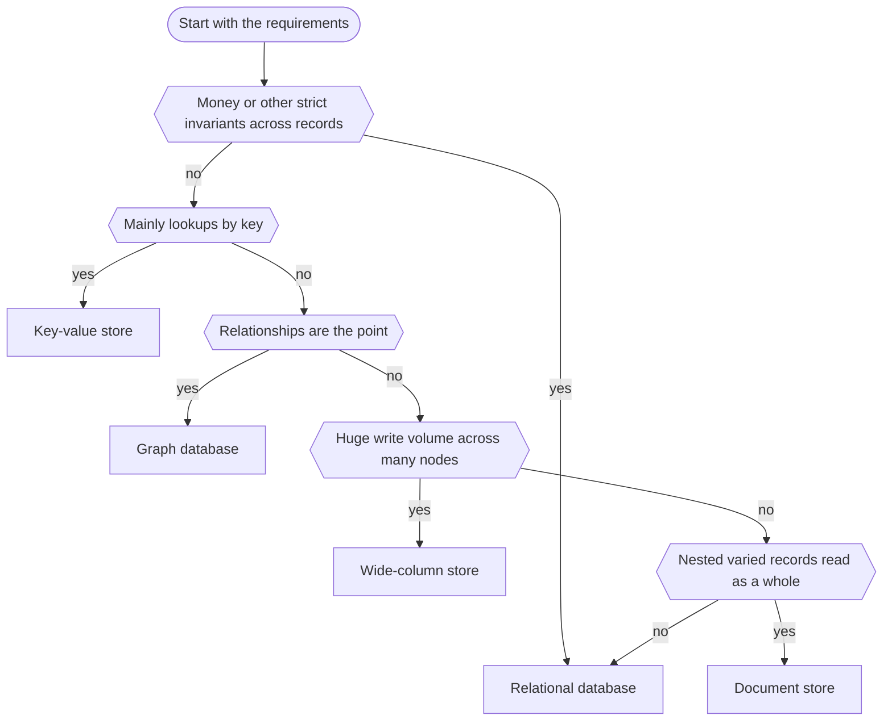

"SQL or NoSQL?" is a near-certain interview question, and the weak answer is "SQL is for structured data, NoSQL is for big data". The good answer names **access patterns, consistency needs, data shape and scale**, and admits that most systems start relational. It builds on [ACID and BASE](lesson:acid-base) (what transactions guarantee) and [distributed systems fundamentals](lesson:distributed-systems) (sharding, replication, CAP). Play the three scenes: data model, scaling, and choosing a store.

```demo
name: sqlnosql-walk
```

> **One sentence to remember:** *SQL databases model data by its relationships and let you ask any question later with strong guarantees; NoSQL databases model data by how you read it and trade some flexibility or consistency for scale, speed or a better fit.*

## Relational (SQL) databases {#sql}

### The relational model {#model}

Data lives in **tables** of rows and columns with a fixed **schema**. Rows are identified by a **primary key**, related through **foreign keys**, and queried with **SQL** (declarative: you say *what*, the optimizer picks *how*). Examples: PostgreSQL, MySQL, Oracle, SQL Server.

- **[Normalisation](lesson:normalization)** stores each fact once (customer, address and phone in separate tables), removing duplication and update anomalies; **joins** reassemble it at query time.
- **Constraints** (primary key, foreign key, unique, not null, check) let the database enforce integrity.
- **Indexes** (usually B-trees) make lookups and range scans fast at the cost of slower writes and more space.
- **ACID transactions** across many rows and tables ([ACID and BASE](lesson:acid-base#acid)).
- **Ad hoc queries:** any filter, join or aggregation works later without redesigning storage.

### Strengths and limits {#sql-trade}

| Strengths | Limits |
| --- | --- |
| strong consistency and multi-row transactions | schema changes (migrations) on huge tables need care |
| powerful queries: joins, aggregates, window functions | joins and cross-node transactions get expensive when sharded |
| mature tooling, standard language, huge talent pool | write scaling is hard beyond one primary |
| enforced integrity (foreign keys, constraints) | object-relational mismatch (ORM impedance) |
| flexible: new questions need no remodelling | rigid schema for highly varied or nested data |

Modern relational databases are not rigid: PostgreSQL has **JSONB** columns with indexes, full-text search and partitioning; MySQL has JSON types. A relational database with a JSON column covers many "flexible schema" needs.

## NoSQL databases {#nosql}

"NoSQL" ("not only SQL") is not one technology but several, grouped by data model. Common traits: flexible or no fixed schema, a model shaped for a particular access pattern, **horizontal scaling by design**, and often relaxed consistency or limited transactions and joins.

### The four main families {#families}

| Family | Model | Strong at | Examples | Watch out for |
| --- | --- | --- | --- | --- |
| **Key-value** | key to opaque value | very fast lookups, caching, sessions, counters, rate limits | Redis, DynamoDB, Memcached | only access by key, no rich queries |
| **Document** | key to JSON-like document, with indexes on fields | nested, varied records read as a whole: profiles, catalogs, content | MongoDB, Couchbase, Firestore | duplicated data, weak joins, keeping copies in sync |
| **Wide-column** | partition key plus sorted columns per row | huge write volume, time series, known query patterns | Cassandra, HBase, ScyllaDB | you must design the table per query; limited ad hoc queries |
| **Graph** | nodes and relationships | highly connected data: fraud rings, recommendations, social links | Neo4j, Amazon Neptune | poor fit for bulk analytics, harder to scale out |

Other specialised stores sit beside these: **search engines** (Elasticsearch, OpenSearch: inverted index, relevance), **time-series** databases (InfluxDB, TimescaleDB), **column stores / warehouses** (BigQuery, Redshift, ClickHouse: analytics over huge tables) and **vector databases**.

### Newer in-betweens {#newsql}

- **NewSQL / distributed SQL** (Google Spanner, CockroachDB, YugabyteDB, TiDB): SQL and ACID transactions with horizontal scaling, using consensus ([Raft](lesson:distributed-systems#raft)) between nodes, at the price of write latency.
- **NoSQL with transactions:** MongoDB multi-document transactions, DynamoDB transactions, Cassandra lightweight transactions. The line between camps keeps blurring.

## Comparison {#compare}

| | SQL (relational) | NoSQL |
| --- | --- | --- |
| Data model | tables, rows, relations | key-value, document, wide-column, graph |
| Schema | fixed, enforced (schema on write) | flexible, often enforced by the app (schema on read) |
| Modelling driver | the data and its relationships (normalise) | the queries (denormalise, embed) |
| Queries | rich, ad hoc, joins, aggregations | by key or index; limited joins and aggregations |
| Transactions | multi-row ACID, standard | often single-item; some support multi-item |
| Consistency | strong by default | often tunable or eventual ([BASE](lesson:acid-base#base)) |
| Scaling | scale up, read replicas, harder sharding | scale out by design (sharding, replication built in) |
| Integrity | foreign keys and constraints in the database | in the application |
| Best fit | money, orders, inventory, reporting, relationships | huge scale, flexible shapes, low latency, simple access patterns |

The comparison is a tendency, not a law: the label tells you the data model and usual trade-offs, but check the specific product and its configuration.

## Data modelling {#modelling}

### Normalise or embed {#embed}

**Relational: model the data, then query it.** Normalise to third normal form, add indexes for the queries you have, join as needed. New questions are cheap.

**NoSQL: model the queries, then store the data.** List the access patterns first ("get a customer with addresses", "latest 20 transactions of an account"), then shape the data so each is **one read** from **one partition**. That means **denormalising**: copying data to where it is read.

In a document database the central choice is **embed or reference**:

| Embed (nested in the document) | Reference (store an id, look up separately) |
| --- | --- |
| data read together, owned by the parent (addresses of a customer) | data shared across many documents or changed independently |
| one read, atomic update of one document | extra lookup or an application-side join |
| bounded size (documents have a size limit, 16 MB in MongoDB) | unbounded or fast-growing lists (all transactions of an account) |
| copies go stale if the source changes | single source of truth |

Wide-column and DynamoDB designs go further: pick the **partition key** (spreads load and groups rows read together) and **sort key** (orders rows within a partition) per query, and accept **one table per access pattern** with the same data stored several times. A bad partition key creates a **hot partition**.

### Schema flexibility is a trade, not a free gift {#schema}

"Schemaless" really means the schema lives in the **application**. Old and new document shapes coexist, so code must handle every version, and there is no database constraint stopping a bad value. Teams add schema validation (MongoDB JSON schema) or versioned documents. In SQL the same change is an explicit, reviewable migration.

## Scaling {#scaling}

1. **Scale up** (bigger machine): simplest, keeps joins and transactions; has a ceiling and is a single point of failure.
2. **Read replicas:** scale reads, give failover, introduce replication lag ([replication](lesson:distributed-systems#replication)).
3. **Partitioning on one node:** split a huge table by range or hash for manageability.
4. **Sharding:** split data across nodes by a **shard key** ([sharding](lesson:distributed-systems#sharding), [consistent hashing](lesson:distributed-systems#consistent-hashing)). Scales writes and size. Cross-shard joins and transactions become hard, rebalancing is work, and a poor key creates hot spots.

Relational databases *can* shard (Vitess for MySQL, Citus for PostgreSQL, application-level sharding) but it is added on; NoSQL stores shard natively because their model (access by key, no cross-item joins) makes it easy. This is the real scaling argument for NoSQL: not "SQL cannot scale" (Stack Overflow-sized workloads run on one primary) but "writes beyond one machine are cheaper when the model avoids joins and distributed transactions".

## Consistency and transactions {#consistency}

- **Relational:** single-node ACID, strong consistency; replicas are usually asynchronous so replica reads can be stale.
- **NoSQL** commonly gives **tunable consistency**: Cassandra and DynamoDB let each request choose how many replicas must respond (a [quorum](lesson:distributed-systems#quorums): R + W > N for strong reads) or accept eventual consistency for lower latency. This is the [CAP/PACELC](lesson:distributed-systems#pacelc) trade made per query.
- **Atomicity is often per item or per partition.** A single MongoDB document or DynamoDB item updates atomically; spanning several needs an explicit multi-document transaction (where supported), or you design so that one aggregate is one document, or you use a [saga](lesson:saga).
- **Integrity in the app:** with no foreign keys, orphan data and duplicates are prevented by application logic, idempotency and reconciliation.

## Indexing and storage engines {#indexes}

| | B-tree (PostgreSQL, MySQL InnoDB, Oracle) | LSM tree (Cassandra, RocksDB, HBase) |
| --- | --- | --- |
| Writes | update pages in place (random I/O, write-ahead log) | append to a memtable and sorted immutable files (sequential I/O), **compaction** merges later |
| Reads | fast point and range reads, one tree lookup | may check several files (helped by Bloom filters), usually slower reads |
| Strength | balanced, predictable read performance | very high write throughput |
| Cost | write amplification from page updates | read and space amplification, compaction work |

Indexes speed reads and slow writes in every database: add them for real query patterns, not for every column. In SQL, check the query plan (`EXPLAIN`); a composite index helps only when its column order matches the query; a function on an indexed column (`WHERE lower(name) = ...`) can stop the index being used.

## Choosing {#choosing}



A practical way to decide:

1. **Access patterns:** how is data read and written? Ad hoc and relational (SQL), by key (key-value), whole nested aggregates (document), huge append volume (wide-column), traversals (graph).
2. **Consistency needs:** hard invariants and transactions across records point to SQL; tolerating staleness opens up the rest.
3. **Scale and distribution:** one primary with replicas is enough far more often than expected; multi-region writes or huge volume push toward sharded or distributed stores.
4. **Data shape:** fixed and related versus varied and nested.
5. **Team and operations:** skills, tooling, managed offering, and the cost of running several stores.

**Default to a relational database** and add something else for a demonstrated need. For a bank, the ledger and accounts stay relational (or distributed SQL); caches, sessions, search and analytics use specialised stores fed from it.

### Polyglot persistence {#polyglot}

Different services or needs use different stores: relational for payments, Redis for sessions and caching, a document store for profiles, Elasticsearch for search, a warehouse for analytics. It matches each need but raises operational cost, and keeping the copies consistent becomes your design problem: events, the [outbox](lesson:microservice-patterns#outbox), [CQRS](lesson:microservice-patterns#cqrs) read models and reconciliation. It fits naturally with [database per service](lesson:microservice-patterns#db-per-service).

## In Java and Spring {#spring}

```java
// relational: JPA entity with a relationship, joined or lazily loaded
@Entity
class Customer {
    @Id @GeneratedValue Long id;
    String name;

    @OneToMany(mappedBy = "customer", cascade = CascadeType.ALL, orphanRemoval = true)
    List<Address> addresses = new ArrayList<>();
}

interface CustomerRepository extends JpaRepository<Customer, Long> {
    @Query("select c from Customer c join fetch c.addresses where c.id = :id")   // one query, avoids N+1
    Optional<Customer> findWithAddresses(@Param("id") Long id);
}
```

```java
// document: the aggregate is one document, addresses embedded
@Document("customers")
record CustomerDoc(@Id String id, String name, List<AddressDoc> addresses) {}

interface CustomerDocRepository extends MongoRepository<CustomerDoc, String> {
    List<CustomerDoc> findByAddressesCity(String city);     // needs an index on addresses.city
}
```

```java
// key-value cache in front of the database (Spring cache abstraction with Redis)
@Cacheable(cacheNames = "customer", key = "#id")
public CustomerView find(long id) { return mapper.toView(repository.findById(id).orElseThrow()); }

@CacheEvict(cacheNames = "customer", key = "#id")
public void update(long id, UpdateCustomer cmd) { ... }
```

Spring Data gives one repository style across stores (`JpaRepository`, `MongoRepository`, `CassandraRepository`, `RedisTemplate`) but the models differ, so the abstraction does not make them interchangeable. Beware ORM traps in the relational case: **N+1 queries** (use `join fetch` or entity graphs), eager loading, and large transactions.

## Cheat sheet {#cheatsheet}

| Topic | Key point |
| --- | --- |
| SQL | tables, joins, constraints, ACID, ad hoc queries, strong consistency |
| NoSQL | key-value, document, wide-column, graph; query-shaped, scale-out, often tunable consistency |
| Modelling | SQL: model data then query. NoSQL: model queries then data (denormalise, embed) |
| Embed vs reference | embed what is read together and bounded; reference shared or growing data |
| Scaling | up, replicas, shard; NoSQL shards natively, SQL needs added tooling |
| Transactions | SQL multi-row ACID; NoSQL often per item, some multi-item |
| Indexes | B-tree balanced reads; LSM fast writes with compaction |
| NewSQL | SQL plus horizontal scale via consensus (Spanner, CockroachDB) |
| Choosing | access patterns, consistency, scale, data shape, team; default relational |
| Polyglot | store per need; you own cross-store consistency |

## Interview questions {#questions}

### [basic] What is the difference between SQL and NoSQL databases? {#difference-q}

SQL databases are relational: fixed schema, tables linked by keys, joins, SQL queries and ACID transactions with strong consistency. NoSQL covers several non-relational models (key-value, document, wide-column, graph) with flexible schemas, models shaped around access patterns, built-in horizontal scaling and often relaxed consistency or limited joins and transactions. The right choice depends on access patterns, consistency needs, data shape and scale.

### [basic] What are the types of NoSQL databases? {#types-q}

Key-value (Redis, DynamoDB): lookups by key, caching, sessions. Document (MongoDB): JSON-like documents for nested varied records. Wide-column (Cassandra, HBase): partitioned rows with sorted columns for huge write volumes and known queries. Graph (Neo4j): nodes and relationships for connected data. Search, time-series and column-store analytics databases are related specialised stores.

### [basic] When would you choose SQL? {#choose-sql-q}

When data is relational and structured, you need multi-row transactions and strong consistency (payments, accounts, orders, inventory), want ad hoc queries, joins and reporting, or integrity enforced by constraints. And as the default when requirements are unclear, because a single relational database with replicas handles most workloads.

### [basic] When would you choose NoSQL? {#choose-nosql-q}

When the access pattern is simple and known (by key or partition), the data is varied or nested and read as a whole, write volume or data size exceeds one machine, latency must be very low (cache, sessions), or the data is naturally a graph, time series or search index. Accept the costs: weaker joins, denormalisation, and integrity and consistency handled in the application.

### [basic] What is normalisation and why do NoSQL stores often denormalise? {#normalise-q}

Normalisation stores each fact once across related tables, avoiding duplication and update anomalies, with joins to reassemble data. NoSQL stores often have no joins or make them costly across partitions, so they denormalise: copy or embed data so a query is a single read from one partition. The trade is faster reads and simpler scaling against duplicated data to keep in sync.

### [basic] Does NoSQL mean no schema? {#schema-q}

Not really: the schema moves from the database into the application ("schema on read"). Documents can have different shapes, so code must handle every version and nothing stops invalid values unless you add validation. SQL enforces the schema on write and changes it through explicit migrations.

### [intermediate] How do SQL and NoSQL databases scale differently? {#scale-q}

Relational databases scale up first and add read replicas; write scaling beyond one primary needs sharding, which is possible (Vitess, Citus) but makes joins and transactions across shards hard. NoSQL stores are built to shard and replicate across nodes, which works because the model avoids joins and cross-item transactions. NewSQL databases (Spanner, CockroachDB) offer SQL with horizontal scale using consensus, at higher write latency.

### [intermediate] Is it true that SQL cannot scale? {#myth-q}

No. A well-tuned relational database on good hardware with indexes, caching and read replicas handles very large workloads, and sharded relational deployments exist at enormous scale. The accurate statement is that scaling **writes and data volume beyond a single machine** is simpler when the data model avoids joins and distributed transactions, which is what NoSQL designs enforce.

### [intermediate] Embed or reference in a document database? {#embed-q}

Embed data that is read together with its parent, owned by it and bounded in size: one read, atomic update. Reference data that is shared by many documents, changes independently or can grow without bound (all transactions of an account): single source of truth, at the cost of an extra lookup. Watch document size limits and stale copies of embedded data.

### [intermediate] How does consistency differ between SQL and NoSQL? {#consistency-q}

Relational databases give strong consistency and multi-row ACID on the primary; replicas can lag. Many NoSQL stores replicate across nodes and offer tunable consistency: a request chooses how many replicas must respond, trading latency and availability against freshness (quorum reads and writes with R + W > N). Atomicity is often per item or partition; multi-item transactions exist in some (MongoDB, DynamoDB) with limits.

### [intermediate] Compare B-tree and LSM-tree storage engines. {#lsm-q}

B-trees (PostgreSQL, InnoDB) update pages in place: predictable read performance, with write amplification and random I/O. LSM trees (Cassandra, RocksDB) buffer writes in memory and flush sorted immutable files sequentially, merging them in the background (compaction): very high write throughput, but reads may touch several files (mitigated by Bloom filters) and compaction costs I/O and space.

### [intermediate] What is polyglot persistence and what does it cost? {#polyglot-q}

Using a different database for each need: relational for transactions, key-value for sessions and cache, document for flexible profiles, a search engine, a warehouse. It matches storage to workload, but adds operational burden, more skills, and the problem of keeping the stores consistent (events, outbox, CQRS projections, reconciliation). Add a store only for a proven need.

### [intermediate] How do you choose a shard or partition key? {#shard-key-q}

Pick a key with high cardinality that spreads load evenly and keeps data accessed together in one partition, so the common queries hit a single shard. Avoid keys that are monotonic (all new writes go to the last shard) or skewed (a celebrity account is a hot partition). Consider the access patterns first, since changing the key later means resharding.

### [intermediate] What is the N+1 problem and how do you avoid it in JPA? {#n-plus-one-q}

Loading N parent entities and then lazily loading each one's association triggers 1 + N queries. Avoid it with `join fetch` in the query, an entity graph, batch fetching (`@BatchSize`) or a projection that selects exactly what is needed. It is the common performance trap of ORMs over relational data.

### [deep] Can a NoSQL database be ACID and a SQL one be eventually consistent? {#blur-q}

Yes. MongoDB, DynamoDB and FoundationDB support multi-item ACID transactions, and distributed SQL databases provide strong consistency across nodes. A relational database with asynchronous replicas and caches serves stale reads. The label describes the data model and defaults, not a fixed guarantee, so check the product's documentation.

### [deep] Design the data model for an account and its transactions in SQL and in a document or wide-column store. {#design-q}

SQL: `account(id, ...)` and `ledger_entry(id, account_id, amount, created_at)` with a foreign key and an index on `(account_id, created_at)`; balance updates and entry inserts in one ACID transaction. Document: keep the account in one document but store transactions in a separate collection keyed by account id (they are unbounded), not embedded. Wide-column: partition key `account_id`, clustering (sort) key `created_at` descending, so the latest entries of an account are one contiguous read, and cap partition size by bucketing by month. In all of them, money movement needs atomic, idempotent updates.

### [deep] How would you migrate a large relational table to a different store without downtime? {#migration-q}

Run both side by side: backfill the new store from a snapshot, capture ongoing changes (change data capture or dual writes via the outbox), verify by comparing, shift reads gradually (shadow reads, then a percentage), switch writes, and keep the old store until confident to roll back. Keep the migration idempotent and make consumers tolerate duplicates.

### [coding] Write SQL to list each customer's total of transfers above 1000 in the last 30 days (customers with at least three), highest first. {#coding-sql}

```sql
SELECT c.id, c.name, SUM(t.amount) AS total
FROM customer c
JOIN account a  ON a.customer_id = c.id
JOIN transfer t ON t.from_account_id = a.id
WHERE t.created_at >= now() - interval '30 days'
  AND t.amount > 1000
GROUP BY c.id, c.name
HAVING COUNT(*) >= 3
ORDER BY total DESC
LIMIT 20;
```

Explain the joins, filter before grouping with `WHERE`, group filter with `HAVING` (here: at least three large transfers), and the supporting index on `transfer(from_account_id, created_at)`. In a key-value or document store this ad hoc aggregation would need precomputed totals or an analytics store.

### [coding] Model a customer with addresses as a MongoDB document in Spring Data and query by city. {#coding-mongo}

```java
@Document("customers")
@CompoundIndex(def = "{'addresses.city': 1}")     // otherwise the city query scans the whole collection
class Customer {
    @Id String id;
    String name;
    List<Address> addresses = new ArrayList<>();
    record Address(String type, String city, String postalCode) {}
}

interface CustomerRepository extends MongoRepository<Customer, String> {
    List<Customer> findByAddressesCity(String city);
}
```

Explain that addresses are embedded because they are read with the customer and bounded, that the nested field needs an index for the query, and that the same data in SQL would be two tables joined by `customer_id`.

### [coding] Fix the N+1 problem in this code. {#coding-n-plus-one}

```java
List<Customer> customers = customerRepository.findAll();
for (Customer c : customers) {
    System.out.println(c.getName() + " " + c.getAddresses().size());   // lazy load: one query per customer
}
```

```java
@Query("select distinct c from Customer c left join fetch c.addresses")
List<Customer> findAllWithAddresses();                                   // one query with a join

// or load in batches: @BatchSize(size = 50) on the collection, or select only what you need with a DTO projection
```

Explain that the loop causes 1 + N queries, that `join fetch` loads the association in one query, and the trade-offs (a join duplicates parent rows, paging with fetch joins on collections is problematic, so prefer batch fetching or a projection for large pages).
